# A Survey of Imitation Learning: Algorithms, Recent Developments, and Challenges

Maryam Zare , Parham M. Kebria , Member, IEEE, Abbas Khosravi , Senior Member, IEEE, and Saeid Nahavandi , Fellow, IEEE

Abstract—In recent years, the development of robotics and artificial intelligence (AI) systems has been nothing short of remarkable. As these systems continue to evolve, they are being utilized in increasingly complex and unstructured environments, such as autonomous driving, aerial robotics, and natural language processing. As a consequence, programming their behaviors manually or defining their behavior through the reward functions [as done in reinforcement learning (RL)] has become exceedingly difficult. This is because such environments require a high degree of flexibility and adaptability, making it challenging to specify an optimal set of rules or reward signals that can account for all the possible situations. In such environments, learning from an expert’s behavior through imitation is often more appealing. This is where imitation learning (IL) comes into play - a process where desired behavior is learned by imitating an expert’s behavior, which is provided through demonstrations.This article aims to provide an introduction to IL and an overview of its underlying assumptions and approaches. It also offers a detailed description of recent advances and emerging areas of research in the field. Additionally, this article discusses how researchers have addressed common challenges associated with IL and provides potential directions for future research. Overall, the goal of this article is to provide a comprehensive guide to the growing field of IL in robotics and AI.

Index Terms—Imitation learning (IL), learning from demonstrations, reinforcement learning (RL), robotics, survey.

## I. INTRODUCTION

N THE realm of machine learning, the traditional I approaches relied heavily on manual programming to give machines and robots autonomous capabilities [1]. These methods demanded intricate, handcrafted rules dictating the actions of machines, and the dynamics of their operating environments, requiring significant time and coding expertise [2]. However, the laborious task of manual coding can be avoided through the adoption of learning paradigms, with imitation learning (IL) emerging as a promising avenue [3].

IL offers a compelling solution by allowing machines to learn desired behaviors through demonstrations, thereby eliminating the need for explicit programming or task-specific reward functions [3].

The fundamental premise of IL hinges upon the notion that the human experts can effectively demonstrate desired behaviors, even if they cannot directly program them into machines or robots [1]. As such, IL holds potential across a spectrum of applications necessitating autonomous behavior akin to human expertise, ranging from manufacturing and healthcare to autonomous vehicles and gaming [4], [5], [6], [7]. By enabling subject-matter experts to efficiently program autonomous behavior without requiring coding skills or indepth system knowledge, IL stands poised to revolutionize diverse industries.

Despite the longstanding presence of IL in the realm of artificial intelligence (AI), recent advancements in computing and sensing technologies coupled with escalating demands for AI applications have propelled IL to the forefront of research [8], [9]. Consequently, there has been a surge in publications in the field, reflecting its growing significance.

IL has evolved significantly over the years (Fig. 1). While numerous surveys have been conducted on the IL over the years, there remains a need for a comprehensive overview that captures the latest developments in this rapidly evolving domain [1], [3], [6], [10]. Such a survey would serve as a vital resource for both the newcomers and seasoned researchers, offering insights into various applications and identifying emerging trends and challenges. Our survey aims to fulfill this need by consolidating existing research, elucidating key concepts, and paving the way for future investigations.

Our survey paper seeks to provide a thorough examination of IL, organized chronologically and logically for clarity and coherence. We begin by delineating two principal categories of IL approaches: 1) behavioral cloning (BC) and 2) inverse reinforcement learning (IRL) [1]. Subsequently, we delve into the formulations, advancements, strengths, and limitations of each method, offering a nuanced understanding of their respective merits. Furthermore, we explore the realm of adversarial imitation learning (AIL), which extends IRL by introducing an adversarial element to the learning process, and discuss its integration into the IL frameworks [1]. Additionally, we introduce imitation from observation (IfO) as a novel subset of the IL algorithms tailored to learning from state-only demonstrations, elucidating its significance and applications.

Finally, we outline the practical challenges encountered by the IL techniques in real-world scenarios, such as suboptimal demonstrations and domain disparities between the expert and the learner. In conclusion, we summarize the challenges faced by various IL approaches and highlight potential research directions aimed at addressing these challenges and fostering advancements in the field. Through our survey, we aim to contribute to the evolution of IL and foster interdisciplinary collaboration and understanding in this dynamic domain.

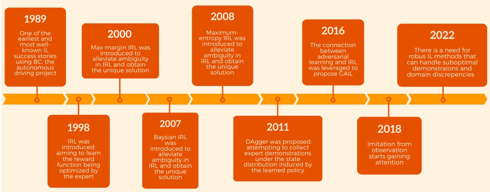  
Fig. 1. Historical timeline of IL research, showcasing significant advancements and breakthroughs in the field’s evolution.

## II. BEHAVIORAL CLONING

BC is an IL technique that treats the problem of learning a behavior as a supervised learning task [11], [12]. BC involves training a model to replicate an expert’s behavior by establishing a mapping between the environment’s state and the corresponding expert action. The expert’s behavior is recorded as a set of state-action pairs, also known as demonstrations. During training, the model learns a function that translates the current state into the corresponding expert action, utilizing these demonstrations as inputs. Once trained, the model can employ this learned function to generate actions for encountering new states.

One advantage of BC is that it requires no knowledge of the underlying dynamics of the environment [11]. Instead, it relies solely on the provided demonstrations to learn the behavior. Additionally, BC is computationally efficient since it involves training a supervised learning model, which is a well-studied problem in machine learning.

Despite its simplicity, the BC approach has a significant drawback - the covariate shift problem [13], [14]. This issue arises because the learner, during training, operates on the states generated by the expert policy, yet during testing, it deals with states induced by its actions [15]. This means that the state distribution observed during testing may diverge from that observed during training, making the agent prone to mistakes as it encounters unseen states for which it lacks clear guidance on how to proceed [16]. The problem with BC supervised approach is that the agent does not know how to return to the demonstrated states when it drifts and encounters out-of-distribution states [17]. This makes covariate shift particularly hazardous in safety-critical scenarios, such as autonomous driving [18], where encountering novel circumstances not encountered during training poses significant risks.

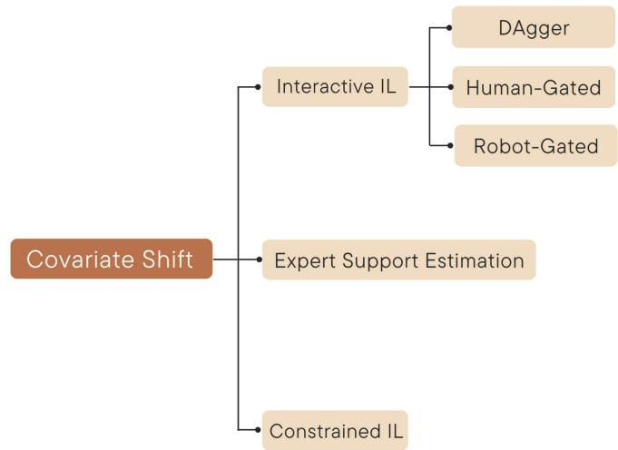  
Fig. 2. Classification of methods addressing the covariate shift problem in IL. Interactive IL relies on access to an online expert. While DAgger-like algorithms mandate corrective labels from the expert for each action. Humangated and robot-gated methods request corrective labels only when prompted by the expert or agent, respectively. Expert support estimation methods do not necessitate online expert access; instead, they optimize a reward function using an underlying RL algorithm. Finally, constrained IL restricts the agent to known demonstration regions, tackling covariate shift issues beyond the scope of the other categories.

This underscores the critical importance of the agent’s ability to recover from the errors promptly to prevent accidents. To address the covariate shift problem and improve the robustness of the BC approach, three broad research areas have been identified (Fig. 2).

The first and most prevalent area is interactive IL. These algorithms operate under the assumption that the agent can consult an online expert during training. One of the earliest methods in this category is dataset aggregation (DAgger) [12], which aims to resolve the mismatch problem between training and testing by training the agent on its own state distribution. DAgger achieves this by querying the expert to relabel the data collected by the agent with the appropriate actions that should have been taken. However, frequent queries place a significant burden on the human expert, resulting in inaccurate or delayed feedback that can adversely affect the training process [19]. Consequently, determining when and how to engage human subjects remains one of the key challenges of the interactive IL algorithms [20].

Instead of providing continuous feedback, “human-gated” interactive IL algorithms [21], [22] extend DAgger to allow the expert to decide when to provide corrective interventions. For instance, the human-gated DAgger (HG-DAgger) [21] allows the expert to intervene when the agent reaches an unsafe region of the state space, guiding it back to a safe state. Li et al. [19] proposed a method that learns to minimize human intervention and adaptively maximize automation during training. In this approach, when the human expert intervenes, it incurs a cost to the agent, which the agent learns to minimize during its training process.

However, the effectiveness of these algorithms relies on the human experts constantly monitoring the agent to decide when to intervene, placing a significant burden on them. To address this challenge, there is growing interest in “robotgated” algorithms [20], [23], [24], [25] that enable robots to actively request human assistance when needed. For example, SafeDAgger [23] uses an auxiliary safety policy to signal the agent to transfer the control to the expert when there is a likelihood of deviation from the expert’s trajectory. LazyDAgger [24] reduces the number of context switches between the expert and autonomous control, while ThriftyDAgger [20] intervenes only when states are sufficiently novel or risky, thus reducing the intervention burden by limiting the total number of interventions to an user-specified budget.

The second realm of research aimed at mitigating the covariate shift problem delves into algorithms that estimate the support of the expert occupancy measure. The support defines the space of states where the expert’s behavior is observed or demonstrated, encompassing those states where the expert’s actions are deemed reliable or desirable. The fundamental idea is to incentivize the agent to consistently remain within the support of the expert policy over time, prompting it to return to the demonstrated states when encountering new states outside the expert’s support [17], [26], [27]. This incentivization is done through a reward signal, which is then used to train an reinforcement learning (RL) agent. Unlike interactive IL, these algorithms operate without direct access to an online expert. They rely solely on the demonstrations and interactions within the environment.

Wang et al. [26] employ a kernelized version of principal component analysis to estimate the support of the expert policy. This process generates a score that increases as a stateaction pair moves closer to the support of the expert policy, which is then utilized to construct an intrinsic reward function.

In a different approach, Reddy et al. [17] introduced soft Q IL (SQIL), aiming to guide the agent to mimic the expert in demonstrated states. SQIL achieves this by employing an extremely sparse reward function, assigning a constant reward of 1 to transitions inside expert demonstrations and 0 to all the other transitions. By encouraging the agent to return to demonstrated states after encountering out-of-distribution states, this model surpasses simple BC and maintains strong performance even with a limited number of demonstrations.

Similarly, Brantley et al. [27] utilized expert demonstrations to train an ensemble of policies, where the variance of their predictions serves as the cost. The variance outside of expert support is inherently higher as ensemble policies are more likely to disagree on the states not included in the demonstrations. An RL algorithm is then employed to minimize this cost combined with a supervised BC cost. Consequently, the RL cost aids the agent in returning to the expert distribution, while the supervised cost ensures that the agent mimics the expert within the expert’s distribution.

Finally, the third area of algorithms aims to constrain the agent to known regions of the space covered by the demonstrator without relying on an interactive expert or leveraging RL. These methods are particularly beneficial and practical for real-world applications where safety constraints must be met, such as in healthcare, autonomous driving, and industrial processes [28], [29].

Bansal et al. [30] tackled the covariate shift problem in autonomous driving by augmenting the imitation loss with additional penalties to discourage undesirable driving behavior. Additionally, they introduce additional data in the form of synthetic perturbations to the expert’s trajectory. These perturbations expose the model to nonexpert behavior, such as collisions, and provide crucial signals for the added penalties to steer clear of such behaviors.

Wong et al. [31] proposed a learned error detection system to identify when an agent is in a potentially failing state. This error detector constrains the policy to execute only on the states seen previously in the demonstrations, preventing potentially unstable behavior by reverting the agent to a wellknown configuration or halting the execution.

The automatic waypoint extraction (AWE) algorithm [32] provides a solution to the covariate shift problem by introducing waypoints. These waypoints serve as a means to break down demonstrations into subsets of states capable of reconstructing trajectories, effectively shortening the decisionmaking process. This reduction in horizon helps alleviate errors that tend to accumulate over time. AWE accomplishes this by decomposing demonstrations into minimal sets of waypoints, ensuring that the linear interpolation between them approximates trajectories within predefined error margins. Importantly, AWE seamlessly integrates with any BC algorithm, enhancing its adaptability and utility in addressing covariate shift challenges.

Navigating the realm of IL, particularly through BC, presents its own set of unique hurdles. The crux of the issue lies in BC’s reliance on supervised learning, which, while effective in many scenarios, falls short when attempting to discern the intricate nuances of expert behavior. This limitation is encapsulated in the concept of “causal misidentification,” where the model struggles to distinguish between the true causes of expert actions and other less relevant factors. In simpler terms, BC often mistakes correlation for causation, leading to suboptimal performance and limited generalization capabilities [33].

This challenge is further compounded by the covariate shift inherent in IL settings [33]. Unlike in traditional supervised learning tasks where training and testing data come from the same distribution, IL must deal with the dynamic nature of real-world environments. As a result, BC may struggle to adapt when faced with scenarios that deviate from its training data, leading to performance degradation and potential failure in critical tasks.

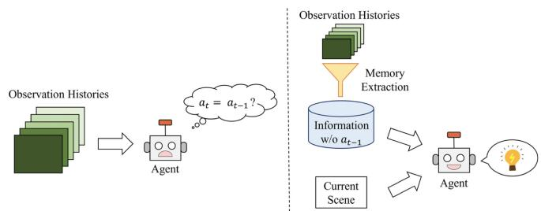  
Fig. 3. Left: BC might learn a shortcut from prior observations that outputs the previous action as the current action. Right: a copycat-free memory extraction module. The shortcut is no longer available using historical information [35].

To address these issues, researchers have delved into various avenues of exploration. One approach involves leveraging causal inference techniques to untangle the Web of relationships between the expert actions and environmental cues [33]. By incorporating causal reasoning into the learning process, models can better understand the underlying mechanisms driving expert behavior, leading to more robust and reliable performance in diverse scenarios.

Additionally, efforts have been made to develop novel algorithms [34], [35] capable of identifying and mitigating the effects of nuisance correlates – extraneous variables that may obscure the learning process. By filtering out irrelevant information and focusing solely on the factors directly influencing expert actions, these algorithms aim to improve the efficiency and effectiveness of BC in real-world applications. One such challenge is the “copycat problem” [34] where agents mimic expert actions without truly understanding the underlying reasons behind them. The copycat problem often arises when expert actions show a high level of correlation over time, causing the agents to simply mimic the previous actions without understanding the context. This behavior can lead to less-than-optimal decision making and hinder the agent’s ability to adapt to new situations. To address this, an approach is proposed by [35], which focuses on learning a feature representation that disregards information about the previous actions while retaining key insights for predicting future actions (3).

Another challenge with the traditional BC models is their difficulty in effectively managing discontinuities in behavior. These discontinuities refer to abrupt changes or shifts in actions that occur in response to varying environmental conditions or task requirements. Explicit neural networks, commonly used in BC, often struggle to represent these discontinuities due to the limitations of continuous activation functions [36]. This limitation poses a significant obstacle to the model’s capacity to make decisive behavior switches.

In contrast, implicit models excel at representing sharp discontinuities despite relying on the continuous layers in the network. An example of this approach, demonstrated in recent research [37], reframes BC as an energy-based modeling problem [38]. By training a neural network to input both the observations and actions and produce low scores for expert actions and high scores for nonexpert actions, this implicit BC model offers a promising solution. Trained policies then select actions with the lowest score for a given observation, leading to improved decision making.

Despite its increased computational demands during both training and inference compared to the explicit BC models, this method often outperforms the traditional baselines in various robotic manipulation tasks, whether in real-world scenarios or simulation environments.

## III. INVERSE REINFORCEMENT LEARNING

In addition to BC, another pivotal approach to IL is IRL [39]. IRL involves an apprentice agent tasked with inferring the reward function underlying observed demonstrations, which are assumed to originate from an expert acting optimally [40]. This inferred reward function is then used to train a policy for the learning agent through RL [41].

Contrary to the relatively static nature of BC agents, RL agents engage in a dynamic learning process by continuously interacting with their environment. They actively observe the consequences of their actions, adjusting their behavior over time to maximize long-term cumulative rewards [42], [43]. This iterative learning process involves utilizing reinforcement signals to discern the extended consequences of each action, enabling the agent to adapt and learn from mistakes [27]. Unlike BC, IRL demonstrates robustness in handling covariate shift, making it less sensitive to changes in the distribution of training and testing data [12]. This adaptability arises from the agent’s capacity to explore the environment, learn from experience and make informed decisions based on the acquired knowledge. This distinction underscores the dynamic and adaptive nature of IRL, offering a significant advantage in scenarios where the learning environment may change or exhibit variations over time.

IRL finds broad applications across diverse domains, including robotics manipulation, autonomous navigation, game playing, and natural language processing [44], [45], [46]. However, formulating an efficient IRL algorithm tailored for learning from demonstrations poses a formidable challenge, primarily due to the two significant factors.

First, IRL can be computationally expensive and resourceintensive, as the agent must interact repeatedly with its environment to accurately estimate the reward function [19], [47], [48]. Additionally, this process can be inherently unsafe, especially in high-risk applications, such as autonomous driving or aircraft control [49]. New methods are being developed to tackle these challenges and explore alternative avenues for obtaining the rewards [50], [51]. The optimal transport reward labeling (OTR) algorithm [51] stands out as a promising solution. OTR computes Wasserstein distances between the expert demonstrations and unlabeled trajectories, thereby generating a reward signal. This novel approach to annotating datasets leverages optimal transport to align trajectories with expert demonstrations, resulting in a similarity measure that serves as a reward.

Furthermore, a typical IRL approach follows an iterative process involving alternating between the reward estimation and policy training, leading to poor sample efficiency [45], [46], [52]. Consequently, significant research efforts have been directed at addressing these issues to enhance the sample efficiency of the IRL algorithms while maintaining the safety and accuracy of the learned policy. Some approaches include methods that leverage human guidance to reduce the number of interactions required to accurately estimate the reward function [53].

The second major challenge of IRL stems from the inherent ambiguity in the relationship between the policy and the reward function. Specifically, a policy can be optimal with respect to an infinite number of the reward functions [54], [55]. To tackle this challenge, researchers have proposed various methods to introduce additional structure into the reward function. Roughly, there are three categories of the IRL methods aimed at addressing this ambiguity [56].

The first category, known as maximum-margin methods, tackles the ambiguity problem by aiming to derive a reward function that explains the optimal policy more comprehensively than any other policy by a certain margin. This essentially means finding a solution that maximizes a specified margin, ensuring that the derived reward function captures the essence of the expert’s behavior. Ng and Russell [54] pioneering work illustrates this concept by estimating the reward function that makes the given policy optimal using a linear program while maximizing a margin. Similarly, maximum margin planning (MMP) [57] seeks to establish a weighted linear mapping of features to the rewards, aligning the estimated policy closely with the demonstrated behaviors. Subsequent advancements by Bagnell et al. [58] and Ratliff et al. [59] further extend these methodologies to nonlinear hypothesis spaces, employing various functional gradient techniques for enhanced performance.

The advent of feature-based reward functions has opened new avenues for optimizing margins through feature expectations. With feature-based rewards, the reward function is crafted based on the anticipated values of specific features observed within the environment. Pioneering this domain, Abbeel and Ng [44] introduced two pivotal methods, maxmargin and projection designed to amplify the margin of feature expectation loss without relying on the access to the expert’s policy. Despite their innovative contributions, these methods often limit the agent’s performance to that of the expert. To surmount this challenge, Syed and Schapire [60] proposed a game-theoretic framework, strategically utilizing adversarial interactions to train policies that surpass the expert performance.

The second category of IRL algorithms focuses on addressing the ambiguity inherent in inferring reward functions by employing the principle of maximum entropy. This category aims to maximize policy entropy, allowing for the accommodation of variations in expert behavior and the inherent uncertainties of real-world environments. At the forefront of this endeavor is MaxEntIRL, a pioneering work by Ziebart et al. [46]. By considering the distribution of potential trajectories, MaxEntIRL showcased promising capabilities in handling expert suboptimality and stochasticity, thus laying the groundwork for subsequent advancements in the field.

Expanding upon the foundational concepts of MaxEntIRL, further research endeavors sought to extend its applicability to continuous state-action spaces. Notable contributions include the works of Aghasadeghi and Bretl [61] and Kalakrishnan et al. [62], who introduced path integral methods to enhance the scalability and versatility of MaxEntIRL. These approaches enable the effective handling of complex, highdimensional environments, facilitating the seamless integration of the IRL techniques into a wide range of real-world applications.

In the progression of the IRL methodologies, a notable development arose with the introduction of maximum entropy deep IRL by Wulfmeier et al. [63]. This approach represents a paradigm shift by leveraging neural networks to model nonlinear reward functions. By harnessing the power of deep learning architectures, maximum entropy deep IRL transcends the limitations of manually crafted features, enabling the automatic extraction of relevant features directly from the raw sensory data. By incorporating convolutional layers, this method provides agents with improved flexibility and adaptability, enabling them to navigate complex environments more efficiently and effectively.

Further augmenting the capabilities of IRL, Finn et al. [64] introduced guided cost learning (GCL), a method designed to optimize the nonlinear reward functions within the inner loop of policy optimization. This approach transforms the traditional IRL paradigm by directly leveraging the raw state of the system to construct the reward functions, thus eliminating the need for extensive feature engineering. By seamlessly integrating reward function estimation into the policy optimization process, GCL enhances sampling efficiency and scalability, paving the way for the effective deployment of the IRL techniques in complex control tasks and real-world scenarios.

Bayesian IRL (BIRL) constitutes the third category within the IRL methodologies, distinguished by its probabilistic approach. In BIRL, the fundamental principles of the Bayesian probability guide the inference of reward functions from expert demonstrations. This methodology comprises three key elements: 1) the prior; 2) likelihood; and 3) posterior. BIRL aims to determine the posterior distribution over potential reward functions based on the observed expert behavior. The prior distribution encapsulates initial beliefs about the agent’s motives before any behavior is observed, while the likelihood models the probability of observing specific actions given a reward function.

One of the pioneering BIRL techniques, BIRL, introduced by Ramachandran and Amir [65] employed a Boltzmann distribution to model the likelihood, providing a flexible framework for capturing expert behavior. Various distributions, such as the Beta distribution can serve as priors over reward functions, tailored to the problem’s characteristics.

However, computing the posterior in the continuous space of reward functions poses a computational challenge. Innovative techniques like Markov chain Monte Carlo (MCMC) have been employed to derive sample-based estimates of the posterior mean [65]. Despite progress, the classical BIRL algorithms face scalability issues in complex high-dimensional environments.

To address the scalability challenges of the classical BIRL algorithms, an innovative approach was proposed by Brown et al. [66]. This method diverges from the traditional strategies by generating samples from the posterior distribution without directly solving the Markov decision processes (MDPs). Instead, it introduces an alternative likelihood formulation that harnesses preference labels over demonstrations (Fig. 4). This novel technique enhances scalability and efficiency, particularly in intricate high-dimensional environments.

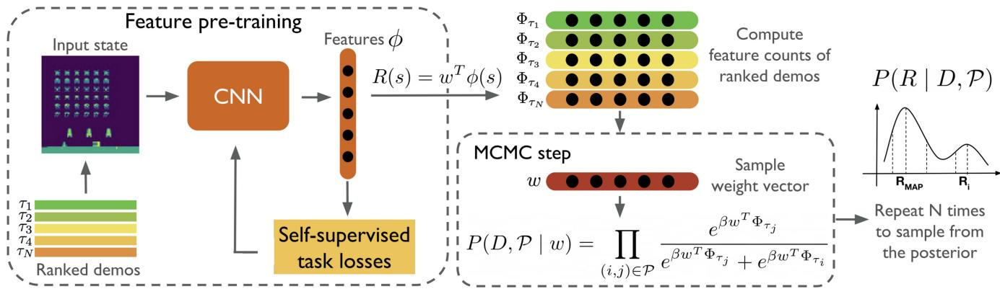  
Fig. 4. Low-dimensional state feature embedding is pretrained using ranked demonstrations [66]. A linear combination of learned features is used to derive the reward function. A pairwise ranking likelihood is used by MCMC proposal evaluations to estimate the likelihood of preferences over demonstrations given a proposal (w). Utilizing the precomputed embeddings of the ranked demonstrations makes MCMC sampling highly efficient, there is no need for data collection during inference or an MDP solver.

Another approach to tackle the scalability issue is approximate variational reward IL (AVRIL) [67]. AVRIL offers the simultaneous learning of imitating policies and approximate posterior distributions over rewards in offline settings. Unlike conventional methods, AVRIL leverages variational inference for precise estimation of the posterior distribution, thus amplifying scalability and efficiency in high-dimensional environments.

As we delve into the diverse landscape of the IRL methodologies, it is crucial to recognize the underlying assumptions that many current approaches rely on. Many existing IRL algorithms operate under the assumption that both the transition model, and occasionally, the expert’s policy are known [46], [54], [57], [68]. However, in practical scenarios, agents often confront the challenge of estimating these components from the sampled data, inevitably introducing inaccuracies in the inferred reward function [69], [70]. In response to this challenge, active exploration for IRL (AceIRL) [69] emerges as a notable alternative, emphasizing the development of effective exploration strategies. Its objective is to navigate both the environment dynamics and the expert policy in a manner that optimally facilitates any IRL algorithm in deducing the reward function. By drawing insights from the past observations, AceIRL constructs confidence intervals that encapsulate feasible reward functions and formulates exploration policies prioritizing informative regions within the environment. This approach endeavors to heighten the efficiency and precision of reward function inference within the IRL frameworks.

## IV. ADVERSARIAL IMITATION LEARNING

Scaling IRL algorithms to larger environments has posed a significant challenge, despite their success in producing policies mirroring expert behavior [64], [71], [72]. The computational complexity inherent in many IRL algorithms often requires executing RL in an inner loop [45]. In response, AIL emerges as a promising solution, tackling the computational intricacies of IRL by introducing a strategy that avoids fully solving an RL subproblem at each iteration [45]. AIL introduces a two-player game dynamic involving an agent and an adversary or discriminator. In this setup, the discriminator aims to differentiate agent trajectories from the expert ones [73]. Conversely, the agent strives to deceive the discriminator by generating trajectories closely resembling those of the expert. Through this adversarial interplay, the agent refines its imitation of the expert’s behavior until converging to a policy resembling the expert’s. AIL demonstrates significant enhancements over the existing methods across various benchmark environments, including robotics, autonomous driving, and gaming [45], [74], [75].

The success of AIL in overcoming IRL limitations has spurred ongoing research in the field. One notable AIL method is generative AIL (GAIL) [45]. In GAIL, the reward function assesses the agent’s ability to mimic the expert’s behavior. This is achieved by employing a discriminator network trained to distinguish between the expert and agent trajectories. The reward signal is derived from the discriminator’s confusion, reflecting the difficulty in discerning between the agent-generated and expert trajectories. By maximizing this reward signal, the agent is incentivized to generate trajectories resembling the expert’s behavior. Over time, various enhancements have been proposed to GAIL, aiming to enhance its sample efficiency, scalability, and robustness [76], including modifications to the discriminator’s loss function [77] and transitioning from the on-policy to off-policy agents [78].

In AIL, the primary goal is to guide the agent in generating trajectories resembling those of the expert. Achieving this involves employing distance measures to quantify the similarity between the two sets of trajectories. Various AIL methods utilize different similarity measures to align the distribution over states and actions encountered by the agent with that of the expert [79]. For instance, GAIL employs the Shannon–Jensen divergence, while others like AIRL [77] utilize the Kullback–Leibler divergence. However, recent studies by Arjovsky et al. [80] have demonstrated that replacing fdivergences with the Wasserstein distance, particularly through its dual formulation can enhance training stability. Several AIL methods have since adopted this approach [78], [81], suggesting the potential for exploring new similarity measures to uncover novel AIL techniques.

Most AIL methods, akin to generative adversarial networks (GANs) [82], employ a min-max optimization framework to minimize the discrepancy between the state-action distributions of the expert and the agent, while simultaneously maximizing a reward signal derived from the discriminator’s confusion. However, this approach often encounters challenges during training, including issues with vanishing gradients and convergence failures [83]. To address these challenges, approaches like primal Wasserstein IL (PWIL) [79] have emerged. PWIL approximates the Wasserstein distances through a primal-dual methodology, offering a potential solution to enhance training stability and convergence in the AIL methods.

## V. IMITATION FROM OBSERVATION

The conventional approach in IL assumes access to both the states and actions demonstrated by an expert [84]. However, this often entails explicitly collecting data tailored for IL [84]. For instance, in robotics, the expert might need to teleoperate the robot or manually adjust its joints (the kinesthetic learning) [85]. Similarly, in gaming, the expert might rely on the specialized software. In both the cases, significant operator expertise is required, and useful demonstrations are limited to controlled conditions. These limitations have sparked interest IfO [86], [87], where the expert’s actions remain unknown.

Unlike the traditional methods, IfO presents a more organic approach to learning from experts, mirroring how humans and animals approach imitation. Humans often learn new behaviors by observing others without detailed knowledge of their actions (e.g., the muscle commands). People learn a diverse range of tasks, from weaving to swimming to playing games, by watching online videos. Despite differences in body shapes, sensory inputs, and timing, humans exhibit an impressive ability to apply knowledge gained from the online demonstrations [7].

Enabling agents to learn from the demonstrations without explicit action information unlocks a wealth of previously inaccessible resources, such as online videos [88]. Moreover, it broadens the scope for learning from the agents with diverse embodiments or unknown actions. While using state-only demonstrations for IL is not new [89], recent advancements in deep learning and visual recognition [90] have equipped researchers with more robust tools, particularly for handling the raw visual inputs [47].

Liu et al. [86] introduced an IfO method aimed at learning an imitator policy directly from raw videos. Their approach employs a context-aware translation model to convert expert demonstrations, originally captured from a third-person viewpoint, into the perspective of the agent, typically a first-person viewpoint. This translation model predicts how the expert’s behavior would manifest in the context of the agent (Fig. 5). Subsequently, a reward function is formulated based on these translated observations, penalizing deviations from the expert’s behavior and encounters with unfamiliar observations. Subsequently, RL optimizes this reward function to train the policy. However, this method assumes alignment between the demonstrations from different contexts, a condition rarely met in practice, and necessitates a substantial number of demonstrations to effectively learn the translation model [91].

Sermanet et al. [92] introduced a self-supervised representation learning method using the time-contrastive networks (TCNs) that is invariant to different viewpoints and embodiments. TCN trains a neural network to learn an embedding of each video frame to extract context-invariant features. Using a triplet loss function, frames from the same time but different viewpoints are brought closer while distant time-steps with visually similar frames are pushed apart (Fig. 6). In order to construct the reward function, the Euclidean distance is calculated between the embedding of a demonstration and the embedding of an agent’s camera images. However, this technique demands multiviewpoint video for training, which is often unavailable.

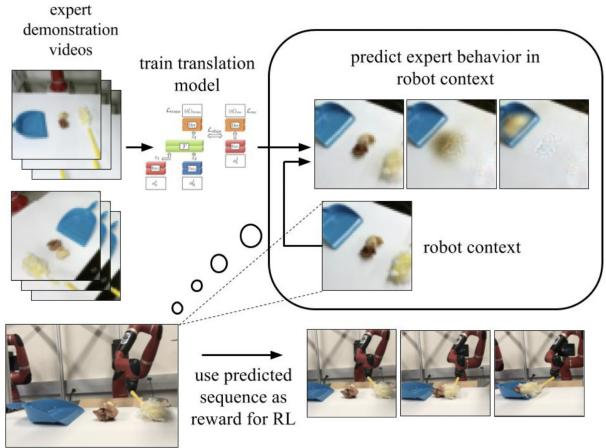  
Fig. 5. Context translation model is trained on several videos of expert demonstrations [86]. The robot observes the context of the task it must perform during the learning process. The model then determines what an expert would do in the context of the robot.

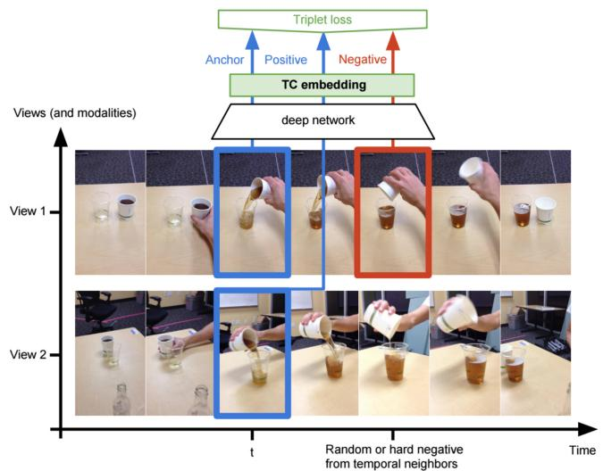  
Fig. 6. Embedding space encourages co-occurring frames from different viewpoints to be in close proximity to each other, while images captured from the same viewpoint but at different times should be far apart [92].

BC from observation (BCO) [93] is an approach that aims to minimize the reliance on the real-time interaction with the environment in the RL algorithms by leveraging a behavior cloning approach. BCO learns an inverse dynamics model from an agent’s interactions with its environment to infer missing actions of expert demonstrations. It then uses a BC algorithm to map states to inferred actions, solving the problem as a regular IL problem. However, gathering large amounts of data for the online dynamics model learning, particularly in high-dimensional problems, is necessary.

Subsequent research by Edwards et al. [84] aimed to streamline BCO’s operation by developing a latent forward dynamics model offline [47]. This approach operates on the assumption that although the underlying causes behind state transitions are unknown, they are predictable. The objective is to enable the agent to anticipate and mimic these latent causes [84]. This is achieved through learning a latent policy that assesses the likelihood of a latent action occurring in an observed state. By utilizing a limited number of interactions with the environment, they establish a correspondence between the real-world actions available to the agent and the latent actions identified by the model.

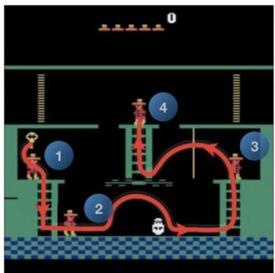  
(a)

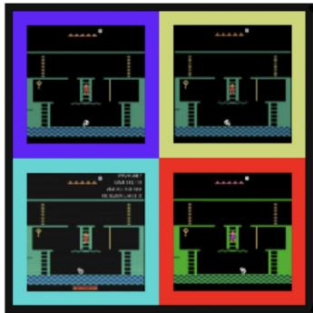  
(b)

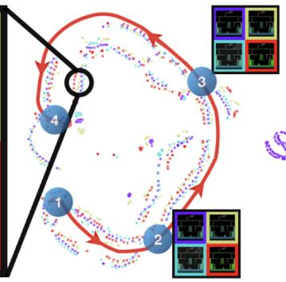  
(c)  
(d)  
Fig. 7. For the path in (a) t-SNE projections [112] of trajectories using the proposed embedding (c) and raw pixels (d) are shown [7]. In (b) example frame of Montezuma’s revenge is compared using four different domains: the arcade learning environment and three YouTube videos. Based on the embedding space, it can be seen that the four trajectories are well aligned.

Latent action policies (LAPOs) [94] present an approach for extracting latent-action information from videos. By analysing observed dynamics, LAPO infers the underlying structure of the action space, facilitating the training of latent-action policies. These policies can then undergo efficient fine tuning to reach expert-level performance, offering adaptability in both the offline and online scenarios. Offline fine tuning is feasible with a small dataset containing labeled actions, while online fine tuning can be accomplished using the rewards. Unlike [93] that relies on the labeled data for training the inverse dynamics model, LAPO derives latent action information directly from observed environmental dynamics, without the need for any labels.

Generative adversarial IfO (GAIfO) [88] adapts the GAIL objective to IfO by matching state-transition distributions of expert and agent. By leveraging an adversarial framework, GAIfO effectively tackles the covariate shift issue observed in prior approaches [84], [93]. Notably, GAIfO is capable of accommodating demonstrations that are not time-aligned, distinguishing it from the previous methods. However, achieving optimal performance hinges on both the expert and the agent operating within identical environments with similar dynamics. Challenges arise when attempting to match state-transition distributions in scenarios where dynamics differ, potentially leading to the expert’s state transitions being infeasible within the agent’s environment [95].

Jaegle et al. [96] presented a nonadversarial approach to IRL from observations, employing the likelihood-based generative models. This method focuses on matching the conditional state transition probabilities between the expert and the learner. The authors argue that their approach, which emphasizes conditional state probabilities is less susceptible to penalizing irrelevant differences between the expert and learner settings compared to the adversarial methods like GAIfO, which match joint state-next-state probabilities. They contend that this emphasis reduces the risk of erroneously penalizing features absent in the demonstrations but crucial for correct transitions.

Aytar et al. [7] introduced an innovative self-supervised framework aimed at mastering challenging exploration Atari games solely through observation of YouTube videos (Fig. 7). Learning from YouTube videos presents several hurdles, including domain-specific variations in color or resolution as well as a lack of frame-by-frame alignment. To overcome these obstacles, the authors employ self-supervised classification tasks encompassing both the visual and auditory cues, enabling the mapping of unaligned videos from diverse sources to an unified representation. Subsequently, a single YouTube video is embedded within this representation, with a sequence of checkpoints strategically positioned along the embedding. These checkpoints serve as reference points for constructing a reward function, incentivizing the agent to replicate human game play. Throughout the policy training, the agent receives rewards solely upon reaching these designated checkpoints.

Brown et al. [113] proposed an approach to IRL from observation, specifically tailored to extrapolating the expert’s intentions from suboptimal ranked demonstrations. The primary objective is to enhance performance beyond that of a suboptimal expert in complex high-dimensional tasks. To achieve this, they devise a state-based reward function that assigns higher total returns to trajectories with superior rankings. By leveraging the ranking information to construct the reward function, the method identifies features that correlate with rankings, potentially leading to performance surpassing that of the original demonstrator. Subsequently, RL is employed to optimize a policy based on the learned reward function.

Utilizing extensive navigation data sourced from YouTube, [114] introduces a framework for scalable driving learning. Initially, a model is trained on a small labeled dataset with the goal of mapping monocular images to bird’s eye view. This training accounts for the variability present in YouTube videos, including differences in viewpoints and camera parameters. This approach leverages the presence of action labels in many publicly available driving datasets, making the assumption feasible. Subsequently, the trained model is employed to generate pseudo-labels across a large unlabeled dataset. Finally, a generalized policy is trained on the pseudo-labeled dataset and fine tuned using the clean labels from the small labeled dataset.

TABLE I  
SUMMARY OF EXISTING RESEARCH ON IL

<table><tr><td></td><td>Ref</td><td>Datasets</td><td>Inputs</td><td>Training Algorithm</td><td>Online Expert</td><td>Application</td></tr><tr><td rowspan="18">BC</td><td>[12]</td><td>Sim</td><td>State, Image</td><td>Online</td><td>Yes</td><td>Games, Handwriting Recognition</td></tr><tr><td>[17]</td><td>Sim</td><td>State, Image</td><td>Online</td><td>No</td><td>Car Racing, Atari Games, Locomotion</td></tr><tr><td>[20]</td><td>Sim, Real</td><td>State, Image</td><td>Online</td><td>Yes</td><td>Peg Insertion, Cable Routing</td></tr><tr><td>[21]</td><td>Sim, Real</td><td>State</td><td>Online</td><td>Yes</td><td>Autonomous Driving</td></tr><tr><td>[22]</td><td>Sim</td><td>State</td><td>Online</td><td>Yes</td><td>Robotic Manipulation</td></tr><tr><td>[23]</td><td>Sim</td><td>Image</td><td>Online</td><td>Yes</td><td>Autonomous Driving</td></tr><tr><td>[24]</td><td>Sim, Real</td><td>State, Image</td><td>Online</td><td>Yes</td><td>Robotic Locomotion, Fabric Manipulation</td></tr><tr><td>[25]</td><td>Sim</td><td>State</td><td>Online</td><td>Yes</td><td>Inverted Pendulum, Locomotion</td></tr><tr><td>[31]</td><td>Sim</td><td>State</td><td>Online</td><td>No</td><td>Robotic Manipulation</td></tr><tr><td>[35]</td><td>Sim</td><td>State, Image</td><td>Offline</td><td>No</td><td>Robotic Locomotion, Autonomous Driving</td></tr><tr><td>[33]</td><td>Sim</td><td>State</td><td>Online</td><td>Yes</td><td>Atari Games, Robotic Locomotion</td></tr><tr><td>[34]</td><td>Sim</td><td>State</td><td>Offline</td><td>No</td><td>Robotic Locomotion</td></tr><tr><td>[37]</td><td>Sim, Real</td><td>State, Image</td><td>Offline</td><td>No</td><td>Robotic Manipulation</td></tr><tr><td>[93]</td><td>Sim</td><td>State</td><td>Online</td><td>No</td><td>Physics-based Control, Robotic Locomotion</td></tr><tr><td>[97]</td><td>Sim</td><td>State</td><td>Offline</td><td>No</td><td>Robotic Locomotion</td></tr><tr><td>[98]</td><td>Sim</td><td>State</td><td>Offline</td><td>No</td><td>Robotic Locomotion</td></tr><tr><td>[99]</td><td>Sim</td><td>State</td><td>Offline</td><td>No</td><td>MiniGrid, Robotic Manipulation, Chess</td></tr><tr><td>[100]</td><td>Sim</td><td>State</td><td>Offline</td><td>No</td><td>Robotic Manipulation, Physics-based Control</td></tr><tr><td rowspan="26">IRL</td><td>[26]</td><td>Sim</td><td>State</td><td>Online</td><td>No</td><td>Robotic Locomotion, Autonomous Driving</td></tr><tr><td>[27]</td><td>Sim</td><td>State, Image</td><td>Online</td><td>No</td><td>Atari Games, Continuous Control Tasks</td></tr><tr><td>[30]</td><td>Sim, Real</td><td>State</td><td>Online</td><td>No</td><td>Autonomous Driving</td></tr><tr><td>[44]</td><td>Sim</td><td>State</td><td>Online</td><td>No</td><td>Autonomous Driving, Gridworld</td></tr><tr><td>[46]</td><td>Real</td><td>State</td><td>Online</td><td>No</td><td>Predicting Driving Behavior, Route Recommendation</td></tr><tr><td>[57]</td><td>Real</td><td>State</td><td>Online</td><td>No</td><td>Route Planning</td></tr><tr><td>[58]</td><td>Sim, Real</td><td>State, Image</td><td>Online</td><td>No</td><td>Path Planning, Locomotion, Driving Obstacle Avoidance</td></tr><tr><td>[59]</td><td>Sim, Real</td><td>State, Image</td><td>Online</td><td>No</td><td>Footstep and Grasp Prediction, Navigation</td></tr><tr><td>[60]</td><td>Sim</td><td>State</td><td>Online</td><td>No</td><td>Car Driving Game</td></tr><tr><td>[61]</td><td>Sim</td><td>State</td><td>Online</td><td>No</td><td>2-D Point Mass Control System</td></tr><tr><td>[62]</td><td>Real</td><td>State</td><td>Online</td><td>No</td><td>Robotic Manipulation</td></tr><tr><td>[101]</td><td>Sim</td><td>State</td><td>Online</td><td>No</td><td>Car Racing, Gridworld, Game</td></tr><tr><td>[63]</td><td>Sim</td><td>State</td><td>Online</td><td>No</td><td>Objectworld, Binaryworld</td></tr><tr><td>[64]</td><td>Sim, Real</td><td>State</td><td>Online</td><td>No</td><td>Robotic Manipulation</td></tr><tr><td>[65]</td><td>Sim</td><td>State</td><td>Online</td><td>No</td><td>Random Generated MDPs</td></tr><tr><td>[102]</td><td>Sim</td><td>State</td><td>Online</td><td>No</td><td>Gridworld, Simplified Car Racing</td></tr><tr><td>[68]</td><td>Sim</td><td>State</td><td>Online</td><td>No</td><td>Objectworld, Highway Driving</td></tr><tr><td>[66]</td><td>Sim</td><td>Image</td><td>Online</td><td>No</td><td>Atari Games</td></tr><tr><td>[67]</td><td>Sim, Real</td><td>State</td><td>Offline</td><td>No</td><td>Medical Dataset, Physics-based Control</td></tr><tr><td>[69]</td><td>Sim</td><td>State</td><td>Online</td><td>No</td><td>MDPs, Gridworld</td></tr><tr><td>[70]</td><td>Sim</td><td>Image</td><td>Online</td><td>Yes</td><td>Gridworld, Random Generated MDPs</td></tr><tr><td>[96]</td><td>Sim</td><td>State</td><td>Online</td><td>No</td><td>Robotic Locomotion</td></tr><tr><td>[103]</td><td>Sim, Real</td><td>State</td><td>Online</td><td>No</td><td>Path Planning, Gridworld</td></tr><tr><td>[104]</td><td>Sim</td><td>State</td><td>Online</td><td>No</td><td>Robotic Locomotion</td></tr><tr><td>[105]</td><td>Sim, Real</td><td>Image</td><td>Online</td><td>No</td><td>Robotic Manipulation</td></tr><tr><td>[106]</td><td>Sim</td><td>State</td><td>Online</td><td>No</td><td>Physics-based Control, Robotic Locomotion</td></tr><tr><td rowspan="11">Adversarial IL</td><td>[79]</td><td>Sim</td><td>State, Image</td><td>Online</td><td>No</td><td>Robotic Locomotion and Manipulation</td></tr><tr><td>[45]</td><td>Sim</td><td>State</td><td>Online</td><td>No</td><td>Physics-based Control, Robotic Locomotion</td></tr><tr><td>[77]</td><td>Sim</td><td>State</td><td>Online</td><td>No</td><td>MDPs, Continuous Control Tasks</td></tr><tr><td>[78]</td><td>Sim</td><td>State</td><td>Online</td><td>No</td><td>Robotic Locomotion and Manipulation</td></tr><tr><td>[81]</td><td>Sim</td><td>State, Image</td><td>Online</td><td>No</td><td>Synthetic 2D Example, Autonomous Driving</td></tr><tr><td>[88]</td><td>Sim</td><td>State, Image</td><td>Online</td><td>No</td><td>Physics-based Control, Robotic Locomotion</td></tr><tr><td>[107]</td><td>Sim</td><td>State</td><td>Online</td><td>No</td><td>Robotic Locomotion</td></tr><tr><td>[108]</td><td>Sim</td><td>State</td><td>Online</td><td>No</td><td>Robotic Locomotion</td></tr><tr><td>[109]</td><td>Sim</td><td>State, Image</td><td>Online</td><td>No</td><td>Atari Games, Robotic Locomotion</td></tr><tr><td>[110]</td><td>Sim</td><td>State</td><td>Online</td><td>No</td><td>Robotic Locomotion</td></tr><tr><td>[111]</td><td>Sim</td><td>State</td><td>Online</td><td>No</td><td>Physics-based Control</td></tr></table>

Table I highlights key elements of the reviewed papers on IL, categorizing them into the three previously mentioned categories: 1) BC; 2) IRL; and 3) adversarial IL. The table is structured into six columns, each offering vital information to facilitate understanding of the characteristics of the papers. Column “Dataset” distinguishes between the real-world and simulation data sources. This differentiation is crucial, as it influences the model’s generalization to real-world scenarios. In the third column, “Inputs,” the choice of data representation is highlighted. Raw image pixels, being higher dimensional, pose greater computational challenges compared to the state features. Recognizing this distinction is pivotal, as it impacts the complexity of the learning task and the computational resources required. The fourth column, “Training Algorithm” distinguishes between the online and offline training methods. This classification reveals whether the learning agent interacts with the environment during training (online) or relies solely on the preexisting datasets (offline). Furthermore, the fifth column, labeled “Online Expert” indicates whether the agent has access to an online expert who can be consulted during training. Finally, the final column delineates the practical application of the dataset, shedding light on how learned behaviors are intended for use across various domains.

## VI. CHALLENGES AND LIMITATIONS

## A. Imperfect Demonstrations

Many IL methods operate under the assumption that demonstrations are optimal, executed by expert demonstrators [2]. However, this assumption proves overly restrictive in various scenarios [2]. First, acquiring a large volume of high-quality demonstrations from human experts poses challenges [115], [116]. In numerous real-world tasks, this endeavor is impractical for humans due to the considerable time and effort involved [117]. Additionally, human demonstrators are susceptible to errors, influenced by factors, such as distractions or limited environmental observability [97], [108]. Second, leveraging crowdsourced datasets is essential to learn robust IL policies [118]. Incorporating crowdsourced datasets into the IL algorithms introduces diversity and richness but also requires addressing the challenge of handling the variability in demonstration quality across different contributors [119], [120].

A simplistic response to suboptimal demonstrations would involve discarding nonoptimal instances. However, this screening process is often infeasible, requiring significant human intervention [97]. Consequently, researchers are increasingly turning their attention to developing methodologies capable of learning from imperfect demonstrations [121].

Wu et al. [108] proposed two strategies to tackle imperfect demonstrations, utilizing both the confidence-scored and unlabeled data: 1) two-step importance weighting IL (2IWIL) and 2) generative adversarial IL with imperfect demonstration and confidence (IC-GAIL). These methods operate based on the assumption that a subset of demonstrations is annotated with confidence scores, indicating the likelihood that a trajectory is optimal. 2IWIL follows a two-step process, initially employing a semi-supervised classifier to generate confidence scores for unlabeled demonstrations, then applying the standard GAIL with a reweighted distribution [98]. Conversely, IC-GAIL avoids the two-step approach, omitting the need for a classifier, and instead focuses on the occupancy measure matching with unlabeled demonstrations.

Sasaki and Yamashina [97] proposed a novel offline BC algorithm tailored to learn from noisy demonstrations, originating from a less-than-perfect expert, and without the need for screening or annotations linked to nonoptimal demonstrations. The fundamental concept involves leveraging the learned policy to adjust the sample weights in the subsequent iteration of weighted BC. They model the noisy expert’s action distribution as a weighted blend of two distributions: one from an optimal expert and the other from a nonoptimal source. The aim is to adjust these weights to bring the noisy expert’s action distribution closer to that of the optimal expert. This is achieved by reusing the previous policy (i.e., the one optimized in the previous iteration) as the weights for action samples in the weighted BC objective. However, it is important to note that this approach only converges to the optimal policy when optimal demonstrations constitute the majority of the data.

Wang et al. [109] introduced a novel approach within the GAIL framework to address imperfect expert demonstrations without prior knowledge. Their method automatically predicts the weight for each expert demonstration to evaluate its quality and significance for agent learning. They demonstrate that these weights can be accurately estimated using the discriminator and agent policy in GAIL. During training, the algorithm iteratively estimates weights and learns the agent policy, optimizing both the processes simultaneously.

Kim et al. [98] proposed a method to address the distributional shift problem resulting from insufficient expert demonstrations by incorporating additional imperfect demonstrations with uncertain optimality levels. They introduce regularization to align the agent’s distribution with a mixture of expert and imperfect distributions using a KL divergence. Through a dual-program technique, they derive the optimal state-action distribution from this regularization [122]. Finally, the expert policy is extracted by weighted behavior cloning based on this optimal distribution.

Beliaev et al. [99] introduced an approach called IL by estimating expertise of demonstrators (ILEEDs), which harnesses the identities of demonstrators to autonomously infer their proficiency levels. With this technique, each demonstrator receives a state-dependent expertise rating, reflecting their superior performance in specific states (Fig. 8). By amalgamating the strengths of various demonstrators across different states, ILEED seeks to enhance learning outcomes. The framework entails developing and refining an unified model that incorporates both a learned policy and expertise levels. This integrated approach empowers the model to distinguish optimal behaviors from suboptimal ones.

Liu et al. [123] presented robust policy improvement (RPI), a learning framework devised to enable robust learning in unknown MDPs by interleaving RL and IL with multiple suboptimal black-box experts. This approach strikes a balance between learning from suboptimal experts and self-improvement through active exploration. It gradually transitions from IL to RL as learning progresses, leveraging learned policies as improved experts. RPI’s adaptability enables it to learn from and enhance various black-box experts, facilitating robust learning in unknown MDPs.

## B. Domain Discrepancies

Previous research has often assumed that both the expert and the agent function within the same state and action space, simplifying the process of aligning expert actions with those of the agent [106]. However, this assumption limits the application of these algorithms to scenarios where expert demonstrations align with the agent’s domain. In recent years, there has been a growing interest in a more flexible approach to IL, where the agent learns to perform tasks optimally in its own domain based on the demonstrations from the expert’s domain [106]. This relaxed setting streamlines the collection of demonstrations by removing the need for in-domain expert demonstrations, thereby enhancing the efficiency and scalability of IL. Various solutions have emerged to address discrepancies across different domains, including dynamics, viewpoint, and embodiment mismatches [92], [95], [105], [106], [110], [111], [124].

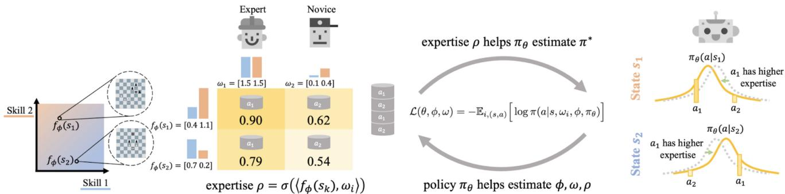  
Fig. 8. ILEEDs [99]. Expertise levels, ρ are represented by the inner product of two embeddings: a state embedding and a demonstrator embedding. Each dimension of these embeddings corresponds to a latent skill, with the state embedding indicating the relevance of each skill in correctly acting in a particular state, while the demonstrator embedding reflects the demonstrator’s proficiency in that skill. By utilizing the expertise levels, the model improves the learned policy, thereby enhancing the estimation of the state/demonstrator embeddings and the expertise level.

To facilitate knowledge transfer between different domains, IL research often involves mapping between the stateaction spaces of the expert and the learner. Some approaches [86], [92] rely on paired and time-aligned demonstrations from both the domains to learn state mappings or encodings to achieve domain-invariant representations. However, these methods face limitations due to the availability of paired demonstrations.

To address these challenges, Kim et al. [100] proposed a framework that learns the state and action maps from unpaired and unaligned demonstrations while leveraging an online expert. Raychaudhuri et al. [91] extended this framework to the IfO setting and also eliminates the necessity for an online expert. However, many existing methods often rely on the proxy tasks, which involve using a set of pairs of expert demonstrations from both the domains. This reliance on theproxy tasks limits the applicability of these approaches in real-world scenarios.

Several methods offer alternative strategies for transferring knowledge between the domains, thereby broadening the applicability of IL in real-world scenarios. For instance, Stadie et al. [111] introduced an adversarial framework for viewpoint-agnostic imitation, employing a discriminator to distinguish the data from different viewpoints. Similarly, Zakka et al. [105] took a goal-driven approach, concentrating on mimicking the task progress without the need for detailed structural matching.

Chae et al. [110] presented a framework aimed at training policies resilient to variations in environment dynamics. Their objective is to develop a policy capable of performing well despite continuous fluctuations in dynamics, leveraging only a limited number of samples across the spectrum of environment dynamics. The framework utilizes sampled environments both during the collection of demonstrations and the policy interaction phases, as illustrated in Fig. 9. The problem is formulated as the minimization of the weighted average of Jensen–Shannon divergences between the multiple expert policies and the agent policy.

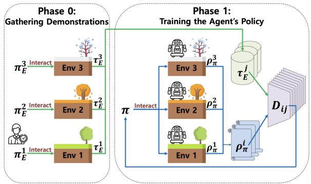  
Fig. 9. IL against variations in environment dynamics [110]. Blue represents the flow of policy samples, while green represents the flow of expert demonstrations.

In contrast, cross-embodiment IRL (XIRL) [105] focuses on extracting a task’s agent-invariant definition from videos featuring different agents executing the task with varying embodiments. XIRL employs temporal cycle consistency (TCC) to learn visual embeddings, identifying critical moments in videos of various lengths and clustering them to represent task progression. To achieve an embodimentinvariant reward function, XIRL measures the distance from a single goal state in the TCC embedding space. This method’s versatility allows it to be applied across multiple embodiments or expert levels, as it does not require manual pairing of video frames between the expert and the learner.

In a similar vein, Fickinger et al. [106] explored how expert demonstrations can train an imitator agent with a different embodiment without relying on the explicit crossdomain latent spaces or resorting to the proxy tasks. Instead, they employ the Gromov–Wasserstein distance between the state-action occupancies of the expert and the agent to identify isometric transformations preserving distance measures between the two domains. By computing pseudo-rewards based on the preservation of distances from a state to its neighbors in the agent domain when transitioning to the expert domain, the policy is optimized using an RL algorithm.

MIMICPLAY [125] addresses domain discrepancies by integrating human play data and robot teleoperation data. It leverages the diversity captured in human play data and the targeted demonstrations from the robot teleoperation data to bridge the gap between the human and robot embodiments. The algorithm introduces a novel learning paradigm where high-level plans are derived from the human play data, while low-level manipulation policies are learned from the robot teleoperation data. This fusion of data sources enables MIMICPLAY to effectively handle domain discrepancies and enhance policy generalization in intricate, long-horizon manipulation tasks.

## VII. OPPORTUNITIES AND FUTURE WORK

This survey article provides a comprehensive overview of the field of IL, exploring its algorithms, categorizations, developments, and challenges. This article starts by presenting a categorization of the IL algorithms, identifying two general learning approaches, namely BC and IRL, and discussing their relative benefits and limitations. Additionally, this article highlights the benefits of integrating adversarial training into IL and evaluates the current progress in the AIL field. This article also introduces a novel technique called IfO that aims to learn from state-only demonstrations.

Through the examination of various IL algorithms, we have gained valuable insights into their strengths and limitations and identified some of the key challenges and opportunities for future research. One of the significant challenges across all the categories of the IL approaches is the need to collect diverse and large-scale demonstrations, which is crucial for training a generalizable policy that can be applied in the real world [118]. One potential strategy to mitigate these challenges is the exploration and utilization of readily available offline datasets. However, this poses a challenge, as readily available demonstration resources, such as online videos present additional difficulties, such as the varying levels of expertise among the demonstrators.

Another challenge in IL research is developing methods that enable agents to learn across domains with differences in dynamics, viewpoint, and embodiment. Overcoming these challenges is essential if we are to teach agents to learn from experts effectively and apply the insights from IL research to real-world scenarios. Therefore, the future research should focus on developing algorithms that can learn from imperfect demonstrations, extract useful information, and enable crossdomain learning.

Despite these challenges, the field of IL presents exciting opportunities for future research. As the field of AI continues to evolve and mature, we believe that the IL will play a critical role in enabling agents to learn from demonstrations, adapt to new tasks and environments, and ultimately achieve more advanced levels of intelligence, paving the way for real-world applications of AI.

## ACKNOWLEDGMENT

This research was partially supported by the Australian Research Council’s Discovery Projects funding scheme (project DP190102181 and DP210101465).

## REFERENCES

[1] T. Osa et al., “An algorithmic perspective on imitation learning,” Foundations Trends-R Robot., vol. 7, nos. 1–2, pp. 1–179, 2018.

[2] H. Ravichandar, A. S. Polydoros, S. Chernova, and A. Billard, “Recent advances in robot learning from demonstration,” Annu. Rev. Control, Robot., Auton. Syst., vol. 3, pp. 297–330, May 2020.

[3] S. Schaal, “Is imitation learning the route to humanoid robots?” Trends Cogn. Sci., vol. 3, no. 6, pp. 233–242, 1999.

[4] Z. Zhu and H. Hu, “Robot learning from demonstration in robotic assembly: A survey,” Robotics, vol. 7, no. 2, p. 17, 2018.

[5] J. Van Den Berg et al., “Superhuman performance of surgical tasks by robots using iterative learning from human-guided demonstrations,” in Proc. IEEE Int. Conf. Robot. Autom., 2010, pp. 2074–2081.

[6] L. Le Mero, D. Yi, M. Dianati, and A. Mouzakitis, “A survey on imitation learning techniques for end-to-end autonomous vehicles,” IEEE Trans. Intell. Transp. Syst., vol. 23, no. 9, pp. 14128–14147, Sep. 2022.

[7] Y. Aytar, T. Pfaff, D. Budden, T. Paine, Z. Wang, and N. De Freitas, “Playing hard exploration games by watching Youtube,” in Proc. Adv. Neural Inf. Process. Syst., vol. 31, 2018, pp. 1–12.

[8] U. E. Ogenyi, J. Liu, C. Yang, Z. Ju, and H. Liu, “Physical human– robot collaboration: Robotic systems, learning methods, collaborative strategies, sensors, and actuators,” IEEE Trans. Cybern., vol. 51, no. 4, pp. 1888–1901, Apr. 2021.

[9] S. Sun, Z. Cao, H. Zhu, and J. Zhao, “A survey of optimization methods from a machine learning perspective,” IEEE Trans. Cybern., vol. 50, no. 8, pp. 3668–3681, Aug. 2020.

[10] A. Hussein, M. M. Gaber, E. Elyan, and C. Jayne, “Imitation learning: A survey of learning methods,” ACM Comput. Surveys, vol. 50, no. 2, pp. 1–35, 2017.

[11] D. A. Pomerleau, “Efficient training of artificial neural networks for autonomous navigation,” Neural Comput., vol. 3, no. 1, pp. 88–97, 1991.

[12] S. Ross, G. Gordon, and D. Bagnell, “A reduction of imitation learning and structured prediction to no-regret online learning,” in Proc. 14th Int. Conf. Artif. Intell. Stat., 2011, pp. 627–635.

[13] D. A. Pomerleau, “ALVINN: An autonomous land vehicle in a neural network,” in Proc. Adv. Neural Inf. Process. Syst., vol. 1, 1988, pp. 305–313.

[14] S. Belkhale, Y. Cui, and D. Sadigh, “Data quality in imitation learning,” in Proc. Adv. Neural Inf. Process. Syst., vol. 36, 2024, pp. 1–18.

[15] K. Zhou, Z. Liu, Y. Qiao, T. Xiang, and C. C. Loy, “Domain generalization: A survey,” IEEE Trans. Pattern Anal. Mach. Intell., vol. 45, no. 4, pp. 4396–4415, Apr. 2023.

[16] S. Belkhale, Y. Cui, and D. Sadigh, “HYDRA: Hybrid robot actions for imitation learning,” in Proc. 7th Annu. Conf. Robot Learn., 2023, pp. 1–21. [Online]. Available: https://openreview.net/forum?id= \_A15qsPswaK

[17] S. Reddy, A. D. Dragan, and S. Levine, “SQIL: Imitation learning via reinforcement learning with sparse rewards,” in Proc. Int. Conf. Learn. Represent., 2020, pp. 1–14.

[18] J. Roche, V. De-Silva, and A. Kondoz, “A multimodal perceptiondriven self evolving autonomous ground vehicle,” IEEE Trans. Cybern., vol. 52, no. 9, pp. 9279–9289, Sep. 2022.

[19] Q. Li, Z. Peng, and B. Zhou, “Efficient learning of safe driving policy via human-AI copilot optimization,” in Proc. Int. Conf. Learn Represent., 2022, pp. 1–19.

[20] R. Hoque, A. Balakrishna, E. Novoseller, A. Wilcox, D. S. Brown, and K. Goldberg, “ThriftyDAgger: Budget-aware novelty and risk gating for interactive imitation learning,” in Proc. 5th Conf. Robot Learn., vol. 164, 2021, pp. 598–608.

[21] M. Kelly, C. Sidrane, K. Driggs-Campbell, and M. J. Kochenderfer, “HG-DAgger: Interactive imitation learning with human experts,” in Proc. Int. Conf. Robot. Autom. (ICRA), 2019, pp. 8077–8083.

[22] A. Mandlekar, D. Xu, R. Martín-Martín, Y. Zhu, L. Fei-Fei, and S. Savarese, “Human-in-the-loop imitation learning using remote teleoperation,” 2020, arXiv:2012.06733.

[23] J. Zhang and K. Cho, “Query-efficient imitation learning for end-toend simulated driving,” in Proc. 31st AAAI Conf. Artif. Intell., 2017, pp. 2891–2897.

[24] R. Hoque et al., “LazyDAgger: Reducing context switching in interactive imitation learning,” in Proc. IEEE 17th Int. Conf. Autom. Sci. Eng. (CASE), 2021, pp. 502–509.

[25] K. Menda, K. Driggs-Campbell, and M. J. Kochenderfer, “EnsembleDAgger: A Bayesian approach to safe imitation learning,” in Proc. IEEE/RSJ Int. Conf. Intell. Robots Syst. (IROS), 2019, pp. 5041–5048.

[26] R. Wang, C. Ciliberto, P. V. Amadori, and Y. Demiris, “Random expert distillation: Imitation learning via expert policy support estimation,” in Proc. Int. Conf. Mach. Learn., 2019, pp. 6536–6544.

[27] K. Brantley, W. Sun, and M. Henaff, “Disagreement-regularized imitation learning,” in Proc. Int. Conf. Learn. Represent., 2020, pp. 1–19.

[28] K. Brantley, “Expert-in-the-loop for sequential decisions and predictions,” Ph.D. dissertation, Dept. Comput. Sci., Univ. Maryland, College Park, MD, USA, 2021.

[29] J. Chang, M. Uehara, D. Sreenivas, R. Kidambi, and W. Sun, “Mitigating covariate shift in imitation learning via offline data with partial coverage,” in Proc. Adv. Neural Inf. Process. Syst., vol. 34, 2021, pp. 965–979.

[30] M. Bansal, A. Krizhevsky, and A. S. Ogale, “ChauffeurNet: Learning to drive by imitating the best and synthesizing the worst,” in Proc. Robot. Sci. Syst. XV, 2019, pp. 1–10.

[31] J. Wong et al., “Error-aware imitation learning from teleoperation data for mobile manipulation,” in Proc. Conf. Robot Learn., 2021, pp. 1367–1378.

[32] L. X. Shi, A. Sharma, T. Z. Zhao, and C. Finn, “Waypoint-based imitation learning for robotic manipulation,” in Proc. 7th Annu. Conf. Robot Learn., 2023, pp. 1–15. [Online]. Available: https://openreview. net/forum?id=X0cmlTh1V

[33] P. De Haan, D. Jayaraman, and S. Levine, “Causal confusion in imitation learning,” in Proc. Adv. Neural Inf. Process. Syst., vol. 32, 2019, pp. 1–17.

[34] C. Wen, J. Lin, T. Darrell, D. Jayaraman, and Y. Gao, “Fighting copycat agents in behavioral cloning from observation histories,” in Proc. Adv. Neural Inf. Process. Syst., vol. 33, 2020, pp. 2564–2575.

[35] C.-C. Chuang, D. Yang, C. Wen, and Y. Gao, “Resolving copycat problems in visual imitation learning via residual action prediction,” 2022, arXiv:2207.09705.

[36] P. Florence and C. Lynch. “Decisiveness in imitation learning for robots.” 2022. [Online]. Available: https://ai.googleblog.com/2021/11/ decisiveness-in-imitation-learning-for.html

[37] P. Florence et al., “Implicit behavioral cloning,” in Proc. Conf. Robot Learn., 2021, pp. 158–168.

[38] Y. Song and D. P. Kingma, “How to train your energy-based models,” 2021, arXiv:2101.03288.

[39] S. Russell, “Learning agents for uncertain environments,” in Proc. 11th Annu. Conf. Comput. Learn. Theory, 1998, pp. 101–103.

[40] B. Piot, M. Geist, and O. Pietquin, “Bridging the gap between imitation learning and inverse reinforcement learning,” IEEE Trans. Neural Netw. Learn. Syst., vol. 28, no. 8, pp. 1814–1826, Aug. 2017.

[41] B. Lian, W. Xue, F. L. Lewis, and T. Chai, “Robust inverse Q-learning for continuous-time linear systems in adversarial environments,” IEEE Trans. Cybern., vol. 52, no. 12, pp. 13083–13095, Dec. 2022.

[42] R. S. Sutton and A. G. Barto, Reinforcement Learning: An Introduction. Cambridge, MA, USA: MIT Press, 2018.

[43] T. T. Nguyen, N. D. Nguyen, and S. Nahavandi, “Deep reinforcement learning for multiagent systems: A review of challenges, solutions, and applications,” IEEE Trans. Cybern., vol. 50, no. 9, pp. 3826–3839, Sep. 2020.

[44] P. Abbeel and A. Y. Ng, “Apprenticeship learning via inverse reinforcement learning,” in Proc. 21st Int. Conf. Mach. Learn., 2004, p. 1.

[45] J. Ho and S. Ermon, “Generative adversarial imitation learning,” in Proc. Adv. Neural Inf. Process. Syst., vol. 29, 2016, pp. 1–14.

[46] B. D. Ziebart, A. L. Maas, J. A. Bagnell, and A. K. Dey, “Maximum entropy inverse reinforcement learning,” in Proc. AAAI, vol. 8. Chicago, IL, USA, 2008, pp. 1433–1438.

[47] F. Torabi, G. Warnell, and P. Stone, “Recent advances in imitation learning from observation,” 2019, arXiv:1905.13566.

[48] M. Pirotta, A. Tirinzoni, A. Touati, A. Lazaric, and Y. Ollivier, “Fast imitation via behavior foundation models,” in Proc. 12th Int. Conf. Learn. Represent., 2024, pp. 1–40. [Online]. Available: https:// openreview.net/forum?id=qnWtw3l0jb

[49] M. Kuderer, S. Gulati, and W. Burgard, “Learning driving styles for autonomous vehicles from demonstration,” in Proc. IEEE Int. Conf. Robot. Autom. (ICRA), 2015, pp. 2641–2646.

[50] S. Haldar, V. Mathur, D. Yarats, and L. Pinto, “Watch and match: Supercharging imitation with regularized optimal transport,” in Proc. Conf. Robot Learn., 2023, pp. 32–43.

[51] Y. Luo, Z. Jiang, S. Cohen, E. Grefenstette, and M. P. Deisenroth, “Optimal transport for offline imitation learning,” in Proc. 11th Int. Conf. Learn. Represent., 2023, pp. 1–17.

[52] S. Chen, X. Ma, and Z. Xu, “Imitation learning as state matching via differentiable physics,” in Proc. IEEE/CVF Conf. Comput. Vis. Pattern Recognit. (CVPR), 2023, pp. 7846–7855.

[53] D. Hadfield-Menell, S. J. Russell, P. Abbeel, and A. Dragan, “Cooperative inverse reinforcement learning,” in Proc. Adv. Neural Inf. Process. Syst., vol. 29, 2016, pp. 1–9.

[54] A. Y. Ng and S. Russell, “Algorithms for inverse reinforcement learning,” in Proc. ICML, vol. 1, 2000, pp. 663–670.

[55] K. Kim, S. Garg, K. Shiragur, and S. Ermon, “Reward identification in inverse reinforcement learning,” in Proc. Int. Conf. Mach. Learn., 2021, pp. 5496–5505.

[56] D. Jarrett, A. Hüyük, and M. Van Der Schaar, “Inverse decision modeling: Learning interpretable representations of behavior,” in Proc. Int. Conf. Mach. Learn., 2021, pp. 4755–4771.

[57] N. D. Ratliff, J. A. Bagnell, and M. A. Zinkevich, “Maximum margin planning,” in Proc. 23rd Int. Conf. Mach. Learn., 2006, pp. 729–736.

[58] J. Bagnell, J. Chestnutt, D. Bradley, and N. Ratliff, “Boosting structured prediction for imitation learning,” in Proc. Adv. Neural Inf. Process. Syst., vol. 19, 2006, pp. 1–8.

[59] N. D. Ratliff, D. Silver, and J. A. Bagnell, “Learning to search: Functional gradient techniques for imitation learning,” Auton. Robots, vol. 27, no. 1, pp. 25–53, 2009.

[60] U. Syed and R. E. Schapire, “A game-theoretic approach to apprenticeship learning,” in Proc. Adv. Neural Inf. Process. Syst., vol. 20, 2007, pp. 1–8.

[61] N. Aghasadeghi and T. Bretl, “Maximum entropy inverse reinforcement learning in continuous state spaces with path integrals,” in Proc. IEEE/RSJ Int. Conf. Intell. Robots Syst., 2011, pp. 1561–1566.

[62] M. Kalakrishnan, P. Pastor, L. Righetti, and S. Schaal, “Learning objective functions for manipulation,” in Proc. IEEE Int. Conf. Robot. Autom., 2013, pp. 1331–1336.

[63] M. Wulfmeier, P. Ondruska, and I. Posner, “Maximum entropy deep inverse reinforcement learning,” 2015, arXiv:1507.04888.

[64] C. Finn, S. Levine, and P. Abbeel, “Guided cost learning: Deep inverse optimal control via policy optimization,” in Proc. Int. Conf. Mach. Learn., 2016, pp. 49–58.

[65] D. Ramachandran and E. Amir, “Bayesian inverse reinforcement learning,” in Proc. IJCAI, vol. 7, 2007, pp. 2586–2591.

[66] D. Brown, R. Coleman, R. Srinivasan, and S. Niekum, “Safe imitation learning via fast Bayesian reward inference from preferences,” in Proc. Int. Conf. Mach. Learn., 2020, pp. 1165–1177.

[67] A. J. Chan and M. van der Schaar, “Scalable Bayesian inverse reinforcement learning,” in Proc. Int. Conf. Learn. Represent., 2021, pp. 1–14.

[68] S. Levine, Z. Popovic, and V. Koltun, “Nonlinear inverse reinforcement learning with Gaussian processes,” in Proc. Adv. Neural Inf. Process. Syst., vol. 24, 2011, pp. 1–9.

[69] D. Lindner, A. Krause, and G. Ramponi, “Active exploration for inverse reinforcement learning,” 2022, arXiv:2207.08645.

[70] A. M. Metelli, G. Ramponi, A. Concetti, and M. Restelli, “Provably efficient learning of transferable rewards,” in Proc. Int. Conf. Mach. Learn., 2021, pp. 7665–7676.

[71] J. Ho, J. Gupta, and S. Ermon, “Model-free imitation learning with policy optimization,” in Proc. Int. Conf. Mach. Learn., 2016, pp. 2760–2769.

[72] S. Levine and V. Koltun, “Continuous inverse optimal control with locally optimal examples,” 2012, arXiv:1206.4617.

[73] A. Deka, C. Liu, and K. P. Sycara, “ARC-actor residual critic for adversarial imitation learning,” in Proc. Conf. Robot Learn., 2023, pp. 1446–1456.

[74] R. Bhattacharyya et al., “Modeling human driving behavior through generative adversarial imitation learning,” IEEE Trans. Intell. Transp. Syst., vol. 24, no. 3, pp. 2874–2887, Mar. 2023.

[75] J. Song, H. Ren, D. Sadigh, and S. Ermon, “Multi-agent generative adversarial imitation learning,” in Proc. Adv. Neural Inf. Process. Syst., vol. 31, 2018, pp. 1–23.

[76] M. Orsini et al., “What matters for adversarial imitation learning?” in Proc. Adv. Neural Inf. Process. Syst., vol. 34, 2021, pp. 14656–14668.

[77] J. Fu, K. Luo, and S. Levine, “Learning robust rewards with adversarial inverse reinforcement learning,” in Proc. Int. Conf. Learn. Represent., 2018, pp. 1–15.

[78] I. Kostrikov, K. K. Agrawal, D. Dwibedi, S. Levine, and J. Tompson, “Discriminator-actor-critic: Addressing sample inefficiency and reward bias in adversarial imitation learning,” in Proc. Int. Conf. Learn. Represent., 2019, pp. 1–14.

[79] R. Dadashi, L. Hussenot, M. Geist, and O. Pietquin, “Primal Wasserstein imitation learning,” in Proc. Int. Conf. Learn. Represent., 2021, pp. 1–19.

[80] M. Arjovsky, S. Chintala, and L. Bottou, “Wasserstein generative adversarial networks,” in Proc. Int. Conf. Mach. Learn., 2017, pp. 214–223.

[81] Y. Li, J. Song, and S. Ermon, “InfoGAIL: Interpretable imitation learning from visual demonstrations,” in Proc. Adv. Neural Inf. Process. Syst., vol. 30, 2017, pp. 1–11.

[82] I. Goodfellow et al., “Generative adversarial nets,” in Proc. Adv. Neural Inf. Process. Syst., vol. 27, 2014, pp. 1–9.

[83] M. Arjovsky and L. Bottou, “Towards principled methods for training generative adversarial networks,” 2017, arXiv:1701.04862.

[84] A. Edwards, H. Sahni, Y. Schroecker, and C. Isbell, “Imitating latent policies from observation,” in Proc. Int. Conf. Mach. Learn., 2019, pp. 1755–1763.

[85] Y. Hu, G. Chen, Z. Li, and A. Knoll, “Robot policy improvement with natural evolution strategies for stable nonlinear dynamical system,” IEEE Trans. Cybern., vol. 53, no. 6, pp. 4002–4014, Jun. 2023.

[86] Y. Liu, A. Gupta, P. Abbeel, and S. Levine, “Imitation from observation: Learning to imitate behaviors from raw video via context translation,” in Proc. IEEE Int. Conf. Robot. Autom. (ICRA), 2018, pp. 1118–1125.

[87] A. Li, B. Boots, and C.-A. Cheng, “MAHALO: Unifying offline reinforcement learning and imitation learning from observations,” in Proc. 40th Int. Conf. Mach. Learn., 2023, pp. 1–25.

[88] F. Torabi, G. Warnell, and P. Stone, “Generative adversarial imitation from observation,” in Proc. Imitation, Intent, Interact. (I3) Workshop ICML, Jun. 2019, pp. 1–10.

[89] A. J. Ijspeert, J. Nakanishi, and S. Schaal, “Movement imitation with nonlinear dynamical systems in humanoid robots,” in Proc. IEEE Int. Conf. Robot. Autom., vol. 2, 2002, pp. 1398–1403.

[90] S. Choe, H. Seong, and E. Kim, “Indoor place category recognition for a cleaning robot by fusing a probabilistic approach and deep learning,” IEEE Trans. Cybern., vol. 52, no. 8, pp. 7265–7276, Aug. 2022.

[91] D. S. Raychaudhuri, S. Paul, J. Vanbaar, and A. K. Roy-Chowdhury, “Cross-domain imitation from observations,” in Proc. Int. Conf. Mach. Learn., 2021, pp. 8902–8912.

[92] P. Sermanet et al., “Time-contrastive networks: Self-supervised learning from video,” in Proc. IEEE Int. Conf. Robot. Autom. (ICRA), 2018, pp. 1134–1141.

[93] F. Torabi, G. Warnell, and P. Stone, “Behavioral cloning from observation,” in Proc. 27th Int. Joint Conf. Artif. Intell., 2018, pp. 4950–4957.

[94] D. Schmidt and M. Jiang, “Learning to act without actions,” in Proc. 12th Int. Conf. Learn. Represent., 2024, pp. 1–17. [Online]. Available: https://openreview.net/forum?id=rvUq3cxpDF

[95] T. Gangwani, Y. Zhou, and J. Peng, “Imitation learning from observations under transition model disparity,” in Proc. Int. Conf. Learn. Represent., 2022, pp. 1–15.

[96] A. Jaegle, Y. Sulsky, A. Ahuja, J. Bruce, R. Fergus, and G. Wayne, “Imitation by predicting observations,” in Proc. Int. Conf. Mach. Learn., 2021, pp. 4665–4676.

[97] F. Sasaki and R. Yamashina, “Behavioral cloning from noisy demonstrations,” in Proc. Int. Conf. Learn. Represent., 2020, pp. 1–14.

[98] G.-H. Kim et al., “DemoDICE: Offline imitation learning with supplementary imperfect demonstrations,” in Proc. Int. Conf. Learn. Represent., 2022, pp. 1–26.

[99] M. Beliaev, A. Shih, S. Ermon, D. Sadigh, and R. Pedarsani, “Imitation learning by estimating expertise of demonstrators,” in Proc. 39th Int. Conf. Mach. Learn., 2022, pp. 1732–1748.

[100] K. Kim, Y. Gu, J. Song, S. Zhao, and S. Ermon, “Domain adaptive imitation learning,” in Proc. Int. Conf. Mach. Learn., 2020, pp. 5286–5295.

[101] A. Boularias, J. Kober, and J. Peters, “Relative entropy inverse reinforcement learning,” in Proc. 14th Int. Conf. Artif. Intell. Stat., 2011, pp. 182–189.

[102] J. Choi and K.-E. Kim, “Map inference for Bayesian inverse reinforcement learning,” in Proc. Adv. Neural Inf. Process. Syst., vol. 24, 2011, pp. 1–9.

[103] M. Pflueger, A. Agha, and G. S. Sukhatme, “Rover-IRL: Inverse reinforcement learning with soft value iteration networks for planetary rover path planning,” IEEE Robot. Autom. Lett., vol. 4, no. 2, pp. 1387–1394, Apr. 2019.

[104] F. Sasaki, T. Yohira, and A. Kawaguchi, “Sample efficient imitation learning for continuous control,” in Proc. Int. Conf. Learn. Represent., 2018, pp. 1–12.

[105] K. Zakka, A. Zeng, P. Florence, J. Tompson, J. Bohg, and D. Dwibedi, “XIRL: Cross-embodiment inverse reinforcement learning,” in Proc. Conf. Robot Learn., 2022, pp. 537–546.

[106] A. Fickinger, S. Cohen, S. Russell, and B. Amos, “Cross-domain imitation learning via optimal transport,” in Proc. Int. Conf. Learn. Represent., 2022, pp. 1–15.

[107] W. Jeon, S. Seo, and K.-E. Kim, “A Bayesian approach to generative adversarial imitation learning,” in Proc. Adv. Neural Inf. Process. Syst., vol. 31, 2018, pp. 1–11.

[108] Y.-H. Wu, N. Charoenphakdee, H. Bao, V. Tangkaratt, and M. Sugiyama, “Imitation learning from imperfect demonstration,” in Proc. Int. Conf. Mach. Learn., 2019, pp. 6818–6827.

[109] Y. Wang, C. Xu, B. Du, and H. Lee, “Learning to weight imperfect demonstrations,” in Proc. Int. Conf. Mach. Learn., 2021, pp. 10961–10970.

[110] J. Chae, S. Han, W. Jung, M. Cho, S. Choi, and Y. Sung, “Robust imitation learning against variations in environment dynamics,” in Proc. 39th Int. Conf. Mach. Learn., vol. 162, 2022, pp. 2828–2852.

[111] B. C. Stadie, P. Abbeel, and I. Sutskever, “Third-person imitation learning,” in Proc. Int. Conf. Learn. Represent., 2017, pp. 1–16.

[112] L. Van der Maaten and G. Hinton, “Visualizing data using t-SNE,” J. Mach. Learn. Res., vol. 9, no. 86, pp. 2579–2605, 2008.

[113] D. Brown, W. Goo, P. Nagarajan, and S. Niekum, “Extrapolating beyond suboptimal demonstrations via inverse reinforcement learning from observations,” in Proc. Int. Conf. Mach. Learn., 2019, pp. 783–792.

[114] J. Zhang, R. Zhu, and E. Ohn-Bar, “SelfD: Self-learning large-scale driving policies from the Web,” in Proc. IEEE/CVF Conf. Comput. Vis. Pattern Recognit., 2022, pp. 17316–17326.

[115] M. Yang, S. Levine, and O. Nachum, “TRAIL: Near-optimal imitation learning with suboptimal data,” in Proc. Int. Conf. Learn. Represent., 2022, pp. 1–20.

[116] G. Xiang and J. Su, “Task-oriented deep reinforcement learning for robotic skill acquisition and control,” IEEE Trans. Cybern., vol. 51, no. 2, pp. 1056–1069, Feb. 2021.

[117] W. Zhang et al., “Discriminator-guided model-based offline imitation learning,” in Proc. 6th Conf. Robot Learn., 2023, pp. 1266–1276.

[118] R. Ramrakhya, E. Undersander, D. Batra, and A. Das, “Habitat-Web: Learning embodied object-search strategies from human demonstrations at scale,” in Proc. IEEE/CVF Conf. Comput. Vis. Pattern Recognit., 2022, pp. 5173–5183.

[119] X. Liu, T. Yoneda, C. Wang, M. R. Walter, and Y. Chen, “Active policy improvement from multiple black-box oracles,” in Proc. Int. Conf. Mach. Learn., 2023, pp. 1–18.

[120] S. Kuhar, S. Cheng, S. Chopra, M. Bronars, and D. Xu, “Learning to discern: Imitating heterogeneous human demonstrations with preference and representation learning,” in Proc. 7th Annu. Conf. Robot Learn., 2023, pp. 1–13. [Online]. Available: https://openreview.net/ forum?id=kOm3jWX8YN

[121] J. Liu, L. He, Y. Kang, Z. Zhuang, D. Wang, and H. Xu, “CEIL: Generalized contextual imitation learning,” in Proc. Adv. Neural Inf. Process. Syst., 2023, pp. 1–26.

[122] J. Lee, W. Jeon, B. Lee, J. Pineau, and K.-E. Kim, “Optidice: Offline policy optimization via stationary distribution correction estimation,” in Proc. Int. Conf. Mach. Learn., 2021, pp. 6120–6130.

[123] X. Liu, T. Yoneda, R. Stevens, M. Walter, and Y. Chen, “Blending imitation and reinforcement learning for robust policy improvement,” in Proc. 12th Int. Conf. Learn. Represent., 2024, pp. 1–20.

[124] W. Sheng, A. Thobbi, and Y. Gu, “An integrated framework for human– robot collaborative manipulation,” IEEE Trans. Cybern., vol. 45, no. 10, pp. 2030–2041, Oct. 2015.

[125] C. Wang et al., “MimicPlay: Long-horizon imitation learning by watching human play,” in Proc. 7th Annu. Conf. Robot Learn., 2023, pp. 1–21. [Online]. Available: https://openreview.net/forum?id= hRZ1YjDZmTo