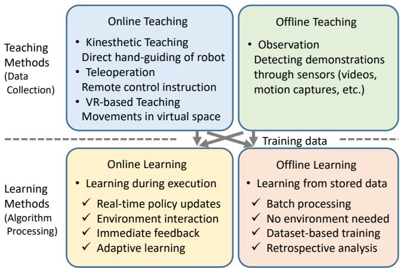

# A Survey on Imitation Learning for Contact-Rich Tasks in Robotics

Toshiaki Tsuji1,∗ Yasuhiro Kato2,∗ Gokhan Solak3,∗ Heng Zhang3,4,∗ Tadej Petrič5,∗ Francesco Nori6,∗ Arash Ajoudani3,∗

June 17, 2025

1Graduate School of Science and Engineering, Saitama University, Saitama, Japan 2Center for Education and Research in Information Science and Technology, University of Tokyo, Tokyo, Japan 3Human-Robot Interfaces and Interaction Lab, Istituto Italiano di Tecnologia, Genova, Italy 4Ph.D. program of national interest in Robotics and Intelligent Machines (DRIM) and Università di Genova, Genoa, Italy 5Department of Automatics, Biocybernetics and Robotics, Jožef Stefan Institute, Ljubljana, Slovenia 6Robotics lab, Google Deepmind ∗All authors contributed equally and majorly to this review paper.

## Abstract

This paper comprehensively surveys research trends in imitation learning for contact-rich robotic tasks. Contact-rich tasks, which require complex physical interactions with the environment, represent a central challenge in robotics due to their nonlinear dynamics and sensitivity to small positional deviations. The paper examines demonstration collection methodologies, including teaching methods and sensory modalities crucial for capturing subtle interaction dynamics. We then analyze imitation learning approaches, highlighting their applications to contact-rich manipulation. Recent advances in multimodal learning and foundation models have significantly enhanced performance in complex contact tasks across industrial, household, and healthcare domains. Through systematic organization of current research and identification of challenges, this survey provides a foundation for future advancements in contact-rich robotic manipulation.

Keywords: Contact rich tasks, imitation learning, machine learning, reinforcement learning, learning from demonstration, impedance control, manipulation

## 1 Introduction

Robots are intelligent systems that bring physical efects to real environments. Many basic tasks are contact-rich tasks involving multiple contact states between robots and their environment, and developing these capabilities is one of the core challenges in robotics. Meanwhile, understanding “everyday physics” has long been known to be extremely difficult (Arimoto, 1999). Our daily tasks involve complex interactions of diverse physical phenomena such as friction, elasticity, plastic deformation, and fracture, which exhibit nonlinear and unpredictable behaviors, making the advancement of contact-rich tasks both an old and new research challenge.

Approaches to contact-rich tasks can be broadly categorized into model-based and model-free methods, with model-based approaches being widely studied at the practical level (Xu et al., 2019). However, as research in everyday physics indicates, contact-rich tasks require highly nonlinear models since slight positional deviations can cause significant behavioral changes. As these tasks are sensitive to minor diferences in models and parameters, the need for machine learning-based model-free methods increases as task dificulty rises. On the other hand, contact-rich tasks must be performed without damaging target objects, and the amount of training data is limited due to the nature of robotic systems. There are primarily two approaches to extracting motion models from demonstration data for skilled tasks: reinforcement learning (RL) and imitation learning (IL) (Hua et al., 2021; Kober and Peters, 2010).

RL has the advantage of autonomously acquiring complex movements involving contact state transitions through interaction with the environment, and has been extensively studied. Recent trends include combining model-free and model-based RL approaches (Fan et al., 2019; Pong et al., 2018), improving sample eficiency (Shi et al., 2021; Wang et al., 2021), pre-training in simulation followed by fine-tuning on real hardware (Yang et al., 2024), and integration with adaptive impedance control for contact force regulation (Beltran-Hernandez et al., 2020; Martín-Martín et al., 2019; Oikawa et al., 2021). However, RL requires extensive trial-anderror, and learning on physical systems is often limited due to hardware wear and safety concerns. Furthermore, the complexity of contact dynamics widens the simulation-to-reality gap, making transfer more challenging. On the other hand, IL has the advantage of eficiently learning expert skills, including subtle adjustments of contact forces and positions in human dexterous manipulation. Expert skills inherently contain human tacit knowledge and empirical rules, and it is expected that if robots can acquire these in some form, their capabilities can be fundamentally enhanced.

Building upon the potential of IL to leverage human tacit knowledge and empirical rules, recent advances in Large Language Models (LLMs) have begun to extend to other modalities such as images and speech, and in robotics, they are expected to develop into foundational technologies for symbolic representation of action sequences, integration of multimodal knowledge, and eventually technologies that can abstract human tacit knowledge and empirical rules inherent in expert skills. With the proliferation of LLMs, the number of papers on IL in robotics continues to increase. However, there is a lack of systematic organization of recent research trends in this field. Therefore, this paper aims to contribute to the advancement of robotics by conducting and systematically organizing a survey on IL for contact-rich tasks.

In the manipulation field, multiple surveys dealing with contact-rich tasks exist (Cui and Trinkle, 2021; Jiang et al., 2022; Kroemer et al., 2021; Suomalainen et al., 2022). An extensive review of robot learning for manipulation appears in Kroemer et al. (2021), providing a structured analysis of fundamental challenges, representational choices, and algorithmic frameworks. A systematic survey of robot manipulation examines complex interactions between robots and their environment during physical contact tasks (Suomalainen et al., 2022). A thorough review of robotic assembly strategies encompasses the entire operational procedure from planning to evaluation, emphasizing the importance of integrating multiple technological approaches (Jiang et al., 2022).

Surveys have also been published on IL (Argall et al., 2009; Celemin et al., 2022; Fang et al., 2019; Hua et al., 2021; Urain et al., 2024). A foundational survey on robot learning from demonstration in Argall et al. (2009) established key paradigms and methodologies that influenced the field for years. IL in robotic manipulation was specifically addressed in Fang et al. (2019), synthesizing key approaches and challenges in transferring human skills to robotic systems. The interconnections between RL, IL, and transfer learning were explored in Hua et al. (2021), highlighting their complementary nature. A comprehensive examination of interactive IL in robotics appears in Celemin et al. (2022), emphasizing the crucial role of human-robot interaction in skill acquisition. Most recently, the growing role of deep generative models in robotics was investigated in Urain et al. (2024), particularly focusing on their application in learning from multimodal demonstrations. No survey exists that investigates imitation learning research in contact-rich tasks. The closest paper surveyed RL technologies in contact-rich tasks (Elguea-Aguinaco et al., 2023). The significant diferences in methodology and effects between RL technology and imitation learning make this contrast valuable for organizing trends in this field.

The contributions of this survey are as follows:

• Systematic organization of existing research methods in imitation learning for contact rich tasks

• Presentation of recent research trends and clarification of challenges

• Presentation of future research directions and practical application possibilities

The structure of this survey is as follows. In Sec. 2, we present preliminaries from the perspectives of contact-rich robotics and motor control, and describe the key challenges in this field. Next, in Sec. 3, we discuss methodologies for collecting demonstrations, which are crucial for imitation learning. Sec. 4 presents trends in learning approaches, while Sec. 5 showcases application cases. Finally, Sec. 6 provides conclusions and directions for future research.

## 2 Preliminaries

## 2.1 Contact-rich robotics / Background

In robotics, contact-rich manipulation refers to robotic manipulation tasks that involve continuous and complex interactions between the robot and its environment, often requiring sophisticated control of forces in one to several contact points. This is why direct and indirect force control (e.g., through impedance or admittance control) techniques have been widely exploited to address this problem. Pioneering contributions in this field include the formulation of operational space, hybrid and impedance control (Khatib, 1987; Neville, 1985; Raibert and Craig, 1981), as well as advancements in contact modelling and multi-contact control (Bicchi and Siciliano, 1993; Cutkosky and Kao, 1989; Mason, 1986; Whitney, 1982). More recent studies build upon the foundational theories proposed by these pioneering works to tackle complex contact-rich problems on advanced hardware systems (Khandelwal et al., 2023; Ozdamar et al., 2024).

A major challenge in contact-rich manipulation is the scalability of classical control solutions to varying task conditions and contact dynamics. For example, even a seemingly simple assembly task, such as peg-in-hole, involves varying force or impedance requirements depending on factors like the position and orientation of the parts, their material properties, and the clearance between them. Similarly, in tasks that need continuous contact like wiping a surface or polishing, changes in surface geometry, friction, or compliance call for constant adaptation of the contact-related robot dynamics to maintain stable and efective interaction. Recent advancements in machine learning have accelerated the resolution of this problem, by enabling robots to learn intricate interaction dynamics directly from data. This shift from traditional control methods to data-driven learning has yielded significant improvements in robustness and adaptability. Techniques such as reinforcement learning, imitation learning, and adaptive model predictive control now allow robots to achieve human-like dexterity in manipulating contacts. This survey provides an in-depth analysis of these advancements.

## 2.2 Insights from motor control

Humans are adaptively good but not inherently precise at contact-rich tasks. They rely on compliance, predictive control, learning, and robust feedback integration to manage contact efectively, but not on precise, optimal control like a model-based system would. This adaptive mastery has long made human motor coordination a powerful source of inspiration for robotics. Here, we provide a brief overview of key works focusing on human motor coordination in contact-rich tasks, with the aim of highlighting principles that can inform the design of more robust, adaptive robotic systems.

Motor control refers to the mechanisms by which organisms and robots orchestrate their movements to interact efectively with their environment, particularly in tasks involving significant physical contact. Unlike movements executed freely in space, contact-rich tasks require management of interaction forces, adaptation to varying material properties, and responsiveness to environmental perturbations. For instance, a robot tasked with screwing in a light bulb must precisely regulate the force applied to rotate it without damaging the glass.

Typical robotic controllers rely on predetermined mathematical models, which generally perform well in structured environments but frequently fail in real-world scenarios with uncertainty and variability (Kroemer et al., 2021). In contrast, biological motor control systems naturally manage these complexities. Humans and animals continuously adapt their movements based on sensory feedback, adjusting grip strength or modulating applied force depending on object properties and environmental conditions (Franklin and Wolpert, 2011; Suomalainen et al., 2022). Additionally, biological systems utilize sensorimotor integration, dynamic impedance modulation, predictive control, and adaptive feedback mechanisms, enabling eficient interactions with complex environments (Kober et al., 2013; Petrič et al., 2017).

Roboticists have drawn on these biological principles to develop control strategies aimed at enhancing adaptability in robotic systems. Impedance and admittance control methods, for example, manage interaction forces by dynamically adjusting the robot’s stifness and damping properties, facilitating more adaptable interactions with the environment (Cui and Trinkle, 2021; Merckaert et al., 2022).

Integrating these methods with learning-based approaches, including deep learning and reinforcement learning, has resulted in hybrid techniques that benefit from both model-based predictions and datadriven adaptability (Aggarwal et al., 2022).

Imitation learning (IL) methods particularly benefit from insights derived from biological motor control. Human demonstrations naturally encompass subtle adjustments in posture, force modulation, and adaptive responses to dynamic environmental conditions (Fang et al., 2019; Gams et al., 2022). By incorporating principles such as dynamic impedance adaptation and sensorimotor predictive modeling, IL approaches can replicate nuanced aspects of human motor skills efectively (Petric et al., 2018).

However, challenges persist in translating biological motor control insights to robotic systems. Accurately modeling contact dynamics remains dificult due to their inherently nonlinear and sensitive nature to small variations in physical conditions (Jiang et al., 2022). Moreover, robotic sensory systems, particularly tactile and proprioceptive sensors, remain limited compared to their biological counterparts, restricting the precision and adaptability of robotic responses (Celemin et al., 2022). Addressing these challenges requires advancements in sensor technology and computational modeling techniques.

Future research directions will focus on improving sensorimotor integration, refining predictive control models, and enhancing impedance modulation through machine learning. Progress in wearable and tactile sensing technologies and better simulation tools for realistic contact dynamics will further enable the practical implementation of biological mo tor control principles in robotics (Hua et al., 2021).

## 2.3 Key Challenges

In this section we highlight the main challenges which are currently tackled in the context of contact-rich imitation learning.

As already mentioned, one important challenge resides in the highly nonlinear nature of contactrich dynamics which are extremely dificult to capture with classical modelling tools (e.g. the ordinary diferential equations generated by Lagrangian mechanics) and often require computationally intractable representations (e.g. the partial diferential equations generated by soft-contacts). This challenge often induced researchers to resort to learning-based model-free methods such as reinforcement learning and imitation learning. Within this context, reinforcement learning is often applied in simulation and it sufers of the intractable nature of contact models and their limited modelling accuracy (i.e. sim-to-real gap). When applied in real instead, reinforcement learning poses significant challenges for both the quantity and the nature of the required data: quantity-wise, it exposes hardware to extensive trials-and-errors which in contact-rich tasks induce a significant wear-and-tear; additionally, non-imitation learning requires explorations which by nature have the tendency to go beyond safety limits which can damage the robot and its surroundings.

On the other hand, imitation learning sufers from the scarcity of technologies suitable for datacollection of contact-rich tasks. Despite eforts, tactile sensors remain a technology which is mostly confined to research applications with rare industrial use-cases. Similarly, wearable tactile technologies (e.g. (Büscher et al., 2012)) seem to be a challenging technology to develop and their adoption haven’t had yet the necessary an impact neither in research nor in industrial applications. These technologies become even more necessary since contactrich tasks are by nature non-fully-observable when the primary observation modality is vision. Interaction forces are an essential component in contactrich tasks and yet they are not directly measurable from images: contact-rich tasks are often susceptible to visual occlusion since the contact area is often occluded by the body-part in contact with the manipulated object.

Observability is even more hampered when considering the highest form of imitation, often referred to as third-person imitation. This is the form of imitation which humans excel at: executing a task or a skill after having seen someone else performing it. As previously pointed out, first-person imitation (i.e. imitation using data of the task executed on the target robot) is in itself challenging due to the scarcity of technologies suitable for datacollection of contact-rich tasks. Third-person imitation poses additional challenges. The first challenge consists in bridging the perception gap by translating what the robot sees (third-person human actions) into its own actions (first-person robot movements) and mapping observed goals to its own perspective; this is especially challenging when relying solely on raw image data without access to complete state information. Another challenge is associated with viewpoint and appearance discrepancy: the significant diferences in viewpoint (third-person human vs. first-person robot) and appearance (human arm vs. robot arm) make direct image translation or learning dificult.

Finally, in the context of contact-rich imitation the challenge of data eficiency and generalization becomes even more challenging due to the richness of involved data and the resulting dificulties in generalizing to new tasks or objects. This is also connected to the dificulties in developing physics-based models that accurately capture and generalize the highly nonlinear nature of contact-rich interactions.

## 3 Collecting demonstrations

## 3.1 Data modalities

Diverse data modalities are crucial for capturing the inherent complexity of contact-rich manipulation tasks, as they enable detailed representation of both spatial and dynamic interaction properties. Position data provides essential information for precise spatial alignment and trajectory following, whereas force measurements inform the nuanced adjustments necessary for stable and compliant interactions. Vision-based modalities extend capabilities to tasks involving environmental context and indirect monitoring of contacts, and tactile information ofers direct feedback on local interaction dynamics. The integration of these diverse data modalities significantly enhances the robustness and generalization of imitation learning methods in robotics (Ravichandar et al., 2020; Sherwani et al., 2020; Urain et al., 2024).

Positional data from joint angles and end-efector positions are fundamental for accurately replicating demonstrated trajectories. Precise positional information enables robots to achieve desired spatial configurations and smoothly transition between diferent motion phases. Force data complement positional information by providing necessary details about the magnitude and direction of forces applied during manipulation tasks. This information is critical for tasks requiring delicate adjustments, such as assembly or insertion operations, where appropriate force application can prevent damage to both the manipulated object and the robot itself (Kormushev et al., 2011; Peternel et al., 2015).

Vision-based modalities play a significant role, particularly in imitation learning scenarios where direct interaction feedback may be limited. Visual sensors provide contextual awareness, enabling robots to interpret environmental states, object positions, and movements observed during demonstrations. However, challenges remain, such as visual occlusions and the indirect nature of force inference from visual observations. These limitations can restrict the precision of learned skills, emphasizing the necessity of complementing visual data with other sensory inputs (Dillmann, 2004; Vogt et al., 2017).

Tactile sensing and haptic feedback provide additional insights for interactions between robotic systems and their environments, since it can enable the detection and interpretation of complex contact phenomena, such as friction, slippage, texture differentiation, and subtle deformation, essential for precise force regulation and adaptive manipulation strategies (Edmonds et al., 2017; Higuera et al., 2024; Lambeta et al., 2024). Despite significant advancements in tactile sensor design and integration methodologies, the adoption of these technologies remains primarily limited to research domain. This limitation persists due to unresolved technical challenges, which include sensor durability under repeated mechanical stress, adequate sensitivity to subtle physical interactions, and seamless integration within existing robotic platforms. Nevertheless, current developments in innovative sensor architectures, complemented by data-driven processing approaches, indicate potential enhancements in the robustness, sensitivity, and applicability of tactile and haptic feedback systems, promoting their integration in broader robotic manipulation applications (Ablett et al., 2024; Edmonds et al., 2017; Higuera et al., 2024; Lambeta et al., 2024).

Efective fusion of multiple sensory modalities can further augment robotic capabilities, particularly in complex scenarios characterized by partial observability and dynamic uncertainties. Advanced multimodal integration approaches, including deep learning techniques, probabilistic inference, and filtering methods, facilitate comprehensive state estimation and enhance predictive capabilities. By leveraging complementary positional, force, visual, and tactile information, robots can achieve greater adaptability and generalization across diverse manipulation tasks. Recent research underscores the benefits of such multimodal integration, demonstrating enhanced performance and robustness in practical robotics applications (Chen and Gombolay, 2024; Li and Zou, 2023; Urain et al., 2024).

Emerging data modalities, including electromyography (EMG) signals, soft and flexible sensors, are poised to further revolutionize robotic imitation learning in contact-rich tasks. EMG has already seen applications in robotics, particularly in exoskeleton research (Peternel et al., 2016), providing insights into human muscle activation patterns, allowing robots to mimic not only observable movements but also internal force modulations (Peternel et al., 2014). Soft sensing technologies ofer the potential to capture intricate interactions with complex geometries and materials, greatly enhancing sensitivity and versatility. Recent work by Liu et al. (2025) introduces a novel hand-held device specifically designed to collect robot-free force-based demonstrations, facilitating more accessible data acquisition. Advanced wearable technologies facilitate naturalistic human demonstration capture, promising more intuitive and contextually rich data collection methodologies. The continued evolution of these modalities will likely lead to substantial advancements in the capability, accuracy, and applicability of imitation learning techniques in contactrich robotic manipulation (Shih et al., 2020; Zhang et al., 2022).

## 3.2 Teaching methods

Robot IL is based on learning human skilled movements and is also called Learning from Demonstration (LfD) or Programming by Demonstration (PbD), emphasizing the aspect of learning directly from human demonstrations. The first process is the acquisition of human skilled movements, which shares many technical commonalities with teaching techniques developed in the field of industrial robots.

Fig. 1 shows the classification of teaching and learning. For imitation learning, teaching is an essential process for obtaining training data, and it can be divided into online teaching and ofline teaching. The diference lies in whether trajectories are provided through online operation using a terminal, or input ofline to the computer. The concept of direct teaching is also known (Ravichandar et al., 2020), while it can be interpreted as a teaching method where the robot is directly operated online, so it is classified as online teaching.

Online teaching is mainly classified into three categories: kinesthetic teaching, teleoperation, and VR-based teaching. Kinesthetic teaching involves direct hand-guiding of robots, while teleoperation utilizes remote control instructions. VR-based teaching, which captures movements in virtual space, is also increasingly being introduced.

In ofline teaching, trajectories calculated by designers based on equations or trajectory-planning programs are input, or human movements are observed to create command trajectories. In imitation learning, only the latter method is used. Such methods, which detect human demonstrations through sensors, are called observation methods.

On the other hand, machine learning is also classified into online learning and ofline learning. It is crucial to recognize that online/ofline teaching and online/ofline learning are distinct concepts that represent diferent aspects to be evaluated independently in methodological frameworks. These distinctions require careful consideration, as the terminology is frequently conflated in the academic literature.

Traditional industrial robot teaching assumes providing limited motions with high reproducibility in few trials. However, when environmental variations are large or task dificulty is high, it becomes necessary to acquire numerous motions and enhance adaptability through the generalization capabilities of machine learning. IL is efective in such cases. As mentioned in Sec. 2.2, it is often necessary to acquire both position and force from human demonstrations to perform IL for contact-rich tasks. In teleoperation teaching, a leader robot operated by the teacher and a follower robot performing the task are connected, and bilateral control including force feedback is often implemented, allowing the operator’s force adjustments to be transmitted to the follower robot (Kormushev et al., 2011). This enables simultaneous teaching of the operator’s force and position information. When the follower robot in teleoperation is used directly for motion reproduction, the reproducibility of replay is high because there is no environmental variation when working in the same environment. Delays in teleoperation can degrade task performance, while this problem is avoided by the operator’s ability to compensate for those delays (Sasagawa et al., 2020). On the other hand, in teaching through a robot, the robot’s dynamic characteristics can interfere with skilled movements. To reduce operator burden and achieve high skill levels, it is essential to ensure transparency in bilateral control to minimize this interference (Lawrence, 2002).

Meanwhile, observation teaching using cameras or motion capture to mainly acquire position information is also a popular method (Dillmann, 2004; Vogt et al., 2017). For contact-rich tasks, force sensors need to be embedded in tools (Furuta et al., 2020) or tactile gloves (Edmonds et al., 2017) to acquire force information. Methods that simulate force information during operation through the introduction of virtual reality technology are also useful (Aleotti et al., 2003; Zhang et al., 2018). Additionally, the combination of position and force observations with muscle activity measurement enables learning not only the motion but also stifness behavior (Peternel et al., 2017). Observation teaching suppresses the degradation of teaching due to robot interference, so the quality of preserved skilled movements is high. However, since dynamics difer between humans and robots, variations in environments involving robots are unavoidable. The robot needs to suppress these variations through some method.

Fig. 1 shows that IL can be categorized into the following four categories based on the combinations of online/ofline teaching and online/ofline learning:

• Interactive Imitation

• Demo-Augmented Reinforcement Learning

• Direct Imitation

• Observational Learning

First, the combination of online teaching and online learning is called interactive imitation. The most prominent example is DAgger (Hoque et al., 2022, 2021), which implements a mechanism where humans correct mistakes in real-time. Second, the combination of ofline teaching and online learning is called demo-augmented reinforcement learning. GAIL (Gubbi et al., 2020; Li et al., 2021; Tsurumine et al., 2019; Xiang et al., 2024) performs adversarial matching with expert demonstrations. DDPGfD (Vecerik et al., 2017) and DAPG (Rajeswaran et al., 2017) can also be considered as types of imitation learning since reinforcement learning is initialized with demonstrations. Third, the combination of online teaching and ofline learning is called direct imitation. This category includes BC and DMP methods that use online teaching approaches such as kinesthetic teaching, teleoperation, and VR-based teaching. Finally, the combination of ofline teaching and ofline learning is called observational learning. BC from datasets involves learning from large-scale demonstration collections, while video-based imitation learning realizes learning from video observations.

  
Figure 1: Relationship between robot teaching methods and learning methods

## 3.3 Synthetic data generation

In modern robotics, synthetic data generation has become a key enabler for the development of dataintensive learning based systems. It ofers diverse and scalable environments that can be crucial for algorithms’ training and validation. When it comes to robotic tasks with physical contacts, the role of synthetic data generation to enable autonomous robotic behaviors become even more significant due to the complexity, variability, and safety-critical nature of contact dynamics, which are dificult to capture, annotate, and scale in real-world data collection. Hence, synthetic data generation ofers numerous advantages such as access to contact dynamics like forces and friction properties, fast domain adaptation, and risk mitigation in safety-critical scenarios such as industry and healthcare (James et al., 2020;

Liu et al., 2023a; Mees et al., 2022b; Yu et al., 2020).

Over the past years, several platforms ofering synthetic data generation in contact manipulation have been introduced. Physical simulators such as MuJoCo (Multi-Joint dynamics with Contact) (Todorov et al., 2012), PyBullet (Coumans and Bai, 2016), Isaac Gym (Makoviychuk et al., 2021), and Drake (Tedrake and the Drake Development Team, 2019) are the most commonly used examples in the community, although every year new platforms with even stronger physics simulation capabilities emerge. MuJoCo prioritizes eficiency and smooth contact dynamics, making it a leading choice for model-based control and reinforcement learning in continuous action spaces. PyBullet, known for its user-friendly interface and extensive community support, excels in accessibility and robotic manipulation, although with less precise contact modeling. Isaac Gym, exploiting NVIDIA’s GPU acceleration, enables high-throughput parallel simulations, ideal for large-scale reinforcement learning, especially in tasks involving complex contact. Finally, Drake employs hydroelastic contact mechanics, providing a principled and accurate approach, crucial for planning, control, and formal verification in safety-critical or high-fidelity applications. These simulators collectively ofer a spectrum of trade-ofs between computational speed, physical realism, and implementation complexity for synthetic data generation.

Regardless of the chosen simulation environment, several practical techniques have been introduced for synthetic data generation. Domain randomization (Tobin et al., 2017), for example, is used to vary certain parameters of interest (e.g., object weight, surface texture) to make the learned models more robust to real-world variations. This method helps algorithms account for such changes and achieve performance in real-world applications that more closely matches their performance in simulation. Another method to bridge the sim-to-real gap is based on physics-based augmentation of the generated data (Yang et al., 2025). It enhances synthetic datasets by incorporating physical models or constraints into the data creation or transformation process.

Despite fundamental progress in these techniques, transferring learned policies or models to real-world robots remains a significant challenge due to the sim-to-real gap, which enlarges as the number and complexity of contact dynamics increase (James et al., 2019; Peng et al., 2018; Tobin et al., 2017). This is why several recent studies have focused on fine-tuning the learned algorithms with real-world data (Chebotar et al., 2019; Finn et al., 2017; Yu et al., 2018). In parallel, more advanced and emerging strategies, such as diferentiable simulation (Degrave et al., 2019; Freeman et al., 2021), synthetic tactile data generation (Wang et al., 2022a), and learning from hybrid (simulated and real) datasets (Ferguson et al., 2020), are gaining increasing attention for their potential to further reduce the sim-toreal gap in contact-rich manipulation tasks.

## 3.4 Available Datasets for contact rich tasks

The field of contact-rich imitation learning heavily relies on diverse and extensive datasets that capture interactions between robots and their environment through various sensory modalities. Several notable datasets have been developed to address the challenges of data scarcity, generalization, and multimodal integration in this domain.

The TVL Dataset (Fu et al., 2024a) comprises 44,000 in-the-wild vision-touch pairs, featuring tactile data from DIGIT sensors and visual observations. A significant portion (90%) of its English language labels are pseudo-labeled by GPT-4V, while 10% are human-annotated, aiming to bridge the gap in integrating touch into multimodal generative language models. Similarly, the Touch100k Dataset (Cheng et al., 2024) focuses on GelSight sensors, offering over 100,000 paired touch-language-vision entries with multi-granularity linguistic descriptions. This dataset, curated from existing tactile datasets like TAG and VisGel, utilizes GPT-4V for generating detailed textual descriptions, which are then refined through a multi-step quality enhancement process involving Gemini 2 for consistency assessment. It aims to improve tactile representation learning for tasks such as material property identification and robot grasping. The VisGel Dataset (Li et al., 2019) also provides a large collection of 3 million synchronized visual and tactile images from 12,000 touches on 195 diverse objects, collected using KUKA LBR iiwa robotic arms equipped with GelSight sensors and webcams, to explore cross-modal prediction between vision and touch.

For broader robotic manipulation, BridgeData V2 (Walke et al., 2023) is a large-scale dataset with over 60,000 trajectories collected across 24 environments using a low-cost WidowX 250 robot arm. It integrates RGB images, depth data, and natural language instructions, supporting open-vocabulary task specification for various imitation learning and ofline reinforcement learning methods, with a focus on generalizing skills across diferent environments and institutions. The DROID (Distributed Robot Interaction Dataset (Khazatsky et al., 2024)) further extends this with an unprecedented scale, featuring 76,000 demonstration trajectories (350 hours of interaction) across 564 scenes, 52 buildings, and 86 tasks. Collected by a distributed network of 50 data collectors across 18 labs worldwide on the Franka Panda robot arm, DROID includes synchronized RGB camera streams, depth information, and language annotations, aiming to enhance policy performance and robustness in “in-the-wild” scenarios.

The Open X-Embodiment (OXE) Dataset (O’Neill et al., 2024) is a significant aggregation, combining over 1 million real robot trajectories from 60 existing datasets across 22 robot embodiments and 21 institutions. This large-scale repository provides diverse robot behaviors, embodiments, and environments in a standardized format, facilitating research into X-embodiment training for generalizable robot policies, including those like RT-X models. The Sparsh project (Higuera et al., 2024) introduces a curated dataset of approximately

661,000 images from various vision-based tactile sensors (DIGIT, GelSight) for self-supervised learning, alongside the TacBench benchmark. TacBench ofers six touch-centric tasks with labeled data for evaluating touch representations, including force estimation, slip detection, pose estimation, grasp stability (from the Feeling of Success dataset), and textile recognition, demonstrating the value of pre-trained touch representations for contact-rich manipulation.

Lastly, a dataset was collected for a study on Multimodal and Force-Matched Imitation Learning with a See-Through Visuotactile Sensor (Ablett et al., 2024). This dataset, created through kinesthetic teaching with a 7-DOF robotic system, includes visuotactile, wrist camera, and relative endefector pose data, with a focus on improving imitation learning for door-opening tasks through tactile force matching and learned mode switching. These datasets collectively advance the capabilities of robots in handling complex, contact-rich tasks through multimodal sensory integration and scalable learning approaches.

## 4 Learning Approaches

## 4.1 Behavior cloning

The substantial advancements in large-scale robotics datasets (Walke et al., 2023) has led to remarkable progress in imitation learning, which leverages pre-collected data for training purposes. Notable examples include RT-1 (Brohan et al., 2023), which was trained on a dataset collected over 17 months using a fleet of 13 robots, and RT-2 (Zitkovich et al., 2023), which employs vision-language models trained on Internet-scale data. These models have demonstrated impressive generalization capabilities in executing various real-world tasks. This progress has further spurred the development of large-scale robotics datasets, such as the Open X-Embodiment dataset (O’Neill et al., 2024). Behavior Cloning (BC) has emerged as a particularly influential paradigm, attracting substantial research interest due to its straightforward implementation and empirical efectiveness. In particular, its ability to eficiently learn from pre-collected data is especially attractive for imitation learning research.

BC constitutes a supervised learning paradigm in which an artificial agent is trained to replicate expert behavior using demonstration data (Levine et al., 2016; Ross and Bagnell, 2010). Specifically, this methodology involves training the agent to generate appropriate actions $a _ { t }$ in response to corresponding state inputs $s _ { t } .$ , learning the mapping between environmental states and expertdemonstrated actions from the data distribution D. The objective function for BC can be expressed as

$$
J (\theta) = \mathbb {E} (s _ {t}, a _ {t}) \sim \mathcal {D} \left[ \| \pi_ {\theta} (s _ {t}) - a _ {t} \| ^ {2} \right],\tag{1}
$$

where policy $\pi _ { \theta }$ is parameterized by a vector $\theta .$ This supervised learning approach is well-suited for acquiring motor skills when expert data are available, such as demonstrations corrected via teleoperation by human operators. For instance, leveraging large-scale datasets of state-action pairs has enabled robots to learn and execute manipulation tasks, such as pick-and-place operations involving objects within kitchen drawers across various domains (Brohan et al., 2023; Zitkovich et al., 2023). These advancements demonstrate the feasibility of learning intricate manipulation sequences that require precise spatial awareness and robust control strategies.

In BC, models capable of processing sequential data have been widely adopted. Representative approaches include recurrent neural network (RNN) (Ito et al., 2022) and long short-term memory networks (LSTM) (Adachi et al., 2018; Funabashi et al., 2020; Kutsuzawa et al., 2018; Rahmatizadeh et al., 2018; Scherzinger et al., 2019). For instance, LSTMs have been successfully applied to tasks involving deformable objects, such as closing the zipper of a bag (Ichiwara et al., 2022). Yang et al. (2016) demonstrated a method for teaching a robot to fold fabric using a time-delay neural network (TDNN) combined with a deep convolutional autoencoder (DCAE). Sequence-to-Sequence (Seq2Seq) models have been utilized for learning contact-intensive manipulation tasks. Kutsuzawa et al. (2018) incorporated a contact dynamics model into a Seq2Seq framework with an embedded LSTM, allowing a robot to scoop and rotate objects using a spatula. Similar models have also been applied to tasks such as toilet cleaning (Yang et al., 2020b), where precise positional correction is required, and door opening (Yang et al., 2023), which demands efective force regulation.

Transformers (Vaswani et al., 2017) have become central to robot imitation learning, ofering better handling of long sequences than RNNs or LSTMs (Sherstinsky, 2020) via attention mechanisms. By Action Chunking Transformer (ACT), complex tasks like opening a cup lid or putting on shoes can be learned. Zhao et al. (2023) introduced ALOHA, a low-cost teleoperation system enabling high-quality demonstrations for tasks like turning book pages or disassembling pens. With 50 demonstrations collected via ALOHA, training ACT enabled successful imitation of complex tasks. As imitation learning relies on high-quality data, advances in hardware tools like mobile ALOHA (Fu et al., 2024b) will further drive progress.

Beyond Transformers, other generative models have been applied to BC. Difusion models, which generate force and position trajectories via denoising, have shown success (Liu et al., 2025). The Mamba model (Jia et al., 2024), a state-space model capable of handling long sequences with greater efficiency, improves generalization under limited data by focusing on salient features. It functions efectively as a motion encoder that compresses sequential robotic motion data while preserving essential temporal dynamics for accurate prediction (Tsuji, 2025). Additionally, implicit Behavior Cloning (Florence et al., 2022), using energy-based models, ofers advantages for tasks with discontinuous transitions, such as contact-rich manipulation.

A key limitation of current BC approaches is the lack of adaptability. In contact-rich tasks, when predicted actions fail to achieve desired contact states, systems must autonomously adjust their behavior. Efective adaptation requires feedback mechanisms that inform how to correct actions in response to environmental changes, ensuring robust performance in dynamic settings. In addition, a common issue in imitation learning is compounding error—the accumulation of incorrect actions over time, which can hinder proper task execution. This problem is amplified in techniques like action chunking, where action sequences are generated in blocks, increasing the risk of error propagation.

Several studies have developed the ability for autonomous behavior correction in the context of imitation learning. Ankile et al. (2024b) has incorporated residual RL policy into base policy trained in BC manner to produce chunked actions. This approach aims to have higher frequency closed-loop control in order to correct behavior in the context of assembly task. Another approach is called Corrective Labels for Imitation Learning (CCIL) (Deshpande et al., 2024) generates some state-action pair to bring the agent back to the expert state to deal with compounding error.

To improve policy learning in BC, some studies incorporate human feedback. Language-conditioned methods guide robots with verbal cues (e.g., “move to the right”) to resume tasks autonomously (Jang et al., 2022; Shi et al., 2024). Additionally, DAgger variants like ThriftyDagger (Hoque et al., 2022) and LazyDAgger (Hoque et al., 2021) iteratively integra te human corrections during execution, helping reduce distributional shifts and improve generalization without constant supervision. Currently, refining policies using human language feedback has mainly explored positional trajectory adjustments.

## 4.2 Dynamic movement primitives

Dynamic movement primitives (DMPs) are a widely known motion representation method that facilitates generalizability and encourage convergence of the learned trajectories thanks to their dynamical system-based formulation (Schaal et al., 2003). The classical DMP formulation fits the target trajectory by learning the weights $w _ { i }$ of phase-shifted Gaussian basis functions $\phi _ { i }$ , known as the forcing term

$$
f (x) = \frac {\sum \phi_ {i} w _ {i}}{\sum \phi_ {i}} x, \phi_ {i} = e ^ {- h _ {i} (x - c _ {i}) ^ {2}},\tag{2}
$$

where $c _ { i }$ is the centre and $h _ { i }$ is the width of each basis function. x is the phase variable that decays with constant rate $\alpha _ { x }$ towards zero in time, described as the canonical system

$$
\dot {x} = - \alpha_ {x} x.\tag{3}
$$

The transformation system is formed as a springdamper system with stifness $\beta _ { y }$ and damping $\alpha _ { y } ,$ that drives the system state y towards the goal state $g$

$$
\ddot {y} = \alpha_ {y} (\beta_ {y} (g - y) - \dot {y}) + f (x).\tag{4}
$$

In the original approach, a single DMP was fit to a single one-dimensional trajectory of the position or joint angle. Learning multi-dimensional motions was possible by learning multiple DMPs, each of which describing an independent motion dimension, modulated with the same canonical system. However, this brought the limitation of representing coupled spaces such as quaternions and rotation matrices. Thus, some of the works focused on representing diferent spaces and manifolds with DMPs. Ude et al. (2014) extended the DMPs to represent quaternions and rotation matrices for nonminimal, singularity free orientation handling. Abu-Dakka and Kyrki (2020) proposed the geometryaware DMPs (G-DMPs) to support symmetric positive definite matrices that enable learning the stifness, damping and manipulability ellipsoids as part of the motion. They later generalized the G-DMP formulation to support any Riemannian manifold including the quaternions and multi-dimensional rotation matrices (Abu-Dakka et al., 2024).

Another limitation of the classical DMPs has been capturing the variance in multiple demonstrated examples. Probabilistic movement primitives (ProMPs) (Paraschos et al., 2013) are a widelyadopted DMP-derivative that learns a probabilistic distribution over multiple trajectories. ProMPs can model the variance in the demonstrations and combine multiple learned primitives smoothly. Another DMP derivative framework is kernelized movement primitives (KMPs) (Huang et al., 2019) that replaces the basis functions with a kernel-based nonparametric approach. KMPs have the advantages of eficiently handling high-dimensional data and allowing via-point based motion modulation. Probabilistic DMPs (ProDMP) (Li et al., 2023) unify the DMPs and ProMPs to retain the useful properties of both the dynamical systems and the statistical distributions.

Some of these works (Huang et al., 2019; Li et al., 2023; Paraschos et al., 2013; Ude et al., 2014) are not contact-rich applications, but they lay the foundation for some of the contact-rich work we mention later. In the following, we limit our discussion primarily to the recent works focusing on contactrich imitation learning, rather than presenting an exhaustive list of movement primitive (MP) works. We refer the reader to an earlier survey (Saveriano et al., 2023) for more general and historical views on the MP literature. However, we also include other MP works such as those based on Gaussian mixture models (GMMs) (Calinon et al., 2010) instead of the Gaussian basis functions (2). These works do not directly extend DMPs, however, they were historically developed in parallel and aimed to answer similar problems with similar principles (Khansari-Zadeh and Billard, 2011; Ureche et al., 2015).

As discussed earlier, the traditional DMP formulation is limited to a single modality and a single task, that is often a position trajectory in joint or task space. However, contact-rich tasks require high-level of context awareness that is possible with multi-modality. Consequently, the MPbased contact-rich manipulation methods answer this problem by either parallelization of the other modalities as separate perception or action modules, or reformulation of the MPs.

The modality parallelization strategy can be traced back to early MP research (Kober et al., 2015; Nemec et al., 2013). For example, an early peg-in a-hole application (Nemec et al., 2013) recorded a force profile alongside the DMPs. The DMPs were adapted according to an admittance control law to match the force profile. Focusing on more recent works, Cho et al. (2020) train hidden Markov model (HMM) and DMP models in parallel for each motor skill: former to select which MP to apply based on the reaction force/moment signal, latter to encode the position-based motion trajectories. Chang et al. (2022) train separate DMPs for position and force trajectories. Then, the impedance is adapted during execution to balance between position and force tracking. Zhao et al. (2022a) train GMMs for position, velocity and force profiles. Then, they adapt the impedance parameters through online optimization to achieve learned profiles. Escarabajal et al. (2023) accommodate the force profile in parallel using GMMs, while using DMPs for the position trajectory. Yang et al. (2018) use GMMs for learning from multiple demonstrations and train a neural network-based controller to compensate for the dynamic efects.

Through reformulation, compliant movement primitives (CMP) (Deniša et al., 2015) add the joint torque modality to model the task-specific dynamics. Petric et al. (2018) improve the CMP framework for safe and autonomous learning of the joint torque profiles. Another reformulation, Bayesian interaction primitives (BIPs) (Campbell et al., 2019), integrate human monitoring modalities to achieve coordination in human–robot interaction (HRI) tasks. Stepputtis et al. (2022) use the BIP policies to modulate the temporal progress of a bimanual multipoint insertion task. They use multi-modal sensing (force, proprioception, object tracking) to identify the task phase, and control two robot arms accordingly. Ugur and Girgin (2020) propose the compliant parametric DMPs that learn haptic feedback trajectories through parametric HMMs and reproduce the desired force profile through a compliance control term. Qian et al. (2025) propose the hierarchical KMPs to generalize a learned motion from known subregions to novel subregions using the correlations between the human and robot positions in object hand-over tasks. Lödige et al. (2024) extend the ProDMP framework to be force aware (FA-ProDMP). FA-ProDMP learns the forceposition correlations from multiple demonstrations to solve contact-rich tasks like peg-in-hole.

MP reformulation does not only aim to support multi-modality, but also to answer task-specific requirements. Yang et al. (2022) choose rhythmic DMPs to represent robot policies in periodic household tasks such as table wiping, food stirring and cable wiring. Unlike the classic DMP approach, the robot learns the task through visual keypoints extracted from human video demonstrations. Rhythmic DMPs facilitate reproducing and adjusting periodic actions. Sidiropoulos and Doulgeri (2021) propose the reversible DMPs that support backwards reproduction of a learned trajectory, which is a desirable feature to recover from errors in physical interaction and operate in unpredictable environments such as cluttered areas. Escarabajal et al. (2023) use the reversible DMPs to encode the trajectory so that the mechanism can safely retract its action when assisting an injured person. Mesh DMPs (Vedove et al., 2024) extend the G-DMPs for reproducing learned motions on complex mesh surfaces to achieve contact-rich tasks like surface polishing.

MPs provide a structural basis for a generalizable motion. The structure confines the parameter search space more than an unstructured Multi-Layer Perceptron (MLP), leading to a better sample eficiency. Thus, movement primitives are often used as the policy to be initialized using IL, and further improved using RL. Cho et al. (2020), who train parallel HMM and DMP models, apply RL to further improve both DMP-HMM parameters. In the case that HMMs do not identify a matching skill, a new DMP-HMM pair is learned using RL. Davchev et al. (2022) combine a DMP policy with RL by learning a residual correction policy to account for the contact-rich aspect of physical insertion tasks. They introduce an additive coupling term in the DMP formulation and learn this term as a nonlinear RL-based strategy. They show the advantages of perturbing the DMP policy directly in the task-space on both task success and sample eficiency. Zang et al. (2024) combine IL and RL by first learning ProMP policies from demonstrations and then guiding the RL training based on ProMP priors. ProMPs are chosen for their flexibility, smoothness and generalization properties.

Just like embedding or coupling another model into the DMP framework, DMPs can also be embedded into more expressive models to leverage the benefits of both. Bahl et al. (2020) embed a DMPbased dynamic system into a neural network to take the advantages of both the generalization capacity of neural networks and the eficiency of dynamical systems. In their architecture, deep neural layers learn the parameters of DMP systems for various raw input from vision or other sensors. The parametrized DMPs then derive the motion trajectories to be executed. Conditional neural movement primitives (CNMPs) (Seker et al., 2019) use conditional neural processes (CNPs) to learn sensorimotor distributions of multiple modalities. The learned CNPs are then conditioned to generate trajectories for new situations.

DMPs have been a central part of the robotic learning from demonstration since their introduction. They are actively being extended and used for contact-rich tasks beside more recent and trending methods. Their generalizability, sample-eficiency and transparency are invaluable for robotic tasks where data collection is costly and risk-sensitive. We identified the common modes in which the DMPs are employed in recent works, such as reformulation, parallelization and in combination with RL. That being said, these modes are not mutually exclusive. They have been used together in some of the works we cited above (Cho et al., 2020; Davchev et al., 2022; Escarabajal et al., 2023). We expect DMPs to stay present and get integrated with novel methods like generative models in the future, thanks to their fundamental structure and various proposed extensions.

## 4.3 Generative methods

## 4.3.1 Variational AutoEncoder

Within the domain of probabilistic modeling, autoregressive models constitute a family of architectures that maintain both high expressivity and computational tractability. These models facilitate the decomposition of log likelihood according to the following expression: log $\begin{array} { r } { p ( x ) = \sum _ { i } \log p _ { \theta } ( x _ { i } | x _ { < i } ) } \end{array}$ . In lieu of direct log-likelihood optimization, an alternative approach involves the introduction of a parametric inference model $q _ { \phi } ( z | x )$ over the latent variables, enabling the optimization of a lower bound on the log-likelihood. The Variational Autoencoder (VAE) objective function takes the following form:

$$
\mathcal {L} (\theta , \phi) = \mathbb {E} _ {q _ {\phi} (z | x)} [ \log p _ {\theta} (x | z) ] - D _ {K L} \left(q _ {\phi} (z | x) \| p (z)\right) \leq \log p (x),\tag{5}
$$

In this formulation, $\mathbb { E } _ { q _ { \phi } ( z | x ) }$ signifies the expectation computed with respect to the approximate posterior distribution, while $D _ { K L }$ corresponds to the Kullback-Leibler divergence measure. Using this formulation, VAE has been used for diverse behavior learning (Wang et al., 2017).

VAE has been employed in imitation learning by training them to reconstruct position or torque commands (Abolghasemi et al., 2019). VAE is interpreted as a means to obtain compact representations of tactile or visual signals (Royo-Miquel et al., 2023; Yoo et al., 2021). It is used for skill learning via reinforcement learning (Cong et al., 2022; Van Hoof et al., 2016). Language is also incorporated using the paired variational autoencoder (PVAE) model (Özdemir et al., 2023). Tsuji et al. (2025) employed a VAE-based model to learn contact-rich tasks like wiping, using the same architecture for simulation pre-training and real-world fine-tuning. They also generated contact-maintaining motions via force feedback in latent space, enabling adaptation to surface variations. Liconti et al. (2024) pretrained a VAE on a large dataset of human hand object images, which are easier to collect than robot demonstrations. They then trained a task-specific policy using a smaller, task-focused dataset, leveraging the pre-trained decoder to generate actions.

The Conditional Variational Autoencoder (CVAE) is an extension of the VAE that incorporates conditioning variables, allowing for the generation of data that is influenced by specific conditions. In imitation learning, CVAE is utilized to modify the reconstructed behavior based on these conditioning variables, enabling more adaptive and context-aware action generation. Zhang and Demiris (2023) proposed a predictive model which is a CVAE with contrastive optimization, jointly learning visual-tactile representations and latent dynamics of deformable garments. Another approach involves training a CVAE architecture with input torque and a task-specific parameter such as a task ID, allowing the learned model to adapt its behavior according to the given task (Xu et al., 2025). A similar approach has also been applied in combination with movement primitives (Noseworthy et al., 2020), leveraging CVAE’s conditioning capabilities to adjust generated motions dynamically. By incorporating conditioning parameters into the learning process, the generated motion can be modified by altering these parameters, making CVAE particularly efective for scenarios requiring motion correction, such as adjusting actions based on contact states with objects (Ren et al., 2021). Moreover, Mees et al. (2022a) handled the multi-modality of free-form imitation data by encoding demonstrations into a latent plan space using a seq2seq CVAE. Conditioning the policy on these plans allows it to focus entirely on learning uni-modal behaviors.

Encoder-decoder architectures capable of conditioning, such as CVAE, have also been employed in imitation learning using Transformer models and Mamba models. ACT (Zhao et al., 2023) and Mamba Imitation Learning (MaIL) (Jia et al., 2024) follow a CVAE-like structure, demonstrating the effectiveness of CVAE-based architectures in imitation learning for contact-rich tasks.

## 4.3.2 Foundation models

Foundation models (FMs) have shown remarkable success in generalization and reasoning capabilities in language and vision modalities. Vision and language were followed by audio and navigation modalities (Firoozi et al., 2023; Kawaharazuka et al., 2024). Apart from the development of transformers (Vaswani et al., 2017) and other enabling technologies, the availability of internet-scale data was a key requirement for the development of FMs. Readily available text and image data fuelled the generalization capability of the FMs, however, this is not the case for the robotics data. Unlike the visuolingual data, embodied interaction modalities such as proprioception and force data are not widely publicized. Currently available robotics datasets have sample sizes between 100K-1M examples, which are incomparable to those of the LLMs (Kim et al., 2024b). These limitations are followed by the additional challenges of the robotics field, such as the presence of various robotic platforms, and safe realtime execution requirements of embodied systems (Firoozi et al., 2023). These challenges are especially important in case of the contact-rich applications as the safety requirements are high and realtime contact-related data is fundamental.

Vision-Language Models (VLMs) have emerged as powerful tools in robot learning, enabling robots to interpret and act upon human instructions grounded in visual scenes. CLIPORT (Shridhar et al., 2022) uses two-stream architecture: a semantic stream that encodes RGB input with a frozen CLIP ResNet50 and conditions decoder layers with language features, and a spatial stream that encodes RGB-D input and fuses laterally with the semantic stream. The output is dense pixel-wise features for predicting pick and place actions. Manipulation of Open-World Objects (MOO) (Stone et al., 2023) enables robots to follow instructions involving unseen object categories by leveraging a pre-trained VLM to extract object information, which conditions the robot policy alongside the image and language command. RoboFlamingo (Li et al., 2024) also uses an existing VLM by incorporating an explicit policy head, and is fine-tuned by IL only on languageconditioned manipulation datasets. (Yan et al., 2024) leverage NeRF for 3D pre-training to acquire a unified semantic and geometric representation. By distilling knowledge from pretrained 2D foundation models into 3D space, the method constructs a semantically meaningful 3D representation that incorporates commonsense priors from large-scale datasets, enabling strong generalization to out-ofdistribution scenarios. Duan et al. (2025) introduce AHA, an open-source vision-language model for detecting and explaining robotic manipulation failures using natural language. Trained with FailGen, a scalable framework that generates failure data by perturbing successful simulations, AHA generalizes well to real-world failures across diverse robots and tasks.

In robot action generation using VLMs, a common approach is to use VLMs to extract semantic features from visual and language inputs, which are then fed into a separate policy module for action prediction. Recently, end-to-end Vision-Language-Action (VLA) models (Zitkovich et al., 2023) that directly map images and language instructions to robot actions have gained increasing attention. Zhao et al. (2025) proposed VLAS (VLA with speech instruction), which encodes visual and speech inputs, retrieves personalized knowledge via a Voice RAG module, and uses LLaMA to generate action tokens, which are decoded into continuous robot control commands. Li et al. (2025) proposed hierarchical VLA models that better leverage of-domain data for robotics by first predicting a coarse 2D trajectory with a VLM, which then guides a low-level 3D control policy for precise manipulation. The self-corrected (SC-)-VLA framework (Liu et al., 2024) enhances manipulation robustness by combining a fast action predictor with a slow, reflective system that uses Chain-of-Thought reasoning to correct failures step by step, mimicking humanlike reflection. Robocat (Bousmalis et al., 2024) is a generalist transformer agent that natively supports multiple robotic embodiments with diferent actionand state-spaces. Furthermore, Robocat can selfimprove by generating new data by its own model. Driess et al. (2023) focus on the problem of grounding multi-modal prompts for real-world manipulation planning using LLMs. They propose the multimodal sentences that embed images and state embeddings in text prompts for improved embodied intelligence. Kim et al. (2024b) propose an open source VLA outperforming the state-of-the-art in object manipulation tasks with smaller parameterspace. They employ fine-tuning techniques such as low-rank adaptation (Hu et al., 2022) and model quantization (Dettmers et al., 2023) to eficiently adapt the model on an of-the-shelf GPU. Hao et al. (2025) train a policy through tactile information to execute interactive contact and collision tasks based on VLA that outperform the traditional IL methods.

In recent years, the concept of Embodied AI/embodied LLM has been discussed for application to robotics. Chen et al. (2025) investigated embodiment-aware LLM-based MAS that operates a heterogeneous multi-robot system composed of drones, legged robots, and wheeled robots with robotic arms in a multi-floor house. When given a household task, the agent needs to understand their respective robots’ hardware specifications for task planning and assignment. Zhang et al. (2025c) identified safety vulnerabilities in embodied AI systems that use LLM for physical robots. They introduced Badrobot, an attack method that exploits three key weaknesses: LLM manipulation within robotic systems, misalignment between language outputs and physical actions, and hazardous behaviors from flawed world knowledge. These attacks use voice interactions to make embodied LLMs violate safety and ethical constraints, highlighting critical security risks in AI-powered physical systems.

Although these works include contact-rich tasks such as object pushing and cloth folding, these are usually solved in a quasi-static way, through position control and pick-place actions. The use of FMs in dynamic contact-rich tasks where the force needs to be regulated remains to be a challenge.

## 4.3.3 Other generative methods

Recently, in IL, generative methods have been used to model the policy or the environment dynamics by generating synthetic data or actions that mimic expert demonstrations. Beyond VAEs and foundation models, there are other notable generative approaches in IL.

Difusion Policy (Chi et al., 2023) is a recent advancement generating robust and multimodal action sequences for robot control. Unlike traditional policy methods, it iteratively denoises action distributions, enabling smoother and more diverse behaviors that can handle complex, real-world tasks. Recent studies have demonstrated its superiority over traditional methods like VAEs and GAIL in contact-rich manipulation tasks. Ankile et al. (2024a) use difusion policy for automatically expanding dataset size. Prasad et al. (2024) proposed Consistency Policy, which is distilled from a pre-trained Difusion Policy while drastically reducing inference time so that can be used in resource-limited cases.

Action Chunking with Transformers (ACT) (Zhao et al., 2023) uses a Transformer-based generative model to predict “chunks” of actions (instead of single-step actions) conditioned on past states, enabling long-horizon, temporally consistent policies. It’s particularly efective for robotic manipulation tasks. ACT has been actively explored in IL, particularly for robotic control tasks where long-horizon action consistency and multi-modal behavior are critical for contact-rich tasks. Buamanee et al. (2024) propose Bi-ACT model utilizing both positional and force data, enhancing the precision and adaptability of robotic tasks.

Wu et al. (2024) introduced GR-1, a GPT-style transformer pre-trained on large-scale video data and fine-tuned for multi-task, language-conditioned visual robot manipulation. GR-1 takes language instructions, observation images, and robot states as input, and predicts both robot actions and future images.

In addition, Chen and Gombolay (2024) proposed a generative model called Elemental, which is designed to learn from human demonstrations and generate robot actions for contact-rich tasks. Elemental leverages a combination of generative modeling techniques, including difusion models and variational inference, to capture the underlying structure of the task space. By learning from diverse human demonstrations, Elemental can generate robot actions that closely resemble human-like behavior, enabling efective IL in complex manipulation scenarios.

## 4.4 Inverse Reinforcement Learning

Inverse Reinforcement Learning (IRL) (Ng and Russell, 2000) also known as reward inference (Kroemer et al., 2021), or inverse optimal control (Englert and Toussaint, 2017; Englert et al., 2017; PJ and BDO, 1971). RL has shown a promising solution to obtain an optimal policy for contact-rich tasks in recent years (Elguea-Aguinaco et al., 2023). To learn the optimal policy, a suitable reward function is significant in RL method. However, in many cases, it is engineering-consuming and unfeasible to design a comprehensive reward function, especially in some complex application scenarios, such as high-dimensional physical interactions and multiobjective manipulation tasks. The natural idea is that we can infer the reward function through expert demonstrations. In this section, we introduce the IRL method.

Diferent from RL learning an optimal policy via a pre-defined reward function by a trial-and-error paradigm (Martín-Martín et al., 2019; Zhang et al., 2024), IRL is an inverse process, which utilizes expert demonstration as the optimal policy to train a reward function that as a crucial part of RL training for generalization. Assuming that the expert demonstration is perfect, i.e., the optimal solution under the optimal reward function and the reward function is optimized to make the expert policy obtains a higher reward value and then uses the RL algorithm to obtain the optimal policy under the latest reward function, and iterates this process until convergence.

However, there are challenges in IRL. Many optimal or sub-optimal policies can match the demonstrations and even more reward functions that can explain an optimal policy. Therefore, to optimize the reward functions, additional experience from the trial-and-error process is needed (Nair et al., 2017; Sermanet et al., 2017).

Recent work by Mandi et al. (2022b) introduced a novel multi-task training method that integrates a self-attention model and a temporal contrastive module to improve task disambiguation. Zhang et al. (2021) learn both variable impedance policy and reward function from expert demonstrations based on IRL framework. Xu et al. (2022) proposed LION net, which only utilizes images as input to learning a task by RL-based control module.

## 4.4.1 Adversarial Imitation Learning

Adversarial Imitation Learning (AIL) addresses a key challenge in inverse reinforcement learning by resolving the ambiguity inherent in inferring reward functions from expert demonstrations. Inverse RL typically sufers from the problem that multiple reward functions can explain the same expert behavior. By leveraging an adversarial framework, AIL incorporates a discriminator that distinguishes between expert and agent-generated trajectories. This mechanism forces the learned policy to produce behaviors that closely mimic the expert, efectively providing a robust and stable reward signal. Consequently, AIL reduces the dependency on hand-crafted rewards and enhances the scalability of training in complex, contact-rich tasks. AIL (Ho and Ermon, 2016) is a variant of IRL that leverages adversarial training to learn the reward function. AIL is based on the Generative Adversarial Networks (GANs) (Goodfellow et al., 2014) framework, where the discriminator is trained to distinguish between expert demonstrations and generated trajectories, while the generator is trained to generate trajectories that are indistinguishable from expert demonstrations. The reward function is implicitly learned through an adversarial optimization process which is formulated as a minimax game, and the discriminator’s output is used to define the reward signal for the policy. AIL has been shown to be effective in learning complex manipulation tasks, such as pick-and-place operations and assembly tasks (Li and Zou, 2023).

## 4.4.2 Generative Adversarial Imitation Learning

Generative Adversarial Imitation Learning (GAIL) (Ho and Ermon, 2016) is a variant of IRL that leverages adversarial training to learn the reward function. GAIL is based on the Generative Adversarial Networks (GANs) (Goodfellow et al., 2014) framework, where the discriminator is trained to distinguish between expert demonstrations and generated trajectories, while the generator is trained to generate trajectories that are indistinguishable from expert demonstrations. The reward function is then learned by optimizing the discriminator to minimize the classification error. GAIL has been shown to be efective in learning complex manipulation tasks, such as pick-and-place operations and assembly tasks (Li and Zou, 2023).

Recent progress in GAIL for contact-rich tasks (Gubbi et al., 2020; Lee et al., 2022; Li et al., 2021; Xiang et al., 2024) has shown promising results. Specifically, Tsurumine et al. (2019) proposed a GAIL-based approach that incorporates contact information to improve the performance of robotic manipulation tasks. Recent advances in contactrich manipulation have explored the use of unified frameworks for handling multiple subtasks. For example, as demonstrated in Xiang et al. (2024), expert demonstrations can be leveraged to train policies across diferent subtasks by sharing a single critic and an identical reward function. This strategy streamlines the learning process by providing consistent value feedback and simplifies reward design, ultimately promoting improved policy convergence and robustness. Li et al. (2021) translate human videos into practical robot demonstrations and train the meta-policy with adaptive loss based on the quality of the translated data. Robot demonstrations are not used but only human videos to train the meta-policy, facilitating data collection. Gubbi et al. (2020) achieve a peg-in-hole insertion task with a 6 µm peg-hole clearance on the Yaskawa GP8 industrial robot.

## 4.5 Multi-modal IL

Context-awareness is a key capability that distinguishes advanced robots acting in unstructured environments from the traditional robots acting in controlled environments. It is especially important in contact-rich tasks as their success depends on timely and appropriate response to the highly dynamic contact conditions. Future robots should be able to understand their surroundings profoundly in order to adapt their behavior and answer changing conditions of tasks. Context-awareness is only possible through the inclusion of diverse modalities, since no single modality can cover the diversity of the tasks and conditions in unstructured environments.

A recent survey (Urain et al., 2024) discusses multi-modal imitation learning using deep generative models. They classify the recent works w.r.t. the types of generative models. However, the scope of this survey is diferent than ours as it focuses on multi-modal deep generative models and does not focus on the contact-rich tasks. Here, we discuss the multi-modal IL methods from the perspective of contact-rich interactions.

As discussed earlier in Sec. 3.1, proprioceptive data constitutes the basis of robotic manipulation. Thus, it is used as the default input in the most methods, with the exceptions of vision-based end to-end approaches (Levine et al., 2016). Traditionally, the force modality has been a common choice in contact-rich tasks for its natural relevance (Siciliano and Villani, 1999). In the recent works, Stepputtis et al. (2022) use the force modality in addition to the robot and object position to identify the task phase. The phase variable synchronizes the learned behavior for diferent modalities. Some DMP-based works (Sec. 4.2) learn the force profile in parallel to the motion primitives either using another DMP (Chang et al., 2022) or a GMM model (Escarabajal et al., 2023). Some of them reformulate the DMP framework to include the force modality (Lödige et al., 2024; Qian et al., 2025). Osa et al. (2018) integrate online trajectory planning with force tracking control in a surgical task (Sec. 5.3). Liu et al. (2025) combine force and vision as detailed later in this section. Luo et al. (2021) conduct a large-scale industrial task assessment of fusing force, proprioception and vision modalities.

The tactile modality can provide more advanced information about the nature of the contact, such as surface friction, shape and curvature, or a spatial array of force readings. George et al. (2024) combine the vision modality with a tactile array with local shape information. They propose visuotactile contrastive pretraining (Rethmeier and Augenstein, 2023) for contact-rich tasks, and show that the multi-modal pretraining improves the deployment time performance, even if the tactile encoder is removed after training. Lin et al. (2024) and Huang et al. (2024) separately propose bimanual teleoperation systems, and study diferent factors afecting the visuotactile imitation learning performance. Ablett et al. (2024) propose to learn the coupling of tactile and vision modalities through IL for better handling of contact mode switching and avoiding failures due to contact slipping.

Although direct force and tactile feedback are essentially useful for contact-rich tasks, it is still possible to achieve these tasks without them. Impedance control (Neville, 1985) has traditionally served as the primary approach for achieving indirect force control in robotic systems. Zhao et al. (2022a) use variable impedance control, optimizing the control parameters online to match the learned force profile. Ugur and Girgin (2020) add a compliance term into the DMP formulation for this purpose. Solak and Jamone (2019) use impedance control to apply grasping forces to keep an object in-hand while demonstrating and reproducing learned trajectories. Another way to modulate force is to rely on indirect sensing modalities such as vision, however, those approaches cannot provide precise force control.

The vision modality receives extensive attention in the related work both because of its capacity to capture spatial context, and its readily available methods and datasets. Indeed, computer vision has been the forerunner of the machine learning research. The language modality has also seen a huge leap lately with the development of the transformer models. Vision and language foundational models with outstanding capacity are getting available to aid robotic research, as discussed in Sec. 4.3.2. Consequently, we see the trend also in multi-modal contact-rich IL. Chen and Gombolay (2024) combine visual user demonstrations with natural language instructions to learn both the reward and policy functions using a VLM model. Mees et al. (2022a) study the efects of diferent algorithmic and architectural decisions on imitation learning through vision and language modalities. They evaluate various techniques on the simulation-based visuolingual manipulation benchmark CALVIN (Mees et al., 2022b). Xian et al. (2023) train two generative models: a transformer-based model for predicting high-level action keypoints, and a difusion model for generating the trajectory segments between the keypoints. Both models have access to the inputs of vision, language and proprioception. Shridhar et al. (2023) add language processing and 3D voxel modality to the RLBench environments (James et al., 2020) to evaluate their transformerbased behavior cloning agent. In the tasks where it is dificult to model the manipulated object, such as in cloth manipulation, the multi-sensory input becomes even more important. Seita et al. (2020)

propose an imitation learning system to solve fabric smoothing task through the RGB and depth modalities.

As a special case of vision modality, ofline videos have a vast potential due to the ease of collection. The video modality carries valuable info on highlevel plans to solve long horizon tasks, however, it is hard to extract low-level control skills from it. This challenge is more important in the contactrich tasks as the physical interactions are essential. For this reason, Wang et al. (2023) combine video modality and teleoperation-based proprioception modality: former for learning high-level plans, and latter for learning low-level control. They use videos of people freely playing in an environment to learn latent features about the possible actions, which are then employed to create plans to guide the low-level controller. Iodice et al. (2022) use the impedance control strategy, and estimate the intended arm stifness of the human directly from video, based on the arm configuration. They then train GMMs to learn the configuration dependent stifness (CDS) profiles of a sawing task, and reproduce it on a robotic setup.

Multi-modality is a key to obtain general solutions for a diverse set of scenarios. We can categorize the works aiming to achieve diversity, or even generality into two groups: unified model and multi-model. The former aims to develop generalist robotic policies (Bousmalis et al., 2024; Ghosh et al., 2024; O’Neill et al., 2024) that aim to learn a single large model that can be easily fine-tuned to novel tasks, often employing multi-modality in both task specification, model input and action-space. On the other hand, the separate model approach avoids the data complexity and data heterogeneity challenges by answering the subproblems through submodels (Ichiwara et al., 2023; Wang et al., 2024c). These sub-models can be combined in a hierarchical manner as Ichiwara et al. (2023) proposed. Their method combines modality-specific RNN models using a high-level RNN model. Wang et al. (2024c) handles generalization by sampling the joint probabilities of separate policies as discussed below.

Difusion models are particularly suitable for multi-modal learning due to being optimized at inference-time. This aspect enables combining multiple difusion models when imitating the learned skills. This capacity was first shown on image generation through the composition of separately trained models (Liu et al., 2022a; Nie et al., 2021). Diffusion policies (DP) (Chi et al., 2023) formulate difusion models to learn visuomotor robot policies. DPs are shown to handle the multi-modal action distributions gracefully and achieved significant improvement over the state-of-the-art methods. Policy Composition (PoCo) method (Wang et al., 2024c) combines DPs that are learned separately from many diferent modalities and domains, for diferent tasks. They achieve this by sampling the product distribution of multiple policies at the inference time. Inference time policy composition has the advantage of learning many small models, instead of a very large model like the generalist approaches. Also, combined DP sampling is more straightforward in comparison to merging RNN policies (Wang et al., 2024b), which requires combined optimization of the learned model parameters. Yan et al. (2024) make use of difusion learning for combining vision, language and proprioception modalities, however, they use it for enhancing the representation learning, rather than as an action policy. Liu et al. (2025) adds the force modality in a DP. Their model combines the point cloud-based vision and proprioception modalities with force data.

The multi-modal approaches to contact-rich IL aim to improve task performance through the inclusion of haptic sensing, extracting knowledge from more available modalities such as vision and language, and develop generalizable solutions to large variety of tasks. The modalities are combined in various ways such as using some modalities to select or modulate the learned skills, hierarchical use of modalities at diferent levels, learning joint probabilities of the modalities, extracting the task goals or costs, representation learning, pretraining, and more. The method depends on the used modalities and the tasks. The developments in the multi-modal learning depend on the collection of diferent sensory data, and thus, highly benefit from the availability of public multi-modal datasets and benchmarks (Sec. 3.3 and 3.4). These are also useful to evaluate and compare the diverse set of proposed methods.

## 4.6 Ofline Reinforcement Learning

Imitation learning and reinforcement learning (RL) are considered the most promising approaches for robot behavior acquisition. While imitation learning is constrained by the performance of expert demonstrations, RL ofers the potential to surpass expert-level skills. This section focuses on RL methods for learning contact-rich tasks. Although current RL algorithms often require largescale datasets, posing a significant bottleneck, recent advances in robotic dataset collection suggest that both RL and imitation learning will play a central role in achieving robust and scalable robotic behavior. Among RL algorithms, ofline RL (Levine et al., 2020) is a prominent approach that seeks to solve tasks using previously collected datasets, without requiring additional interaction with the environment. In contrast, traditional online RL typically relies on extensive trial-and-error and continuous environment interaction to acquire new data. This requirement presents significant challenges in real-world robotic applications, where safety concerns such as hardware damage are critical. Offline RL addresses these issues by learning solely from pre-collected data, thereby avoiding the aforementioned risks. This section focuses on the use of ofline RL for acquiring contact-rich manipulation skills.

Ofline RL algorithms are often employed for pre-training on diverse, pre-collected datasets, enabling more eficient learning on downstream target tasks. Several approaches have demonstrated the efectiveness of leveraging such ofline pre-training. Kumar et al. (2023) proposed Pre-Training for Robots (PTR), showing that combining diverse offline datasets with a small amount of target task data can significantly improve performance on new tasks. Their results highlight the potential of hybrid approaches that integrate broad prior experience with limited task-specific supervision. In another line of work, Bhateja et al. (2024) improved learning eficiency by utilizing observation-only datasets that lack action and reward labels such as Ego4D (Grauman et al., 2022) for pre-training. This approach shows that rich visual or state information alone can provide valuable priors for downstream policy learning. These pre-training strategies are closely related to meta-reinforcement learning (Meta-RL), which aims to enable rapid adaptation to new tasks. For instance, Zhao et al. (2022b) proposed an Ofline Meta-RL framework that leverages demonstration adaptation to quickly adapt to novel tasks, bridging ofline pre-training and meta-learning principles.

In addition to pre-training, fine-tuning is key for adapting models to target tasks, and various strategies have been proposed within the ofline RL framework. A major challenge is the sim-to-real gap, as simulation data often lacks real-world noise and variability. Zhou et al. (2023) tackled this by using real-world data from safe executions of related tasks, enabling more robust transfer. Zhang et al. (2023) showed that combining ofline pre-training via IQL with online SAC fine-tuning improves performance on dexterous tasks like cherry-picking. However, Rafailov et al. (2023) noted that naïve fine-tuning can cause distribution shifts and instability, and proposed a model-based on-policy method to mitigate this. Similarly, Feng et al. (2023) introduced a fine-tuning approach using online data collection and a constraint balancing return estimates and model uncertainty, aiming for eficient yet safe realworld deployment.

Several studies have advanced learning with offline RL by exploring architectural innovations, data eficiency, and reward design. One notable direction incorporates Q-learning into transformerbased models initially designed for imitation learning. For instance, Q-Transformer (Chebotar et al.,

2023) merges transformer structures with temporaldiference learning, enabling sequence modelling of actions in ofline settings. Other work has integrated goal conditioning and afordance models to provide structured priors or constraints that guide policy learning in complex environments (Fang et al., 2023). Dong et al. (2024) proposed a twostage framework that improves policy learning from limited data by decoupling the learning process, enhancing both sample eficiency and generalization. To mitigate distributional shift, policy constraints and conservative learning methods are common, but often rely on complex approximations in continuous action spaces. Luo et al. (2023) addressed this by introducing state-conditioned action quantization, ofering a discrete, state-aware approximation. Reward specification remains critical in ofline RL. Liu et al. (2023b) proposed using a small amount of expert data to drive learning via intrinsic rewards, reducing or even eliminating the need for explicit extrinsic rewards.

## 4.7 Other methods

In addition to the common approaches discussed above, several other methods have been proposed to tackle unique challenges in this area, ofering alternative perspectives and solutions.

World models ofer a promising avenue for IL in contact-rich tasks by enabling robots to learn predictive representations of their environment (Wu et al., 2023). These models, trained on demonstration data, can forecast the outcomes of actions, allowing robots to plan and execute complex manipulations more efectively. By capturing the underlying dynamics of contact interactions, world models facilitate the acquisition of robust policies that generalize well to novel situations, addressing key challenges in contact-rich imitation learning such as data scarcity and sim-to-real transfer. (Barcellona et al., 2025)

Zero or One-shot imitation learning: such as works (Bonardi et al., 2020; Duan et al., 2017; Lázaro-Gredilla et al., 2019) that enable agents to generalize from minimal or even no task-specific demonstrations, leveraging meta-learning, transfer learning, or compositional reasoning to adapt quickly to unseen tasks. Unlike traditional BC or IRL, which often require extensive demonstrations, zero/one-shot IL focuses on extreme generalization, where policies must infer correct behavior from just one example (one-shot) or none at all (zero-shot) by relying on prior knowledge or task embeddings. This paradigm bridges the gap between IL and fewshot RL, ofering a complementary perspective to ofline RL and generative methods by prioritizing data eficiency at the expense of upfront training complexity.

IL on Riemannian Manifolds extends traditional methods to non-Euclidean spaces, where actions or states inherently lie on smooth, curved geometries. Work (Zeestraten et al., 2017) leverages geometric priors to ensure stable and physically plausible policy learning. Manifold-aware IL avoids distortions caused by Euclidean approximations, improving performance in contact-rich tasks.

Several studies focus on learning from limited or suboptimal demonstrations, addressing scenarios where datasets may be sparse or exhibit noise, biases, or non-expert trajectories (Kim et al., 2021). These methods relax the assumption of high-quality, large-scale data required by standard BC or IRL. For small datasets, techniques like data augmentation (Johns, 2021), meta-learning, or hybrid RL/IL frameworks are employed to extract robust policies despite limited supervision, often leveraging coarsegrained abstractions or hierarchical strategies to compensate for missing details. These approaches are critical in real-world settings in which collecting expert-quality data is expensive or impractical, though they may require careful trade-ofs between generalization and fidelity to the demonstrations.

Recent advances have explored integrating unsupervised learning with imitation learning to reduce dependency on labeled demonstrations. By leveraging unlabeled data, these methods can learn useful representations and dynamics models that enhance policy learning eficiency and generalization. Techniques like LOTUS (Wan et al., 2024) combine self-supervised representation learning with imitation policies, enabling agents to extract meaningful patterns from uncurated data before fine-tuning on limited demonstrations. This paradigm ofers significant advantages in real-world scenarios where labeled demonstrations are scarce but unlabeled interaction data is abundant. The unsupervised components can learn robust feature spaces and dynamics that make subsequent IL more sample-eficient and adaptable. While sharing some goals with ofline RL and generative approaches, unsupervised IL methods uniquely focus on extracting value from completely unlabeled data. This positions them as particularly valuable for scaling IL to complex, openended environments

An emerging direction in IL incorporates explicit optimization objectives into the learning process, blending traditional imitation approaches with mathematical optimization techniques to create more robust and adaptable policies. As demonstrated by Okada et al. (2023), these methods often formulate policy learning as a bilevel optimization problem or integrate constrained optimization layers directly into neural networks, enabling policies to satisfy physical and logical constraints while imitating demonstrations. While sharing some conceptual ground with DMPs and model-based RL, optimization-based IL methods distinguish themselves through their formal mathematical guarantees and explicit constraint satisfaction mechanisms.

Some other methods such as learning sequential structure (Tanwani et al., 2021), intervention learning (Korkmaz and Bıyık, 2025), probabilistic activity grammars (Lee et al., 2013) and skill retrival and adaptation (Guo et al., 2025; Memmel et al., 2025) ofer unique approaches to address specific challenges in contact-rich $\operatorname { I L } ,$ complementing the primary techniques discussed above.

## 5 Application cases

## 5.1 Industrial robots

IL has emerged as a powerful framework for enabling industrial robots to acquire complex contactrich skills eficiently from expert demonstrations. By imitating human expertise, IL reduces the need for extensive manual programming and facilitates rapid adaptation to varying tasks. This approach enhances precision and robustness in operations such as assembly (Scherzinger et al., 2019), insertion (Wang et al., 2022b), and pick-and-place operations (Li and Zou, 2023), ultimately leading to more flexible and autonomous robotic systems. These tasks, which involve intricate interactions between the robot and its environment, pose significant challenges due to uncertainties in contact dynamics and the need for precise force and motion control. Industrial robots, which traditionally rely on programmed control policies, can greatly benefit from IL techniques to achieve greater adaptability and autonomy (Liu et al., 2022b).

Industrial scenarios are the main application of contact-rich tasks. Such as assembly (Peg-in-hole, insertion) (Zhang et al., 2021), deburring grinding (Onstein et al., 2020), polishing and sanding (Zeng et al., 2023), and deformable object manipulation (Salhotra et al., 2022). Recent advances in IL have enabled industrial robots to learn complex manipulation tasks involving multiple contact transitions. For example, robots have been trained to perform pick-and-place operations with varying object shapes and sizes, demonstrating the ability to adapt to diferent scenarios (Zhang, 2023). IL has also been applied to assembly tasks, where robots learn to assemble components with high precision and eficiency (Wang, 2023). These developments highlight IL’s potential to enhance industrial robots’ capabilities in contact-rich environments (Abu-Dakka and Saveriano, 2020)

Despite advancements in robotic control, several key challenges persist in these applications. These include achieving precise force regulation amid variable contact conditions, integrating real-time reflexive control with sensory feedback (Van Duong, 2025; Zhang et al., 2025a), and ensuring stability while maintaining safety (Hejrati and Mattila, 2023; Zhang et al., 2025b). Addressing these challenges is critical for enhancing the robustness and autonomy of industrial robots in contact-rich tasks.

## 5.2 Service and household robots

Service and household robots have seen limited usage in commercial applications due to the challenges of physically interacting in unstructured environments with untrained end-users. Most of the existing commercial household robots focus on a specific task such as surface cleaning, lawn-mowing, or window cleaning (Zachiotis et al., 2018), with the exception of Care-O-bot, which is designed to handle various tasks like tool-use and interaction with kitchen appliances using its two arms (Kittmann et al., 2015). Currently commercialized household robots such as the educational, entertainment, social, and toy robots do not require physical interaction (Zachiotis et al., 2018). Thus, we review mainly the non-commercialized research in the following.

One of the main requirements of the service and household robotics is to interact with the end-user. This requirement entails multiple challenges such as the social acceptance, safe human-robot interaction and intuitive interfaces. Although the professional service robot users may have former education, providing easy interaction modalities is still desirable (Gonzalez-Aguirre et al., 2021). For this reason, the natural language modality is fundamental for service and household robots. Furthermore, it is desirable for the robot to understand the human physical and emotional states through non-verbal means. Thus, the multi-modality methods (Sec. 4.5) allowing language-based or image-based goal conditioning are important for the service robots.

The second requirement of physically interacting with unstructured environments is more relevant for our review. Typical contact-rich household activities include maintenance activities such as table wiping (Yang et al., 2022; Zhao et al., 2022a), cloth folding and smoothing (Hoque et al., 2021; Seita et al., 2020; Xiong et al., 2023); interacting with the household objects such as doors (Ablett et al., 2024; Bharadhwaj et al., 2023), drawers (Liu et al., 2024; Yan et al., 2024), kitchen appliances (Mandi et al., 2022a; Wang et al., 2023), and tools (Wang et al., 2024b,c); and kitchen tasks such as fruit or vegetable cutting (Liu et al., 2025), pouring liquids (Zhang et al., 2021), and food stirring (Yang et al., 2022). Currently, these tasks are solved using general-purpose mobile robots and manipulators in laboratory settings. Solving these tasks in a long-term cost-efective manner continues to be a key research goal. Due to the abundance of challenging tasks in household environments, it remains as a major motivation for the advanced robotics research. Accordingly, existing datasets and benchmarks often include kitchen (Li et al., 2022; Xiong et al., 2023), tool-use (Wang et al., 2024b), or general household tasks (Fang et al., 2024; James et al., 2020; Yu et al., 2020).

Unlike industrial robots that deal with relatively constrained environments and tasks, the service robots should support a wider variety of actions. Thus, household robots aiming for generality may benefit from high-DoF dexterous manipulators like dual arms (Huang et al., 2024; Zhao et al., 2023), multi-fingered hands (Shaw et al., 2024), or both (Lin et al., 2024; Wang et al., 2024a). However, such systems are usually too costly (An et al., 2025) to be made available for personal use. Developing costefective dexterous manipulation systems stands as a challenge for contact-rich household applications.

Lastly, health-care robotic applications like monitoring, assisting and rehabilitating robots can be deployed in houses of the people in need, in addition to the professional places (Halicka and Surel, 2022; Yang et al., 2020a). Some of the potential contact-rich tasks in houses are mobility support, rehabilitation exercises, and activities of daily living, such as feeding, dressing and personal hygiene assistance (Yang et al., 2020a). Health-care robotic applications are covered in more detail in the next section.

## 5.3 Health-care robots

One of the areas in the healthcare industry where automation is highly anticipated is surgical procedures. Given that surgery requires advanced skills and significant physical endurance, automation through robotic systems (Osa et al., 2010) is expected to ofer substantial benefits. A clinical study has suggested that surgeons can benefit from the assistance of robotic systems in surgical procedures (Nix et al., 2010). Surgical operations involve the manipulation of soft tissues and organs, which necessitates a high level of dexterity. Osa et al. (2018) have developed a technique that mimics not only positional trajectories but also force trajectories based on expert human data. They demonstrated this approach using a dual-arm robotic system for the knot-tightening task. In surgical procedures, both video and kinematic data are recorded for postoperative analysis, resulting in the establishment of a large repository of empirical data. With this in mind, Kim et al. (2024a) employed imitation learning using visual and kinematic data to enable a dual-arm robotic system to robustly perform surgical tasks. They have introduced Surgical Robot Transformer (SRT) which the ACT is integrated into the Da Vinci Research Kit (dVRK) (Cui et al., 2023) and successfully executed various surgical tasks, including tissue manipulation, needle handling, and knot-tying.

Another area in healthcare where automation is highly anticipated is rehabilitation. Patients recovering from conditions such as stroke (Langhorne et al., 2011) or Parkinson’s disease (Abbruzzese et al., 2016) require training to restore or maintain their physical functions. In most cases, treatment is administered by therapists, and due to the inherent complexity of working with human patients, automation through robotic systems presents significant challenges.

Robotic-assisted rehabilitation exercises (Batson et al., 2020; Kato et al., 2024; Krebs et al., 1998) involving physical human-robot interaction require careful consideration due to the physical contact between the patient and the robot, making compliant behavior imperative for these tasks. Escarabajal et al. (2023) have developed a method for generating compliant trajectories for passive rehabilitation exercises, taking into account that previous positions along the trajectory are attainable for the patient. Their approach is based on imitation learning, encoding forces using GMR, and employing Reversible DMPs. The system enables self-paced rehabilitation exercises through back-and-forth movements along the trajectory in response to the patient’s reactions. Lim et al. (2023) investigate the feasibility of using a general-purpose collaborative robot for rehabilitation therapies. Imitation learning methods were employed to replicate expert-provided training trajectories that can adapt to the subject’s capabilities, facilitating in-home rehabilitation training. Their approach incorporates the concept of HG-DAgger (Kelly et al., 2019), allowing human intervention to ensure that patients do not attempt trajectories that may be dificult to execute. By integrating imitation learning with a system that permits human intervention, this method is expected to be beneficial for in-home rehabilitation.

## 6 Conclusion

This paper comprehensively surveys research trends in IL for contact-rich tasks. Contact-rich tasks, requiring complex physical interactions with the environment, represent a central challenge in robotics. The nonlinearity and complexity of these contact tasks make it dificult to address them with conventional control methods alone. Understanding everyday physics has long been recognized as a challenging problem, and this is particularly evident in contact-rich tasks where slight positional deviations can cause significant behavioral changes. Against this background, IL approaches that learn from human demonstrations have attracted considerable at-

tention.

The paper analyzes in detail the main approaches to IL, including BC, DMP, Generative methods, and IRL. Recent developments highlight how the latest generative models have been applied to IL, demonstrating excellent performance even in complex tasks. Each method has its distinct strengths, requiring appropriate selection based on the nature of the task and available data. In response to these advances in learning technology, implementations are progressing in various fields, particularly in industrial robots (assembly and picking tasks), household robots (everyday manipulation tasks), and medical robots (surgical and physical therapy support).

Looking forward, the field demands development of adaptive control strategies, eficient learning methods from limited training data, safe and robust operation in real-world environments, and enhanced human-robot collaboration. To address these global challenges, three critical research directions emerge: 1. Design theory for dual-process hierarchical architectures, 2. Multimodal sensing, and 3. Bridging the gap between simulation and the real world.

First, designing hierarchical architectures based on dual-process theory is a crucial challenge. Researchers are applying the cooperation mechanism between System 1 (automatic, unconscious reactions) and System 2 (conscious, deliberative thinking) from human cognition to robotic systems. This dual-process approach aims to achieve both adaptability to complex environments and advanced decision-making capabilities. Therefore, hierarchical architectures hold the potential to dramatically improve robot autonomy and flexibility, especially in complex tasks involving contact. While many researchers have proposed various models, a unified design principle has not yet been established. As LLMs continue to develop, expectations for System 2 models capable of handling advanced logic are growing, while contact-rich tasks particularly require high-performance System 1 models to process environmental interactions.

Second, the success of IL requires appropriate selection and integration of data modalities. Multimodal learning that integrates multiple sensory information—not just position data but also force, vision, and tactile information—significantly contributes to improving performance in contact tasks. The development of tactile sensing, in particular, enables detection and interpretation of subtle contact phenomena, and the advancement of its hardware and software, along with integration with other sensory information, is key to achieving more delicate manipulation.

Third, the transfer from simulation to real machines (sim-to-real) remains an important challenge. Due to the dificulty of modeling contact dynamics, policies learned in simulation often fail to function well in the real world. Various approaches have been proposed to address this problem, including domain randomization, physics-based augmentation, diferentiable simulation, and hybrid dataset utilization. Further development in this area is essential to overcome the challenges of limited demonstration data in contact-rich tasks.

The development of foundation models is likely to influence all three challenges mentioned above, and further research progress is anticipated. To achieve more versatile and adaptive contact-rich tasks, solutions to these technical challenges and the development of integrated approaches will be necessary.

## References

Abbruzzese G, Marchese R, Avanzino L and Pelosin E (2016) Rehabilitation for parkinson’s disease: current outlook and future challenges. Parkinsonism & Related Disorders 22: S60–S64.

Ablett T, Limoyo O, Sigal A, Jilani A, Kelly J, Siddiqi K, Hogan F and Dudek G (2024) Multimodal and force-matched imitation learning with a seethrough visuotactile sensor. IEEE Transactions on Robotics .

Abolghasemi P, Mazaheri A, Shah M and Boloni L

(2019) Pay attention!-robustifying a deep visuomotor policy through task-focused visual attention. In: Proceedings of the IEEE/CVF conference on computer vision and pattern recognition. pp. 4254–4262.

Abu-Dakka FJ and Kyrki V (2020) Geometry-aware dynamic movement primitives. In: 2020 IEEE International Conference on Robotics and Automation (ICRA). IEEE, pp. 4421–4426.

Abu-Dakka FJ and Saveriano M (2020) Variable impedance control and learning—a review. Frontiers in Robotics and AI 7: 590681.

Abu-Dakka FJ, Saveriano M and Kyrki V (2024) A unified formulation of geometry-aware discrete dynamic movement primitives. Neurocomputing 598: 128056.

Adachi T, Fujimoto K, Sakaino S and Tsuji T (2018) Imitation learning for object manipulation based on position/force information using bilateral control. In: 2018 IEEE/RSJ International Conference on Intelligent Robots and Systems (IROS). IEEE, pp. 3648–3653.

Aggarwal K, Singh SK, Chopra M, Kumar S and Colace F (2022) Deep Learning in Robotics for Strengthening Industry 4.0.: Opportunities, Challenges and Future Directions. Cham: Springer International Publishing. ISBN 978-3-030-96737-6, pp. 1–19. DOI:10.1007/ 978-3-030-96737-6\_1. URL https://doi.org/ 10.1007/978-3-030-96737-6\_1.

Aleotti J, Caselli S and Reggiani M (2003) Toward programming of assembly tasks by demonstration in virtual environments. In: The 12th IEEE International Workshop on Robot and Human Interactive Communication, 2003. Proceedings. ROMAN 2003. pp. 309–314. DOI:10.1109/ROMAN.2003. 1251863.

An S, Meng Z, Tang C, Zhou Y, Liu T, Ding F, Zhang S, Mu Y, Song R, Zhang W et al. (2025)

Dexterous manipulation through imitation learning: A survey. arXiv preprint arXiv:2504.03515

Ankile L, Simeonov A, Shenfeld I and Agrawal P (2024a) Juicer: Data-eficient imitation learning for robotic assembly. In: 2024 IEEE/RSJ International Conference on Intelligent Robots and Systems (IROS). IEEE, pp. 5096–5103.

Ankile L, Simeonov A, Shenfeld I, Torne M and Agrawal P (2024b) From imitation to refinement– residual rl for precise visual assembly. arXiv preprint arXiv:2407.16677 .

Argall BD, Chernova S, Veloso M and Browning B (2009) A survey of robot learning from demonstration. Robotics and Autonomous Systems 57(5): 469–483.

Arimoto S (1999) Robotics research toward explication of everyday physics. The International Journal of Robotics Research 18(11): 1056–1063.

Bahl S, Mukadam M, Gupta A and Pathak D (2020) Neural dynamic policies for end-to-end sensorimotor learning. Advances in Neural Information Processing Systems 33: 5058–5069.

Barcellona L, Zadaianchuk A, Allegro D, Papa S, Ghidoni S and Gavves E (2025) Dream to manipulate: Compositional world models empowering robot imitation learning with imagination. In: The Thirteenth International Conference on Learning Representations. URL https: //openreview.net/forum?id=3RSLW9YSgk.

Batson JP, Kato Y, Shuster K, Patton JL, Reed KB, Tsuji T and Novak D (2020) Haptic coupling in dyads improves motor learning in a simple force field. In: 2020 42nd Annual International Conference of the IEEE Engineering in Medicine & Biology Society (EMBC). IEEE, pp. 4795–4798.

Beltran-Hernandez CC, Petit D, Ramirez-Alpizar IG and Harada K (2020) Variable compliance control for robotic peg-in-hole assembly: A deep-

reinforcement-learning approach. Applied Sciences 10(19): 6923.

Bharadhwaj H, Gupta A, Tulsiani S and Kumar V (2023) Zero-shot robot manipulation from passive human videos. arXiv preprint arXiv:2302.02011

Bhateja C, Guo D, Ghosh D, Singh A, Tomar M, Vuong Q, Chebotar Y, Levine S and Kumar A (2024) Robotic ofline rl from internet videos via value-function learning. In: 2024 IEEE International Conference on Robotics and Automation (ICRA). pp. 16977–16984.

Bicchi A and Siciliano B (1993) Closure properties of robotic manipulation. The International Journal of Robotics Research 12(2): 122–137.

Bonardi A, James S and Davison AJ (2020) Learning one-shot imitation from humans without humans. IEEE Robotics and Automation Letters 5(2): 3533–3539.

Bousmalis K, Vezzani G, Rao D, Devin CM, Lee AX, Villalonga MB, Davchev T, Zhou Y, Gupta A, Raju A, Laurens A, Fantacci C, Dalibard V, Zambelli M, Martins MF, Pevceviciute R, Blokzijl M, Denil M, Batchelor N, Lampe T, Parisotto E, Zolna K, Reed S, Colmenarejo SG, Scholz J, Abdolmaleki A, Groth O, Regli JB, Sushkov O, Rothörl T, Chen JE, Aytar Y, Barker D, Ortiz J, Riedmiller M, Springenberg JT, Hadsell R, Nori F and Heess N (2024) Robocat: A selfimproving generalist agent for robotic manipulation. Transactions on Machine Learning Research URL https://openreview.net/forum? id=vsCpILiWHu.

Brohan A, Brown N, Carbajal J, Chebotar Y, Dabis J, Finn C, Gopalakrishnan K, Hausman K, Herzog A, Hsu J, Ibarz J, Ichter B, Irpan A, Jackson T, Jesmonth S, Joshi N, Julian R, Kalashnikov D, Kuang Y, Leal I, Lee KH, Levine S, Lu Y, Malla U, Manjunath D, Mordatch I, Nachum O, Parada C, Peralta J, Perez E, Pertsch K, Quiambao J,

Rao K, Ryoo MS, Salazar G, Sanketi PR, Sayed K, Singh J, Sontakke S, Stone A, Tan C, Tran H, Vanhoucke V, Vega S, Vuong QH, Xia F, Xiao T, Xu P, Xu S, Yu T and Zitkovich B (2023) RT-1: Robotics Transformer for Real-World Control at Scale. In: Proceedings of Robotics: Science and Systems. Daegu, Republic of Korea. DOI: 10.15607/RSS.2023.XIX.025.

Buamanee T, Kobayashi M, Uranishi Y and Takemura H (2024) Bi-act: Bilateral control-based imitation learning via action chunking with transformer. In: 2024 IEEE International Conference on Advanced Intelligent Mechatronics (AIM). pp. 410–415. DOI:10.1109/AIM55361.2024.10637173.

Büscher G, Koiva R, Schürmann C, Haschke R and Ritter HJ (2012) Tactile dataglove with fabricbased sensors. In: 2012 12th IEEE-RAS International Conference on Humanoid Robots (Humanoids 2012). IEEE, pp. 204–209.

Calinon S, D’halluin F, Sauser EL, Caldwell DG and Billard AG (2010) Learning and reproduction of gestures by imitation. IEEE Robotics & Automation Magazine 17(2): 44–54.

Campbell J, Stepputtis S and Ben Amor H (2019) Probabilistic multimodal modeling for humanrobot interaction tasks. Robotics: Science and Systems XV .

Celemin C, Pérez-Dattari R, Chisari E, Franzese G, de Souza Rosa L, Prakash R, Ajanović Z, Ferraz M, Valada A and Kober J (2022) Interactive imitation learning in robotics: A survey. Foundations and Trends® in Robotics 10(1-2): 1–197.

Chang C, Haninger K, Shi Y, Yuan C, Chen Z and Zhang J (2022) Impedance adaptation by reinforcement learning with contact dynamic movement primitives. In: 2022 IEEE/ASME International Conference on Advanced Intelligent Mechatronics (AIM). IEEE, pp. 1185–1191.

Chebotar Y, Handa A, Makoviychuk V, Macklin M, Issac J, Fox D and Molchanov A (2019) Closing

the sim-to-real loop: Adapting simulation randomization with real world experience. 2019 International Conference on Robotics and Automation (ICRA) : 8973–8979.

Chebotar Y, Vuong Q, Hausman K, Xia F, Lu Y, Irpan A, Kumar A, Yu T, Herzog A, Pertsch K, Gopalakrishnan K, Ibarz J, Nachum O, Sontakke SA, Salazar G, Tran HT, Peralta J, Tan C, Manjunath D, Singh J, Zitkovich B, Jackson T, Rao K, Finn C and Levine S (2023) Q-transformer: Scalable ofline reinforcement learning via autoregressive q-functions. In: Proceedings of The 7th Conference on Robot Learning, volume 229. pp. 3909–3928.

Chen J, Yu C, Zhou X, Xu T, Mu Y, Hu M, Shao W, Wang Y, Li G and Shao L (2025) EMOS: Embodiment-aware heterogeneous multirobot operating system with LLM agents. In: The Thirteenth International Conference on Learning Representations. URL https://openreview. net/forum?id=Ey8KcabBpB.

Chen L and Gombolay M (2024) Elemental: Interactive learning from demonstrations and visionlanguage models for reward design in robotics. arXiv preprint arXiv:2411.18825 .

Cheng N, Guan C, Gao J, Wang W, Li Y, Meng F, Zhou J, Fang B, Xu J and Han W (2024) Touch100k: A large-scale touch-language-vision dataset for touch-centric multimodal representation. URL https://arxiv.org/abs/2406. 03813.

Chi C, Xu Z, Feng S, Cousineau E, Du Y, Burchfiel B, Tedrake R and Song S (2023) Difusion policy: Visuomotor policy learning via action difusion. The International Journal of Robotics Research : 02783649241273668.

Cho NJ, Lee SH, Kim JB and Suh IH (2020) Learning, improving, and generalizing motor skills for the peg-in-hole tasks based on imitation learning and self-learning. Applied Sciences 10(8): 2719.

Cong L, Liang H, Ruppel P, Shi Y, Görner M, Hendrich N and Zhang J (2022) Reinforcement learning with vision-proprioception model for robot planar pushing. Frontiers in Neurorobotics 16: 829437.

Coumans E and Bai Y (2016) Pybullet, a python module for physics simulation for games, robotics and machine learning. https://pybullet.org.

Cui J and Trinkle J (2021) Toward next-generation learned robot manipulation. Science robotics 6(54): eabd9461.

Cui Z, Cartucho J, Giannarou S and y Baena FR (2023) Caveats on the first-generation da vinci research kit: Latent technical constraints and essential calibrations. IEEE Robotics & Automation Magazine .

Cutkosky MR and Kao I (1989) Computing and controlling compliance of a robotic hand. IEEE Transactions on Robotics and Automation 5(2): 151–165.

Davchev T, Luck KS, Burke M, Meier F, Schaal S and Ramamoorthy S (2022) Residual learning from demonstration: Adapting dmps for contactrich manipulation. IEEE Robotics and Automation Letters 7(2): 4488–4495.

Degrave J, Hermans M, Dambre J and Wyfels F (2019) A diferentiable physics engine for deep learning in robotics. Frontiers in Neurorobotics 13: 6.

Deniša M, Gams A, Ude A and Petrič T (2015) Learning compliant movement primitives through demonstration and statistical generalization. IEEE/ASME Transactions on Mechatronics 21(5): 2581–2594.

Deshpande A, Ke L, Pfeifer Q, Gupta A and Srinivasa SS (2024) Data eficient behavior cloning for fine manipulation via continuity-based corrective

labels. In: 2024 IEEE/RSJ International Conference on Intelligent Robots and Systems (IROS). pp. 8531–8538.

Dettmers T, Pagnoni A, Holtzman A and Zettlemoyer L (2023) Qlora: Eficient finetuning of quantized llms. Advances in Neural Information Processing Systems 36: 10088–10115.

Dillmann R (2004) Teaching and learning of robot tasks via observation of human performance. Robotics and Autonomous Systems 47(2-3): 109– 116.

Dong Q, Kaneko T and Sugiyama M (2024) An ofline learning of behavior correction policy for vision-based robotic manipulation. In: 2024 IEEE International Conference on Robotics and Automation (ICRA). pp. 5448–5454.

Driess D, Xia F, Sajjadi MS, Lynch C, Chowdhery A, Ichter B, Wahid A, Tompson J, Vuong Q, Yu T, Huang W, Chebotar Y, Sermanet D Pierre ackworth, Levine S, Vanhoucke V, Hausman K, Toussaint M, Gref K, Zeng A, Mordatch I and Florence P (2023) Palm-e: An embodied multimodal language model. In: International Conference on Machine Learning. PMLR, pp. 8469–8488.

Duan J, Pumacay W, Kumar N, Wang YR, Tian S, Yuan W, Krishna R, Fox D, Mandlekar A and Guo Y (2025) AHA: A vision-languagemodel for detecting and reasoning over failures in robotic manipulation. In: The Thirteenth International Conference on Learning Representations. URL https://openreview.net/forum? id=JVkdSi7Ekg.

Duan Y, Andrychowicz M, Stadie B, Jonathan Ho O, Schneider J, Sutskever I, Abbeel P and Zaremba W (2017) One-shot imitation learning. Advances in Neural Information Processing Systems 30.

Edmonds M, Gao F, Xie X, Liu H, Qi S, Zhu Y, Rothrock B and Zhu SC (2017) Feeling the force:

Integrating force and pose for fluent discovery through imitation learning to open medicine bottles. In: 2017 IEEE/RSJ International Conference on Intelligent Robots and Systems (IROS). IEEE, pp. 3530–3537.

Elguea-Aguinaco Í, Serrano-Muñoz A, Chrysostomou D, Inziarte-Hidalgo I, Bøgh S and Arana-Arexolaleiba N (2023) A review on reinforcement learning for contact-rich robotic manipulation tasks. Robotics and Computer-Integrated Manufacturing 81: 102517.

Englert P and Toussaint M (2017) Learning manipulation skills from a single demonstration. The International Journal of Robotics Research 37: 027836491774379. DOI:10.1177/ 0278364917743795.

Englert P, Vien N and Toussaint M (2017) Inverse kkt: Learning cost functions of manipulation tasks from demonstrations. The International Journal of Robotics Research 36: 027836491774598. DOI: 10.1177/0278364917745980.

Escarabajal RJ, Pulloquinga JL, Zamora-Ortiz P, Valera Á, Mata V and Vallés M (2023) Imitation learning-based system for the execution of self-paced robotic-assisted passive rehabilitation exercises. IEEE Robotics and Automation Letters 8(7): 4283–4290.

Fan Y, Luo J and Tomizuka M (2019) A learning framework for high precision industrial assembly. In: 2019 International Conference on Robotics and Automation (ICRA). IEEE, pp. 811–817.

Fang B, Jia S, Guo D, Xu M, Wen S and Sun F (2019) Survey of imitation learning for robotic manipulation. International Journal of Intelligent Robotics and Applications 3: 362–369.

Fang HS, Fang H, Tang Z, Liu J, Wang C, Wang J, Zhu H and Lu C (2024) Rh20t: A comprehensive robotic dataset for learning diverse skills in oneshot. In: 2024 IEEE International Conference

on Robotics and Automation (ICRA). IEEE, pp. 653–660.

Fang K, Yin P, Nair A, Walke HR, Yan G and Levine S (2023) Generalization with lossy afordances: Leveraging broad ofline data for learning visuomotor tasks. In: Proceedings of The 6th Conference on Robot Learning, volume 205. pp. 106–117.

Feng Y, Hansen N, Xiong Z, Rajagopalan C and Wang X (2023) Finetuning ofline world models in the real world. In: Proceedings of The 7th Conference on Robot Learning, volume 229. pp. 425–445.

Ferguson S, Liu S, Mandikal V, Liu K, Goldberg K and Thananjeyan B (2020) Leveraging demonstrations for reinforcement learning with hybrid representations. In: Conference on Robot Learning (CoRL).

Finn C, Yu T, Zhang T, Abbeel P and Levine S (2017) One-shot visual imitation learning via meta-learning. In: Conference on Robot Learning. pp. 357–368.

Firoozi R, Tucker J, Tian S, Majumdar A, Sun J, Liu W, Zhu Y, Song S, Kapoor A, Hausman K, Ichter B, Driess D, Wu J, Lu C and Schwager M (2023) Foundation models in robotics: Applications, challenges, and the future. The International Journal of Robotics Research : 02783649241281508.

Florence P, Lynch C, Zeng A, Ramirez OA, Wahid A, Downs L, Wong A, Lee J, Mordatch I and Tompson J (2022) Implicit behavioral cloning. In: Proceedings ofthe 5th Conference on Robot Learning, volume 164. pp. 158–168.

Franklin DW and Wolpert DM (2011) Computational mechanisms of sensorimotor control. Neuron 72(3): 425–42. DOI:10.1016/j.neuron.2011. 10.006.

Freeman D, Ha D, Lester T, Wente A, Tunyasuvunakool K, Tassa Y, Erez T, Davidson J, Heess N and Tassa Y (2021) Brax: A diferentiable physics engine for large scale rigid body simulation.

Fu L, Datta G, Huang H, Panitch WCH, Drake J, Ortiz J, Mukadam M, Lambeta M, Calandra R and Goldberg K (2024a) A touch, vision, and language dataset for multimodal alignment. In: Forty-first International Conference on Machine Learning. URL https://openreview.net/ forum?id=tFEOOH9eH0.

Fu Z, Zhao TZ and Finn C (2024b) Mobile aloha: Learning bimanual mobile manipulation with low-cost whole-body teleoperation. In: Conference on Robot Learning.

Funabashi S, Ogasa S, Isobe T, Ogata T, Schmitz A, Tomo TP and Sugano S (2020) Variable inhand manipulations for tactile-driven robot hand via cnn-lstm. In: 2020 IEEE/RSJ International Conference on Intelligent Robots and Systems (IROS). IEEE, pp. 9472–9479.

Furuta D, Kutsuzawa K, Sakaino S and Tsuji T (2020) Motion planning with success judgement model based on learning from demonstration. IEEE Access 8: 73142–73150.

Gams A, Petrič T, Nemec B and Ude A (2022) Manipulation Learning on Humanoid Robots. Current Robotics Reports 3(3): 97–109. DOI:10. 1007/s43154-022-00082-9. URL https://link. springer.com/10.1007/s43154-022-00082-9.

George A, Gano S, Katragadda P and Barati Farimani A (2024) Visuo-tactile pretraining for cable plugging. arXiv e-prints : arXiv–2403.

Ghosh D, Walke HR, Pertsch K, Black K, Mees O, Dasari S, Hejna J, Kreiman T, Xu C, Luo J, Tan YL, Chen LY, Vuong Q, Xiao T, Sanketi PR, Sadigh D, Finn C and Levine S (2024) Octo: An Open-Source Generalist Robot Policy. In: Proceedings of Robotics: Science and Systems.

Gonzalez-Aguirre JA, Osorio-Oliveros R, Rodríguez-Hernández KL, Lizárraga-Iturralde J, Morales Menendez R, Ramirez-Mendoza RA, Ramirez-Moreno MA and Lozoya-Santos JdJ (2021) Service robots: Trends and technology. Applied Sciences 11(22): 10702.

Goodfellow IJ, Pouget-Abadie J, Mirza M, Xu B, Warde-Farley D, Ozair S, Courville A and Bengio Y (2014) Generative adversarial nets. Advances in Neural Information Processing Systems 27.

Grauman K, Westbury A, Byrne E, Chavis Z, Furnari A, Girdhar R, Hamburger J, Jiang H, Liu M, Liu X, Martin M, Nagarajan T, Radosavovic I, Ramakrishnan SK, Ryan F, Sharma J, Wray M, Xu M, Xu EZ, Zhao C, Bansal S, Batra D, Cartillier V, Crane S, Do T, Doulaty M, Erapalli A, Feichtenhofer C, Fragomeni A, Fu Q, Gebreselasie A, González C, Hillis J, Huang X, Huang Y, Jia W, Khoo W, Kolá˘ı J, Kottur S, Kumar A, Landini F, Li C, Li Y, Li Z, Mangalam K, Modhugu R, Munro J, Murrell T, Nishiyasu T, Price W, Puentes PR, Ramazanova M, Sari L, Somasundaram K, Southerland A, Sugano Y, Tao R, Vo M, Wang Y, Wu X, Yagi T, Zhao Z, Zhu Y, Arbeláez P, Crandall D, Damen D, Farinella GM, Fuegen C, Ghanem B, Ithapu VK, Jawahar CV, Joo H, Kitani K, Li H, Newcombe R, Oliva A, Park HS, Rehg JM, Sato Y, Shi J, Shou MZ, Torralba A, Torresani L, Yan M and Malik J (2022) Ego4d: Around the world in 3,000 hours of egocentric video. In: 2022 IEEE/CVF Conference on Computer Vision and Pattern Recognition (CVPR). pp. 18973–18990.

Gubbi S, Kolathaya S and Amrutur B (2020) Imitation learning for high precision peg-in-hole tasks. In: 2020 6th International Conference on Control, Automation and Robotics (ICCAR). IEEE, pp. 368–372.

Guo Y, Tang B, Akinola I, Fox D, Gupta A and Narang Y (2025) SRSA: Skill retrieval and adaptation for robotic assembly tasks. In: The Thir-

teenth International Conference on Learning Representations. URL https://openreview.net/ forum?id=RInisw1yin.

Halicka K and Surel D (2022) Smart living technologies in the context of improving the quality of life for older people: The case of the humanoid rudy robot. Human Technology 18(2): 191–208.

Hao P, Zhang C, Li D, Cao X, Hao X, Cui S and Wang S (2025) Tla: Tactile-languageaction model for contact-rich manipulation. arXiv preprint arXiv:2503.08548 .

Hejrati M and Mattila J (2023) Nonlinear subsystem-based adaptive impedance control of physical human-robot-environment interaction in contact-rich tasks. IEEE Robotics and Automation Letters 8(10): 6083–6090.

Higuera C, Sharma A, Bodduluri CK, Fan T, Lancaster P, Kalakrishnan M, Kaess M, Boots B, Lambeta M, Wu T and Mukadam M (2024) Sparsh: Self-supervised touch representations for vision-based tactile sensing. 8th Annual Conference on Robot Learning URL https:// openreview.net/forum?id=xYJn2e1uu8.

Ho J and Ermon S (2016) Generative adversarial imitation learning. In: Advances in Neural Information Processing Systems, volume 29.

Hoque R, Balakrishna A, Novoseller E, Wilcox A, Brown DS and Goldberg K (2022) Thriftydagger: Budget-aware novelty and risk gating for interactive imitation learning. In: Proceedings of the 5th Conference on Robot Learning, volume 164. pp. 598–608.

Hoque R, Balakrishna A, Putterman C, Luo M, Brown DS, Seita D, Thananjeyan B, Novoseller E and Goldberg K (2021) Lazydagger: Reducing context switching in interactive imitation learning. In: 2021 IEEE 17th International Conference on Automation Science and Engineering (CASE). pp. 502–509.

Hu EJ, Shen Y, Wallis P, Allen-Zhu Z, Li Y, Wang S, Wang L and Chen W (2022) LoRA: Lowrank adaptation of large language models. In: International Conference on Learning Representations. URL https://openreview.net/forum? id=nZeVKeeFYf9.

Hua J, Zeng L, Li G and Ju Z (2021) Learning for a robot: Deep reinforcement learning, imitation learning, transfer learning. Sensors 21(4): 1278.

Huang B, Wang Y, Yang X, Luo Y and Li Y (2024) 3d-vitac: Learning fine-grained manipulation with visuo-tactile sensing. In: 8th Annual Conference on Robot Learning.

Huang Y, Rozo L, Silvério J and Caldwell DG (2019) Kernelized movement primitives. The International Journal of Robotics Research 38(7): 833– 852.

Ichiwara H, Ito H, Yamamoto K, Mori H and Ogata T (2022) Contact-rich manipulation of a flexible object based on deep predictive learning using vision and tactility. In: 2022 International Conference on Robotics and Automation (ICRA). IEEE, pp. 5375–5381.

Ichiwara H, Ito H, Yamamoto K, Mori H and Ogata T (2023) Modality attention for predictionbased robot motion generation: Improving interpretability and robustness of using multimodality. IEEE Robotics and Automation Letters 8(12): 8271–8278.

Iodice F, Wu Y, Kim W, Zhao F, De Momi E and Ajoudani A (2022) Learning cooperative dynamic manipulation skills from human demonstration videos. Mechatronics 85: 102807.

Ito H, Yamamoto K, Mori H and Ogata T (2022) Eficient multitask learning with an embodied predictive model for door opening and entry with whole-body control. Science Robotics 7(65): eaax8177.

James S, Davison AJ and Johns E (2019) Sim-toreal via sim-to-sim: Data-eficient robotic grasping via randomized-to-canonical adaptation networks. In: Proceedings of the IEEE/CVF Conference on Computer Vision and Pattern Recognition. pp. 12627–12637.

James S, Ma Z, Arrojo DR and Davison AJ (2020) Rlbench: The robot learning benchmark & learning environment. IEEE Robotics and Automation Letters 5(2): 3019–3026.

Jang E, Irpan A, Khansari M, Kappler D, Ebert F, Lynch C, Levine S and Finn C (2022) Bc-z: Zero-shot task generalization with robotic imitation learning. In: Proceedings of the 5th Conference on Robot Learning, volume 164. pp. 991– 1002.

Jia X, Wang Q, Donat A, Xing B, Li G, Zhou H, Celik O, Blessing D, Lioutikov R and Neumann G (2024) MaIL: Improving imitation learning with selective state space models. In: 8th Annual Conference on Robot Learning.

Jiang Y, Huang Z, Yang B and Yang W (2022) A review of robotic assembly strategies for the full operation procedure: planning, execution and evaluation. Robotics and Computer-Integrated Manufacturing 78: 102366.

Johns E (2021) Coarse-to-fine imitation learning: Robot manipulation from a single demonstration. In: 2021 IEEE International Conference on Robotics and Automation (ICRA). IEEE, pp. 4613–4619.

Kato Y, Tsuji T and Cikajlo I (2024) Feedback type may change the emg pattern and kinematics during robot supported upper limb reaching task. IEEE Open Journal of Engineering in Medicine and Biology 5: 173–179.

Kawaharazuka K, Matsushima T, Gambardella A, Guo J, Paxton C and Zeng A (2024) Real-world robot applications of foundation models: A review. Advanced Robotics 38(18): 1232–1254.

Kelly M, Sidrane C, Driggs-Campbell K and Kochenderfer MJ (2019) Hg-dagger: Interactive imitation learning with human experts. In: 2019 International Conference on Robotics and Automation (ICRA). pp. 8077–8083. DOI:10.1109/ ICRA.2019.8793698.

Khandelwal A, Kant N and Mukherjee R (2023) Nonprehensile manipulation of a stick using impulsive forces. Nonlinear Dynamics 111(1): 113– 127.

Khansari-Zadeh SM and Billard A (2011) Learning stable nonlinear dynamical systems with gaussian mixture models. IEEE Transactions on Robotics 27(5): 943–957.

Khatib O (1987) A unified approach for motion and force control of robot manipulators: The operational space formulation. IEEE Journal on Robotics and Automation 3(1): 43–53.

Khazatsky A, Pertsch K, Nair S, Balakrishna A, Dasari S, Karamcheti S, Nasiriany S, Srirama MK, Chen LY, Ellis K, Fagan PD, Hejna J, Itkina M, Lepert M, Ma YJ, Miller PT, Wu J, Belkhale S, Dass S, Ha H, Jain A, Lee A, Lee Y, Memmel M, Park S, Radosavovic I, Wang K, Zhan A, Black K, Chi C, Hatch KB, Lin S, Lu J, Mercat J, Rehman A, Sanketi PR, Sharma A, Simpson C, Vuong Q, Walke HR, Wulfe B, Xiao T, Yang JH, Yavary A, Zhao TZ, Agia C, Baijal R, Castro MG, Chen D, Chen Q, Chung T, Drake J, Foster EP, Gao J, Herrera DA, Heo M, Hsu K, Hu J, Jackson D, Le C, Li Y, Lin R, Ma Z, Maddukuri A, Mirchandani S, Morton D, Nguyen T, O’Neill A, Scalise R, Seale D, Son V, Tian S, Tran E, Wang AE, Wu Y, Xie A, Yang J, Yin P, Zhang Y, Bastani O, Berseth G, Bohg J, Goldberg K, Gupta A, Gupta A, Jayaraman D, Lim JJ, Malik J, Martín-Martín R, Ramamoorthy S, Sadigh D, Song S, Wu J, Yip MC, Zhu Y, Kollar T, Levine S and Finn C (2024) DROID: A Large-Scale In-The-Wild Robot Manipulation Dataset. In: Pro-

ceedings of Robotics: Science and Systems. Delft, Netherlands. DOI:10.15607/RSS.2024.XX.120.

Kim GH, Seo S, Lee J, Jeon W, Hwang H, Yang H and Kim KE (2021) Demodice: Ofline imitation learning with supplementary imperfect demonstrations. In: International Conference on Learning Representations.

Kim JW, Zhao TZ, Schmidgall S, Deguet A, Kobilarov M, Finn C and Krieger A (2024a) Surgical robot transformer (srt): Imitation learning for surgical tasks. In: Conference on Robot Learning.

Kim MJ, Pertsch K, Karamcheti S, Xiao T, Balakrishna A, Nair S, Rafailov R, Foster EP, Sanketi PR, Vuong Q, Kollar T, Burchfiel B, Tedrake R, Sadigh D, Levine S, Liang P and Finn C (2024b) OpenVLA: An open-source visionlanguage-action model. In: 8th Annual Conference on Robot Learning. URL https:// openreview.net/forum?id=ZMnD6QZAE6.

Kittmann R, Fröhlich T, Schäfer J, Reiser U, Weißhardt F and Haug A (2015) Let me introduce myself: I am care-o-bot 4, a gentleman robot. In: Mensch und computer 2015–proceedings. De Gruyter Oldenbourg, pp. 223–232.

Kober J, Bagnell JA and Peters J (2013) Reinforcement learning in robotics: A survey. The International Journal of Robotics Research 32(11): 1238– 1274.

Kober J, Gienger M and Steil JJ (2015) Learning movement primitives for force interaction tasks. In: 2015 IEEE International Conference on Robotics and Automation (ICRA). IEEE, pp. 3192–3199.

Kober J and Peters J (2010) Imitation and reinforcement learning. IEEE Robotics & Automation Magazine 17(2): 55–62.

Korkmaz Y and Bıyık E (2025) Mile: Modelbased intervention learning. arXiv preprint arXiv:2502.13519 .

Kormushev P, Calinon S and Caldwell DG (2011) Imitation learning of positional and force skills demonstrated via kinesthetic teaching and haptic input. Advanced Robotics 25(5): 581–603.

Krebs HI, Hogan N, Aisen ML and Volpe BT (1998) Robot-aided neurorehabilitation. IEEE Transactions on Rehabilitation Engineering 6(1): 75–87.

Kroemer O, Niekum S and Konidaris G (2021) A review of robot learning for manipulation: Challenges, representations, and algorithms. Journal of Machine Learning Research 22(30): 1–82.

Kumar A, Singh A, Ebert FD, Nakamoto M, Yang Y, Finn C and Levine S (2023) Pre-Training for Robots: Ofline RL Enables Learning New Tasks in a Handful of Trials. In: Proceedings of Robotics: Science and Systems.

Kutsuzawa K, Sakaino S and Tsuji T (2018) Sequence-to-sequence model for trajectory planning of nonprehensile manipulation including contact model. IEEE Robotics and Automation Letters 3(4): 3606–3613.

Lambeta M, Wu T, Sengul A, Most VR, Black N, Sawyer K, Mercado R, Qi H, Sohn A, Taylor B, Tydingco N, Kammerer G, Stroud D, Khatha J, Jenkins K, Most K, Stein N, Chavira R, Craven-Bartle T, Sanchez E, Ding Y, Malik J and Calandra R (2024) Digitizing touch with an artificial multimodal fingertip. URL https://arxiv.org/ abs/2411.02479.

Langhorne P, Bernhardt J and Kwakkel G (2011) Stroke rehabilitation. The Lancet 377(9778): 1693–1702.

Lawrence DA (2002) Stability and transparency in bilateral teleoperation. IEEE Transactions on Robotics and Automation 9(5): 624–637.

Lázaro-Gredilla M, Lin D, Guntupalli JS and George D (2019) Beyond imitation: Zero-shot task transfer on robots by learning concepts

as cognitive programs. Science Robotics 4(26): eaav3150.

Lee K, Su Y, Kim TK and Demiris Y (2013) A syntactic approach to robot imitation learning using probabilistic activity grammars. Robotics and Autonomous Systems 61(12): 1323–1334.

Lee Y, Lim JJ, Anandkumar A and Zhu Y (2022) Adversarial skill chaining for long-horizon robot manipulation via terminal state regularization. In: Proceedings of the 5th Conference on Robot Learning. pp. 406–416.

Levine S, Finn C, Darrell T and Abbeel P (2016) End-to-end training of deep visuomotor policies. Journal of Machine Learning Research 17(39): 1– 40.

Levine S, Kumar A, Tucker G and Fu J (2020) Offline reinforcement learning: Tutorial, review, and perspectives on open problems. arXiv preprint arXiv:2005.01643 .

Li C, Xia F, Martín-Martín R, Lingelbach M, Srivastava S, Shen B, Vainio KE, Gokmen C, Dharan G, Jain T, Kurenkov A, Liu CK, Gweon H, Wu J, Li FF and Savarese S (2022) igibson 2.0: Objectcentric simulation for robot learning of everyday household tasks. In: Conference on Robot Learning. PMLR, pp. 455–465.

Li G, Jin Z, Volpp M, Otto F, Lioutikov R and Neumann G (2023) Prodmp: A unified perspective on dynamic and probabilistic movement primitives. IEEE Robotics and Automation Letters 8(4): 2325–2332.

Li J, Lu T, Cao X, Cai Y and Wang S (2021) Metaimitation learning by watching video demonstrations. In: International Conference on Learning Representations.

Li R and Zou Z (2023) Enhancing construction robot learning for collaborative and longhorizon tasks using generative adversarial imita-

tion learning. Advanced Engineering Informatics 58: 102140.

Li X, Liu M, Zhang H, Yu C, Xu J, Wu H, Cheang C, Jing Y, Zhang W, Liu H, Li H and Kong T (2024) Vision-language foundation models as effective robot imitators. In: International Conference on Learning Representations. URL https: //openreview.net/forum?id=lFYj0oibGR.

Li Y, Deng Y, Zhang J, Jang J, Memmel M, Garrett CR, Ramos F, Fox D, Li A, Gupta A and Goyal A (2025) HAMSTER: Hierarchical action models for open-world robot manipulation. In: The Thirteenth International Conference on Learning Representations. URL https://openreview.net/ forum?id=h7aQxzKbq6.

Li Y, Zhu JY, Tedrake R and Torralba A (2019) Connecting touch and vision via cross-modal prediction. In: 2019 IEEE/CVF Conference on Computer Vision and Pattern Recognition (CVPR). pp. 10601–10610.

Liconti D, Toshimitsu Y and Katzschmann R (2024) Leveraging pretrained latent representations for few-shot imitation learning on an anthropomorphic robotic hand. In: 2024 IEEE-RAS 23rd International Conference on Humanoid Robots (Humanoids). pp. 181–188.

Lim JH, He K, Yi Z, Hou C, Zhang C, Sui Y and Li L (2023) Adaptive learning based upper-limb rehabilitation training system with collaborative robot. In: 2023 45th Annual International Conference of the IEEE Engineering in Medicine & Biology Society (EMBC). IEEE, pp. 1–5.

Lin T, Zhang Y, Li Q, Qi H, Yi B, Levine S and Malik J (2024) Learning visuotactile skills with two multifingered hands. arXiv preprint arXiv:2404.16823 .

Liu B, Zhu Y, Gao C, Feng Y, Liu Q, Zhu Y and Stone P (2023a) Libero: Benchmarking knowledge transfer for lifelong robot learning. Ad-

vances in Neural Information Processing Systems 36: 44776–44791.

Liu J, Li C, Wang G, Lee L, Zhou K, Chen S, Xiong C, Ge J, Zhang R and Zhang S (2024) Self-corrected multimodal large language model for end-to-end robot manipulation. arXiv preprint arXiv:2405.17418 .

Liu J, Zu L, He L and Wang D (2023b) Clue: Calibrated latent guidance for ofline reinforcement learning. In: Proceedings of The 7th Conference on Robot Learning, volume 229. pp. 906–927.

Liu N, Li S, Du Y, Torralba A and Tenenbaum JB (2022a) Compositional visual generation with composable difusion models. In: European Conference on Computer Vision. Springer, pp. 423– 439.

Liu W, Wang J, Wang Y, Wang W and Lu C (2025) Forcemimic: Force-centric imitation learning with force-motion capture system for contact-rich manipulation. In: 2025 IEEE International Conference on Robotics and Automation (ICRA).

Liu Z, Liu Q, Xu W, Wang L and Zhou Z (2022b) Robot learning towards smart robotic manufacturing: A review. Robotics and Computer-Integrated Manufacturing 77: 102360.

Lödige PW, Li MX and Lioutikov R (2024) Use the force, bot!–force-aware prodmp with event-based replanning. arXiv preprint arXiv:2409.11144 .

Luo J, Dong P, Wu J, Kumar A, Geng X and Levine S (2023) Action-quantized ofline reinforcement learning for robotic skill learning. In: Proceedings of The 7th Conference on Robot Learning, volume 229. pp. 1348–1361.

Luo J, Sushkov O, Pevceviciute R, Lian W, Su C, Vecerik M, Ye N, Schaal S and Scholz J (2021) Robust Multi-Modal Policies for Industrial Assembly via Reinforcement Learning and Demonstrations: A Large-Scale Study. In: Proceedings

of Robotics: Science and Systems. Virtual. DOI: 10.15607/RSS.2021.XVII.088.

Makoviychuk V, Wawrzyniak L, Margolis Y, Lin Y, Makadia A, Macklin M, Issac AH, State G and Yumer E (2021) Isaac gym: High performance gpu based physics simulation for robot learning.

Mandi Z, Bharadhwaj H, Moens V, Song S, Rajeswaran A and Kumar V (2022a) Cacti: A framework for scalable multi-task multi-scene visual imitation learning. In: CoRL 2022 Workshop on Pre-training Robot Learning.

Mandi Z, Liu F, Lee K and Abbeel P (2022b) Towards more generalizable one-shot visual imitation learning. In: 2022 International Conference on Robotics and Automation (ICRA). IEEE, pp. 2434–2444.

Martín-Martín R, Lee MA, Gardner R, Savarese S, Bohg J and Garg A (2019) Variable impedance control in end-efector space: An action space for reinforcement learning in contact-rich tasks. In: 2019 IEEE/RSJ International Conference on Intelligent Robots and Systems (IROS). IEEE, pp. 1010–1017.

Mason MT (1986) Mechanics and planning of manipulator pushing operations. The International Journal of Robotics Research 5(3): 53–71.

Mees O, Hermann L and Burgard W (2022a) What matters in language conditioned robotic imitation learning over unstructured data. IEEE Robotics and Automation Letters 7(4): 11205–11212.

Mees O, Hermann L, Rosete-Beas E and Burgard W (2022b) Calvin: A benchmark for languageconditioned policy learning for long-horizon robot manipulation tasks. IEEE Robotics and Automation Letters 7(3): 7327–7334.

Memmel M, Berg J, Chen B, Gupta A and Francis J (2025) STRAP: Robot sub-trajectory retrieval for augmented policy learning. In: The Thirteenth

International Conference on Learning Representations. URL https://openreview.net/forum? id=4VHiptx7xe.

Merckaert K, Convens B, ju Wu C, Roncone A, Nicotra MM and Vanderborght B (2022) Real-time motion control of robotic manipulators for safe human–robot coexistence. Robotics and Computer-Integrated Manufacturing 73: 102223. DOI:https://doi.org/10.1016/j.rcim.2021.102223. URL https://www.sciencedirect.com/ science/article/pii/S0736584521001022.

Nair A, Chen D, Agrawal P, Isola P, Abbeel P, Malik J and Levine S (2017) Combining self-supervised learning and imitation for vision-based rope manipulation. In: 2017 IEEE International Conference on Robotics and Automation (ICRA). IEEE, pp. 2146–2153.

Nemec B, Abu-Dakka FJ, Ridge B, Ude A, Jørgensen JA, Savarimuthu TR, Joufroy J, Petersen HG and Krüger N (2013) Transfer of assembly operations to new workpiece poses by adaptation to the desired force profile. In: 2013 16th International Conference on Advanced Robotics (ICAR). IEEE, pp. 1–7.

Neville H (1985) Impedance control: An approach to manipulation: Part i-iii. Trans. of the ASME Journal of Dynamic System, Measurement, and Control 107: 1.

Ng AY and Russell S (2000) Algorithms for inverse reinforcement learning. In: Icml, volume 1. p. 2.

Nie W, Vahdat A and Anandkumar A (2021) Controllable and compositional generation with latent-space energy-based models. Advances in Neural Information Processing Systems 34: 13497–13510.

Nix J, Smith A, Kurpad R, Nielsen ME, Wallen EM and Pruthi RS (2010) Prospective randomized controlled trial of robotic versus open radical cystectomy for bladder cancer: perioperative and

pathologic results. European Urology 57(2): 196– 201.

Noseworthy M, Paul R, Roy S, Park D and Roy N (2020) Task-conditioned variational autoencoders for learning movement primitives. In: Conference on Robot Learning. PMLR, pp. 933–944.

Oikawa M, Kusakabe T, Kutsuzawa K, Sakaino S and Tsuji T (2021) Reinforcement learning for robotic assembly using non-diagonal stifness matrix. IEEE Robotics and Automation Letters 6(2): 2737–2744.

Okada M, Komatsu M, Okumura R and Taniguchi T (2023) Learning compliant stifness by impedance control-aware task segmentation and multiobjective bayesian optimization with priors. In: 2023 IEEE/RSJ International Conference on Intelligent Robots and Systems (IROS). IEEE, pp. 8155–8162.

Onstein IF, Semeniuta O and Bjerkeng M (2020) Deburring using robot manipulators: A review. In: 2020 3rd International Symposium on Smallscale Intelligent Manufacturing Systems (SIMS). IEEE, pp. 1–7.

Osa T, Staub C and Knoll A (2010) Framework of automatic robot surgery system using visual servoing. In: 2010 IEEE/RSJ International Conference on Intelligent Robots and Systems. pp. 1837– 1842.

Osa T, Sugita N and Mitsuishi M (2018) Online trajectory planning and force control for automation of surgical tasks. IEEE Transactions on Automation Science and Engineering 15(2): 675–691.

Ozdamar I, Sirintuna D, Arbaud R and Ajoudani A (2024) Pushing in the dark: A reactive pushing strategy for mobile robots using tactile feedback. IEEE Robotics and Automation Letters .

O’Neill A, Rehman A, Maddukuri A, Gupta A, Padalkar A, Lee A, Pooley A, Gupta A, Mandlekar A, Jain A, Tung A, Bewley A, Herzog A,

Belkhale S, Park S, Nair S, Mirchandani S, Osa T, Gupta T, Harada T, Matsushima T, Xiao T, Kollar T, Yu T, Ding T, Davchev T, Zhao TZ, Armstrong T, Darrell T, Chung T, Jain V, Vanhoucke V, Zhan W, Zhou W, Burgard W, Chen X, Wang X, Zhu X, Geng X, Liu X, Liangwei X, Li X, Lu Y, Ma YJ, Kim Y, Chebotar Y, Zhou Y, Zhu Y, Wu Y, Xu Y, Wang Y, Bisk Y, Cho Y, Lee Y, Cui Y, Cao Y, Wu YH, Tang Y, Zhu Y, Zhang Y, Jiang Y, Li Y, Li Y, Iwasawa Y, Matsuo Y, Ma Z, Xu Z, Cui ZJ, Zhang Z and Lin Z (2024) Open x-embodiment: Robotic learning datasets and rt-x models : Open x-embodiment collaboration0. In: 2024 IEEE International Conference on Robotics and Automation (ICRA). pp. 6892– 6903. DOI:10.1109/ICRA57147.2024.10611477.

Paraschos A, Daniel C, Peters JR and Neumann G (2013) Probabilistic movement primitives. Advances in Neural Information Processing Systems 26.

Peng XB, Andrychowicz M, Zaremba W and Abbeel P (2018) Sim-to-real transfer of robotic control with dynamics randomization. In: 2018 IEEE International Conference on Robotics and Automation (ICRA). IEEE, pp. 3803–3810.

Peternel L, Noda T, Petrič T, Ude A, Morimoto J and Babič J (2016) Adaptive control of exoskeleton robots for periodic assistive behaviours based on emg feedback minimisation. PLOS ONE 11(2): 1–26. DOI:10.1371/journal. pone.0148942. URL https://doi.org/10.1371/ journal.pone.0148942.

Peternel L, Petrič T and Babič J (2015) Humanin-the-loop approach for teaching robot assembly tasks using impedance control interface. In: 2015 IEEE International Conference on Robotics and Automation (ICRA). IEEE, pp. 1497–1502.

Peternel L, Petrič T, Oztop E and Babič J (2014) Teaching robots to cooperate with humans in dynamic manipulation tasks based on

multi-modal human-in-the-loop approach. Autonomous Robots 36(1-2): 123–136. DOI:10. 1007/s10514-013-9361-0. URL http://link. springer.com/10.1007/s10514-013-9361-0.

Peternel L, Rozo L, Caldwell D and Ajoudani A (2017) A method for derivation of robot taskframe control authority from repeated sensory observations. IEEE Robotics and Automation Letters 2(2): 719–726.

Petric T, Gams A, Colasanto L, Ijspeert AJ and Ude A (2018) Accelerated Sensorimotor Learning of Compliant Movement Primitives. IEEE Transactions on Robotics 34(6): 1636–1642. DOI:10.1109/TRO.2018.2861921. URL https: //ieeexplore.ieee.org/document/8437179/.

Petrič T, Simpson CS, Ude A and Ijspeert AJ (2017) Hammering Does Not Fit Fitts’ Law. Frontiers in Computational Neuroscience 11(May): 1– 12. DOI:10.3389/fncom.2017.00045. URL http://journal.frontiersin.org/article/ 10.3389/fncom.2017.00045/full.

PJ M and BDO A (1971) Nonlinear regulator theory and an inverse optimal control problem. Pap n 6- C3 : 462–467.

Pong V, Gu S, Dalal M and Levine S (2018) Temporal diference models: Model-free deep rl for model-based control. In: International Conference on Learning Representations. URL https: //openreview.net/forum?id=Skw0n-W0Z.

Prasad A, Lin K, Wu J, Zhou L and Bohg J (2024) Consistency Policy: Accelerated Visuomotor Policies via Consistency Distillation. In: Proceedings of Robotics: Science and Systems. DOI: 10.15607/RSS.2024.XX.071.

Qian K, Yue Z and Bai J (2025) Hierarchical kernelized movement primitives for learning humanrobot collaborative trajectories in referred object handover. Applied Intelligence 55(1): 1–15.

Rafailov R, Hatch KB, Kolev V, Martin JD, Phielipp M and Finn C (2023) Moto: Ofline pre-training to online fine-tuning for model-based robot learning. In: Proceedings of The 7th Conference on Robot Learning. pp. 3654–3671.

Rahmatizadeh R, Abolghasemi P, Bölöni L and Levine S (2018) Vision-based multi-task manipulation for inexpensive robots using end-to-end learning from demonstration. In: 2018 IEEE International Conference on Robotics and Automation (ICRA). IEEE, pp. 3758–3765.

Raibert MH and Craig JJ (1981) Hybrid position/force control of manipulators. Journal of Dynamic Systems, Measurement, and Control 103(2): 126–133.

Rajeswaran A, Kumar V, Gupta A, Vezzani G, Schulman J, Todorov E and Levine S (2017) Learning complex dexterous manipulation with deep reinforcement learning and demonstrations. arXiv preprint arXiv:1709.10087 .

Ravichandar H, Polydoros AS, Chernova S and Billard A (2020) Recent advances in robot learning from demonstration. Annual Review of Control, Robotics, and Autonomous Systems 3(1): 297– 330.

Ren A, Veer S and Majumdar A (2021) Generalization guarantees for imitation learning. In: Conference on Robot Learning. PMLR, pp. 1426– 1442.

Rethmeier N and Augenstein I (2023) A primer on contrastive pretraining in language processing: Methods, lessons learned, and perspectives. ACM Computing Surveys 55(10): 1–17.

Ross S and Bagnell D (2010) Eficient reductions for imitation learning. In: Proceedings of the Thirteenth International Conference on Artificial Intelligence and Statistics. JMLR Workshop and Conference Proceedings, pp. 661–668.

Royo-Miquel J, Hamaya M, Beltran-Hernandez CC and Tanaka K (2023) Learning robotic assembly by leveraging physical softness and tactile sensing. In: 2023 IEEE/RSJ International Conference on Intelligent Robots and Systems (IROS). pp. 6469– 6476.

Salhotra G, Liu ICA, Dominguez-Kuhne M and Sukhatme GS (2022) Learning deformable object manipulation from expert demonstrations. IEEE Robotics and Automation Letters 7(4): 8775– 8782.

Sasagawa A, Fujimoto K, Sakaino S and Tsuji T (2020) Imitation learning based on bilateral control for human–robot cooperation. IEEE Robotics and Automation Letters 5(4): 6169–6176.

Saveriano M, Abu-Dakka FJ, Kramberger A and Peternel L (2023) Dynamic movement primitives in robotics: A tutorial survey. The International Journal of Robotics Research 42(13): 1133–1184.

Schaal S, Peters J, Nakanishi J and Ijspeert A (2003) Control, planning, learning, and imitation with dynamic movement primitives. In: Workshop on Bilateral Paradigms on Humans and Humanoids: IEEE International Conference on Intelligent Robots and Systems (IROS 2003). pp. 1– 21.

Scherzinger S, Roennau A and Dillmann R (2019) Contact skill imitation learning for robotindependent assembly programming. In: 2019 IEEE/RSJ International Conference on Intelligent Robots and Systems (IROS). IEEE, pp. 4309–4316.

Seita D, Ganapathi A, Hoque R, Hwang M, Cen E, Tanwani AK, Balakrishna A, Thananjeyan B, Ichnowski J, Jamali N, Yamane K, Iba S, Canny J and Goldberg K (2020) Deep imitation learning of sequential fabric smoothing from an algorithmic supervisor. In: 2020 IEEE/RSJ International Conference on Intelligent Robots and Systems (IROS). IEEE, pp. 9651–9658.

Seker MY, Imre M, Piater JH and Ugur E (2019) Conditional neural movement primitives. In: Robotics: Science and Systems, volume 10.

Sermanet P, Xu K and Levine S (2017) Unsupervised perceptual rewards for imitation learning. In: Proceedings of Robotics: Science and Systems.

Shaw K, Agarwal A, Bahl S, Srirama MK, Kirchmeyer A, Kannan A, Sivakumar A and Pathak D (2024) Demonstrating learning from humans on open-source dexterous robot hands. In: Robotics: Science and Systems.

Sherstinsky A (2020) Fundamentals of recurrent neural network (rnn) and long short-term memory (lstm) network. Physica D: Nonlinear Phenomena 404: 132306.

Sherwani F, Asad MM and Ibrahim BSKK (2020) Collaborative robots and industrial revolution 4.0 (ir 4.0). In: 2020 International Conference on Emerging Trends in Smart Technologies (ICETST). IEEE, pp. 1–5.

Shi LX, Hu Z, Zhao TZ, Sharma A, Pertsch K, Luo J, Levine S and Finn C (2024) Yell At Your Robot: Improving On-the-Fly from Language Corrections. In: Proceedings of Robotics: Science and Systems.

Shi Y, Chen Z, Liu H, Riedel S, Gao C, Feng Q, Deng J and Zhang J (2021) Proactive action visual residual reinforcement learning for contactrich tasks using a torque-controlled robot. In: 2021 IEEE International Conference on Robotics and Automation (ICRA). IEEE, pp. 765–771.

Shih B, Shah D, Li J, Thuruthel TG, Park YL, Iida F, Bao Z, Kramer-Bottiglio R and Tolley MT (2020) Electronic skins and machine learning for intelligent soft robots. Science Robotics 5(41): eaaz9239. DOI:10.1126/scirobotics. aaz9239. URL https://www.science.org/doi/ abs/10.1126/scirobotics.aaz9239.

Shridhar M, Manuelli L and Fox D (2022) Cliport: What and where pathways for robotic manipulation. In: Conference on Robot Learning. PMLR, pp. 894–906.

Shridhar M, Manuelli L and Fox D (2023) Perceiveractor: A multi-task transformer for robotic manipulation. In: Conference on Robot Learning. PMLR, pp. 785–799.

Siciliano B and Villani L (1999) Robot force control. Springer Science & Business Media.

Sidiropoulos A and Doulgeri Z (2021) A reversible dynamic movement primitive formulation. In: 2021 IEEE International Conference on Robotics and Automation (ICRA). IEEE, pp. 3147–3153.

Solak G and Jamone L (2019) Learning by demonstration and robust control of dexterous in-hand robotic manipulation skills. In: 2019 IEEE/RSJ International Conference on Intelligent Robots and Systems (iros). IEEE, pp. 8246–8251.

Stepputtis S, Bandari M, Schaal S and Amor HB (2022) A system for imitation learning of contactrich bimanual manipulation policies. In: 2022 IEEE/RSJ International Conference on Intelligent Robots and Systems (IROS). IEEE, pp. 11810–11817.

Stone A, Xiao T, Lu Y, Gopalakrishnan K, Lee KH, Vuong Q, Wohlhart P, Kirmani S, Zitkovich B, Xia F, Finn C and Hausman K (2023) Open-world object manipulation using pre-trained visionlanguage models. In: Conference on Robot Learning. PMLR, pp. 3397–3417.

Suomalainen M, Karayiannidis Y and Kyrki V (2022) A survey of robot manipulation in contact. Robotics and Autonomous Systems 156: 104224.

Tanwani AK, Yan A, Lee J, Calinon S and Goldberg K (2021) Sequential robot imitation learning from observations. The International Journal of Robotics Research 40(10-11): 1306–1325.

Tedrake R and the Drake Development Team (2019) Drake: A planning, control, and analysis toolbox for nonlinear dynamical systems. https: //drake.mit.edu.

Tobin J, Fong R, Ray A, Schneider J, Zaremba W and Abbeel P (2017) Domain randomization for transferring deep neural networks from simulation to the real world. In: 2017 IEEE/RSJ International Conference on Intelligent Robots and Systems (IROS). IEEE, pp. 23–30.

Todorov E, Erez T and Tassa Y (2012) Mujoco: A physics engine for model-based control. In: 2012 IEEE/RSJ International Conference on Intelligent Robots and Systems. IEEE, pp. 5026–5033.

Tsuji C, Coronado E, Osorio P and Venture G (2025) Adaptive contact-rich manipulation through few-shot imitation learning with forcetorque feedback and pre-trained object representations. IEEE Robotics and Automation Letters 10(1): 240–247. DOI:10.1109/LRA.2024.3497713.

Tsuji T (2025) Mamba as a motion encoder for robotic imitation learning. IEEE Access : 1–1.

Tsurumine Y, Cui Y, Yamazaki K and Matsubara T (2019) Generative adversarial imitation learning with deep p-network for robotic cloth manipulation. In: 2019 IEEE-RAS 19th International Conference on Humanoid Robots (Humanoids). IEEE, pp. 274–280.

Ude A, Nemec B, Petrić T and Morimoto J (2014) Orientation in cartesian space dynamic movement primitives. In: 2014 IEEE International Conference on Robotics and Automation (ICRA). IEEE, pp. 2997–3004.

Ugur E and Girgin H (2020) Compliant parametric dynamic movement primitives. Robotica 38(3): 457–474.

Urain J, Mandlekar A, Du Y, Shafiullah M, Xu D, Fragkiadaki K, Chalvatzaki G and Peters J (2024) Deep generative models in robotics: A survey on

learning from multimodal demonstrations. arXiv preprint arXiv:2408.04380 .

Ureche ALP, Umezawa K, Nakamura Y and Billard A (2015) Task parameterization using continuous constraints extracted from human demonstrations. IEEE Transactions on Robotics 31(6): 1458–1471.

Van Duong L (2025) A tactile reflex arc for physical human–robot interaction. Mechatronics 107: 103307.

Van Hoof H, Chen N, Karl M, Van Der Smagt P and Peters J (2016) Stable reinforcement learning with autoencoders for tactile and visual data. In: 2016 IEEE/RSJ International Conference on Intelligent Robots and Systems (IROS). IEEE, pp. 3928–3934.

Vaswani A, Shazeer N, Parmar N, Uszkoreit J, Jones L, Gomez A, Kaiser L and Polosukhin I (2017) Attention is all you need. In: NIPS.

Vecerik M, Hester T, Scholz J, Wang F, Pietquin O, Piot B, Heess N, Rothörl T, Lampe T and Riedmiller M (2017) Leveraging demonstrations for deep reinforcement learning on robotics problems with sparse rewards. arXiv preprint arXiv:1707.08817 .

Vedove MD, Abu-Dakka FJ, Palopoli L, Fontanelli D and Saveriano M (2024) Meshdmp: Motion planning on discrete manifolds using dynamic movement primitives. arXiv preprint arXiv:2410.15123 .

Vogt D, Stepputtis S, Grehl S, Jung B and Amor HB (2017) A system for learning continuous humanrobot interactions from human-human demonstrations. In: 2017 IEEE International Conference on Robotics and Automation (ICRA). IEEE, pp. 2882–2889.

Walke HR, Black K, Zhao TZ, Vuong Q, Zheng C, Hansen-Estruch P, He AW, Myers V, Kim MJ, Du M, Lee A, Fang K, Finn C and Levine S (2023)

Bridgedata v2: A dataset for robot learning at scale. In: Proceedings of The 7th Conference on Robot Learning, volume 229. pp. 1723–1736.

Wan W, Zhu Y, Shah R and Zhu Y (2024) Lotus: Continual imitation learning for robot manipulation through unsupervised skill discovery. In: 2024 IEEE International Conference on Robotics and Automation (ICRA). IEEE, pp. 537–544.

Wang A (2023) Eficient assembly in robotics. International Journal of Robotics Research 2(2): 11– 20.

Wang C, Fan L, Sun J, Zhang R, Fei-Fei L, Xu D, Zhu Y and Anandkumar A (2023) Mimicplay: Long-horizon imitation learning by watching human play. In: Proceedings of The 7th Conference on Robot Learning, volume 229. pp. 201–221.

Wang C, Lin C, Liu B, Su C, Xu P and Xie L (2021) Deep reinforcement learning with shaping exploration space for robotic assembly. In: 2021 3rd International Symposium on Robotics & Intelligent Manufacturing Technology (ISRIMT). IEEE, pp. 345–351.

Wang C, Shi H, Wang W, Zhang R, Fei-Fei L and Liu K (2024a) Dexcap: Scalable and portable mocap data collection system for dexterous manipulation. In: RSS 2024 Workshop: Data Generation for Robotics.

Wang L, Zhang K, Zhou A, Simchowitz M and Tedrake R (2024b) Robot fleet learning via policy merging. In: Proceedings of the International Conference on Learning Representations (ICLR). URL https://openreview.net/forum? id=IL71c1z7et.

Wang L, Zhao J, Du Y, Adelson EH and Tedrake R (2024c) Poco: Policy composition from and for heterogeneous robot learning. In: Robotics: science and systems.

Wang S, Lambeta M, Chou PW and Calandra R (2022a) Tacto: A fast, flexible, and open-source

simulator for high-resolution vision-based tactile sensors. IEEE Robotics and Automation Letters 7(2): 3930–3937. DOI:10.1109/LRA.2022. 3146945.

Wang Y, Beltran-Hernandez CC, Wan W and Harada K (2022b) An adaptive imitation learning framework for robotic complex contact-rich insertion tasks. Frontiers in Robotics and AI 8: 777363.

Wang Z, Merel JS, Reed SE, de Freitas N, Wayne G and Heess N (2017) Robust imitation of diverse behaviors. Advances in Neural Information Processing Systems 30.

Whitney DE (1982) Quasi-static assembly of compliantly supported rigid parts. Journal of Dynamic Systems, Measurement, and Control 104(1): 65–77.

Wu H, Jing Y, Cheang C, Chen G, Xu J, Li X, Liu M, Li H and Kong T (2024) Unleashing large-scale video generative pre-training for visual robot manipulation. In: International Conference on Learning Representations. URL https: //openreview.net/forum?id=NxoFmGgWC9.

Wu P, Escontrela A, Hafner D, Abbeel P and Goldberg K (2023) Daydreamer: World models for physical robot learning. In: Conference on Robot Learning. PMLR, pp. 2226–2240.

Xian Z, Gkanatsios N, Gervet T, Ke TW and Fragkiadaki K (2023) Chaineddifuser: Unifying trajectory difusion and keypose prediction for robotic manipulation. In: Conference on Robot Learning. PMLR, pp. 2323–2339.

Xiang G, Li S, Shuang F, Gao F and Yuan X (2024) Sc-airl: Share-critic in adversarial inverse reinforcement learning for long-horizon task. IEEE Robotics and Automation Letters 9(4): 3179– 3186.

Xiong H, Fu H, Zhang J, Bao C, Zhang Q, Huang Y, Xu W, Garg A and Lu C (2023) Robotube:

Learning household manipulation from human videos with simulated twin environments. In: Conference on Robot Learning. PMLR, pp. 1–10.

Xu B, Ud Din M and Hussain I (2025) Conditional variational auto encoder based dynamic motion for multitask imitation learning. Scientific Reports 15(1): 9196.

Xu J, Hou Z, Liu Z and Qiao H (2019) Compare contact model-based control and contact model-free learning: A survey of robotic peg-in-hole assembly strategies. arXiv preprint arXiv:1904.05240

Xu X, You M, Zhou H, Qian Z and He B (2022) Robot imitation learning from imageonly observation without real-world interaction. IEEE/ASME Transactions on Mechatronics 28(3): 1234–1244.

Yan G, Wu YH and Wang X (2024) Dnact: Difusion guided multi-task 3d policy learning. arXiv preprint arXiv:2403.04115 .

Yang C, Chen C, He W, Cui R and Li Z (2018) Robot learning system based on adaptive neural control and dynamic movement primitives. IEEE Transactions on Neural Networks and Learning Systems 30(3): 777–787.

Yang G, Pang Z, Deen MJ, Dong M, Zhang YT, Lovell N and Rahmani AM (2020a) Homecare robotic systems for healthcare 4.0: Visions and enabling technologies. IEEE Journal of Biomedical and Health Informatics 24(9): 2535–2549.

Yang J, Mark MS, Vu B, Sharma A, Bohg J and Finn C (2024) Robot fine-tuning made easy: Pretraining rewards and policies for autonomous realworld reinforcement learning. In: 2024 IEEE International Conference on Robotics and Automation (ICRA). IEEE, pp. 4804–4811.

Yang J, Zhang J, Settle C, Rai A, Antonova R and Bohg J (2022) Learning periodic tasks from human demonstrations. In: 2022 International

Conference on Robotics and Automation (ICRA). IEEE, pp. 8658–8665.

Yang L, Suh H, Zhao T, Graesdal BP, Kelestemur T, Wang J, Pang T and Tedrake R (2025) Physicsdriven data generation for contact-rich manipulation via trajectory optimization. arXiv preprint arXiv:2502.20382 .

Yang PC, Koganti N, Garcia Ricardez GA, Yamamoto M, Takamatsu J and Ogasawara T (2020b) Context dependent trajectory generation using sequence-to-sequence models for robotic toilet cleaning. In: 2020 29th IEEE International Conference on Robot and Human Interactive Communication (RO-MAN). pp. 932–937. DOI:10.1109/RO-MAN47096.2020.9223341.

Yang PC, Sasaki K, Suzuki K, Kase K, Sugano S and Ogata T (2016) Repeatable folding task by humanoid robot worker using deep learning. IEEE Robotics and Automation Letters 2(2): 397–403.

Yang W, Angleraud A, Pieters RS, Pajarinen J and Kämäräinen JK (2023) Seq2seq imitation learning for tactile feedback-based manipulation. In: 2023 IEEE International Conference on Robotics and Automation (ICRA). pp. 5829–5836. DOI: 10.1109/ICRA48891.2023.10161145.

Yoo Y, Lee CY and Zhang BT (2021) Multimodal anomaly detection based on deep auto-encoder for object slip perception of mobile manipulation robots. In: 2021 IEEE International Conference on Robotics and Automation (ICRA). pp. 11443– 11449.

Yu T, Finn C, Xie A, Dasari S, Zhang T, Abbeel P and Levine S (2018) One-shot imitation from observing humans via domain-adaptive metalearning. In: Robotics: Science and Systems (RSS).

Yu T, Quillen D, He Z, Julian R, Hausman K, Finn C and Levine S (2020) Meta-world: A benchmark

and evaluation for multi-task and meta reinforcement learning. In: Conference on Robot Learning. PMLR, pp. 1094–1100.

Zachiotis GA, Andrikopoulos G, Gornez R, Nakamura K and Nikolakopoulos G (2018) A survey on the application trends of home service robotics. In: 2018 IEEE international conference on Robotics and Biomimetics (ROBIO). IEEE, pp. 1999–2006.

Zang Y, Wang P, Zha F, Guo W, Li C and Sun L (2024) Human skill knowledge guided global trajectory policy reinforcement learning method. Frontiers in Neurorobotics 18: 1368243.

Zeestraten MJ, Havoutis I, Silvério J, Calinon S and Caldwell DG (2017) An approach for imitation learning on riemannian manifolds. IEEE Robotics and Automation Letters 2(3): 1240–1247.

Zeng X, Zhu G, Gao Z, Ji R, Ansari J and Lu C (2023) Surface polishing by industrial robots: a review. The International Journal of Advanced Manufacturing Technology 125(9): 3981–4012.

Zhang A (2023) Learning adaptation for robotic operation. Journal of Robotics 1(1): 1–10.

Zhang F and Demiris Y (2023) Visual-tactile learning of garment unfolding for robot-assisted dressing. IEEE Robotics and Automation Letters 8(9): 5512–5519.

Zhang H, Solak G and Ajoudani A (2025a) Bresa: Bio-inspired reflexive safe reinforcement learning for contact-rich robotic tasks. arXiv preprint arXiv:2503.21989 .

Zhang H, Solak G, Hjorth S and Ajoudani A (2025b) Towards passive safe reinforcement learning: A comparative study on contact-rich robotic manipulation. arXiv preprint arXiv:2503.00287 .

Zhang H, Solak G, Lahr GJG and Ajoudani A (2024) Srl-vic: A variable stifness-based safe reinforcement learning for contact-rich robotic tasks.

IEEE Robotics and Automation Letters 9(6): 5631–5638. DOI:10.1109/LRA.2024.3396368.

Zhang H, Zhu C, Wang X, Zhou Z, Yin C, Li M, Xue L, Wang Y, Hu S, Liu A, Guo P and Zhang LY (2025c) Badrobot: Jailbreaking embodied LLMs in the physical world. In: The Thirteenth International Conference on Learning Representations. URL https://openreview.net/forum? id=ei3qCntB66.

Zhang T, McCarthy Z, Jow O, Lee D, Chen X, Goldberg K and Abbeel P (2018) Deep imitation learning for complex manipulation tasks from virtual reality teleoperation. In: 2018 IEEE International Conference on Robotics and Automation (ICRA). Ieee, pp. 5628–5635.

Zhang T, Sun H and Zou Y (2022) An electromyography signals-based human-robot collaboration system for human motion intention recognition and realization. Robotics and Computer-Integrated Manufacturing 77: 102359. DOI: https://doi.org/10.1016/j.rcim.2022.102359. URL https://www.sciencedirect.com/ science/article/pii/S0736584522000473.

Zhang X, Sun L, Kuang Z and Tomizuka M (2021) Learning variable impedance control via inverse reinforcement learning for force-related tasks. IEEE Robotics and Automation Letters 6(2): 2225–2232.

Zhang Y, Ke L, Deshpande A, Gupta A and Srinivasa S (2023) Cherry-Picking with Reinforcement Learning. In: Proceedings of Robotics: Science and Systems.

Zhao J, Giammarino A, Lamon E, Gandarias JM, De Momi E and Ajoudani A (2022a) A hybrid learning and optimization framework to achieve physically interactive tasks with mobile manipulators. IEEE Robotics and Automation Letters 7(3): 8036–8043.

Zhao TZ, Kumar V, Levine S and Finn C (2023) Learning Fine-Grained Bimanual Manipulation

with Low-Cost Hardware. In: Proceedings of Robotics: Science and Systems. Daegu, Republic of Korea. DOI:10.15607/RSS.2023.XIX.016.

Zhao TZ, Luo J, Sushkov O, Pevceviciute R, Heess N, Scholz J, Schaal S and Levine S (2022b) Offline meta-reinforcement learning for industrial insertion. In: 2022 International Conference on Robotics and Automation (ICRA). pp. 6386–6393.

Zhao W, Ding P, Min Z, Gong Z, Bai S, Zhao H and Wang D (2025) VLAS: Vision-languageaction model with speech instructions for customized robot manipulation. In: The Thirteenth International Conference on Learning Representations. URL https://openreview.net/forum? id=K4FAFNRpko.

Zhou G, Ke L, Srinivasa S, Gupta A, Rajeswaran A and Kumar V (2023) Real world ofline reinforcement learning with realistic data source. In: 2023 IEEE International Conference on Robotics and Automation (ICRA). pp. 7176–7183.

Zitkovich B, Yu T, Xu S, Xu P, Xiao T, Xia F, Wu J, Wohlhart P, Welker S, Wahid A, Vuong Q, Vanhoucke V, Tran H, Soricut R, Singh A, Singh J, Sermanet P, Sanketi PR, Salazar G, Ryoo MS, Reymann K, Rao K, Pertsch K, Mordatch I, Michalewski H, Lu Y, Levine S, Lee L, Lee TWE, Leal I, Kuang Y, Kalashnikov D, Julian R, Joshi NJ, Irpan A, Ichter B, Hsu J, Herzog A, Hausman K, Gopalakrishnan K, Fu C, Florence P, Finn C, Dubey KA, Driess D, Ding T, Choromanski KM, Chen X, Chebotar Y, Carbajal J, Brown N, Brohan A, Arenas MG and Han K (2023) Rt-2: Vision-language-action models transfer web knowledge to robotic control. In: Proceedings of The 7th Conference on Robot Learning, volume 229. pp. 2165–2183.

Özdemir O, Kerzel M, Weber C, Hee Lee J and Wermter S (2023) Language-model-based paired variational autoencoders for robotic language learning. IEEE Transactions on Cognitive and Developmental Systems 15(4): 1812–1824.