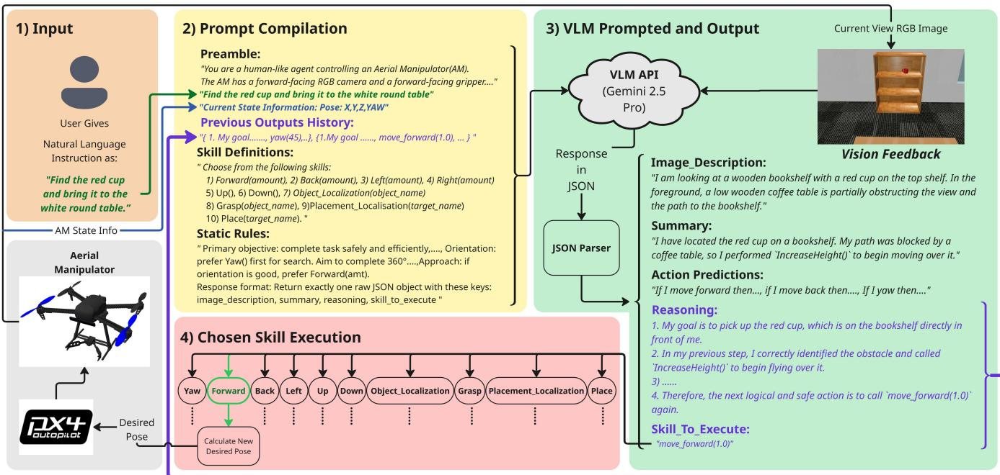
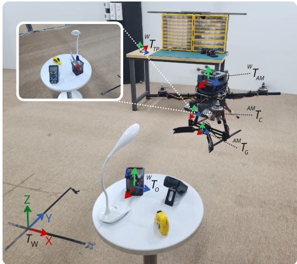
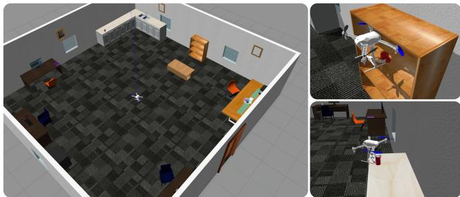
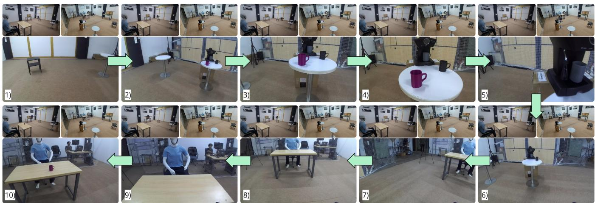
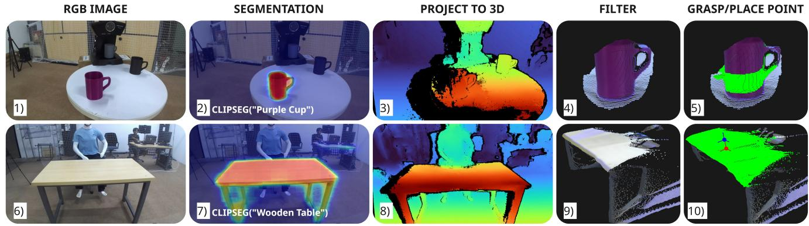
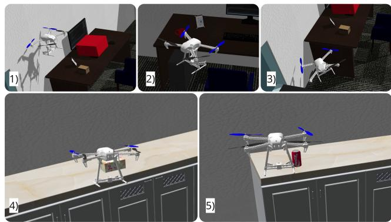
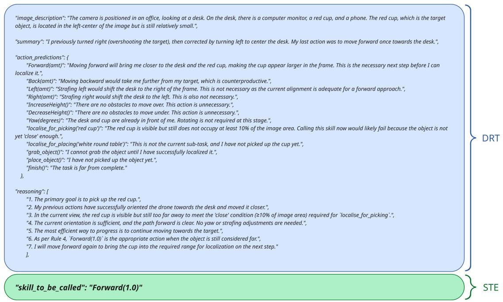

# AERMANI-VLM: Structured Prompting and Reasoning for Aerial Manipulation with Vision Language Models

Sarthak Mishra<sup>∗1</sup>, Rishabh Dev Yadav<sup>∗2</sup>, Avirup Das<sup>2</sup>, Saksham Gupta<sup>1</sup>, Wei Pan<sup>2</sup>, and Spandan Roy<sup>1</sup>

Abstract— The rapid progress of vision–language models (VLMs) has sparked growing interest in robotic control, where natural language can express the operation goals while visual feedback links perception to action. However, directly deploying VLM-driven policies on aerial manipulators remains unsafe and unreliable since the generated actions are often inconsistent, hallucination-prone, and dynamically infeasible for flight. In this work, we present AERMANI-VLM, the first framework to adapt pretrained VLMs for aerial manipulation by separating high-level reasoning from low-level control, without any taskspecific fine-tuning. Our framework encodes natural language instructions, task context, and safety constraints into a structured prompt that guides the model to generate a step-by-step reasoning trace in natural language. This reasoning output is used to select from a predefined library of discrete, flightsafe skills, ensuring interpretable and temporally consistent execution. By decoupling symbolic reasoning from physical action, AERMANI-VLM mitigates hallucinated commands and prevents unsafe behavior, enabling robust task completion. We validate the framework in both simulation and hardware on diverse multi-step pick-and-place tasks, demonstrating strong generalization to previously unseen commands, objects, and environment.

Website: https://sites.google.com/view/aermani-vlm

## I. INTRODUCTION

Aerial manipulators (AMs) extend multirotors from passive sensing to active interaction, enabling grasping, transport, and placement of objects in cluttered or hard-to-reach environments [1]. To be broadly useful, AMs should follow human-friendly instructions expressed in natural language, allowing non-expert operators to specify complex tasks with out hand-crafted scripts.

Achieving vision-language-guided aerial manipulation remains difficult, because AMs must simultaneously interpret high-level natural language and execute tasks under the coupled demands of perception, navigation, and manipulation. Executing a command like “find the red cup” involves: (i) exploration, when the target is out of view; (ii) grounding, linking linguistic concepts (“red cup”) to visual observation; and (iii) execution, performing contact-rich motion respecting dynamics. These interdependent demands make uniquely sensitive to perception or reasoning errors. Any reasoning failure directly compromises both grasping task success and the robot itself.

Existing Vision-Language-Action (VLA) models such as SayCan [2], PaLM-E [3], RT-2 [4], and OpenVLA [5] showcase strong zero-shot semantic reasoning for ground robots, but their data-intensive training and low-frequency inference make them unsuitable for aerial manipulation [6]. Their spatial grounding is brittle, often hallucinating unseen targets or misinterpreting spatial relations [7], and their stepwise, stochastic outputs [8] conflict with the stability and control consistency required for safe flight. These models also lack temporal coherence, generating context-free decisions across time rather than reasoning over task history. Similarly, Vision-Language Navigation (VLN) systems [9] have achieved language-conditioned navigation for multirotors, but remain limited to flight without manipulation. Furthermore, the behavior of vision-language models (VLMs) is highly prompt-sensitive [10], [11], underscoring the need for explicit and structured prompting to achieve consistent, interpretable reasoning in aerial manipulation.

This gap raises a central question: how can generalpurpose VLMs be adapted for aerial manipulation without costly domain training or fine-tuning? To address these challenges, we propose AERMANI-VLM, the first system that integrates pretrained vision–language reasoning with aerial manipulation. The core idea is to decouple what to do from how to do it: the VLM handles high-level reasoning under structured prompting, while a predefined library of flight-safe skills executes the resulting actions. This design retains the generalization ability of large models while ensuring stable, and repeatable control.

The main contributions are:

• To our knowledge, this is the first formalization of vision–language-guided aerial manipulation as sequential decision-making under partial observability, unifying natural-language reasoning, onboard perception, and task-level skill selection, without any taskspecific training or finetuning.

• Structured input prompting that encodes task intent, reasoning history, skill library, and safety constraints into a unified query for the pretrained VLM, enabling temporally consistent, context-aware, and physically valid reasoning while reducing hallucinations and maintaining task grounding.

• Structured reasoning output via Descriptive Reasoning Trace (DRT) that constrains the pretrained VLM to produce interpretable, temporally grounded decision traces instead of free-text commands, enforcing reasoning-before-action execution for consistent skill selection.

  
Fig. 1. Overview of the AERMANI-VLM pipeline for vision-language-guided aerial manipulation. (1) Input: a user provides a natural language command. (2) Prompt compilation: the command is compiled into a structured prompt containing a preamble, reasoning history, skill definitions, and safety rules. (3) VLM inference: together with the current RGB observation, the prompt is processed by a pretrained VLM, which outputs an image description, task summary, explicit reasoning trace, and a discrete skill to execute. (4) Skill execution: the selected motion primitive or perception-driven routine is executed by deterministic low-level controllers, ensuring repeatability under flight dynamics. This reasoning–action loop continues until task completion, enabling the VLM to focus on semantic reasoning while delegating precise execution to robust controllers.

The framework is evaluated in simulation and real-world experiments using a pretrained VLM, and comprehensive comparison and ablation studies are carried out to verify its performance. CLIPSeg [12] is used for prompt-based segmentation, maintaining a unified prompting pipeline from perception to reasoning.

## A. Additional Related Works

Aerial manipulation has progressed from vision-guided approaches relying on onboard cameras and artificial visual cues [13], to fully markerless grasping systems using onboard perception [14], and more recently endeffector–centric frameworks for versatile manipulation [15], yet all remain focused on execution rather than languagelevel reasoning. In parallel, VLAs [2]–[5] combine LLMbased planning [16], [17] with perceptual grounding from models such as CLIP [18], CLIPort [19], and LLaVA [20], but their end-to-end policies are data-intensive and prone to unsafe behaviors from ambiguous outputs, or adversarial prompts, motivating hybrid approaches where reasoning is decoupled from execution via modular skill primitives [21], [22]. For multirotors specifically, foundation model research has focused on mission planning [23], spatial reasoning [24], and direct control [25] which advances locomotion but does not extend to aerial manipulation, and it requires exploration coupled with grasping and placement [26].

In summary, control-focused aerial manipulation, reasoning-focused VLAs, and navigation-focused UAV-VLN each address parts of the problem, but none unify perception, reasoning, and execution for aerial manipulation. Together, these limitations motivate AERMANI-VLM, which unifies open-vocabulary perception, structured reasoning, and safe skill execution for aerial manipulation.

## II. AERMANI-VLM: METHODOLOGY

This section introduces its core components: problem formulation, prompt design, VLM output, the skill library, and the closed reasoning–action loop. Table I summarizes the key notations, and Fig. 2 illustrates the coordinate frames used throughout.

NOTATION SUMMARY FOR AERMANI-VLM.  
TABLE I

<table><tr><td>Symbol</td><td>Description</td></tr><tr><td> $L$ </td><td>Natural language command</td></tr><tr><td> $P_{t}$ </td><td>Structured prompt at timestep  $t$ </td></tr><tr><td> $s_{t}$ </td><td>Latent world state (partially observable)</td></tr><tr><td> $o_{t}$ </td><td>Onboard observation at timestep  $t$ </td></tr><tr><td> $a_{t} \in A$ </td><td>Skill action from skill library  $A$ </td></tr><tr><td> $\pi$ </td><td>High-level VLM policy</td></tr><tr><td> $\gamma_{t}$ </td><td>Structured VLM output at timestep  $t$ </td></tr></table>

## A. Problem Formulation and Architecture Overview

Our formulation is consistent with a Partially Observable Markov Decision Process (POMDP) framework [27], where the true world state $s _ { t }$ (object poses, manipulator pose, placement targets) is hidden and only partial observations are available. The system assumes no pre-existing map and relies solely on onboard perception for situational awareness. A natural language command L is embedded into a structured prompt $P _ { t }$ . At each timestep t, the aerial manipulator receives onboard observations $o _ { t }$ and queries a pretrained VLM, treated as the high-level policy π:

  
Fig. 2. Coordinate frames and spatial grounding in AERMANI-VLM. (i) The global world frame $T _ { \underline { { W } } }$ anchors all transformations, defining poses for the aerial manipulator $( \overset { \cdot } { W } _ { T _ { A M } } ) .$ , target object $( ^ { W } T _ { O } ) .$ , and placement location $( ^ { W } T _ { T P } ) .$ . (ii) Onboard frames for the camera $( ^ { A M } T _ { C } )$ and gripper $( \overset { \cdot } { \underset { \cdot } { A M } } _ { T _ { G } } )$ are expressed relative to the manipulator body, maintaining consistency between perception and control.

$$
\gamma_ {t} = \pi (o _ {t}, P _ {t}).\tag{1}
$$

The VLM produces a structured output $\gamma _ { t }$ that contains both its reasoning trace and a selected skill identifier, which together determine the next high-level action. The overall perception–reasoning–action pipeline can be summarized as:

$$
L; \xrightarrow {\text { task }} P _ {t}; \xrightarrow {\text { query }} \pi (o _ {t}, P _ {t}); \xrightarrow {\text { VLM   output }} \gamma_ {t}; \xrightarrow {\text { execution }} a _ {t}
$$

At timestep t, the AM acquires onboard observations:

$$
o _ {t} = \{I _ {t}, q _ {t} \},
$$

where $I _ { t }$ is the camera RGB image and $q _ { t }$ encodes the multirotor’s position and yaw.

## B. Structured Prompt Design and Input Encoding

A structured prompt $P _ { t }$ is constructed to encode the current task context before querying the pretrained VLM:

$$
P _ {t} = \{L, \text {   Preamble,   History,   Skill   Library,   Rules } \}. \tag {2}
$$

Each component structures task context and operational constraints for decision-making: (i) Task Command $( L ) .$ Defines the goal of task in natural language. (ii) Preamble: Describes the VLM’s role, the robotic platform and sensing setup. (iii) History: Summarized previous reasoning and executed skills to maintain sequential continuity and avoid repeated actions. (iv) Skill Library: Lists valid user-defined motion and perception skills in language form, defining the discrete action space. (v) Rules: Specify output constraints and enforce two-part responses: DRT and STE.

This prompt structure removes ambiguity in the query, prevents non-executable commands, and links high-level reasoning directly to physically valid control actions.

## C. Structured Output for Executable Reasoning

The pretrained VLM produces a bounded, structured and machine-interpretable response:

$$
\gamma_ {t} = \pi (o _ {t}, P _ {t}) = \{D R T _ {t}, S T E _ {t} \}.\tag{3}
$$

The DRT acts as a reasoning record-book, organizing the model’s perception, memory, and prediction into four fields:

## $D R T _ { t }$ = {Image Description, Summary, Action Predictions, Reasoning}.

Each field conveys complementary temporal information: (i) Image Description (Present): Describes the current scene, visible objects, their spatial layout, and contextual cues. It anchors reasoning to real, observable input and prevents hallucinated targets. (ii) Summary (Past): Recaps previous observations and executed skills, providing short-term memory for task progress. This continuity helps avoid repetitive actions and inconsistent planning under partial observability. (iii) Action Predictions (Future Candidates): Lists all available skills with short outcome estimates (e.g., what would happen if each were executed). This step forces the VLM to evaluate the full action set before selection, improving reasoning transparency and filtering invalid choices. (iv) Reasoning (Decision): Synthesizes perception, memory, and action predictions into a single coherent justification, concluding with the most appropriate skill/action.

The $\mathrm { S T E } _ { t }$ is a discrete command $a _ { t } \in A$ selected from the predefined skill library, while the DRT externalizes the reasoning behind this choice. This output format constrains the VLM to produce interpretable, verifiable reasoning that links visual perception to an executable action, forming a transparent reasoning–execution bridge for aerial manipulation.

## D. Skill Library for Aerial Manipulation

The skill library A defines the discrete set of executable routines available to the aerial manipulator. The VLM selects one skill, which is executed as a predefined routine with fixed action sequences and termination conditions. The library comprises two categories:

1) Motion Primitives. The motion primitives are userdefined pose adjustments of the aerial manipulator in its body frame, enabling active exploration, re-alignment, and precise positioning when targets object or placement sites are not visible. Each primitive is executed as a predefined routine with fixed angle and distance parameters, ensuring consistent behavior across tasks. The motion primitives are summarized in Table II.

2) Perception-Driven Manipulation Routines. Composite routines that couple perception with control for physical interaction. The four core routines are summarized in Table III.

All motion and perception routines are predefined, yield ing repeatable behavior under identical high-level inputs (e.g., move left, ascend, rotate). Each skill follows a fixed control–perception sequence, decoupling the VLM’s reasoning from low-level dynamics (e.g., thrust, body rates).

TABLE II  
MOTION PRIMITIVES IN THE SKILL LIBRARY.

<table><tr><td>Primitive</td><td>Description</td></tr><tr><td>yaw</td><td>Rotate about the body z-axis for view re-alignment or orientation adjustment.</td></tr><tr><td>forward/backward</td><td>Translate along the body x-axis to approach or retreat from detected targets.</td></tr><tr><td>left/right</td><td>Translate along the body y-axis to correct lateral misalignment or bypass occlusions.</td></tr><tr><td>up/down</td><td>Adjust altitude to maintain clearance or reach manipulation height.</td></tr><tr><td colspan="2">TABLE IIIPERCEPTION-DRIVEN ROUTINES IN THE SKILL LIBRARY.</td></tr><tr><td>Routine</td><td>Description</td></tr><tr><td>object_localization</td><td>Estimate 3D pose of the queried object using CLIPSeg [12] for zero-shot segmentation fused with depth and camera extrinsics.</td></tr><tr><td>grasp</td><td>Iterative re-localization with yaw alignment, closed-loop gripper actuation, and safe retreat after contact.</td></tr><tr><td>placement_localization</td><td>Identify a candidate surface in the point cloud and compute a collision-free placement pose with vertical offset.</td></tr><tr><td>place</td><td>Controlled descent, release, and retreat to a safe hover.</td></tr></table>

This modular separation enables new skills to be added or refined without modifying the reasoning framework or compromising system safety.

## E. Reasoning–Action Execution Loop

The reasoning–action execution loop forms the closed control cycle linking perception, reasoning, and actuation. At each step, the manipulator captures observations $o _ { t } ,$ compiles the structured prompt $P _ { t } ,$ and queries the pretrained VLM to obtain $\gamma _ { t } = \{ \mathrm { D R T } _ { t } , \mathrm { S T E } _ { t } \}$ . The selected skill STE is executed as a predefined routine/skill/action until its termination condition is met, while the corresponding reasoning trace is appended to the prompt history to maintain temporal context. This process repeats iteratively, with new observations updating the prompt and driving the next reasoning cycle. The system automatically re-prompts if the VLM output is invalid or outside the skill library, and switches to exploration or localization routines when targets are not detected. A compact working memory stores detected objects and executed actions, preventing redundant exploration and supporting consistent reasoning across time. The closed-loop structure ensures that each reasoning step is grounded in real observations and that all actions remain verifiable and flight-safe under partial observability. The overall process is summarized in Algorithm 1 and Fig 1.

## III. EXPERIMENTS

Experiments are conducted in both simulation and realworld settings to assess the framework’s performance and compare against various baselines. The pretrained VLM backbone is Gemini 2.5-Pro and perception modules is CLIPSeg [12] for target localization. Each policy operates by producing one discrete skill command at each reasoning step.

<div class="mineru-algorithm" style="white-space: pre-wrap; font-family:monospace;">
Algorithm 1 AERMANI-VLM reasoning-action loop.

Require: Natural language command L, skill library A
Ensure: Executed skill sequence  $\{a_{1}, a_{2}, \ldots, a_{T}\}$ 

1: Initialize history buffer  $H \leftarrow \emptyset$ 

2: for each timestep  $t = 1, 2, \ldots$  until task completion do

3: Acquire observation:  $o_{t} = \{I_{t}, q_{t}\}$ 

4: Construct structured prompt:

 $P_{t} = \{L, \text{Preamble}, H, \text{Skill Library}, \text{Rules}\}$ 

5: Query VLM policy:

 $\gamma_{t} = \pi(o_{t}, P_{t}) = \{\text{DRT}_{t}, \text{STE}_{t}\}$ 

6: Extract skill:  $a_{t} \leftarrow STE_{t} \in A$ 

7: Execute  $a_{t}$  as a predefined routine

8: Update history:  $H \leftarrow H \cup \{\text{DRT}_{t}, a_{t}\}$ 

9: end for
</div>

  
Fig. 3. Simulation Environment consisting of a custom indoor office setup with randomized layouts of tables, shelves, and other furniture.

## A. Experimental Setup

Simulation: The AM model operated under PX4 Autopilot in a Software-in-the-Loop (SITL) configuration, enabling realistic flight dynamics and high-fidelity sim-to-real transfer. A custom manipulator was mounted on the simulated Iris quadrotor to replicate the real-world hardware design.

Hardware: The physical platform was a Tarot 650 hexarotor equipped with a CUAV X7+ flight controller running PX4. High-level autonomy and perception ran on an NVIDIA Jetson Orin Nano using ROS 2, with onboard sensing provided by a ZED stereo RGB-D camera and a two-finger servo gripper. The Jetson computed skill-level setpoints, while the PX4 executed low-level way-point tracking.

The experimental environment, both in simulation and the real world, is shown in Fig 3.

## B. Task Suites

We design four progressively challenging task categories that test complementary aspects of language-conditioned aerial manipulation. (i) Localization and Identification tasks involve clear, unambiguous object–language references (e.g., “Pick up the red cup and place it on the table”), assessing perception–language grounding. (ii) Pick from Clutter / Ambiguity Resolution introduces multiple candidate objects (e.g., “Bring me a snack” when both an apple and a cracker box are visible), probing reasoning under perceptual and linguistic ambiguity. (iii) Sequential Instruction Following tasks combine navigation, perception, and manipulation (e.g., “Move closer to the table, turn left, and pick up the cup”), evaluating sequential consistency and procedural reasoning. Finally, (iv) Search and Pick requires locating targets initially outside the field of view (e.g., “Find the soda can on the table and bring it here”), testing exploratory reasoning before manipulation. Representative commands for all categories are listed in Table IV.

TABLE IV  
REPRESENTATIVE TASK COMMANDS.  
```txt
REPRESENTATIVE TASK COMMANDS.

Task and Example Commands

Localization & Identification
"Pick up the [Object] and place it on the [Location]."
"Get the [Object] and put it in the [Location]."
(Objects: red cup, coke can, tissue box; Locations: table, sink, shelf).

Pick from Clutter / Ambiguity Resolution
"Of the two boxes, pick up the larger one."
"Ignore the tools and pick up the green bottle."

Sequential Instruction Following
"Move forward twice, turn right, and pick up the tissue box."
"Approach the counter. If you see an orange, pick it up; otherwise grab the banana."

Search and Pick
"Find the purple cup and place it on the round table."
"Locate the cardboard box and bring it to the sink."
```

## C. Evaluation Metrics

Performance was evaluated using three complementary metrics. The (i) Task Success Rate (SR) measures overall reliability and is defined as $\begin{array} { r } { \mathrm { { S R } } \ = \ \frac { N _ { \mathrm { { s u c c e s s } } } } { N _ { \mathrm { { t o t a l } } } } \ \times \ 1 0 0 } \end{array}$ , where $N _ { \mathrm { s u c c e s s } }$ is the number of trials in which the correct object is manipulated and placed within a spatial tolerance before the timeout $T _ { \mathrm { m a x } } ~ = ~ 1 0$ min. This metric reflects task completion under realistic aerial operation constraints such as limited flight time and battery endurance. The (ii) Planning Inefficiency (PI) quantifies redundant or recoverable actions and is computed only over successful trials as $\begin{array} { r l r } { \mathrm { P I } } & { = } & { \frac { 1 } { N _ { \mathrm { s u c c e s s } } } \sum _ { i = 1 } ^ { N _ { \mathrm { s u c c e s s } } } \frac { { \bf \tilde { \rho } } _ { \mathrm { r e d u n d a n t } } ^ { * } } { n _ { \mathrm { t o t a l } } ^ { ( i ) } } } \end{array}$ , where $n _ { \mathrm { r e d u n d a n t } } ^ { ( i ) }$ denotes redundant actions and $n _ { \mathrm { t o t a l } } ^ { ( i ) }$ is the total number of actions in trial i. Redundant actions include unnecessary exploration or hesitation loops (e.g., forward–back or null–displacement motions), identified through trajectory analysis and verified via zero–net–motion checks. Lower values reflects smoother motion with fewer unnecessary corrections. The (iii) Decision Efficiency (DE) quantifies the average number of VLM queries per task and is defined as $\begin{array} { r } { \mathrm { D E } = \frac { 1 } { N _ { \mathrm { t o t a l } } } \sum _ { i = 1 } ^ { N _ { \mathrm { t o t a l } } } n _ { \mathrm { V L M } } ^ { ( i ) } , } \end{array}$ where $n _ { \mathrm { V L M } } ^ { ( i ) }$ is the number of reasoning–action cycles (queries) in trial i, averaged across all trials, including failed ones. Lower values correspond to more direct and consistent reasoning with fewer re–prompts.

## D. Ablation Studies and Comparison

To isolate the effects of input prompt P and the DRT, we conduct ablations using the same VLM and skill library, ensuring performance differences stem from reasoning structure rather than model capacity.

1) Ablation Configurations: We evaluate several variants of Reason-Fly shown in Table V.

TABLE V  
ABLATION CONFIGURATION

<table><tr><td rowspan="2">Variant</td><td colspan="5">Prompt Components</td><td colspan="4">DRT Components</td></tr><tr><td>L</td><td>P</td><td>H</td><td>S</td><td> $R^*$ </td><td>I</td><td>Su</td><td>A</td><td>Re</td></tr><tr><td>Unstructured Prompting</td><td>√</td><td>×</td><td>×</td><td>√</td><td>×</td><td>×</td><td>×</td><td>×</td><td>×</td></tr><tr><td>No-DRT (Direct Control)</td><td>√</td><td>√</td><td>√</td><td>√</td><td>√</td><td>×</td><td>×</td><td>×</td><td>×</td></tr><tr><td>Reduced DRT-V1</td><td>√</td><td>√</td><td>√</td><td>√</td><td>√</td><td>√</td><td>×</td><td>×</td><td>×</td></tr><tr><td>Reduced DRT-V2</td><td>√</td><td>√</td><td>√</td><td>√</td><td>√</td><td>√</td><td>√</td><td>×</td><td>×</td></tr><tr><td>Reduced DRT-V3</td><td>√</td><td>√</td><td>√</td><td>√</td><td>√</td><td>√</td><td>√</td><td>√</td><td>×</td></tr><tr><td>Full AERMANI-VLM</td><td>√</td><td>√</td><td>√</td><td>√</td><td>√</td><td>√</td><td>√</td><td>√</td><td>√</td></tr></table>

Component definitions: $\mathrm { ~ L ~ } = \mathrm { ~ I ~ }$ anguage Command, P = Preamble, H = History, S = Skill Library, R = Rules, I = Image Description, Su = Summary, A = Action Predictions, Re = Reasoning. \* variant-specific modification.

2) Results: In real-world experiments, AERMANI-VLM successfully executed full pick-and-place tasks from natural language instructions (shown in Fig 4), while its openvocabulary perception pipeline for object localization and placement estimation is shown in Fig 5. Across 10 hardware trials, the AERMANI-VLM framework achieved an average success rate of 80%, with a PI of 2.5 and a DE of 18.0. Complementary simulation experiments were performed across four task suites, each repeated ten times per ablation configuration to ensure statistical reliability and enable fair comparison across tasks. Table VI confirms that AERMANI-VLM (With-DRT) achieving an average success rate of 87.5%, far surpassing No-DRT (15.0%) and Unstructured Prompting (5.0%) configurations. Representative failure cases in Fig. 6 show that No-DRT and unstructured variant often failed due to spurious skill selections, object mislocalization, or premature grasp execution. In contrast, DRT-based reasoning enabled contextual correction, such as relocalizing targets before grasping or verifying placement safety before execution.

3) Discussion.: The ablation sequence reflects the progressive development of AERMANI-VLM. The initial Unstructured Prompting setup exposed fundamental weaknesses: without contextual cues or rule constraints, the VLM produced unstable and often contradictory actions, leading to frequent drift and task failure. Adding prompt structure but without any DRT (No-DRT) stabilized language grounding yet still caused reactive behavior, as the system lacked memory of prior reasoning or action outcomes. Introducing partial DRT variants incrementally restored this linkage. V1 (image description only) improved visual grounding but could not track progress across steps. V2 (with summary) introduced temporal awareness, reducing redundant motions but still lacking predictive reasoning. V3 (with action prediction) further increased task stability by enabling forward evaluation, though execution errors remained unfiltered. The complete AERMANI-VLM integrates all components, i.e. structured prompting, full DRT reasoning, and pre-defined skill library. This progression confirms that both the structured input and structured output are essential: the former provides reliable semantic grounding, while the latter enforces causal and physically consistent decision sequences under aerial



Fig. 4. Qualitative results from a real-world hardware experiment for the command: “Pick up the purple cup next to the coffee machine and place it on the wooden table.” Each panel shows the first-person onboard view (large bottom image) and two static third-person views (small top images). The numbered sequence illustrates the complete, autonomous execution of the task. (1–3) The AM performs an active search to find the target object. (4–5) It executes a visually-guided approach and grasp. (6–8) After securing the cup, it searches for the destination table. (9–10) Finally, it approaches the table and places the object.  


Fig. 5. The open-vocabulary perception pipeline for object localization (top row) and placement localization (bottom row). Given a natural language query (e.g., ”Purple Cup”), CLIPSeg performs zero-shot segmentation on the input RGB image. This 2D mask is then used to extract a filtered 3D point cloud from the depth data, allowing for the precise calculation of a grasp or placement pose.  
  
Fig. 6. Common failure modes from baselines lacking structured reasoning. These include collisions from hallucinated motion commands (1-3). Manipulation failures (4-5), such as colliding with the table or misjudging object position, frequently occurred when the object localization module led to inaccurate pose estimates.

## dynamics.

## E. Baseline Methods and Comparisons

To contextualize performance, AERMANI-VLM is compared against both general-purpose Vision–Language–Action (VLA) models and aerial-domain reasoning frameworks. Since existing VLAs are not trained for aerial manipulation, all baselines are adapted without retraining, using identical visual and linguistic inputs and the same discrete skill library. Each baseline functions as a frozen high-level policy; lowlevel control and safety handling are executed through the common PX4-based controller for consistency.

1) Baseline Configuration: We evaluate four representative frameworks capturing complementary control paradigms: (i) UAV-VLN [9] performs language-conditioned waypoint prediction for aerial navigation. We adapt its pretrained waypoint network to output displacements in the drone body frame and quantize them into motion primitives (forward, backward, left, right, up, down). Tasks terminate once the target vicinity is reached, as manipulation primi tives are not supported. (ii) SayCan [2] grounds language instructions through skill affordances estimated by an LLM. The ground-robot skills are replaced by our aerial motion and manipulation primitives. The original affordance values are substituted by a binary feasibility mask that filters unsafe or dynamically infeasible skills. The model outputs one ranked skill per prompt without temporal memory or reasoning trace. (iii) RT-2 [4] represents direct end-to-end action prediction. Image and instruction inputs are mapped to a discrete action token, which is translated to the nearest aerial skill using a static lookup table. Unrecognized or unsafe tokens are ignored. This baseline captures a purely reactive policy without interpretability or state continuity. (iv) UAV-VLA / CognitiveDrone [23], [25] models highlevel language reasoning for aerial tasks. Following their published prompting structure, the model selects missionlevel primitives (fly to, scan area, hover), which are mapped to our skill set for execution. Its low decision frequency limits control granularity but provides an upper bound on deliberative reasoning performance.

TABLE VI  
SIMULATION RESULTS ACROSS 4 TASK CATEGORIES.

<table><tr><td>Task Suite</td><td>Method</td><td>SR ↑</td><td>PI ↓</td><td>DE ↓</td></tr><tr><td rowspan="6">Localization</td><td>Unstructured</td><td>10.0</td><td>21.0</td><td>40.0</td></tr><tr><td>No-DRT</td><td>20.0</td><td>20.3</td><td>33.5</td></tr><tr><td>DRT-V1</td><td>30.0</td><td>18.1</td><td>31.4</td></tr><tr><td>DRT-V2</td><td>50.0</td><td>14.7</td><td>26.3</td></tr><tr><td>DRT-V3</td><td>60.0</td><td>10.2</td><td>21.5</td></tr><tr><td>AERMANI-VLM</td><td>90.0</td><td>2.1</td><td>11.0</td></tr><tr><td rowspan="6">Pick from Clutter</td><td>Unstructured</td><td>0.0</td><td>-</td><td>35.0</td></tr><tr><td>No-DRT</td><td>10.0</td><td>17.1</td><td>28.0</td></tr><tr><td>DRT-V1</td><td>20.0</td><td>14.9</td><td>26.1</td></tr><tr><td>DRT-V2</td><td>40.0</td><td>12.6</td><td>22.5</td></tr><tr><td>DRT-V3</td><td>50.0</td><td>8.9</td><td>18.7</td></tr><tr><td>AERMANI-VLM</td><td>80.0</td><td>4.0</td><td>14.1</td></tr><tr><td rowspan="6">Sequential</td><td>Unstructured</td><td>10.0</td><td>-</td><td>42.0</td></tr><tr><td>No-DRT</td><td>20.0</td><td>15.0</td><td>35.7</td></tr><tr><td>DRT-V1</td><td>30.0</td><td>12.1</td><td>32.4</td></tr><tr><td>DRT-V2</td><td>50.0</td><td>8.7</td><td>28.3</td></tr><tr><td>DRT-V3</td><td>60.0</td><td>6.5</td><td>25.4</td></tr><tr><td>AERMANI-VLM</td><td>100.0</td><td>2.8</td><td>19.2</td></tr><tr><td rowspan="6">Search &amp; Pick</td><td>Unstructured</td><td>0.0</td><td>16.0</td><td>46.0</td></tr><tr><td>No-DRT</td><td>10.0</td><td>14.3</td><td>39.8</td></tr><tr><td>DRT-V1</td><td>30.0</td><td>12.4</td><td>37.1</td></tr><tr><td>DRT-V2</td><td>50.0</td><td>9.5</td><td>33.6</td></tr><tr><td>DRT-V3</td><td>60.0</td><td>6.9</td><td>29.2</td></tr><tr><td>AERMANI-VLM</td><td>80.0</td><td>3.1</td><td>23.7</td></tr></table>

2) Results: Table VII summarizes the quantitative comparison for ten simulation trials per method, where AERMANI-VLM achieves the highest SR and lowest PI and DE among all evaluated methods. SayCan and RT-2 perform moderately well but show higher variance in action selection, reflected in increased PI. UAV-VLN and UAV-VLA exhibit reduced task completion rates due to the absence of manipulation capabilities and coarser action resolution. Fig 7 shows the policy output with reasoning and skill selection for the AERMANI-VLM.

TABLE VII  
PERFORMANCE COMPARISON WITH EXISTING BASELINES.

<table><tr><td>Method</td><td>SR (%) ↑</td><td>PI ↓</td><td>DE ↓</td><td>Reasoning</td><td>Manipulation</td></tr><tr><td>RT-2 [4]</td><td>10.0</td><td>19.0</td><td>42.0</td><td>-</td><td>√</td></tr><tr><td>SayCan [2]</td><td>20.0</td><td>16.0</td><td>33.0</td><td>√</td><td>√</td></tr><tr><td>UAV-VLN [9]</td><td>30.0</td><td>16.5</td><td>38.0</td><td>√</td><td>-</td></tr><tr><td>UAV-VLA [23], [25]</td><td>45.0</td><td>10.5</td><td>26.0</td><td>√</td><td>-</td></tr><tr><td>AERMANI-VLM (Ours)</td><td>87.5</td><td>3.0</td><td>17.0</td><td>√</td><td>√</td></tr></table>

3) Discussion: The comparison results reveal a clear hierarchy, how existing frameworks handle aerial manipulation tasks. RT-2, being purely reactive, directly maps vision–language inputs to actions without any reasoning. This leads to frequent goal drift, dynamically infeasible motions, and poor task success due to the absence of temporal or contextual grounding. SayCan introduces grounding through a predefined skill set, yet lacks explicit temporal reasoning, often producing context-inconsistent or redundant skill sequences that degrade long-horizon reliability. UAV-VLN demonstrates better goal continuity through sequential instruction following, but its absence of physical interaction primitives restricts success to navigation-only tasks. UAV-VLA performs deliberate, mission-level reasoning, but its low update frequency and coarse action abstraction limit fine-grained control and result in moderate completion rates. In contrast, AERMANI-VLM achieves robust reasoning and control through structured prompting, DRT-based temporal consistency, and deterministic skill execution. These mechanisms suppress reasoning drift, prevent hallucinated action transitions, and ensure stable perception–action coupling, yielding the highest task success rate.

## IV. CONCLUSION AND FUTURE WORK

This work presented AERMANI-VLM, the first framework that systematically integrates pretrained VLM with aerial manipulation through structured prompting and predefined skill library. By decoupling semantic reasoning from physical control, the system transforms general-purpose VLMs into reliable decision layers for aerial robots without domain-specific retraining. Extensive simulation and hardware experiments demonstrate that structured input–output design is critical: prompting defines the task boundary, while the output reasoning trace enforces temporal grounding and verifiable reasoning. Together, these mechanisms reduce hallucinations, stabilize task sequences, and enable zero-shot manipulation from natural-language commands. Future work will extend this foundation toward dexterous and dual-arm manipulation, persistent long-horizon missions with memory, and collaborative multi-agent reasoning, advancing the vision of autonomous aerial systems that understand, reason, and act through language.

## REFERENCES

[1] A. Ollero, M. Tognon, A. Suarez, D. J. Lee, and A. Franchi, “Past, ´ present, and future of aerial robotic manipulators,” IEEE Transactions on Robotics, vol. 38, no. 1, pp. 626–645, 2021.

[2] M. Ahn, A. Brohan et al., “Do as i can, not as i say: Grounding language in robotic affordances,” in Proc. Conf. Robot. Learning (CoRL), 2022.

[3] D. Driess, F. Xia, M. S. M. Sajjadi, C. Lynch, A. Chowdhery, B. Ichter, A. Wahid, J. Tompson, Q. Vuong, T. Yu et al., “PaLM-E: An embodied multimodal language model,” in Proceedings of the 40th International Conference on Machine Learning (ICML), 2023.

[4] B. Zitkovich, T. Yu et al., “Rt-2: Vision-language-action models transfer web knowledge to robotic control,” in Proc. 7th Conf. Robot. Learning (CoRL), 2023, pp. 2165–2183.

[5] M. J. Kim, K. Pertsch, S. Karamcheti, T. Xiao, A. Balakrishna, S. Nair, R. Rafailov, E. Foster, G. Lam, P. Sanketi, Q. Vuong, T. Kollar, B. Burchfiel, R. Tedrake, D. Sadigh, S. Levine, P. Liang, and C. Finn, “Openvla: An open-source vision-language-action model,” in Proceedings of the 8th Conference on Robot Learning (CoRL), 2025, pp. 2679–2713.

  
Fig. 7. Example output from the pretrained VLM under AERMANI-VLM prompting. The model generates a structured reasoning trac (DRT) consisting of image description, task summary, candidate action predictions with justifications, and step-by-step reasoning. From this trace, the system selects a discrete, flight-safe skill (STE) to execute.

[6] P. Foehn, E. Kaufmann, A. Romero, R. Penicka, S. Sun, L. Bauersfeld, T. Laengle, G. Cioffi, Y. Song, A. Loquercio, and D. Scaramuzza, “Agilicious: Open-source and open-hardware agile quadrotor for vision-based flight,” Science Robotics, vol. 7, no. 67, Jun. 2022. [Online]. Available: http://dx.doi.org/10.1126/scirobotics.abl6259

[7] R. Steiner, A. Millane, D. Tingdahl, C. Volk, V. Ramasamy, X. Yao, P. Du, S. Pouya, and S. Sheng, “mindmap: Spatial memory in deep feature maps for 3d action policies,” arXiv preprint arXiv:2509.20297, 2025.

[8] X. Wu, S. Chakraborty, R. Xian, J. Liang, T. Guan, F. Liu, B. M. Sadler, D. Manocha, and A. S. Bedi, “On the vulnerability of llm/vlmcontrolled robotics,” arXiv preprint arXiv:2402.10340, 2024.

[9] Y. Jiang, A. Gupta, Z. Zhang, G. Wang, Y. Dou, Y. Chen, L. Fei-Fei, A. Anandkumar, Y. Zhu, and L. Fan, “Vima: General robot manipulation with multimodal prompts,” in Fortieth International Conference on Machine Learning, 2023.

[10] J. Gu, Z. Han, S. Chen, A. Beirami, B. He, G. Zhang, R. Liao, Y. Qin, V. Tresp, and P. Torr, “A systematic survey of prompt engineering on vision-language foundation models,” arXiv preprint arXiv:2307.12980, 2023.

[11] K. Zhou, J. Yang, C. C. Loy, and Z. Liu, “Learning to prompt for vision-language models,” International Journal of Computer Vision, vol. 130, no. 9, pp. 2337–2348, 2022.

[12] T. Luddecke and A. S. Ecker, “Image segmentation using text and¨ image prompts,” in Proceedings of the IEEE/CVF Conference on Computer Vision and Pattern Recognition (CVPR). IEEE, 2022, pp. 7086–7096.

[13] K. Kim and et al., “Vision-guided aerial manipulation using a multirotor with a robotic arm,” in IEEE/RSJ International Conference on Intelligent Robots and Systems (IROS), 2016.

[14] E. Bauer, B. G. Cangan, and R. K. Katzschmann, “Autonomous marker-less rapid aerial grasping,” arXiv preprint, vol. 2211.13093, 2022, arXiv:2211.13093.

[15] G. He, X. Guo, L. Tang, Y. Zhang, M. Mousaei, J. Xu, J. Geng, S. Scherer, and G. Shi, “Flying hand: End-effector-centric framework for versatile aerial manipulation teleoperation and policy learning,” arXiv preprint arXiv:2504.10334, 2025.

[16] T. Brown, B. Mann, N. Ryder, M. Subbiah, J. Kaplan, P. Dhariwal, A. Neelakantan, P. Shyam, G. Sastry, A. Askell, S. Agarwal et al., “Language models are few-shot learners,” in Advances in Neural Information Processing Systems, vol. 33, 2020, pp. 1877–1901.

[17] J. Wei, X. Wang, D. Schuurmans, M. Bosma, F. Xia, E. Chi, Q. V. Le, and D. Zhou, “Chain-of-thought prompting elicits reasoning in

large language models,” in Advances in Neural Information Processing Systems, vol. 35, 2022, pp. 24 824–24 837.

[18] A. Radford, J. W. Kim, C. Hallacy, A. Ramesh, G. Goh, S. Agarwal, G. Sastry, A. Askell, P. Mishkin, J. Clark, G. Krueger, and I. Sutskever, “Learning transferable visual models from natural language supervision,” in Proceedings ofthe 38th International Conference on Machine Learning (ICML), 2021, pp. 8748–8763.

[19] M. Shridhar, L. Manuelli, and D. Fox, “CLIPort: What and where to pick?–language-guided semantic grasping,” in Conference on Robot Learning (CoRL). PMLR, 2021, pp. 932–941.

[20] H. Liu, C. Li, Q. Wu, and Y. J. Lee, “Visual instruction tuning,” in Advances in Neural Information Processing Systems, vol. 36, 2023.

[21] Y. Hu, Q. Xie, V. Jain, J. Francis, J. Patrikar, N. Keetha, S. Kim, Y. Xie, T. Zhang, H.-S. Fang et al., “Toward general-purpose robots via foundation models: A survey and meta-analysis,” arXiv preprint arXiv:2312.08782, 2023.

[22] B. Zhang, Y. Zhang, J. Ji, Y. Lei, J. Dai, Y. Chen, and Y. Yang, “Safevla: Towards safety alignment of vision-language-action model via constrained learning,” arXiv preprint arXiv:2503.03480, 2025.

[23] O. Sautenkov, Y. Yaqoot, A. Lykov, M. A. Mustafa, G. Tadevosyan, A. Akhmetkazy, M. Altamirano Cabrera, M. Martynov, S. Karaf, and D. Tsetserukou, “UAV-VLA: Vision-language-action system for large scale aerial mission generation,” arXiv preprint arXiv:2501.05014, 2025, available at: https://arxiv.org/abs/2501.05014.

[24] Y. Gao, C. Li, Z. You, J. Liu, P. Chen, Q. Chen, Y. Tang, H. Luo, K. Wang, X. Han, and L. Lin, “OpenFly: A comprehensive platform for aerial vision-language navigation,” arXiv preprint arXiv:2502.18041, 2025, available at: https://arxiv.org/abs/ 2502.18041.

[25] A. Lykov, V. Serpiva, M. H. Khan, O. Sautenkov, A. Myshlyaev, G. Tadevosyan, Y. Yaqoot, and D. Tsetserukou, “CognitiveDrone: A VLA model and evaluation benchmark for real-time cognitive task solving and reasoning in UAVs,” arXiv preprint arXiv:2503.01378, 2025, available at: https://arxiv.org/abs/2503.01378.

[26] Y. Tian, F. Lin, Y. Li, T. Zhang, Q. Zhang, X. Fu, J. Huang, X. Dai, Y. Wang, C. Tian, B. Li, Y. Lv, L. Kovacs, and F.-Y. Wang, “Uavs´ meet llms: Overviews and perspectives toward agentic low-altitude mobility,” arXiv preprint arXiv:2501.02341, 2025, available at: https: //arxiv.org/abs/2501.02341.

[27] M. Lauri, D. Hsu, and J. Pajarinen, “Partially observable markov decision processes in robotics: A survey,” IEEE Transactions on Robotics, vol. 39, no. 1, pp. 21–40, 2023.