# AdaptNC: Adaptive Nonconformity Scores for Conformal Prediction under Distribution Shift

Renukanandan Tumu1 ∗

Aditya Singh1

Rahul Mangharam1

## Abstract

Rigorous uncertainty quantification is essential for the safe deployment of autonomous systems in dynamic environments. Conformal Prediction (CP) provides a distribution-free framework for this task, yet its standard formulations rely on exchangeability assumptions that are violated by the distribution shifts inherent in real world robotics. Existing online CP methods maintain target coverage by adaptively scaling the conformal threshold, but typically employ a static nonconformity score function. We show that this fixed geometry leads to highly conservative, volumeinefficient prediction regions when environments undergo structural shifts. To ad dress this, we propose AdaptNC, a framework for the joint online adaptation of both the nonconformity score parameters and the conformal threshold. AdaptNC leverages an adaptive reweighting scheme to optimize score functions, and introduces a replay buffer mechanism to mitigate the coverage instability that occurs during score transitions. We evaluate AdaptNC on diverse robotic benchmarks involving multiagent policy changes, environmental changes and sensor degradation. Our results demonstrate that AdaptNC significantly reduces prediction region volume compared to state-of-the-art threshold-only baselines while maintaining target coverage levels.

## 1 Introduction

Autonomous systems operating in real-world environments are subject to constant change. These changes induce distribution shift, driven by changing environmental conditions, such wind or weather, system degradation due to damage or wear and tear, or through multi-agent interactions, which can all degrade the performance of predictive models. For safety-critical applications such as autonomous driving and robotic navigation, identifying these shifts and providing robust, uncertainty-aware predictions is not just a performance requirement; it is a safety necessity [1]. Distribution shift in robotics does not only change the magnitude or frequency of errors, it can change the structure of the errors. For example, tire damage in a ground vehicle or strong winds affecting a drone can induce directionally biased prediction errors. Because prediction regions are often used to define where robots should slow down, avoid, or plan conservatively [2], these structural changes directly affect the usefulness of uncertainty estimates. Thus, prediction regions should not only adapt in size, but also in shape, as environmental and system conditions evolve.

Uncertainty quantification has been a focus of much recent work, and conformal prediction (CP) [3, 4], has emerged as a popular method for its flexibility to be applied to predictors of all types, its statistical grounding, and its ease of use for the practitioner. CP constructs prediction sets which contain the true label with high (1−α) probability, under the assumption of exchangeability between the calibration and test distributions. In CP, the threshold controls the size of the prediction region, while the non-conformity score function controls its geometry. Online adaptation has largely focused on the former, leaving the latter fixed even when the structure of the data changes.

Recent online CP methods adapt the conformal threshold to maintain coverage under distribution shift[5–7]. However, because they keep the non-conformity score fixed, they can only resize prediction regions rather than reshape them. This limitation is important in robotic settings, where shifts such as sensor degradation or policy changes can alter the geometry of prediction errors. Separately, previous work has addressed the design of non-conformity score functions[8, 9], including control and robotics settings with multi-dimensional outputs [10–13], however, this work does not address the adaptation of the non-conformity score in response to distribution shift.

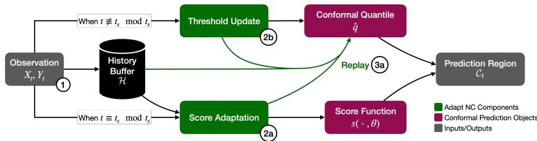  
Figure 1: The AdaptNC framework is an online algorithm designed to handle distribution shifts. The above figure shows the procedure at a timestep t. (1) The observation for the current timestep arrives, and is added to the history buffer. Every $t _ { s }$ timesteps, the score function is adapted by weighted score adaptation (2a). This adaptation yields a score function $s ( \cdot , \theta _ { t } )$ , the replay algorithm (3a) compensates for the distribution shift generated by the change in score function by replaying recent samples from the history buffer H and generates the conformal quantile qˆ. When the score is not being adapted, only the conformal quantile is adapted through the threshold update step.

Unlike existing methods that only tune the threshold, AdaptNC optimizes the underlying score function to ensure that prediction regions remain tight and informative even as the data distribution evolves. AdaptNC also shifts the conformal threshold. In order to provide principled score function adaptation, we introduce an adaptive reweighting scheme that leverages DtACI expert weights to prioritize the most relevant historical observations during score optimization. The joint adaptation of the score function and threshold introduces the phenomenon of “coverage shock": the errors in coverage caused by evaluating old threshold values under a new score function. To mitigate “coverage shock” we employ a counterfactual replay mechanism to recalibrate the conformal threshold following a score update. Across three robotic settings with structural distribution shifts, AdaptNC maintains target coverage while producing smaller prediction regions than threshold-adaptation baselines, demonstrating that score adaptation improves efficiency without sacrificing empirical coverage.

Contributions: This paper addresses the challenge of constructing efficient, uncertainty-aware prediction regions under distribution shift by contributing:

1. Online Score Function and Threshold Adaptation: We present a method for the online optimization of non-conformity scores and their corresponding conformal thresholds that minimizes prediction region volume while enabling adaptation to shifting distributions.

2. Dynamic Weighting and Replay Buffer: We develop a weighting mechanism for data based on the rate of distribution shift, and a replay mechanism to maintain coverage stability during score parameter transitions.

3. Empirical Validation on Robotic Benchmarks: We evaluate AdaptNC on robotic tasks involving structural distribution shifts, including multi-agent policy changes and sensor degradation. We demonstrate that AdaptNC reduces prediction volume compared to state-of-the-art online CP baselines while maintaining target coverage levels.

Furthermore, we emphasize that AdaptNC is not a direct composition of prior adaptive conformal prediction and score-adaptation methods. Instead, it formulates a new setting involving coupled adaptation, characterizes the instabilities arising from a naive integration, and introduces the mechanisms necessary to ensure stable and effective joint adaptation. Additional discussion is provided in Appendix B.1.

## 2 Problem Setup and Preliminaries

## 2.1 Online Prediction Setting

We consider an online τ -step prediction setting. At each time step $t { = } 1 , . . . , T$ , the predictor observes features $X _ { t } \in \mathcal { X }$ and produces a τ-step prediction $\hat { Y } _ { t } = h ( X _ { t } ) = \{ \hat { y } _ { t + 1 } , \dots , \hat { y } _ { t + \tau } \} \in \mathcal { Y } ^ { \tau }$ . The future outcome $Y _ { t } \in \mathcal { V } ^ { \tau }$ is then observed. The joint distribution of $\dot { ( X _ { t } , Y _ { t } ) }$ may change over time.

We seek to build a prediction region $\mathcal { C } _ { t }$ that contains the future outcome $Y _ { t }$ with probability $1 - \alpha$ where $\alpha \in ( 0 , 1 )$ is the target miscoverage rate. The prediction regions are constructed using a non-conformity score function $s ( X _ { t } , y ; \theta _ { t } )$ where $\theta _ { t }$ are parameters of the score function at time $t ,$ as well as a conformal threshold, $q _ { t }$ . We define $q _ { \mathcal { D } _ { t } } ( \delta )$ to be the empirical $\delta \in [ 0 , 1 ]$ quantile of the score dataset $\mathcal { D } _ { t }$ , and $q _ { t } = q _ { D _ { t } } ( \delta _ { t } )$ . The prediction region is the set of points with a non-conformity score less than the conformal quantile: $\mathcal { C } _ { t } ( X _ { t } ; \theta _ { t } , q _ { t } ) : = \{ y \in \mathcal { Y } ^ { \tau } : s ( X _ { t } , \dot { y } ; \theta _ { t } ) \leq q _ { t } \}$ . The threshold $q _ { t }$ controls the size of the prediction region, while the score parameters $\theta _ { t }$ control its geometry.

Desiderata: We pursue the objectives of coverage that approaches the target, and efficiency of the prediction region under settings with distribution shift.

Coverage: Under distribution shift, exact finite-sample coverage at every time step is generally not attainable. Instead, we seek the asymptotic miscoverage rate $\alpha ,$ in settings where the magnitude of distri bution shift decays over time. We define the error indicator er $\mathbf { r } _ { t } { = } \Im \{ Y _ { t } \hat { \notin } { \mathcal { C } } _ { t } ( X _ { t } ; \theta _ { t } , q _ { t } ) \}$ , and we target:

$$
\lim _ {T \to \infty} \frac {1}{T} \sum_ {t = 1} ^ {T} \mathbf {e r r} _ {t} = \alpha .\tag{1}
$$

Efficiency: We would also like to ensure that the prediction regions $\mathcal { C } _ { t }$ are small and informative to downstream algorithms. Subject to our coverage desideratum, our objective is to minimize the volume of the prediction set $\mathcal { C } _ { t }$ . We formulate the optimization problem:

$$
\min _ {\theta_ {t}} \quad \operatorname{Vol} (\mathcal {C} _ {t} (X _ {t + 1}; \theta_ {t}, q _ {t})), \quad \text { s.t. } \operatorname * {P r} [ Y _ {t + 1} \in \mathcal {C} _ {t} (X _ {t + 1}; \theta_ {t}, q _ {t}) ] \geq 1 - \alpha .\tag{2a}
$$

In the online setting, the future distribution is unknown, so this problem serves as an idealized objective: AdaptNC seeks to reduce prediction-region volume while maintaining long-run coverage.

## 2.2 Preliminaries

Conformal Prediction: Conformal prediction (CP) and its split variants provide distribution-free, finite-sample prediction regions which guarantee ground truth coverage with $1 - \alpha$ probability under the assumption of exchangeable calibration and test data [3, 4, 14]. Under distribution shift, this exchangeability assumption may fail, motivating online methods that adapt the threshold over time.

Online Threshold Adaptation: Online conformal prediction methods adapt the threshold to maintain long-run coverage in settings where distribution shift occurs. DtACI [6] targets long-run coverage under arbitrary distribution shifts by adaptively reweighting a set of candidate adaptation rates based on their historical performance. It obtains a long-term coverage guarantee of the form in Eq. (1) in settings where the size of the distribution shift decays over time.

The DtACI algorithm seeks to compensate for distribution shift by changing the adaptive miscoverage level $\alpha _ { t }$ used to select the score threshold $q _ { t } = q _ { \mathcal { D } _ { t } } ( 1 - \alpha _ { t } )$ . The algorithm seeks to find $\alpha _ { t }$ that minimizes the regret to the hindsight optimal quantile $\alpha _ { t } ^ { * }$ . This difference is bounded in Theorem D.1. Observations in the algorithm are quantiles $\beta _ { t } ,$ , which are the lowest empirical quantiles of the dataset $\mathcal { D } _ { t }$ that would have covered the true outcome at time t. Formally,

$$
\beta_ {t} := \inf \left\{\beta : Y _ {t} \in \left\{y: s (X _ {t}, y; \theta_ {t}) \leq \hat {q} _ {\mathcal {D} _ {t}} (\beta) \right\} \right\}\tag{3}
$$

To achieve this, DtACI maintains a set of k candidate adaptation rates $\{ \gamma _ { i } \} _ { i = 1 } ^ { k }$ and corresponding weights $\{ w _ { t } ^ { i } \} _ { i = 1 } ^ { k }$ . At each time step, the algorithm performs an exponential weights update on the weights based on the error incurred by each candidate rate. An averaged quantile $\bar { \alpha } _ { t }$ is then computed using the weights, and the quantile threshold $q _ { \mathcal { D } _ { t } } ( 1 - \bar { \alpha } _ { t } )$ ) is updated accordingly. The algorithm is presented in Algorithm 3 (in Appendix C).

## 3 Related Work

Online Threshold Adaptation. Online conformal prediction methods address distribution shift primarily by adapting the conformal threshold or calibration quantile over time. Adaptive Conformal Inference (ACI) updates the quantile based on recent coverage errors [5], while related methods such as AgACI and multivalid conformal prediction provide alternative mechanisms for maintaining coverage under non-stationarity [7, 15]. DtACI further advances this line of work by adaptively weighting multiple candidate adaptation rates and providing long-term coverage regret guarantees [6]. However, these online CP methods adapt the threshold while leaving the non-conformity score fixed. As a result, they can resize prediction regions under distribution shift, but they cannot reshape them when the geometry of prediction errors changes. Other approaches address distribution shift by reweighting calibration points to better match the test distribution under covariate shift [16, 17]. These methods modify the effective calibration distribution, and have been used in reinforcement learning settings [18, 19] but they do not adapt the non-conformity score online.

Efficient and Shape-Adaptive Non-Conformity Scores. A separate line of work studies how the choice of non-conformity score affects the shape and volume of conformal prediction regions. Recent methods design volume-efficient scores for general prediction settings [8, 9], as well as for control and robotics problems with multi-dimensional outputs [10–13]. These methods show that intentional design of the non-conformity score function can substantially improve prediction-region efficiency and downstream usefulness. However, they typically design or optimize the score for a fixed data-generating process. They do not consider online score adaptation under distribution shift, where the geometry of prediction errors may change over time.

## 4 AdaptNC Method

Our method, Adaptation of Non-Conformity Scores (AdaptNC), extends online conformal prediction by jointly adapting the conformal threshold and non-conformity score function (NCSF). (1) Threshold adaptation maintains long-run coverage, (2) Score Parameter Adaptation improves efficiency under distribution shift, and (3) Replay recalibrates the threshold after score updates to mitigate coverage shock. At each timestep, the conformal threshold is updated using the quantile $q _ { \mathcal { D } _ { t } } ( 1 - \bar { \alpha } _ { t } )$ based on the current NCSF and newly observed data. Score parameters $\theta _ { t }$ are periodically updated using estimates of distribution shift to obtain more efficient regions, and replay rescores recent observations under the updated NCSF ccount for the induced change in the score distribution . Due to computational intensity, steps (2) and (3) are performed every $t _ { s }$ timesteps, while (1) is updated at every timestep. An overview is shown in Fig. 1, with full details in Algorithm 2 (Appendix C).

The data observed is saved as tuples $( X _ { t } , Y _ { t } , \hat { Y } _ { t } )$ in a history buffer H. For each observation, $\beta _ { t }$ is calculated according to Eq. (3). The dataset $\mathcal { D } _ { t }$ used in the quantile calculation is a rolling window of the last W timesteps.

Conformal Threshold Update At every timestep, AdaptNC uses DtACI (Algorithm 3) to adapt the conformal threshold online. The goal of this step is to select an adaptive miscoverage level $\bar { \alpha } _ { t }$ and the corresponding quantile $q _ { t } = q _ { \mathcal { D } _ { t } } ( 1 - \bar { \alpha } _ { t } )$ , where $\mathcal { D } _ { t }$ is a rolling window of the last W timesteps. To enable coverage under unknown distribution shift, k ACI [5] experts are maintained and dynamically reweighted. The procedure involves calculating an inverse quantile to transform the raw non-conformity score, expert reweighting, and finally expert update. This procedure aims to estimate $\alpha _ { t } ^ { * }$ , the optimal value for the miscoverage rate that would yield the correct coverage.

Based on the error between the predicted quantile for each expert $\alpha _ { t } ^ { i }$ and the observed $\beta _ { t } .$ , the weight wi is exponentially reweighted. When these weights are applied to the experts, we get the algorithm’s estimate of the current conformal quantile $\bar { \alpha } _ { t }$ . Finally, each expert is updated according to the expert learning rate $\gamma _ { i }$ and the error indicator $\mathbf { e r r } _ { t } ^ { i } .$ , which is 1 if the observation is not covered by the i-th expert, and 0 otherwise. The complete DtACI algorithm is presented in Algorithm 3 (in Appendix C).

Score Parameter Adaptation Threshold adaptation can maintain coverage under distribution shift, but it can only resize prediction regions for a fixed score function. To adapt the geometry of the prediction region, AdaptNC periodically updates the score parameters $\theta _ { t }$ . The objective of this step is to find score parameters that reduce prediction-region volume while preserving the desired coverage behavior. Since the future distribution is unknown, AdaptNC approximates this objective using a relevance-weighted history buffer, where the relevance weights are derived from the current DtACI expert weights $w _ { t } ^ { i }$ and adaptation rates $\gamma _ { i }$

Let $\mathcal { H } _ { t }$ denote the history buffer at time t. For each historical observation indexed by $j \leq t ,$ , AdaptNC assigns a relevance weight using the DtACI expert mixture:

$$
\bar {\omega} _ {j, t} = \sum_ {i = 1} ^ {k} w _ {t} ^ {i} (1 - \gamma_ {i}) ^ {t - j}, \quad \omega_ {j, t} = \frac {\bar {\omega} _ {j , t}}{\sum_ {\ell \in \mathcal {H} _ {t}} \bar {\omega} _ {\ell , t}}\tag{4}
$$

This weighting scheme induces a weighted empirical distribution $\mathcal { H } _ { t } ^ { \omega }$ . Experts with larger adaptation rates $\gamma _ { i }$ emphasize recent observations, while experts with smaller adaptation rates retain longer memory. Therefore, the DtACI mixture provides an adaptive estimate of how much historical data should influence score adaptation.

Using the weighted history distribution $\mathcal { H } _ { t } ^ { \omega }$ , AdaptNC seeks score parameters that minimize prediction-region volume subject to weighted empirical coverage. This gives the objective

$$
\min _ {\theta} \mathbb {E} _ {X \sim \mathcal {H} _ {t} ^ {\omega}} [ \mathrm{Vol} (\mathcal {C} (X; \theta , q _ {\theta})) ] \quad \mathrm{s.t.} \mathbb {P} _ {(X, Y) \sim \mathcal {H} _ {t} ^ {\omega}} [ Y \in \mathcal {C} (X; \theta , q _ {\theta}) ] \geq 1 - \alpha ,\tag{5a}
$$

where $q _ { \theta }$ denotes the threshold induced by the score function with parameters θ on the weighted history. In practice, AdaptNC approximates this objective by estimating a high-density region of the weighted residual distribution and fitting a convex score template to that region.

To estimate the high-density region, AdaptNC forms residual samples $Y _ { j } - h ( X _ { j } )$ from the weighted history buffer and constructs a weighted kernel density estimate (KDE) [20]. We then sample candidate residuals from the KDE, evaluate their estimated density, and retain the highest-density samples whose empirical mass is approximately $1 - \alpha$ . We denote this retained set by $\hat { R } _ { t }$ . This Monte Carlo procedure provides an empirical approximation of the high-density residual region under the current weighted data distribution; the full algorithmic details are given in Appendix C.4.

Given the estimated high-density region $\hat { R } _ { t }$ , AdaptNC fits a convex shape template to cover these points, in a manner similar to [10]. We parameterize the template by $\theta _ { t } = \{ A \in \mathbb { R } ^ { r \times p } , b \in \mathbb { R } ^ { r } \}$ , where $r$ is the number of facets. The resulting non-conformity score is: $\begin{array} { r } { s ( X , y ; \theta _ { t } ) = \operatorname* { m a x } _ { j \in \{ 1 , \dots , r \} } ( A _ { j } ( y - h ( X ) ) - b _ { j } ) } \end{array}$

Under this parameterization, the zero sublevel set of the score corresponds to the fitted convex template centered at the predictor output $h ( X )$ ). We fit the convex hull of $\hat { R } _ { t }$ using the QuickHull algorithm [21]. This produces convex prediction-region geometry, which is useful for downstream planning and control applications [22].

Replay Changing the score parameters alters the distribution of non-conformity scores. Consequently, the DtACI state prior to an update may remain calibrated to the previous score function. This mismatch induces coverage shock, a transient calibration error immediately following a score update. In the DtACI regret bound, this appears as a potentially large change in the hindsight-optimal miscoverage level $\alpha _ { t } ^ { * }$ across consecutive timesteps (see Sections E.1 and 5.3 for theoretical and empirical evidence ).

To mitigate coverage shock, AdaptNC replays the most recent W observations after each score update. The replay procedure rescans these observations under the updated score parameters $\theta _ { t }$ recomputes the corresponding quantiles $\beta _ { t }$ , and reruns the threshold updates. This can be interpreted as a counterfactual reconstruction of the DtACI state under the new score function. The resulting miscoverage level and threshold are then used for subsequent online predictions, effectively resetting the the threshold adaptation process under the new score distribution and reducing the abrupt calibration error induced by score updates.

## 5 Theoretical Analysis

AdaptNC modifies adaptive conformal prediction in two ways: it updates the nonconformity score online, and it replays recent observations after score updates to realign the ACI expert states with the updated score. These two mechanisms serve different goals. Score adaptation controls the geometry and efficiency of the prediction region, while the ACI expert updates control long-run coverage. Our theoretical analysis therefore separates these effects: we first study long-run stability of prediction-region size, then show that single-expert ACI coverage is preserved whenever replay induces only a vanishing average perturbation of the expert recursion. $\theta _ { t }$

## 5.1 Long-Run Score Function and Region Stability

We make a series of assumptions in the long-run stability and coverage analysis, which are analogous to the long-run regimes considered in prior work [6].

Assumption 5.1 (Weighted Residual Stability). We assume that the weighted distribution of residuals $\mathcal { Z } _ { t }$ converges in f-divergence to the steady state $\mathcal { Z } ,$ in the asymptote: $D _ { \phi } ( \mathcal { Z } _ { t } , \mathcal { Z } _ { * } )  0 \mathrm { a s } t  \infty$ . We additionally assume that the MCKDE parameters $M , N \to \infty$

In AdaptNC, because the score function is fit from weighted residuals, the corresponding stability object is the weighted residual distribution used by the score-adaptation step. We require the regularity conditions for the HDR stability result in Assumption D.4. We also assume that the MCKDE procedure converges in Assumption C.1. The proof of Theorem 5.2 can be found in Section D.2.

Theorem 5.2 (Score Function Stability). Suppose Assumptions C.1, D.4 and 5.1 hold. Let $\widehat { R } _ { m }$ be the MCKDE high-density residual region estimated at score-update time $t _ { m }$ , and define $K _ { m } : = \mathrm { c o n v } ( \widehat { R } _ { m } )$ $L e t R _ { \star } : = \bar { \{ z \ : \ f _ { \star } ( z ) \ \geq \ \tau _ { \star } \} }$ and $K _ { \star } : = \mathrm { c o n v } ( R _ { \star } )$ . Let $s _ { K _ { m } }$ and $s _ { K , \ast }$ denote the canonical support-function scores induced by $K _ { m }$ and $K _ { \star }$ . Then,for any evaluation domain $\mathcal { A } \subseteq \mathcal { X } \times \mathcal { Y }$

$$
\sup _ {(x, y) \in \mathcal {A}} | s _ {K _ {m}} (x, y) - s _ {K _ {\star}} (x, y) | \stackrel {{p}} {{\to}} 0 \quad \therefore \quad \sup _ {(x, y) \in \mathcal {A}} | s _ {K _ {m + 1}} (x, y) - s _ {K _ {m}} (x, y) | \stackrel {{p}} {{\to}} 0.
$$

Corollary ${ \bar { 5 . 3 } }$ (Stability of prediction-region size). Suppose $\operatorname* { s u p } _ { ( x , y ) \in \mathcal { A } } | s _ { t } ( x , y ) - s _ { \star } ( x , y ) | \leq \delta _ { t }$ with $\delta _ { t } \to 0$ in probability due to Theorem 5.2. Under Assumption D.4,for everyfixed threshold q,

$$
| \operatorname{Vol} (C _ {t} (x; q)) - \operatorname{Vol} (C _ {\star} (x; q)) | \leq L _ {\mathrm{vol}} \delta_ {t} \quad i n p r o b a b i l i t y.
$$

Hence the size ofthe prediction region stabilizes as the scorefunction stabilizes in probability.

Thus, the score-stability result implies that the geometry and volume of the prediction regions stabilize around the limiting convex-template region. In this sense, the score-adaptation analysis is an efficiency result: once the residual geometry stabilizes, AdaptNC no longer incurs persistent changes in prediction region size due to score updates.

## 5.2 Coverage Guarantees

The long-term coverage guarantee of our method follows from a variation on the per-expert guarantee of ACI, which we present in Theorem 5.4. This modification is necessary because the recursion used to prove the original ACI guarantee is perturbed by the score updates and replay mechanism. We show that the single-expert ACI guarantee is preserved whenever replay induces only a vanishing average perturbation of the expert recursion. We then give a sufficient condition for this perturbation to vanish: successive score updates must become small on replayed observations, and replayed observations must not concentrate near the conformal boundary.

Theorem 5.4 (Per-Expert Coverage Guarantee with AdaptNC). Fix an expert $i \in \{ 1 , . . . , k \}$ with step size $\gamma _ { i } > 0$ . At time t, let the expert’s prediction set be $\bar { \mathcal { C } } _ { t } ^ { i } = \mathcal { C } _ { t } ( X _ { t } ; \theta _ { t } , q _ { \bar { D } _ { t } } ( 1 - \alpha _ { t } ^ { i } ) )$ , and define its realized miscoverage indicator er $\mathsf { \Omega } _ { t } ^ { i } = \dot { \mathbb { 1 } } \{ Y _ { t } \notin \mathcal { C } _ { t } ^ { i } \}$ . Suppose the expert state evolves according to the perturbed ACI recursion $\alpha _ { t + 1 } ^ { i } = \alpha _ { t } ^ { i } + \gamma _ { i } \left( \stackrel { . } { \alpha } - e r r _ { t } ^ { i } \right) + \Delta _ { t } ^ { i }$ , where $\Delta _ { t } ^ { i }$ is the perturbation caused by score updates and replay. Assume that the expert states remain uniformly bounded in the range (0,1), then:

$$
\frac {1}{T} \sum_ {t = 1} ^ {T} | \Delta_ {t} ^ {i} | \longrightarrow 0 \Longrightarrow \frac {1}{T} \sum_ {t = 1} ^ {T} e r r _ {t} ^ {i} \longrightarrow \alpha\tag{6}
$$

Theorem 5.5 (Averaged Replay Perturbation Bound). Fix an ACI expert i with step size $\gamma _ { i } > 0$ Let $\{ t _ { m } \} _ { m \geq 1 }$ be the score-update times, and let $\mathcal { R } _ { m }$ be the replay window used at update $t _ { m } .$ Let $s _ { m } ^ { - }$ and $s _ { m } ^ { + }$ denote the score functions immediately before and after the update. Define $\begin{array} { r } { \varepsilon _ { m } : = \operatorname* { s u p } _ { r \in \mathscr { R } _ { m } } \mathopen { } \mathclose \bgroup \left| s _ { m } ^ { + } ( X _ { r } , Y _ { r } ) - s _ { m } ^ { - } ( \check { X } _ { r } , Y _ { r } ) \aftergroup \egroup \right| } \end{array}$ |. Let $q _ { m , r } ^ { i , - }$ and $\dot { q } _ { m , r } ^ { i , + }$ be the conformal thresholds used by expert i at replay step r under the pre-update and post-update scores. Suppose there exists $L _ { q } < \infty$ such that $| q _ { m , r } ^ { i , + } - q _ { m , r } ^ { i , - } | \leq L _ { q } \varepsilon _ { m }$ for all m and $r \in \mathcal { R } _ { m }$ . Supposefurther that

$$
\frac {1}{T} \sum_ {m: t _ {m} \leq T r \in \mathcal {R} _ {m}} \sum \mathbf {1} \left\{\left| s _ {m} ^ {-} \left(X _ {r}, Y _ {r}\right) - q _ {m, r} ^ {i, -} \right| \leq \left(1 + L _ {q}\right) \varepsilon_ {m} \right\} \longrightarrow 0.
$$

Then the replay-induced perturbations satisfy $\begin{array} { r } { \frac { 1 } { T } \sum _ { t = 1 } ^ { T } \vert \Delta _ { t } ^ { i } \vert \longrightarrow 0 } \end{array}$

The second supposition requires that replayed observations do not accumulate in the shrinking band around the conformal boundary where a small score update can change the miscoverage indicator. Score stability makes the width of this band shrink, but it does not by itself rule out many replayed points lying near the boundary. The assumption can be interpreted as a regularity condition on the data distribution. Taken together, the preceding results establish the single-expert long-run coverage property underlying AdaptNC. Proofs are provided in Section D. Since the DtACI long-run coverage guarantee holds for arbitrary sequences, AdaptNC inherits this guarantee for any sequence of score functions.

## 5.3 Replay

We formally define coverage shock as the $\alpha ^ { * }$ shift term from Remark D.2: coverage shock = $\left| \alpha _ { t } ^ { * } - \alpha _ { t - 1 } ^ { * } \right|$ . Together with the term that varies inversely with the window size $| W |$ , this quantity dominates the regret. Minimizing coverage shock, i.e., the change in the optimal miscoverage level across consecutive timesteps, will improve regret performance. However, changes to the NCSF can have an outsized impact on this difference, motivating the counterfactual replay mechanism. Here, we present an intuitive explanation paired with evidence from a toy experiment in support.

The hindsight-optimal $\alpha _ { t } ^ { * }$ depends on the distribution of non-conformity scores at time t. We decompose changes in this distribution into those arising from new observations and those induced by updates to the NCSF. First, we note that replacing a single data point yields a bounded change in the score distribution in Proposition D.9. Next, we show that the distance caused by the change in NCSF parameter is not bounded by the data-distribution shift.

Remark 5.6. The score distribution depends on both the underlying data and the NCSF used to process it. We can decompose the distribution shift as follows due to Proposition D.9.

$$
\mathbf {T V} (S _ {\theta_ {t}, t}, S _ {\theta_ {t + 1}, t + 1}) \leq \delta + \mathbf {T V} (S _ {\theta_ {t}, t + 1}, S _ {\theta_ {t + 1}, t + 1})\tag{7}
$$

## 5.4 Computational Complexity Analysis

The computational complexity is dominated by replay associated costs, proportional to the size of the replay window W.

Remark 5.7 (Computational Complexity of AdaptNC). Let $W$ denote the window size, k the number of experts, M the number of Monte Carlo samples, d the state dimension, r the number of facets of the convex hull, and $n = | \hat { R } _ { t }$ | the number of high-density points retained after thresholding. Under the assumption $d \le 3$ , the amortized per-timestep cost of AdaptNC is $O ( W + k + M W d / t _ { s } )$

We defer a detailed analysis of computational complexity to Section C.5, and a discussion in Section B.3

## 6 Experiments

We evaluate AdaptNC across three case studies capturing common forms of distribution shift in robotics and dynamical systems: (i) environmental shift from unmodeled sensor noise, (ii) policy-induced shift from changing interaction dynamics, and (iii) dynamics shift from gradual system degradation. Together, these settings provide a comprehensive testbed for adaptive uncertainty quantification under evolving conditions.

We present three experimental settings. In the Indoor Localization experiments, a robot performs localization using wireless signal strength measurements. Distribution shifts arise in this setting because the underlying localization model fails to account for realistic wireless channel dynamics which vary over time. In the Social Navigation setting, 8 agents navigate a shared environment based on information from agents within a collaboration radius. A trajectory predictor seeks to estimate the future poses of the agents. The distribution shift in this scenario stems from a gradual increase in the collaboration radius. In the Multirotor Tracking experiment, a predictor seeks to estimate the future position of a multirotor tracking a reference trajectory while maintaining a fixed altitude, but encounters distribution shift due to gradual degradation in the multirotor actuators. These three experiments showcase AdaptNC’s benefits in settings due to environmental changes, policy shift in multi-agent settings, and actuator degradation. Further details are in Appendices E.2, E.3, and E.4.

For each case study, we evaluate all methods across 50 different random seeds to assess performance variability and robustness. For each seed, evaluation is conducted over a single 6000-step rollout without resets, and results are aggregated across all seeds.

Evaluation Metrics: (1) Global Coverage, defined as $\textstyle 1 - { \frac { 1 } { T } } \sum _ { t = 0 } ^ { T } \mathbf { e r r } _ { t } ,$ , which measures recovery of the target coverage level, (2) Average Coverage Volume per Covered Timestep, which quantifies conservatism. (3) Local Coverage metric, defined by $\begin{array} { r } { 1 - { \frac { 1 } { w } } \sum _ { t - { \frac { w } { 2 } } + 1 } ^ { t + { \frac { w } { 2 } } } \mathbf { e r r } _ { t } } \end{array}$ , a sliding-window average of size w that captures temporal behavior under distribution shift.

Baselines: We compare against four baselines. (1) DtACI: As the state-of-the-art method for online conformal prediction under distribution shift, it serves as the primary and most relevant baseline as it consistently outperforms prior approaches [6]. (2) Split Conformal Prediction: assumes exchangeability and does not account for distribution shift. (3) AdaptNC d without Replay: an ablation to assess the role of replay in stabilizing adaptation and mitigating coverage shock. (4) Shape-CP: [10] uses optimized but static nonconformity scores, highlighting the limitations of static calibration under distribution shift.

## 6.1 Performance Evaluation and Comparative Analysis

Table 1 summarizes performance across all methods and environments. AdaptNC achieves coverage closest to the target level of 90% while maintaining substantially smaller uncertainty volumes, indicating a favorable trade-off between coverage and efficiency. Furthermore, the low variance across 50 seeds shows that these trends remain consistent, demonstrating the robustness of the method.

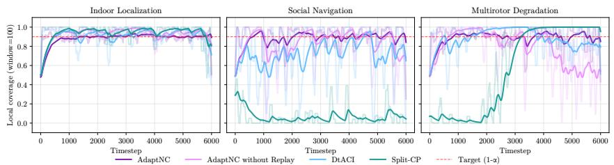  
Figure 2: This figure shows the evolution of local coverage over a 100-step sliding window for a representative seed. For readability, an exponential moving average is shown, with the raw data in a lighter color. AdaptNC exhibits the lowest variability in local coverage, indicating stable recovery of tight uncertainty regions under distribution shift.

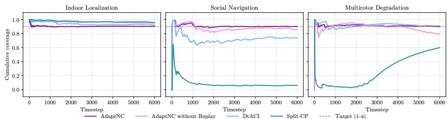  
Figure 3: This figure illustrates the evolution of empirical coverage over the evaluation horizon relative to the target coverage level (shown in red)for a representative seed. AdaptNC’s performance highlights that score-function adaptation enables sustained coverage with tighter regions.

Global Coverage and Local Coverage Stability: AdaptNC consistently achieves coverage closest to the target across all settings (90.6%, 91.6%, and 92.5%) while maintaining stable local coverage with low variance. In contrast, baseline methods exhibit a clear trade-off between coverage, stability, and efficiency. DtACI attains near-target coverage in some settings, but only with significantly larger uncertainty regions. Conversely, methods that achieve small volumes, such as Split CP and Shape-CP in certain environments, suffer from severe undercoverage (e.g., ≈ 3.0% in social navigation). Moreover, these baselines display pronounced temporal variations (Figures 2 and 3): AdaptNC without replay achieves reasonable global coverage only through oscillatory local behavior, while DtACI and Split CP exhibit intermittent coverage drops under distribution shift. These results indicate that baseline methods cannot simultaneously maintain accurate, stable coverage and efficient uncertainty regions, whereas AdaptNC achieves all three.

Uncertainty Volume: AdaptNC achieves smaller uncertainty regions while maintaining near-target coverage. For example, in multirotor tracking, AdaptNC attains comparable coverage to DtACI with an 11x reduction in volume (0.04 vs. 0.44). A similar trend is observed in indoor localization, where DtACI achieves reasonable coverage but at significantly higher volume (43.09 vs. 27.76). In contrast, methods that achieve low volumes do so by sacrificing coverage, as seen with Split CP. Thus, baseline methods either achieve efficiency at the cost of coverage or achieve coverage with excessive volume. Figure 4 further illustrates that shape adaptation enables significantly tighter conformal prediction regions while maintaining coverage.

Importance of Replay: Figures 2 and 3 illustrate the evolution of global and local coverage over time for all case studies using a representative seed, highlighting the role of the replay mechanism. A consistent trend is observed across settings: AdaptNC maintains coverage closer to the target with significantly more stable behavior. In contrast, AdaptNC without replay exhibits increased variability in local coverage, which propagates to oscillations in global coverage and leads to more conservative uncertainty regions. These results highlight the importance of replay in stabilizing coverage under distribution shift and enabling the recovery of tighter, more accurate uncertainty regions.

Table 1: This table reports the proposed evaluation metrics across all methods and case studies, averaged over 50 seeds. AdaptNC achieves coverage closest to the 90% target while maintaining low uncertainty volumes. It also exhibits the most stable and robust behavior, as reflected by the low standard deviation of all metrics.

<table><tr><td rowspan="2">Method</td><td colspan="3">Indoor Localization</td><td colspan="3">Social Navigation</td><td colspan="3">Multirotor Navigation</td></tr><tr><td>Global Cov.</td><td>Vol. (m2) ↓</td><td>Mean Local Cov.</td><td>Global Cov.</td><td>Vol. (m2) ↓</td><td>Mean Local Cov.</td><td>Global Cov.</td><td>Vol. (m2) ↓</td><td>Mean Local Cov.</td></tr><tr><td>ANC</td><td>90.6% ± 0.3%</td><td>27.76 ± 2.08</td><td>90.2% ± 0.3%</td><td>91.6% ± 1.2%</td><td>43.56 ± 6.00</td><td>91.4% ± 1.2%</td><td>92.5% ± 0.7%</td><td>0.04 ± 0.01</td><td>92.3% ± 0.7%</td></tr><tr><td>ANC NR</td><td>94.8% ± 0.8%</td><td>38.64 ± 3.67</td><td>94.4% ± 0.8%</td><td>87.9% ± 3.0%</td><td>73.47 ± 9.62</td><td>87.6% ± 3.0%</td><td>80.1% ± 2.5%</td><td>0.07 ± 0.02</td><td>80.0% ± 2.5%</td></tr><tr><td>DtACI</td><td>92.2% ± 1.8%</td><td>43.09 ± 4.46</td><td>91.8% ± 1.8%</td><td>80.0% ± 3.5%</td><td>52.67 ± 8.10</td><td>79.7% ± 3.5%</td><td>87.4% ± 1.7%</td><td>0.44 ± 0.01</td><td>87.2% ± 1.7%</td></tr><tr><td>Sp. CP</td><td>97.1% ± 0.9%</td><td>98.91 ± 3.12</td><td>96.7% ± 0.9%</td><td>3.0% ± 0.8%</td><td>0.71 ± 0.02</td><td>3.0% ± 0.8%</td><td>60.1% ± 1.6%</td><td>0.21 ± 0.00</td><td>59.9% ± 1.6%</td></tr><tr><td>Sh. CP</td><td>96.9% ± 1.1%</td><td>102.1 ± 7.0</td><td>96.5% ± 1.1%</td><td>3.0% ± 0.8%</td><td>0.70 ± 0.02</td><td>3.0% ± 0.8%</td><td>0.7% ± 0.2%</td><td>0.003 ± 0.0003</td><td>0.6% ± 0.2%</td></tr></table>

Abbreviations: ANC= AdaptNC; NR = No replay; Sh. CP = Shape CP; Sp. CP = Split CP; CP = Conformal Prediction.

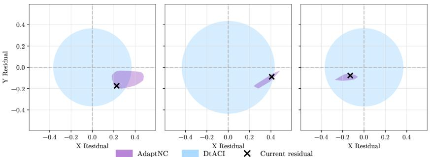  
Figure 4: This figure shows uncertainty regions from AdaptNC and DtACI at representative timesteps (t ∈ [720, 1560, 3120]) in the multirotor tracking task for a representative seed, along with the realized residual. AdaptNC recovers significantly tighter regions while maintaining coverage, whereas DtACI’s threshold-based adaptation constrains region geometry and leads to misalignment under distribution shift.

Runtime Analysis: We report per-step runtimes in Table 2, averaged over 50 seeds on a desktop workstation (AMD Ryzen 7900X, 64GB RAM). Runtimes include all operations required to return a prediction region, including score evaluation (for offline methods Split-CP and Shape-CP). The threshold update in AdaptNC has a runtime comparable to DtACI, under 0.1ms in all environments. The score update averages ≈ 100 ms, dominated by KDE evaluation, consistent with the theoretical analysis. Score updates are performed periodically (every 20, 100, and 100 steps across the three case studies), keeping latency within the ts·∆t budget. Importantly, periodic updates do not degrade coverage, as threshold updates occur at every timestep, which we verify empirically. Moreover, a runtime of ≈ 100 ms is comparable to static safety filtering methods such as Control Barrier Functions (CBFs) [23], which must be recomputed in settings with distribution shift. Further discussion of these topics are provided in Appendices B.6 and B.7 respectively.

Hyperparameter Sensitivity: We also provide a sensitivity analysis across different values of shape adaptation interval (update period) and replay buffer window size to assess the robustness of AdaptNC to moderate hyperparameter changes. Due to space constraints, the results are reported in Table 5 in Appendix E.5. Overall, AdaptNC exhibits low sensitivity to hyperparameters, with stable performance across a broad range of window sizes and update periods. Coverage and volume change noticeably only when deviating far from the base setting. The results show changes in the window size and update period have monotonic effects on both coverage and volume. The predictable nature of these tradeoffs enables straightforward, principled tuning.

Results Summary: Across all three case studies, AdaptNC maintains near-target coverage under structural distribution shifts while producing significantly tighter uncertainty regions than competing methods. By jointly adapting the nonconformity score and threshold, it avoids the conservatism of threshold-only approaches and the undercoverage of non-adaptive baselines, with replay mitigating coverage shocks and stabilizing local coverage. This behavior is also reflected in the expert weight dynamics (Figures 10, 11, and 12), where AdaptNC exhibits faster reweighting than DtACI and AdaptNC without replay. Additional details are provided in Appendices E.2, E.3, and E.4.

## 7 Conclusion

We present AdaptNC, an online conformal prediction method that adapts nonconformity scores under distribution shift. It leverages a reweighted data distribution and a replay mechanism to stabilize adaptation and maintain coverage as scores evolve. We establish regret and long-term coverage guarantees and validate the method on three robotics case studies involving environmental change, multi-agent interaction, and system degradation. Across all settings, AdaptNC achieves coverage closer to the target with lower uncertainty volume than competing methods. Future work will focus on improving computational efficiency and addressing the limitations discussed in Appendix A.

Table 2: Per-step runtime (ms) of all methods, averaged over 50 seeds.

<table><tr><td>Method</td><td>Indoor Localization (ms)</td><td>Multirotor (ms)</td><td>Social Navigation (ms)</td></tr><tr><td>AdaptNC (threshold update)</td><td> $0.09 \pm 0.00$ </td><td> $0.08 \pm 0.00$ </td><td> $0.08 \pm 0.00$ </td></tr><tr><td>AdaptNC (score update)</td><td> $100.61 \pm 48.28$ </td><td> $101.90 \pm 38.06$ </td><td> $97.34 \pm 38.09$ </td></tr><tr><td>AdaptNC (no replay, threshold update)</td><td> $0.15 \pm 0.00$ </td><td> $0.16 \pm 0.01$ </td><td> $0.13 \pm 0.00$ </td></tr><tr><td>AdaptNC (no replay, score update)</td><td> $7.04 \pm 0.47$ </td><td> $6.91 \pm 0.12$ </td><td> $6.55 \pm 0.18$ </td></tr><tr><td>DtACI</td><td> $0.09 \pm 0.00$ </td><td> $0.08 \pm 0.00$ </td><td> $0.08 \pm 0.00$ </td></tr><tr><td>Split CP</td><td> $0.00 \pm 0.00$ </td><td> $0.00 \pm 0.00$ </td><td> $0.00 \pm 0.00$ </td></tr><tr><td>Shape CP</td><td> $0.22 \pm 0.06$ </td><td> $0.20 \pm 0.40$ </td><td> $0.21 \pm 0.04$ </td></tr></table>

## References

[1] Lukas Brunke, Melissa Greeff, Adam W. Hall, Zhaocong Yuan, Siqi Zhou, Jacopo Panerati, and Angela P. Schoellig. Safe Learning in Robotics: From Learning-Based Control to Safe Reinforcement Learning. Annual Review of Control, Robotics, and Autonomous Systems, 5(Volume 5, 2022):411–444, May 2022. ISSN 2573-5144. doi: 10.1146/annurev-control-042920-020211. URL https://www.annualreviews.org/ content/journals/10.1146/annurev-control-042920-020211.

[2] Lars Lindemann, Yiqi Zhao, Xinyi Yu, George J. Pappas, and Jyotirmoy V. Deshmukh. Formal verification and control with conformal prediction: Practical safety guarantees for autonomous systems. IEEE Control Systems, 45(6):72–122, 2025. doi: 10.1109/MCS.2025.3611545.

[3] Vladimir Vovk, Alexander Gammerman, and Glenn Shafer. Algorithmic Learning in a Random World. Springer International Publishing, Cham, 2022. ISBN 978-3-031-06648-1 978-3-031-06649-8. doi: 10.1007/978-3-031-06649-8. URL https://link.springer.com/10.1007/978-3-031-06649-8.

[4] Jing Lei, Max G’Sell, Alessandro Rinaldo, Ryan J. Tibshirani, and Larry Wasserman. Distribution-Free Predictive Inference for Regression. Journal of the American Statistical Association, 113(523):1094–1111, July 2018. ISSN 0162-1459. doi: 10.1080/01621459. 2017.1307116. URL https://doi.org/10.1080/01621459.2017.1307116. \_eprint: https://doi.org/10.1080/01621459.2017.1307116.

[5] Isaac Gibbs and Emmanuel Candes. Adaptive Conformal Inference Under Distribution Shift. In Advances in Neural Information Processing Systems, volume 34, pages 1660–1672. Curran Associates, Inc., 2021. URL https://proceedings.neurips.cc/paper/2021/hash/ 0d441de75945e5acbc865406fc9a2559-Abstract.html.

[6] Isaac Gibbs and Emmanuel J. Candès. Conformal Inference for Online Prediction with Arbitrary Distribution Shifts. Journal of Machine Learning Research, 25(162):1–36, 2024. ISSN 1533-7928. URL http://jmlr.org/papers/v25/22-1218.html.

[7] Margaux Zaffran, Olivier Feron, Yannig Goude, Julie Josse, and Aymeric Dieuleveut. Adaptive Conformal Predictions for Time Series. In Proceedings of the 39th International Conference on Machine Learning, pages 25834–25866. PMLR, June 2022. URL https://proceedings.mlr.press/v162/zaffran22a.html.

[8] Shayan Kiyani, George Pappas, and Hamed Hassani. Length Optimization in Conformal Prediction. Advances in Neural Information Processing Systems, 37:99519–99563, December 2024. doi: 10.52202/079017-3158. URL https://doi.org/10.52202/079017-3158.

[9] Chao Gao, Liren Shan, Vaidehi Srinivas, and Aravindan Vijayaraghavan. Volume Optimality in Conformal Prediction with Structured Prediction Sets. June 2025. URL https://openreview.net/forum?id=oNDhnGrD51&noteId=7kR09SC5BY.

[10] Renukanandan Tumu, Matthew Cleaveland, Rahul Mangharam, George Pappas, and Lars Lindemann. Multi-modal conformal prediction regions by optimizing convex shape templates. In Proceedings ofthe 6th Annual Learningfor Dynamics & Control Conference, pages 1343–1356. PMLR, June 2024. URL https://proceedings.mlr.press/v242/tumu24a.html.

[11] Renukanandan Tumu, Lars Lindemann, Truong Nghiem, and Rahul Mangharam. Physics Constrained Motion Prediction with Uncertainty Quantification. In 2023 IEEE Intelligent Vehicles Symposium (IV), pages 1–8, Anchorage, AK, USA, June 2023. IEEE. ISBN 979-8-3503-4691-6. doi: 10.1109/IV55152.2023.10186812. URL https://ieeexplore.ieee.org/document/10186812/.

[12] Matthew Cleaveland, Insup Lee, George J. Pappas, and Lars Lindemann. Conformal Prediction Regions for Time Series Using Linear Complementarity Programming. Proceedings of the AAAI Conference on Artificial Intelligence, 38(19):20984– 20992, March 2024. ISSN 2374-3468. doi: 10.1609/aaai.v38i19.30089. URL https://ojs.aaai.org/index.php/AAAI/article/view/30089.

[13] Sacha Braun, Liviu Aolaritei, Michael I. Jordan, and Francis Bach. Minimum Volume Conformal Sets for Multivariate Regression, March 2025. URL http://arxiv.org/abs/2503.19068. arXiv:2503.19068 [stat].

[14] Rina Foygel Barber, Emmanuel J. Candes, Aaditya Ramdas, and Ryan J. Tibshirani. Predictive inference with the jackknife+, May 2020. URL http://arxiv.org/abs/1905.02928. arXiv:1905.02928 [stat].

[15] Osbert Bastani, Varun Gupta, Christopher Jung, Georgy Noarov, Ramya Ramalingam, and Aaron Roth. Practical Adversarial Multivalid Conformal Prediction. October 2022. URL https://openreview.net/forum?id=QNjyrDBx6tz.

[16] Ryan J Tibshirani, Rina Foygel Barber, Emmanuel Candes, and Aaditya Ramdas. Conformal Prediction Under Covariate Shift. In Advances in Neural Information Processing Systems, volume 32. Curran Associates, Inc., 2019. URL https://papers.nips.cc/paper/2019/ hash/8fb21ee7a2207526da55a679f0332de2-Abstract.html.

[17] Rina Foygel Barber, Emmanuel J. Candès, Aaditya Ramdas, and Ryan J. Tibshirani. Conformal prediction beyond exchangeability. The Annals of Statistics, 51(2):816– 845, April 2023. ISSN 0090-5364, 2168-8966. doi: 10.1214/23-AOS2276. URL https://doi.org/10.1214/23-AOS2276.

[18] Muhammad Faaiz Taufiq, Jean-Francois Ton, Rob Cornish, Yee Whye Teh, and Arnaud Doucet. Conformal Off-Policy Prediction in Contextual Bandits. Advances in Neural Information Processing Systems, 35:31512–31524, December 2022. URL https://proceedings.neurips.cc/paper\_files/paper/2022/hash/ cc84bfabe6389d8883fc2071c848f62a-Abstract-Conference.html.

[19] Tom Kuipers, Renukanandan Tumu, Shuo Yang, Milad Kazemi, Rahul Mangharam, and Nicola Paoletti. Conformal Off-Policy Prediction for Multi-Agent Systems. In 2024 IEEE 63rd Conference on Decision and Control (CDC), pages 1067–1074, December 2024. doi: 10.1109/CDC56724.2024.10886791. URL https://ieeexplore.ieee.org/document/10886791. ISSN: 2576-2370.

[20] Emanuel Parzen. On Estimation of a Probability Density Function and Mode. The Annals of Mathematical Statistics, 33(3):1065–1076, 1962. ISSN 0003-4851. URL https://www.jstor.org/stable/2237880.

[21] C. Bradford Barber, David P. Dobkin, and Hannu Huhdanpaa. The quickhull algorithm for convex hulls. ACM Transactions on Mathematical Software, 22(4): 469–483, December 1996. ISSN 0098-3500. doi: 10.1145/235815.235821. URL https://dl.acm.org/doi/10.1145/235815.235821.

[22] Björn Lindqvist, Sina Sharif Mansouri, Ali-akbar Agha-mohammadi, and George Nikolakopoulos. Nonlinear MPC for Collision Avoidance and Control of UAVs With Dynamic Obstacles. IEEE Robotics and Automation Letters, 5(4):6001– 6008, October 2020. ISSN 2377-3766. doi: 10.1109/LRA.2020.3010730. URL https://ieeexplore.ieee.org/abstract/document/9145644.

[23] Aaron D. Ames, Xiangru Xu, Jessy W. Grizzle, and Paulo Tabuada. Control barrier function based quadratic programs for safety critical systems. IEEE Transactions on Automatic Control, 62(8):3861–3876, 2017. doi: 10.1109/tac.2016.2638961.

[24] A. W. Van Der Vaart. Asymptotic Statistics. Cambridge University Press, 1 edition, October 1998. ISBN 978-0-511-80225-6 978-0-521-49603-2 978-0-521-78450-4. doi: 10.1017/CBO9780511802256. URL https://www.cambridge.org/core/product/ identifier/9780511802256/type/book.

[25] Yury Polyanskiy and Yihong Wu. Information theory: from coding to learning. Cambridge University Press, Cambridge, United Kingdom ; New York, NY, 2025. ISBN 978-1-108-83290-8 978-1-108-96635-1. doi: 10.1017/9781108966351.

[26] Theodore S Rappaport. Wireless communications: Principles and practice, 2/E. Pearson Education India, 2010.

[27] Mikael Gudmundson. Correlation model for shadow fading in mobile radio systems. Electronics letters, 27(23):2145–2146, 1991.

[28] William C Jakes and Donald C Cox. Microwave mobile communications. Wiley-IEEE press, 1994.

[29] Richard Hedley Clarke. A statistical theory of mobile-radio reception. Bell system technical journal, 47(6):957–1000, 1968.

A Limitations 14   
B Additional Clarifications and Extended Discussion 14   
B.1 AdaptNC is not a direct combination of DtACI and prior score-adaptation methods . 14   
B.2 AdaptNC's Theoretical Support . . . . . . . . . . . . . . . . . . . . . . . . . . . . . . . . . . . . . . . . . . . . . . . . . . . . . . . . . . . . . . . . B.3 Role of the Low-Dimensional Assumption in Complexity Analysis . . . . . . . . . . . . . . . . . . . . . . . . B.4 Effects of Vacuous Prediction Regions on the Next Cycle of Learning and Their Mitigation 15   
B.5 Detecting Distribution Shift and Adapting to its Rate . . . . . . . . . . . . . . . . . . . . B.6 Ability to Maintain Safety if a Catastrophic Change Occurs Between Score Updates 15   
B.7 Tackling More Complex Tasks and Computational Considerations. 16   
C Method 17   
C.1 Score Optimization Algorithm 17   
C.2 AdaptNC Algorithm 17   
C.3 Dynamically Tuned Adaptive Conformal Inference (DtACI) 17   
C.4 High Density Region Identification 17   
C.5 Computational Complexity Analysis of AdaptNC 18   
D Theoretical Details and Proofs 20   
D.1 Background ACI and DtACI Guarantees 20   
D.2 HDR and Score-Stability Proofs 20   
D.3 Long-Run Coverage under Replay 23   
D.4 Coverage Shock from Score Updates 24   
E Experiments 25   
E.1 Gaussian Mixture Model: A Minimal Example of Coverage Shock 25   
E.2 Indoor Localization 27   
E.3 Social Navigation 30   
E.4 Multirotor Tracking 33   
E.5 Hyperparameter Sensitivity Analysis 35

## A Limitations

While AdaptNC demonstrates the ability to recover tight, valid uncertainty regions under distribution shift, it remains, as with other adaptive conformal prediction methods, susceptible to producing trivial uncertainty sets. Although such sets are not entirely uninformative, as they indicate that future observations are likely to fall outside the previously observed support and that the system may be undergoing a regime change, they nonetheless represent a limitation. Empirically, AdaptNC exhibits a vacuous coverage rate of approximately 25% across all case studies, while DtACI exhibits a rate of approximately 20%. Although AdaptNC shows a slightly higher vacuous coverage rate, the difference is marginal, and these results suggest that vacuous coverage is an inherent limitation shared across all adaptive conformal prediction methods considered in this study. Furthermore, we emphasize that vacuous coverage steps do not constitute a critical safety concern in autonomous systems. Rather, they serve as indicators of a potential regime change in the environment, at which point the system can transition to a fallback safe controller during the transient phase. We believe that score function regularization may be able to address this issue, and it is an avenue of future work we are pursuing.

## B Additional Clarifications and Extended Discussion

## B.1 AdaptNC is not a direct combination of DtACI and prior score-adaptation methods

While AdaptNC builds upon these important prior works, it is not merely a direct combination of these methods. The key novelty of AdaptNC lies in identifying and addressing a new setting that prior work does not consider: the joint, coupled adaptation of both the nonconformity score and the conformal threshold under distribution shift. This coupling introduces a non-trivial feedback loop. Changes in the score function alter the induced nonconformity distribution, which subsequently shifts the optimal quantile and destabilizes threshold updates. As a result, the update dynamics of prior independent methods no longer perform their function in the same manner. To support this new setting, we introduced an adaptive reweighting scheme that enables fully online score optimization, alongside new theoretical results including score function stability under joint adaptation (Theorem 5.3) in an asymptotic setting, using a guarantee on the stability of the score function adaptation in (Theorem B.1).

Furthermore, the direct amalgamation of DtACI with score adaptation, corresponds to our “AdaptNC without Replay” baseline, which includes our historical data reweighting scheme. As demonstrated in our ablation studies, this naive combination fails, exhibiting substantial misses in coverage and significantly inflated prediction regions because composition alone is insufficient to handle the feedback problem created through this joint optimization. The intuition behind this is presented in (Remark 5.5), which shows that there are two sources of shift in the score distribution; the bounded component due to the additional data point observed at the next timestep, and the potentially unbounded component which is due to the shift in the score function. To solve this, we introduced the counterfactual replay mechanism. By reinitializing and recalibrating the DtACI expert chain using recent data under the updated score, the replay mechanism prevents coverage shocks caused by mismatched quantiles. As shown empirically, replay is not a minor implementation detail but a fundamentally necessary component that restores both valid coverage and tight uncertainty sets.

Overall, AdaptNC goes significantly beyond combining existing techniques by formulating a new problem setting of coupled adaptation, identifying the instabilities of a naive synthesis, and introducing the novel mechanisms required to make joint adaptation both stable and effective.

## B.2 AdaptNC’s Theoretical Support

AdaptNC’s various components have asymptotic guarantees. It is important to note that finite-sample guarantees are generally unavailable in online conformal prediction (CP) due to the absence of assumptions on distribution shift. Guarantees are often given in the asymptotic setting. [6] show that the regret of their expert weighting algorithm will have a bounded regret to the best expert. [5] establish asymptotic convergence of each expert to the target coverage. In this asymptotic stability setting, we guarantee that our method yields tight and consistent prediction regions. This is shown in Theorem 5.2 and Corollary 5.3. Taken together, our method provides convergence guarantees in the asymptotic setting, including for the score adaptation procedure. Our theoretical analysis gives sufficient conditions under which replay induces a vanishing average perturbation of the ACI expert recursion. These conditions are asymptotic and rely on boundary anti-concentration; finite-sample replay guarantees remain an important direction for future work.

## B.3 Role of the Low-Dimensional Assumption in Complexity Analysis

The assumption $d \leq 3$ in Section 5.4 is introduced to derive tractable bounds for the geometric operations underlying AdaptNC, particularly convex hull construction via the QuickHull algorithm. In low dimensions, QuickHull exhibits near-linear complexity, which supports the stated amortized per-timestep bound. This assumption is therefore analytical in nature and is used to characterize the regime where AdaptNC achieves favorable computational efficiency.

Importantly, AdaptNC itself does not depend on $d \le 3$ and remains applicable in higher dimensions, although the associated geometric computations scale less favorably. In particular, QuickHull has complexity $O ( n ^ { \lfloor d / 2 \rfloor } )$ for $d > 3$ , where ⌊·⌋ denotes the greatest integer function. However, this growth remains manageable up to moderate dimensions $( \mathbf { e . g . , } d \leq 5 )$ , where the scaling is at most quadratic, consistent with the empirical runtimes in Table 2. Moreover, in autonomous systems applications, which are the primary focus of this work, conformal prediction is typically performed over low-dimensional predictors such as scalar value functions or spatial trajectory predictors (up to 3 dimensions), and thus AdaptNC remains applicable without incurring prohibitive computational overhead.

## B.4 Effects of Vacuous Prediction Regions on the Next Cycle of Learning and Their Mitigation

The "infinite" safety margins or vacuous bounds do not corrupt the next cycle of learning, as the underlying data is not perturbed or destroyed. These vacuous bounds are often encountered when the system undergoes change, or sees significant shift in error patterns. When the non-conformity scores the system sees are very large, larger than those we have previously seen, AdaptNC correctly identifies that the system is undergoing change, and surfaces to the user that the change is major, and the system cannot yet accurately predict what will happen. In this way, vacuous bounds are informative; they show that AdaptNC cannot provide guarantees in high-change regimes. After this period of change is complete, AdaptNC will return to predicting safety regions, as the residuals stabilize. Finally, prediction of these vacuous bounds happens when the current quantile prediction $\bar { \alpha } _ { t }$ becomes very small. The data is preserved in its unperturbed state in the history buffer H. These independent mechanisms ensure that data is kept in a manner that permits learning from samples, even if the predicted safety margin is infinite.

## B.5 Detecting Distribution Shift and Adapting to its Rate

Identifying when the data distribution has shifted is one of the major problems in the online conformal prediction setting. There are advantages to having more data, namely that more data allows for more data to develop bounds on the non-conformity scores. However, using old or stale data can yield inaccurate coverage which can lead to catastrophe for robots. AdaptNC is fundamentally a weighted mixture of a series of “expert" predictors. Each of these “experts" functions under the hypothesis that the distribution is shifting at a different rate, characterized by γ. A lower value of γ indicates a low expected rate of change, and a higher γ indicates a higher expected rate of change. AdaptNC uses the weights allocated to each expect to dynamically identify how quickly the distribution is changing, and use that estimate to change how much historical data it uses at every timestep. This is also illustrated in the expert weight dynamics (Figures 10, 11, and 12).

## B.6 Ability to Maintain Safety if a Catastrophic Change Occurs Between Score Updates

AdaptNC separates adaptation into two components: The threshold update occurs at every timestep, while the score update occurs periodically. While the shapes update periodically, the threshold updates at every timestep. This provides instantaneous response to changes in the system, while the calculation of the new score function allows for AdaptNC to react to systemic changes in the system. We show empirically in our results that in scenarios with distribution shift, our method is able to maintain the target coverage better than the previous state of the art.

## B.7 Tackling More Complex Tasks and Computational Considerations

While the task of drawing safety boundaries may appear computationally intensive, in practice it is not prohibitively slow. In our experimental settings, the score update path executed every T steps takes approximately 100 ms, while the threshold update path executed at every timestep takes approximately 0.1 ms. The threshold update runtime is comparable to standard safety filtering methods such as Control Barrier Functions (CBFs), which typically assume negligible or no distribution shift. The score update enables adaptation to significant distribution shift. In such settings, recomputing CBFs is often more computationally demanding than the threshold update in AdaptNC.

## C Method

## C.1 Score Optimization Algorithm

Algorithm 1 OptimizeScore: Score Parameter Optimization
Require: History buffer  $H_{t}^{w}$ , current parameters  $\theta$ , target miscoverage rate  $\alpha$ 
1: Generate high-density points  $\hat{R}_{t}$  covering proportion  $1-\alpha$  of density mass through Algorithm 4
2: Fit shape template S using QuickHull algorithm on  $\hat{R}_{t}$ 
3:  $\theta_{t+1} \leftarrow$  parameters encoding shape templates  $\{S\}$ 
4: Return: Updated parameters  $\theta_{t+1}$

## C.2 AdaptNC Algorithm

Algorithm 2 AdaptNC Algorithm
Require: Target miscoverage rate α, adaptation interval  $t_{s}$ , initial parameters  $\theta_{0}$ , DtACI expert gammas  $\Gamma = [\gamma_{1}, \ldots, \gamma_{k}]$ , window size W, learning rate η, calibration data  $D_{cal}$ 
Initialize history buffer  $H \leftarrow \emptyset$ 
Fit initial conformal region with  $\theta_{0}$  on  $D_{cal}$ 
Initialize DtACI with  $s(\cdot; \theta_{0})$ ,  $\alpha$ ,  $\Gamma$ , W,  $\eta$ ,  $D_{cal}$ 
for  $t = 1, 2, \ldots, T$  do
    Observe  $X_{t}$ , produce prediction  $\hat{Y}_{t}$ 
    Output prediction region  $\hat{C}_{t}(X_{t}; \theta_{t}, q_{1-\alpha_{t}}, \mathcal{D}_{t})$ 
    Observe  $Y_{t}$ 
    Append  $(X_{t}, Y_{t}, s_{t})$  to H
    Compute score  $s_{t} = s(X_{t}, Y_{t}; \theta_{t})$ 
    Update DtACI with  $(X_{t}, Y_{t})$  to obtain  $\bar{\alpha}_{t}$ 
    Obtain new threshold:  $q_{1-\alpha_{t}}, D$ 
    if t mod  $t_{s} = 0$  then
    Compute distribution  $H_{t}^{\omega}$  using Eq. (4)
    $\theta_{t+1} \leftarrow OPTIMIZESCORE(H_{t}^{\omega}, \theta_{t}, \alpha)$ 
    Re-initialize DtACI with score function  $s(\cdot; \theta_{t+1})$ 
    for each  $(X_{i}, Y_{i}) \in [t - w + 1, t]$  do
    Update experts and expert weights with  $(X_{i}, Y_{i})$ 
    end for
    end if
end for

## C.3 Dynamically Tuned Adaptive Conformal Inference (DtACI)

See Algorithm 3.

## C.4 High Density Region Identification

Under standard KDE regularity conditions and sufficiently dense Monte Carlo sampling, the retained high-density samples approximate the corresponding KDE level set. We therefore model the score-optimization step through Assumption C.1.

Assumption C.1 (Consistent residual-template estimation). At score-update times $t _ { m } ,$ let $\widehat { R } _ { m }$ be the residual set returned by the score-optimization procedure and let $K _ { m } = \mathrm { c o n v } ( \widehat { R } _ { m } )$ . Let $R _ { \star } = \{ z : f _ { \star } ( z ) \geq \tau _ { \star } \}$ and $K _ { \star } \dot { = } \mathrm { c o n v } ( R _ { \star } )$ . We assume

$$
d _ {H} (K _ {m}, K _ {\star}) \xrightarrow {p} 0.
$$

Theorem C.2 (Glivenko-Cantelli Theorem as written in Vaart [24]). $I f X _ { 1 } , X _ { 2 } , . . . , X _ { n }$ are independent and identically distributed random variables with cumulative distributionfunction $f ,$ , and empirical distribution function $f _ { n } ,$ , then:

$$
\| f _ {n} - f \| _ {\infty} \xrightarrow {a s} 0\tag{8}
$$

Algorithm 3 Dynamically tuned Adaptive Conformal Inference (DtACI) [6, Algorithm 2]

Require: Observed values $\{\beta_t\}_{1\leq t\leq T}$, set of candidate $\gamma$ values $\{\gamma_i\}_{1\leq i\leq k}$, starting points $\{\alpha_1^i\}_{1\leq i\leq k}$, and parameters $\sigma$ and $\eta$.

1: $w_1^i \leftarrow 1, 1 \leq i \leq k$;

2: for $t = 1, 2, \dots, T$ do

3: Define the probabilities $p_t^i := w_t^i / \sum_{1 \leq j \leq k} w_t^j$, $\forall 1 \leq i \leq k$;

4: Output $\bar{\alpha}_t = \sum_{1 \leq i \leq k} p_t^i \alpha_t^i$;

5: $\bar{w}_t^i \leftarrow w_t^i \exp(-\eta \ell(\beta_t, \alpha_t^i))$, $\forall 1 \leq i \leq k$;

6: $\bar{W}_t \leftarrow \sum_{1 \leq i \leq k} \bar{w}_t^i$;

7: $w_{t+1}^i \leftarrow (1 - \sigma) \bar{w}_t^i + \bar{W}_t \sigma / k$;

8: $\mathbf{err}_t^i := 1 \{Y_t \notin \hat{C}_t(\alpha_t^i; \theta_t, \mathcal{D}_t)\}$, $\forall 1 \leq i \leq k$;

9: $\mathbf{err}_t := 1 \{Y_t \notin \hat{C}_t(\bar{\alpha}_t; \theta_t, \mathcal{D}_t)\}$;

10: $\alpha_{t+1}^i = \alpha_t^i + \gamma_i (\alpha - \mathbf{err}_t^i)$, $\forall 1 \leq i \leq k$;

11: end for

Algorithm 4 Monte Carlo Kernel Density Estimation (MCKDE)

1: Input: Dataset  $X \in R^{N \times d}$ , sample weights  $w \in R^{N}$ , Monte Carlo samples M, miscoverage rate  $\alpha$ , bandwidth factor  $\beta$ .

2: Output: Set of high-density samples  $\hat{R}_{N,M}$ .

3: // 1. Bandwidth Selection

4: if bandwidth method is “Scott” then

5:  $h \leftarrow N^{\frac{-1}{d+4}}$ 

6: else if bandwidth method is “Silverman” then

7:  $h \leftarrow \left( \frac{N(d+2)}{4} \right)^{\frac{-1}{d+4}}$ 

8: end if

9:  $h \leftarrow h \times \beta$ 

10: // 2. Fit Kernel Density Estimator

11: Fit weighted Gaussian KDE  $\hat{f}_{N}$  using  $(X, w)$ 

12: // 3. Monte Carlo Sampling &amp; Scoring

13: Draw M samples  $Z = \{z_{1}, ..., z_{M}\}$  where  $z_{i} \sim \hat{f}_{N}$ 

14: Calculate density scores  $\xi_{i} \leftarrow \hat{f}_{N}(z_{i})$  for  $i = 1, ..., M$ 

15: // 4. Thresholding

16: Let  $\tau$  be the  $\alpha$ -quantile of the set  $\{\xi_{1}, ..., \xi_{M}\}$ 

17:  $\hat{R}_{N,M} \leftarrow \{z_{i} \in Z | \xi_{i} \geq \tau\}$ 

18: return  $\hat{R}_{N,M}$

## C.5 Computational Complexity Analysis of AdaptNC

Theorem C.3 (Computational Complexity of AdaptNC). AdaptNC consists oftwo components: a threshold update executed at every timestep and a scorefunction update executed every $t _ { s }$ timesteps. Let W denote the window size, k the number ofexperts, M the number ofMonte Carlo samples, d the residual dimension, r the number offacets ofthe convex hull, and $n = | \hat { R } _ { t } |$ the number ofretained high-density points. Then, the per-timestep cost ofthe threshold update is $O ( \stackrel { \cdot } { r } + W + k )$ , and the cost of the score function update is $O ( M W d \bar { + } M \mathrm { l o g } M + n \mathrm { l o g } n + W \bar { ( } r + k ) )$ , which is dominated by the KDE evaluation term O(MWd) in the low-dimensional regime considered here. Under the assumption $d \leq 3 ,$ the amortizedper-timestep cost ofAdaptNC is $O ( W + k + M W d / t _ { s } ) .$ Proof. We analyze the computational cost of AdaptNC by decomposing it into two components: the threshold update and the score function update. We assume that the residual dimensionality satisfies $d \leq 3 ,$ , which holds for all experiments and typical real-world trajectory prediction tasks.

Threshold update: The threshold update executes at every timestep and consists of three operations. First, the nonconformity score $s ( X _ { t } , Y _ { t } ; \theta _ { t } )$ is evaluated for the current observation, requiring $O ( r )$ time where r is the number of facets of the convex hull. Second, the inverse quantile $\beta _ { t }$ is computed by evaluating the score against the rolling window $\mathcal { D } _ { t } .$ , requiring $O ( W )$ time. Third, the k expert weights are updated via exponential reweighting and each expert’s quantile $\alpha _ { t } ^ { i }$ is updated, requiring $O ( k )$ time. The total per-timestep cost of the fast path is therefore $O ( r + W + k )$

Score function update: The score function update executes every $t _ { s }$ timesteps and consists of three stages: reweighting, score optimization, and replay.

Reweighting: Computing the adaptive weights $\omega _ { \tau }$ for all history buffer entries requires evaluating the exponential decay across k experts for each of the $W$ buffered points, yielding $\bar { O ( k W ) }$ .

Score optimization: This stage comprises density estimation and shape template fitting. The weighted KDE is constructed from $\breve { W }$ samples in $O ( W d )$ time. Drawing M Monte Carlo samples from the KDE costs $O ( M d )$ . Evaluating the KDE at each Monte Carlo sample requires summing over all W kernel centers, yielding $O ( \bar { M } W d )$ . Selecting the top $1 - \alpha$ fraction by density requires sorting in $O ( M \mathrm { l o g } M )$ ). Finally, the QuickHull algorithm fits the convex hull to the n retained high-density points in $O ( n \mathrm { l o g } n )$ ) expected time. The dominant cost of this stage is the KDE evaluation at $O ( M W d )$ ).

Replay: The replay mechanism re-initializes the DtACI expert chain and processes the $W$ most recent observations under the updated score function. Each replayed observation requires $O ( r + k )$ for score evaluation and expert updates, yielding a total replay cost of $O ( W ( r + k ) )$ ).

The total cost of the score update is $O ( M W d + M \log M + n \log n + W ( r + k ) )$ , dominated by the KDE evaluation term $O ( M W d )$

Amortized cost: Since the score function update is executed every $t _ { s }$ timesteps, its per timestep cost amortizes to: $O ( M W d / t _ { s } )$ . Adding the threshold update cost yields the amortized per-timestep cost of AdaptNC:

$$
O (W + k + M W d / t _ {s})
$$

## D Theoretical Details and Proofs

## D.1 Background ACI and DtACI Guarantees

We present the theorem that yields Remark D.2

Theorem D.1 (Theorem 4, [6]). Let $\gamma _ { m a x } : = \mathrm { m a x } _ { 1 \leq i \leq k } \gamma _ { t }$ and assume that $\gamma _ { 1 } < \gamma _ { 2 } < . . . < \gamma _ { k }$ where $\gamma _ { i + 1 } / \gamma _ { i } \leq 2$ for all $1 < i \leq k ,$ , and that $\ell ( \beta _ { t } , \theta ) : = \alpha \overline { { ( \beta _ { t } } } - \theta ) - \operatorname* { m i n } \{ 0 , \beta _ { t } - \theta \}$ Then, for any window $\dot { W } = \dot { [ } r , s ] \in [ \dot { T } ]$ and any sequence $\alpha _ { r } ^ { * } , . . . , \alpha _ { s } ^ { * } \in [ 0 , 1 ]$

$$
\begin{array}{c} \frac {1}{| W |} \sum_ {t = r} ^ {s} \ell ((\beta_ {t}, \bar {\alpha} _ {t})) - \frac {1}{| W |} \sum_ {t = r} ^ {s} \ell ((\beta_ {t}, \alpha_ {t} ^ {*})) \leq \\ \frac {\log (k / \sigma) + 2 \sigma | W |}{\eta | W |} + \frac {\eta}{| W |} \sum_ {t = r} ^ {s} \mathbb {E} \big [ \ell (\beta_ {t}, \alpha_ {t}) ^ {2} \big ] + \\ 4 (1 + \gamma_ {\max}) ^ {2} \max \Bigg \{\sqrt {\frac {\sum_ {t = r + 1} ^ {s} | \alpha_ {t} ^ {*} - \alpha_ {t - 1} ^ {*} | + 1}{| W |}}, \gamma_ {1} \Bigg \}. \end{array}\tag{9}
$$

Remark D.2. The bound of the error presented here can be written in simpler form for specific choices of σ and η. Specifically, $\begin{array} { r } { \eta = \sqrt { \frac { \log ( 2 k | W | ) + 1 } { \sum _ { t = r } ^ { s } \mathbb { E } [ \ell ( \beta _ { t } , \alpha _ { t } ) ^ { 2 } ] } } } \end{array}$ and $\sigma { = } 1 / ( 2 | W | )$

$$
\frac {1}{| W |} \sum_ {t = r} ^ {s} \ell ((\beta_ {t}, \bar {\alpha} _ {t})) - \frac {1}{| W |} \sum_ {t = r} ^ {s} \ell ((\beta_ {t}, \alpha_ {t} ^ {*})) \leq O \left(\sqrt {\frac {\log (| W |)}{| W |}}\right) + O \left(\sqrt {\frac {\sum_ {t = r + 1} ^ {s} | \alpha_ {t} ^ {*} - \alpha_ {t - 1} ^ {*} | + 1}{| W |}}\right).\tag{10}
$$

This derivation is due to Gibbs and Candès [6]

Theorem D.3 (Theorem 6, [6]). Consider a modified version of Algorithm 3 in which on iteration t the parameters η and σ are replaced by values $\eta _ { t }$ and $\sigma _ { t } .$ . Let $\begin{array} { r } { \gamma _ { \operatorname* { m i n } } : = \operatorname* { m i n } _ { i } \gamma _ { i } , \gamma _ { \operatorname* { m a x } } : = \operatorname* { m a x } _ { i } \gamma _ { i } } \end{array}$ , and that lim $\scriptstyle { 1 _ { t \to \infty } \eta _ { t } = \operatorname* { l i m } _ { t \to \infty } \sigma _ { t } = 0 }$ . Then,

$$
\lim _ {T \to \infty} \frac {1}{T} \sum_ {t = 1} ^ {T} \mathrm{err} _ {t} \stackrel {a. s.} {=} \alpha
$$

where the expectation is over the randomness in the randomized variant of DtACI and the data $\beta _ { 1 } , . . . , \beta _ { T }$ can be viewed asfixed.

## D.2 HDR and Score-Stability Proofs

Assumption D.4 (Regularity for HDR stability). Let $\mathcal { Z } _ { t }$ denote the effective weighted residual distribution used by AdaptNC at score-update time $t ,$ and let $f _ { t }$ denote its density. Let $\mathcal { Z } _ { \star }$ be the limiting weighted residual distribution with density $f _ { \star }$

1. The residual-distribution convergence is strong enough to imply uniform density convergence:

$$
\left\| f _ {t} - f _ {\star} \right\| _ {\infty} \rightarrow 0.
$$

2. The KDE kernel, bandwidth sequence, and weighted effective sample size satisfy the standard conditions for uniform KDE consistency:

$$
\| \widehat {f _ {t}} - f _ {t} \| _ {\infty} \xrightarrow {p} 0.
$$

3. The density-score quantile at level α is regular: if

$$
G _ {\star} (u) := \mathbb {P} _ {Z \sim \mathcal {Z} _ {\star}} (f _ {\star} (Z) \leq u),
$$

then $G _ { \star }$ is continuous and strictly increasing in a neighborhood of $\tau _ { \star } : = G _ { \star } ^ { - 1 } ( \alpha )$

4. The limiting HDR boundary is regular: there exist constants $c > 0$ and $\varepsilon _ { 0 } > 0$ such that

$$
\left\| \nabla f _ {\star} (z) \right\| _ {2} \geq c \quad \text { whenever } \left| f _ {\star} (z) - \tau_ {\star} \right| \leq \varepsilon_ {0}.
$$

5. The relevant HDRs are nonempty compact subsets of $\mathbb { R } ^ { p }$ .

6. There exists $L _ { \mathrm { v o l } } < \infty$ such that for all $x ,$ all thresholds $q$ in the relevant range, and all sufficiently small $\varepsilon > 0$

$$
\operatorname{Vol} \{y: q - \varepsilon \leq s _ {\star} (x, y) \leq q + \varepsilon \} \leq L _ {\mathrm{vol}} \varepsilon .
$$

Lemma D.5 (Hausdorff consistency of the MCKDE high-density region). Let

$$
R _ {\star} := \{z \in \Omega : f _ {\star} (z) \geq \tau_ {\star} \}
$$

be the limiting (1−α) high-density residual region, where $\tau _ { \star }$ is chosen so that

$$
\int_ {R _ {\star}} f _ {\star} (z) d z = \int_ {\Omega} \mathbf {1} \{f _ {\star} (z) \geq \tau_ {\star} \} f _ {\star} (z) d z = 1 - \alpha .
$$

At score-update time t, let $\widehat { f } _ { t }$ be the KDEformedfrom $N _ { t }$ weighted residual samples, and let $\widehat { \tau } _ { t }$ be the Monte Carlo estimate ofthe density threshold obtainedfrom $M _ { t }$ samples. Define the MCKDE estimated high-density region

$$
\widehat {R} _ {t} := \{z \in \Omega : \widehat {f} _ {t} (z) \geq \widehat {\tau} _ {t} \}.
$$

Under Assumptions 5.1 and D.4,

$$
d _ {H} (\widehat {R} _ {m}, R _ {\star}) \xrightarrow {p} 0.
$$

Proof. By the assumed stability of the weighted residual distributions and the assumed relation between $D _ { \phi }$ and the residual density class,

$$
\left\| f _ {t} - f _ {\star} \right\| _ {\infty} \rightarrow 0.
$$

By uniform KDE consistency,

$$
\| \widehat {f _ {t}} - f _ {t} \| _ {\infty} \xrightarrow {p} 0.
$$

Therefore,

$$
\| \widehat {f _ {t}} - f _ {\star} \| _ {\infty} \xrightarrow {p} 0.
$$

The Monte Carlo threshold $\widehat { \tau } _ { t }$ is the empirical quantile of the density scores $\widehat { f _ { t } } ( Z )$ , where $Z$ is sampled from the KDE. Since $M _ { t } \to \infty$ , the empirical density-score CDF converges uniformly to its population counterpart, by the Glivenko–Cantelli theorem. Together with the regularity of the density-score quantile and the convergence $\widehat { f } _ { t } \to f ,$ , this gives

$$
| \widehat {\tau} _ {t} - \tau_ {\star} | \xrightarrow {p} 0.
$$

Define

$$
\varepsilon_ {t} := \left\| \widehat {f _ {t}} - f _ {\star} \right\| _ {\infty} + \left| \widehat {\tau} _ {t} - \tau_ {\star} \right|.
$$

Then $\varepsilon _ { t } \xrightarrow { p } 0$

$\mathrm { I f } ~ z \in \widehat { R } _ { t }$ , then $\widehat { f } _ { t } ( z ) \geq \widehat { \tau } _ { t }$ , and hence

$$
f _ {\star} (z) \geq \widehat {f _ {t}} (z) - \| \widehat {f _ {t}} - f _ {\star} \| _ {\infty} \geq \widehat {\tau_ {t}} - \| \widehat {f _ {t}} - f _ {\star} \| _ {\infty} \geq \tau_ {\star} - \varepsilon_ {t}.
$$

Therefore,

$$
\widehat {R} _ {t} \subseteq \{z \in \Omega : f _ {\star} (z) \geq \tau_ {\star} - \varepsilon_ {t} \}.
$$

Similarly, if $\mu _ { \mathrm { { \star } } }$ , then $f _ { \star } ( z ) \ge \tau _ { \star }$ . Points in $R _ { \star }$ with $f _ { \star } ( z ) \geq \tau _ { \star } + \varepsilon _ { t }$ satisfy

$$
\widehat {f} _ {t} (z) \geq f _ {\star} (z) - \| \widehat {f} _ {t} - f _ {\star} \| _ {\infty} \geq \tau_ {\star} + \varepsilon_ {t} - \| \widehat {f} _ {t} - f _ {\star} \| _ {\infty} \geq \widehat {\tau} _ {t},
$$

and therefore belong to $\widehat { R } _ { t }$ . Thus, any point of $R _ { \star }$ that may fail to belong to $\widehat { R } _ { t }$ must lie in the shrinking level band

$$
\left\{z \in \Omega : \left| f _ {\star} (z) - \tau_ {\star} \right| \leq \varepsilon_ {t} \right\}.
$$

By the regular-boundary assumption, these level bands shrink to $\partial R _ { \star }$ in Hausdorff distance. More precisely, for all sufficiently small ε, every point satisfying

$$
| f _ {\star} (z) - \tau_ {\star} | \leq \varepsilon
$$

lies within distance $O ( \varepsilon )$ of the boundary $\{ z : f _ { \star } ( z ) = \tau _ { \star } \}$ . Consequently,

$$
d _ {H} (\widehat {R} _ {t}, R _ {\star}) \leq C \varepsilon_ {t}
$$

for some constant $C > 0$ and all sufficiently large t, with probability tending to one. Since $\varepsilon _ { t } \overset { p } { \to } 0$ we conclude that

$$
d _ {H} (\widehat {R} _ {t}, R _ {\star}) \xrightarrow {p} 0.
$$

□

Lemma D.6 (Convex-hull stability). Let $A _ { m } , A _ { \star } \subset \mathbb { R } ^ { p }$ be nonempty compact sets.

$$
d _ {H} (A _ {m}, A _ {\star}) \rightarrow 0 \Longrightarrow d _ {H} (\operatorname{conv} (A _ {m}), \operatorname{conv} (A _ {\star})) \rightarrow 0.
$$

Proof. Let $\rho _ { m } = d _ { H } ( A _ { m } , A _ { \star } )$ . For any $x \in \mathrm { c o n v } ( A _ { m } )$ , write

$$
x = \sum_ {\ell = 1} ^ {L} \lambda_ {\ell} a _ {\ell}, \quad a _ {\ell} \in A _ {m}, \quad \lambda_ {\ell} \geq 0, \quad \sum_ {\ell = 1} ^ {L} \lambda_ {\ell} = 1.
$$

For each $^ { a \ell } ,$ choose $a _ { \ell } ^ { \star } \in A .$ ⋆ such that $\| a _ { \ell } - a _ { \ell } ^ { \star } \| _ { 2 } \le \rho _ { m }$ . Then

$$
x ^ {\star} := \sum_ {\ell = 1} ^ {L} \lambda_ {\ell} a _ {\ell} ^ {\star} \in \operatorname{conv} (A _ {\star}),
$$

and

$$
\| x - x ^ {\star} \| _ {2} \leq \sum_ {\ell = 1} ^ {L} \lambda_ {\ell} \| a _ {\ell} - a _ {\ell} ^ {\star} \| _ {2} \leq \rho_ {m}.
$$

where the last inequality follows from the definition of the Hausdorff distance. Thus every point of conv $\left( A _ { m } \right)$ lies within $\rho _ { m }$ of $\mathrm { c o n v } ( A _ { \star } )$ . The reverse inclusion is identical. Hence

$$
d _ {H} (\operatorname{conv} (A _ {m}), \operatorname{conv} (A _ {\star})) \leq \rho_ {m}.
$$

□

Corollary D.7. In the setting of Lemma $D . 6 ,$

$$
d _ {H} (\operatorname{conv} (A _ {m}), \operatorname{conv} (A _ {\star})) \leq d _ {H} (A _ {m}, A _ {\star}).
$$

Because halfspace representations of a convex set are not unique, we state score stability for the canonical support-function score induced by the fitted convex template. Equivalently, the implemented halfspace score should be normalized to this canonical representation before comparing scores across updates. Our implementation, which relies on QuickHull [21], performs this normalization.

Lemma D.8 (Score stability from hull stability). For a compact convex set $K \subset \mathbb { R } ^ { p }$ , define

$$
s _ {K} (x, y) := \sup _ {\| v \| _ {2} = 1} \left\{v ^ {\top} (y - h (x)) - H _ {K} (v) \right\}, \qquad H _ {K} (v) := \sup _ {z \in K} v ^ {\top} z.
$$

If

$$
d _ {H} (K _ {t}, K _ {\star}) \to 0,
$$

then

$$
\sup _ {(x, y) \in \mathcal {A}} | s _ {K _ {t}} (x, y) - s _ {K _ {\star}} (x, y) | \to 0
$$

for a set $\mathcal { A } \subseteq \mathcal { X } \times \mathcal { y }$

Proof. For any residual $z = y - h ( x )$

$$
\begin{array}{l} | s _ {K _ {m}} (x, y) - s _ {K _ {\star}} (x, y) | = \left| \sup _ {\| v \| _ {2} = 1} \{v ^ {\top} z - h _ {K _ {m}} (v) \} - \sup _ {\| v \| _ {2} = 1} \{v ^ {\top} z - h _ {K _ {\star}} (v) \} \right| \\ \leq \sup _ {\| v \| _ {2} = 1} | H _ {K _ {m}} (v) - H _ {K _ {\star}} (v) |. \end{array}
$$

For compact convex sets,

$$
\sup _ {\| v \| _ {2} = 1} | H _ {K _ {m}} (v) - H _ {K _ {\star}} (v) | = d _ {H} (K _ {m}, K _ {\star}).
$$

Therefore,

$$
\left| s _ {K _ {m}} (x, y) - s _ {K _ {\star}} (x, y) \right| \leq d _ {H} \left(K _ {m}, K _ {\star}\right).
$$

Taking the supremum over $( x , y ) \in A$ gives the result.

Theorem 5.2 (Score Function Stability). Suppose Assumptions C.1, D.4 and 5.1 hold. Let $\widehat { R } _ { m }$ be the MCKDE high-density residual region estimated at score-update time $t _ { m } ,$ , and define $K _ { m } : = \mathrm { c o n v } (  { \widehat { R } } _ { m } )$ LetR⋆ $: = { \mathit { \bar { \{ z } } }  : f _ { \star } ( z ) \geq \tau _ { \star } \}$ and $K _ { \star } : = \mathrm { c o n v } ( R _ { \star } )$ . Let $s _ { K _ { m } }$ and $s _ { K , \ }$ denote the canonical support-function scores induced by $K _ { m }$ and $K _ { \star }$ . Then,for any evaluation domain $\mathcal { A } \subseteq \mathcal { X } \times \mathcal { y }$

$$
\sup _ {(x, y) \in \mathcal {A}} | s _ {K _ {m}} (x, y) - s _ {K _ {\star}} (x, y) | \stackrel {{p}} {{\to}} 0 \quad \therefore \quad \sup _ {(x, y) \in \mathcal {A}} | s _ {K _ {m + 1}} (x, y) - s _ {K _ {m}} (x, y) | \stackrel {{p}} {{\to}} 0.
$$

Proof. By Lemma D.5,

$$
d _ {H} (\widehat {R} _ {m}, R _ {\star}) \xrightarrow {p} 0.
$$

By Lemma D.6,

$$
d _ {H} (K _ {m}, K _ {\star}) = d _ {H} (\mathrm{conv} (\widehat {R} _ {m}), \mathrm{conv} (R _ {\star})) \xrightarrow {p} 0.
$$

By Lemma D.8,

$$
\sup _ {(x, y) \in \mathcal {A}} | s _ {K _ {m}} (x, y) - s _ {K _ {\star}} (x, y) | \stackrel {{p}} {{\to}} 0.
$$

Finally, by the triangle inequality,

$$
\begin{array}{l} \sup _ {(x, y) \in \mathcal {A}} | s _ {K _ {m + 1}} (x, y) - s _ {K _ {m}} (x, y) | \\ \leq \sup _ {(x, y) \in \mathcal {A}} | s _ {K _ {m + 1}} (x, y) - s _ {K _ {\star}} (x, y) | + \sup _ {(x, y) \in \mathcal {A}} | s _ {K _ {m}} (x, y) - s _ {K _ {\star}} (x, y) |. \end{array}
$$

Both terms converge to zero in probability, so the successive score functions are asymptotically stable. 口

Proof of Corollary 5.3. Suppose

$$
\sup _ {(x, y) \in \mathcal {A}} | s _ {t} (x, y) - s _ {\star} (x, y) | \leq \delta_ {t}.
$$

Under Assumption D.4, for every fixed threshold q,

$$
| \operatorname{Vol} (C _ {t} (x; q)) - \operatorname{Vol} (C _ {\star} (x; q)) | \leq L _ {\mathrm{vol}} \delta_ {t}.
$$

Since $\delta _ { t } \to 0$ in probability by Theorem 5.2, the prediction-region volume stabilizes in probability.

## D.3 Long-Run Coverage under Replay

Proof of Theorem 5.4. Expanding the perturbed recursion gives

$$
\alpha_ {T + 1} ^ {i} = \alpha_ {1} ^ {i} + \gamma_ {i} \sum_ {t = 1} ^ {T} (\alpha - \mathbf {e r r} _ {t} ^ {i}) + \sum_ {t = 1} ^ {T} \Delta_ {t} ^ {i}.
$$

Rearranging,

$$
\frac {1}{T} \sum_ {t = 1} ^ {T} \mathbf {e r r} _ {t} ^ {i} - \alpha = \frac {\alpha_ {1} ^ {i} - \alpha_ {T + 1} ^ {i}}{T \gamma_ {i}} + \frac {1}{T \gamma_ {i}} \sum_ {t = 1} ^ {T} \Delta_ {t} ^ {i}.
$$

The first term vanishes because the expert states are bounded. The second term vanishes by the assumed sublinear cumulative perturbation.

$$
\left| \frac {1}{T \gamma_ {i}} \sum_ {t = 1} ^ {T} \Delta_ {t} ^ {i} \right| \leq \frac {1}{T \gamma_ {i}} \sum_ {t = 1} ^ {T} | \Delta_ {t} ^ {i} | \rightarrow 0.
$$

Hence:

$$
\frac {1}{T} \sum_ {t = 1} ^ {T} \mathbf {e r r} _ {t} ^ {i} \rightarrow \alpha .
$$

ProofofTheorem 5.5. For the analysis, define the pre-update replay trajectory as the counterfactual trajectory obtained by replaying $\mathcal { R } _ { m }$ using $s _ { m } ^ { - }$ , and the post-update replay trajectory as the trajectory obtained by replaying the same window using $s _ { m } ^ { + } ,$ , both initialized from the same expert state. Let

$$
e _ {m, r} ^ {i, -} := \mathbf {1} \{s _ {m} ^ {-} (X _ {r}, Y _ {r}) > q _ {m, r} ^ {i, -} \}, \qquad e _ {m, r} ^ {i, +} := \mathbf {1} \{s _ {m} ^ {+} (X _ {r}, Y _ {r}) > q _ {m, r} ^ {i, +} \}.
$$

At non-update times, $\Delta _ { t } ^ { i } = 0$ . At update time $t _ { m }$ , the difference between the replayed post-update expert state and the corresponding pre-update expert state is controlled by the number of replayed observations whose coverage indicators change:

$$
| \Delta_ {t _ {m}} ^ {i} | \leq \gamma_ {i} \sum_ {r \in \mathcal {R} _ {m}} | e _ {m, r} ^ {i, +} - e _ {m, r} ^ {i, -} |.
$$

Now observe that the indicators can differ only if the replayed score lies near the pre-update threshold. Indeed, if

$$
| s _ {m} ^ {-} (X _ {r}, Y _ {r}) - q _ {m, r} ^ {i, -} | > (1 + L _ {q}) \varepsilon_ {m},
$$

then

$$
| s _ {m} ^ {+} (X _ {r}, Y _ {r}) - s _ {m} ^ {-} (X _ {r}, Y _ {r}) | \leq \varepsilon_ {m}
$$

and

$$
| q _ {m, r} ^ {i, +} - q _ {m, r} ^ {i, -} | \leq L _ {q} \varepsilon_ {m}
$$

together imply that $s _ { m } ^ { + } ( X _ { r } , Y _ { r } )$ and $s _ { m } ^ { - } ( X _ { r } , Y _ { r } )$ remain on the same side of their respective thresholds. Hence

$$
\left| e _ {m, r} ^ {i, +} - e _ {m, r} ^ {i, -} \right| \leq \mathbf {1} \left\{\left| s _ {m} ^ {-} \left(X _ {r}, Y _ {r}\right) - q _ {m, r} ^ {i, -} \right| \leq \left(1 + L _ {q}\right) \varepsilon_ {m} \right\}.
$$

Therefore

$$
\frac {1}{T} \sum_ {t = 1} ^ {T} | \Delta_ {t} ^ {i} | \leq \frac {\gamma_ {i}}{T} \sum_ {m: t _ {m} \leq T r \in \mathcal {R} _ {m}} \mathbf {1} \left\{| s _ {m} ^ {-} (X _ {r}, Y _ {r}) - q _ {m, r} ^ {i, -} | \leq (1 + L _ {q}) \varepsilon_ {m} \right\}.
$$

The assumed averaged boundary condition implies that the right-hand side converges to zero. The final coverage claim follows from the perturbed single-expert ACI guarantee. □

## D.4 Coverage Shock from Score Updates

Proposition D.9. Let $\mathcal { D } _ { t }$ and $\mathcal { D } _ { t + 1 }$ be thejoint distributions ofinputs and observations $( X _ { t } , Y _ { t } )$ at times t and t+1. Assume that the total variation distance (TV) between the two distributions is bounded $\mathbf { T V } ( \mathcal { D } _ { t } , \mathcal { D } _ { t + 1 } ) \leq \delta .$ . For a fixed $N C S F s ( \cdot )$ , and a fixed score parameter θ let $S _ { \theta , t }$ be the random variable $s ( X , \dot { Y } , \theta )$ where $( { \dot { X } } , Y ) \sim { \mathcal { D } } _ { t }$ , and $S _ { \theta , t + 1 }$ be the random variable where $( X , Y ) \sim { \mathcal { D } } _ { t + 1 }$ Then, the TV distance between the score distributions will be less than δ: $\mathbf { T V } ( S _ { \theta , t } , S _ { \theta , t + 1 } ) \mathop { \leq } \delta$

Proof. This follows from the Data Processing Inequality [25, Theorem 7.4] with NCSF $s ( \cdot ; \theta )$ as channel, and f-divergence as TV distance. □

## E Experiments

## E.1 Gaussian Mixture Model: A Minimal Example of Coverage Shock

The replay mechanism in AdaptNC is motivated by a simple failure mode: the state of an adaptive thresholding algorithm is tied to the nonconformity score used to map past residuals into ranks and coverage errors. When the score function changes, the same recent residuals can induce a different score distribution and therefore a different calibration state. Thus, even if the underlying residual distribution changes smoothly, a score update can produce a transient mismatch between the inherited threshold state and the updated score. We refer to this transient mismatch as coverage shock. The following Gaussian mixture example isolates this effect in a setting where the only source of nonstationarity is a smooth change in mixture weights.

Data-generating process. At time $t ,$ a residual sample $z _ { t } \in \mathbb { R } ^ { \bar { 2 } }$ is drawn from a two-component Gaussian mixture

$$
p _ {t} (z) = \left(1 - w _ {t}\right) p _ {1} (z) + w _ {t} p _ {2} (z),\tag{11}
$$

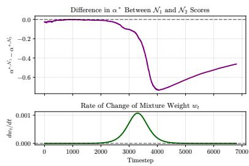  
Figure 5: Score-induced coverage shock in GMM example. The top panel shows the gap between history-relative effective miscoverage levels induced by the two diagnostic scores, while the bottom panel shows the rate of change of the mixture weight. Despite smooth distributional changes, altering the score can induce large shifts in the calibration state that DtACI must track.

where $w _ { t }$ varies smoothly over time. Thus the stream begins in a regime dominated by $\mathcal { N } _ { 1 }$ and gradually transitions to a regime dominated by $\mathcal { N } _ { 2 }$ . The two components are

$$
\mathcal {N} _ {1} = \mathcal {N} \bigg ([ 1. 0 \quad - 1. 2 ], \left[ \begin{array}{c c} 1. 2 & 0. 6 \\ 0. 6 & 0. 9 \end{array} \right] \bigg), \qquad \mathcal {N} _ {2} = \mathcal {N} \bigg ([ - 1. 0 \quad 1. 2 ], \left[ \begin{array}{c c} 0. 8 & - 0. 3 \\ - 0. 3 & 1. 1 \end{array} \right] \bigg).
$$

The resulting stream is shown in Fig. 6.

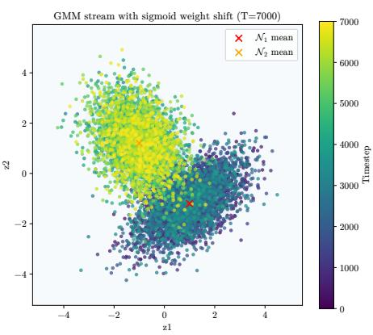  
Figure 6: The 7000 samples drawn from the shifting Gaussian mixture stream. Color indicates time, showing the transition from the $\mathcal { N } _ { 1 }$ -dominated regime to the $\mathcal { N } _ { 2 }$ -dominated regime.

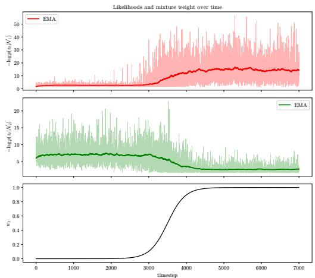  
Figure 7: Negative log-likelihood scores under the two component scores as the mixture weight changes. The smooth mixture transition induces a systematic change in the score distribution.

Score-dependent reference levels. We compare two fixed nonconformity scores, each matched to one component:

$$
s _ {a} (z) = - \log p _ {a} (z), \qquad a \in \{1, 2 \}.\tag{12}
$$

These scores are used as interpretable diagnostic endpoints: $s _ { 1 }$ is matched to the early regime and $s _ { 2 }$ is matched to the late regime. AdaptNC does not literally switch between these two scores; rather, the pair illustrates how a change in score geometry can change the calibration state even on the same residual stream.

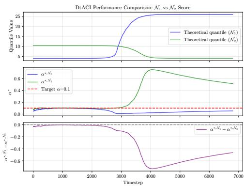  
Figure 8: Coverage shock in the shifting GMM. Top: The nominal $( 1 - \alpha )$ score quantiles for the two diagnostic scores evolve in opposite directions as the dominant mixture component changes. Middle: The corresponding effective miscoverage levels $\widehat { \alpha } _ { a , } ^ { \star }$ deviate from the nominal target $\alpha = 0 . 1$ and from one another. Bottom: The gap between these levels quantifies the change in calibration state induced by changing scores.

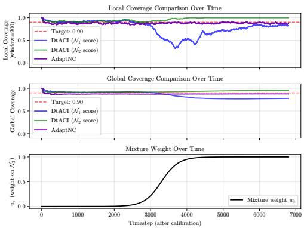  
Figure 9: Coverage behavior under the shifting GMM. The fixed $s _ { 1 }$ baseline undercovers after the mixture shifts, while the fixed $s _ { 2 }$ baseline is conservative. AdaptNC remains closer to the target than the under-covering fixed score and avoids the persistent conservatism of the lateregime score by adapting its score and replaying recent observations.

For each score $s _ { a } .$ let

$$
q _ {a, t} ^ {\text { mix }} = \inf \left\{q: \operatorname * {P r} _ {Z \sim p _ {t}} [ s _ {a} (Z) \leq q ] \geq 1 - \alpha \right\}\tag{13}
$$

be the nominal $( 1 - \alpha )$ score quantile under the instantaneous mixture $p _ { t }$ . In the experiment, this quantity is estimated by Monte Carlo from the current mixture distribution. We then evaluate where this instantaneous quantile falls relative to the accumulated score history,

$$
\widehat {F} _ {a, t} ^ {\mathrm{hist}} (u) = \frac {1}{t + 1} \sum_ {\tau = 0} ^ {t} \mathbb {1} \left\{s _ {a} (z _ {\tau}) \leq u \right\}, \quad \widehat {\alpha} _ {a, t} ^ {\star} = 1 - \widehat {F} _ {a, t} ^ {\mathrm{hist}} \left(q _ {a, t} ^ {\mathrm{mix}}\right).\tag{14}
$$

The quantity $\widehat { \alpha } _ { a , t } ^ { \star }$ is a diagnostic effective miscoverage level: it is the miscoverage rate that would make the accumulated score history place its $( 1 - \widehat \alpha _ { a , t } ^ { \star } )$ quantile at the instantaneous mixture quantile. Because both $q _ { a , t } ^ { \operatorname* { m i x } }$ and $\widehat { F } _ { a , t } ^ { \mathrm { h i s t } }$ depend on the score map, changing from $s _ { 1 }$ to $s _ { 2 }$ can induce a large jump in $\widehat { \alpha } _ { a , t } ^ { \star }$ even when $w _ { t }$ changes smoothly.

Why this motivates replay. Fig. 8 shows that a smooth change in mixture weight can still create a large separation between the calibration reference levels associated with different scores. If a scoreadaptive method updates its score without recalibrating the threshold state, DtACI continues from a state shaped by old score observations while receiving future observations through a new score. In the regret bound of Remark D.2, this appears as a large $| \alpha _ { t } ^ { \star } - \alpha _ { t - 1 } ^ { \star } |$ term, i.e., coverage shock.

Replay mitigates this effect by reconstructing the recent DtACI state under the updated score. Instead of applying the new score to future observations while retaining a threshold state learned from the old score, AdaptNC rescores the recent window, recomputes the corresponding ranks and coverage errors, and reruns the threshold updates. In the GMM example, this replaces a counterfactual abrupt jump between the diagnostic endpoint scores with a recalibration step under the updated score used by AdaptNC.

This behavior is reflected in Fig. 9. When a fixed score becomes mismatched with the dominant mixture component, DtACI either undercovers or becomes conservative. AdaptNC adapts the score and uses replay to realign the threshold state, yielding more stable near-target coverage through the transition. The example is intentionally simple: its purpose is not to model a robotics task, but to isolate the mechanism by which score changes create coverage shock and to motivate replay as the corresponding state-realignment step.

## E.2 Indoor Localization

This section provides a complete and reproducible description of the environment dynamics, wireless observation model, trajectory predictor, and evaluation policy used in all experiments.

## E.2.1 Environment Dynamics

We consider a planar indoor localization environment with discrete-time dynamics and sampling period $\Delta t { = } 0 . 1 { \mathrm { s } }$ . The true system state at time t is

$$
\mathbf {s} _ {t} = [ x _ {t}, y _ {t}, v _ {x, t}, v _ {y, t} ] ^ {\top} \in \mathbb {R} ^ {4},
$$

where $\left( x _ { t } , y _ { t } \right)$ denotes the agent position and $( v _ { x , t } , v _ { y , t } )$ denotes velocity.

Given an acceleration control input $\mathbf { a } _ { t } = [ a _ { x , t } , a _ { y , t } ] ^ { \top }$ , the dynamics evolve according to

$$
\begin{array}{r l} & x _ {t + 1} = x _ {t} + \Delta t v _ {x, t}, \\ & y _ {t + 1} = y _ {t} + \Delta t v _ {y, t}, \\ & v _ {x, t + 1} = v _ {x, t} + \Delta t (a _ {x, t} + \varepsilon_ {x, t}), \\ & v _ {y, t + 1} = v _ {y, t} + \Delta t (a _ {y, t} + \varepsilon_ {y, t}), \end{array}
$$

where $\varepsilon _ { x , t } , \varepsilon _ { y , t } \sim \mathcal { N } ( 0 , \sigma _ { \mathrm { p r o c } } ^ { 2 } )$ model additive process noise on acceleration. We use $\sigma _ { \mathrm { p r o c } } = 0 . 0 2$

The agent operates within a bounded workspace defined by $x , y \in [ - 6 , 6 ]$ . Reflective boundary conditions are enforced by reversing the corresponding velocity component whenever the agent reaches the workspace boundary.

## E.2.2 Access Point Geometry

The environment contains four fixed access points located at

$$
(- 5, - 5), (5, - 5), (5, 5), (- 5, 5).
$$

These access points are static and known to the environment simulator and predictor.

## E.2.3 RSSI Observation Model

At each time step, the agent observes a received signal strength indicator vector

$$
\mathbf {o} _ {t} = \left[ \mathrm{RSSI} _ {t} ^ {(1)}, \dots , \mathrm{RSSI} _ {t} ^ {(4)} \right] ^ {\top} \in \mathbb {R} ^ {4}.
$$

Each RSSI measurement is generated as the sum of path loss, shadowing, and small-scale fading components, expressed in decibels:

$$
\mathbf {R S S I} _ {t} ^ {(i)} = P _ {0} - 1 0 n \mathrm{log} _ {1 0} (d _ {t} ^ {(i)}) + S _ {t} ^ {(i)} + F _ {t} ^ {(i)}.
$$

Path Loss. The path loss component follows the standard log-distance path loss model [26]. Here, $P _ { 0 } = - 3 0$ dB denotes the reference received power at unit distance, $n { = } 2 . 2$ is the path loss exponent,

$$
d _ {t} ^ {(i)} = \left\| [ x _ {t}, y _ {t} ] - \mathbf {a} _ {i} \right\| _ {2}
$$

is the Euclidean distance between the agent and access point i. Distances are lower bounded by $1 0 ^ { - 2 }$ m to ensure numerical stability. The path loss exponent controls the rate of signal attenuation with distance and reflects indoor propagation characteristics.

Shadowing. Large-scale shadowing is modeled as a temporally correlated log-normal process [27]. For each access point i, the shadowing term evolves according to a first-order Gauss–Markov model:

$$
S _ {t} ^ {(i)} = \rho S _ {t - 1} ^ {(i)} + \sqrt {1 - \rho^ {2}} \sigma_ {\mathrm{sh}} \xi_ {t} ^ {(i)}, \quad \xi_ {t} ^ {(i)} \sim \mathcal {N} (0, 1),
$$

where $\sigma _ { \mathrm { s h } } = 4 . 0$ dB controls the shadowing variance and $\rho { = } 0 . 9 7$ determines temporal correlation. Shadowing states are initialized to zero at environment reset and evolve independently across access points.

Small-Scale Fading. Small-scale fading is modeled using a Rayleigh fading process generated via a sum-of-sinusoids [28] method. For each access point, a complex channel coefficient $h _ { t } ^ { ( i ) }$ is generated, and the fading contribution is computed as

$$
F _ {t} ^ {(i)} = 1 0 \mathrm{log} _ {1 0} (| h _ {t} ^ {(i)} | ^ {2} + \epsilon),
$$

with $\epsilon = 1 0 ^ { - 1 2 }$ for numerical stability.

The Doppler frequency governing temporal fading correlation is velocity-dependent:

$$
f _ {d, t} = \frac {\| \mathbf {v} _ {t} \| _ {2}}{\lambda}, \quad \lambda = \frac {c}{f _ {c}},
$$

where $f _ { c } = 2 . ^ { \it }$ 4 GHz is the carrier frequency and c is the speed of light. Fading processes are independent across access points. The Rayleigh distribution of $| h _ { t } ^ { ( i ) } |$ follows from the assumption of rich multipath with no dominant line-of-sight component [29, 26].

## E.2.4 Trajectory Predictor

We employ a lightweight model-based trajectory predictor that estimates the agent position from RSSI measurements using a simplified propagation model. The predictor is mismatched with the true environment observation model and does not explicitly account for shadowing or small-scale fading. This mismatch induces systematic and time-varying localization error.

Internal State. The predictor maintains an internal estimate of planar position and velocity,

$$
\hat {\mathbf {x}} _ {t} \in \mathbb {R} ^ {2}, \quad \hat {\mathbf {v}} _ {t} \in \mathbb {R} ^ {2},
$$

which are reset to zero at the beginning of each rollout.

Prediction Step. At each time step, the predictor applies a constant-velocity motion model:

$$
\hat {\mathbf {x}} _ {t | t - 1} = \hat {\mathbf {x}} _ {t - 1} + \Delta t \hat {\mathbf {v}} _ {t - 1}.
$$

This prediction does not incorporate control inputs or process noise and serves only as a kinematic extrapolation of past estimates.

RSSI-to-Distance Conversion. Given an RSSI observation vector $\mathbf { o } _ { t } ,$ the predictor converts each RSSI measurement into a distance estimate by inverting the log-distance path loss model:

$$
\hat {d} _ {t} ^ {(i)} = 1 0 ^ {\frac {P _ {0} - \mathrm{RSSI} _ {t} ^ {(i)}}{1 0 n}}.
$$

This inversion assumes that RSSI measurements are generated solely by path loss and ignores the presence of shadowing and fading. As a result, the inferred distances are biased and noisy, with error statistics that depend on the instantaneous channel realization.

Multilateration via Gauss–Newton. The predicted position is refined by solving a nonlinear leastsquares multilateration problem of the form

$$
\min _ {\mathbf {x} \in \mathbb {R} ^ {2}} \sum_ {i = 1} ^ {N} w _ {i} \Big (\| \mathbf {x} - \mathbf {a} _ {i} \| _ {2} - \hat {d} _ {t} ^ {(i)} \Big) ^ {2}, \quad w _ {i} = \frac {1}{(\hat {d} _ {t} ^ {(i)}) ^ {2}}.
$$

This problem is solved using Gauss–Newton iterations initialized at $\hat { \mathbf { x } } _ { t \mid t - 1 } . \mathrm { A }$ small damping term is added for numerical stability, and update steps are clipped to avoid large jumps. The resulting solution is denoted $\mathbf { x } _ { t } ^ { \mathrm { { m e a s } } }$

Alpha–Beta Filtering. The final position and velocity estimates are obtained using an $\alpha { - } \beta$ filter:

$$
\begin{array}{r l} & {\mathbf {e} _ {t} = \mathbf {x} _ {t} ^ {\mathrm{meas}} - \hat {\mathbf {x}} _ {t | t - 1},} \\ & {\hat {\mathbf {x}} _ {t} = \hat {\mathbf {x}} _ {t | t - 1} + \alpha \mathbf {e} _ {t},} \\ & {\hat {\mathbf {v}} _ {t} = \hat {\mathbf {v}} _ {t - 1} + \frac {\beta}{\Delta t} \mathbf {e} _ {t},} \end{array}
$$

with $\alpha { = } 0 . 2 5$ and $\beta { = } 0 . 0 5$ . This filter smooths high-frequency measurement noise while allowing the predictor to track gradual motion trends.

Model Mismatch and Error Characteristics. Since the predictor assumes a deterministic path loss model and neglects shadowing and small-scale fading, its position estimates exhibit residual errors that are neither independent nor identically distributed. In particular, temporally correlated fading induces time-correlated localization errors whose magnitude and direction vary over time. This mismatch produces nonstationary residual streams, making the predictor suitable for evaluating adaptive conformal uncertainty estimation methods that must respond to evolving error statistics.

## E.2.5 Evaluation Policy

All experiments use a fixed, non-adaptive random motion policy intended to emulate surveillance-style exploration. At each time step, acceleration inputs are sampled uniformly within bounded limits. Velocity magnitudes are clipped to a maximum of 1.0 m/s, and accelerations are bounded by 0.5 m/s2.

The policy is independent of RSSI observations, predictor estimates, and uncertainty regions. The same policy is used across all methods, ensuring that observed differences in coverage and region geometry arise solely from the uncertainty estimation method.

## E.2.6 Expert Weights

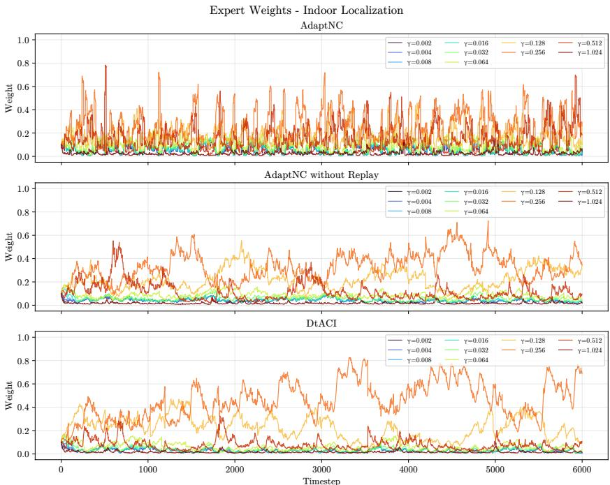  
Figure 10: This figure shows the evolution of expert weights in the Indoor Localization setting over the course of the experiment. The pronounced, piecewise variation observed for AdaptNC arises from its adaptive reweighting mechanism, which enables rapid adjustment of expert weights in response to changes in the score function and contributes to maintaining valid coverage. In contrast, DtACI and AdaptNC without replay exhibit slower weight adaptation and consistently select smaller values of γ than AdaptNC.

## E.3 Social Navigation

The simulation environment implements a continuous-space multi-agent system based on the Social Force Model described by Helbing and Molnár (1995).

## E.3.1 Equations of Motion

Let the state of agent α at time t be defined by its position $\vec { r } _ { \alpha } ( t )$ , actual velocity $\vec { v } _ { \alpha } ( t )$ , and preferred velocity $\vec { w } _ { \alpha } ( t )$ . The dynamics are governed by a nonlinearly dynamics equation driving the preferred velocity, subject to a maximum speed constraint.

The evolution of the preferred velocity $\vec { w } _ { \alpha }$ is given by:

$$
\frac {d \vec {w} _ {\alpha}}{d t} = \frac {\vec {v} _ {\alpha} ^ {d e s} - \vec {v} _ {\alpha}}{\tau} + \sum_ {\beta \neq \alpha} \vec {F} _ {\alpha \beta} + \sum_ {B} \vec {F} _ {\alpha B} + \vec {\xi} (t)\tag{15}
$$

where:

• τ is the relaxation time constant.

$\vec { v } _ { \alpha } ^ { d e s }$ is the desired velocity vector toward the current goal.

• $\vec { F } _ { \alpha \beta }$ represents the social repulsive force from agent $\beta .$

$\vec { F } _ { \alpha B }$ represents the repulsive force from boundary $B .$

$\vec { \xi } ( t )$ is a stochastic fluctuation term (Gaussian noise).

The actual velocity $\vec { v } _ { \alpha } ( t )$ is derived by clipping the preferred velocity to the agent’s maximum speed $v _ { \alpha } ^ { m a x }$

$$
\vec {v} _ {\alpha} (t) = \min \left(1, \frac {v _ {\alpha} ^ {m a x}}{\| \vec {w} _ {\alpha} (t) \|}\right) \vec {w} _ {\alpha} (t)\tag{16}
$$

## E.3.2 Force Components

Goal Attraction The driving term attracts the agent toward its goal $\vec { g } _ { \alpha }$ with a desired speed $v _ { \alpha } ^ { 0 }$ :

$$
\vec {v} _ {\alpha} ^ {d e s} = v _ {\alpha} ^ {0} \frac {\vec {g} _ {\alpha} - \vec {r} _ {\alpha}}{\| \vec {g} _ {\alpha} - \vec {r} _ {\alpha} \|}\tag{17}
$$

Social Repulsion The interaction force $\vec { F } _ { \alpha \beta }$ models the repulsion between agents to maintain personal space. The implementation utilizes an elliptical distance metric approximation. The force is defined as:

$$
\vec {F} _ {\alpha \beta} = w (\vec {e} _ {\alpha}, \vec {f} _ {\alpha \beta}) \cdot \vec {f} _ {\alpha \beta}\tag{18}
$$

where the raw isotropic force $\vec { f } _ { \alpha \beta }$ is:

$$
\vec {f} _ {\alpha \beta} = \left(\frac {A}{B} \exp \left(- \frac {b}{B}\right) \frac {2 d _ {\alpha \beta} - s _ {a b}}{2 b}\right) \vec {n} _ {\alpha \beta}\tag{19}
$$

with terms defined as follows:

$$
\begin{array}{l} d _ {\alpha \beta} = \| \vec {r} _ {\alpha} - \vec {r} _ {\beta} \| \quad (\text { Euclidean   distance }) \\ \vec {n} _ {\alpha \beta} = \frac {\vec {r} _ {\alpha} - \vec {r} _ {\beta}}{d _ {\alpha \beta}} \quad (\text { Normalized   direction   vector }) \\ s _ {a b} = \| \vec {v} _ {\beta} \| \Delta t _ {\text { anticipation }} \quad (\text { Anticipated   displacement }) \end{array}
$$

The semi-minor axis b of the repulsive potential is approximated in the implementation as:

$$
b = \sqrt {\frac {d _ {\alpha \beta} ^ {2} + (d _ {\alpha \beta} - s _ {a b}) ^ {2}}{2}}\tag{20}
$$

This differs slightly from the exact equipotential formulation in the original work but preserves the qualitative elliptical avoidance behavior .

Boundary Repulsion Repulsion from static boundaries (walls) decays exponentially with the distance $d _ { \alpha B }$ to the nearest point on the boundary:

$$
\vec {F} _ {\alpha B} = w (\vec {e} _ {\alpha}, \vec {f} _ {\alpha B}) \cdot \frac {A _ {w a l l}}{R _ {w a l l}} \mathrm{exp} \left(- \frac {d _ {\alpha B}}{R _ {w a l l}}\right) \vec {n} _ {\alpha B}\tag{21}
$$

where $\vec { n } _ { \alpha B }$ is the normal vector pointing away from the boundary.

## E.3.3 Anisotropic Perception

To reflect the limited field of view, forces are scaled by an anisotropic weight $w ( \vec { e } , \vec { f } )$ dependent on the angle ϕ between the agent’s desired direction $\vec { e } _ { \alpha }$ and the force vector ${ \vec { f } } \colon$

$$
w (\vec {e} _ {\alpha}, \vec {f}) = \left\{ \begin{array}{l l} \lambda + (1 - \lambda) \frac {1 + \cos \phi}{2} & \text { if } \cos \phi \geq 0 \\ c & \text { if } \cos \phi <   0 \end{array} \right. \quad \text {(Frontal)}\tag{22}
$$

where $\begin{array} { r } { \cos \phi = \frac { \vec { e } _ { \alpha } \cdot \vec { f } } { \parallel \vec { e } _ { \alpha } \parallel \parallel \vec { f } \parallel } . } \end{array}$

## E.3.4 Model Parameters

The default parameters used in the simulation are listed in Table 3.

<table><tr><td>Parameter</td><td>Symbol</td><td>Value</td></tr><tr><td>Relaxation time</td><td> $\tau$ </td><td>0.5 s</td></tr><tr><td>Desired speed</td><td> $v^{0}$ </td><td> $\mathcal{N}(1.34,0.26)$  m/s</td></tr><tr><td>Max speed</td><td> $v^{max}$ </td><td> $1.3 \times v^{0}$  m/s</td></tr><tr><td>Repulsion strength</td><td>A</td><td> $5.0$  m/s $^{2}$ </td></tr><tr><td>Repulsion range</td><td>B</td><td>2.0 m</td></tr><tr><td>Anticipation time</td><td> $\Delta t_{anticipation}$ </td><td>2.0 s</td></tr><tr><td>Anisotropy factor</td><td> $\lambda$ </td><td>0.5</td></tr><tr><td>Rear influence</td><td>c</td><td>0.5</td></tr><tr><td>Wall repulsion strength</td><td> $A_{wall}$ </td><td> $10.0$  m/s $^{2}$ </td></tr><tr><td>Wall repulsion range</td><td> $R_{wall}$ </td><td>0.2 m</td></tr></table>

Table 3: Simulation parameters corresponding to the Social Navigation experiment

## E.3.5 Trajectory Predictor

The trajectory predictor is implemented as an Long Short-Term Memory (LSTM) to capture temporal dependencies in agent motion. The model is implemented using the Flax/JAX framework.

Architecture The model processes a sequence of state observations $X = \{ x _ { 1 } , . . . , x _ { T } \}$ where each timestep $\boldsymbol { x } _ { t } \in \mathbb { R } ^ { 3 4 }$ contains the ego-agent’s state and the relative states of the $k = 7$ nearest neighbors. The specific feature composition is:

• Ego Features (6): Absolute position $( p _ { x } , p _ { y } )$ , velocity $( v _ { x } , v _ { y } )$ , and goal position $( g _ { x } , g _ { y } )$

• Neighbor Features (28): Relative position $( \Delta p _ { x } , \Delta p _ { y } )$ and relative velocity $( \Delta v _ { x } , \Delta v _ { y } )$ for each of the 7 nearest neighbors.

The network architecture consists of a single LSTM layer with a hidden dimension of $h = 1 2 8$ . The final hidden state hT is passed through a Multi-Layer Perceptron (MLP) head to predict the 2D position $\hat { y } \in \mathbb { R } ^ { 2 }$ of the agent at the prediction horizon $\tau { : }$

$$
h _ {1: T} = \mathrm{LSTM} (x _ {1: T})\tag{23}
$$

$$
z = \operatorname{ReLU} \left(\text { Dense } _ {1 2 8} \left(\text { Dropout } (h _ {T})\right)\right)\tag{24}
$$

$$
\hat {y} = \operatorname{Dense} _ {2} (\operatorname{Dropout} (z))\tag{25}
$$

Dropout with a rate of 0.1 is applied before the dense layers during training to prevent overfitting .

Training Objective The model is trained to minimize the Mean Squared Error (MSE) between the predicted position yˆ and the ground truth position y after τ simulation steps:

$$
\mathcal {L} (\theta) = \frac {1}{N} \sum_ {i = 1} ^ {N} \| \hat {y} _ {i} - y _ {i} \| ^ {2}\tag{26}
$$

Optimization is performed using the AdamW optimizer. The specific hyperparameters used for training are detailed in Table 4.

<table><tr><td>Hyperparameter</td><td>Value</td></tr><tr><td>Hidden Dimension</td><td>128</td></tr><tr><td>Dropout Rate</td><td>0.1</td></tr><tr><td>Sequence Length (T)</td><td>10</td></tr><tr><td>Prediction Horizon (τ)</td><td>5</td></tr><tr><td>Learning Rate</td><td> $1 \times 10^{-4}$ </td></tr><tr><td>Weight Decay</td><td> $1 \times 10^{-5}$ </td></tr><tr><td>Batch Size</td><td>512</td></tr><tr><td>Training Epochs</td><td>200</td></tr></table>

Table 4: Hyperparameters for the LSTM Trajectory Predictor.

## E.3.6 Expert Weights

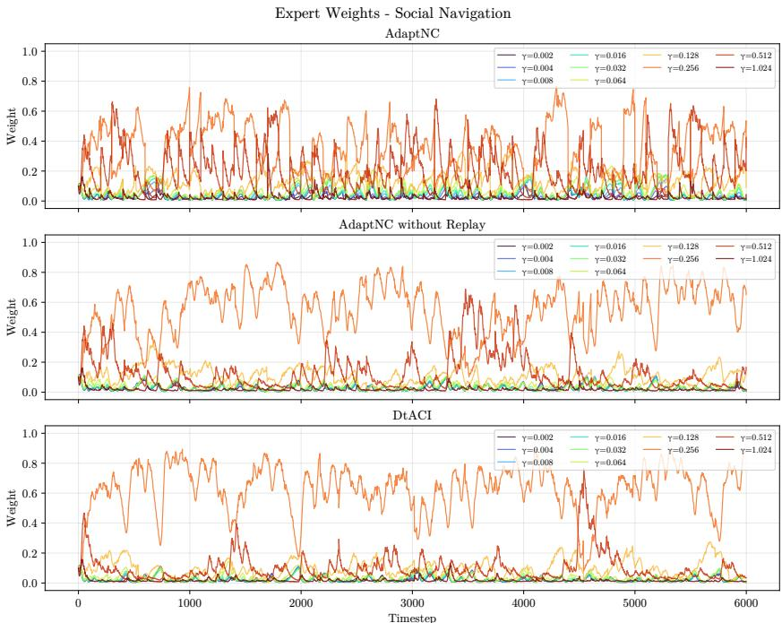  
Figure 11: This figure contains the expert weights for the social navigation setting. The plots show the evolution of the weights over the course of the scenario. The stacatto pattern of the AdaptNC setting is a consequence of the adaptive reweighting scheme, which enables rapid adaptation of the expert weights in response to score function changes, which helps AdaptNC maintain coverage. We can see that the DtACI and AdaptNC without Replay methods do not adapt expert weights as quickly, and choose values for γ that are lower than those chosen by AdaptNC.

## E.4 Multirotor Tracking

This section describes the multirotor environment with actuator degradation, the trajectory predictor used for position forecasting, and the control policy employed to generate training, calibration, and evaluation trajectories.

## E.4.1 Environment with Actuator Degradation

The multirotor state at time t is: $\mathbf { s } _ { t } = [ x _ { t } , \dot { x } _ { t } , y _ { t } , \dot { y } _ { t } , z _ { t } , \dot { z } _ { t } , \psi _ { t } , \dot { \psi } _ { t } , \theta _ { t } , \dot { \theta } _ { t } , \delta _ { t } , \dot { \delta } _ { t } ] ^ { \top } \in \mathbb { R } ^ { 1 2 }$ , where $( x , y , z )$ denote position, $( \dot { x } , \dot { y } , \dot { z } )$ translational velocity, ψ yaw, θ pitch, and δ roll. The system evolves in discrete time with integration step $\Delta t { = } 0 .$ 1 s using forward Euler integration.

Control Inputs. The control input is: $\mathbf { u } _ { t } = [ u _ { 1 , t } , u _ { 2 , t } , u _ { 3 , t } , u _ { 4 , t } ] ^ { \top }$ , where $u _ { 1 }$ corresponds to collective thrust, $u _ { 2 }$ to pitch torque, $u _ { 3 }$ to roll torque, and u4 to yaw torque.

Actuator Degradation. Each actuator is subject to stochastic degradation modeled by a health variable, $\mathbf { { T } } _ { t } \in [ 0 , 1 ] ^ { 4 }$ , where $\Gamma _ { t } ^ { ( i ) } = 1$ denotes a healthy actuator. The effective control applied to the system is: $\bar { \mathbf { u } } _ { t } ^ { \mathrm { e f f } } \bar { = } \mathbf { T } _ { t } \odot \mathbf { u } _ { t }$ . Actuator health evolves according to an additive Wiener process with negative drift:

$$
\boldsymbol {\Gamma} _ {t + 1} = \boldsymbol {\Gamma} _ {t} - \alpha \Delta t + \sigma \mathbf {w} _ {t}, \quad \mathbf {w} _ {t} \sim \mathcal {N} (\mathbf {0}, \Delta t I),
$$

with $\alpha = 5 \times 1 0 ^ { - 4 }$ and $\sigma = 2 . 5 \times 1 0 ^ { - 4 }$ . The degradation process is unobserved by the predictor and policy.

Dynamics. Translational accelerations are given by $\begin{array} { r } { : \ddot { x } _ { t } = g \theta _ { t } , \ddot { y } _ { t } = - g \delta _ { t } , \ddot { z } _ { t } = u _ { 1 , t } ^ { \mathrm { e f f } } - g \ d , } \end{array}$ , with gravitational constant $g = 9 . 8 1 \mathrm { m } / \mathrm { s } ^ { 2 }$ . Rotational accelerations satisfy: $\ddot { \psi } _ { t } = u _ { 4 , t } ^ { \mathrm { e f f } } , \ddot { \theta } _ { t } = u _ { 2 , t } ^ { \mathrm { e f f } } , \ddot { \delta } _ { t } = u _ { 3 , t } ^ { \mathrm { e f f } }$ Yaw is wrapped to $[ - \pi , \pi ]$ , and pitch and roll are clipped to $[ - 0 . 3 , 0 . 3 ]$ radians.

## E.4.2 Trajectory Predictor

To forecast planar motion, we use a hybrid physics learning predictor that combines a simple kinematic prior with a learned residual model.

Physics Prior. The prior assumes constant velocity motion in the horizontal plane:

$$
\hat {x} _ {t + 1} ^ {\mathrm{phys}} = x _ {t} + \Delta t \dot {x} _ {t}, \quad \hat {y} _ {t + 1} ^ {\mathrm{phys}} = y _ {t} + \Delta t \dot {y} _ {t}.
$$

This prior ignores rotational coupling and actuator degradation and therefore provides only a coarse approximation of the true dynamics.

Residual Learning. Rather than predicting absolute position $^ { 1 S , }$ the predictor learns the residual

$$
\mathbf {r} _ {t} = \left[ \begin{array}{c} x _ {t + 1} \\ y _ {t + 1} \end{array} \right] - \left[ \begin{array}{c} \hat {x} _ {t + 1} ^ {\mathrm{phys}} \\ \hat {y} _ {t + 1} ^ {\mathrm{phys}} \end{array} \right].
$$

The final prediction is obtained as

$$
\hat {\mathbf {p}} _ {t + 1} = \left[ \begin{array}{c} \hat {x} _ {t + 1} ^ {\mathrm{phys}} \\ \hat {y} _ {t + 1} ^ {\mathrm{phys}} \end{array} \right] + \hat {\mathbf {r}} _ {t}.
$$

LSTM Architecture and Training. Residuals are predicted using a single layer long short term memory network that takes as input a fixed length history

$$
\left[ \mathbf {s} _ {t - H + 1}, \dots , \mathbf {s} _ {t} \right] \in \mathbb {R} ^ {H \times 1 2},
$$

with $H = 5 0$ . The LSTM hidden dimension is $1 2 8 .$ , and the output is a two dimensional residual $( r _ { x } , r _ { y } )$ The network is trained by minimizing mean squared error between predicted and true residuals using supervised data generated from the environment.

Model Mismatch. The predictor does not observe actuator health and does not model degradation dynamics. As actuator effectiveness degrades over time, the physics prior becomes increasingly inaccurate. Although the LSTM can partially compensate using temporal context, prediction errors remain time varying and correlated, providing a nonstationary residual process.

## E.4.3 Evaluation Policy

All trajectories are generated using a fixed model predictive path integral control policy. The policy is used solely to excite the system and is not part of the proposed uncertainty estimation method.

Reference Motion. The policy tracks a figure eight trajectory in the horizontal plane:

$$
x _ {r} (t) = A \mathrm{sin} (\omega t), y _ {r} (t) = A \mathrm{sin} (2 \omega t),
$$

with amplitude $A = 3 . 0$ and angular frequency $\omega = 0 . 2 5 .$ A constant altitude reference $z _ { r } = 2 . 0$ m is enforced using a proportional derivative controller on thrust.

MPPI Control. At each time step, the policy samples N =30 control sequences over a horizon of H =35 by perturbing a nominal sequence with Gaussian noise. Each sequence is rolled out using the environment dynamics, and a quadratic cost penalizing position tracking error, velocity error, attitude deviation, and control effort is accumulated. Sampled trajectories are weighted using an exponential transformation of cost, and the nominal sequence is updated accordingly. The first control input is applied, and the horizon is receded.

Policy Independence. The policy does not observe actuator health, predictor outputs, or uncertainty regions. The same policy and parameters are used across all experiments. Consequently, differences in coverage and region geometry arise solely from the uncertainty estimation method rather than from changes in control behavior.

## E.4.4 Expert Weights

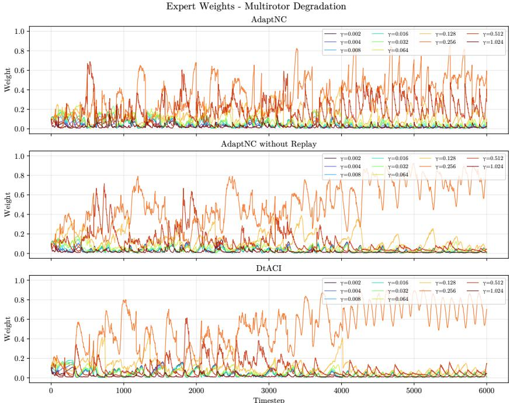  
Figure 12: This figure shows the evolution of expert weights in the multirotor navigation setting. The plots illustrate how weights change over time across the different methods. The pronounced oscillatory pattern observed for AdaptNC arises from its adaptive reweighting mechanism, which enables rapid adjustment of expert weights in response to changes in the nonconformity score and contributes to maintaining coverage. In contrast, DtACI and AdaptNC without Replay exhibit slower weight adaptation and assign greater weight to intermediate values of $\mathit { \check { \gamma } }$ toward the end of the rollout, resulting in reduced responsiveness compared to AdaptNC.

## E.5 Hyperparameter Sensitivity Analysis

<table><tr><td colspan="3">Social Navigation</td></tr><tr><td colspan="3">Varying window size (update period = 100)</td></tr><tr><td>Window Size</td><td>Global Cov. (↑)</td><td>Mean Volume (↓)</td></tr><tr><td>35</td><td>0.9043 ± 0.0144</td><td>40.24 ± 5.66</td></tr><tr><td>75 (base)</td><td>0.9223 ± 0.0090</td><td>42.00 ± 5.54</td></tr><tr><td>120</td><td>0.9641 ± 0.0043</td><td>52.41 ± 5.46</td></tr></table>

<table><tr><td>Update Period</td><td>Global Cov. (↑)</td><td>Mean Volume (↓)</td></tr><tr><td>70</td><td> $0.9609 \pm 0.0032$ </td><td> $36.45 \pm 3.97$ </td></tr><tr><td>100 (base)</td><td> $0.9223 \pm 0.0090$ </td><td> $42.00 \pm 5.54$ </td></tr><tr><td>130</td><td> $0.8780 \pm 0.0111$ </td><td> $46.74 \pm 5.93$ </td></tr></table>

<table><tr><td colspan="3">Varying window size (update period = 100)</td></tr><tr><td>Window Size</td><td>Global Cov. (↑)</td><td>Mean Volume (↓)</td></tr><tr><td>35</td><td> $0.9180 \pm 0.0050$ </td><td> $0.04 \pm 0.01$ </td></tr><tr><td>65 (base)</td><td> $0.9264 \pm 0.0055$ </td><td> $0.04 \pm 0.01$ </td></tr><tr><td>100</td><td> $0.9620 \pm 0.0049$ </td><td> $0.03 \pm 0.01$ </td></tr></table>

<table><tr><td>Update Period</td><td>Global Cov. (↑)</td><td>Mean Volume (↓)</td></tr><tr><td>60</td><td> $0.9685 \pm 0.0027$ </td><td> $0.03 \pm 0.01$ </td></tr><tr><td>100 (base)</td><td> $0.9264 \pm 0.0055$ </td><td> $0.04 \pm 0.01$ </td></tr><tr><td>140</td><td> $0.8976 \pm 0.0060$ </td><td> $0.04 \pm 0.01$ </td></tr></table>

<table><tr><td colspan="3">Varying window size (update period = 20)</td></tr><tr><td>Window Size</td><td>Global Cov. (↑)</td><td>Mean Volume (↓)</td></tr><tr><td>60</td><td>0.9135 ± 0.0027</td><td>26.29 ± 1.64</td></tr><tr><td>100 (base)</td><td>0.9062 ± 0.0027</td><td>27.81 ± 1.75</td></tr><tr><td>140</td><td>0.9004 ± 0.0032</td><td>28.67 ± 1.71</td></tr></table>

$$
\text { Global   Cov. } (\uparrow)
$$

$$
0. 8 9 6 4 \pm 0. 0 0 3 4
$$

$$
2 5. 0 0 \pm 1. 7 1
$$

$$
0. 9 0 6 2 \pm 0. 0 0 2 7
$$

$$
2 7. 8 1 \pm 1. 7 5
$$

$$
0. 9 3 6 5 \pm 0. 0 0 2 4
$$

$$
3 5. 9 0 \pm 2. 6 1
$$

Table 5: Sensitivity analysis with respect to window size and update period across all environments. Performance remains stable around the chosen base configurations, indicating robustness to moderate hyperparameter variations.