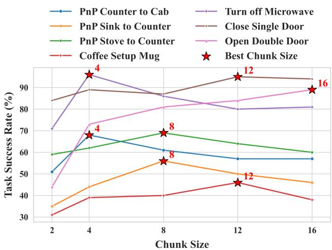
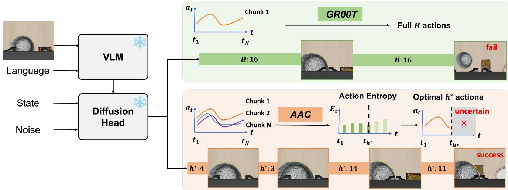
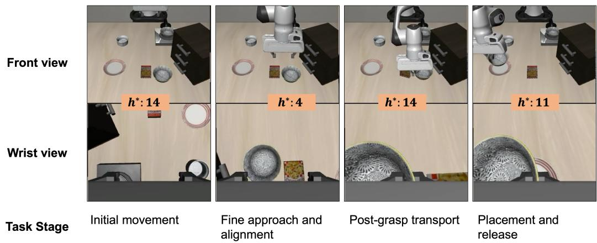
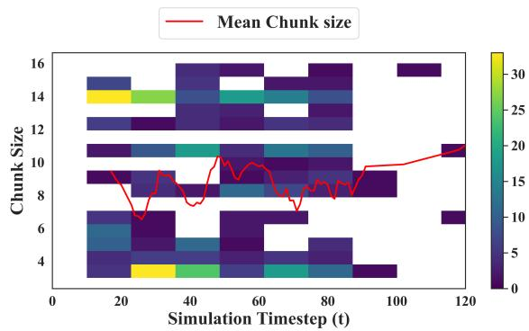
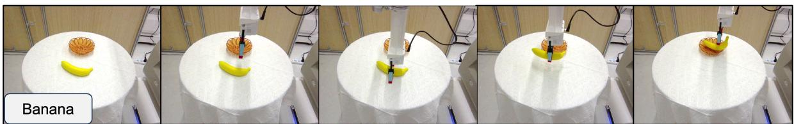
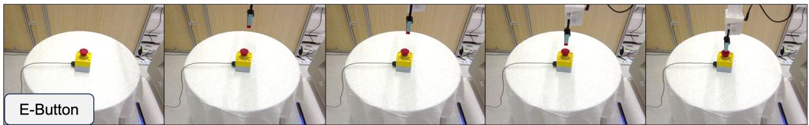
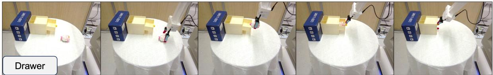
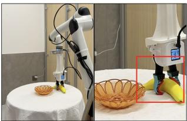
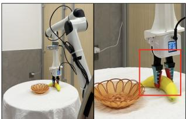

# Adaptive Action Chunking at Inference-time for Vision-Language-Action Models

Yuanchang Liang1 Xiaobo Wang2,3 Kai Wang1 Shuo Wang4

Xiaojiang Peng5 Haoyu Chen6 David Kim Huat Chua1 Prahlad Vadakkepat1

1National University of Singapore 2Shenzhen University of Advanced Technology

3Sangfor Technologies Inc. 4Mininglamp Technology 5Shenzhen Technology University 6City University of Hong Kong

liangyuanchang@u.nus.edu, wangxiaobo@suat-sz.edu.cn

## Abstract

In Vision-Language-Action (VLA) models, action chunking (i.e., executing a sequence ofactions without intermediate replanning) is a key technique to improve robotic manipulation abilities. However, a large chunk size reduces the model’s responsiveness to new information, while a small one increases the likelihood of mode-jumping, jerky behavior resulting from discontinuities between chunks. Therefore, selecting the optimal chunk size is an urgent demand to balance the model’s reactivity and consistency. Unfortunately, a dominant trend in current VLA models is an empirical fixed chunk length at inference-time, hindering their superiority and scalability across diverse manipulation tasks. To address this issue, we propose a novel Adaptive Action Chunking (AAC) strategy, which exploits action entropy as the cue to adaptively determine the chunk size based on current predictions. Extensive experiments on a wide range of simulated and real-world robotic manipulation tasks have demonstrated that our approach substantially improves performance over the state-of-the-art alternatives. The videos and source code are publicly available at https://lance-lot.github.io/adaptivechunking.github.io/.

## 1. Introduction

Vision-Language-Action (VLA) models have shown great potential to improve robotic manipulation abilities by generating robotic control actions from a variety of data modal ities [2, 3, 13, 14, 20, 24, 26, 32, 33, 39, 41, 43]. Usually, they map basic information such as vision, language instructions, and robotic proprioception states, or additional information like tactile [1, 13], force [41], and 3D information [19, 31, 34, 42, 44, 47] into executable actions. Beyond that, earlier studies in imitation learning, such as ACT [46] and Diffusion Policy [9] have shown that executing a sequence of actions at each observation point, known as action chunking, can effectively improve the success rates as it reduces compounding errors. Therefore, the action chunking technique is employed as a standard paradigm for VLA models. Jointly, the action chunk is simply set as a fixed length by empirical experiments. For instance, in GR00T N1.5 [2], the chunk size is set as 16 at inference-time for the RoboCasa Kitchen [28] benchmark. $\pi _ { 0 }$ [3] sets the inference chunk size as 16 or 25 for different benchmarks. Differently, SmolVLA [33] suggests a chunk size of 10 for the LIBERO [23] benchmark. In summary, determining a proper chunk size is non-trivial as it is not consistent for different policies. Moreover, it is intuitive that the best chunk size for different manipulation tasks is also different. To demonstrate this, we performed experiments with GR00T N1.5 [2] across multiple tasks in RoboCasa Kitchen [28]. As shown in Fig. 1, the success rates of different tasks exhibit a strong dependency on the action chunk size.

To mitigate this dilemma at inference-time, ACT [46] integrates current and past predicted actions using Exponential Moving Average (EMA) to enhance temporal consistency. BID [25] employs a search strategy to select the optimal full action chunk from multiple candidates, where backward coherence and forward contrast scores are used to balance the policy’s consistency and reactivity. TV-BID [15] further extends BID [25] by adapting the backward coherence and forward contrast scores according to the Total Variation Distance (TVD) between consecutive action chunk distributions. SGAC [35] selectively updates action chunks by comparing the cosine similarity between the first action of the previous planned chunk and the newly generated action. Nevertheless, all these methods set a fixed chunk size throughout a whole episode, relying on extensive empirical tuning for the action chunk size selection. Recent studies [8, 11] have begun to adaptively select the chunk size by reinforcement learning. Gou et al. [11] determine whether to choose a single action or an entire action chunk based on a regret value function. However, this handcrafted value function fails to generalize across various tasks. Chen et al. [8] introduce a learnable module that predicts chunk size, but this approach depends on task-specific reward signals available only in simulation, exhibiting limited applicability in real-world deployment. Consequently, adaptively selecting the optimal action chunk size at inference-time remains a challenging problem in practice.

  
Figure 1. Effects of action chunk sizes. At inference-time, the success rates of the GR00T N1.5 [2] on different tasks of Robo-Casa Kitchen [28] are highly related to the action chunk size. It can be observed that it is difficult and sub-optimal to empirically set a fixed value for various manipulation tasks.

In this paper, we propose a simple yet effective Adaptive Action Chunking (AAC) strategy, which exploits action entropy as the cue to determine the optimal chunk size at each inference timestep dynamically. Specifically, as action entropy reflects the uncertainty level of the predicted action, a lower entropy implies higher action reliability during task execution. Inspired by this, AAC tries to adaptively determine the optimal action chunk size by maintaining a lower action entropy. In detail, we compute the maximum differential point of average action entropy across different chunk sizes meanwhile ensuring minimum action magnitude. In high-entropy cases, where the predicted actions are of low quality, AAC executes smaller chunks and replans more frequently to improve the model’s reactivity. Conversely, when the entropy is low, longer action chunks are executed to enhance temporal consistency and inference efficiency. Notably, AAC performs action entropy computation and chunk-size adaptation only at inference-time, without additional training or architectural modifications. Therefore, it ensures the robustness and scalability of our method to various manipulation tasks. To sum up, the main contributions of this paper can be summarized as follows:

• We analyze existing action chunking methods and highlight the importance of adaptive action chunking at inference-time for diffusion-based VLA models.

• We propose AAC, a simple yet effective algorithm that exploits action entropy as the cue to dynamically select the action chunk size at inference-time.

• We conduct extensive experiments on a wide range of simulated and real-world robotic manipulation benchmarks, demonstrating the superiority of our approach over the state-of-the-art alternatives.

## 2. Related work

## 2.1. Vision-Language-Action models

Inspired by the success of large pre-trained vision-language models (VLMs), Vision-Language-Action (VLA) models have shown great promise in robotic policy learning by leveraging diverse, robot-specific datasets. One line of VLA models [5, 6, 17, 30, 37, 51] discretizes the continuous action space and predicts actions as tokens, showing that pretrained VLMs can be effectively adapted to low-level action predictions. In contrast, a growing body of studies [2– 4, 7, 12, 16, 18, 21, 33, 36, 45, 48, 49] leverage action experts to predict continuous actions via diffusion or flowmatching, enabling more accurate predictions. For instance, GR00T N1.5 [2] conditions a flow-matching head on VLM features to generate action chunks. CogVLA [21] systematically compares action modules and finds that diffusion action transformers scale favorably when conditioned on VLM representations. CoT-VLA [45] incorporates explicit visual chain-of-thought (CoT) reasoning into VLM by autoregressively predicting future image frames as visual goals. In this paper, we propose an adaptive action chunking strategy that operates at inference-time for VLA models, without requiring additional training or architectural modifications. Therefore, without loss of generality, this work adopts GR00T N1.5 [2] as the baseline.

## 2.2. Action Chunking

Action chunking plays an important role in recent pretrained VLA models with diffusion-based action heads. At training-time, action chunking enables the policy to learn a sequence of future actions across multiple timesteps. At inference-time, however, action chunks can be executed differently to balance the policy’s consistency and reactivity. For example, ACT [46] generates a new action chunk at every timestep and preserves temporal consistency by assembling actions across different timesteps. In GR00T N1.5 [2], it adopts the same chunk size at training-time and inferencetime. In contrast, π [3] uses a larger chunk size (50)

during training, but executes smaller chunks (16 or 25) at inference-time, depending on different embodiment setups. SmolVLA [33] follows a similar paradigm, referred to as an asynchronous inference mechanism. Recently, DeepConf [10] exploits model output confidence as a signal to address the Best-of-N selection problem, but it is limited to large Language Models (LLMs). Similarly, BID [25] proposes to select the best action chunk from multiple candidates based on the designed backward coherence and forward contrast scores. However, it is still required to set a fixed chunk size, which limits the reactivity and efficiency of a policy. Complementary to these fixed action chunking methods, in this paper, we investigate the adaptive selection of the optimal action chunk size at inference-time.

## 3. Preliminaries

## 3.1. GR00T N1.5

GR00T N1.5 [2] is a typical Vision-Language-Action foundation model with a flow-matching action head. It consists of two systems, a Vision-Language Model (VLM) to extract vision-language features $\phi _ { t }$ as condition, and a Diffusion Transformer (DiT) module as the action head $\mathbf { V } _ { \theta }$ for flow-matching. Specifically, given a ground-truth action chunk $\mathbf { A } _ { t } = \{ \mathbf { a } _ { t } , \mathbf { a } _ { t + 1 } , \cdot \cdot \cdot , \mathbf { a } _ { t + H - 1 } \} \in \mathbb { R } ^ { d \times H }$ at timestep $t , \mathrm { ~ a ~ }$ flow-matching timestep $\tau \in [ 0 , 1 ]$ and sampled noise $\epsilon \sim \mathcal { N } ( \mathbf { 0 } , \mathbf { I } )$ , where d denotes the action degrees of freedom and H is the action horizon, the noised action chunk ${ \bf A } _ { t } ^ { ( \tau ) }$ is computed as ${ \bf A } _ { t } ^ { ( \tau ) } = \tau { \bf A } _ { t } + ( 1 - \tau ) \epsilon$ . Together with the robot state embedding $\mathbf { q } _ { t }$ , the action head prediction ${ \bf V } _ { \theta } ( \phi _ { t } , { \bf A } _ { t } ^ { ( \tau ) } , { \bf q } _ { t } )$ aims to approximate the flow vector field $\epsilon - \mathbf { A } _ { t }$ by minimizing the following loss:

$$
\mathcal {L} _ {\mathrm{fm}} (\theta) = \mathbb {E} _ {\tau} \left[ \left\| \mathbf {V} _ {\theta} (\phi_ {t}, \mathbf {A} _ {t} ^ {(\tau)}, \mathbf {q} _ {t}) - (\epsilon - \mathbf {A} _ {t}) \right\| ^ {2} \right],\tag{1}
$$

which is also known as flow-matching loss in popular VLA models. At inference-time, action chunk is generated by Kstep iterative denoising from random noise ${ \bf A } _ { t } ^ { ( 0 ) } \sim \mathcal { N } ( { \bf 0 , I } )$ with forward Euler integration: ${ \bf A } _ { t } ^ { \left( \tau + 1 / K \right) ^ { \circ } } = { \bf A } _ { t } ^ { \left( \tau \right) } +$ $\frac { 1 } { K } { \bf V } _ { \theta } ( \phi _ { t } , { \bf A } _ { t } , { \bf q } _ { t } )$ . For more details, one can refer to the work [2]. Note that our proposed Adaptive Action Chunking (AAC) algorithm is applicable to all VLA models with a diffusion-based action head. In this study, we use GR00T N1.5 [2] as the baseline of implementation.

## 3.2. Action Entropy

Generally, entropy is computed to quantify the degree of disorder, randomness, or uncertainty. In robotics, the action space may consist of discrete controls (e.g., gripper) or continuous controls (e.g., translation and rotation). Discrete control involves selecting from a finite set of actions, such as choosing a specific gear in a vehicle. Continuous control, on the other hand, involves actions that can take on any value within a certain range, such as adjusting the robot’s velocity. Therefore, as described by the works [29, 38, 40], for a discrete control $^ { a , }$ its action entropy can be calculated using the following formula:

$$
E _ {\mathrm{dis}} = - \sum_ {a \in \mathcal {A}} p (a) \log (p (a)),\tag{2}
$$

where A is the discrete action space and $p ( a )$ is the probability of a certain action output from the policy network. For continuous control of d-dimensional actions, we use the Gaussian Differential entropy as follows:

$$
E _ {t} = \frac {1}{2} \log [ (2 \pi e) ^ {d} d e t (\Sigma_ {t}) ]\tag{3}
$$

where $d e t ( \Sigma _ { t } )$ is the determinant of the covariance matrix.

## 4. Adaptive Action Chunking

Typically, existing VLA models with diffusion-based action heads are trained with an action horizon H, and executing a sequence of h $( h \leq H )$ actions at each inference timestep [2, 3, 33]. A large fixed chunk size h at inferencetime reduces the model’s reactivity, whereas a small one compromises its temporal consistency and computational efficiency. Moreover, it is impractical to determine a single fixed chunk size that fits across diverse manipulation tasks. To this end, we seek to adaptively determine the optimal action chunk size $h ^ { * }$ to achieve a better balance between consistency and reactivity.

Intuitively, if the model exhibits high uncertainty in its predictions, the action chunk size should be reduced at inference-time. Conversely, when the model is more confident, the action chunk size should be increased. To quantify this uncertainty, we exploit action entropy as a cue to adaptively select the optimal chunk size. Specifically, consider a 7-DOF robotic arm equipped with a gripper as an example, where the predicted action at the i-th timestep is denoted as ${ \bf a } _ { i } .$ It consists of three components: 3-DOF translation offsets $( [ \Delta x , \Delta y , \Delta z ] \in \mathbb { R } ^ { 3 } )$ ), 3-DOF rotation offsets $( [ \Delta R _ { x } , \Delta R _ { y } , \Delta R _ { z } ] \in \mathbb { R } ^ { 3 } )$ and 1-DOF gripper control $G \in \{ 0 , 1 \}$ . For continuous control of 3-dimensional translations and rotations, the corresponding action entropy $E _ { t } ^ { i }$ and $E _ { r } ^ { i }$ at the i-th timestep are computed according to Eq. (3). For the discrete gripper control, its action entropy $E _ { g } ^ { i }$ is computed by Eq. (2). To estimate the probability $p ( a )$ in Eq. (2) and the covariance matrix $\Sigma _ { t }$ in Eq. (3), we sample N candidate action chunks in parallel. The probability of predicting a gripper-close state is then estimated as $\boldsymbol { p } ( a ) = c / N$ , where c denotes the number of close-state occurrences among all N samples. Finally, the average action entropy $\overline { { E } } _ { h }$ with a chunk size h is as follows:

$$
\overline {{E}} _ {h} = \frac {1}{h} \sum_ {i = t} ^ {t + h - 1} \sum_ {j \in \{t, r, g \}} E _ {j} ^ {i}.\tag{4}
$$

  
Figure 2. An overview of AAC. The proposed Adaptive Action Chunking (AAC) algorithm operates solely at inference-time, without any extra training or architectural changes. Specifically, we exploit the action entropy of continuous and discrete values as the cue to adaptively determine the optimal chunk size $h ^ { * }$ in each action chunk at the current observation. Therefore, we can achieve a favorable trade-off between consistency and reactivity in the entire episode, and substantially improve success rates across a variety of manipulation tasks.

The optimal chunk size $h ^ { * }$ in each action chunk ${ \bf A } _ { t }$ can be adaptively determined by

$$
h ^ {*} = \max (\arg \max _ {h} (\overline {{E}} _ {h + 1} - \overline {{E}} _ {h}),   \xi),\tag{5}
$$

where arg ma $\mathrm { x } _ { h } \big ( \overline { { E } } _ { h + 1 } - \overline { { E } } _ { h } \big )$ is the maximum difference point of average action chunk. ξ is a lower bound of chunk size, ensuring a minimum action magnitude to balance temporal consistency and computational efficiency. Since the action spaces of different robot embodiments (e.g., singlearm, bimanual, and humanoid configurations) can be modeled as either continuous or discrete domains, the formulation of action entropy in Eq. (4) naturally generalizes across them. For brevity, we omit the detailed derivations in this paper.

We summarize the above solution as the proposed Adaptive Action Chunking (AAC) algorithm. After selecting the optimal chunk size by AAC, the first $h ^ { * }$ actions will be executed at inference-time. For clarity, the whole scheme of our adaptive action chunking is detailed in Algorithm 1. Moreover, the difference between our method and the typi cal baseline GR00T N1.5 [2] is shown in Fig. 2. In consequence, we can achieve a good balance between consistency and reactivity throughout each episode, and substantially improve the success rates on various manipulation tasks.

## 5. Experiments

In this section, to validate the effectiveness of the proposed AAC, we conduct extensive experiments across various manipulation tasks, ranging from simulation benchmarks and real-world applications.

## Algorithm 1 Adaptive Action Chunking

Input: $N$ candidate action chunks $\{ \mathbf { A } _ { t } ^ { i } \} _ { i = 1 } ^ { N }$ 1 predicted in parallel. Each chunk $\mathbf { A } _ { t } ^ { i } = \{ a _ { t } , a _ { t + 1 } , . . . , a _ { t + H - 1 } \}$ includes actions of H future timesteps.

Output: Optimal chunk size $h ^ { * }$ at current timestep t.

1: for $i = 1$ to H do

2: Compute the action entropy of continuous translations and rotations at each timestep $E _ { t } ^ { i }$ and $E _ { r } ^ { i }$ by Eq. (3).

3: Compute the action entropy of the discrete gripper control at each timestep $E _ { g } ^ { i }$ by Eq. (2).

4: end for

5: for $h = 1$ to H do

6: Get average action entropy with different chunk size $\overline { { E _ { h } } }$ by Eq. (4).

7: end for

8: Find maximum difference point and compute the optimal chunk size $h ^ { * }$ by Eq. (5).

9: return Optimal chunk size $h ^ { * }$

## 5.1. Simulation Experiments

## 5.1.1. Benchmarks

RoboCasa Kitchen. RoboCasa [28] is a simulation benchmark comprising 24 kitchen manipulation tasks. For clarity, 24 RoboCasa tasks are categorized into 4 groups: Relocation (10 pick-and-place tasks), Container (6 tasks of opening or closing doors and drawers), Rotation (5 rotationalaffordance tasks such as turning a sink facet or stove knob), and Button (3 tasks involving button pressing on appliances such as a microwave or a coffee machine). Additional details are provided in the supplementary material.

Table 1. Main Results on RoboCasa and LIBERO Benchmarks. We report the success rate (%) for various subsets and the overall average. Our AAC achieves the best or competitive results across both benchmarks. Bolded entries indicate the highest success rates.

<table><tr><td rowspan="2">Method</td><td colspan="5">RoboCasa</td><td colspan="5">LIBERO</td></tr><tr><td>Relo.</td><td>Cont.</td><td>Rot.</td><td>Button</td><td>Avg.</td><td>Spatial</td><td>Long</td><td>Object</td><td>Goal</td><td>Avg.</td></tr><tr><td>GR00T (Default h=16)</td><td>42.1</td><td>80.3</td><td>57.6</td><td>80.3</td><td>59.7</td><td>93.6</td><td>88.8</td><td>97.2</td><td>96.8</td><td>94.1</td></tr><tr><td>GR00T (h=2)</td><td>29.6</td><td>57.0</td><td>59.4</td><td>64.7</td><td>47.0</td><td>93.6</td><td>81.8</td><td>93.6</td><td>91.6</td><td>90.2</td></tr><tr><td>GR00T (h=4)</td><td>37.9</td><td>71.3</td><td>61.2</td><td>78.7</td><td>56.2</td><td>94.0</td><td>85.8</td><td>95.4</td><td>95.2</td><td>92.6</td></tr><tr><td>GR00T (h=8)</td><td>42.8</td><td>80.3</td><td>62.6</td><td>81.7</td><td>61.2</td><td>92.0</td><td>93.4</td><td>97.8</td><td>95.4</td><td>94.7</td></tr><tr><td>GR00T (h=12)</td><td>42.9</td><td>79.5</td><td>60.0</td><td>79.3</td><td>60.2</td><td>93.0</td><td>91.0</td><td>97.6</td><td>95.2</td><td>94.2</td></tr><tr><td>GR00T+AAC (Ours)</td><td>44.4</td><td>82.2</td><td>61.4</td><td>81.3</td><td>62.0</td><td>94.4</td><td>92.8</td><td>98.6</td><td>94.2</td><td>95.0</td></tr></table>

LIBERO. LIBERO [23] is a robot simulation benchmark that consists of four distinct task suites: LIBERO-Spatial, LIBERO-Object, LIBERO-Goal, and LIBERO-Long. Each suite contains 10 diverse tasks with 50 human-teleoperated demonstrations per task, designed to evaluate a robot’s ability to understand spatial relationships, object interactions, and task-specific objectives.

## 5.1.2. Training and Evaluation Details

Our model is fine-tuned from the publicly available GR00T N1.5 checkpoint [2], which was trained on a large-scale data pyramid. We fine-tune the diffusion head of GR00T N1.5 on eight NVIDIA A800 GPUs with mixed-precision training, while keeping the Eagle-2 VLM [22] backbone and vision projector frozen. The updated parameters in the diffusion head comprise DiT backbone, state encoder, state decoder, action encoder, and action decoder. For RoboCasa, we fine-tune 100 demo trajectories generated by MimicGen [27] for 90 epochs. For LIBERO, all four task suites (40 tasks in total) are jointly trained for 90 epochs. In this paper, we use the pre-processed dataset provided by Open-VLA [17] and π0 [3]. We evaluate AAC using 100 rollouts per task in RoboCasa and 50 per task in LIBERO.

## 5.1.3. Quantitative Results

Baseline. As illustrated in Sec. 3.1, this paper adopts the vanilla GR00T N1.5 [2] as the baseline, which uses a fixed and consistent action horizon of 16 for both training and action execution. For the compared approaches, inspired by previous studies [3, 9, 33], we set a fixed inference action chunk size h with different values for GR00T. In contrast, our AAC adaptively determines the optimal chunk size h∗ at each inference step.

Comparison with Vanilla GR00T. Experimental results on the adopted two simulation benchmarks, Robocasa [28] and LIBERO [23], are presented in Tab. 1. In Robocasa,

AAC improves the task success rate for most tasks, achieving an average gain of 2.3% across 24 tasks. In particular, the success rate on the Rotation task set increases from 57.6% to 61.4%, indicating a substantial performance boost. This improvement can be attributed to AAC’s ability to handle tasks requiring fine-grained control, such as manipulating a rotational switch on a sink facet or a stove. In contrast, the improvement on the Button task set is relatively modest (from 80.3% to 81.3%) e.g., pressing a button on microwaves or coffee machines, since these tasks mainly involve simple pressing actions that demand less precise gripper control. For LIBERO, AAC improves the average task success rate across the four task suites by 0.9% (i.e., from 94.1% to 95.0%). The pick-and-place tasks in LIBERO exhibit higher overall success rates compared to those in RoboCasa, likely due to the limited diversity in object positions within the LIBERO testing environments. Nonetheless, a notable gain of 4% is achieved on the most challenging LIBERO-Long suite. Each episode in LIBERO-Long involves multiple subtasks requiring precise operation over a longer action trajectory. The proposed adaptive action chunking strategy effectively addresses this challenge by executing high-confidence action chunks and replanning upon new observations, thereby yielding consistent improvements on complex, long-horizon manipulation tasks.

Comparison with Fixed-size GR00T. Besides the baseline, vanilla GR00T, we further compare our AAC with GR00T using different chunk sizes. Specifically, we evaluate the task success rates by varying the fixed chunk size h at inference-time. As shown in Tab. 1, the results indicate that using a fixed chunk size leads to suboptimal performance. For instance, the task set LIBERO-Spatial performs best with a chunk size of 4, whereas LIBERO-Goal achieves the highest success rate with a chunk size of 16. This observation reveals the potential to improve the task success rate by adaptively changing chunk size within or across different tasks. Inspired by this, AAC adaptively

Task: Pick up the black bowl next to the cookie box and place it on the plate

  
Figure 3. Rollout of chunk sizes from AAC. The derived chunk sizes align with human intuitions with respect to different semantic phases: a large chunk size is observed during the transportation stage, while a small chunk size appears at the critical manipulation stage.

determines the chunk size by leveraging action entropy as a cue, thereby eliminating the need for manual and timeconsuming chunk-size tuning. Consequently, AAC consistently outperforms all fixed-size baselines on average. Detailed results for each fixed-size configuration and individual tasks are provided in the Appendix.

  
Figure 4. Distribution of chunk size decisions from AAC. We show the chunk size distribution of episodes on the first task of LIBERO-Spatial: ”Pick up the black bowl next to the cookie box and place it on the plate”. The heatmap indicates the frequency of different chunk sizes at different decision timesteps. The red curve shows the mean chunk size at different observation timesteps.

## 5.1.4. Qualitative Results

Distribution of Chunk Size Decision. To qualitatively analyze the performance of the proposed AAC, we present a representative example illustrating the chunk size decision process in Fig. 3. The corresponding distribution of chunk sizes across simulation timesteps is visualized in Fig. 4. As shown in the heatmap and the average curve, the chunk sizes predicted by AAC closely follow the semantic phases of the task. Initially (around $t ~ < ~ 2 0 )$ , when the gripper is far away from the object, AAC tends to predict a large chunk size. When the gripper approaches the object (around $3 0 < t < 5 0 )$ , small chunk sizes are predicted. After successfully grasping the object $( t > 5 0 )$ , AAC again increases the chunk size to efficiently transport the object to the target location. This adaptive pattern mirrors human intuition: larger chunks enable fast, coarse movements when approaching the target or transporting the lifted object, while smaller chunks with high-frequency observations ensure precise, fine control during the critical grasping and manipulation phases.

Table 2. Success rates (%) with $\pi _ { 0 . 5 }$ backbone on LIBERO.

<table><tr><td>Method</td><td>Spatial</td><td>Long</td><td>Object</td><td>Goal</td><td>Avg.</td></tr><tr><td> $\pi_{0.5}$ </td><td>98.5</td><td>92.5</td><td>98.7</td><td>98.1</td><td>97.0</td></tr><tr><td> $\pi_{0.5}$ +AAC (Ours)</td><td>99.1</td><td>95.2</td><td>99.2</td><td>98.0</td><td>97.9</td></tr></table>

## 5.1.5. Scalability and Efficiency

Different Backbones We apply our AAC to different VLA backbones (i.e., GR00T and $\pi _ { 0 . 5 } { } ^ { 1 } [ 4 ] )$ on LIBERO and LIBERO Pro [50] benchmarks. From the results in Tab. 2, we can observe that AAC generalizes well on $\pi _ { 0 . 5 }$ backbone. We highlight that AAC is designed for the flowmatching action head, and it can be easily adapted to different backbones.

Out of Distribution Scenarios We evaluate the robustness of AAC on OOD tasks by using the position perturbation subset of LIBERO-Pro [50] benchmark. The quantitative results are reported in Tab. 3, from which we can summarize that as the perturbation level increases, the success rates of both the baseline methods and AAC decrease. Nevertheless, our AAC demonstrates its effectiveness by leveraging the action entropy to dynamically modulate the execution horizon.

Table 3. Success rates (%) on LIBERO-Pro [50].

<table><tr><td>Perturbation level</td><td>×0.2</td><td>×0.3</td><td>×0.4</td><td>Avg.</td></tr><tr><td>GR00T</td><td>11.3</td><td>0.4</td><td>0.0</td><td>3.9</td></tr><tr><td>GR00T+AAC (Ours)</td><td>17.9</td><td>0.9</td><td>0.0</td><td>6.3</td></tr><tr><td> $\pi_{0.5}$ </td><td>53.2</td><td>29.9</td><td>9.5</td><td>30.9</td></tr><tr><td> $\pi_{0.5}$ +AAC (Ours)</td><td>57.4</td><td>35.3</td><td>11.8</td><td>34.8</td></tr></table>

Table 4. Success rates (%) on LIBERO and inference-time under different numbers of samples for estimating action entropy.

<table><tr><td>#Samples</td><td>1</td><td>5</td><td>10</td><td>20</td><td>30</td><td>40</td></tr><tr><td>Succ. (%)</td><td>94.1</td><td>94.7</td><td>94.4</td><td>95.0</td><td>95.0</td><td>95.5</td></tr><tr><td>Time (ms)</td><td>83.0</td><td>83.5</td><td>84.3</td><td>106.0</td><td>136.5</td><td>157.0</td></tr></table>

Different Number of Samples. As illustrated in Sec. 4, AAC is based on the distribution of action entropy, which is derived from multiple candidate predicted action chunks. Therefore, we investigate the impact of varying the number of samples. From the results in Tab. 4, we can conclude that the success rate can be continuously improved with a larger number of samples. When the number of samples increases from 1 to 20, the success rate continuously improves 0.9%, from 94.1% to 95.0%. However, the improvement is marginal when the samples are enough (e.g, 20) to estimate the action entropy. In consequence, we use 20 samples to balance the tradeoff between computational efficiency and success rate in all benchmarks.

Computational Efficiency. The calculation of action entropy requires multiple action chunk candidates. Thus, AAC inevitably involves additional computational cost compared to the fixed-size competitors. Fortunately, as the multiple action chunk candidates can be generated through batched parallel computation, the computational cost is negligible. The inference time for different sample sizes on a single A800 GPU is shown in Tab. 4. From the results, we can see that the influence on the inference speed is negligible when the number of samples is smaller than 10. The default sample size used in this paper is 20, which will introduce about 20 ms inference delay according to the testing results in the last row of Tab. 4. Higher-end GPUs can further close the computational gap.

## 5.2. Real-world Experiments

## 5.2.1. Setup

We further evaluate the performance of the proposed AAC with different desktop applications in the real world. We use a Realman single-arm robot with a Mycobot gripper. A SpaceMouse is also used for collecting 50 humanteleoperated demonstrations per task. The visual observation includes a wrist RGB view and a side RGB view on a tripod. The state and action space are consistent with the configuration in Robocasa and LIBERO benchmarks. We finetune GR00T N1.5 [2] checkpoint on each of the tasks with 8 NVIDIA A800 GPUs for 300 epochs. The batch size on each GPU is set to 32. For each task, we evaluate the success rate on 20 trials with a limitation of 600 action execution steps for each trial.

## 5.2.2. Tasks

We design 3 real-world tasks to evaluate the proposed method: (1) a banana pick-and-place task, (2) an emergency button pressing task, and (3) a long-horizon task that involves picking and placing the toy, then closing the drawer. Specifically, the first task requires picking up a banana and placing it into a rattan fruit basket. Both the banana and the basket are randomly positioned on a round table with a diameter of 0.6 m. For evaluation, 20 different combinations of banana and basket locations are tested, as the position and orientation of the gripper critically influence grasping success. The second task involves pressing an emergency button (E-Button), demanding higher localization accuracy than the banana pick-and-place task. During data collection, the E-Button positions cover only the upper half of the table. Therefore, this task is challenging because some button positions in the evaluation are unseen during training. The third task is a long-horizon task, where the robot must pick up a randomly placed toy, place it into a drawer, and subsequently close the drawer. To complete this task, the policy needs to ensure precision along the whole trajectory.

Table 5. Success rates (%) on real-world applications.

<table><tr><td>Task</td><td>Banana</td><td>Button</td><td>Drawer</td><td>Avg.</td></tr><tr><td>GR00T</td><td>70.0</td><td>65.0</td><td>65.0</td><td>67.0</td></tr><tr><td>GR00T+AAC</td><td>90.0</td><td>75.0</td><td>80.0</td><td>82.0</td></tr></table>

## 5.2.3. Results

AAC improves real-world task success rates. We present the quantitative results in Tab. 5. The results demonstrate that AAC consistently outperforms the baseline GR00T across all three real-world tasks. On average, AAC achieves a 15% performance gain, increasing the success rate from 67.0% to 82.0%. The performance improvement arises from multiple aspects. For the banana pickand-place task, AAC allows the robot to better align the gripper orientation with respect to the target banana, resulting in more precise grasping. In the E-Button pressing task, both the baseline GR00T and the proposed AAC can successfully complete the task under familiar conditions. However, when the E-button appears at locations that lie near but outside the location distribution of humanteleoperated demonstrations, AAC shows better generalization ability and achieves more robust performance. For the long-horizon toy manipulation task, although the drawerclosing stage is relatively easy due to its lower precision requirements, AAC achieves a higher success rate in the toypicking stage, benefiting from adaptive chunk sizes.

Task 1: Pick up the banana and place it in the basket.  

Task 2: Press the emergency button.  

Task 3: Pick up the toy and place it in the drawer. Then close the drawer.  
  
Figure 5. Execution examples for real-world tasks using AAC. Videos of complete execution trajectories will be publicly available.

AAC improves action accuracy and safety. In this part, we illustrate that the proposed AAC has the ability to local ize more precisely, thanks to the adaptive chunk size strategy that ensures higher action quality. As shown in Fig. 6, the baseline vanilla GR00T tends to collide with the tabletop due to the low-quality actions predicted at the earlier observation point. In contrast, AAC is able to smoothly stop at an appropriate lowest point by filtering high-entropy or uncertain actions through the dynamically selected chunk size. This phenomenon demonstrates the potential of AAC for high-precision robot manipulation tasks, thus improving safety and robustness in practice.

  
(a) Execution process of GR00T.  
(b) Execution process of AAC.  
Figure 6. AAC improves action accuracy and safety. Left: the gripper collided with the table. Right: the gripper reached an appropriate lowest point.

## 6. Conclusion

In this work, we have analyzed that the action chunk size is important for robot manipulation tasks. Based on this observation, we propose Adaptive Action Chunking (AAC), an inference-time strategy that exploits action entropy as the cue to adaptively select action chunk size. It aligns with human intuitions that a large chunk size is used at the transportation stage, while a small chunk size appears at the critical manipulation stage. Consequently, we achieve a good balance between reactivity and consistency. Extensive experiments on a variety of simulation benchmarks and realworld applications have validated the effectiveness of our approach over the baseline and state-of-the-art alternatives.

## References

[1] Jianxin Bi, Kevin Yuchen Ma, Ce Hao, Mike Zheng Shou, and Harold Soh. VLA-Touch: Enhancing vision-languageaction models with dual-level tactile feedback. arXiv preprint arXiv:2507.17294, 2025. 1

[2] Johan Bjorck, Fernando Castaneda, Nikita Cherniadev,˜ Xingye Da, Runyu Ding, Linxi Fan, Yu Fang, Dieter Fox, Fengyuan Hu, Spencer Huang, et al. GR00T N1: An open foundation model for generalist humanoid robots. arXiv preprint arXiv:2503.14734, 2025. 1, 2, 3, 4, 5, 7

[3] Kevin Black, Noah Brown, Danny Driess, Adnan Esmail, Michael Equi, Chelsea Finn, Niccolo Fusai, Lachy Groom, Karol Hausman, Brian Ichter, et al. π0: A vision-languageaction flow model for general robot control. arXiv preprint arXiv:2410.24164, 2024. 1, 2, 3, 5

[4] Kevin Black, Noah Brown, James Darpinian, Karan Dhabalia, Danny Driess, Adnan Esmail, Michael Equi, Chelsea Finn, Niccolo Fusai, et al. π0.5: a vision-languageaction model with open-world generalization. arXiv preprint arXiv:2504.16054, 2025. 2, 6

[5] Anthony Brohan, Noah Brown, Justice Carbajal, Yevgen Chebotar, Joseph Dabis, Chelsea Finn, Keerthana Gopalakrishnan, Karol Hausman, Alexander Herzog, Jasmine Hsu, et al. RT-1: Robotics Transformer for real-world control at scale. Robotics: Science and Systems XIX, 2023. 2

[6] Jun Cen, Chaohui Yu, Hangjie Yuan, Yuming Jiang, Siteng Huang, Jiayan Guo, Xin Li, Yibing Song, Hao Luo, Fan Wang, et al. WorldVLA: Towards autoregressive action world model. arXiv preprint arXiv:2506.21539, 2025. 2

[7] Hao Chen, Jiaming Liu, Chenyang Gu, Zhuoyang Liu, Renrui Zhang, Xiaoqi Li, Xiao He, Yandong Guo, Chi-Wing Fu, Shanghang Zhang, et al. Fast-in-Slow: A dual-system foundation model unifying fast manipulation within slow reasoning. arXiv preprint arXiv:2506.01953, 2025. 2

[8] Ruopei Chen, Ke Wang, et al. Adaptive action chunk selector. Stanford CS224R 2025 Final Report, 2025. 2

[9] Cheng Chi, Zhenjia Xu, Siyuan Feng, Eric Cousineau, Yilun Du, Benjamin Burchfiel, Russ Tedrake, and Shuran Song. Diffusion policy: Visuomotor policy learning via action diffusion. The International Journal ofRobotics Research, 44: 1684–1704, 2023. 1, 5

[10] Yichao Fu, Xuewei Wang, Yuandong Tian, and Jiawei Zhao. Deep think with confidence. In NeurIPS 2025 Workshop on Efficient Reasoning, 2025. 3

[11] Ruiyu Gou. Learning temporal action chunking for motor control. PhD thesis, University of British Columbia, 2024. 2

[12] Zhi Hou, Tianyi Zhang, Yuwen Xiong, Haonan Duan, Hengjun Pu, Ronglei Tong, Chengyang Zhao, Xizhou Zhu, Yu Qiao, Jifeng Dai, et al. Dita: Scaling diffusion transformer for generalist vision-language-action policy. In Proceedings of the IEEE/CVF International Conference on Computer Vision, pages 7686–7697, 2025. 2

[13] Jialei Huang, Shuo Wang, Fanqi Lin, Yihang Hu, Chuan Wen, and Yang Gao. Tactile-VLA: Unlocking visionlanguage-action model’s physical knowledge for tactile generalization. arXiv preprint arXiv:2507.09160, 2025. 1

[14] Yuming Jiang, Siteng Huang, Shengke Xue, Yaxi Zhao, Jun Cen, Sicong Leng, Kehan Li, Jiayan Guo, Kexiang Wang, Mingxiu Chen, et al. RynnVLA-001: Using human demon strations to improve robot manipulation. arXiv preprint arXiv:2509.15212, 2025. 1

[15] Sarosh Khan and Ellie Tanimura. Test-time stochasticity estimation for adaptive action chunk selection. Stanford CS224R 2025 Final Report, 2025. 1

[16] Moo Jin Kim, Chelsea Finn, and Percy Liang. Fine-tuning vision-language-action models: Optimizing speed and success. arXiv preprint arXiv:2502.19645, 2025. 2

[17] Moo Jin Kim, Karl Pertsch, Siddharth Karamcheti, Ted Xiao, Ashwin Balakrishna, Suraj Nair, Rafael Rafailov, Ethan P Foster, Pannag R Sanketi, Quan Vuong, et al. OpenVLA: An open-source vision-language-action model. In Conference on Robot Learning, 2025. 2, 5

[18] Myungkyu Koo, Daewon Choi, Taeyoung Kim, Kyungmin Lee, Changyeon Kim, Youngyo Seo, and Jinwoo Shin. Hamlet: Switch your vision-language-action model into a historyaware policy. arXiv preprint arXiv:2510.00695, 2025. 2

[19] Chengmeng Li, Junjie Wen, Yaxin Peng, Yan Peng, and Yichen Zhu. PointVLA: Injecting the 3D world into visionlanguage-action models. IEEE Robotics and Automation Letters, 11(3):2506–2513, 2026. 1

[20] Peiyan Li, Yixiang Chen, Hongtao Wu, Xiao Ma, Xiangnan Wu, Yan Huang, Liang Wang, et al. BridgeVLA: Input output alignment for efficient 3D manipulation learning with vision-language models. In The Thirty-ninth Annual Conference on Neural Information Processing Systems, 2025. 1

[21] Wei Li, Renshan Zhang, et al. CogVLA: Cognition-aligned vision-language-action models via instruction-driven routing & sparsification. In The Thirty-ninth Annual Conference on Neural Information Processing Systems, 2025. 2

[22] Zhiqi Li, Guo Chen, Shilong Liu, Shihao Wang, Vibashan VS, Yishen Ji, Shiyi Lan, Hao Zhang, Yilin Zhao, et al. Eagle 2: Building post-training data strategies from scratch for frontier vision-language models. arXiv preprint arXiv:2501.14818, 2025. 5

[23] Bo Liu, Yifeng Zhu, Chongkai Gao, Yihao Feng, Qiang Liu, Yuke Zhu, et al. LIBERO: Benchmarking knowledge transfer for lifelong robot learning. Advances in Neural Information Processing Systems, 2023. 1, 5

[24] Jiaming Liu, Hao Chen, Pengju An, Zhuoyang Liu, Renrui Zhang, Chenyang Gu, Xiaoqi Li, Ziyu Guo, Sixiang Chen, Mengzhen Liu, et al. HybridVLA: Collaborative diffusion and autoregression in a unified vision-language-action model. arXiv preprint arXiv:2503.10631, 2025. 1

[25] Yuejiang Liu, Jubayer Ibn Hamid, Annie Xie, Yoonho Lee, Max Du, and Chelsea Finn. Bidirectional decoding: Improving action chunking via guided test-time sampling. In The Thirteenth International Conference on Learning Representations, 2025. 1, 3

[26] Yueen Ma, Zixing Song, Yuzheng Zhuang, Jianye Hao, and Irwin King. A survey on vision-language-action models for embodied ai. arXiv preprint arXiv:2405.14093, 2024. 1

[27] Ajay Mandlekar, Soroush Nasiriany, Bowen Wen, Iretiayo Akinola, Yashraj Narang, Linxi Fan, Yuke Zhu, and Dieter

Fox. MimicGen: A data generation system for scalable robot learning using human demonstrations. In Conference on Robot Learning, 2023. 5

[28] Soroush Nasiriany, Abhiram Maddukuri, Lance Zhang, Adeet Parikh, Aaron Lo, Abhishek Joshi, Ajay Mandlekar, and Yuke Zhu. Robocasa: Large-scale simulation of everyday tasks for generalist robots. In RSS 2024 Workshop: Data Generationfor Robotics. 1, 2, 4, 5

[29] Shuaicheng Niu, Jiaxiang Wu, Yifan Zhang, Yaofo Chen, Shijian Zheng, Peilin Zhao, and Mingkui Tan. Efficient testtime model adaptation without forgetting. In International Conference on Machine Learning, 2022. 3

[30] Karl Pertsch, Kyle Stachowicz, Brian Ichter, Danny Driess, Suraj Nair, Quan Vuong, Oier Mees, Chelsea Finn, and Sergey Levine. FAST: Efficient action tokenization for vision-language-action models. arXiv preprint arXiv:2501.09747, 2025. 2

[31] Delin Qu, Haoming Song, Qizhi Chen, Yuanqi Yao, Xinyi Ye, Yan Ding, Zhigang Wang, JiaYuan Gu, Bin Zhao, Dong Wang, et al. SpatialVLA: Exploring spatial representations for visual-language-action model. arXiv preprint arXiv:2501.15830, 2025. 1

[32] Ameesh Shah, William Chen, Adwait Godbole, Federico Mora, Sanjit A Seshia, and Sergey Levine. Learning affordances at inference-time for vision-language-action models. arXiv preprint arXiv:2510.19752, 2025. 1

[33] Mustafa Shukor, Dana Aubakirova, Francesco Capuano, Pepijn Kooijmans, Steven Palma, Adil Zouitine, Michel Aractingi, Caroline Pascal, Martino Russi, et al. SmolVLA: A vision-language-action model for affordable and efficient robotics. arXiv preprint arXiv:2506.01844, 2025. 1, 2, 3, 5

[34] Ishika Singh, Ankit Goyal, Stan Birchfield, Dieter Fox, Animesh Garg, and Valts Blukis. OG-VLA: 3D-aware vision language action model via orthographic image generation. arXiv preprint arXiv:2506.01196, 2025. 1

[35] Junhyuk So, Chiwoong Lee, Shinyoung Lee, et al. Improving generative behavior cloning via self-guidance and adaptive chunking. In The Thirty-ninth Annual Conference on Neural Information Processing Systems, 2025. 1

[36] Haoming Song, Delin Qu, Yuanqi Yao, Qizhi Chen, Qi Lv, Yiwen Tang, Modi Shi, Guanghui Ren, Maoqing Yao, et al. Hume: Introducing system-2 thinking in visual-languageaction model. arXiv preprint arXiv:2505.21432, 2025. 2

[37] Wenxuan Song, Jiayi Chen, Pengxiang Ding, Han Zhao, Wei Zhao, Zhide Zhong, Zongyuan Ge, Jun Ma, and Haoang Li. Accelerating vision-language-action model integrated with action chunking via parallel decoding. arXiv preprint arXiv:2503.02310, 2025. 2

[38] Dequan Wang, Evan Shelhamer, Shaoteng Liu, Bruno Olshausen, and Trevor Darrell. Tent: Fully test-time adaptation by entropy minimization. In International Conference on Learning Representations, 2021. 3

[39] Yihao Wang, Pengxiang Ding, Lingxiao Li, Can Cui, Zirui Ge, Xinyang Tong, Wenxuan Song, Han Zhao, Wei Zhao, Pengxu Hou, et al. VLA-Adapter: An effective paradigm for tiny-scale vision-language-action model. In Proceedings of the AAAI Conference on Artificial Intelligence, 2026. 1

[40] Shoukai Xu, Zihao Lian, Mingkui Tan, Liu Liu, Zhong Zhang, and Peilin Zhao. Test-time adapted reinforcement learning with action entropy regularization. In International Conference on Machine Learning, 2025. 3

[41] Jiawen Yu, Hairuo Liu, Qiaojun Yu, Jieji Ren, Ce Hao, Haitong Ding, Guangyu Huang, Guofan Huang, Yan Song, Panpan Cai, Wenqiang Zhang, and Cewu Lu. ForceVLA: Enhancing VLA models with a force-aware MoE for contactrich manipulation. In The Thirty-ninth Annual Conference on Neural Information Processing Systems, 2025. 1

[42] Tianyuan Yuan, Yicheng Liu, Chenhao Lu, Zhuoguang Chen, Tao Jiang, and Hang Zhao. DepthVLA: Enhancing vision-language-action models with depth-aware spatial reasoning. arXiv preprint arXiv:2510.13375, 2025. 1

[43] Yanjie Ze, Gu Zhang, Kangning Zhang, Chenyuan Hu, Muhan Wang, and Huazhe Xu. 3D diffusion policy: Generalizable visuomotor policy learning via simple 3D representations. In ICRA 2024 Workshop on 3D Visual Representations for Robot Manipulation, 2024. 1

[44] Jiahui Zhang, Yurui Chen, Yueming Xu, Ze Huang, Yanpeng Zhou, Yu-Jie Yuan, Xinyue Cai, Guowei Huang, Xingyue Quan, Hang Xu, et al. 4D-VLA: Spatiotemporal visionlanguage-action pretraining with cross-scene calibration. In The Thirty-ninth Annual Conference on Neural Information Processing Systems, 2025. 1

[45] Qingqing Zhao, Yao Lu, Moo Jin Kim, Zipeng Fu, Zhuoyang Zhang, Yecheng Wu, Zhaoshuo Li, Qianli Ma, Song Han, et al. CoT-VLA: Visual chain-of-thought reasoning for vision-language-action models. In Proceedings of the Computer Vision and Pattern Recognition Conference, 2025. 2

[46] Tony Zhao, Vikash Kumar, Sergey Levine, and Chelsea Finn. Learning fine-grained bimanual manipulation with low-cost hardware. Robotics: Science and Systems XIX, 2023. 1, 2

[47] Haoyu Zhen, Xiaowen Qiu, Peihao Chen, Jincheng Yang, Xin Yan, Yilun Du, Yining Hong, and Chuang Gan. 3D-VLA: A 3D vision-language-action generative world model. In International Conference on Machine Learning, 2024. 1

[48] Jinliang Zheng, Jianxiong Li, Zhihao Wang, Dongxiu Liu, Xirui Kang, Yuchun Feng, Yinan Zheng, Jiayin Zou, Yilun Chen, Jia Zeng, et al. X-VLA: Soft-prompted Transformer as scalable cross-embodiment vision-language-action model. arXiv preprint arXiv:2510.10274, 2025. 2

[49] Yifan Zhong, Xuchuan Huang, Ruochong Li, Ceyao Zhang, Zhang Chen, Tianrui Guan, Fanlian Zeng, Ka Nam Lui, Yuyao Ye, Yitao Liang, et al. DexGraspVLA: A vision-language-action framework towards general dexterous grasping. In Proceedings of the AAAI Conference on Artificial Intelligence, 2026. 2

[50] Xueyang Zhou, Yangming Xu, Guiyao Tie, Yongchao Chen, Guowen Zhang, Duanfeng Chu, Pan Zhou, and Lichao Sun. LIBERO-PRO: Towards robust and fair evaluation of vision-language-action models beyond memorization. arXiv preprint arXiv:2510.03827, 2025. 6, 7

[51] Brianna Zitkovich, Tianhe Yu, Sichun Xu, Peng Xu, Ted Xiao, Fei Xia, Jialin Wu, Paul Wohlhart, Stefan Welker, Ayzaan Wahid, et al. RT-2: Vision-language-action models transfer web knowledge to robotic control. In Conference on Robot Learning, 2023. 2

# Adaptive Action Chunking at Inference-time for Vision-Language-Action Models

Supplementary Material

## A. Minimum Action Magnitude

To further guarantee temporal consistency and computational efficiency, we impose a minimum action magnitude constraint on the optimal action chunk size, thereby defining a dynamic threshold ξ in Eq. (6):

$$
\xi = \underset {l} {\arg \min} (m (l) > \alpha)\tag{6}
$$

where the action magnitude $m ( l )$ is defined as the sum of the component magnitudes of translation $m _ { t }$ , rotation $m _ { r } ,$ and gripper motion $m _ { g } .$ , as illustrated in Eq. (7). The parameter α denotes the minimum movement energy of the robot arm, which we set to 3 in our experiments.

$$
m (l) = \sum_ {i \in \{t, r, g \}} m _ {i} (l)\tag{7}
$$

Specifically, the translational action magnitude is defined as the Euclidean norm of the translation vector from the start point of an action chunk to the end point of a selected chunk size $l ,$ as illustrated in $\operatorname { E q . }$ . (8). The rotational action magnitude is obtained by accumulating the rotational offsets through sequential quaternion composition, as shown in Eq. (9). For the gripper action magnitude, we set it to 1 when the gripper state changes (e.g., from open to closed or vice versa), and to 0 otherwise, as presented in Eq. (10). Here, 1 denotes an indicator function that returns 1 if the condition is satisfied and 0 otherwise.

$$
m _ {t} (l) = \left\| \sum_ {l} \Delta x, \sum_ {l} \Delta y, \sum_ {l} \Delta z) \right\|\tag{8}
$$

$$
m _ {r} (l) = \left\| \prod_ {l} \Delta q \right\|\tag{9}
$$

$$
m _ {g} (l) = \mathbf {1} _ {\mathrm{switch}}\tag{10}
$$

## B. Complete Experiment Results in RoboCasa

The complete experimental results for all 24 tasks in Robo-Casa are presented in Tab. 6 and Tab. 7. On average, AAC demonstrates the best overall performance across these tasks. Nevertheless, there remains room for improvement in optimizing the chunk size selection for future work, as the optimal performance for each task has not yet been fully achieved.

Table 6. Success rates (%) on RoboCasa.

<table><tr><td>Task Group</td><td>Task Name</td><td>GR00T</td><td>GR00T + AAC</td></tr><tr><td rowspan="10">Relocation</td><td>Counter to Cab</td><td>57.0</td><td>59.0</td></tr><tr><td>Counter to Stove</td><td>41.0</td><td>40.0</td></tr><tr><td>Sink to Counter</td><td>46.0</td><td>52.0</td></tr><tr><td>Stove to Counter</td><td>60.0</td><td>63.0</td></tr><tr><td>Counter to Sink</td><td>26.0</td><td>28.0</td></tr><tr><td>Counter to Microwave</td><td>33.0</td><td>30.0</td></tr><tr><td>Cab to Counter</td><td>26.0</td><td>25.0</td></tr><tr><td>Microwave to Counter</td><td>27.0</td><td>36.0</td></tr><tr><td>Coffee Setup Mug</td><td>38.0</td><td>39.0</td></tr><tr><td>Coffee Serve Mug</td><td>67.0</td><td>72.0</td></tr><tr><td rowspan="6">Container</td><td>Open Single Door</td><td>62.0</td><td>73.0</td></tr><tr><td>Close Single Door</td><td>94.0</td><td>92.0</td></tr><tr><td>Close Double Door</td><td>56.0</td><td>62.0</td></tr><tr><td>Open Double Door</td><td>89.0</td><td>88.0</td></tr><tr><td>Open Drawer</td><td>81.0</td><td>80.0</td></tr><tr><td>Close Drawer</td><td>100.0</td><td>98.0</td></tr><tr><td rowspan="5">Rotation</td><td>Turn Sink Spout</td><td>69.0</td><td>66.0</td></tr><tr><td>Turn on Sink facet</td><td>85.0</td><td>91.0</td></tr><tr><td>Turn off Sink Facet</td><td>74.0</td><td>80.0</td></tr><tr><td>Turn on Stove</td><td>39.0</td><td>49.0</td></tr><tr><td>Turn off Stove</td><td>21.0</td><td>21.0</td></tr><tr><td rowspan="3">Button</td><td>Coffee Press Button</td><td>94.0</td><td>93.0</td></tr><tr><td>Turn on Microwave</td><td>66.0</td><td>68.0</td></tr><tr><td>Turn off Microwave</td><td>81.0</td><td>83.0</td></tr><tr><td rowspan="5"></td><td>Relocation Average</td><td>42.1</td><td>44.4</td></tr><tr><td>Container Average</td><td>80.3</td><td>82.2</td></tr><tr><td>Rotation Average</td><td>57.6</td><td>61.4</td></tr><tr><td>Button Average</td><td>80.3</td><td>81.3</td></tr><tr><td>24 Tasks Average</td><td>59.7</td><td>62.0</td></tr></table>

Table 7. Success rates (%) with Different Chunk Sizes.

<table><tr><td>Task Group</td><td>Task Name</td><td>Fixed-2</td><td>Fixed-4</td><td>Fixed-8</td><td>Fixed-12</td><td>Fixed-16</td></tr><tr><td rowspan="10">Relocation</td><td>Counter to Cab</td><td>51.0</td><td>68.0</td><td>61.0</td><td>57.0</td><td>57.0</td></tr><tr><td>Counter to Stove</td><td>31.0</td><td>40.0</td><td>46.0</td><td>45.0</td><td>41.0</td></tr><tr><td>Sink to Counter</td><td>35.0</td><td>44.0</td><td>56.0</td><td>50.0</td><td>46.0</td></tr><tr><td>Stove to Counter</td><td>59.0</td><td>62.0</td><td>69.0</td><td>64.0</td><td>60.0</td></tr><tr><td>Counter to Sink</td><td>6.0</td><td>10.0</td><td>15.0</td><td>19.0</td><td>26.0</td></tr><tr><td>Counter to Microwave</td><td>7.0</td><td>12.0</td><td>29.0</td><td>23.0</td><td>33.0</td></tr><tr><td>Cab to Counter</td><td>18.0</td><td>18.0</td><td>23.0</td><td>23.0</td><td>26.0</td></tr><tr><td>Microwave to Counter</td><td>27.0</td><td>42.0</td><td>28.0</td><td>36.0</td><td>27.0</td></tr><tr><td>Coffee Setup Mug</td><td>31.0</td><td>39.0</td><td>40.0</td><td>46.0</td><td>38.0</td></tr><tr><td>Coffee Serve Mug</td><td>31.0</td><td>44.0</td><td>61.0</td><td>66.0</td><td>67.0</td></tr><tr><td rowspan="6">Container</td><td>Open Single Door</td><td>15.0</td><td>41.0</td><td>61.0</td><td>62.0</td><td>62.0</td></tr><tr><td>Close Single Door</td><td>84.0</td><td>89.0</td><td>87.0</td><td>95.0</td><td>94.0</td></tr><tr><td>Close Double Door</td><td>53.0</td><td>62.0</td><td>73.0</td><td>58.0</td><td>56.0</td></tr><tr><td>Open Double Door</td><td>44.0</td><td>73.0</td><td>81.0</td><td>84.0</td><td>89.0</td></tr><tr><td>Open Drawer</td><td>51.0</td><td>64.0</td><td>81.0</td><td>79.0</td><td>81.0</td></tr><tr><td>Close Drawer</td><td>95.0</td><td>99.0</td><td>99.0</td><td>99.0</td><td>100.0</td></tr><tr><td rowspan="5">Rotation</td><td>Turn Sink Spout</td><td>70.0</td><td>69.0</td><td>69.0</td><td>67.0</td><td>69.0</td></tr><tr><td>Turn on Sink facet</td><td>84.0</td><td>87.0</td><td>85.0</td><td>83.0</td><td>85.0</td></tr><tr><td>Turn off Sink Facet</td><td>82.0</td><td>78.0</td><td>85.0</td><td>80.0</td><td>74.0</td></tr><tr><td>Turn on Stove</td><td>42.0</td><td>52.0</td><td>52.0</td><td>47.0</td><td>39.0</td></tr><tr><td>Turn off Stove</td><td>19.0</td><td>20.0</td><td>22.0</td><td>23.0</td><td>21.0</td></tr><tr><td rowspan="3">Button</td><td>Coffee Press Button</td><td>76.0</td><td>89.0</td><td>98.0</td><td>98.0</td><td>94.0</td></tr><tr><td>Turn on Microwave</td><td>47.0</td><td>51.0</td><td>61.0</td><td>60.0</td><td>66.0</td></tr><tr><td>Turn off Microwave</td><td>71.0</td><td>96.0</td><td>86.0</td><td>80.0</td><td>81.0</td></tr><tr><td rowspan="5"></td><td>Relocation Average</td><td>29.6</td><td>37.9</td><td>42.8</td><td>42.9</td><td>42.1</td></tr><tr><td>Container Average</td><td>57.0</td><td>71.3</td><td>80.3</td><td>79.5</td><td>80.3</td></tr><tr><td>Rotation Average</td><td>59.4</td><td>61.2</td><td>62.6</td><td>60.0</td><td>57.6</td></tr><tr><td>Button Average</td><td>64.7</td><td>78.7</td><td>81.7</td><td>79.3</td><td>80.3</td></tr><tr><td>24 Tasks Average</td><td>47.0</td><td>56.2</td><td>61.2</td><td>60.2</td><td>59.7</td></tr></table>