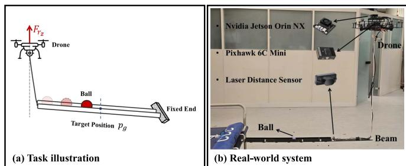
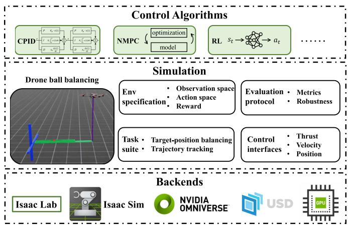
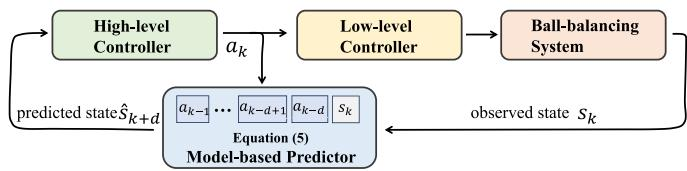

# Aerial-Balance-Bench: A Controlled and Reproducible Drone-Ball Balancing Benchmark for Indirect Dynamic Aerial Manipulation

Mingjiang Liu , Graduate Student Member, IEEE, Guanzhong Zhou , Chengchen Zhang Stephen L. Smith , Senior Member, IEEE, and Hailong Huang , Senior Member, IEEE

Abstract—Aerial manipulation studies and benchmarks have mostly emphasized direct interaction and static or quasi-static tasks, leaving indirect dynamic manipulation insufficiently studied. We present Aerial-Balance-Bench, a controlled and reproducible drone-ball balancing benchmark in which a vertically constrained tethered drone tilts a beam to drive a rolling ball to a target position or along a reference trajectory. The benchmark unifies: 1) target-position balancing and trajectory-tracking tasks; 2) thrust-, velocity-, and position-command interfaces with corresponding dynamic models; 3) a Gym-style Isaac Lab environment with standardized observations, actions, and task-dependent rewards; and 4) evaluation metrics and robustness tests. To demonstrate the benchmark and provide reference results, we develop a delay-aware hierarchical control framework for the velocitycommand interface, combining delay identification with modelbased state prediction to compensate for low-level tracking latency. Within this framework, we compare three high-level baselines: cascaded PID, nonlinear model predictive control (MPC), and modelfree reinforcement learning (RL). Simulation and real-world experiments show the benchmark’s feasibility. These results establish Aerial-Balance-Bench as a practical benchmark and baseline suite for studying the core balancing dynamics in indirect dynamic aerial manipulation.

Index Terms—Aerial systems: mechanics and control, aerial systems: applications, aerial manipulation, performance evaluation and benchmarking.

## I. INTRODUCTION

R ECENTLY, aerial robots have gained increasing attentionin both research and practical applications. Many aerial in both research and practical applications. Many aerial tasks are conducted at high altitudes, presenting challenges and safety risks for human workers. These scenarios may also require active environmental interaction, necessitating aerial robotic operations that go beyond passive roles. In response, aerial manipulation has emerged as a key research focus, aiming to equip aerial robots with the ability to physically interact with their surroundings [1].

Uncrewed aerial vehicles (UAVs), such as multirotors, are commonly equipped with robotic arms or custom grippers to form typical aerial manipulation systems. These systems are capable of performing a wide range of manipulation tasks. For instance, one study addressed disturbances in a quadrotor equipped with a robotic arm to achieve millimeter-level pegin-hole insertion [2]. To overcome the limited manipulation workspace of underactuated multirotors, omnidirectional platforms have been employed as floating bases, accompanied by whole-body controllers designed for robust manipulation [3], [4]. Additionally, an aerial manipulator incorporating a custom soft tendon-actuated gripper was developed to enable in-flight grasping [5]. Alternatively, objects can also be manipulated by UAVs through direct attachment or cable suspension, where a notable example is cable-suspended payload transportation [6], [7], [8]. To mitigate the impact effects of suspended payloads on quadrotors, an impact-aware planning and control framework was developed [6]. To enhance payload capacity, multi-quadrotor systems have been developed [7], and an admittance-controller-based system that enables adaptive human-robot interaction during payload transport [8]. More recently, a hand-like autonomous flying robot has been introduced, enabling versatile tasks such as airborne grasping, door opening, perching, object transport, and human interaction [9].

While these studies demonstrate the versatility of aerial manipulation, most existing systems are tightly coupled to specific tasks and hardware configurations. Such task-specific implementations are often difficult to reproduce, which makes fair comparison across methods challenging and slows the development of general algorithmic insights. Benchmark-oriented studies can help address this issue, yet they remain scarce in aerial manipulation. The work in [10] introduced hardwareoriented benchmarks for aerial manipulators equipped with robotic arms, evaluating system performance in terms of accuracy, execution time, manipulation capability, and impact response. RotorTM [11] provided an open-source simulator for aerial transportation and manipulation with single or multiple UAVs connected to payloads through passive mechanisms such as cables or rigid links. More recently, AIR-VLA [12] introduced a benchmark for vision-language-action systems in aerial manipulation, providing a physics-based simulation environment and a multimodal dataset. Nevertheless, existing efforts mainly target direct interaction through arms/grippers or payloads physically attached to aerial robots. In contrast, many real-world scenarios require aerial robots to manipulate dynamic objects indirectly through an intermediate tool or carrier, which remains insufficiently studied.

  
Fig. 1. Illustration of the drone-ball balancing task.

To fill this gap, inspired by the canonical ball-and-beam system designed for studying nonlinear control theory and developing advanced control algorithms [13], [14], we propose Aerial-Balance-Bench, a drone-ball balancing benchmark that serves as a controlled and simplified testbed for dynamic manipulation through indirect actuation. In this benchmark, a vertically constrained tethered drone is required to manipulate a beam to guide a ball either to a target position or along a desired trajectory (see Fig. 1). Unlike the canonical ball-and-beam system, where the beam is driven by a directly controlled actuator, the proposed task keeps the drone in the control loop. Consequently, the beam motion is shaped by the drone response dynamics, low-level tracking errors, and actuator limits, thereby preserving key nonidealities of practical aerial actuation. Owing to the inherent aerial instability and highly dynamic motion of the ball, precise ball balancing or trajectory tracking poses a unique challenge. The proposed benchmark therefore provides a focused platform for systematically studying and comparing methods for indirect dynamic aerial manipulation under controlled physical assumptions.

To make this task a practical and reusable benchmark, we formalize Aerial-Balance-Bench from the perspectives of task definition, control abstraction, environment design, and evaluation. Specifically, we define the target-position balancing and trajectory-tracking tasks, and introduce three control interfaces: thrust, velocity, and position command, together with the corresponding dynamic models. We further specify a unified observation and action design, task-dependent reward definitions for RL training, and standardized evaluation and robustness protocols.

Building on this benchmark, we develop a reference control framework for the target-position balancing task based on the velocity-command interface. The velocity-command interface preserves a practical separation between high-level balancing and low-level flight control, but it also introduces action delay because the commanded velocity must be tracked by the onboard controller. We therefore equip the reference framework with delay-aware components, including model-based state prediction and delay identification, to explicitly compensate for the latency induced by the hierarchical architecture.

Finally, to establish meaningful performance references for future studies, we design and implement three representative high-level baselines: cascaded PID, nonlinear MPC, and modelfree RL. These controllers represent classical feedback control, optimization-based control, and learning-based control, respectively, and are instantiated under the same reference framework. We evaluate them in both simulation and on a physical system for the target-position balancing task, enabling a systematic comparison oftheir accuracy, robustness, and practical deployability. In short, this letter makes the following key contributions:

We introduce the drone-ball balancing task as a benchmark for studying indirect dynamic aerial manipulation under a controlled vertical-motion setup, capturing the combined challenges of underactuated flight dynamics, toolmediated interaction, and dynamic object manipulation. Table I compares this benchmark against representative aerial manipulation studies and benchmarks.

We provide a complete and configurable benchmark specification, including two task families, three control interfaces, a unified environment specification, task-dependent evaluation metrics, and a robustness test suite. These elements make Aerial-Balance-Bench controlled, reproducible, and extensible for studying indirect dynamic aerial manipulation.

We propose a reference control framework for the targetposition balancing task based on the velocity-command interface and augment it with a delay-aware design, thereby mitigating the adverse effects ofaction delay in hierarchical aerial manipulation.

\- We implement three representative baselines and compare them systematically in simulation and on a real platform, providing reference results.

## II. AERIAL-BALANCE-BENCH

## A. Overview and Design Goals

To broaden aerial manipulation benchmarks, we introduce Aerial-Balance-Bench. Unlike conventional aerial manipulation settings that emphasize direct interaction through robotic arms or grippers, the proposed task requires the drone to regulate the motion of a ball through an intermediate beam. This setup provides a representative testbed for studying aerial manipulation beyond direct and static settings. An overview of the benchmark is shown in Fig. 2.

The benchmark is designed around two primary principles. The first is controllability and reproducibility, so that different control and learning algorithms can be evaluated under the same task definitions, initial conditions, and environmental variations. The second is to approximate real-world deployment as closely as possible, so that conclusions obtained in simulation remain informative for physical systems. To follow these principles, we build the benchmark on Isaac Lab [15] and provide a Gym-style interface [16] for algorithm development and evaluation. The environment is specified through modular configuration files, which define the task setup, system parameters, and testing conditions in a transparent and repeatable manner, thereby enabling controlled and reproducible experiments. At the same time, the simulator incorporates the drone’s low-level control and actuation process, making the environment better aligned with practical aerial platforms and more suitable for sim-to-real transfer. In addition, the implementation supports GPU-parallelized training and evaluation, which allows efficient large-scale testing across different tasks, controller designs, and robustness settings.

TABLE I  
COMPARISON OF REPRESENTATIVE AERIAL MANIPULATION STUDIES AND BENCHMARKS RELATED TO THIS LETTER

<table><tr><td>Category</td><td>Work</td><td>System Configuration</td><td>Manipulation Mode</td><td>Object Dynamics</td><td>Simulation</td><td>Real System</td><td>Task Description</td></tr><tr><td rowspan="4">Specific</td><td>Aerial Pick-and-Peg [2]; Flying Hand [3]; SE(3) Aerial Manipulation [4]</td><td>UAV + robotic arm</td><td>Direct</td><td>Static</td><td>×</td><td>√</td><td>Pick-and-Peg; writing; changing light bulbs; grasping; pulling</td></tr><tr><td>Soft Aerial Gripper [5]</td><td>UAV + soft gripper</td><td>Direct</td><td>Static/Dynamic</td><td>×</td><td>√</td><td>High-speed aerial grasping</td></tr><tr><td>IMPACTOR [6]; Cooperative Transportation [7]; Human-Aware Transportation [8]</td><td>UAV(s) + cable-suspended payload</td><td>Direct</td><td>Dynamically attached</td><td>√</td><td>√</td><td>Payload transportation</td></tr><tr><td>HI-ARM [9]</td><td>Hand-like UAV</td><td>Direct</td><td>Static</td><td>×</td><td>√</td><td>Grasping; door opening; perching</td></tr><tr><td rowspan="4">Benchmark</td><td>Aerial Manipulation Benchmarks [10]</td><td>UAV + robotic arm</td><td>Direct</td><td>Static</td><td>×</td><td>√</td><td>Grasping; force control</td></tr><tr><td>RotorTM [11]</td><td>UAV(s) + cable/rigid-link payload</td><td>Direct</td><td>Dynamically attached</td><td>√</td><td>√</td><td>Payload transportation</td></tr><tr><td>AIR-VLA [12]</td><td>UAV + robotic arm</td><td>Direct</td><td>Static</td><td>√</td><td>×</td><td>Picking; placing; twisting</td></tr><tr><td>Aerial-Balance-Bench (ours)</td><td>UAV + cable-suspended beam</td><td>Indirect</td><td>Dynamic</td><td>√</td><td>√</td><td>Ball balancing</td></tr></table>

  
Fig. 2. Overview of Aerial-Balance-Bench.

## B. Benchmark Definition

1) Physical Setup and Assumptions: The proposed droneball balancing task is illustrated in Fig. 1(a), where a drone manipulates a beam through coordinated tilting to drive the ball to a target position or track a desired trajectory. The system has three main features: 1) the drone is connected to one end of the beam by a rope; 2) the drone is constrained to move only along the vertical axis; and 3) the opposite end of the beam is fixed during normal operation but can also be vertically actuated to introduce disturbances. The vertical-motion constraint decouples lateral drone translation from beam inclination, thereby isolating the core dynamic interaction between drone actuation and ball motion. Although this setting does not cover arbitrary 3-D flight, it retains the vertical actuation channel that directly determines beam inclination and ball rolling. Thus, the resulting controllers and insights can inform the balancing layer of unconstrained aerial systems.

2) Task Suite: To comprehensively evaluate the drone’s capability for manipulating the ball, we define two complementary tasks in the benchmark: Target-position Balancing and Trajectory Tracking. These two tasks correspond to a static regulation problem and a dynamic tracking problem, respectively, and therefore impose different requirements on the controller.

a) Target-position Balancing: In this task, the objective is to drive the ball from an initial position to a given target position on the beam as quickly and accurately as possible. Let $p _ { b } ( t )$ denote the ball position and $p _ { g }$ denote the desired target position. The control objective can be written as

$$
\lim _ {t \to \infty} | p _ {b} (t) - p _ {g} | = 0.\tag{1}
$$

In the benchmark, the initial ball position and the target position are randomly sampled for each episode, and the controller is evaluated over a fixed control horizon. This task primarily assesses the controller’s regulation capability under different initial-goal pairs, including its transient response and final stabilization performance.

b) Trajectory Tracking: In this task, the controller is required to balance the ball along a time-varying reference trajectory throughout the entire evaluation horizon. Let $p _ { g } ( t )$ denote the time-varying reference ball position, and define the control goal as minimizing the episode-level tracking error. Specifically, the tracking objective is written as

$$
\min J = \int_ {t = 0} ^ {T} | p _ {b} (t) - p _ {g} (t) | d t.\tag{2}
$$

We set a constant initial ball position. Three types of reference trajectories are considered in the benchmark: sinusoidal, trapezoidal, and triangular trajectories. These three trajectory families introduce distinct tracking challenges, including smooth periodic motion, abrupt reference changes, and piecewise linear variations, thereby enabling a more comprehensive evaluation of dynamic tracking performance.

3) Control Interfaces and Dynamic Models: The drone’s motion serves as the control input of the ball-balancing system. However, how this motion is commanded can be abstracted at different control layers, which leads to different trade-offs between responsiveness and controller complexity. A lower-level interface can provide more direct and timely actuation over the beam dynamics, but it also couples the ball-balancing policy more tightly with low-level flight control. In contrast, a higherlevel interface simplifies controller design by further decoupling the benchmark task from the drone’s low-level controller, but its effective behavior depends more strongly on tracking dynamics and may therefore introduce additional delay. To support a broad range of controller designs, the benchmark provides three control interfaces: thrust command, velocity command, and position command. Under the assumptions of nominal system mentioned in Section II-B1, the rope geometry satisfies

TABLE II  
NOTATION USED IN THE DYNAMIC MODELS

<table><tr><td>Notation</td><td>Description</td><td>Notation</td><td>Description</td></tr><tr><td> $p_b$ </td><td>Ball position</td><td> $\theta$ </td><td>Beam angle w.r.t. horizontal</td></tr><tr><td> $J_b$ </td><td>Ball inertia</td><td> $\beta$ </td><td>Rope angle w.r.t. vertical</td></tr><tr><td> $m_b$ </td><td>Ball mass</td><td> $m_r$ </td><td>Drone mass</td></tr><tr><td> $r_b$ </td><td>Ball radius</td><td> $\tau_r$ </td><td>Rope-induced torque on the beam</td></tr><tr><td> $J_b'$ </td><td>Beam inertia</td><td> $F_{rz}$ </td><td>Drone vertical thrust</td></tr><tr><td> $m_b'$ </td><td>Beam mass</td><td> $F_{\text{max}}$ </td><td>Max. drone vertical thrust</td></tr><tr><td> $g$ </td><td>Gravity</td><td> $v_{rz}$ </td><td>Drone vertical velocity</td></tr><tr><td> $L$ </td><td>Beam length</td><td> $d_{rz}$ </td><td>Drone vertical displacement</td></tr><tr><td> $l$ </td><td>Rope length</td><td> $a_{\text{max}}$ </td><td>Max. drone vertical acceleration</td></tr></table>

$$
\sin \beta = \frac {L}{l} (1 - \cos \theta).\tag{3}
$$

Below we summarize the corresponding core dynamic models. The model parameters are listed in Table II.

a) Thrust-command Interface: In this interface, the system input is the drone’s vertical thrust $F _ { r _ { z } }$ . During execution, this command is converted into the desired vertical acceleration and attitude, then tracked by a low-level SE(3) attitude controller [17]. This interface offers the most direct actuation and fastest response, but it also yields the strongest coupling between ball balancing and low-level flight control. The corresponding core model can be written as

$$
\left(\frac {J _ {b}}{r _ {b} ^ {2}} + m _ {b}\right) \ddot {p} _ {b} = m _ {b} (p _ {b} - L) \dot {\theta} ^ {2} - m _ {b} g \sin \theta ,\tag{4a}
$$

$$
[ J _ {b} ^ {\prime} + m _ {b} (L - p _ {b}) ^ {2} ] \ddot {\theta} = (m _ {b} g \cos \theta + 2 m _ {b} \dot {\theta} \dot {p} _ {b}) (L - p _ {b})
$$

$$
+ \frac {L}{2} m _ {b} ^ {\prime} g \cos \theta - \tau_ {r},\tag{4b}
$$

$$
\tau_ {r} = [ F _ {r _ {z}} - m _ {r} g + m _ {r} l (\cos \beta \dot {\beta} ^ {2} + \sin \beta \ddot {\beta})
$$

$$
\left. - m _ {r} L \left(\sin \theta \dot {\theta} ^ {2} - \cos \theta \ddot {\theta}\right) \right] \frac {\cos (\beta - \theta)}{\cos \beta} L,\tag{4c}
$$

$$
0 \leq F _ {r _ {z}} \leq F _ {\max}.\tag{4d}
$$

Here, the high-level command directly enters the beam dynamics through the rope-induced torque $\tau _ { r }$ , so this interface retains the richest coupling with the drone actuation dynamics.

b) Velocity-command Interface: In this interface, the system input is the drone’s vertical velocity $v _ { r _ { z } }$ , which is tracked by a low-level SE(3) velocity controller [17]. The resulting abstract dynamic model is

$$
(\frac {J _ {b}}{r _ {b} ^ {2}} + m _ {b}) \ddot {p} _ {b} = m _ {b} (p _ {b} - L) \dot {\theta} ^ {2} - m _ {b} g \sin \theta ,\tag{5a}
$$

$$
L \dot {\theta} = - v _ {r _ {z}} \frac {\cos \beta}{\cos (\beta - \theta)},\tag{5b}
$$

$$
\left| \dot {v} _ {r _ {z}} \right| \leq a _ {\max}.\tag{5c}
$$

Compared with direct thrust command, this interface removes most of the system-level complexity from the high-level policy and achieves a compromise between control authority and design simplicity. Hence, the benchmark controller only needs to generate feasible velocity commands, while the low-level controller handles the corresponding velocity tracking. However, this hierarchical architecture will introduce longer control delays.

c) Position-command Interface: In this interface, the system input is the drone’s vertical displacement $d _ { r _ { z } }$ . This command is tracked by a low-level SE(3) position controller [17]. The abstract dynamic model is written as follows:

$$
(\frac {J _ {b}}{r _ {b} ^ {2}} + m _ {b}) \ddot {p _ {b}} = m _ {b} (p _ {b} - L) \dot {\theta} ^ {2} - m _ {b} g \sin \theta ,\tag{6a}
$$

$$
d _ {r _ {z}} = l (\cos \beta - 1) - L \sin \theta ,\tag{6b}
$$

$$
| \ddot {d} _ {r _ {z}} | \leq a _ {\mathrm{max}}.\tag{6c}
$$

This interface provides the highest level of abstraction and has the easiest dynamics formulation. However, its effective response depends on the derivatives of the commanded displacement and on the tracking behavior of the low-level position controller, making it more susceptible to lag than the thrust- and velocity-command interfaces.

## C. Environment Specification

1) Observation Space: We use a unified observation space for both Target-position Balancing and Trajectory Tracking. At control step $t _ { k } ,$ the observation is defined as

$$
s _ {k} = [ p _ {b}, v _ {b}, a _ {b}, \theta , \omega , \alpha , d _ {r _ {z}}, v _ {r _ {z}}, a _ {r _ {z}}, p _ {g}, a _ {k - 1} ] ^ {T},\tag{7}
$$

where $v _ { b }$ and $a _ { b }$ denote the ball velocity and acceleration along the beam, ω and α denote the beam angular velocity and angular acceleration, $\boldsymbol { a } _ { r _ { z } }$ represents the drone’s vertical acceleration, and $a _ { k - 1 }$ represents the action taken at step $t _ { k - 1 }$ . Here, $p _ { g }$ denotes the desired ball position: it is constant in Target-position Balancing and is obtained from the reference trajectory in Trajectory Tracking.

2) Action Space: The action space is tied to the selected control interface. Instead of directly outputting an absolute control command, the agent outputs an increment of the current command. This design yields a unified interface across different control abstractions and makes it easier to enforce smoothness and actuator feasibility. Let $u _ { k }$ denote the current high-level command and let $a _ { k }$ denote the action at step $t _ { k }$ . The command update is defined as

$$
u _ {k} = u _ {k - 1} + \mathrm{clip} _ {\mathcal {A}} (a _ {k}),\tag{8}
$$

where A is the feasible command set associated with the chosen control interface. Accordingly, the action is defined as a relative increment:

$$
a _ {k} = \Delta F _ {r _ {z}, k}, \quad \Delta F _ {r _ {z}, k} \in [ - \Delta F _ {\max}, \Delta F _ {\max} ],\tag{9a}
$$

$$
a _ {k} = \Delta v _ {r _ {z}, k}, \quad \Delta v _ {r _ {z}, k} \in [ - \Delta v _ {\mathrm{max}}, \Delta v _ {\mathrm{max}} ],\tag{9b}
$$

$$
a _ {k} = \Delta d _ {r _ {z}, k}, \quad \Delta d _ {r _ {z}, k} \in [ - \Delta d _ {\mathrm{max}}, \Delta d _ {\mathrm{max}} ],\tag{9c}
$$

for the thrust-command, velocity-command, and positioncommand interfaces, respectively. Here, the exact bounds are configurable through the environment specification files, which allows the benchmark to support different actuation ranges and difficulty settings while preserving a consistent action semantics.

3) Reward Design: To support RL policy training, we define task-dependent rewards that share a common structure but reflect the different objectives of regulation and tracking. All the reward weights are configurable in the environment files and can therefore be tuned for different training regimes without changing the benchmark definition itself. The reference reward weights used in this letter are provided in the released repository. Detailed definitions are listed below.

a) Target-position Balancing: Let $e _ { k } = p _ { b } ( t _ { k } ) - p _ { g } ( t _ { k } )$ be the ball-position error at time $t _ { k }$ . The reward is defined as

$$
r _ {k} ^ {\text { bal }} = r _ {\text { object }, k} ^ {\text { bal }} + r _ {\text { control }, k} ^ {\text { bal }} + r _ {\text { failure }, k} ^ {\text { bal }} + r _ {\text { goal }, k},\tag{10}
$$

where

$$
r _ {\mathrm{object}, k} ^ {\mathrm{bal}} = - k _ {1} e _ {k} ^ {2} - k _ {2} v _ {b} ^ {2},\tag{11a}
$$

$$
r _ {\mathrm{control}, k} ^ {\mathrm{bal}} = - k _ {3} u _ {k} ^ {2} - k _ {4} a _ {k} ^ {2},\tag{11b}
$$

$$
r _ {\text { failure }, k} ^ {\text { bal }} = \left\{ \begin{array}{l l} - k _ {5} & \text { if } (| \theta | > \theta_ {\max}) \vee (| e _ {k} | > e _ {\max}) \\ 0 & \text { otherwise } \end{array} \right.,\tag{11c}
$$

$$
r _ {\text { goal }, k} = \left\{ \begin{array}{l l} (c - k _ {7} | e _ {k} |) \exp (- k _ {6} | v _ {b} |) & \text { if } | e _ {k} | <   e _ {\text { goal }} \\ 0 & \text { otherwise } \end{array} \right..\tag{11d}
$$

b) Trajectory Tracking: We define a tracking-oriented reward using both position and velocity matching. Let $v _ { g , k }$ denote the reference velocity obtained from the desired trajectory at time $t _ { k }$ . The reward is defined as

$$
r _ {k} ^ {\mathrm{track}} = r _ {\mathrm{object}, k} ^ {\mathrm{track}} + r _ {\mathrm{control}, k} ^ {\mathrm{track}} + r _ {\mathrm{failure}, k} ^ {\mathrm{track}} + r _ {\mathrm{progress}, k},\tag{12}
$$

where

$$
r _ {\mathrm{object}, k} ^ {\mathrm{track}} = - \bar {k} _ {1} e _ {k} ^ {2} - \bar {k} _ {2} (v _ {b} - v _ {g, k}) ^ {2},\tag{13a}
$$

$$
r _ {\mathrm{control}, k} ^ {\mathrm{track}} = - \bar {k} _ {3} u _ {k} ^ {2} - \bar {k} _ {4} a _ {k} ^ {2},
$$

$$
r _ {\text {   failure }, k} ^ {\text { track }} = \left\{ \begin{array}{l l} - \bar {k} _ {5} & \text { if } (| \theta | > \theta_ {\max}) \vee (| e _ {k} | > e _ {\max}) \\ 0 & \text { otherwise } \end{array} \right.,\tag{13b}
$$

(13c)

$$
r _ {\text { progress }, k} = \bar {k} _ {6} (| e _ {k - 1} | - | e _ {k} |).\tag{13d}
$$

## D. Evaluation Protocol

## 1) Evaluation Metrics:

a) Target-position Balancing: Each evaluation episode lasts 10 s. We generate 500 test episodes by randomly sampling the initial ball position and target position from the feasible range. We evaluate the controller using five metrics: success rate (SR), steady-state error (SE), convergence time (CONT), climb time (CLIT), and computation time (COMT). Here,  denotes the target-position error tolerance. An episode is successful ifthe ball absolute position error falls below  before the episode ends and remains within this tolerance thereafter; SR is the percentage of successful episodes. SE is the mean absolute position error over a fixed terminal time window W. CONT denotes the first time at which the error enters and subsequently remains within the tolerance band, while CLIT denotes the first entry time into the tolerance band. COMT measures the controller computation time. The tolerance  and terminal time window $W$ can be configured according to the evaluation requirements.

b) Trajectory Tracking: We also evaluate 500 test episodes, using stratified random sampling across the three reference families (sinusoidal, trapezoidal, and triangular) so that no single family dominates the aggregate score. Within each family, the trajectory amplitude and frequency are randomly sampled from predefined ranges. We evaluate tracking performance using four metrics: mean absolute position error (MAE), root-meansquare position error (RMSE), maximum absolute position error (MAXE), and compute time (COMT). MAE characterizes average tracking accuracy, RMSE penalizes occasional large deviations more strongly, and MAXE captures the worst-case tracking excursion.

2) Robustness Test Suite: Beyond nominal task evaluation, the benchmark includes a robustness test suite designed to probe how well a controller tolerates uncertainty and mismatch between training/designing and deployment conditions. The central idea is to introduce controlled variations into the environment, primarily through changes in system parameters and execution imperfections, so that algorithms can be evaluated not only by their nominal performance but also by their ability to generalize to non-ideal conditions. Specifically, we design four robustness tests.

a) Ball-mass Variation: The first robustness test varies the ball mass. Since the ball mass directly affects the inertial and gravitational terms in the system dynamics, changes in this parameter alter the difficulty of balancing and tracking. By evaluating controllers on balls with different masses, the benchmark measures whether the learned or designed policy can generalize beyond a single nominal object and remain effective under payload-related parameter shifts.

b) Low-level Gain Variation: The second robustness test varies the control gains of the drone’s low-level controllers. In practice, high-level commands are never executed directly; instead, they must be tracked by an onboard flight controller whose behavior depends strongly on its gain setting. By reducing or perturbing these gains, the benchmark simulates imperfect or changed low-level control behavior and evaluates whether the high-level algorithm remains effective when command tracking becomes less accurate or less responsive.

c) Action Delay: The third robustness test introduces explicit action delay. Action delay is pervasive in real robotic systems due to sensing, communication, computation, and actuation latencies, and it is particularly harmful in highly dynamic tasks. In this benchmark, robustness to delay is assessed by inserting a configurable delay buffer between the high-level controller output and the executed command, so that the command applied at the current step corresponds to a past decision. This setting enables systematic evaluation of how controller performance degrades in the presence of realistic execution lag.

d) Disturbance Injection: The fourth robustness test injects external disturbance by allowing the otherwise fixed beam endpoint to undergo random vertical motion. This perturbation mimics environmental disturbance or support-point vibration and directly affects the beam-ball dynamics. To model temporally correlated disturbance rather than independent impulsive noise, we generate the endpoint motion using an Ornstein-Uhlenbeck (OU) process. The disturbed endpoint motion is then superimposed on the nominal fixed-end configuration to assess the controller’s resilience to temporally correlated external perturbations.

  
Fig. 3. The delay-aware control structure.

## III. REFERENCE CONTROL FRAMEWORK

In this letter, we propose a reference control framework for the Target-position Balancing task based on the velocity-command interface. The high-level controller outputs the desired vertical velocity command for the drone, while a low-level velocity controller tracks the commanded motion. Although this hierarchy is practical for real drone systems, it inevitably introduces action delay caused by actuation latency. This delay is particularly harmful in drone-ball balancing because the ball dynamics are sensitive to timing errors. Therefore, the proposed framework explicitly addresses action delay through model-predictive state prediction and delay identification.

## A. Model-Predictive Delay Compensation

To compensate for action delay, we follow the idea of a d-step-ahead state predictor [18], using the constructed highlevel dynamic model in (5) to predict the future system state. We refer to this component as the model-based predictor. The control structure with the model-based predictor is illustrated in Fig. 3. Specifically, let the current observed system state be $s _ { k }$ and the historical action sequence be $\{ a _ { k - d } , a _ { k - d + 1 } , \dotsc , a _ { k - 1 } \}$ where d denotes the number of delay steps. Using the highlevel dynamic model (5), we predict the system state d steps ahead, $\hat { s } _ { k + d } .$ based on $s _ { k }$ and the historical action sequence $\{ a _ { k - d } , a _ { k - d + 1 } , \dotsc , a _ { k - 1 } \}$ . This predicted state $\hat { s } _ { k + d }$ is then fed to the high-level controller to generate timely commands.

## B. Delay Identification

To estimate the delay step d, we employ a time-domain method based on the cross-correlation function. Specifically, we execute the high-level policy on the real-world system and record the commanded vertical velocity (denoted as Sequence A) and the actual vertical velocity of the drone (denoted as Sequence $B )$ . The cross-correlation value $R _ { A B } [ q ]$ for a candidate delay step q is computed as:

$$
R _ {A B} [ q ] = \sum_ {i = 0} ^ {T} A [ i ] B [ i + q ],\tag{14}
$$

where $T$ denotes the length of the signal sequences. The most probable delay step d corresponds to the delay that maximizes the cross-correlation:

$$
d = \arg \max _ {q \in \mathbb {N} ^ {+}} R _ {A B} [ q ].\tag{15}
$$

In the real-world system, the identified delay is $d = 1 6$ control steps. Given the 60 Hz control frequency, this corresponds to a delay duration of approximately 0.267 s. Although this letter only presents the offline delay-identification method for constant-delay tasks, this method can be readily extended to an online form and therefore has the potential to handle timevarying delays.

## IV. BASELINES

For the high-level controller, we design and implement three baselines: a cascaded PID controller, a nonlinear MPC controller, and a model-free RL controller. All baselines are instantiated under the same reference framework and are evaluated on the Target-position Balancing task in both simulation and the real-world system.

## A. The Cascaded PID Controller

Given the nonlinear dynamics of the system, we employ a cascaded PID controller as the high-level controller. The outer loop computes the desired beam angular displacement θ based on the ball’s position error e, while the inner loop generates the required drone vertical-velocity increment $\Delta v _ { r _ { z } }$ from the current beam-angle error. Both loops are implemented using an incremental PID formulation. In discrete time, the output of the incremental PID controller at step $t _ { k }$ is given by:

$$
\Delta u _ {k} = K _ {p} e _ {k} ^ {\prime} + \frac {K _ {p} \Delta t}{T _ {i}} e _ {k} + \frac {K _ {p} T _ {d}}{\Delta t} e _ {k} ^ {\prime \prime},\tag{16}
$$

where $e _ { k }$ represents the system error at timestep $t _ { k } , \ e _ { k } ^ { \prime } =$ $e _ { k } - e _ { k - 1 }$ is its first-order backward difference, and $e _ { k } ^ { \prime \prime } = ( e _ { k } -$ $e _ { k - 1 } \coth - \left( e _ { k - 1 } - e _ { k - 2 } \right)$ is the second-order backward difference. Here, $\Delta t$ denotes the sampling time interval, $K _ { p }$ is the proportional gain, $T _ { i }$ and $T _ { d }$ are the integral and derivative time constants, respectively. The PID parameters were initialized empirically and then refined through local sampling, with the overall tuning process taking several hours. Specifically, the tuned parameters are: the outer-loop controller uses $K _ { p } = 0 . 5 , T _ { i } = 1 . 5 , T _ { d } = 0 . 6 ;$ the inner-loop controller uses $\bar { K _ { p } } = 1 0 . 0 , T _ { i } = 1 , 0 0 0 . 0 , T _ { d } = 0 . 0$

## B. The Nonlinear MPC Controller

We formulate the high-level ball balancing task as an optimal control problem:

$$
\min _ {\mathbf {x} _ {[ 0: N ]}, \mathbf {u} _ {[ 0: N ]}, \mathbf {z} _ {[ 0: N ]}} \sum_ {k = 0} ^ {N} l (\mathbf {x} _ {k}, \mathbf {u} _ {k}, \mathbf {z} _ {k}) + l _ {N} (\mathbf {x} _ {N}, \mathbf {u} _ {N}, \mathbf {z} _ {N})\tag{17a}
$$

s.t. :

$$
\mathbf {x} _ {0} = \hat {\mathbf {x}},\tag{17b}
$$

$$
\mathbf {x} _ {k + 1} = \mathbf {f} (\mathbf {x} _ {k}, \mathbf {u} _ {k}, \mathbf {z} _ {k}) \forall k \in \{0, \dots , N - 1 \},\tag{17c}
$$

$$
\mathbf {g} _ {\mathrm{alg}} \left(\mathbf {x} _ {k}, \mathbf {u} _ {k}, \mathbf {z} _ {k}\right) = 0 \forall k \in \{0, \dots , N - 1 \},\tag{17d}
$$

$$
\mathbf {g} _ {\text { con }} (\mathbf {x} _ {k}, \mathbf {u} _ {k}, \mathbf {z} _ {k}) \leq 0   \forall   k \in \{0, \dots , N - 1 \},\tag{17e}
$$

where ${ \bf X } _ { [ 0 : N ] } , ~ { \bf u } _ { [ 0 : N ] }$ , and $\mathbf { z } _ { [ 0 : N ] }$ represent states, inputs, and algebraic states from stage 0 to $N$ , respectively, xˆ is the measured state, l(·) is the running cost, $l _ { N } ( \cdot )$ is the terminal cost, $\mathbf { f } \left( \cdot \right)$ is the discrete-time dynamics, $\mathbf { g } _ { \mathrm { a l g } }$ and $\mathbf { g } _ { \mathrm { c o n } }$ are the equality and inequality constraints. The definitions are:

$$
\mathbf {x} = [ p _ {b}, v _ {b}, \theta , v _ {r _ {z}} ] ^ {T},\tag{18a}
$$

$$
\mathbf {u} = \left[ a _ {r _ {z}} \right],\tag{18b}
$$

$$
\mathbf {z} = [ \omega , \beta ] ^ {T},\tag{18c}
$$

$$
\mathbf {f} (\mathbf {x}, \mathbf {u}, \mathbf {z}) = \mathbf {x} + \left[ \begin{array}{c} v _ {b} \\ \frac {1}{\frac {J _ {b}}{r _ {b} ^ {2}} + m _ {b}} (m _ {b} (p _ {b} - L) \omega^ {2} - m _ {b} g \sin \theta) \\ \omega \\ a _ {r _ {z}} \end{array} \right] \Delta t,\tag{18d}
$$

$$
\mathbf {g} _ {\mathrm{alg}} (\mathbf {x}, \mathbf {u}, \mathbf {z}) = \left[ \begin{array}{c} L \omega + v _ {r _ {z}} \frac {\cos \beta}{\cos (\beta - \theta)} \\ \sin \beta - (1 - \cos \theta) \frac {L}{l} \end{array} \right],\tag{18e}
$$

$$
\mathbf {g} _ {\mathrm{con}} (\mathbf {x}, \mathbf {u}, \mathbf {z}) = \left[ \begin{array}{c} - p _ {b} \\ p _ {b} - 0. 7 \\ | \theta | - 4 0 ^ {\circ} \\ | a _ {r _ {z}} | - a _ {\max} \end{array} \right],\tag{18f}
$$

$$
l (\mathbf {x}, \mathbf {u}, \mathbf {z}) = (p _ {b} - p _ {g}) ^ {2} + 0. 2 5 v _ {b} ^ {2} + 0. 5 v _ {r _ {z}} ^ {2} + 0. 0 5 \Delta a _ {r _ {z}} ^ {2},\tag{18g}
$$

$$
l _ {N} (\mathbf {x} _ {N}, \mathbf {u} _ {N}, \mathbf {z} _ {N}) = (p _ {b, N} - p _ {g}) ^ {2} + v _ {b, N} ^ {2} + \theta_ {N} ^ {2} + v _ {r _ {z}, N} ^ {2}.\tag{18h}
$$

The implementation utilizes the do-mpc toolbox [19]. We empirically evaluated six prediction horizon lengths (15, 20, 25, 30, 35, and 40 time steps) and report three representative cases (15, 25, and 35) to illustrate the trade-off between computational complexity and control performance.

## C. The Model-Free RL Controller

In this baseline, we empirically use an 8-dimensional state space: $[ e , e ^ { \prime } , e ^ { \prime \prime } , v _ { b } , \theta , \omega , v _ { r _ { z } } , a ]$ instead of the given observation space in Section II-C. In addition, the original action space and reward function are retained. As empirical results demonstrate that Robust Policy Optimization (RPO) [20] outperforms Proximal Policy Optimization (PPO) [21] in improving task performance, this letter selects RPO to train the ball-balancing policy. We directly use the implementation provided by the SKRL library [22]. For training the RL-based high-level policy, we designed both actor and critic networks as three-layer MLPs with 256 neurons per layer, where the actor’s output layer employed a tanh activation function. We trained each policy over six random seeds and report the mean and standard deviation. Each run uses 90,000 environment steps with 1,024 parallel environments and takes about 3 h on a single NVIDIA GeForce RTX 4060 Ti GPU with 8 GB memory.

## D. Simulation Results

1) Standard Performance Evaluation: We first evaluate the nominal performance of each controller without activating the robustness tests. In this evaluation, the simulation runs at 60 Hz with maximum acceleration $a _ { \mathrm { m a x } } = 0 . 5 \mathrm { m } / \mathrm { s } ^ { 2 }$ , ball mass $m _ { b } =$ 0.0005 kg, low-level velocity-controller gain 10, target-position error tolerance  = 0.01 m, and SE window W = 1 s. Since action delay is observed in the real system, the standard evaluation also includes a fixed 15-step delay. All controllers are designed or trained in the delay-free setting and then directly deployed under delayed execution, either without compensation or with the proposed model-predictive delay compensation. This setup evaluates how well each controller transfers from the nominal delay-free environment to delayed environments without delay-specific retuning. Quantitative results are summarized in Table III. It shows that introducing action delay substantially degrades all controllers when no compensation is used. In the delay-free setting, Cascaded PID, NMPC with horizon 35, and RL all achieve strong balancing performance. However, after direct deployment to the delay-compensated framework, only Cascaded PID maintains consistently high SR and low SE. Overall, Cascaded PID provides a strong and practical baseline under delayed execution.

TABLE III  
STANDARD PERFORMANCE EVALUATION RESULTS; ORANGE INDICATES COMT VIOLATES THE 60 HZ COMPUTATION REQUIREMENT

<table><tr><td>Type</td><td>Controller</td><td>SR(%)†</td><td>SE(mm)‡</td><td>CONT(s)‡</td><td>CLIT(s)‡</td><td>COMT(ms)‡</td></tr><tr><td rowspan="5">Delay-free</td><td>Cascaded PID</td><td>100</td><td>0.209 ± 0.122</td><td>3.278 ± 1.345</td><td>2.352 ± 0.138</td><td>0.444</td></tr><tr><td>NMPC (horizon=15)</td><td>0</td><td>66.419 ± 35.714</td><td>10.017 ± 0.000</td><td>8.451 ± 1.849</td><td>13.239</td></tr><tr><td>NMPC (horizon=25)</td><td>99.600</td><td>14.536 ± 7.838</td><td>9.369 ± 0.727</td><td>5.644 ± 2.106</td><td>17.510</td></tr><tr><td>NMPC (horizon=35)</td><td>100</td><td>1.458 ± 0.793</td><td>6.615 ± 1.644</td><td>5.083 ± 1.193</td><td>22.999</td></tr><tr><td>RL</td><td>100 ± 0</td><td>4.597 ± 2.641</td><td>4.158 ± 1.501</td><td>2.783 ± 0.898</td><td>0.767</td></tr><tr><td rowspan="5">Delay w/o comp</td><td>Cascaded PID</td><td>4.400</td><td>144.326 ± 83.208</td><td>10.013 ± 0.023</td><td>1.558 ± 0.109</td><td>0.468</td></tr><tr><td>NMPC (horizon=15)</td><td>2.600</td><td>160.492 ± 113.996</td><td>10.012 ± 0.039</td><td>5.373 ± 2.237</td><td>16.897</td></tr><tr><td>NMPC (horizon=25)</td><td>3.400</td><td>101.514 ± 102.729</td><td>10.005 ± 0.083</td><td>5.276 ± 1.879</td><td>26.042</td></tr><tr><td>NMPC (horizon=35)</td><td>0</td><td>223.654 ± 81.406</td><td>10.017 ± 0.013</td><td>1.823 ± 0.798</td><td>53.574</td></tr><tr><td>RL</td><td>0 ± 0</td><td>216.298 ± 69.126</td><td>10.017 ± 0.003</td><td>1.518 ± 0.176</td><td>0.840</td></tr><tr><td rowspan="5">Delay w/ comp</td><td>Cascaded PID</td><td>100</td><td>0.795 ± 0.410</td><td>3.899 ± 1.285</td><td>2.443 ± 0.108</td><td>14.059</td></tr><tr><td>NMPC (horizon=15)</td><td>9.000</td><td>58.718 ± 39.991</td><td>9.975 ± 0.154</td><td>7.695 ± 2.318</td><td>11.827</td></tr><tr><td>NMPC (horizon=25)</td><td>17.800</td><td>56.832 ± 45.293</td><td>9.952 ± 0.244</td><td>3.736 ± 0.287</td><td>17.482</td></tr><tr><td>NMPC (horizon=35)</td><td>10.200</td><td>15.251 ± 8.413</td><td>9.908 ± 0.323</td><td>3.419 ± 1.202</td><td>23.495</td></tr><tr><td>RL</td><td>82.800 ± 32.828</td><td>6.198 ± 5.274</td><td>7.056 ± 2.172</td><td>2.508 ± 0.496</td><td>11.717</td></tr></table>

TABLE IV

ROBUSTNESS EVALUATION RESULTS

<table><tr><td>Type</td><td>Controller</td><td> $\mathrm{SR(\%)}^{\uparrow}$ </td><td> $\mathrm{SE(mm)}^{\downarrow}$ </td><td> $\mathrm{CONT(s)}^{\downarrow}$ </td><td> $\mathrm{CLIT(s)}^{\downarrow}$ </td></tr><tr><td rowspan="5">Mass</td><td>Cascaded PID</td><td>28.200</td><td>16.341 ± 8.812</td><td>8.751 ± 2.227</td><td>3.719 ± 2.823</td></tr><tr><td>NMPC (horizon=15)</td><td>0.400</td><td>258.485 ± 129.922</td><td>10.016 ± 0.000</td><td>4.533 ± 2.028</td></tr><tr><td>NMPC (horizon=25)</td><td>1.800</td><td>209.995 ± 116.766</td><td>10.014 ± 0.020</td><td>6.474 ± 3.541</td></tr><tr><td>NMPC (horizon=35)</td><td>7.600</td><td>83.680 ± 73.668</td><td>9.995 ± 0.088</td><td>5.962 ± 3.623</td></tr><tr><td>RL</td><td>5.033 ± 5.662</td><td>32.897 ± 18.612</td><td>9.957 ± 0.380</td><td>5.275 ± 3.629</td></tr><tr><td rowspan="5">Gain</td><td>Cascaded PID</td><td>92.200</td><td>5.648 ± 11.465</td><td>5.778 ± 2.466</td><td>2.320 ± 0.091</td></tr><tr><td>NMPC (horizon=15)</td><td>8.600</td><td>72.754 ± 53.077</td><td>9.992 ± 0.093</td><td>7.544 ± 2.535</td></tr><tr><td>NMPC (horizon=25)</td><td>7.800</td><td>105.193 ± 77.616</td><td>9.991 ± 0.158</td><td>3.846 ± 1.059</td></tr><tr><td>NMPC (horizon=35)</td><td>0.400</td><td>75.333 ± 95.653</td><td>10.013 ± 0.065</td><td>2.734 ± 0.141</td></tr><tr><td>RL</td><td>26.033 ± 13.980</td><td>45.202 ± 65.999</td><td>9.683 ± 0.971</td><td>2.358 ± 0.195</td></tr><tr><td rowspan="5">Disturbance</td><td>Cascaded PID</td><td>14.000</td><td>53.425 ± 40.160</td><td>9.905 ± 0.429</td><td>3.773 ± 2.531</td></tr><tr><td>NMPC (horizon=15)</td><td>0.600</td><td>248.262 ± 121.605</td><td>10.016 ± 0.016</td><td>4.355 ± 2.360</td></tr><tr><td>NMPC (horizon=25)</td><td>0.200</td><td>226.220 ± 87.548</td><td>10.016 ± 0.014</td><td>4.154 ± 2.178</td></tr><tr><td>NMPC (horizon=35)</td><td>2.000</td><td>196.699 ± 109.675</td><td>10.014 ± 0.030</td><td>4.087 ± 2.651</td></tr><tr><td>RL</td><td>6.100 ± 1.050</td><td>125.050 ± 100.728</td><td>9.991 ± 0.148</td><td>3.795 ± 2.700</td></tr></table>

2) Robustness Evaluation: We then evaluate zero-shot robustness by varying one factor at a time while keeping the remaining settings consistent with the standard evaluation. All controllers are designed or trained in the nominal environment and then directly tested under perturbed conditions without retuning. Because action delay is a fundamental issue in the real system, robustness is assessed under the 15-step delay condition by default. To further examine the effect of increasing latency, we also test controller performance under multiple longer delay settings. Quantitative results are summarized in Tables IV and V. Table IV shows that mass variation, reduced low-level gain, and external disturbance all lead to substantial performance degradation across controllers. Table V further shows that controller performance generally deteriorates as the delay increases. These results indicate that practical system imperfections, model mismatch, and external disturbances remain major challenges for robust drone-ball balancing.

TABLE V  
ROBUSTNESS EVALUATION WITH LONG DELAYS

<table><tr><td>Delay</td><td>Controller</td><td>SR(%) $^{\dagger}$ </td><td>SE(mm) $^{\downarrow}$ </td><td>CONT(s) $^{\downarrow}$ </td><td>CLIT(s) $^{\downarrow}$ </td></tr><tr><td rowspan="5">30 (0.5s)</td><td>Cascaded PID</td><td>84.000</td><td>7.958 ± 4.838</td><td>7.955 ± 2.047</td><td>2.637 ± 0.083</td></tr><tr><td>NMPC (horizon=15)</td><td>11.000</td><td>52.121 ± 36.245</td><td>9.967 ± 0.152</td><td>7.779 ± 2.243</td></tr><tr><td>NMPC (horizon=25)</td><td>4.200</td><td>68.035 ± 38.087</td><td>9.995 ± 0.171</td><td>4.006 ± 0.473</td></tr><tr><td>NMPC (horizon=35)</td><td>52.000</td><td>31.296 ± 33.580</td><td>9.879 ± 0.209</td><td>3.108 ± 0.162</td></tr><tr><td>RL</td><td>37.900 ± 15.109</td><td>27.074 ± 18.950</td><td>9.861 ± 0.457</td><td>2.652 ± 0.262</td></tr><tr><td rowspan="5">45 (0.75s)</td><td>Cascaded PID</td><td>33.800</td><td>18.103 ± 19.096</td><td>9.759 ± 0.513</td><td>2.925 ± 0.086</td></tr><tr><td>NMPC (horizon=15)</td><td>15.200</td><td>47.756 ± 32.725</td><td>9.967 ± 0.132</td><td>7.856 ± 2.175</td></tr><tr><td>NMPC (horizon=25)</td><td>1.400</td><td>64.664 ± 34.857</td><td>10.004 ± 0.114</td><td>4.414 ± 0.964</td></tr><tr><td>NMPC (horizon=35)</td><td>2.200</td><td>67.687 ± 67.625</td><td>10.014 ± 0.022</td><td>3.373 ± 0.172</td></tr><tr><td>RL</td><td>0.767 ± 0.559</td><td>100.575 ± 61.400</td><td>10.016 ± 0.027</td><td>2.900 ± 0.179</td></tr><tr><td rowspan="5">60 (1.0s)</td><td>Cascaded PID</td><td>2.600</td><td>53.045 ± 76.236</td><td>9.993 ± 0.177</td><td>3.228 ± 0.101</td></tr><tr><td>NMPC (horizon=15)</td><td>15.000</td><td>47.354 ± 29.214</td><td>9.982 ± 0.095</td><td>7.928 ± 2.114</td></tr><tr><td>NMPC (horizon=25)</td><td>5.600</td><td>47.965 ± 27.404</td><td>9.983 ± 0.141</td><td>5.025 ± 1.574</td></tr><tr><td>NMPC (horizon=35)</td><td>0.800</td><td>42.323 ± 74.530</td><td>10.010 ± 0.078</td><td>3.698 ± 0.200</td></tr><tr><td>RL</td><td>1.500 ± 1.399</td><td>248.859 ± 102.127</td><td>10.016 ± 0.004</td><td>3.198 ± 0.204</td></tr></table>

TABLE VI REAL-WORLD RESULTS

<table><tr><td>Goal</td><td>Controller</td><td>SR $^{\uparrow}$ </td><td>SE(mm) $^{\downarrow}$ </td><td>CONT(s) $^{\downarrow}$ </td><td>CLIT(s) $^{\downarrow}$ </td></tr><tr><td rowspan="3">0.15</td><td>Cascaded PID</td><td>2/9</td><td>85.454 ± 52.853</td><td>19.176 ± 2.201</td><td>5.978 ± 7.390</td></tr><tr><td>NMPC (horizon=25)</td><td>0/9</td><td>284.003 ± 82.575</td><td>20.017 ± 0.000</td><td>9.124 ± 9.743</td></tr><tr><td>RL</td><td>1/9</td><td>113.055 ± 64.221</td><td>19.987 ± 0.084</td><td>7.696 ± 8.007</td></tr><tr><td rowspan="3">0.35</td><td>Cascaded PID</td><td>6/9</td><td>21.944 ± 16.780</td><td>13.641 ± 7.008</td><td>4.024 ± 5.668</td></tr><tr><td>NMPC (horizon=25)</td><td>0/9</td><td>232.710 ± 47.256</td><td>20.017 ± 0.000</td><td>2.644 ± 6.150</td></tr><tr><td>RL</td><td>5/9</td><td>33.617 ± 17.146</td><td>16.848 ± 5.290</td><td>2.137 ± 0.876</td></tr><tr><td rowspan="3">0.55</td><td>Cascaded PID</td><td>0/9</td><td>89.232 ± 11.810</td><td>20.017 ± 0.000</td><td>11.910 ± 9.077</td></tr><tr><td>NMPC (horizon=25)</td><td>0/9</td><td>329.621 ± 61.211</td><td>20.017 ± 0.000</td><td>6.945 ± 9.247</td></tr><tr><td>RL</td><td>0/9</td><td>71.738 ± 27.767</td><td>20.017 ± 0.000</td><td>5.042 ± 5.519</td></tr></table>

## E. Real-World Results

The real system is shown in Fig. 1(b). We directly transfer the simulation-designed/trained controllers to the real system without real-world fine-tuning. For nonlinear MPC, we use a horizon of 25 as a representative trade-off between control performance and computational cost. Experiments are conducted at three target positions, $p _ { g } = 0 . 1 5 , 0 . 3 5 .$ , and 0.55, with targetposition error tolerance $\epsilon = 0 . 0 3$ m and SE window $W = 5$ s. For each target, 9 initial ball positions are randomly sampled, and each episode lasts 20 s. Quantitative results are summarized in Table VI. It shows that cascaded PID achieves the best overall control performance at $p _ { g } = 0 . 3 5$ . For the off-center targets, $p _ { g } = 0 . 1 5$ and $p _ { g } = 0 . 5 5$ , all controllers exhibit degraded performance, likely due to gravity-induced beam bending. These results confirm the baseline real-world balancing capability of cascaded PID, while also revealing its limited adaptability to unmodeled or non-ideal dynamics. A detailed analysis and mitigation of beam bending will be considered in future work.

## V. CONCLUSION, LIMITATIONS, AND FUTURE WORK

This letter presents Aerial-Balance-Bench, a controlled and simplified drone-ball balancing benchmark for indirect dynamic aerial manipulation. By formalizing task definitions, command interfaces, simulation environments, evaluation metrics, robustness tests, and reference implementations, the benchmark provides a reproducible platform for developing and comparing algorithms that manipulate dynamic objects through intermediate mechanisms under controlled physical assumptions. We hope this benchmark can broaden aerial manipulation research beyond direct and static interaction, and support future studies on control, learning, robustness, and sim-to-real transfer in indirect dynamic manipulation.

A current limitation of Aerial-Balance-Bench is that the physical setup is intentionally simplified: the drone motion is restricted to the vertical direction and the opposite end of the beam is fixed. Although these assumptions allow the benchmark to focus more specifically on the core problem of ball manipulation, they also abstract away practical factors (e.g., full three-dimensional flight and moving supports). Future work will relax these assumptions and extend the benchmark toward more realistic and interactive scenarios, including multi-drone cooperative transportation and balancing, and human-drone collaborative transportation with balancing.

## REFERENCES

[1] A. Ollero, M. Tognon, A. Suarez, D. Lee, and A. Franchi, “Past, present, and future of aerial robotic manipulators,” IEEE Trans. Robot., vol. 38, no. 1, pp. 626–645, Feb. 2022.

[2] M. Wang et al., “Millimeter-level pick and peg-in-hole task achieved by aerial manipulator,” IEEE Trans. Robot., vol. 40, pp. 1242–1260, 2024.

[3] G. He et al., “Flying hand: End-effector-centric framework for versatile aerial manipulation teleoperation and policy learning,” in Proc. Robot. Sci. Syst., 2025, doi: 10.15607/RSS.2025.XXI.130.

[4] D. Lee, B. Kim, and H. J. Kim, “Autonomous aerial manipulation at arbitrary pose in SE(3) with robust control and whole-body planning,” Int. J. Robot. Res., vol. 45, no. 7, pp. 1021–1045, 2026.

[5] S. Ubellacker, A. Ray, J. M. Bern, J. Strader, and L. Carlone, “High-speed aerial grasping using a soft drone with onboard perception,” npj Robot., 2024, vol. 2, no. 1, Art. no. 5.

[6] H. Wang, H. Li, B. Zhou, F. Gao, and S. Shen, “Impact-aware planning and control for aerial robots with suspended payloads,” IEEE Trans. Robot., vol. 40, pp. 2478–2497, 2024.

[7] S. Sun, X. Wang, D. Sanalitro, A. Franchi, M. Tognon, and J. Alonso-Mora, “Agile and cooperative aerial manipulation of a cable-suspended load,” Sci. Robot., vol. 10, no. 107, 2025, Art. no. eadu8015.

[8] G. Li, X. Liu, and G. Loianno, “Human-aware physical human-robot collaborative transportation and manipulation with multiple aerial robots,” IEEE Trans. Robot., vol. 41, pp. 762–781, 2025.

[9] Y. Wu et al., “Hand-like autonomous flying robot for airborne grasping and interaction,” Nature Commun., vol. 17, 2026, Art. no. 2200.

[10] A. Suarez, V. M. Vega, M. Fernandez, G. Heredia, and A. Ollero, “Benchmarks for aerial manipulation,” IEEE Robot. Automat. Lett., vol. 5, no. 2, pp. 2650–2657, Apr. 2020.

[11] G. Li, X. Liu, and G. Loianno, “RotorTM: A flexible simulator for aerial transportation and manipulation,” IEEE Trans. Robot., vol. 40, pp. 831–850, 2024.

[12] J. Sun et al., “AIR-VLA: Vision-language-action systems for aerial manipulation,” in Proc. 43rd Int. Conf. Mach. Learn., to be published, 2026.

[13] J. Hauser, S. Sastry, and P. Kokotovic, “Nonlinear control via approximate input-output linearization: The ball and beam example,” IEEE Trans. Autom. Control, vol. 37, no. 3, pp. 392–398, Mar. 1992.

[14] J. Huang and W. J. Rugh, “An approximation method for the nonlinear servomechanism problem,” IEEE Trans. Autom. Control, vol. 37, no. 9, pp. 1395–1398, Sep. 1992.

[15] M. Mittal et al., “Orbit: A unified simulation framework for interactive robot learning environments,” IEEE Robot. Automat. Lett., vol. 8, no. 6, pp. 3740–3747, Jun. 2023.

[16] M. Towers et al., “Gymnasium: A standard interface for reinforcement learning environments,” in Proc. Adv. Neural Inf. Process. Syst., vol. 38, 2025.

[17] T. Lee, M. Leok, and N. H. McClamroch, “Geometric tracking control of a quadrotor UAV on SE(3),” in Proc. 49th IEEE Conf. Decis. Control, 2010, pp. 5420–5425.

[18] R. Lozano, P. Castillo, P. Garcia, and A. Dzul, “Robust prediction-based control for unstable delay systems: Application to the yaw control of a mini-helicopter,” Automatica, vol. 40, no. 4, pp. 603–612, 2004.

[19] F. Fiedler et al., “do-MPC: Towards FAIR nonlinear and robust model predictive control,” Control Eng. Pract., vol. 140, 2023, Art. no. 105676.

[20] M. M. Rahman and Y. Xue, “Robust policy optimization in deep reinforcement learning,” 2022, arXiv:2212.07536.

[21] J. Schulman, F. Wolski, P. Dhariwal, A. Radford, and O. Klimov, “Proximal policy optimization algorithms,” 2017, arXiv:1707.06347.

[22] A. Serrano-Muñoz, D. Chrysostomou, S. Bøgh, and N. Arana-Arexolaleiba, “skrl: Modular and flexible library for reinforcement learning,” J. Mach. Learn. Res., vol. 24, no. 254, pp. 1–9, 2023.