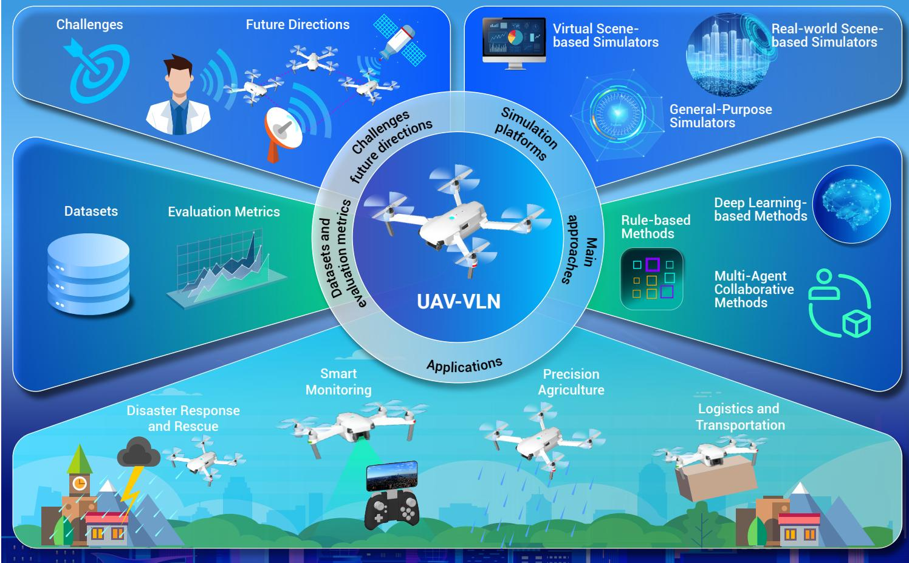
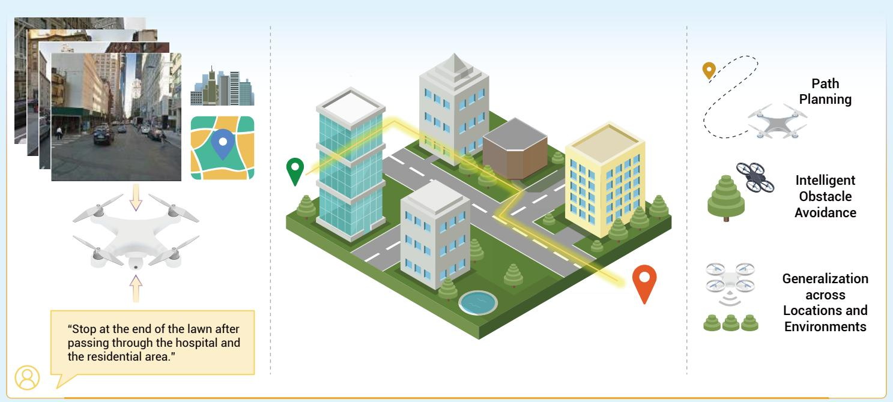
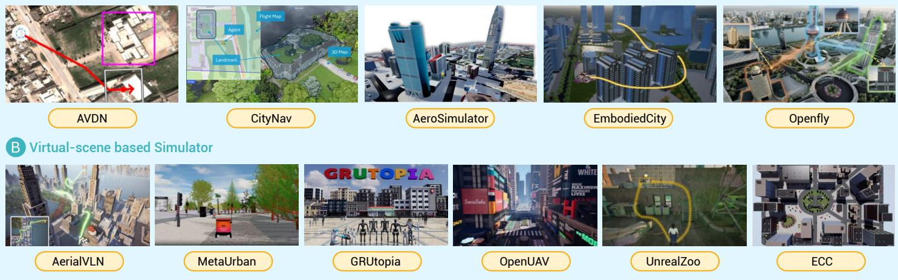
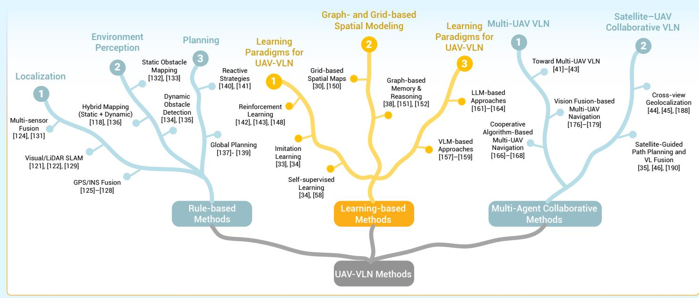
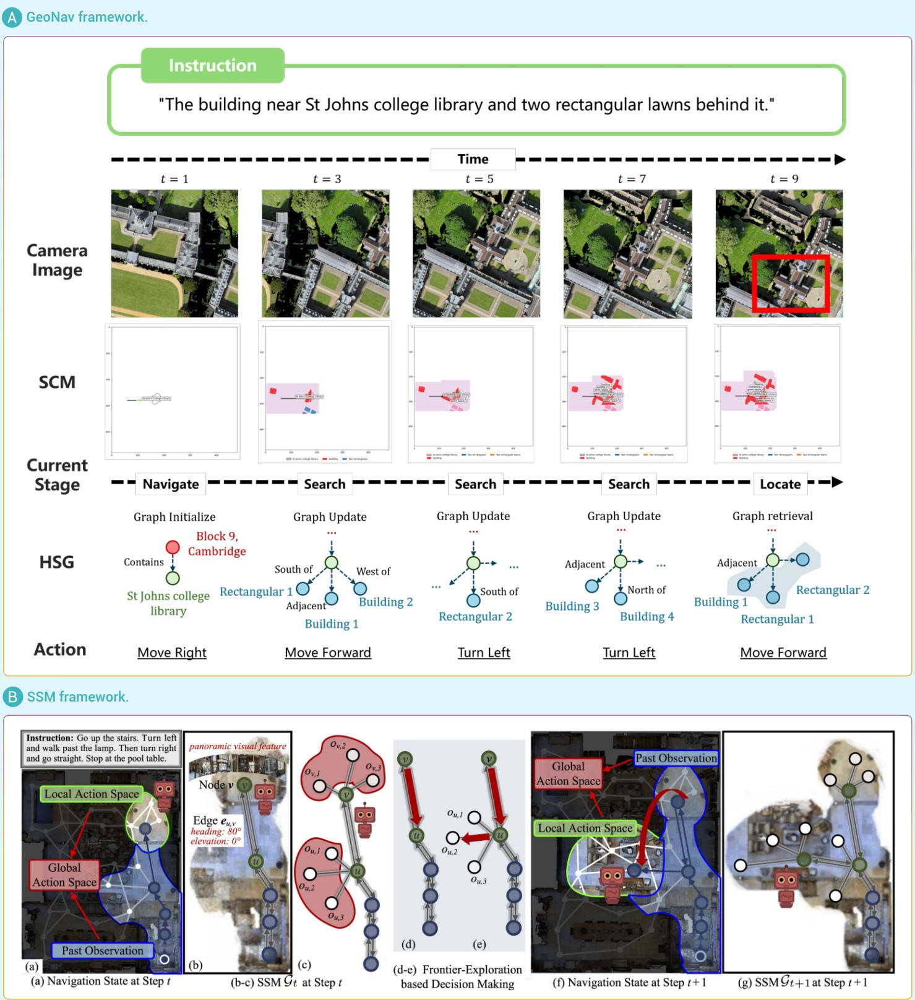
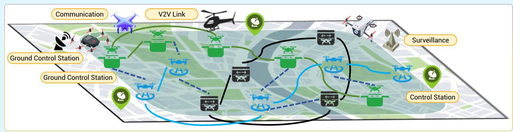
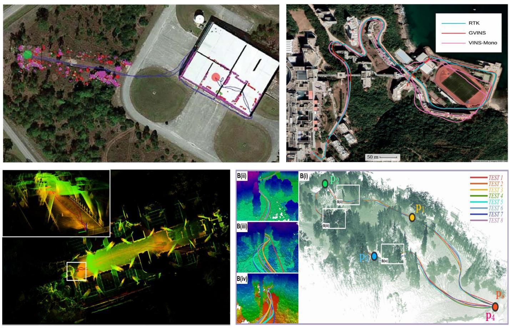
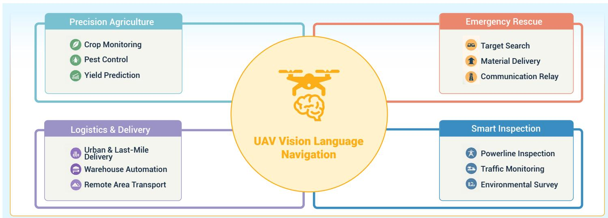
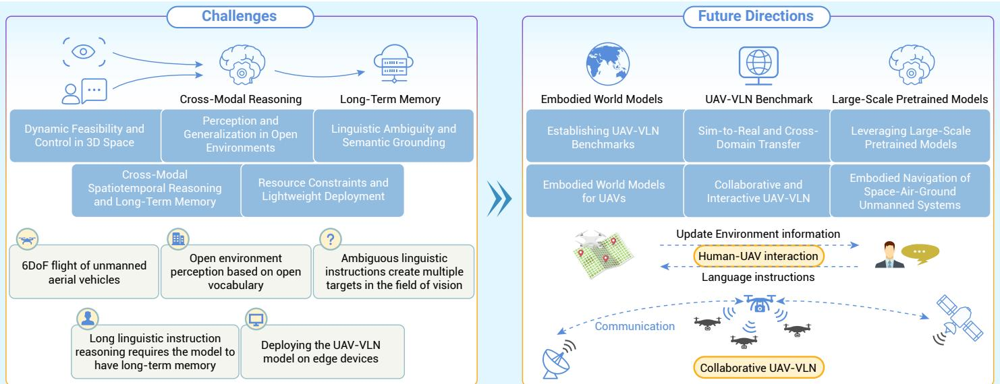

# AeroVerse-Review: Comprehensive survey on aerial embodied vision-and-language navigation

Fanglong Yao,1,4,17,\* Youzhi Liu,1,2,3,4,17 Wenyi Zhang,1,2,3,4,17 Zhengqiu Zhu,5,6,17 Chenglong Li,7,8,17 Nayu Liu,9,17 Peng Hu,10,17 Yuanchang Yue,1,2,3,4,17 Kaiwen Wei,11,17 Xin He,12 Xudong Zhao,13 Zihan Wei,1,2,3,4 Haotian Xu,5,6 Zhiyuan Wang, 14 Gujie Shao,11 Liu Yang,15 Dan Zhao,16 and Yong Yang9

\*Correspondence: yaofanglong17@mails.ucas.ac.cn

Received: September 21, 2025; Accepted: November 4, 2025; Published Online: November 7, 2025; https://doi.org/10.59717/j.xinn-inform.2025.100015 © 2025 The Author(s). This is an open access article under the CC BY license (https://creativecommons.org/licenses/by/4.0/).

## GRAPHICAL ABSTRACT

## PUBLIC SUMMARY

■ Comprehensive review of unmanned aerial vehicle based vision-and-language navigation (UAV-VLN).

■   Provide a summary of methodological evolution, from single-UAV navigation to multi-agent collaboration.

Outline promising future directions, such as embodied world models and space-air-ground unmanned systems.

# AeroVerse-Review: Comprehensive survey on aerial embodied vision-and-language navigation

Fanglong Yao,1,4,17,\* Youzhi Liu,1,2,3,4,17 Wenyi Zhang,1,2,3,4,17 Zhengqiu Zhu,5,6,17 Chenglong Li,7,8,17 Nayu Liu,9,17 Peng Hu,10,17 Yuanchang Yue,1,2,3,4,17 Kaiwen Wei,11,17 Xin He,12 Xudong Zhao,13 Zihan Wei,1,2,3,4 Haotian Xu,5,6 Zhiyuan Wang,1 4 Gujie Shao,11 Liu Yang,15 Dan Zhao,16 and Yong Yang9

1Aerospace Information Research Institute, Chinese Academy of Sciences, Beijing 100190, China

2University of Chinese Academy of Sciences, Beijing 100190, China

3School of Electronic, Electrical and Communication Engineering, University of Chinese Academy of Sciences, Beijing 100190, China

8Sichuan Provincial Engineering Research Center of Domestic Civil Aircraft Flight and Operation Support, Chengdu 641400, China

10School of Computer Science and Engineering, Beihang University, Beijing 100191, China

11College of Computer Science, Chongqing University, Chongqing 400044, China

12Information and Navigation School, Air Force Engineering University, Xian 710077, China

13School of Software, University of Science and Technology of China, Suzhou 215123, China

14School of Transportation and Logistics, Southwest Jiaotong University, Chengdu 610031, China

15Institute of Computing Technology, China Academy of Railway Sciences, Beijing 100081, China

16Institute of Scientific and Technical Information of China, Beijing 100038, China

17These authors contributed equally

\*Correspondence: yaofanglong17@mails.ucas.ac.cn

Received: September 21, 2025; Accepted: November 4, 2025; Published Online: November 7, 2025; https://doi.org/10.59717/j.xinn-inform.2025.100015

© 2025 The Author(s). This is an open access article under the CC BY license (https://creativecommons.org/licenses/by/4.0/).

Citation: Yao F., Liu Y., Zhang W., et al. (2025). AeroVerse-Review: Comprehensive survey on aerial embodied vision-and-language navigation. The Innovation Informatics 1:100015.

With the rapid advancement of unmanned aerial vehicle (UAV) technology, embedding intelligence into aerial platforms has become an increasingly important research direction. UAV-based vision-and-language navigation ( ) i di f b di d i lli gence, requires UAVs to understand natural language instructions and integrate multimodal perception to autonomously plan and execute navigation tasks in three-dimensional environments. This survey provides a comprehensive review of UAy-VLN research, covering simulation platforms, task definitions, core methodologies, datasets and evaluation metrics, application scenarios, as well as key challenges and future directions. We first h d i i i l d bili i f i i l followed by a structured summary of methodological progress, including rule-based approaches, deep learning-driven models, and multi-agent collaborative strategies. We then discuss critical technical challenges in UAV-VLN, such as dynamic feasibility and control in 3D space, perception and generalization in complex environments, linguistic ambiguity and crossmodal semantic grounding, long-term spatiotemporal reasoning, and deployment under resource constraints. Based on these challenges, we outline promising future directions, including standardized benchmark development, Sim-to-Real and cross-domain transfer, pretrained large model integration, embodied world model, collaborative and interactive UAV-VLN, and embodied navigation of space-air-ground unmanned systems. This survey aims to provide a structured reference for future research and to guide the practical deployment of UAV-VLN systems.

## INTRODUCTION

Aerospace embodied intelligence aims to embed intelligence into aerospace platforms such as unmanned aerial vehicles (UAVs),1 near-space airships, satellites, and planetary rovers, forming aerospace agents with autonomous perception, navigation, planning, and action capabilities.2-8 With the rapid development of UAV technology, the demand for UAV applications in inspection, emergency response, logistics, and environmental monitoring h dil i d 9-12 i h ll i b di d intelligence is enabling UAVs to understand human intentions and autonomously perform complex navigation tasks based on natural language instructions.13-15 Vision-and-Language Navigation (VLN)14,16-19 is a representative paradigm, requiring the integration of visual perception and language understanding to navigate unseen environments.

Compared with ground-based VLN, UAV-VLN involves higher degrees of freedom and more complex environmental constraints. UAVs can observe scenes from multiple angles and altitudes, capturing richer spatial and semantic information.20,21 The navigation space is three-dimensional, involving pitch, yaw, and roll control as well as path optimization, which significantly increases the degrees of freedom compared with ground platforms.22 Natural language instructions are often ambiguous, for example, “fl over the ” requiring strong language understanding, multi-scale visual perception, and spatial reasoning capabilities. Perception data may also come from heterogeneous sources, such as RGB images, depth maps, semantic maps, remote sensing imagery, and GPS/IMU signals, which pose significant challenges for multi-modal information fusion. Tasks in UAV-VLN further extend beyond single-shot navigation to multi-hop planning, exploratory flight, and long-term memorybased planning.23-27

Thanks to advances in simulation platforms and data construction, UAy-VLN has gradually formed a structured research framework, spanning highfidelity simulators, navigation algorithms, and evaluation metrics linked to downstream applications. Simulation platforms range from general-purpose environments such as Isaac Sim and AirSim28 to UAV-VLN-specific tools, including CityNav,29 AerialVLN,30 and OpenFly.31 Methodologically, UAV-VLN has evolved from early rule-based systems to learning-based approaches, including reinforcement learning,32 imitation learning,33 self-supervised learning,34 multi-modal fusion,35 and large model-driven frameworks,36 with some methods further incorporating long-term memory to support complex navigation tasks.37-39 In recent years, collaborative paradigms have gained attention, including multi-UAV systems40-43 and satellite–UAV cooperative frameworks,44-46 where coordination strategies and shared perception improve robustness and efficiency. Evaluation metrics have also moved beyond simple success rates to incorporate trajectory accuracy, efficiency, and path quality, offering more comprehensive assessments of navigation performance.

Despite these advances, UAV-VLN still faces challenges in generalization to complex environments, real-world deployment, ambiguous instruction understanding, and cross-modal long-term reasoning. Therefore, this survey provides a structured overview of UAV-VLN research, offering the first unified aerial-centric synthesis that links simulators, datasets, methods (rule-, learning-, and multi-agent), evaluation metrics, and applications, and further highlights key challenges and promising research directions. The main contributions of this survey are as follows:

• We review mainstream simulation platforms with their design principles and limitations, and provide a structured summary of methodological evolution, from rule-based pipelines to deep learning-driven models and from single-UAV navigation to multi-agent collaboration. We also discuss representative datasets and evaluation metrics, highlighting how different approaches vary in modeling perspectives, navigation strategies, and task adaptability.

• We identify key technical challenges in UAV-VLN, such as complex motion dynamics in 3D space, generalization in open environments, crossmodal spatiotemporal reasoning and lightweight deployment. Based on these challenges, we outline promising future directions, such as Sim-to-Real transfer, leveraging pretrained large models, embodied world models for UAVs, collaborative and interactive UAV-VLN, and embodied navigation of space-air-ground unmanned systems, with the aim of providing insights for future research and real-world applications.

The remainder of this paper is organized as follows. Section II introduces h li i i f i l di k d fi i i d i l i ground-based VLN and UAV navigation. Section III reviews UAV simulation platforms and categorizes them by construction approach. Section IV provides a systematic review of core UAV-VLN methods, including rulebased, deep learning-based, and multi-agent collaborative approaches. Section V presents representative applications and their navigation requirements. Section VI summarizes existing datasets and evaluation metrics. Section VII discusses the key challenges in UAV-VLN and highlights promising future research directions.

## PRELIMINARIE

This section introduces the development of VLN and UAV navigation researches. as well as the basic definitions and characteristics of UAy-NAy tasks, providing background support for the subsequent review of the methodology.

## Vision-and-language navigation (VLN)

Vision-and-Language Navigation (VLN) has emerged as an important research direction in recent years.47-49 Its core objective is to enable an agent to autonomously plan and execute navigation paths in visual environments based on natural language instructions.39,50-52 VLN was first defined on the Room-to-Room (R2R) dataset,47 where the agent receives a language instruction (e.g., “Walk through the hallwa from the lobb enter the kitchen ”) and first-person visual observations, and must perform step-wise actions to reach the target. Unlike traditional path planning, VLN integrates natural language understanding, visual perception, and action decision-making within a unified framework, posing challenges in semantic alignment, multimodal reasoning, and temporal control.53-58

Subsequent studies have extended VLN to handle more diverse and complex tasks. For example, the Room-for-Room (R4R) dataset introduces multi-hop long-horizon navigation, increasing the complexity of instructionenvironment associations.39 In outdoor urban environments, Chen et al. proposed the Touchdown dataset, requiring agents to navigate in Google Street View-level city scenes,49 significantly increasing environmental complexity and language diversity. Such tasks not only emphasize local perception but also require long-term memory and cross-region reasoning.59-61

Overall, VLN research has gradually evolved from indoor to outdoor environments, from static to dynamic scenarios, and from small-scale datasets to large-scale pretraining. These developments provide a theoretical and methodological foundation for language-guided navigation in UAV scenarios.

## UAV navigation

UAV navigation has long been a core topic in robotics and automation, aiming to enable autonomous flight and task execution in complex and uncertain environments.41,62–64 Compared with ground robots, UAVs are characterized by high degrees of freedom in three-dimensional flight, limited energy resources, and stringent requirements for real-time performance and robustness.

Traditional UAV navigation methods mainly rely on localization and planning techniques.65-69 For localization, Visual-Inertial Odometry (VIO) and Simultaneous Localization and Mapping (SLAM) are commonly used solutions. For instance, ORB-SLAM270 has become a benchmark in UAV visual localization. For path planning, graph search algorithms (e.g., A\*71), sampling based methods (e.g., RRT66,67), and optimization-based approaches (e.g., ${ \mathsf { M P C } } ^ { 7 2 , 7 3 } )$ are widely applied. Kamel compared linear and nonlinear MPC for UAV trajectory tracking, providing theoretical insights for complex trajectory control.69

With the advancement of deep learning and reinforcement learning,74-78 endto-end learning and RL-based methods have been introduced to enhance autonomous perception and decision-making.79,80 These approaches reduce reliance on traditional mapping and planning, making them more suitable for complex real-world environments. Recently, UAV navigation research has also explored multi-UAV collaboration and cross-domain perception.41,81-84 For example, the AirSwarm framework41 investigates the feasibility of multiagent cooperative navigation with low-cost commercial UAVs. Meanwhile, multi-modal navigation combining satellite remote sensing and UAV data has become an emerging trend. Overall, UAV navigation is evolving from traditional model-based methods toward data-driven and multi-modal fusion approaches, laying a solid foundation for UAV-NAV tasks.85-89

## UAV-VLN task definition

At the intersection of VLN and UAV autonomy, the UAV-based VLN task has been introduced. As shown in Figure 1, the aim of UAV-VLN is to enable UAVs to navigate aerial environments safely and efficiently by following natural language instructions. While UAy-VLN can be regarded as an extension of VLN to aerial agents, it is gradually forming into a research direction with its own characteristics. Formally, the UAV-VLN task can be defined as learning a ”π :policy $( I _ { t } , L ) \to \bar { a } _ { t } .$ I, where denotes the multimodal observation (e.g., RGB t Limages, depth maps, or GPS data) at time step , and represents a natural ”πlanguage instruction describing the navigation goal or route. The policy a ∈ A Aoutputs an action from the action space (e.g., move forward, turn , , , or ). The objective is to generate an action sequence $\{ a _ { 1 } , a _ { 2 } , \ldots , a _ { \scriptscriptstyle T } \}$ that drives the UAV from its starting position to the Ltarget location specified by , while minimizing trajectory deviation and avoiding collisions. Success is typically evaluated using standard UAV-VLN metrics such as Navigation Error (NE), Success Rate (SR), and Success weighted by Path Length (SPL), which jointly measure navigation accuracy and task completion. Compared with conventional VLN, UAV-VLN presents several distinctive aspects:

• UAVs operate in full 3D space with six degrees of freedom (6-DoF), where navigation must account for path.

• UAV-VLN often involves outdoor and large-scale unstructured environ-( f l d di f ) h di i l i view observations, and varying altitudes introduce domain shifts and sim-toreal gaps, posing challenges for robust perception and generalization.94,95

• UAV platforms are restricted by onboard computation, payload, and energy budgets, necessitating lightweight and efficient models that support real-time multi-modal fusion and deployment.96-98

## SIMULATION PLATFORMS

The UAV-VLN task requires agents to autonomously perform multimodal instruction-driven path planning and execution in realistic or near-realistic environments. Due to the high development cost, safety risks. and lack of controllability in real-world deployment, constructing high-fidelity and reproducible training simulators has become a key enabler for advancing this field. Such simulators typically virtualize UAV motion characteristics, sensor configurations, and environment interaction mechanisms, thereby providing a stable platform for algorithm training, testing, and evaluation. We categorize mainstream UAV simulators into three groups based on their construction methodology: general-purpose simulators, real-world scene reconstruction simulators, and virtual environment-based simulators.

## General-purpose simulators

General-purpose simulators usually adopt a modular architecture, integrating high-precision physics engines (for 3D motion and dynamics simulation),

  
Figure 1.  Schematic diagram of UAV-VLN tasks The UAV agent receives natural language instructions and environmental perception inputs, such as RGB images, depth maps, and semantic maps, to achieve autonomous planning and navigation, while possessing intelligent obstacle avoidance and environmental generalization capabilities.

3D environment rendering modules (supporting dynamic scenes and lighting simulation), multimodal sensor modeling (e.g., cameras, LiDAR, IMU), and interaction frameworks (supporting real-time control and event triggering). Together, these modules construct realistic environments for training and evaluation.

Isaac Sim,99 built on the NVIDIA Omniverse platform and the PhysX engine, supports high-fidelity physical simulation, GPU-accelerated rendering, and parallel computation. It provides various sensor models (e.g., RGB, depth camera, Li-DAR, IMU) and is compatible with mainstream deep learning f k ki i i bl f l l h i d i d agent training. Unreal Engine (UE)100 offers photorealistic rendering and blueprint-based programmability. AirSim28, developed by Microsoft on top of UE, supports comprehensive physical and visual modeling with API access, and has been widely used for vision-based navigation, obstacle avoidance, and path planning research. Gazebo101 is a widely adopted open-source robotics simulator, integrating physics engines such as ODE and Bullet. With seamless ROS integration, abundant robot models, and indoor/outdoor environments, it is suitable for SLAM, multi-agent coordination, and path control tasks. Google Earth102 focuses on geospatial visualization based on satellite and street-view data. Although it lacks physical simulation capabilities, it is valuable for urban scene understanding and path planning visualization. GTA-V,103 though originally a commercial game engine, has been widely adopted due to its high-fidelity city modeling, realistic traffic flow, and human–vehicle interactions, serving as a large-scale synthetic visual data source and a pretraining platform for navigation algorithms. CoppeliaSim104 and Webots105 provide multi-physics engine support and modular modeling interfaces, with APIs for Python, ROS, and other middleware, making them suitable for multirobot control, path planning, and reinforcement learning experiments. MORSE,106 based on Blender, emphasizes lightweight design and middleware compatibility (e.g., ROS, MOOS), and is particularly suitable for semantic-level interactions and multisensor modeling. USARSim,107 also built on UE, targets urban disaster rescue scenarios, offering high-fidelity physical, visual, and environmental modeling, and is well-suited for research on search-andrescue tasks and multisensor fusion.

Table 1 compares the main features and application scenarios of these 11 simulators. Most platforms support physics engines (e.g., PhysX, Bullet, ODE), standard sensor modeling (e.g., camera, LiDAR, IMU, GPS), and programmatic interface integration. Open-source platforms such as Gazebo, MORSE, and PyBullet place more emphasis on physical realism and ROS compatibility, albeit with limited rendering fidelity.108 By contrast, Isaac Sim, UE+AirSim, and

Unity109 provide high-quality rendering, making them ideal for machine learning and visual perception research, though at the cost of higher configuration complexity. GTA-V, with its open-world urban environments and rich visual details, has emerged as an excellent tool for synthetic training. Apart from Google Earth, which mainly serves geospatial visualization purposes, all other simulators support real-time dynamic simulation and interactive control, thereby offering multi-level evaluation and model training environments for UAV-VLN tasks.

## Real-world scene-based simulators

d i l h i i i l b d l world scenes bridge the gap between simulation and reality by integrating high-resolution satellite imagery, street-view data, or 3D models generated through photogrammetry. These simulators provide a more realistic interactive environment, thus improving the feasibility and robustness of deploying systems in real-world scenarios

AVDN110 is a 2D continuous scene simulator developed by the University of California, Santa Cruz. It uses high-resolution satellite images from the xView dataset as visual input and allows drones to move freely to any given coordinates. This platform provides an interactive interface that supports human control and behavior collection, making it suitable for exploring navigation strategies from a top-down perspective.

CityNav29 constructs a 3D environment using the Sensat-Urban urban point cloud data, covering an area of 8.7 square kilometers across Cambridge and Birmingham. It utilizes the WebGL-based Potree tool for visualization and supports six-degree-of-freedom flight control, making it ideal for structural perception-based path planning research.

Embodied City,111 released by Tsinghua University, reconstructs the Guomao district of Beijing using Unreal Engine 5, simulating urban elements such as buildings, streets, vehicles, and pedestrians. The platform employs AirSim for perception modeling and path movement, emphasizing the integration of urban details and dynamic interactions.

AeroSimulator,1 a core component of the AeroVerse platform developed by the Aerospace Information Research Institute of the Chinese Academy of Sciences, uses the UrbanScene3D dataset112 to reconstruct urban scenes in cities like Shanghai and Shenzhen. It supports various flight states (e.g., speed, acceleration) and environmental variables (e.g., lighting, weather), enhancing generalization and adaptability in complex scenarios.

OpenFly,31 developed by the Shanghai AI Laboratory, integrates multiple rendering engines (Unreal Engine 4/5, GTA-V, Google Earth) and 3D GS reconstruction techniques. It constructs 18 real-world scenes spanning 11 cities and covering over 150 square kilometers, including business districts, campuses, and historical buildings. With a unified perception and action control interface, OpenFly is well-suited for navigation modeling and evaluation in large-scale, diverse environments.

Table 1.  Comparison of general-purpose UAV simulators.

<table><tr><td>Simulator</td><td>High-fidelity Physics</td><td>Photorealistic Rendering</td><td>Parallel Computation</td><td>Multisensor Support</td><td>Real-time Dynamics</td><td>Physical Interaction</td><td>Open-source</td><td>Physics Engine</td><td>Research Domains</td></tr><tr><td>Isaac Sim</td><td>√</td><td>√</td><td>√</td><td>√</td><td>√</td><td>√</td><td>×</td><td>PhysX</td><td>Attitude control, navigation</td></tr><tr><td>PyBullet</td><td>×</td><td>×</td><td>√</td><td>√</td><td>√</td><td>√</td><td>√</td><td>Bullet</td><td>Navigation, swarm/formation control</td></tr><tr><td>Unity</td><td>×</td><td>√</td><td>√</td><td>√</td><td>√</td><td>√</td><td>×</td><td>PhysX</td><td>Reinforcement learning, visual perception, attitude control</td></tr><tr><td>UE + AirSim</td><td>√</td><td>√</td><td>√</td><td>√</td><td>√</td><td>√</td><td>√</td><td>PhysX</td><td>Attitude control, path planning, vision-based navigation, Sim2Real</td></tr><tr><td>Gazebo</td><td>×</td><td>×</td><td>√</td><td>√</td><td>√</td><td>√</td><td>√</td><td>ODE, Bullet, Simbody, DART</td><td>Obstacle avoidance, path planning, multi-agent collaboration</td></tr><tr><td>Google Earth×</td><td></td><td>×</td><td>×</td><td>×</td><td>×</td><td>×</td><td>×</td><td>N/A</td><td>Geolocation, street-view navigation</td></tr><tr><td>GTA-V</td><td>√</td><td>√</td><td>×</td><td>√</td><td>√</td><td>√</td><td>×</td><td>Euphoria</td><td>Object detection, vision-based navigation</td></tr><tr><td>CoppeliaSim ×</td><td></td><td>×</td><td>×</td><td>√</td><td>√</td><td>√</td><td>×</td><td>ODE, Bullet, Vortex</td><td>Manipulation control, mobile platforms</td></tr><tr><td>Webots</td><td>×</td><td>√</td><td>×</td><td>√</td><td>√</td><td>√</td><td>√</td><td>ODE</td><td>Mobile robot navigation, SLAM</td></tr><tr><td>MORSE</td><td>×</td><td>×</td><td>×</td><td>√</td><td>√</td><td>√</td><td>√</td><td>Bullet</td><td>Robot perception algorithms, sensor fusion</td></tr><tr><td>USARSim</td><td>×</td><td>×</td><td>×</td><td>√</td><td>√</td><td>√</td><td>√</td><td>PhysX</td><td>Disaster response search-and-rescue, multi-robot formation control</td></tr></table>

The aforementioned simulators each have their distinct advantages. AVDN uses satellite imagery for global navigation modeling, making it suitable for tasks that require alignment of instructions with geographic images. However, due to its top-down view, it is limited in perceiving vertical structures. CityNav provides high-precision 3D point cloud environments, but lacks dynamic elements, making it less suitable for simulating real-time changes such as crowds or traffic flow. Embodied City emphasizes detailed urban modeling and dynamic interaction, making it suitable for multi-modal, multientity environments.

AeroSimulator offers higher freedom in flight physics modeling and environmental disturbance, ideal for simulating complex maneuvers. OpenFly stands out for its large-scale, multi-source real-world urban reconstruction, focusing on cross-city and cross-style generalization, making it one of the most comprehensive benchmark platforms available.

In summary, simulators based on real-world scenes offer significant advantages in enhancing environmental fidelity, perceptual challenges, and interaction complexity. They are progressively becoming a crucial infrastructure for research in UAV-VLN.

## Virtual scene-based simulators

In UAV navigation research, obtaining large-scale and realistic diverse training data is often constrained by high costs, low controllability, and difficulty in scene reproduction. Simulators based on virtual environments create digital scenes through existing digital resources or procedural generation, allowing researchers to quickly and cost-effectively synthesize large amounts of experimental data. They also enable the flexible construction of diverse task scenarios with specific features, facilitating efficient algorithm development and testing.

Aerial VLN30 is an early virtual simulation platform for aerial VLN proposed by Northwestern Polytechnical University. Built on the UE4 engine and AirSim, it includes 25 city-level virtual scenes (e.g., blocks, subways, factories) and over 870 object categories. The platform allows drones to capture RGB and depth images from a first-person perspective and perform eight types of actions, including forward movement, turning, vertical/horizontal movement, achieving 4-degree-of-freedom motion control.

OpenUAV113 is a multi-scenario outdoor navigation platform developed by Beihang University. It integrates UE and CARLA, introducing 22 urban, rural, and natural scenes, and supports scene editing and dynamic environmental changes (e.g., lighting, vegetation sway). The drone on this platform features 6-degree-of-freedom control, supports multimodal sensor configurations (RGB, depth, IMU, LiDAR, GPS), and can be controlled manually or in positionbased mode, making it suitable for complex flight strategy research.

UnrealZoo114 is an open-world embodied intelligence simulator based on l i d l i i i i l d embodied agents across seven categories. The platform supports tasks such as visual navigation and target tracking, and provides both discrete and continuous control modes, making it suitable for multi-agent path planning and interaction behavior modeling.

The Embodied Crowd Counting Simulator115 is specifically designed for simulating and analyzing large-scale crowds. UnrealZoo excels in constructing complex open worlds, where various types of agents can simultaneously interact and navigate. GRUtopia116 focuses on training robots in highly interactive scenarios to help them adapt better to real-world conditions. MetaUrban117 is focused on simulating ground robots in complex urban traffic scenarios (e.g., dense crowds of pedestrians). These virtual simulators collectively drive the algorithm validation and capability enhancement of UAVs and other embodied agents in diverse and complex virtual environments.

Overall, Figure 2 and Figure 3 provide a comprehensive comparison of realworld and virtual scene-based simulators in terms of environment type, platform, scene editing capabilities, dynamic assets, number of scenes, scene scale, main sensors, and action degrees of freedom, which can serve as a reference for selecting appropriate simulators for UAV-VLN research.

## MAIN APPROACHES

We categorize UAV-VLN approaches into three main paradigms: rulebased methods, deep learning-based methods, and multi-agent collaborative methods. Rule-based methods explicitly combine language parsing, visual recognition, and mapping modules, relying on manually designed strategies to accomplish navigation. Deep learning-based methods leverage neural networks to jointly model visual and linguistic features, and optimize navigation policies through supervised learning. Multi-agent collaborative methods target multi-objective and dynamic environments, employing agent cooperation mechanisms to achieve task decomposition and parallel navigation. Figure 3 provides a taxonomy of UAV-VLN methods, visually summarizing the paradigms and their representative techniques.

  
Figure 2.  Typical scenarios of simulators based on real scene reconstruction and virtual scene construction.

Table 2.  Comparison of simulators based on real and virtual environments.

<table><tr><td>Simulator</td><td>Environment</td><td>Base Platform</td><td>Scene Editing</td><td>Dynamic Assets</td><td>Number of Scenes</td><td>Scene Size (km2)</td><td>Main Sensors</td><td>Action DOF</td></tr><tr><td>CityNav</td><td>Real</td><td>Potree</td><td>×</td><td>×</td><td>2</td><td>8.7</td><td>RGB-D, Pose</td><td>4</td></tr><tr><td>AVDN</td><td>Real</td><td>Satellite Images</td><td>×</td><td>×</td><td>1</td><td>N/A</td><td>RGB, Pose</td><td>4</td></tr><tr><td>Embodied City</td><td>Real</td><td>UE 5</td><td>√</td><td>√</td><td>1</td><td>6.72</td><td>RGB-D, Pose, Semantic Segmentation</td><td>4</td></tr><tr><td>AeroSimulator</td><td>Real</td><td>UE 4</td><td>√</td><td>×</td><td>4</td><td>N/A</td><td>LiDAR, Semantic Segmentation, RGB-D, Pose</td><td>6</td></tr><tr><td>OpenFly</td><td>Real and Virtual</td><td>UE 4, UE 5, GTA-V, Google Earth, 3D GS</td><td>√</td><td>×</td><td>18</td><td>150</td><td>LiDAR, Semantic, RGB-D, Pose</td><td>4</td></tr><tr><td>Aerial VLN</td><td>Virtual</td><td>UE 4</td><td>×</td><td>×</td><td>25</td><td>N/A</td><td>RGB-D, Pose</td><td>4</td></tr><tr><td>Open UAV</td><td>Virtual</td><td>UE 4</td><td>√</td><td>√</td><td>22</td><td>N/A</td><td>LiDAR, RGB-D, Pose, IMU, GPS</td><td>6</td></tr><tr><td>UnrealZoo</td><td>Virtual</td><td>Unreal Engine 4/5</td><td>√</td><td>√</td><td>100</td><td>16 (Largest)</td><td>Color, RGB-D, Gray, Pose, Mask</td><td>3</td></tr><tr><td>Embodied Crowd Counting</td><td>Virtual</td><td>Unreal Engine 4</td><td>√</td><td>√</td><td>60</td><td>40 (Average per scene)</td><td>RGB-D, Semantic, LiDAR</td><td>6</td></tr><tr><td>GRUtopia</td><td>Virtual</td><td>Isaac Sim</td><td>√</td><td>√</td><td>100k</td><td>N/A</td><td>RGB-D, Pose</td><td>Various</td></tr><tr><td>Metaurban</td><td>Virtual</td><td>PyBullet</td><td>√</td><td>√</td><td>12.9k</td><td>20 (Average per scene)</td><td>RGB-D, Semantic, LiDAR</td><td>Various</td></tr></table>

## Rule-based methods

Rule-based methods rely on manually designed features, mathematical models, and logical reasoning rather than learning-based approaches. They are intuitive and highly interpretable but have limited generalization capability, making them more suitable for well-defined tasks or environments. Typically, rule-based methods decompose UAy navigation into three sub-problems: localization, environmental perception, and planning.

Localization. The goal of localization is to determine the relative position of the UAV and the target, which serves as the input for subsequent route or action planning (Figure 4). Depending on the sensing modality, existing approaches can be divided into those relying on onboard sensors (e.g., cameras, LiDAR) and those using external sources such as GPS or UWB.

Early works in the 2000s adopted GPS for outdoor UAV localization. For example, Hui et al.125 integrated GPS with electronic maps to achieve dynamic UAV navigation and visualization. Williamson et al.126 fused GPS with INS sensors to achieve formation flight localization accuracy within 10 cm for F18 aircraft. However, GNSS signals are unstable and prone to blockage, ionospheric activity, or deliberate jamming, which significantly limits their usability in complex environments.127,128

With sensor miniaturization and increasing onboard computation, many works have adopted cameras or LiDAR for UAV localization. For instance, Mohta et al.121 extended the MSCKF visual odometry framework119 into a dualsided version for UAV localization, enabling agile indoor and outdoor flight. Mohta et al.129 leveraged the SVO framework130 for localization in cluttered warehouse environments. Ren et al.122 applied Fast-LIO2123 to achieve UAV navigation in forest environments. Nevertheless, vision and LiDAR odometry only provide relative localization and suffer from drift over long distances, restricting their scalability.

To overcome this. hybrid solutions combine relative odometry with global positioning (e.g., GNSS or prior map matching) to eliminate drift. Cao et al.124 tightly fused raw GNSS, vision, and IMU data in an optimization-based manner, enabling robust localization even with limited satellite visibility in large-scale indoor-outdoor mixed environments. Wang et al.131 exploited geomagnetic field matching to compensate for INS drift. Overall, multi-sensor fusion has become mainstream for UAV localization, though significant challenges remain in ensuring robustness in highly complex environments.

  
Figure 3.  A taxonomy of UAV-VLN methods, covering rule-based, learning-based, multi-agent collaborative paradigms.

Environmental perception. Environmental perception aims to capture information about static and dynamic obstacles to ensure safe UAV flight. Static obstacles are often represented via occupancy grids, 3D voxels, ESDF maps, or point cloud maps. For instance, Mohta et al.129 used 2D grids for global maps and 3D voxels for local maps; Fang et al.132 modeled environments using pre-built voxel maps; Oleynikova et al.133 incrementally constructed ESDF maps. These methods perform well in static environments but struggle to reflect dynamic changes in real time.

Dynamic obstacle detection typically relies on visual or LiDAR data, with results represented by ellipses or bounding boxes. For example, Oleynikova et al.134 detected obstacles from disparity maps and modeled them with 2D ellipses. Lin et al.135 extended this to 3D bounding boxes with continuous estii f i i i d i i i d bili i l dynamic scenes. Yet, purely geometric representations may be insufficient in highly cluttered environments.

To simultaneously handle static and dynamic information, hybrid mapping approaches have been proposed. For instance, Xu et al.118 and Wang et al.136 adopted two-layer structures: static layers modeled with occupancy voxels and dynamic layers represented by ellipsoids, with point cloud occlusion used to detect moving objects.

Planning. Once the UAV’s position, target, and obstacles are obtained, the system must plan a safe trajectory or action sequence. Planning methods can be broadly divided into two categories.

The first category is global planning methods, which generate consistent, globally optimal paths, similar to bird migration, but typically require complete maps and high computational resources. For instance, Mohta et al.129 applied A\* on a hybrid 2D/3D map and optimized safe trajectories via Safe Flight Corridors. Oleynikova et al.133, building on,120 combined RRT global search with minimum-snap smoothing. Zhou et al.137 initialized paths with A\*, then optimized collision-free trajectories using B-splines in ESDF maps. However, ESDF construction is time-consuming; hence, Zhou et al.138 proposed an optimization-based method without ESDF for improved efficiency. Most of these methods assume static environments. To handle dynamics, Xu et al.118 first generated a minimum-snap trajectory in the static layer, then avoided dynamic obstacles using chance-constrained MPC. Xu et al.139 further combined occupancy grids and dynamic ellipsoids to build two-layer maps, generating B-spline trajectories that jointly account for static and dynamic obstacles.

The second category is reactive motion strategies, which resemble insect reflexes, relying on minimal prior information with low computational demand but at the cost of path quality. For example, Liu et al.140 integrated Lyapunov methods with artificial potential fields for dynamic obstacle avoidance, Jenie et al.141 extended the 3D velocity obstacle approach with buffered velocity sets to improve robustness. These methods respond quickly but fail to generate globally consistent and efficient paths.

In summary, global planning methods demand globally consistent continuous maps (e.g., ESDF) to support trajectory optimization and gradient computation, while reactive strategies emphasize local perception and rely on lightweight maps such as occupancy grids to enable fast responses. Thus, map modeling and path planning must be co-designed to balance accuracy and efficiency for improved performance and adaptability.

## Deep learning-based methods

i h h b k h h f d l i i i i d l language processing, its powerful feature representation and cross-modal modeling capabilities have gradually become the backbone of UAV-VLN research. Unlike traditional approaches that rely on handcrafted rules or shallow models, deep learning enables UAVs to leverage large-scale data and endto-end training to significantly enhance perception, reasoning, and decisionmaking in complex environments. This subsection reviews UAV-VLN methods from three perspectives: learning paradigms, graph and grid-based spatial modeling and large model-based methods.

Learning paradigms for UAV-NLN. The choice of learning paradigm directly affects a navigation model’s perceptual ability, decision-making efficiency, and generalization performance. For example, reinforcement learning (RL) optimizes policies through continuous interaction with environments, enabling UAVs to gradually learn how to follow natural language instructions and visual observations in long-horizon tasks. Self-supervised learning (SSL) exploits massive unlabeled data via pretraining mechanisms such as contrastive learning and masked modeling to acquire cross-modal representations, alleviating the challenges of data scarcity and high annotation cost. Imitation learning (IL), by contrast, emphasizes learning from expert demonstrations, which is particularly useful in avoiding unsafe behaviors and facilitating fast adaptation to novel environments. Recent studies combining these paradigms with UAV-VLN have demonstrated promising results in both simulation and real-world UAV experiments, laying the foundation for intelligent navigation in dynamic and complex missions.

For instance, Wang et al.34 addressed poor generalization and low exploration efficiency in VLN by combining Reinforced Cross-Modal Matching (RCM) with Self-supervised Imitation Learning (SIL), thereby improving agent navigation in indoor environments. In UAV tracking scenarios with long trajectories, complex 3D scenes, and frequent occlusion, Wu et al.32 proposed ORTrack, which integrates a spatial Cox-process masking strategy with adaptive knowledge distillation, achieving robust and real-time performance.

"The building near St Johns college library and two rectangular lawns behind it.'

  
Figure 4.  UAV localization: determining relative position for navigation and action planning through onboard sensors and external sources DPMPC118 utilizes the temporal information to generate a reactive trajectory for avoidance. MSCKF119 estimates the trajectory with blue line overlaid on a map of area. Another work locates the original goal 120 121-124 ( sion.121 Copyright 2018, IEEE)(Reproduced with permission.122 Copyright 2025, Science)(Reproduced with permission.123 Copyright 2022, IEEE)(Reproduced with permission.124 Copyright 2022, IEEE)

Emami et al.142 combined diffusion models (DMs), reinforcement learning, and digital twins (DT) to address decision-making and modeling challenges in UAV communications. For VTOL-UAV landing on offshore charging platforms, Ali et al.143 proposed a staged RL framework, applying model-based control during approach and PPO-based policy learning during landing to

enhance disturbance robustness.

In multi-UAV collaborative scenarios, Zhu et al.144 developed the ZD-RL method, which decomposes the Z-function to jointly optimize transmit power and UAV trajectories, maximizing localization accuracy. To counteract physical sensor attacks (e.g., GPS spoofing), Dash et al.145 introduced ARMOR, a two-stage robust RL framework where a teacher encoder leverages privileged information to generate robust latent states, while a student encoder approximates them via LSTM using only historical sensor data. For simulation support, Tai et al.146 presented PyFlyt, a Bullet-based UAV simulation platform with standardized tasks and support for sparse-reward RL training, improving portability and efficiency compared to existing tools.

  
Figure 5.  (A) The GeoNav framework149 presents a qualitative example of its agent performing language-goal aerial navigation; the framework leverages natural language commands for task specification and demonstrates robust visual navigation capabilities on the CityNav benchmark. (Reproduced with permission.149 Copyright 2025, arXiv) (B) The SSM framework38 learns a graph-structured scene memory to capture historical observations and environmental layouts and integrates it with a global action space for b i i l i i d li f i l d i bl l h i i d i i h li i i f l l i ( d d i h permission.38 Copyright 2021, IEEE)

Furthermore, He et al.147 investigated communication and trajectory joint optimization for multi-UAV collaboration, proposing RL-TP for trajectory planning and C-TOP for convex optimization-based topology adaptation, thereby maximizing throughput under neighbor and power constraints. Xu et al.148 proposed NavRL, a PPO-based framework for safe UAV navigation in dynamic environments, integrating velocity obstacle theory with linear programming to refine RL outputs for collision avoidance. Wang et al.33 combined RL and IL in a synergistic framework, enabling UAVs to perform visual-based autonomous flight in complex river environments.

Graph and grid-based spatial modeling. In complex urban environments, UAVs face challenges such as long trajectories, multi-hop instructions, and frequent target switching, where immediate perception alone is insufficient for robust decision-making. To overcome these limitations, recent research has increasingly adopted graph- and grid-based spatial modeling to explicitly encode visual, geometric, and semantic information, while maintaining structured memory of the environment. By supporting dynamic updates and longhorizon reasoning, these models enable UAVs to perform more reliable planning, revisitation, and instruction following.

To address the demands of long trajectories and coupled 3D maneuvers, EventFly37 reformulates navigation as a view-selection problem. It integrates six-view representations with top-down grid maps, consolidating navigation history into a unified spatial memory that significantly improves robustness in dynamic urban scenarios.

For large-scale spatial reasoning and multi-stage navigation strategies, GeoNav149 introduces a multimodal framework that integrates a global cognitive map (SCM), a hierarchical scene graph (HSG), and multi-stage strategies (MNS) (Figure 5A). This design enables explicit geographic reasoning and landmark-based planning, improving both efficiency and accuracy in language-guided navigation.

Several works further highlight the utility of grid-based spatial modeling. For instance, AerialVLN30 augments bird’s-eye-view (BEV) grid maps with realtime updates, allowing UAVs to fuse semantic and geometric cues for finegrained navigation. Similarly, Wu et al.150 proposed a low-cost system that generates occupancy grid maps from 2D LiDAR, combining offline path planning with reinforcement learning–based obstacle avoidance for deployment in unknown environments.

Graph-based modeling approaches, on the other hand, emphasize relational reasoning and long-term memory. The Structured Scene Memory (SSM)38 encodes UAV observations as nodes and spatial relations as edges(Figure 5B), enabling revisitation and retrieval of past states. Building on this idea, CityNavAgent151 applies a dynamic memory graph to urban-scale environments, while MCGPT152 leverages memory topology graphs and demonstrations to diversify navigation strategies. Likewise, InstructNav153 introduces multi-source value graphs to decompose complex instructions into manageable sub-tasks.

Overall, graph- and grid-based spatial modeling provides UAVs with structured, queryable, and updatable representations of their environment, bridging the gap between immediate perception and long-term decision-making in vision-and-language navigation.

Large model-based UAV-VLN. Recently, pretrained large models have become increasingly prominent in UAV-VLN, offering strong reasoning capabilities and extensive prior knowledge. By leveraging these models as agents for action prediction, UAVs can better handle complex spatial relations and semantic cues in outdoor environments.154-156 Many approaches transform visual observations into textual descriptions or structured prompts, thereby enhancing generalization and data efficiency.

VLM-based approaches integrate visual and linguistic inputs to achieve end-to-end navigation. For example, Hong et al.157 introduced a recurrent d l h i i d l dd i ll b able Markov decision problems, achieving state-of-the-art results on R2R and REVERIE. Zhang et al.158 proposed a multimodal system for fine-grained delivery scenarios, combining lightweight large language models with visionl d l f i d i d i l i Similarly, Fan et al.110 developed the HAA-Transformer based on the AVDN dataset, enabling dialogue-guided navigation and human attention prediction. Cai et al.159 combined supervised finetuning and group-relative policy optimization with a chain-of-thought reasoning mechanism, improving multimodal perception and structured decision-making. Liu et al.2 proposed Aero-Verse-NavAgent, a large Vision-Language Model-based approach for UAV navigation that integrates multi-scale environmental information including topological maps, panoramic observations, and fine-grained landmark recognition using GLIP.

LLM-based approaches primarily exploit large language models for instruction parsing, world modeling, and high-level reasoning. For instance, Wang et al.34 uses an LLM to convert instructions into structured prompts, quiding vision-language models for zero-shot navigation. Wang et al.160 proposed STMR, projecting landmarks onto top-down maps and encoding them as matrix-formatted textual prompts for LLM reasoning. Saxena et al.161 and Li et al.162 employ LLMs to interpret high-level semantic instructions, integrating them with visual context or model predictive control for trajectory optimization. MapGPT,163 NavGPT,36 and DiscussNav164 convert environmental or semantic information into language prompts to guide navigation, while STMR165 and NavCoT156 leverage structured textual representations for precise spatial reasoning and world-model-based planning.

In summary, large model-based UAV-VLN leverages the reasoning power and knowledge integration capabilities of both LLMs and VLMs. VLMs enable end-to-end perception-action learning, while LLMs provide high-level reasoning, instruction parsing, and world modeling. Together, these approaches enhance generalization, support zero-shot navigation, and facilitate human-machine interaction in complex aerial environments.

  
Figure 6.  Multi-UAV cooperative navigation in urban low-altitude airspace Multiple UAV clusters coordinate routes between vertiports while maintaining communication–navigation–surveillance (CNS) links. Communication supports trajectory sharing and control handover; navigation combines satellite, ground beacons, and vision-based methods; surveillance feeds constraints from monitoring stations. The figure highlights concurrent multi-cluster operations under shared CNS services

## Multi-agent collaborative methods

Although a single UAV has already demonstrated strong perception and decision-making capabilities in VLN, it still faces inherent limitations in scenarios requiring wide-area coverage, complex task decomposition, and high robustness. Single-agent systems are typically constrained by limited sensing range, computational resources, and task redundancy. To address these challenges, researchers have begun to explore multi-agent collaborative frameworks that integrate multi-source information and multi-agent decision-making. These frameworks aim to overcome the limitations of single UAVs while enhancing overall efficiency and reliability. This section introduces two representative categories: multi-UAV collaboration and satellite–UAV collaboration. Both paradigms highlight the advantages of multiagent coordination at different levels and open up new research directions for UAV-VLN in urban management, disaster response, and intelligent logistics.

Multi-UAV VLN. Multi-UAV vision-and-language navigation (MU-VLN) integrates computer vision, natural language understanding, and multi-agent cooperative control, with the goal of guiding multiple UAVs to collaboratively accomplish complex navigation tasks via natural language instructions. Compared to single-UAV systems, MU-VLN not only faces the challenges of perception and reasoning but also requires addressing task decomposition, communication, and coordinated behavior planning (Figure 6). Early approaches often relied on distributed decision-making and real-time communication for collaborative navigation. Later. vision-based methods became increasingly popular in multi-UAV navigation due to their passive sensing, low cost, and adaptability to diverse environments. Moving forward, MU-VLN is expected to evolve toward higher autonomy, which multimodal fusion and language grounding jointly model scene semantics, spatial structure, and team-level strategies.

Cooperative algorithm-based multi-UAV navigation. Multi-UAV cooperative navigation techniques improve localization accuracy, path planning, and robustness by enabling UAVs to share positional, velocity, and attitude information in real time, compensating for individual blind spots. Early methods heavily relied on Global Navigation Satellite Systems (GNSS) and Inertial Navigation Systems (INS), such as the tightly coupled GNSS/INS framework in work,40 which improved global localization. However, these approaches struggle in GNSS-denied environments such as urban canyons, under electromagnetic interference, or indoors. To overcome this. Pan et al.166proposed a geometry-based GPS-free cooperative localization method using relative configurations of three UAVs combined with Kalman filtering to reduce drift, while Horyna et al.167 introduced an enhanced Multi-Robot State Estimation (MRSE) approach for fast onboard-only collaborative flight. Incorporating multimodal sensing, Zhang et al.168 developed a cooperative integrated navigation method combining radar odometry and enhanced visual odometry, leveraging robust filtering to mitigate outliers in external information.

With the advancement of artificial intelligence, cooperative algorithms are increasingly integrated with learning-based approaches to optimize path planning and trajectory generation. For instance, Braik et al.169 simulated the Coriolis effect in tornado physics to model swarm path planning; Zhou et al.170 extended Conflict-Based Search (CBS) by incorporating flight constraints, spatial coordination, and rapid replanning under dynamic obstacles; and Tang et al.171 proposed a multi-agent twin-delayed deep deterministic policy gradient with improved dynamic formation reward (MATD3- IDFRF), achieving robust formation stability and obstacle avoidance. Similarly, Zhou et al.172 introduced a distributed model predictive control (DMPC) framework with a multi-strategy improved grey wolf optimization (MSIGWO)

  
Figure 7.  Embodied intelligence technologies centered on UAV-VLN are driving innovations across key industries Typical applications include emergency rescue, remote monitoring, precision agriculture, and logistics, highlighting the technology’s potential in complex task scenarios.

algorithm, while Chen et al.173 designed a biologically inspired tribal competition algorithm for 3D multi-UAV path planning. Han et al.174 improved the sparrow search algorithm with logarithmic spiral and adaptive step strategies (LASSA) for swarm trajectory optimization, and Wang et al.175 developed a multi-objective dynamic prioritization model with unilateral collision-avoidance and congestion-weighted mapping.

Vision fusion-based multi-UAV navigation. With the rapid development of computer vision, vision-based cooperative navigation has become a mainstream research direction. As a passive sensor, vision offers low cost, small size, rich information, and strong localization autonomy, making it ideal for multi-UAV tasks. Leveraging shared visual inputs, UAV swarms can overcome failures due to occlusion or flight altitude limits, enabling wide-area positioning and navigation in complex environments.176 Visual SLAM (Simultaneous Localization and Mapping) further enables UAVs to achieve GPSindependent localization and environment reconstruction, and its integration into multi-agent systems greatly improves efficiency in collaborative tasks. For example, Leishiman et al.177 studied relative navigation using visual SLAM for formation flying and dynamic obstacle avoidance; Xu et al.178 proposed D2SLAM, a decentralized, distributed system for collaborative SLAM in aerial swarms, robust to network delays and dynamic conditions; and Wang et al.179 developed a real-time monocular SLAM system with a distributed architecture and innovative feature descriptors for efficient multi-UAV collaboration.

Reinforcement learning and deep learning have also been applied to visualbased multi-UAV navigation. Huang et al.180 introduced a distributed obstacle avoidance strategy using deep reinforcement learning, combining depth maps and inertial data to enable autonomous navigation without communication. Mo et al.181 proposed a Deep Reinforcement Adaptive Learning (DRAL) algorithm that imitates expert pilots to improve robustness in dynamic environments. Xu et al.182 developed an independent-policy path planning algorithm (C51-Duel-IP) to allow UAVs to independently navigate dynamic environments with limited communication, and Wang et al.183 employed an asymmetric actor–critic framework to exploit extra information during training, boosting navigation performance in partially observable environments.

Toward multi-UAV VLN. MU-VLN represents a natural extension of multi-UAV navigation into the multimodal domain, requiring not only traditional multi-agent coordination but also cross-modal alignment and languagedriven decision-making. While most existing VLN models target single UAVs, extending them to multi-UAV systems requires aligning multi-view visual features, enabling each UAV to interpret natural language commands independently, and coordinating their path generation in real time. Key challenges include multimodal alignment, distributed decision-making, dynamic adaptai d i l f

Preliminary research has attempted to address these challenges. AirSwarm41 demonstrated a low-cost, reproducible multi-UAV experimental platform using commercial off-the-shelf drones, visual SLAM, and hierarchical control, also exploring large language models (LLMs) and multi-agent decision frameworks for high-level task assignment and formation control. Zhang et al.43 proposed an end-to-end approach integrating UAV physical modeling with deep learning, achieving robust real-world swarm navigation through differentiable physics training. Wu et al.42 introduced a hierarchical two-UAV di h hi h l i d l b l d hil low-altitude UAV acts as a “scout,” collaboratively achieving efficient target search. Although evaluated primarily in simulation, these studies lower deployment barriers and enhance reproducibility for future real-world UAV-VLN research.

Given the lack of standardized benchmarks for aerial and multi-agent VLN. we preliminarily categorize representative MU-VLN tasks as follows: first, collaborative obstacle avoidance: UAV swarms adapt formations (e.g., “main-”) while avoiding obstacles. Secondly, collaborative target localization: multiple UAVs follow language instructions (e.g., “search the left area for a red vehicle”) to explore unknown environments and locate targets. Thirdly, collaborative data collection: UAVs collect images from multiple viewpoints to construct semantic 3D maps (e.g., “mark all windows on the building”). Finally, collaborative task allocation: UAVs dynamically distribute subtasks based on complex instructions (e.g., “Drone-A ”). Future MU-VLN research should emphasize optimizing inter-UAV information sharing, enhancing multimodal perception, and developing explainable formation decision-making strategies. Moreover, establishing open, realistic multi-UAV VLN benchmarks is crucial to enable fair comparison and systematic progress.

Satellite–UAV collaborative VLN. In environments where GNSS signals are limited (e.g., urban canyons, forest canopies, or complex indoor–outdoor hybrid scenes), UAVs that solely rely on satellite navigation are highly vulnerable to blockage, multipath effects, and interference, leading to a significant degradation in positioning accuracy.184,185 Onboard visual localization can provide dense, infrastructure-free positional information while supporting multi-task perception such as mapping and object recognition.186,187 Meanwhile, large-scale satellite imagery offers temporally stable geospatial priors, serving as global anchors for long-range flights without the need to maintain extensive 3D maps.188,189 Natural language instructions compactly encode task intent (e.g., “fly along the river and turn at the bridge”), and when aligned with scene semantics, they directly define navigation goals and path constraints. Satellite–UAV collaborative vision-and-language navigation therefore aims to fuse satellite priors, onboard sensing, and language understanding to achieve high-precision, low-drift autonomous navigation in complex environments.

Cross-view geolocalization. This direction seeks to align UAV aerial images with geo-referenced satellite or aerial tiles to achieve global localization across scales. Mainstream approaches leverage contrastive learning and hierarchical retrieval,188,189 extracting multi-scale semantic features from satellite and UAV views, and applying metric learning to reduce viewpoint discrepancies. Such methods can periodically reset VO drift during flight or provide pseudo-measurements when GNSS is weak. However, they are easily disturbed by visually similar regions (e.g., farmlands, forests) or heavy occlusions. Recent studies44,45 enhance robustness by introducing multi-scale convolutions, attention mechanisms, and geographic constraints, and by integrating multi-modal sensing (e.g., depth, thermal imaging) to mitigate degradation caused by illumination and weather variations.

Satellite-guided path planning and vision–language fusion. Satellite imagery not only enables global localization but also supports large-scale task-oriented path planning. In VLN, some approaches directly feed highresolution satellite images and natural language instructions into Transformer-based models to generate executable flight routes. For instance, the UAV-VLA framework generates end-to-end flight paths from satellite imagery and task descriptions,190 while UAV-VLPA46 further incorporates the traveling salesman problem (TSP) and A\* search to achieve optimal multi-goal planning. UAV-CodeAgents35 adopt a multi-agent ReAct framework, integrating satellite imagery, onboard vision, and parsed instructions, enabling pixel-level localization and task decomposition for collaborative flight. In engineering i h h d f i d l i ffi i l i modal networks (e.g., lightweight RepVGG + Transformer) on UAV platforms, combined with model quantization, distillation, and small-window optimization, to ensure real-time performance on embedded computing hardware.191,192

## APPLICATIONS

With advancements in sensors, batteries, UAV flight performance has significantly improved. Equipped with embodied intelligence and VLN capabilities, UAVs are increasingly able to autonomously perform tasks in complex environments. Thanks to their agility and independence from terrain constraints, UAVs have been widely applied in disaster response, remote monitoring, precision agriculture, and logistics transportation as shown in Figure 7.193

## Disaster response and rescue

Emergency scenarios are often accompanied by challenges such as disrupted communication and blocked roads. UAVs, with their ability for rapid deployment and traversal in complex environments, have been utilized for target search, supply delivery, and temporary communication support.194 Wolfe et al.195 proposed a UAV-based approach for locating avalanche victims by detecting mobile phone signals. Bejiga et al.196 developed a victim detection method by combining CNNs with SVMs. Martinez-Alpiste et al.197 designed a UAV–smartphone cooperative system in which smartphones performed real-time detection on UAV-transmitted images to determine target locations; this system has been applied in missing person search operations by the Scottish police. In addition, Zimroz et al.198 constructed a UAV system for detecting distress calls in underground mines, while Jo et al.199 developed heavy-lift UAVs with vertical takeoff and landing capabilities for cargo transport in rescue missions. For disaster area communication support, recent works leveraged multi-UAV reinforcement learning and large language models to optimize flight paths,200,201 thereby establishing efficient aerial mobile base station networks. In these scenarios, natural language interaction can enable rescuers to issue high-level commands such as “search the east zone for survivors,” allowing UAVs to interpret human intent directly and coordinate autonomously in uncertain environments.

## Smart monitoring

UAVs have demonstrated high efficiency in tasks such as security surveillance, intelligent transportation, power line inspection, geological surveying, and wildlife monitoring.202-205 Applications include monitoring illegal activities in forests,202 identifying potential hazards in urban traffic systems,204 and detecting power line faults or vegetation interference using thermal cameras and radar sensors.206,207 Iversen et al. further integrated soft robotic grippers with UAVs, enabling line-grasping operations and opening possibilities for automated maintenance.208 Beyond infrastructure monitoring, UAVs have also been applied in geological exploration and wildlife behavior studies.209,210 In monitoring tasks, language understanding allows operators to describe targets or areas of interest (e.g., “inspect the south power line” or “track the animal near the riverbank”), enabling UAVs to adapt sensing behaviors without manual waypoint setup.

## Precision agriculture

UAV systems, with their unique advantages of low cost, operational precision, high flexibility, automation capabilities, and ease of use, have played an important role in tasks such as pest and disease monitoring, crop condition assessment, precision spraying, and yield prediction.211 For example, deep learning models have been applied for segmentation and detection of grapevine diseases,212 recognition of cashew anthracnose,213 and analysis of winter wheat water absorption.214 At the operational level, Shendryk et al.215 designed a low-volume spraying system for precise pesticide application. Using LiDAR and multispectral cameras, UAVs can also capture crop phenotypic data to assist in biomass and nutrient status prediction, such as nitrogen content estimation in sugarcane for optimizing fertilization strategies.216 In this domain, VLN could enable UAVs to follow intuitive instructions (e.g., “inspect the northern field for pest damage”) for assisting agricultural monitoring and treatment, improving operational efficiency and reducing the need for expert control.

## Logistics and transportation

In the logistics sector, UAVs are increasingly favored for their speed and independence from terrain constraints. Their applications mainly include cargo delivery to remote areas such as mountains and islands, urban “lastmile” delivery,217 and short-range transport between different sections within supply chain warehouses. Li et al.218 proposed a UAV–vehicle collaborative delivery system for mountainous regions, combining the flexibility of UAVs with the load capacity of vehicles to improve efficiency. Oy et al.219 studied the current status and challenges of UAV-based logistics in urban environments. Awasthi et al.220 highlighted that UAV-based cargo transportation can reduce carbon emissions and alleviate traffic congestion. Beyond large-scale delivery in mountainous or urban areas, UAVs have also been deployed for intrawarehouse cargo transfer. Rejeb et al.221 discussed the potential and challenges of UAV applications in supply chain management (SCM) and logistics. For such scenarios, VLN integration (e.g., “deliver to Zone C” or “return to base”) enhances UAV autonomy, enabling flexible coordination and reducing manual workload.

## DATASETS AND EVALUATION METRICS

## Datasets

Similar to other embodied intelligence tasks,222-229 UAV-VLN research relies on simulation datasets that typically include visual observations, natural language instructions, and corresponding navigation trajectories. Several datasets have been proposed in recent years, which can be broadly categorized into top-view datasets and three-dimensional scene datasets. Several representative UAV-VLN datasets are summarized in Table 3.

Top-view datasets. Top-view datasets are primarily constructed from satellite imagery, offering higher realism and close alignment with real geospatial information. Built on a top-down satellite imagery environment (see Section III-B), AVDN provides 3k dialogue-driven navigation trajectories; visual observations are derived from the xView dataset. On top of this environment, the AVDN dataset was collected, consisting of 3,064 aerial navigation trajectories. Notably, AVDN incorporates human–machine interactive settings: crowd-sourced “commanders” issue language instructions to simulated “UAV experts”, enabling multi-turn dialogue navigation. Additionally, human attention distribution data on aerial imagery during task execution were collected, providing valuable insights into how language instructions align with visual environments.

UAV-VLPA-nano-30190 is another benchmark dataset designed for UAV-VLN, comprising 30 high-resolution satellite images that cover diverse environments including urban, suburban, rural, and natural landscapes (e.g., buildings, stadiums, water bodies, and transportation infrastructure). The images have a resolution of 1.5 meters per pixel, with each image covering approximately 760 square meters, and include precise geospatial metadata for path planning and location alignment. The dataset’s task design evaluates UAV systems’ ability to understand language instructions and generate corresponding flight paths: human operators manually create a flight path for each image within 35 minutes (e.g., flying over a target building marked with a purple bounding box), while recording quantitative measures such as path length. This benchmark places high demands on models’ global vision–language understanding and is particularly suitable for testing navigation performance in complex geographical environments.

Table 3.  UAV-VLN datasets.

<table><tr><td>Name</td><td>Year</td><td>Types</td><td>Description</td></tr><tr><td>AVDN</td><td>2022</td><td>Top-View</td><td>3k trajectories with human-human asynchronous dialogues</td></tr><tr><td>UAV-VLPA-nano-30</td><td>2025</td><td>Top-View</td><td>30 high-resolution satellite images covering diverse environments</td></tr><tr><td>HaL-13k</td><td>2025</td><td>Top-View</td><td>High-altitude bird&#x27;s-eye views + low-altitude first-person views for multi-UAV collaboration</td></tr><tr><td>UAV-VLN</td><td>2025</td><td>Top-View</td><td>1,000 human tasks with sub-structures to study LLMs&#x27; high-level planning decomposition</td></tr><tr><td>OpenUAV</td><td>2025</td><td>Top-View</td><td>12k 6-DoF trajectories and assistant prompts for language-guided planning and control</td></tr><tr><td>AerialVLN</td><td>2022</td><td>3D</td><td>8.4k trajectories based on virtual game engine</td></tr><tr><td>CityNav</td><td>2024</td><td>3D</td><td>Urban reconstruction with high-precision point clouds and large-scale human navigation trajectories</td></tr><tr><td>AeroVerse(CyberAgent-Ego500k)</td><td>2024</td><td>3D</td><td>A virtual image-text-pose alignment dataset for pre-training aerospace world models</td></tr><tr><td>AeroVerse(AerialAgent-Ego10k)</td><td>2024</td><td>3D</td><td>A large-scale, real-world image-text pre-training dataset from a UAV&#x27;s first-person perspective</td></tr><tr><td>AeroVerse(SkyAgent-Scene3k)</td><td>2024</td><td>3D</td><td>An instruction dataset for the fine-tuning of aerospace embodied scene awareness</td></tr><tr><td>AeroVerse(SkyAgent-Reason3k)</td><td>2024</td><td>3D</td><td>An instruction dataset for the fine-tuning of aerospace embodied spatial reasoning</td></tr><tr><td>AeroVerse(SkyAgent-Nav3k)</td><td>2024</td><td>3D</td><td>An instruction dataset for the fine-tuning of aerospace embodied navigational exploration</td></tr><tr><td>AeroVerse(SkyAgent-Plan3k)</td><td>2024</td><td>3D</td><td>An instruction dataset for the fine-tuning of aerospace embodied task planning</td></tr><tr><td>AeroVerse(SkyAgent-Act3k)</td><td>2024</td><td>3D</td><td>An instruction dataset for the fine-tuning of aerospace embodied motion decision</td></tr><tr><td>OpenFly</td><td>2025</td><td>3D</td><td>100k trajectories across diverse scenes with varied heights and trajectory lengths</td></tr><tr><td>VDUAV</td><td>2025</td><td>3D</td><td>Pairs satellite with UAV views for cross-modal alignment, a key VLN pre-training resource</td></tr><tr><td>RefDrone</td><td>2025</td><td>3D</td><td>8,536 images with 17,900 expressions for understanding small, multiple, or absent targets</td></tr><tr><td>UrbanVideo-Bench</td><td>2025</td><td>3D</td><td>1.5k aerial videos and 5.2k multiple-choice questions for multimodal memory and reasoning evaluation</td></tr></table>

More recently, to address multi-UAV vision-and-language navigation tasks, Wu et al proposed the HaL-13k dataset,42 targeting high-altitude–low-altitude UAV collaborative navigation. HaL-13k consists of approximately 13,000 instruction–trajectory pairs, with each entry including natural language navigation commands, initial and target states, flight paths, and corresponding perceptual inputs. Unlike traditional single-UAV VLN datasets, HaL-13k is designed to enable two UAVs at different altitudes and perspectives to collaborate: the high-altitude UAV provides global bird’s-eye perception and reasoning, while the low-altitude UAV executes fine-grained, ground-level navigation. Through unified scene annotations and task objectives, the dataset ensures semantic information sharing between UAVs, simulating a more realistic division of labor for multi-level collaborative tasks.

The UAV-VLN dataset230 serves as a pioneering benchmark in the field, establishing a foundation for continuous point-to-point navigation tasks in top-down views. It provides a suite of diverse instructions paired with satellite image-based environments, challenging agents to reason about spatial relationships from an aerial perspective. The O enUAVbenchmark231 extends this paradigm by focusing on generalization across unseen environments. It aggregates over 100 distinct real-world locations, each with multiple navigation tasks, specifically designed to test the robustness and zero-shot capabilities of VLN models in open-world settings.

3D datasets. Compared with conventional top-down environments, threedimensional (3D) datasets provide richer spatial information, such as height variations, occlusion relationships, and multi-view observations, making them closer to real-world UAV flight scenarios. These datasets are typically constructed on virtual simulation engines (e.g., Unity3D, AirSim, and Unreal Engine)232-234 and are generated through point cloud reconstruction, procedural modeling, or manual design to create complex environments that support high-degree-of-freedom navigation tasks guided by natural language. In recent years, researchers have continuously advanced dataset construction along the axes of scene diversity, task complexity, and data scale, thereby driving algorithmic progress in UAV Vision-and-Language Navigation (VLN).30

Early datasets such as AerialVLN 30 were primarily built upon virtual game engines, with limited realism and interactive capability. With the progress of 3D reconstruction and hybrid simulation techniques, a new generation of datasets has begun to integrate real urban point clouds (e.g., CityNav 29) and multi-source modeling strategies (e.g., OpenFl 31). A notable contribution in this area is AeroVerse,1 which aims to establish a comprehensive benchmark suite that integrates simulation, pre-training, fine-tuning, and evaluation to support end-to-end aerospace embodied intelligence research. This suite explicitly defines five downstream tasks: scene awareness, spatial reasoning, navigational exploration, task planning, and motion decision. To this end, it includes two large-scale pre-training datasets (AerialAgent-Ego10k, a realworld image-text dataset, and CyberAgent-Ego500k, a virtual image-textpose alignment dataset) and five corresponding instruction datasets for finetuning (SkyAgent-Scene3k, SkyAgent-Reason3k, SkyAgent-Nav3k, SkyAgent-Plan3k, and SkyAgent-Act3k). Similarly, Cit Nav29 provides language-goal aerial navigation with large-scale human trajectories collected via a webbased simulator (see Section III-B for scene construction). OpenFl 31 offers a mixed-source toolchain that combines semantic understanding and automated collision-free trajectory generation to build large-scale trajectories while substantially reducing manual annotation costs (platform details in Section III-B). Benefiting from these advances, the dataset scale has expanded from around 8,400 trajectories in AerialVLN 30 to the hundred-thousand level in O enFl ,31 while supporting six-degree-of-freedom (6-DoF) flight modeling.

Modern 3D datasets also design tasks that better align with real-world application requirements. CityNav29 incorporates real-world geographic information (e.g., building structures, semantic labels) and high-level language instructions to support navigation tasks for urban inspection and intelligent delivery. AerialVLN30 introduces UAV-specific maneuver actions such as “ascend” and “dive,” and designs long-horizon navigation tasks with an average path length exceeding 660 steps, greatly increasing the demands on agents’ 3D spatial reasoning and decision-making capabilities. Meanwhile, annotation strategies have gradually evolved from manual collection to automated generation: for example, AerialVLN30 relies on professional pilots to record trajectories, while OpenFly31 employs semantic perception and language generation models to automatically synthesize instructions and plan trajectories, ensuring annotation quality while significantly improving efficiency.

  
Figure 8.  Challenge and future directions of UAV-VLN.

Further enriching the diversity of 3D tasks, the VDUAV dataset235 introduces a multi-turn dialogue setting for UAV navigation, where the agent must engage in an interactive conversation to clarify ambiguities or receive incremental instructions mid-flight. The RefDrone benchmark236 shifts the focus to fine-grained spatial reasoning, requiring the UAV to navigate to a target specified by a complex referring expression within a cluttered 3D scene.237 Lastly, the UrbanVideo-Bench combines navigation with video captioning challenges, providing dense temporal language annotations for long-horizon flight trajectories in urban environments, thereby supporting research in continuous perception and planning.

## Evaluation metrics

In terms of evaluation metrics, the current mainstream VLN evaluation system focuses on navigation accuracy and task completion rate. Common evaluation metrics include Navigation Error (NE), Success Rate (SR), Oracle Success Rate (OSR), and Success Weighted by Path Length (SPL). Navigation Error measures the average Euclidean distance between the final position of the UAV and the target location. Success Rate refers to the proportion of tasks where the UAV reaches a point within a certain threshold (e.g., 3m) of the target, reflecting the accuracy of the navigation results. Oracle Success Rate is a more relaxed metric, where the task is considered successful as long as any point along the trajectory is within the success threshold of the target, used to assess potential reachability. Success Weighted by Path Length combines the efficiency and success of the navigation path by comparing the actual path length with the ideal path length, thereby weighting the success rate and encouraging shorter, more efficient path planning. These metrics complement each other and provide a multi-dimensional quantitative basis for evaluating the performance of the UAV-VLN task.

In addition to these navigation-focused metrics, some research has begun to address the quality of text generation, especially for complex tasks reguiring language outputs like scene description and task planning. For instance, AeroVerse1 introduced SkyAgent-Eval, an automated evaluation suite based on Large Language Models (LLMs). This method leverages the capabilities of GPT-4 to design specialized evaluation rubrics for different downstream tasks, including LLM-Judge-Scene for scene awareness, LLM-Judge-Reason&Nav for spatial reasoning and navigation, and LLM-Judge-Plan for task planning. These metrics aim to provide assessments that more closely align with human preferences by evaluating semantic consistency, instruction adherence, and logical soundness. This benchmark also incorporates traditional text-generation metrics like BLEU and SPICE to offer a more comprehensive evaluation of a model’s overall language capabilities.

## CHALLENGES AND FUTURE DIRECTIONS Challenges

Dynamic feasibility and control in 3D space. Compared with ground robots, UAVs must manage far more complex motion dynamics in threedimensional space, including multi-degree-of-freedom control (pitch, yaw, roll), nonlinear aerodynamic coupling effects, and external disturbances such as wind fields (Figure 8). Path planning and attitude control are thus no longer simple planar optimization problems, but joint optimizations involving timevarying state estimation and continuous high-dimensional control. When natural language commands specify fine-grained operations (e.g., “fly around ”), the system must simultaneously interpret semantic intent and ensure dynamically feasible trajectories. This tight coupling between control and semantics introduces challenges that go beyond existing VLN frameworks primarily designed for ground navigation.

Perception and generalization in open environments. UAV-VLN often takes place in unstructured and dynamic environments such as dense urban areas, forests, or post-disaster zones. UAVs must cope with illumination variations, weather changes, and sensor noise, while maintaining robust navigation without accurate maps or strong priors. Aerial perspectives further introduce large-scale variations and significant viewpoint shifts compared with ground robots. Although current models achieve strong performance in fixed or small-scale environments, their ability to generalize across diverse realworld scenarios remain limited, which restricts the reliability of UAV deployment in practice.

Linguistic ambiguity and semantic grounding. Natural language instructions frequently involve ambiguity and context-dependent expressions, such as “descend behind the trees” or “fl near the red roof”. Such referents may be spatially uncertain, shift dramatically with viewpoint changes, or lack unique visual cues. UAVs, due to their aerial vantage points, are particularly prone to misalignment between linguistic descriptions and visual evidence. Building robust grounding mechanisms that connect ambiguous language to dynamic visual semantics remains a central challenge for UAV-VLN research.

Cross-modal spatiotemporal reasoning and long-term memory. UAV navigation tasks often require long-duration flights and multi-stage planning, where instructions may describe sequential goals (e.g., “follow the river cross ”). This setting demands reasoning over both space and time, while maintaining a consistent task memory across long trajectories. However, most current methods still rely on short-term local perception, making it difficult to preserve global context, which leads to goal drifting or forgetting during execution. Developing memory-augmented models that can store, retrieve, and update multi-modal information over extended horizons is essential for reliable and coherent UAV navigation.

Resource constraints and lightweight deployment. In real-world deployment, UAVs face strict constraints on on-board computation, energy consumption, and communication bandwidth. Although multimodal large models show impressive navigation capabilities under laboratory conditions, their high computational and memory costs make direct deployment on UAV platforms impractical. Achieving efficient inference without sacrificing accuracy requires advances in architectural optimization and collaborative edge–cloud computing. Balancing accuracy and efficiency under constrained resources remains a key challenge for practical UAV-VLN systems.

## Future directions

EstablishingUAV-NLN benchmarks. Current research in UAV-VLN lacks unified benchmark tasks and large-scale standardized datasets. Existing datasets are often task-specific or environment-limited, hindering comprehensive evaluation of model generalization. Future efforts should aim to construct benchmarks covering diverse scenarios, multimodal inputs, and instruction variability. Integrating both large-scale virtual environments and field-collected real-world data would facilitate robust cross-domain evaluation, providing a standardized platform for algorithm comparison and community-wide progress.

Sim-to-real and cross-domain transfer. Simulation platforms offer convenient testbeds for UAV-VLN research, yet transferring models to realld i i h ll i d l i d dynamic discrepancies. Future research should explore domain adaptation,238 adversarial training,239 and synthetic data augmentation240 to bridge this simto-real gap. Additionally, meta-learning241 and self-supervised approaches could enable UAVs to rapidly adapt to new environments with limited realworld samples, improving robustness and reliability under operational conditions.

Leveraging pretrained large models. The advances in large language models (LLMs) and multimodal foundation models present promising oppori i f k l h d l h instruction parsing, semantic alignment, and planning under complex natural language commands. Combining lightweight multimodal architectures with pretrained knowledge242 can balance the trade-off between reasoning capability and computational efficiency, enabling real-time deployment on resource-constrained UAV platforms.

Embodied world models for UAVs. Beyond immediate perception and reactive planning, UAV-VLN systems would benefit from embodied world models,243 which are continuously updated representations of the environment learned through interaction. These models enable predictive reasoning, long-horizon planning, and consistent cross-modal state maintenance, all of which are critical for large-scale, long-duration flights. Concrete implementations include graph-based semantic maps and learned neural scene representations, which have shown promise in capturing spatial and semantic structure. However, maintaining such models under dynamic conditions with environmental uncertainty remains an open challenge. Future research can focus on integrating embodied world models with multimodal inputs to enhance global navigation performance and task reliability.

Collaborative and interactive UAV-VLN. Fully autonomous operation is often insufficient for complex or high-risk tasks. Future UAV-VLN systems should emphasize collaboration, both with humans and among multiple UAVs. Human-UAV interaction can enable real-time adjustment of tasks via language, dialogue, or gestures, enhancing safety and reliability. Multi-UAV collaboration can support semantic sharing, dynamic task allocation, and cooperative path planning, extending navigation capabilities to large-scale and heterogeneous environments. Integrating these collaborative mechanisms will broaden UAV-VLN applicability and advance embodied intelligence research in practical scenarios.

Embodied navigation of space-air-ground unmanned systems. It combines space-based (satellites), air-based (drones), and ground-based (ground equipment) resources, through collaborative sensing, information fusion, and joint decision-making, achieves navigation capabilities far beyond those of a single platform. In environments where satellite signals are denied (e.g., tunnels, underground areas, dense urban regions) or ground visibility is limited (e.g., disaster sites), units within the system can complement each other’s information, providing continuous and reliable navigation solutions; When a node in the space-based or air-based segment fails or is interfered with, other nodes can provide backup and support, ensuring the continuity of navigation.

## CONCLUSION

This survey provides a comprehensive review of research progress in UAV-VLN, offering a structured summary across simulation platforms, task definitions, core methodologies, datasets and evaluation metrics, as well as application scenarios. Methodologically, we analyze rule-based, deep learningd i d l i ll b i h i h i l h i on rule strategies, learning paradigms, graph- and grid- based spatial modeling. large model applications, and multi-UAV and satellite-UAV collaboration strategies. In terms of applications, UAV-VLN has demonstrated promising potential in disaster response, environmental monitoring, precision agriculture, and logistics. We further identify key technical challenges in complex three-dimensional dynamic environments, including high-degree-of-freedom control, perception and generalization in open environments, cross-modal language understanding, long-term spatiotemporal reasoning, and deployment under resource constraints. Based on these challenges, we outline several promising future research directions, encompassing standardized benchmark development, Sim-to-Real transfer, large model integration, embodied world modeling, collaborative human–UAV navigation strategies, and embodied navigation of space-air-ground unmanned systems. Overall, this survey provides a structured research framework and methodological reference for UAV-VLN, offering guidance for advancing both theoretical d l d i l d l f b di d i lli

## REFERENCES

Yao F., Yue Y., Liu Y., et al. (2024). Aeroverse: Uav-agent benchmark suite for1. simulating, pre-training, finetuning, and evaluating aerospace embodied world

Liu Y., Yao F., Yue Y., et al (2024). Navagent: Multi-scale urban street view fusion for2. uav embodied vision-and-language navigation. arXiv preprint. DOI:10.48550/arXiv. 2411.08579

Li J. and Yang S.X. (2025). Digital twins to embodied artificial intelligence: Review3. and perspective, /ntell, Robot, 5:202-227, D0I:10.20517/ir,2025.11

Sarkar A., Narasimhan S.S., Singh A.P., et al. (2024). Gomaa-geo: Goal modality4. agnostic active geo-localization. arXiv preprint, D0I:10.48550/arXiv,2406.01917

i i l ( ) h i di i i i i d i l vehicle object detection. Ex ert S st A l 246:123221. DOI:10.1016/j.eswa.2023.

Qiu H., Li J., Gan J., et al. (2024). Dronegpt: Zero-shot video question answering for6. CVDL '24

Chen G. (2023). Typefly: Flying drones with large language model. arXiv preprint.7. DOI:10.48550/arXiv,2312.14950

Kondo K. (2023). Real: Resilience and adaptation using large language models on8. autonomous aerial robots. arXiv preprint, D0I:10.48550/arXiv,2311.01403

Long X., Zhao Q., Zhang K., et al. (2025). A survey: Learning embodied intelligence9. from physical simulators and world models. arXivpreprint. DOI:10.48550/arXiv.2507.

DJI. (2022). Dji drone solutions for inspection and infrastructure construction in the10.

DJI. (2022). Dji drone solutions for optimizing operations in the public safety11. industry. https://enterprise.dji.com/cn/public-safety

resource management. https://enterprise.dji.com/cn/surveying

Anderson P., Wu Q., Teney D., et al. (2018). Vision-and-language navigation:13. Interpreting visually-grounded navigation instructions in real environments. Com .2018:3674–3683. DOI:10.1109/CVPR.2018.00387

Qi Y., Wu Q., Anderson P., et al. (2020). Reverie: Remote embodied visual referring14. Vis Pattern .2020:9975–9984. DOI:10.1109/CVPR42600.2020.01000

Jain V., Magalhaes G., Ku A., et al. (2019). Stay on the path: Instruction fidelity in15. vision-and-language navigation. Assoc Comput Ling.1: 1867–1876. DOI:10.18653/ v1/P19-1181

and-language navigation with dense spatiotemporal grounding. Em ir Methods Nat, Lang. Process, 2020:4392–4412. D0I: 10.18653/y1/2020.emnlp-main,355

robot learning of everyday household tasks. Conf. Robot Learn.155:455-465. D0l: 10.48550/arXiv.2108.03272

Shen B., Xia F., Li C., et al. (2021). Igibson 1.0: A simulation environment for18. interactive tasks in large realistic scenes. Int Conf Intell Robots Syst. 2021:7520-7527.D0I:10.1109/IR0S51168,2021.9636509

IEEE Robot Autom Lett 5:713-720,D0I:10.1109/LRA,2020,2965079

Huang Y., Chen J. and Huang D. (2022). Ufpmp-det: Toward accurate and efficient20. object detection on drone imagery. AAAI Conf Artif Intell 36:1026−1033. DOI:10. 1609/aaai.v36i1.19986

Zhu X., Lyu S., Wang X., et al. (2021). Tph-yolov5: Improved yolov5 based on21. transformer prediction head for object detection on drone-captured scenarios. IEEE Int. Conf. Comput. Vis. 2021:2778-2788. D0I:10.1109/ICCVW54120.2021.00312

Lin F. (2025). Uavs meet llms: Overviews and perspectives toward agentic low-22. l i d bili Inf Fusion j i ff

Hao W., Li C., Lee P., et al. (2020). Towards learning a generic agent for vision-and-23. language navigation via pre-training. Comp Vis Pattern Recogn. 2020:13134-13143.D0I:10.1109/CVPR42600.2020.01315

Ke L., Li X., Huang B., et al. (2019). Tactical rewind: Self-correction via backtracking24. DOI:10.1109/CVPR.2019.00689

l i i Eur Conf Com ut Vis 030-58598-3\_19

Chattopadhyay P., Hoffman J., Parikh D., et al. (2021). Robustnav: Towards26. benchmarking robustness in embodied navigation. Int Conf Com ut Vis. 2021:15671-15680.D0I:10.1109/ICCV48922.2021.01539

h h i l ( ) hi k l b l l l l l graph transformer for vision-and-language navigation. Com Vis Pattern Reco n. 2022:16516-16526.D0I:10.1109/CVPR52688.2022.01607

Shah S., Dey D., Lovett C., et al. (2018). Airsim: High-fidelity visual and physica28. i l i f hi l Field Serv Robot

Lee J., Miyanishi T., Kurita S., et al. (2024). Citynav: Language-goal aerial navigation29. dataset with geographic information. Int Conf Com ut Vis. 2024:1–12. DOI:10. 48550/arXiv,2406.14240

Liu S., Zhang H., Qi Y., et al. (2023). Aerialvln: Vision-and-language navigation for30. uavs. arXivpreprint. DOI:10.48550/arXiv.2308.06735

Gao Y., Li C., You Z., et al. (2025). Openfly: A versatile toolchain and large-scale31. benchmark for aerial vision-language navigation. arXiv preprint. DOI:10.48550/arXiv. 2502.18041

( ) i l i b i i f f l i tracking. arXivpreprint. DOI:10.48550/arXiv.2504.09228

Wang Z., Li J. and Mahmoudian N. (2024). Synergistic reinforcement and imitation33. learning for vision-driven autonomous flight of uav along river. Int Conf Intell Robots Svst, 2024:9976-9982, DOI:10.1109/IR0S47612,2024.10611488

and self-supervised imitation learning for vision-language navigation. Com Vis Pattern Recogn. 2019:6629-6638. DOI:10.1109/CVPR.2019.00679

07236

Zhou G. (2023). Navgpt: Explicit reasoning in vision-and-language navigation with36. large language models. arXivpreprint. DOI:10.48550/arXiv.2305.16986

Kong L. (2025). Eventfly: Event camera perception from ground to the sky. arXiv37. preprint, D0I:10.48550/arXiv,2503.19916

Wang H., Wang W., Liang W., et al. (2021). Structured scene memory for vision-38. language navigation. Com Vis Pattern Reco n. 2021:8455–8464. DOI:10.1109/ CVPR46437.2021.00846

Anderson P., Shrivastava A., Parikh D., et al. (2019). Chasing ghosts: Instruction39. following as bayesian state tracking. Adv Neural Inf Process Syst 2019:371–381.

40. Zhou Z., Zhang Z.. Peng X., et al. (2023). Decentralized cooperative navigation method for multi-uavs based on memory fusion mode. Acta Aeronaut Astronaut Sin,44:28440. D0I:10.7527/S10006893.2023.28440

Yuan S. (2025). Airswarm: Enabling cost-effective multi-uav research with cots41. drones. arXivpreprint. DOI:10.48550/arXiv.2503.06890.

Chen J. (2025). Aeroduo: Aerial duo for uav-based vision and language navigation.42. ACM Int, Conf, Multimedia, 2025:1–10. DOI:10.48550/arXiv,2508.15232

Zhang Y., Hu Y., Song Y., et al. (2025). Learning vision-based agile flight via43. 01048-0

on adaptive threshold-guided ring partitioning framework. Remote Sens 17:2448.

Gong N., Li L., Sha J., et al. (2024). A satellite-drone image cross-view45. geolocalization method based on multi-scale information and dual-channe

Sautenkov O. (2025). Uav-vlpa: A vision-language-path-action system for optima46.

Anderson P., Wu Q., Teney D., et al. (2018). Vision-and-language navigation:47. Interpreting visually-grounded navigation instructions in real environments. Comp . 2018:3674–3683. DOI:10.1109/CVPR.2018.00387

Jain V., Magalhaes G., Ku A., et al. (2019). Stay on the path: Instruction fidelity in48. vision-and-language navigation. Assoc. Comput Ling. 2019:1867–1876. DOI:10.

Chen H., Suhr A., Misra D., et al. (2019). Touchdown: Natural language navigation49. and spatial reasoning in visual street environments. Com Vis Pattern Reco n. 2019:12538-12547.D0I:10.1109/CVPR.2019.01281

Hong Y., Wu Q., Qi Y., et al. (2020). Language and visual entity relationship graph for50. agent reasoning in vision-and-language navigation. Adv. Neural Inf. Process. Syst. 644:7685-7696. D0I:10.48550/arXiv,2010.09304

Tan M. and Le Q. (2019). Efficientnet: Rethinking model scaling for convolutional51. neural networks. /nt Conf, Mach, Learn, 2019:6105–6114. D0I:10.48550/arXiy.1905.

Dosovitskiy A., Beyer L., Kolesnikov A., et al. (2020). An image is worth 16x16 words:52. Transformers for image recognition at scale. arXiv preprint. DOI:10.48550/arXiv. 2010.11929

Mnih V., Kavukcuoglu K., Silver D., et al. (2015). Human-level control through deep53. reinforcement learning. Nature, 518:529–533, D0I:10.1038/nature14236

Schulman J. (2017). Proximal policy optimization algorithms. arXiv preprint. DOI:10.54. 48550/arXiv1707.06347

Haarnoja T., Zhou A., Abbeel P., et al. (2018). Soft actor-critic: Off-policy maximum55. 2018:1861–1870. DOI: 10.48550/arXiv.1801.01290

Ross S., Gordon G. and Bagnell D. (2011). A reduction of imitation learning and56. d di i li l i Artif Intell Stat

Chen T., Kornblith S., Norouzi M., et al. (2020). A simple framework for contrastive57. l i f i l i Int Conf Mach Learn 48550/arXiv,2002.05709

Kipf T. N. and Welling M. (2017). Semi-supervised classification with graph59.

Yang Y., Li Y., Song W., et al. (2018). Graph r-cnn for scene graph generation. Eur60. . 2018:690–706. DOI:10.1007/978-3-030-01246-5\_41

Hu R., Rohrbach A., Darrell T., et al. (2020). Language-conditioned graph networks61. for relational reasoning. Int Conf Com ut Vis. 2020:10294–10303. DOI:10.1109/ ICCV.2019.01039

robotics research with isaac sim. arXivpreprint. DOI:10.48550/arXiv.2303.04466

Handa A. (2021). Isaac gym: High performance gpu-based physics simulation for63. b l i arXiv i i

Richards A. and How J. (2002). Robust model predictive control for autonomous64. d f AIAA Guid Navi Control Conf

Forster C., Pizzoli M. and Scaramuzza D. (2014). Svo: Fast semi-direct monocular65. visual odometry. /nt. Conf. Robot, Autom. 2014:15-22. D0I:10.1109/ICRA.2014. 6906584

LaValle S. M. (1998). Rapidly-exploring random trees: A new tool for path planning.66.

Karaman S. and Frazzoli E. (2011). Sampling-based algorithms for optimal motion67. R b t S i S t Xi

Mellinger D. and Kumar V. (2011). Minimum snap trajectory generation and control68. for quadrotors. Int Conf Robot Autom 2011:2520−2525. DOI:10.1109/ICRA.2011. 5980409

Kamel M., Burri M. and Siegwart R. (2017). Linear vs nonlinear mpc for trajectory69. tracking applied to rotary wing micro aerial vehicles. IFAC World Con r 50:3463-3469.D0I:10.1016/i,ifacol,2017.08.926

Mur-Artal R. and Tardós J. D. (2017). Orb-slam2: An open-source slam system for70. l d b d IEEE Trans Robot

Hart P.E., Nilsson N.J. and Raphael B. (1968). A formal basis for the heuristic71. determination of minimum cost paths. IEEE Trans S st Sci C bern 4:100−107. DOI:10.1109/TSSC.1968,300136

Kamel M., Stastny T., Alexis K., et al. (2017). Linear vs non-linear mpc for trajectory72. tracking applied to rotary wing micro aerial vehicles. IFAC World Con r. 50: 3463–3469. DOI: 10.1016/j.ifacol.2017.08.927

Mayne D.Q. (2014). Model predictive control: Recent developments and future73.

Vaswani A., Shazeer N., Parmar N., et al. (2017). Attention is all you need. Adv74. Neura/ Inf, Process, Svst, 30:5998–6008, D0I: 10.48550/arXiv,1706,03762

He K., Zhang X., Ren S., et al. (2016). Deep residual learning for image recognition.75. . 2016: 770–778. DOI:10.1109/CVPR.2016.90

b i l i h d i d i i Int Conf Robot Autom 2018:3803-3810.DOI:10.1109/ICRA,2018.8460528

Tassa Y., Doron Y., Muldal A., et al. (2018). Deepmind control suite. arXiv preprint.77. DOI:10.48550/arXiy,1801.00690

navigation. Int Conf Com ut Vis. 2010: 2769–2779. DOI:10.1109/ICCV.2019.00286

79. Loquercio A., Maqueda A.I., Del-Blanco C.R., et al. (2018). Dronet: Learning to fly by

driving. IEEE Robot Autom Lett 3:1088−1095. DOI:10.1109/LRA.2018.2795645

Tai L., Paolo G. and Liu M. (2017). Virtual-to-real deep reinforcement learning:80. Continuous control of mobile robots for mapless navigation. Int Conf Intell Robots Syst.2017:31-36.D0I:10.1109/IR0S.2017.8202134.

Bekmezci I., Sahingoz O.K. and Temel O. (2013). Flying ad-hoc networks (fanets): A81.

the swarm engineering perspective. Swarm Intell 7:1−41. DOI:10.1007/s11721-012-

Howard A., Zhu M., Chen B., et al. (2020). Multi-uav coordination for large-scale area83. coverage: A survey and taxonomy. Robot Auton S st 125:103400. DOI:10.1016/j.

Chen J. (2025). Aeroduo: Aerial duo for uav-based vision and language navigation.84. preprint. DOI:10.48550/arXiv.2508.15232

Radford A., Kim J.W., Hallacy C., et al. (2021). Learning transferable visual models85. from natural language supervision. arXivpreprint. DOI:10.48550/arXiv.2103.00020

Dosovitskiy A., Beyer L., Kolesnikov A., et al. (2021). An image is worth 16x16 words:86. Transformers for image recognition at scale. arXiv preprint. DOI: 10.48550/arXiv. 2010.11929

using shifted windows. Int Conf Com ut Vis. 2021:10012–10022. DOI:10.1109/ ICCV48922,2021,00986

Radford A., Wu J., Child R., et al. (2019). Language models are unsupervised88. multitask learners. O enAI Blo 1:9.https://cdn.openai.com/better-languaged l l d l i d l i k l df

Yan L. (2023). Vlm-nav: Vision-language models for uav navigation. arXiv89. preprint.DOI:10.48550/arXiv.2310.02971

Bouabdallah S. (2007). Design and control of quadrotors with application to90. fl i PhD Thesis EPFL fl h i

Hoffmann G. M., Huang H., Waslander S. L., et al. (2007). Quadrotor helicopter flight91. dynamics and control: Theory and experiment. AIAA Guid Navi Control Conf 2007:6461 D0I:10.2514/6.2007-6461

IEEE R b t A t M 1109/MRA.2012.2205474

Faessler M., Franchi A. and Scaramuzza D. (2018). Differential flatness of quadrotor93. dynamics subject to rotor drag for accurate tracking control. IEEE Robot Autom Lett. 3:620-626. D0I:10.1109/LRA.2017.2776355

Tobin J., Fong R., Ray A., et al. (2017). Domain randomization for transferring deep94. neural networks from simulation to the real world. Int Conf Intell Robots S st. 2019:23–30. DOI:10.1109/IROS.2017.8202133.

robotic control with dynamics randomization. arXiv preprint. DOI: 10.48550/arXiv.

Hinton G., Vinyals O. and Dean J. (2015). Distilling the knowledge in a neura96. network. arXivpreprint. DOI: 10.48550/arXiv.1503.02531

linear bottlenecks. Comp Vis Pattern Recogn. 4510–4520. DOI:10.1109/CVPR. 2018.00474

Redmon J. and Farhadi A. (2018). Yolov3: An incremental improvement. arXiv98. preprint. DOI:10.48550/arXiv.1804.02767

sim.

100. Epic Games. (2022). Unreal engine. https://www.unrealengine.com.

Koenig N. and Howard A. (2004). Design and use paradigms for gazebo, an open-101. I t C f I t ll R b t S t 1109/IR0S.2004.1389727

Gorelick N., Hancher M., Dixon M., et al. (2017). Google earth engine: Planetary-scale102. geospatial analysis for everyone. Remote Sens Environ 202:18−27. DOI:10.1016/j.

Ji Y., He B., Tan Z., et al. (2025). Game4loc: A uav geo-localization benchmark from103. AAAI C f A tif I t ll

versatile and scalable robot simulation framework. Int Conf Intell Robots S st 2013:1321-1326,D0I:10.1109/IR0S,2013,6696520

Michel O. (2004). Webots: Professional mobile robot simulation. Int J Adv Robot105. 1:39−42. DOI:10.5772/5618

simulation engine: Morse. Int Conf Robot Autom. 2011:46–51. DOI:10.1109/ICRA. 2011.5980355

Carpin S., Lewis M., Wang J., et al. (2007). Usarsim: A robot simulator for research107. and education. Int Conf Robot Autom. 2007:1400–1405. DOI:10.1109/ROBOT. 2007.363204

Panerati J. and Schoellig A.P. (2021). Learning to fly—a gym environment with108. pybullet physics for reinforcement learning of multi-agent quadcopter control. Int Conf /ntell, Robots Svst, 2021:7512–7519. D0I:10.1109/IR0S51168.2021.9636161

Kshitij. (2018). Drone simulation109. with realistic https://github.com/Kshitij08/Drone-Simulation

Fan Y., Chen W., Jiang T., et al. (2023). Aerial vision-and-dialog navigation. Assoc110. Comput, Ling, 2023:3043–3061, D0I: 10.18653/v1/2023.findings-acl.190

Gao C., Zhao B., Zhang W., et al. (2024). Embodiedcity: A benchmark platform for111. embodied agent in real-world city environment. arXiv preprint. DOI:10.48550/arXiv.

2410.09604

Lin L., Liu Y., Hu Y., et al. (2022). Capturing, reconstructing, and simulating: The112. urbanscene3d dataset. Eur. Conf. Comput. Vis. 2022:93-109. DOI:10.1007/978-3-

Schmittle M., Lukina A., Vacek L., et al. (2018). Openuav: A uav testbed for the cps113. and robotics community. Int Conf C ber-Ph s S st. 2018:130–139. DOI:10.1109/ ICCPS,2018.00019

Zhong F. (2024). Unrealzoo: Enriching photo-realistic virtual worlds for embodied ai.114.

( ) b di d d i arXiv i i

Wang H. (2024). Grutopia: Dream general robots in a city at scale. arXiv preprint.116. DOI:10.48550/arXiv.2407.10943

( ) b b di d i i l i l f f b micromobility. arXivpreprint. DOI:10.48550/arXiv.2407.08725

Xu Z., Deng D., Dong Y., et al. (2022). Dpmpc-planner: A real-time uav trajectory118. planning framework for complex static environments with dynamic obstacles. Int

119. Mourikis A. I. and Roumeliotis S. I. (2007). A multi-state constraint kalman filter for vision-aided inertial navigation. Int Conf Robot Autom. 2007:3565–3572. DOI:10. 1109/ROBOT,2007,364024

Oleynikova H., Burri M., Taylor Z., et al. (2016). Continuous-time trajectory120. optimization for online uav replanning. Int Conf Intell Robots S st. 2016:5332–5339. DOI:10.1109/IROS.2016.7759774

Mohta K., Sun K., Liu S., et al. (2018). Experiments in fast, autonomous, gps-denied121. quadrotor flight. IEEE Int Conf Robot Autom. 2018:7832–7839. DOI:10.1109/ICRA. 2018.8461076

Ren Y., Zhu F., Lu G., et al. (2025). Safety-assured high-speed navigation for mavs.122. Sci. Robot, 10:eado6187. D0I:10.1126/scirobotics,ado6187

Trans, Robot 38:2053-2073. D0I:10.1109/TR0.2022.3141876

Cao S., Lu X. and Shen S. (2022). Gvins: Tightly coupled gnss–visual–inertial fusion124. DOI:10.1109/TR0,2022,3148900

Hui Y., Xhiping C., Shanjia X., et al. (1998). An unmanned air vehicle (uav) gps125. location and navigation system. Int Conf Microwave Millim Wave Technol. 1998:472–475. DOI:10.1109/ICMMT.1998.768328

Williamson W.R., Rios T. and Speyer J.L. (1999). Carrier phase differential gps/ins126. 1999.786276

system applied to formation flight. IEEE Trans Control S st Technol 15:75−85. DOI:10.1109/TCST.2006.883336

Pany T., Akos D., Arribas J., et al. (2024). Gnss software-defined radio: History,128. current developments, and standardization efforts. Navi ation. 71. DOI:10.33012/ navi.628

Mohta K., Watterson M., Mulgaonkar Y., et al. (2018). Fast, autonomous flight in gps-129. denied and cluttered environments. J Field Robot 35:101−120. DOI:10.1002/rob. 21774

h l ( ) idi i l d f monocular and multicamera systems. /EEE Trans. Robot, 33:249-265. DOI:10.1109/ TR0.2016.2623335

matching navigation method. Heli on 8:e11249. DOI:10.1016/j.heliyon.2022.e11249

visually degraded shipboard environments. J Field Robot 34:25−52. DOI:10.1002/

Oleynikova H., Taylor Z., Fehr M., et al. (2017). Voxblox: Incremental 3d euclidean133. i d di fi ld f b d l i IEEE/RSJ Int Conf Intell Robots . 2017:1366–1373. DOI:10.1109/IROS.2017.8202315

Oleynikova H., Honegger D. and Pollefeys M. (2015). Reactive avoidance using134. IEEE I t C f R b t A t DOI:10.1109/ICRA.2015.7138992

IEEE I t C f R b t A t 2020:2680–2686. DOI:10.1109/ICRA40945.2020.9196975

Wang Y., Ji J., Wang Q., et al. (2021). Autonomous flights in dynamic environments136. IEEE/RSJ Int C nf Int ll R b t S t DOI:10.1109/IR0S51168.2021.9636005

Zhou B., Gao F., Wang L., et al. (2019). Robust and efficient quadrotor trajectory137. generation for fast autonomous flight. IEEE Robot Autom Lett 4:3529−3536. DOI:10.1109/LRA,2019,2926660

Zhou X., Wang Z., Xu C., et al. (2021). Ego-planner: An esdf-free gradient-based local138. IEEE R b t A t L tt 3047704

Xu Z., Xiu Y., Lyu X., et al. (2023). Vision-aided uav navigation and dynamic obstacle139. avoidance using gradient-based b-spline trajectory optimization. IEEE Int Conf Robot, Autom, 2023:1214–1220, D0I:10.1109/ICRA48891,2023.10160899

Liu J. Y., Guo Z. Q. and Liu S. Y. (2012). The simulation of the uav collision140. avoidance based on the artificial potential field method. Adv Mater Res. 591- 593:1400-1404. DOI: 10.4028/www.scientific.net/AMR.591-593.1400

Jenie Y.I., van Kampen E.J., de Visser C.C., et al. (2016). Three-dimensional velocity obstacle method for uav’s uncoordinated avoidance maneuver. AIAA Guid Navi Contro/ Conf. 2016:1842. D0I:10.2514/6.2016-1842

Emami Y., Zhou H., Almeida L., et al. (2025). Diffusion models for smarter uavs:142. Decision-making and modeling. arXivpreprint. DOI:10.48550/arXiv.2501.05819

real policy transfer of vtol-uavs offshore docking operations. Appl Soft Comput.165:111843 D0l: 10.1016/i.asoc,2024.111843

Zhu Y., Chen M., Wang S., et al. (2024). Collaborative reinforcement learning based144. d i l hi l ( ) j d i f d ki IEEE Trans Mob, Comput 23:10787-10802. D0I:10.1109/TMC,2024.3382913

Dash P., Chan E., Lawrence N. P., et al. (2025). Armor: Robust reinforcement learning-145.

Tai J.J., Wong J., Innocente M., et al. (2023). Pyflyt–uav simulation environments for146.

He M., Wang P., Chen H., et al. (2025). Optimization of flying ad hoc network147. topology and collaborative path planning for multiple uavs. arXiv preprint. DOI:10. 48550/arXiv,2506.17945

Xu Z., Han X., Shen H., et al. (2025). Navrl: Learning safe flight in dynamic148. IEEE R b t A t L tt

Xu H., Hu Y., Gao C., et al. (2025). Geonav: Empowering mllms with explicit149. geospatial reasoning abilities for language-goal aerial navigation. arXiv preprint. DOI:10.48550/arXiv.2504.09587

2309.08095

Zhang W., Gao C., Yu S., et al. (2025). Citynavagent: Aerial vision-and-language151. navigation with hierarchical semantic planning and global memory. Assoc Comput

Zhan Z., Yu L., Yu S., et al. (2024). Mc-gpt: Empowering vision-and-language152. navigation with memory map and reasoning chains. arXiv preprint. DOI:10.48550/

Long Y., Cai W., Wang H., et al. (2024). Instructnav: Zero-shot system for generic153. 2406.04882

Shah D., Osiński B., ichter B., et al. (2023). Lm-nav: Robotic navigation with large pre-154. trained models of language, vision, and action. Conf. Robot Learn. 229:492–504. DOI:10.48550/arXiv.2207.04429

zero-shot vision language navigation. arXiv preprint. DOI:10.48550/arXiv.2403. 08833.

Lin B., Nie Y., Wei Z., et al. (2024). Navcot: Boosting llm-based vision-and-language156. navigation via learning disentangled reasoning. IEEE Trans Pattern Anal Mach IntelL 46:9423-9438 D0I:10.1109/TPAML2024.3457291

Hong Y., Wu Q., Qi Y., et al. (2021). A recurrent vision-and-language bert for157. navigation. arXivpreprint. DOI:10.48550/arXiv.2011.13922

Zhang X., Tian Y., Zhu F., et al. (2025). Logisticsvln: Vision-language navigation for158. low-altitude terminal delivery based on agentic uavs. arXiv preprint. DOI:10.48550/ arXiv,2505.03460

Cai H., Dong J., Tan J., et al. (2025). Flightgpt: Towards generalizable and159.

Gao Y., Wang Z., Jing L., et al. (2024). Exploring spatial representation to enhance160. arXiv.2410.08500

Saxena P., Raghuvanshi N. and Goveas N. (2025). Uav-vln: End-to-end vision161. language guided navigation for uavs. arXiv preprint. DOI:10.48550/arXiv.2504.

Li T., Huai T., Li Z., et al. (2025). Skyvln: Vision-and-language navigation and nmpc162. control for uavs in urban environments. arXiv preprint. DOI:10.48550/arXiv.2507. 06564

Chen J., Lin B., Xu R., et al. (2024). Mapgpt: Map-guided prompting with adaptive163. path planning for vision-and-language navigation. Assoc, Comput. Ling. 2024,acllong:9796–9810. DOI: 10.18653/v1/2024.acl-long.529

Long Y., Li X., Cai W., et al. (2024). Discuss before moving: Visual language164. navigation via multi-expert discussions. IEEE Int Conf Robot Autom. 2024:10807- 10813,D0I:10.1109/ICRA57147.2024.10610391

i l ( ) i l i i d l i i i semantic-topo-metric representation guided llm reasoning. arXiv preprint. DOI:10. 48550/arXiv,2410.08500.

Pan R., Xu S. and Brigade S. (2017). Multi-uav cooperative navigation algorithm166. based on geometric characteristics. J Ordnance Equip Eng 38:55−59.

Horyna J., Kratky V., Pritzl V., et al. (2024). Fast swarming of uavs in gnss-denied167. feature-poor environments without explicit communication. IEEE Robot Autom 9:5284−5291. DOI:10.1109/LRA.2024.3387830

Braik M., Al-Hiary H., Alzoubi H., et al. (2025). Tornado optimizer with coriolis force: A169.

Inte/l, Rey, 58:123, D0I:10.1007/s10462-025-11118-9

170. Zhou Z.. Zhang Z., Peng X., et al. (2021). A collaborative path planning method for

Tang H., Sun W., Lü L., et al. (2024). Unmanned aerial vehicle formation path171. planning method based on dynamic reward strategy. S st En Electron 46:3506-3518.D0I:10.12305/j.issn.1001-506X.2024.10.27

Zhou Z., Zhang Z., Zhang Z., et al. (2021). A distributed collaborative trajectory172. planning method for multi-uav targets tracking in complex dynamic environment.

h i h l ( ) i i f ib d i f members algorithm: An evolutionary computation approach for model free optimization. Ex ert S st A l 265:125908. DOI:10.1016/j.eswa.2024.125908

h d b d l l i h S st En Electron j

Wang Z., Zhang M., Zhang Z., et al. (2024). Uav cooperative path planning based on175. multi-index dynamic priority. Acta Aeronaut Astronaut Sin 45:328816. DOI:10.7527 /S1000-6893.2023.28816

Tong P., Yang X., Yang Y., et al. (2023). Multi-uav collaborative absolute vision176. positioning and navigation: A survey and discussion. Drones 7:261. DOI:10.3390/ drones7040261

Leishman R.C., McLain T.W. and Beard R.W. (2014). Relative navigation approach177. f J Intell Robot S st DOI:10.1007/s10846-013-9914-7

40:3445-3464.D0I:10.1109/TR0.2024.3411984

Wang T., Zhang Y., Liang J., et al. (2020). Multi-uav collaborative system with a179. feature fast matching algorithm. Front Inf Technol Electron En 21:1695−1712. DOI:10.1631/FITEE.2000239

IEEE/RSJ I t C f I t ll Robots Svst 2022:13745-13752. D0I:10.1109/IR0S47612.2022.9981803

Mo K., Chu L., Zhang X., et al. (2024). Dral: Deep reinforcement adaptive learning for181. multi-uavs navigation in unknown indoor environment. IEEE Int Conf Mechatron . 2024:1–6. DOI:10.1109/MCTE62870.2024.00012

Xu Y., Wei Y., Jiang K., et al. (2023). Multiple uavs path planning based on deep182. reinforcement learning in communication denial environment. Mathematics. 11:405. DOI:10.3390/math11020405

h l ( ) i i b d d i f l i f uav autonomous navigation using privileged information. arXiv preprint. DOI:10. 48550/arXiv,2412.06313

Duffy J.P., Cunliffe A.M., DeBell L., et al. (2018). Location, location, location:184. Considerations when using lightweight drones in challenging environments. Remote

Zhu P., Wen L., Bian X., et al. (2018). Vision meets drones: A challenge. arXiv preprint.185. DOI:10.48550/arXiv.1804.07437

R b t A t n S t

ll d l ( ) i l li i f denied uav using direction-of-arrival measurements. IEEE Trans Aeros Electron Syst. 56:1966-1978. D0I:10.1109/TAES.2019.2950136

representation for visual loop closure detection. IEEE Int Conf Inf Autom. 2015:2238-2245,D0I:10.1109/ICInfA.,2015.7279665

Al-Jarrah O.Y., Shatnawi A.S., Shurman M.M., et al. (2024). Exploring deep learning-189. based visual localization techniques for uavs in gps-denied environments. IEEE Access, 12:113049-113071, D0I:10.1109/ACCESS,2024,3439350

system for large scale aerial mission generation. arXiv preprint. DOI:10.48550/arXiv. 2501.05014

Ding X., Zhang X., Ma N., et al. (2021). Repvgg: Making vgg-style convnets great191. again. IEEE/CVF Conf Comput Vis Pattern Recogn. 2021:13733–13742. DOI:10.

Shuvo M. M. H., Islam S. K., Cheng J., et al. (2023). Efficient acceleration of deep192. learning inference on resource-constrained edge devices: A review. Proc IEEE

i ill b f Nature d

Jin W., Yang J., Fang Y., et al. (2020). Research on application and deployment of194. uav in emergency response. IEEE Int Conf Electron Inf Emer Commun. 2020:277-280 D0I:10.1109/ICEIEC49280.2020.9152338

Wolfe V., Frobe W., Shrinivasan V., et al. (2015). Detecting and locating cell phone195. signals from avalanche victims using unmanned aerial vehicles. Int Conf

Bejiga M.B., Zeggada A. and Melgani F. (2016). Convolutional neural networks for196. operations. IEEE Int Geosci Remote Sens Symp. 2016:693–696. DOI:10.1109/

Martinez-Alpiste I., Golcarenarenji G., Wang Q., et al. (2021). Search and rescue197.

eswa.2021.114937

Jo D. and Kwon Y. (2017). Development of rescue material transport uav198. ( d i l hi l ) World J En Technol j 2017.54061

Zhang X., Zhao H., Zhang J., et al. (2023). Cooperative trajectory design of multiple199. uav base stations with heterogeneous graph neural networks. IEEE Trans Wireless Commun. 22:1495-1509. D0I:10.1109/TWC.2022.3204794

using uavs: A reinforcement learning approach with large language model. Int Conf Inf. Process. Sensor Netw. 2024:287-288. D0I:10.1109/IPSN61024.2024.00056

Yong S.P. and Yeong Y.C. (2018). Human object detection in forest with deep201. I t C f C t I f S i ICCOINS,2018.8510564

Menouar H., Guvenc I., Akkaya K., et al. (2017). Uav-enabled intelligent202. 55:22−28. DOI:10.1109/MCOM.2017.1600238CM

Telikani A., Sarkar A., Du B., et al. (2024). Machine learning for uav-aided its: A review203. 1109/TITS.2024.3422039

l ( ) i i h l d li i f transmission line. IEEE Int Conf Inf S st Com ut Aided Educ. 2022:594–597. DOI:10.1109/ICISCAF57069,2022,10075457

Duan H., Shi F., Gao B., et al. (2025). A novel real-time intelligent detector for205. i i i li li i k di ib i k Intell Robot 5:70−87. DOI:10.20517/ir.2025.05

( ) i i li i i i h i f h l i applications, and challenges. Int J Ener Smart Grid 9:60−69. DOI:10.23884/ijesg. 2024.9.1.05

Iversen N., Schofield O.B. and Ebeid E. (2020). Locator - lightweight and low-cost207. autonomous drone system for overhead cable detection and soft grasping. IEEE Int . 2020:205–212. DOI:10.1109/SSRR50563.2020. 9292591

Dadrass Javan F., Samadzadegan F., Toosi A., et al. (2025). Unmanned aeria208. geophysical remote sensing: A systematic review. Remote Sens 17:110. DOI:10. 3390/rs17010110

Iglay R. B., Jones L. R., Elmore J. E., et al. (2024). Wildlife monitoring with drones: A209. survey of end users. Wildl Soc Bull 48:e1533. DOI:10.1002/wsb.1533

Su J., Zhu X., Li S., et al. (2023). Ai meets uavs: A survey on ai empowered uav210. perception systems for precision agriculture. Neurocom utin 518:242−270. DOI:10. 1016/j.neucom.2022.10.072

Kerkech M., Hafiane A. and Canals R. (2020). Vine disease detection in uav211. multispectral images with deep learning segmentation approach. Comput Electron 169:105236. DOI:10.1016/j.compag.2019.105236

Rajagopal M. K. and Sarker B. M. (2023). Artificial intelligence based drone for early212. disease detection and precision pesticide management in cashew farming. arXiv

Zhou Y., Lao C., Yang Y., et al. (2021). Diagnosis of winter-wheat water stress based213. on uav-borne multispectral image texture and vegetation indices. Agric Water 256:107076. DOI:10.1016/j.agwat.2021.107076

Huang Y., Hoffmann W.C., Lan Y., et al. (2015). Development of a low-volume214. sprayer for an unmanned helicopter. J A ric Sci 7:148−153. DOI:10.5539/jas. v7n1p148

Shendryk Y., Sofonia J., Skocaj G., et al. (2020). Fine-scale prediction of biomass215. and leaf nitrogen content in sugarcane using uav lidar and multispectral imaging. 92:102177. DOI:10.1016/j.jag.2020.102177

Huang X. (2025). The small-drone revolution is coming — scientists need to ensure216. it will be safe. Nature 637:29−30. DOI:10.1038/d41586-024-04167-7

Wang L., Wang L., Qiao Z., et al. (2022). The optimization of the "uav-vehicle" joint217. /journal.pone.0265518

Li X., Tupayachi J., Sharmin A., et al. (2023). Drone-aided delivery methods,218. challenge, and the future: A methodological review. Drones 7:191. DOI:10.3390/ drones7030191

Gaia Consulting Oy. (2021). Potential benefits of drone deliveries in Helsinki.219. https://kstatic.googleusercontent.com/files/cccdb99966ab71d08af6b990e4e3ff687 751122130934f82f55f960ecfcf75a987ec36a5ae4be130c482824eeb0febc6790d83 46a3a707508165c045c2c74436

Awasthi S., Gramse N., Reining C., et al. (2022). Uavs for industries and supply chain220. management. arXivpreprint. DOI:10.48550/arXiv.2212.03346

Rejeb A., Rejeb K., Simske S., et al. (2023). Drones for supply chain management and221. logistics: A review and research agenda. Int J Lo ist Res A l 26:708−731. DOI:10. 1080/13675567.2021.1981273

. 2018:1–10. DOI:10.1109/CVPR.2018.00006

Mu Y., Zhang Q., Hu M., et al. (2023). Embodiedgpt: Vision-language pre-training via223. embodied chain of thought. arXivpreprint. DOI:10.48550/arXiv.2305.15021

224. Shah D., Osiński B., Ichter B., et al. (2022). Lm-nav: Robotic navigation with large pre-

trained models of language, vision, and action. arXiv preprint. DOI:10.48550/arXiv. 2207.04429

Wu Z., Wang Z., Xu X., et al. (2023). Embodied task planning with large language225. models. arXiv preprint. D0I:10.48550/arXiv.2307.01848

Tian H., Meng J., Zheng W.-S., et al. (2024). Loc4plan: Locating before planning for226. outdoor vision and language navigation. arXiv preprint. DOI:10.48550/arXiv.2408. 05090

Chen J., Lin B., Xu R., et al. (2024). Mapgpt: Map-guided prompting with adaptive227. path planning for vision-and-language navigation. arXiv preprint. DOI:10.48550/ arXiv.2401.07314

Hong Y., Zhen H., Chen P., et al. (2023). 3d-llm: Injecting the 3d world into large228.

Luo J., Liu Y., Chen W., et al. (2025). Dspnet: Dual-vision scene perception for robust229. 3d guestion answering, arXiv preprint, D0I:10.48550/arXiy,2503.03190

language guided navigation for uays, arXiv preprint, D0I:10.48550/arXiy,2504.21432

Wang X., Yang D., Wang Z., et al. (2024). Towards realistic uav vision-language231.

Messaoudi F., Simon G. and Ksentini A. (2015). Dissecting games engines: The case232. of unity3d. Int Worksho Netw S st Su ort Games. 2015:1–6. DOI:10.1109/ NetGames,2015.7382997

Shah S., Dey D., Lovett C., et al. (2018). Airsim: High-fidelity visual and physical233. simulation for autonomous vehicles. Field Sery, Robot, 2018:621-635, D0I:10.1007/ 978-3-319-67361-5\_40

234. Unreal Engine. (2018). Unreal engine. https://www.unrealengine.com.

l ( ) l li i d d h d based on cross-view matching. Sensors, 24:6905. D0I:10.3390/s24216905

expression comprehension in drone scenes. arXivpreprint. DOI:10.48550/arXiv.2502. 00392

Xiao J., Sun Y., Shao Y., et al. (2025). Uav-on: A benchmark for open-world object237. goal navigation with aerial agents, arXiv preprint, D0I:10.48550/arXiy,2508.00288

Wang S., Zhou D., Xie L., et al. (2025). Panogen++: Domain-adapted text-guided238. i i i f i i d l i i Neural Netw, 187:107320. D0I:10.1016/i.neunet,2025.107320

domain adaptation for multimodal mobile sensing with multi-branch adversarial training. Proc ACM Interact Mob Wearable Ubi uitous Technol 8:1−30. DOI:10. 1145/3659623

augmentation methods in machine vision. Mach Intell Res 21:831−869. DOI:10.

challenges in meta-learning: A technical review. IEEE Trans Pattern Anal Mach /ntel/,46:4763-4779, D0I:10.1109/TPAMI.2024.3357847

Xu X., Li M., Tao C., et al. (2024). A survey on knowledge distillation of large language242.

Long X., Zhao Q., Zhang K., et al. (2025). A survey: Learning embodied intelligence243. 00917

## FUNDING AND ACKNOWLEDGMENTS

This work was supported by the National Natural Science Foundation of China (62306302, 62425115, 7250011972, 62406223, 62176029 and 62506050), China Postd l i d i d d j ( ) hi d f il way Sciences Foundation under Grant (2023YJ392). The funders had no role in study design, data collection and analysis, decision to publish, or preparation of the manuscript.

## AUTHOR CONTRIBUTIONS

All authors contributed to the manuscript and approved the final version.

## DECLARATION OF INTERESTS

Zhengqiu Zhu is Youth Editor of The Innovation and was blinded from reviewing or making final decisions on the manuscript. Fanglong Yao is Youth Editor of The Innovation Informatics and was blinded from reviewing or making final decisions on the manuscript. Peer review was handled independently of this member and their research group. The other authors declare no conflicts of interest.

## ETHICAL STATEMENT AND PATIENT CONSENT

Not Applicable