# Asynchronous Multimodal Diffusion Policy Composition via Latency-Aware Guidance Fusion

Zihao He∗,1, Hongjie Fang∗,1, Shirun Tang2, Cewu Lu1,2,3,†, Hao-Shu Fang△,† 1Shanghai Jiao Tong University 2Noematrix 3Shanghai Innovation Institute △Independent Researcher ∗Equal Contribution †Corresponding Authors

https://lag-fusion.github.io/

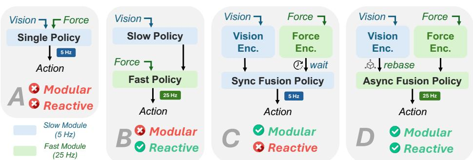  
Figure 1: Overview of Multimodal Fusion Policy Paradigms. (A) Directly merging multimodal inputs into a single policy makes the policy neither modular nor reactive. (B) Slow-fast policy improves reactiveness by allowing a fast branch to output actions at a higher frequency, but the policy remains non-modular. (C) Synchronous fusion policy introduces modular modality-specific encoders, but all branches must wait for the slowest modality before fusion, making the overall policy non-reactive. (D) Our asynchronous fusion policy decouples modality-specific inference and composes their outputs with latency-aware guidance, preserving both modularity and high-frequency reactivity.

Abstract: Diffusion policies have shown strong potential for robotic imitation learning, and recent extensions incorporate additional modalities to improve manipulation performance. However, these modalities often differ not only in information content but also in sensing rates and inference latencies. Existing multimodal diffusion policies typically rely on synchronous fusion or manually designed multi-frequency architectures, which either slow down high-frequency feedback or limit extensibility to new modality combinations. We propose LAG-Fusion, a latency-aware guidance fusion framework for asynchronous multimodal diffusion policy composition. LAG-Fusion allows modality-specific policies to operate at their native inference rates and contribute denoising guidance whenever available. To make asynchronous composition consistent, we derive a referenceframe rebasing rule for diffusion variables under relative action representations, enabling delayed guidance to be aligned before fusion. We instantiate LAG-Fusion in contact-rich manipulation by composing a low-frequency vision policy with a high-frequency force policy. Experiments under heterogeneous modality latencies show that LAG-Fusion improves policy responsiveness and task performance over synchronous fusion and specially designed force-aware baselines.

Keywords: Multimodal Policy Composition, Contact-Rich Manipulation

## 1 Introduction

Diffusion policies [1, 2] have emerged as a powerful paradigm for robotic imitation learning, generating expressive action trajectories via iterative denoising [3, 4]. Recent studies [5, 6, 7, 8] extend diffusion policies with additional sensory and task modalities, such as point clouds, language instructions, force or tactile signals, and audio signals, to support more robust manipulation across diverse settings.

However, multimodal robot policies must handle not only heterogeneous information content, but also heterogeneous temporal characteristics. Different modalities become available at different rates and with different latencies: force and audio signals can be lightweight and high-frequency, while visual observations often require heavier perception or encoding pipelines. Existing multimodal diffusion policies are not designed to preserve this temporal heterogeneity. Joint multimodal fusion [9, 10] typically requires temporally aligned observations and feeds all modalities into a unified policy network, making the control loop dependent on the latency of the full multimodal inference pipeline. As a result, high-frequency lightweight signals such as force and tactile feedback cannot be exploited at their native update rates for reactive control. Dual-system or multi-frequency designs [5, 11] partially mitigate this issue, but often rely on manually designed architectures or inference schedules that are difficult to adapt to existing policies and new modality combinations.

The above limitations suggest that multimodal diffusion policies should decouple modality-specific inference from the final action generation process. Rather than feeding all sensory streams into a single policy network, each modality should be able to produce guidance at its own pace, while the action generator composes the available guidance signals. Fortunately, diffusion composition [12, 13, 14] provides a natural interface for this decoupling, as denoising predictions can be interpreted as guidance terms that shape the sampling trajectory. However, existing composition schemes [15, 16, 10, 17] typically assume a same-model, same-frequency setting, where all guidance terms are produced synchronously within a shared denoising process. This assumption is poorly matched to multimodal robotic control, where modality-conditioned predictors may have different sensing rates, preprocessing costs, and inference latencies.

To address this gap, we propose LAG-Fusion (Latency-Aware Guidance Fusion), a general framework for asynchronous multimodal diffusion policy composition. LAG-Fusion allows modalityspecific policies to operate at their native inference rates and contribute denoising guidance whenever available. To make asynchronous composition consistent, delayed guidance is aligned through reference-frame rebasing before being fused with latency-aware weights during sampling. This enables multi-rate diffusion policy composition without requiring synchronized inputs or manually designed frequency schedules. Experiments under heterogeneous modality latencies show that LAG-Fusion improves policy responsiveness and task performance over synchronous policy composition methods and force-aware baselines with specialized designs.

## 2 Related Works

## 2.1 Policy Composition in Robotics

Policy composition has been widely explored as a way to combine multiple generative models, constraints, or guidance signals at inference time. Related ideas have appeared in visual generation [14, 18, 13, 19, 20], language modeling [21, 22, 23, 24], and planning [25, 26, 27], where different semantic or structural conditions are composed to guide generation. In robotics, recent works extend this idea to policy learning. PoCo [15] composes diffusion policies trained from heterogeneous robot datasets, while General Policy Composition [16] combines diffusion- or flow-based robot policies through test-time distribution-level composition. In addition, Policy Consensus [10] employs a router network that learns consensus weights to adaptively combine contributions of different modalities.

However, existing robot policy composition methods are frequency-agnostic [16, 10, 15, 17]. They assume that all modalities are queried at the same time, in the same reference frame. This assumption simplifies composition, but it also implicitly requires all policies to operate at a shared decision frequency. As a result, the composed policy is often limited by the slowest modality or policy component. Contact-rich manipulation is a representative example where this synchronization assumption becomes problematic. Stable physical interaction always requires fast local corrections from force/torque feedback. We address this gap by introducing latency-aware guidance fusion for asynchronous policy composition. Instead of forcing all modality-specific policies to be queried at the same time and frequency, our method allows each policy to operate at its natural inference rate.

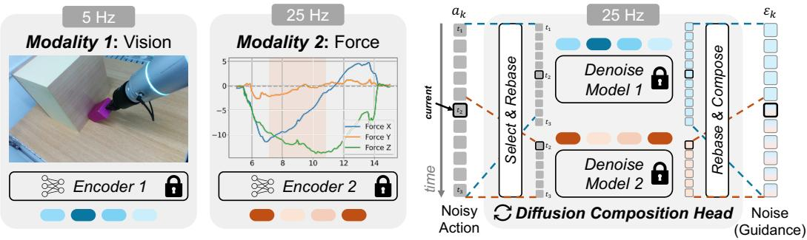  
Figure 2: Overview of the LAG-Fusion Framework. LAG-Fusion composes modality-specific diffusion policies at their native inference frequencies. (Left) A low-frequency vision policy provides long-horizon scene guidance, while a high-frequency force/torque policy provides local contact guidance. (Right) In the diffusion composition head, the overlapping noisy action segment is rebased into the current force frame for force denoising. The corresponding vision guidance is rebased to the same frame, fused with force guidance, and mapped back to update the full-horizon noise prediction.

## 2.2 Contact-Rich Manipulation

Contact-rich manipulation has traditionally been addressed by classical control methods like impedance control [28, 29], admittance control [30, 31], and hybrid force-position control [32, 33]. These methods explicitly regulate motion-force interaction and are effective for tasks such as insertion, polishing, wiping, and assembly. However, they often require task-specific modeling, contact-state estimation, and careful parameter tuning, limiting their scalability to diverse and unstructured manipulation scenarios. Recent learning-based methods instead learn contact-rich manipulation policies from multimodal demonstrations with audio [8, 34, 35, 36], force/torque signals [5, 37, 38, 9, 39, 11, 40], or tactile [41, 42, 43, 44, 10] observations. These modalities provide complementary contact information and have been shown to improve fine-grained manipulation performance.

Despite recent progress, many multimodal policies still operate at relatively low inference frequencies [9, 37, 38, 8, 10, 36], often because all modalities are fused through a single vision-centric policy. Such designs are less suitable for dynamic contact-rich tasks, where force or tactile feedback changes rapidly and should be processed at higher rates. Recent slow-fast architectures [5, 11] address this issue by introducing high-frequency contact-aware modules. Different from these systems, our framework does not require manually designing a new multimodal architecture or inference schedule from scratch. Instead, we formulate contact-rich manipulation as asynchronous diffusion policy composition: modality-specific policies can be queried at their native frequencies, and their denoising guidance is aligned only when composition is needed. This enables latency-aware multimodal control while preserving the modularity of existing pretrained policies.

## 3 Method

We propose LAG-Fusion, a general framework for asynchronous multimodal diffusion policy composition. The framework is designed for settings where modality-conditioned policies operate at different sensing and inference rates, and their denoising guidance must be composed without forcing all modalities into a single policy pipeline. In this work, we instantiate and evaluate thisframework in force-aware contact-rich manipulation, where vision provides lower-frequency global scene information and force/torque sensing provides higher-frequency contact feedback. The overview of the LAG-Fusion framework is illustrated in Fig. 2.

At inference time, LAG-Fusion composes modality-specific diffusion policies by integrating their denoising guidance during sampling. Unlike synchronous composition (§3.1), LAG-Fusion handles asynchronous queries by rebasing delayed guidance into the current action reference frame (§3.2) and fusing the aligned guidance with latency-aware weights (§3.3).

## 3.1 Preliminary: Synchronous Diffusion Policy Composition

We first review the standard setting of diffusion policy composition [16, 15]. Let $a _ { 0 } \in \mathbb { R } ^ { H \times d }$ denote a clean action trajectory over horizon H and dimension d. A diffusion policy defines a noisy action as

$$
a _ {k} = \sqrt {\bar {\alpha} _ {k}} a _ {0} + \sqrt {1 - \bar {\alpha} _ {k}} \varepsilon , \qquad \varepsilon \sim \mathcal {N} (0, I),\tag{1}
$$

where $k$ is the diffusion timestep and $\bar { \alpha } _ { k }$ is the cumulative noise schedule. Given a noisy action $a _ { k } .$ a modality-conditioned policy predicts the noise term under its own observation. For two modalities in this work, we have $\overset { \cdot } { \varepsilon } _ { k } ^ { V } = \overset { \cdot } { \pi } ^ { \setminus } \left( a _ { k } , k ; c ^ { V } \right)$ for vision and $\pmb { \varepsilon } _ { k } ^ { F } = \pmb { \pi } ^ { F } \left( { a } _ { k } , k ; { c } ^ { F } \right)$ for force, where $c ^ { V }$ and $c ^ { F }$ denote the corresponding modality conditions after observation encoding.

In the synchronous setting, both predictions are evaluated at the same physical time and in the same action reference frame. Therefore, they can be directly composed as

$$
\boldsymbol {\varepsilon} _ {k} = \frac {w ^ {V}}{w ^ {V} + w ^ {F}} \boldsymbol {\varepsilon} _ {k} ^ {V} + \frac {w ^ {F}}{w ^ {V} + w ^ {F}} \boldsymbol {\varepsilon} _ {k} ^ {F},\tag{2}
$$

where $w ^ { V } , w ^ { F } \ge 0$ are the composition weights for each modality. The composed noise prediction is then used in a standard DDIM [4] update $a _ { k - 1 } = { \mathrm { D D I M S t e p } } \left( a _ { k } , \varepsilon _ { k } , k \right)$ . This synchronous composition serves as the basis for our asynchronous extension.

## 3.2 Reference-Frame Rebase for Diffusion Variables

In asynchronous composition, all modality guidance must be expressed in a common action reference frame. We use relative action chunks [45, 1, 46, 47], where each action is defined with respect to the robot state at the policy query time. This representation is important for local feedback policies, since force-conditioned actions should describe corrections relative to the current contact state rather than absolute target poses [11]. However, relative actions are tied to their starting state: the same relative action can lead to different physical motions when applied from different robot poses. Therefore, when a low-frequency policy is queried at time $t _ { 1 }$ and reused at a later time $t _ { 2 } .$ , its predicted diffusion variables are still expressed in the action frame at $t _ { 1 }$ . Directly fusing them with guidance produced at $t _ { 2 }$ would mix predictions from different reference frames. We address this by rebasing delayed diffusion variables into the current action frame before fusion, making clean actions, noisy samples, and predicted noises comparable across asynchronous diffusion policies.

Let $T _ { 1 }$ and $T _ { 2 }$ denote the robot poses at $t _ { 1 }$ and $t _ { 2 } .$ , respectively. Then, the transformation from the old action frame at $t _ { 1 }$ to the current action frame at $t _ { 2 }$ is $T _ { 2  1 } = T _ { 2 } ^ { - 1 } T _ { 1 }$ . Let $T _ { 2  1 } = ( R _ { 2  1 } , p _ { 2  1 } )$ , where $R _ { 2  1 }$ denotes the rotation matrix and $p _ { 2  1 }$ is the translational offset.

Action Representation and Transformation. Since composition is performed in the noise space, the rebase operation must be compatible with clean actions, noisy samples, and predicted noises. We thus need an action representation whose frame transformation has an orthogonal linear part and a separate affine offset. The linear part can be applied to noises without changing their Gaussian covariance, while the offset must be handled separately for clean actions and noisy samples.

We first consider the rotation component. Let the rotation component of a relative action with respect to frame $T _ { 1 }$ be $R = [ r _ { 1 } , r _ { 2 } , r _ { 3 } ] \in S O ( 3 )$ , where $r _ { i } \in \mathbb { R } ^ { 3 }$ is the i-th column. Under the transformation $T _ { 2  1 }$ , the same relative rotation is expressed in frame $T _ { 2 }$ as $R ^ { \prime } { = } R _ { 2  1 } R _ { ☉ }$ , so we have $r _ { i } ^ { \prime } { = } R _ { 2  1 } r _ { i }$ . This column-wise transformation motivates the column-based 6D representation [48], $R _ { 6 \mathrm { d } } = [ r _ { 1 } ^ { \top } , r _ { 2 } ^ { \top } ] ^ { \top }$ whose rebase is linear: $R _ { 6 \mathrm { d } } ^ { \prime } = \mathrm { b l o c k d i a g } ( R _ { 2  1 } , R _ { 2  1 } ) \cdot R _ { 6 \mathrm { d } }$ . Other action dimensions can also be handled in the same representation space. For the relative translation $x \in \mathbb { R } ^ { 3 }$ , the clean-action rebase is affine: $x ^ { \prime } = R _ { 2  1 } x + p _ { 2  1 }$ . The gripper command $g \in \mathbb R$ is frame-invariant, so $g ^ { \prime } = g$ . Thus, each action step is represented as $a = [ x ^ { \top } , R _ { 6 \mathrm { d } } ^ { \top } , g ] ^ { \top } \in \mathbb { R } ^ { 1 0 }$ , and the full action-space transformation is

$$
a ^ {\prime} = A _ {2 \leftarrow 1} a + b _ {2 \leftarrow 1},\tag{3}
$$

where

$$
\left\{ \begin{array}{l} A _ {2 \leftarrow 1} = \text { blockdiag } \left(R _ {2 \leftarrow 1}, R _ {2 \leftarrow 1}, R _ {2 \leftarrow 1}, 1\right) \in \mathbb {R} ^ {1 0 \times 1 0}, \\ b _ {2 \leftarrow 1} = \left[ p _ {2 \leftarrow 1}, \mathbf {0} _ {3} ^ {\top}, \mathbf {0} _ {3} ^ {\top}, 0 \right] ^ {\top} \in \mathbb {R} ^ {1 0}. \end{array} \right.\tag{4}
$$

Since $R _ { 2  1 } \in S O ( 3 )$ , the linear part $A _ { 2  1 }$ is orthogonal. Next, we show that this affine rebase leads to different rules for different diffusion variables: clean actions use the full affine transform, noisy samples include a scaled offset, and noises are transformed only by the orthogonal linear part $A _ { 2  1 }$

Diffusion Variables Transformation. We now derive how the affine rebase applies to different diffusion variables. For the clean actions, they naturally follow the full affine transform in Eq. (4). Given a noisy sample $a _ { k }$ and a predicted noise $\varepsilon _ { k }$ in frame $T _ { 1 }$ , the clean action estimate is

$$
\hat {a} _ {0} = \frac {1}{\sqrt {\bar {\alpha} _ {k}}} a _ {k} - \frac {\sqrt {1 - \bar {\alpha} _ {k}}}{\sqrt {\bar {\alpha} _ {k}}} \varepsilon_ {k}.\tag{5}
$$

Applying the clean action rebase in Eq. (4) gives

$$
\hat {a} _ {0} ^ {\prime} = A _ {2 \leftarrow 1} \hat {a} _ {0} + b _ {2 \leftarrow 1} = \frac {1}{\sqrt {\bar {\alpha} _ {k}}} \left(A _ {2 \leftarrow 1} a _ {k} + \sqrt {\bar {\alpha} _ {k}} b _ {2 \leftarrow 1}\right) - \frac {\sqrt {1 - \bar {\alpha} _ {k}}}{\sqrt {\bar {\alpha} _ {k}}} A _ {2 \leftarrow 1} \varepsilon_ {k}.\tag{6}
$$

Comparing Eq. (6) with the standard estimator in frame $T _ { 2 } ,$ which has the same form as Eq. (5), we can obtain the rebase rules:

$$
\left\{ \begin{array}{l} a _ {k} ^ {\prime} = A _ {2 \leftarrow 1} a _ {k} + \sqrt {\bar {\alpha} _ {k}} b _ {2 \leftarrow 1}, \\ \varepsilon_ {k} ^ {\prime} = A _ {2 \leftarrow 1} \varepsilon_ {k}. \end{array} \right.\tag{7}
$$

Thus, the affine offset appears in the noisy sample with a factor $\sqrt { \bar { \alpha } _ { k } }$ , but it is not added to the diffusion noise. The noise is transformed only by the orthogonal linear part $A _ { 2  1 }$ , preserving the standard Gaussian diffusion distribution.

## 3.3 Asynchronous Policy Composition via Latency-Aware Guidance Fusion

We now apply the rebase rule to asynchronous policy composition, as illustrated in Figure 3. In our instantiation, the vision policy is queried at a lower frequency and provides full-horizon guidance, while the force policy is queried at a higher frequency and provides local contact aware guidance. Suppose the vision policy is queried at time $t _ { 1 } .$ , and the force policy is queried later at time $t _ { 2 } > t _ { 1 }$ . We maintain the full-horizon noisy action $a _ { k } \in \mathbb { R } ^ { H \times d }$ in the vision action frame $T _ { 1 } .$ , and assume that the force horizon is contained within the vision horizon.

Let $S ( \cdot )$ denote the temporal selection operator that extracts the segment of the vision horizon corresponding to the force horizon. Before querying the force policy, we rebase this

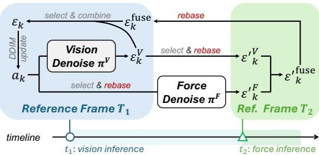  
Figure 3: Latency-Aware Guidance Fusion. A lowfrequency vision policy provides full-horizon guidance in frame $T _ { 1 }$ , while a high-frequency force policy is queried later in frame $T _ { 2 }$ . LAG-Fusion selects the overlapping action segment, rebases it to $T _ { 2 }$ for force denoising, fuses the aligned vision and force guidance in $T _ { 2 } ,$ , and maps the fused guidance back to $T _ { 1 }$ to update the full diffusion trajectory.

selected noisy segment into the force action frame $T _ { 2 }$ using Eq. (7). The force policy then predicts

$$
\varepsilon_ {k} ^ {\prime F} = \pi^ {F} \left(A _ {2 \leftarrow 1} S (a _ {k}) + \sqrt {\bar {\alpha} _ {k}} b _ {2 \leftarrow 1}, k; c ^ {F}\right),\tag{8}
$$

where $c ^ { F }$ is the force condition at time $t _ { 2 }$ . The rebase parameters are applied to every action step.

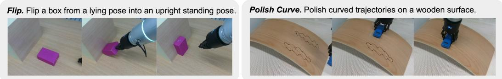  
Figure 4: Contact-Rich Manipulation Tasks. We evaluate LAG-Fusion on two contact-rich tasks that require both visual perception and fine-grained force/torque feedback. Both tasks require effective coordination and adaptation across visual and force/torque modalities.

The vision policy predicts full-horizon guidance $\pmb { \varepsilon } _ { k } ^ { V } = \pi ^ { V } ( a _ { k } , k ; c ^ { V } )$ in frame $T _ { 1 }$ , where $c ^ { V }$ is the vision condition at time $t _ { 1 }$ . To fuse it with the force guidance, we select the same temporal segment and rebase the vision guidance into frame $T _ { 2 } { \mathrm { i } }$

$$
\boldsymbol {\varepsilon} _ {k} ^ {\prime V} = A _ {2 \leftarrow 1} S (\boldsymbol {\varepsilon} _ {k} ^ {V}).\tag{9}
$$

Now $\varepsilon _ { k } ^ { \prime V }$ and $\varepsilon _ { k } ^ { \prime F }$ are defined over the same horizon segment and in the same action frame. We fuse them with latency-aware weights and map the result back to frame $T _ { 1 }$ :

$$
\boldsymbol {\varepsilon} _ {k} ^ {\text { fuse }} = A _ {1 \leftarrow 2} \boldsymbol {\varepsilon} _ {k} ^ {\prime \text { fuse }} = A _ {1 \leftarrow 2} \left(\frac {w ^ {V}}{w ^ {V} + w ^ {F}} \boldsymbol {\varepsilon} _ {k} ^ {\prime V} + \frac {w ^ {F}}{w ^ {V} + w ^ {F}} \boldsymbol {\varepsilon} _ {k} ^ {\prime F}\right),\tag{10}
$$

where $w ^ { V } , w ^ { F } \geq 0$ encode the freshness or reliability of each modality, and $A _ { 1  2 } = A _ { 2  1 } ^ { \top }$ . For latency-aware fusion, the weights are designed to reflect the temporal freshness of each modality. The vision policy provides long-horizon guidance from the last visual observation at t1, which is reliable near the beginning of the selected segment but becomes less certain for later steps as the robot state evolves without updated visual inference. In contrast, the force policy is queried at the current time $t _ { 2 }$ and provides more up-to-date local contact feedback, making it more reliable for reactive corrections within the selected segment. Therefore, we assign a larger vision weight at the beginning of the segment and gradually decrease it along the horizon, while increasing the force weight accordingly. This schedule treats latency as a proxy for confidence: older or farther-ahead guidance is down-weighted, whereas fresher high-frequency feedback is given stronger influence.

Finally, we replace the selected segment of $\varepsilon _ { k } ^ { V }$ with the fused noise $\varepsilon _ { k } ^ { \mathrm { f u s e } }$ , leaving the rest unchanged, and use the updated full-horizon noise for the DDIM update.

## 4 Experiments

We answer the following research questions through experiments: (Q1) Do asynchronous policy composition and latency-aware guidance fusion improve over synchronous or naive multimodal composition baselines? (Q2) How does LAG-Fusion compare with vision-only and existing multimodal policies? (Q3) How does inference frequency affect LAG-Fusion performance?

Experimental Setup We evaluate our method on two contact-rich manipulation tasks shown in Fig. 4, Flip and Polish Curve, where successful execution requires both visual perception and finegrained force feedback. We collect 50 demonstrations for each tasks using arm-to-arm teleoperation with accurate force feedback [49]. We instantiate LAG-Fusion by composing a RISE [50] vision policy with a lightweight force/torque policy using our asynchronous composition framework.

Baselines and Metrics To isolate the contribution of composition design, we include three critical controls: Training-Time Noise Fusion, Synchronous Composition, and Policy Consensus [10]. Training-Time Noise Fusion fuses diffusion noises during training, while Synchronous Composition combines modality branches at synchronize inference steps. Based on Synchronous Composition, Policy Consensus [10] uses a learned router for modality combination. We further compare with representative multimodal policies, RDP [5] and TAVLA [38]. For Flip, “Push” measures whether the box reaches the target, and “Flip” measures successful flipping, with partial flips counted as half successes. For Polish Curve, “Contact” measures surface contact, and “Score” is 1.0/0.75/0.25/0 for complete erasure, over-50% erasure, partial erasure below 50%, and failure, respectively.

<table><tr><td rowspan="2">Policy</td><td rowspan="2">Modular</td><td rowspan="2">Inference Freq.</td><td colspan="2">Flip</td><td colspan="2">Polish Curve</td></tr><tr><td>Push</td><td>Flip</td><td>Contact</td><td>Score</td></tr><tr><td>RISE [50] (vision policy)</td><td>-</td><td>2 Hz</td><td>95.0%</td><td>20.0%</td><td>90.0%</td><td>30.0%</td></tr><tr><td>Training Noise Fusion</td><td> $\times$ </td><td>5 Hz</td><td>30.0%</td><td>17.5%</td><td>70.0%</td><td>20.0%</td></tr><tr><td>Synchronous Composition</td><td>√</td><td>5 Hz</td><td>100.0%</td><td>25.0%</td><td>100.0%</td><td>25.0%</td></tr><tr><td>Policy Consensus [10]</td><td> $\checkmark^†$ </td><td>5 Hz</td><td>95.0%</td><td>40.0%</td><td>100.0%</td><td>42.5%</td></tr><tr><td>TA-VLA [38]</td><td> $\times$ </td><td>1 Hz</td><td>80.0%</td><td>27.5%</td><td>100.0%</td><td>42.5%</td></tr><tr><td>RDP [5]</td><td> $\times$ </td><td>24 Hz</td><td>100.0%</td><td>35.0%</td><td>100.0%</td><td>45.0%</td></tr><tr><td>LAG-Fusion (ours)</td><td>√</td><td>25 Hz</td><td>95.0%</td><td>60.0%</td><td>100.0%</td><td>55.0%</td></tr></table>

Table 1: Evaluation Results. LAG-Fusion achieves the best performance, indicating that asynchronous policy composition and latency-aware guidance fusion are effective in contact-rich manipulation. Cells highlighted in gray indicate high-frequency inference. The † denotes that Policy Consensus [10] is not fully modular since it requires training an extra router and fine-tuning the remaining modules.

## 4.1 LAG-Fusion Evaluation

Asynchronous latency-aware guidance fusion improves multimodal composition performance (Q1). Table 1 shows that LAG-Fusion consistently outperforms other fusion methods. For trainingtime noise fusion, high-frequency force inputs are forced into temporal alignment with slower vision observations, limiting their capability. Compared with synchronous composition, this gap suggests that bottlenecking all modalities at slow inference frequency limits the utilization of modalityspecific capabilities, especially for lightweight, high-frequency modalities such as force feedback. Policy Consensus further adds a router on top of synchronous composition, but still underperforms LAG-Fusion. We found that the learned router weights may overfit to one dominant modality during training, leading to imbalanced modality usage. Instead, LAG-Fusion asynchronously composes modality-specific policies at inference time, allowing each modality branch to operate at its native frequency rather than being bottlenecked by the slowest modality.

LAG-Fusion achieves stronger overall performance than existing vision-only and multimodal baselines (Q2). The vision-only RISE backbone lacks contact-aware feedback and struggles during contact-sensitive stages. RDP adopts a specially designed jointly trained multimodal architecture, but does not explicitly align and compose modality-specific guidance at inference time. TA-VLA is limited by its low inference speed, which restricts reactive correction using force feedback. By contrast, LAG-Fusion combines long-horizon visual guidance with high-frequency force feedback, enabling more responsive contact adaptation and stronger overall task performance.

## 4.2 Effect of Policy Inference Frequency

Standalone force policies benefit from native high-frequency inference (Q3). We first isolate the low-dimensional force policy to examine whether force/torque feedback should be treated as a highfrequency control signal. For this standalone frequency study, we train separate force policies with different inputfrequency configurations and evaluate each policy under multiple inference fre-

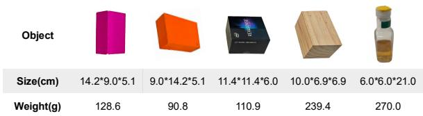  
Figure 5: Evaluation Objects for the Low-dimensional Force Policy on Flip. The policy is tested on five objects with varying sizes and weights. Only the first purple box is seen during training, while the other four objects are unseen.

quencies. As shown in Fig. 5, evaluation is conducted on 5 objects with diverse sizes and weights, including the training object and 4 unseen objects. For each setting, we perform 10 trials per object, resulting in a total of 50 trials. Fig. 6(a) shows that the force policy consistently achieves higher success rates when executed at higher inference frequencies. This suggests that force feedback is highly time-sensitive: its benefit depends on whether the policy can react promptly to contact changes. In other words, lightweight high-frequency modalities can fully express their control capability only when executed near their native frequency. This motivates asynchronous composition: instead of bottlenecking high-frequency branches by the slowest modality, LAG-Fusion allows the force policy to run at its native inference rate.

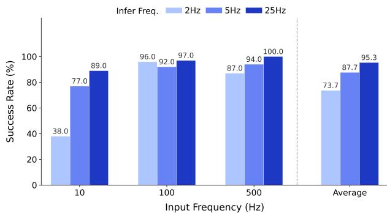  
(a) Standalone force policy on Flip.

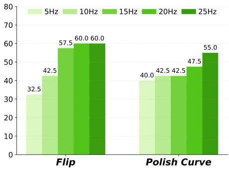  
(b) LAG-Fusion composition.  
Figure 6: Effect of Inference Frequency. (a) On Flip, the standalone low-dimensional force policy performs better when it is allowed to infer at higher frequencies, showing that the lightweight high-frequency modality benefits from its native high-frequency execution. (b) In the full LAG-Fusion framework, preserving highfrequency inference also improves composed policy performance on both tasks.

For LAG-Fusion, preserving high-frequency inference improves composed policy performance (Q3). Fig. 6 shows that the same frequency-dependent trend appears in the full composition framework. As the high-frequency branch is allowed to run at higher inference rates, LAG-Fusion achieves higher success rates on both tasks. This indicates that the benefit of high-frequency control is not limited to the standalone setting; it remains effective when integrated with a slower policy, as long as the composition mechanism does not force it to operate at the slow policy’s lower rate.

Together, these results support the core motivation of asynchronous policy composition. The standalone experiment shows that lowering the inference frequency of a lightweight high-frequency policy can hurt its performance. The LAG-Fusion experiment further shows that preserving this high-rate inference improves the final multimodal policy. Therefore, LAG-Fusion avoids synchronizing all modalities to the slowest policy and instead allows each modality, especially lightweight high-frequency modalities, to operate its native frequency while fusing their guidance.

## 5 Conclusion

We presented LAG-Fusion, a latency-aware guidance fusion framework for asynchronous multimodal diffusion policy composition. Unlike synchronized composition methods that require all modalities to be evaluated together, LAG-Fusion allows modality-specific policies to operate at their native inference rates and contribute denoising guidance whenever available. To make asynchronous composition consistent, we derived a reference-frame rebasing rule for diffusion variables under relative action representations, enabling delayed guidance to be aligned before fusion. We instantiated LAG-Fusion in contact-rich manipulation by composing a low-frequency vision policy with a high-frequency force policy. Experiments on two contact-rich tasks show that LAG-Fusion improves the performance over synchronized fusion and slow-fast baselines. Our frequency analysis further confirms that preserving native inference rates benefits both standalone and composed policies. Overall, LAG-Fusion provides a modular and practical interface for exploiting heterogeneous sensory modalities in diffusion-policy-based robot control.

Limitations and Future Work. Although LAG-Fusion improves over existing baselines, there is still room to further enhance task success and control stability. A promising direction is to incorporate control priors, such as hybrid force-position control [51, 11], into the learned policies, which may provide more stable contact regulation during asynchronous composition. Second, our current framework is developed for diffusion-based policies, and extending it to flow matching [52, 53] or other generative action modeling frameworks remains future work. Finally, our experiments focus on parallel-gripper manipulation. Future work could apply LAG-Fusion to dexterous hands, where richer contact dynamics, higher-dimensional actions, and high-frequency reactive control may further highlight the benefits of asynchronous multimodal policy composition.

## References

[1] C. Chi, S. Feng, Y. Du, Z. Xu, E. Cousineau, B. Burchfiel, and S. Song. Diffusion policy: Visuomotor policy learning via action diffusion. In Robotics: Science and Systems, 2023.

[2] M. Janner, Y. Du, J. Tenenbaum, and S. Levine. Planning with diffusion for flexible behavior synthesis. In International Conference on Machine Learning, pages 9902–9915. PMLR, 2022.

[3] J. Ho, A. Jain, and P. Abbeel. Denoising diffusion probabilistic models. Advances in Neural Information Processing Systems, 33:6840–6851, 2020.

[4] J. Song, C. Meng, and S. Ermon. Denoising diffusion implicit models. In The International Conference on Learning Representations, 2021.

[5] H. Xue, J. Ren, W. Chen, G. Zhang, Y. Fang, G. Gu, H. Xu, and C. Lu. Reactive diffusion policy: Slow-fast visual-tactile policy learning for contact-rich manipulation. In Robotics: Science and Systems, 2025.

[6] H. Ha, P. Florence, and S. Song. Scaling up and distilling down: Language-guided robot skill acquisition. In Conference on Robot Learning, pages 3766–3777. PMLR, 2023.

[7] Y. Ze, G. Zhang, K. Zhang, C. Hu, M. Wang, and H. Xu. 3d diffusion policy: Generalizable visuomotor policy learning via simple 3d representations. Proceedings of Robotics: Science and Systems (RSS), 2024.

[8] Z. Liu, C. Chi, E. Cousineau, N. Kuppuswamy, B. Burchfiel, and S. Song. Maniwav: Learning robot manipulation from in-the-wild audio-visual data. In Conference on Robot Learning, 2024.

[9] Z. He, H. Fang, J. Chen, H.-S. Fang, and C. Lu. Foar: Force-aware reactive policy for contactrich robotic manipulation. IEEE Robotics and Automation Letters, 2025.

[10] H. Chen, J. Xu, H. Chen, K. Hong, B. Huang, C. Liu, J. Mao, Y. Li, Y. Du, and K. Driggs-Campbell. Multi-modal manipulation via multi-modal policy consensus. In 2026 IEEE International Conference on Robotics and Automation (ICRA), 2026. to appear, arXiv:2509.23468.

[11] H. Fang, S. Tang, M. Mei, H. Qin, Z. He, J. Chen, Y. Feng, C. Wang, W. Liu, Z. He, C. Lu, and S. Wang. Force policy: Learning hybrid force-position control policy under interaction frame for contact-rich manipulation. arXiv preprint arXiv:2602.22088, 2026.

[12] Y. Du, C. Durkan, R. Strudel, J. B. Tenenbaum, S. Dieleman, R. Fergus, J. Sohl-Dickstein, A. Doucet, and W. S. Grathwohl. Reduce, reuse, recycle: Compositional generation with energy-based diffusion models and mcmc. In International conference on machine learning, pages 8489–8510. PMLR, 2023.

[13] Y. Du, S. Li, and I. Mordatch. Compositional visual generation and inference with energy based models. In Advances in Neural Information Processing Systems, 2020.

[14] N. Liu, S. Li, Y. Du, A. Torralba, and J. B. Tenenbaum. Compositional visual generation with composable diffusion models. In Computer Vision - ECCV 2022 - 17th European Conference, Tel Aviv, Israel, October 23-27, 2022, Proceedings, Part XVII, Lecture Notes in Computer Science, pages 423–439, 2022.

[15] L. Wang, J. Zhao, Y. Du, E. H. Adelson, and R. Tedrake. Policy composition from and for heterogeneous robot learning. In Robotics: Science and Systems, 2024.

[16] J. Cao, Y. Huang, H. Guo, R. Zhang, M. Nan, W. Mai, J. Wang, H. Cheng, J. Sun, G. Han, W. Zhao, Q. Zhang, Y. Guo, Q. Zheng, C. Song, X. Li, P. Luo, and A. F. Luo. Compose your policies! improving diffusion-based or flow-based robot policies via test-time distribution-level composition. In International Conference on Learning Representations, 2026.

[17] C. Liu, H. Chen, S. H. Høeg, S. Yao, Y. Li, K. Hauser, and Y. Du. Flexible multitask learning with factorized diffusion policy. IEEE Robotics and Automation Letters, 11(4):4697–4704, 2026.

[18] D. Geng, I. Park, and A. Owens. Visual anagrams: Generating multi-view optical illusions with diffusion models. In Conference on Computer Vision and Pattern Recognition (CVPR), 2024.

[19] D. Geng, I. Park, and A. Owens. Factorized diffusion: Perceptual illusions by noise decomposition. In European Conference on Computer Vision (ECCV), 2024.

[20] Z. Chen, D. Geng, and A. Owens. Images that sound: Composing images and sounds on a single canvas. Neural Information Processing Systems (NeurIPS), 2024.

[21] A. Liu, M. Sap, X. Lu, S. Swayamdipta, C. Bhagavatula, N. A. Smith, and Y. Choi. Dexperts: Decoding-time controlled text generation with experts and anti-experts. In Annual Meeting of the Associationfor Computational Linguistics, 2021.

[22] K. Yang and D. Klein. Fudge: Controlled text generation with future discriminators. In Conference of the North American Chapter of the Association for Computational Linguistics, 2021.

[23] B. Krause, A. D. Gotmare, B. McCann, N. S. Keskar, S. Joty, R. Socher, and N. F. Rajani. Gedi: Generative discriminator guided sequence generation. In Findings ofthe Associationfor Computational Linguistics: EMNLP, 2021.

[24] X. Lu, P. West, R. Zellers, R. Le Bras, C. Bhagavatula, and Y. Choi. Neurologic decoding: (un)supervised neural text generation with predicate logic constraints. In Conference of the North American Chapter ofthe Associationfor Computational Linguistics, 2021.

[25] U. A. Mishra, S. Xue, Y. Chen, and D. Xu. Generative skill chaining: Long-horizon skill planning with diffusion models. In Conference on Robot Learning, 2023.

[26] U. A. Mishra, D. He, Y. Chen, and D. Xu. Compositional diffusion with guided search for long-horizon planning. In International Conference on Learning Representations, 2026.

[27] Y. Du, M. Yang, P. Florence, F. Xia, A. Wahid, B. Ichter, P. Sermanet, T. Yu, P. Abbeel, J. B. Tenenbaum, C. Lynch, and J. Tompson. Energy-based models are zero-shot planners for compositional scene rearrangement. In Robotics: Science and Systems, 2023.

[28] N. Hogan. Impedance control: An approach to manipulation. Journal of Dynamic Systems, Measurement, and Control, 107:1–24, 1985.

[29] J. Buchli, F. Stulp, E. Theodorou, and S. Schaal. Learning variable impedance control. International Journal of Robotics Research, 30(7):820–833, 2011.

[30] H. Seraji. Adaptive admittance control: An approach to explicit force control in compliant motion. In IEEE International Conference on Robotics and Automation, pages 2705–2712. IEEE, 1994.

[31] K. Kronander and A. Billard. Stability considerations for variable impedance control. IEEE Transactions on Robotics, 32(5):1298–1305, 2016.

[32] M. H. Raibert and J. J. Craig. Hybrid position/force control of manipulators. Journal of dynamic systems, measurement, and control, 103(2):126–133, 1981.

[33] O. Khatib. A unified approach for motion and force control of robot manipulators: The operational space formulation. IEEE Journal on Robotics and Automation, 3(1):43–53, 2003.

[34] H. Li, Y. Zhang, J. Zhu, S. Wang, M. A. Lee, H. Xu, E. H. Adelson, L. Fei-Fei, R. Gao, and J. Wu. See, hear, and feel: Smart sensory fusion for robotic manipulation. In Conference on Robot Learning, pages 1368–1378, 2022.

[35] J. Mejia, V. Dean, T. Hellebrekers, and A. Gupta. Hearing touch: Audio-visual pretraining for contact-rich manipulation. arXiv preprint arXiv:2405.08576, 2024.

[36] R. Feng, D. Hu, W. Ma, and X. Li. Play to the score: Stage-guided dynamic multi-sensory fusion for robotic manipulation. In Conference on Robot Learning, 2024.

[37] J. Yu, H. Liu, Q. Yu, J. Ren, C. Hao, H. Ding, G. Huang, G. Huang, Y. Song, P. Cai, et al. Forcevla: Enhancing vla models with a force-aware moe for contact-rich manipulation. In Advances in Neural Information Processing Systems, 2025.

[38] Z. Zhang, H. Xu, Z. Yang, C. Yue, Z. Lin, H.-a. Gao, Z. Wang, and H. Zhao. Elucidating the design space of torque-aware vision-language-action models. In Conference on Robot Learning, volume 305, pages 4019–4037. PMLR, 2025.

[39] Y. Hou, Z. Liu, C. Chi, E. Cousineau, N. Kuppuswamy, S. Feng, B. Burchfiel, and S. Song. Adaptive compliance policy: Learning approximate compliance for diffusion guided control. In IEEE International Conference on Robotics and Automation, pages 4829–4836, 2025.

[40] X. Xu, Y. Hou, Z. Liu, and S. Song. Compliant residual DAgger: Improving real-world contactrich manipulation with human corrections. In The Thirty-ninth Annual Conference on Neural Information Processing Systems (NeurIPS), 2025.

[41] H.-S. Fang, B. Romero, Y. Xie, A. Hu, B.-R. Huang, J. Alvarez, M. Kim, G. Margolis, K. Anbarasu, M. Tomizuka, E. Adelson, and P. Agrawal. Dexop: A device for robotic transfer of dexterous human manipulation. arXiv preprint arXiv:2509.04441, 2025.

[42] K. Yu, Y. Han, Q. Wang, V. Saxena, D. Xu, and Y. Zhao. Mimictouch: Leveraging multi-modal human tactile demonstrations for contact-rich manipulation. In Conference on Robot Learning, 2024.

[43] Z. Zhang, J. Ma, X. Yang, X. Wen, Y. Zhang, B. Li, Y. Qin, J. Liu, C. Zhao, L. Kang, et al. Touchguide: Inference-time steering of visuomotor policies via touch guidance. arXiv preprint arXiv:2601.20239, 2026.

[44] J. Yin, H. Qi, Y. Wi, S. Kundu, M. Lambeta, W. Yang, C. Wang, T. Wu, J. Malik, and T. Hellebrekers. Osmo: Open-source tactile glove for human-to-robot skill transfer. arXiv:2512.08920, 2025.

[45] S. Xia, H. Fang, H.-S. Fang, and C. Lu. Cage: Causal attention enables data-efficient generalizable robotic manipulation. In IEEE International Conference on Robotics and Automation. IEEE, 2025.

[46] C. Chi, Z. Xu, C. Pan, E. Cousineau, B. Burchfiel, S. Feng, R. Tedrake, and S. Song. Universal manipulation interface: In-the-wild robot teaching without in-the-wild robots. In Robotics: Science and Systems, 2024.

[47] T. Z. Zhao, V. Kumar, S. Levine, and C. Finn. Learning fine-grained bimanual manipulation with low-cost hardware. In Robotics: Science and Systems, 2023.

[48] Y. Zhou, C. Barnes, J. Lu, J. Yang, and H. Li. On the continuity of rotation representations in neural networks. In Proceedings of the IEEE/CVF Conference on Computer Vision and Pattern Recognition, pages 5745–5753, 2019.

[49] F. Ltd. Flexiv teleoperation development kit (tdk). Accessed January 2026.

[50] C. Wang, H. Fang, H.-S. Fang, and C. Lu. Rise: 3d perception makes real-world robot imitation simple and effective. arXiv preprint arXiv:2404.12281, 2024.

[51] W. Liu, J. Wang, Y. Wang, W. Wang, and C. Lu. Forcemimic: Force-centric imitation learning with force-motion capture system for contact-rich manipulation. In ICRA, pages 1105–1112. IEEE, 2025.

[52] K. Black, N. Brown, D. Driess, A. Esmail, M. Equi, C. Finn, N. Fusai, L. Groom, K. Hausman, B. Ichter, et al. π0: A vision-language-action flow model for general robot control. In Robotics: Science and Systems, 2025.

[53] K. Black, N. Brown, J. Darpinian, K. Dhabalia, D. Driess, A. Esmail, M. R. Equi, C. Finn, N. Fusai, M. Y. Galliker, et al. π0.5: a vision-language-action model with open-world generalization. In Conference on Robot Learning, volume 305, pages 17–40. PMLR, 2025.

# Supplementary Material

## A Method Implementation Details

## A.1 Visual Policy Details

Our visual policy follows the original RISE policy design [50]. We keep the visual input representation, network architecture, diffusion action prediction head, and training procedure unchanged. The main difference lies in the action coordinate representation. The original RISE policy represents predicted actions in the camera global coordinate frame, whereas our implementation represents actions in a relative coordinate frame with respect to the current end-effector pose.

This relative action representation is introduced to support asynchronous policy composition. Since the visual policy and the force/torque policy may produce guidance at different timestamps, their predicted action trajectories must be expressed in a form that can be transformed across reference frames. By representing visual actions relative to the current end-effector pose, we can rebase delayed visual predictions before composing them with high-frequency force/torque guidance. All other visual policy hyperparameters and implementation choices follow RISE [50].

## A.2 Force Policy Details

We train a force-conditioned diffusion policy as the low-dimensional force policy. In the main compositional policy, the force policy takes a 1s force/torque history as input, corresponding to 100 steps at 100Hz with six force/torque channels, and predicts a 1s future action chunk, corresponding to 50 action steps at 50Hz. Each action is represented in a 10D space, including 3D translation, 6D rotation, and one gripper command. Rotations are parameterized by the column-wise 6D rotation representation. The force/torque stream is expressed in the TCP frame and normalized to [−1,1] using fixed per-axis force/torque bounds. Actions are represented in a relative formulation, using the current end-effector pose as the base pose. The key hyperparameters of the force policy are summarized in Table 2.

For the standalone force policy analysis in Appendix B.2, we additionally vary the force/torque input frequency and inference frequency to study their effects on performance.

<table><tr><td>Item</td><td>Setting</td></tr><tr><td>Force input length</td><td>1s</td></tr><tr><td>Force input frequency</td><td>100Hz</td></tr><tr><td>Force input steps</td><td>100</td></tr><tr><td>Force/torque channels</td><td>6</td></tr><tr><td>Force feature dimension</td><td>16</td></tr><tr><td>Force encoder</td><td>MLP: 600 → 256 → 16</td></tr><tr><td>Action chunk length</td><td>50</td></tr><tr><td>Action chunk frequency</td><td>50Hz</td></tr><tr><td>Action representation</td><td>10D: 3D translation, 6D rotation, gripper</td></tr><tr><td>U-Net channels</td><td>[32, 64]</td></tr><tr><td>DDPM training steps</td><td>100</td></tr><tr><td>DDIM inference steps</td><td>10</td></tr><tr><td>Optimizer</td><td>AdamW</td></tr><tr><td>Learning rate</td><td> $3 \times 10^{-4}$ </td></tr><tr><td>Batch size</td><td>256</td></tr><tr><td>Epochs</td><td>100</td></tr></table>

Table 2: Key Hyperparameters of the Force Policy. The standalone force/torque frequency study additionally varies the input and inference frequencies while keeping the remaining architecture and training settings consistent unless otherwise specified.

## A.3 Inference and Asynchronous Composition Details

Latency-Aware Weights. During asynchronous composition, the vision and force/torque policies provide guidance at different update rates. The vision policy is queried less frequently and provides global, long-horizon guidance, while the force/torque policy is queried more frequently and provides fresher local guidance for contact-sensitive correction. Therefore, when fusing the two guidance signals, we use a latency-aware weighting schedule that changes along the selected action horizon.

Specifically, for each action index within the force policy horizon, we compute the vision weight by linearly decreasing it from a high value to a low value. Let i denote the action index and $I _ { \mathrm { m a x } }$ denote the maximum index of the selected horizon. We first compute a normalized horizon ratio $r _ { i } = i / I _ { \operatorname* { m a x } } .$ The vision weight is then computed by linear interpolation:

$$
w _ {i} ^ {V} = w _ {\mathrm{start}} ^ {V} + r _ {i} \left(w _ {\mathrm{end}} ^ {V} - w _ {\mathrm{start}} ^ {V}\right).\tag{11}
$$

In our implementation, $w _ { \mathrm { s t a r t } } ^ { V } = 0 . 8 , w _ { \mathrm { e n d } } ^ { V } = 0 . 2$ , and $I _ { \mathrm { m a x } } = 5 0$ . Therefore, the vision weight starts from 0.8 at the beginning of the selected horizon and gradually decreases to 0.2 by the end of the horizon. The force weight is defined as the complementary value $w _ { i } ^ { F } = 1 - w _ { i } ^ { V }$ . This creates an index-dependent weighting schedule: early actions rely more on vision guidance, while later actions rely more on force/torque guidance.

Runtime Analysis. We report the runtime of the proposed asynchronous composition during evaluation. With our implementation, the mean policy inference time after composition is approximately 40ms, which enables 25Hz policy inference. In contrast to synchronous composition, where all modalities are typically constrained by the slowest policy, our asynchronous formulation allows the low-dimensional force branch to be updated at a higher frequency while still incorporating visual guidance when available.

## B Experiment Details

## B.1 Setup

Data Collection. We perform real-world experiments on a Flexiv Rizon4 robot equipped with an FT03S six-axis force/torque sensor. For each task, we collect 50 demonstrations using an armto-arm teleoperation system with accurate force feedback [49]. This setup allows the operator to provide contact-rich manipulation trajectories while preserving fine-grained interaction information between the robot and the environment.

During data collection, we record synchronized multimodal observations, including color images, depth images, robot proprioceptive states, and force/torque measurements. The color and depth streams are recorded at 20 Hz, while the low-dimensional data is recorded at 1000 Hz.

We also visualize the initial configurations of all 50 demonstrations for each task in Fig. 7. The objects are randomly placed within the workspace during demonstration collection.

Baseline. We compare our method with two representative multimodal policy baselines, RDP [5] and TA-VLA [38]. RDP [5] is a slow-fast policy that combines a low-frequency visual policy with a faster low-dimensional policy for reactive control based on Diffusion Policy [1]. TA-VLA [38] is a vision-language-action policy that incorporates tactile feedback to improve contact-rich manipulation based on π [52].

Evaluation Protocols. All policies are deployed for inference on a local workstation equipped with a NVIDIA RTX 5090 GPU, with the sole exception of TA-VLA [38], whose memory footprint exceeds the workstation’s GPU capacity. TA-VLA [38] is therefore served on a remote node with 4 NVIDIA A100 GPUs, connected to the workstation through a dedicated high-bandwidth link so that the communication overhead is negligible; all actions are still executed on the same workstation. We emphasize that the 1 Hz decision rate reported for TA-VLA [38] in Table 1 stems from its native action-chunking scheme-predicting and then executing a one-second action chunk per query-rather than from a limitation of its inference speed, which is in fact substantially faster.

Flip  
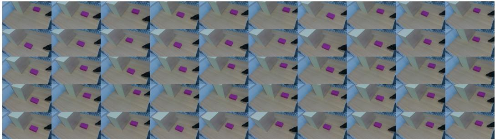

Polish Curve  
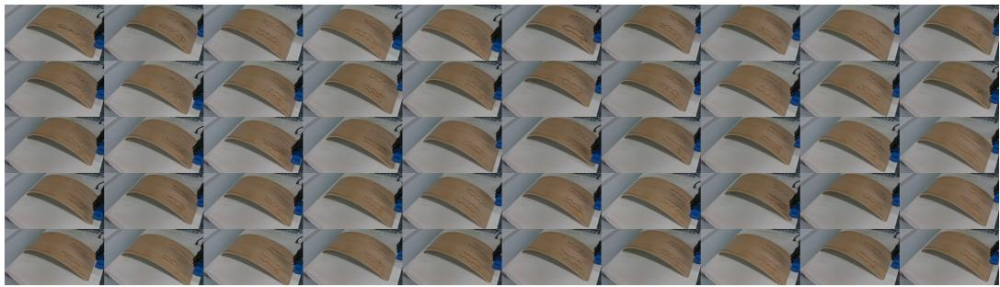  
Figure 7: Overview of Demonstrations for each Tasks. We visualize the initial configurations from 50 demonstrations for each task.

Flip  
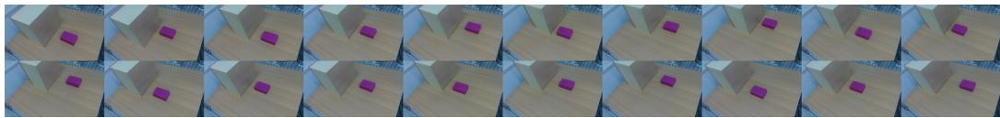

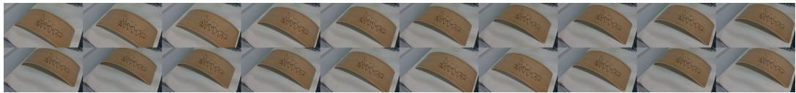  
Figure 8: Evaluation Initial Configurations. For each task, we evaluate each policy on 20 different initial configurations. The object is randomly placed at the beginning of each trial, and these evaluation configurations are different from those used in the training demonstrations.

To ensure a fair and reproducible comparison, we adopt an identical evaluation protocol across all policies. As shown in Fig. 8, we pre-sample a fixed set of initial object placements that are uniformly distributed over the workspace, and reuse exactly the same set of placements for every policy. This isolates the effect of the policy itself from variation in the test layout, so that all methods are evaluated under identical initial conditions. Unless otherwise stated, the main results in Table 1 use the seen object and randomize only its placement. Each policy is evaluated over 20 consecutive trials per task, and success rates are computed accordingly.

## B.2 Additional Experiments Results

We additionally evaluate the standalone low-dimensional force/torque policy to analyze the effect of input and inference frequencies. Fig. 9 shows the evaluation setup. The policy is tested on five objects, including the Purple Box used in training and four additional test objects with different shapes, materials, and contact properties. This setup provides a controlled set of object configurations for comparing the standalone force policy under different frequency settings.

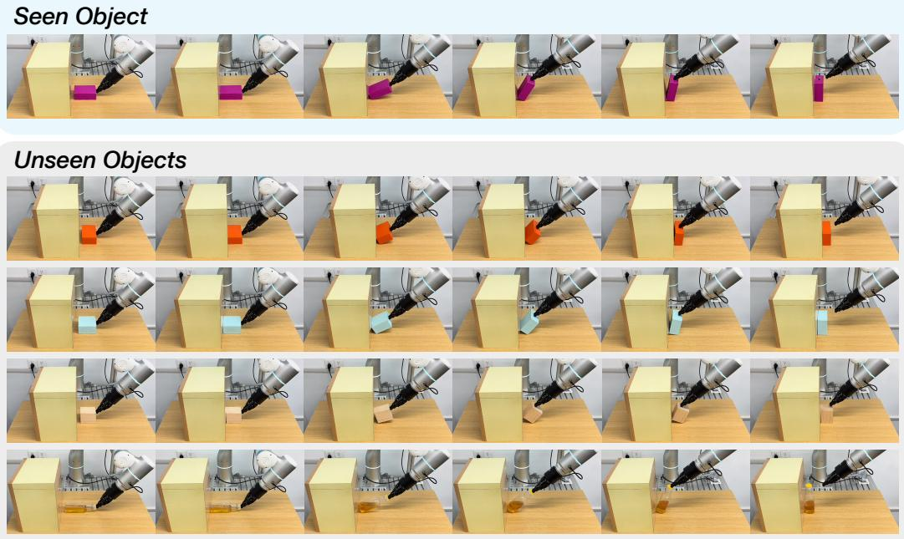  
Figure 9: Evaluation Setup for the Standalone Low-dimensional Policy. We evaluate the standalone lowdimensional force/torque policy on five objects with different shapes, materials, and contact properties. The top row shows the Purple Box used in training, while the bottom rows show additional test objects used during evaluation. This setup is used to compare the standalone policy under different input-frequency and inferencefrequency configurations.

We further report the detailed success rates of the standalone force policy under different inputfrequency and inference-frequency configurations in Fig. 10. For each input frequency, we keep the force history window fixed to 1s and vary the number of input steps according to the input frequency. We evaluate each policy with three inference frequencies, 2Hz, 5Hz, and 25Hz, across 5 objects. Each input-frequency and inference-frequency configuration is evaluated with 10 trials per object. The results show that increasing the inference frequency generally improves the success rate, especially when the input frequency is low. These results support our motivation that force feedback should not be bottlenecked by a low inference rate, and that high-frequency local feedback is important for contact-sensitive manipulation.

## B.3 Failure Analysis

We further analyze representative failure modes for the Flip and Polish Curve tasks. Overall, the failures are closely related to insufficient reactivity to force feedback and the difficulty of balancing global visual guidance with local contact feedback.

Flip. For Flip, we observe three common failure modes in the baselines. First, for force based baselines, the force signal can be noisy during the contact-free pushing stage. This noise may cause the robot arm to drift from the desired contact position with the small box, making the subsequent flipping motion difficult to complete. Second, during the flipping stage, some baselines do not run at a sufficiently high inference frequency and therefore cannot react quickly to force feedback. As a result, the robot fails to adjust its end-effector position in time after contact, leading to missed or incomplete flips. Third, vision-only policies do not have access to force feedback and may prematurely switch to the flipping motion before the small box establishes contact with the target box.

Input Frequency: 10Hz  
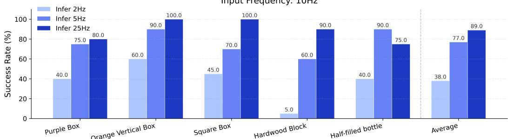

Input Frequency: 100Hz  
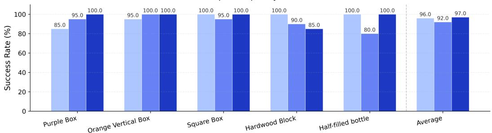

Input Frequency: 500Hz  
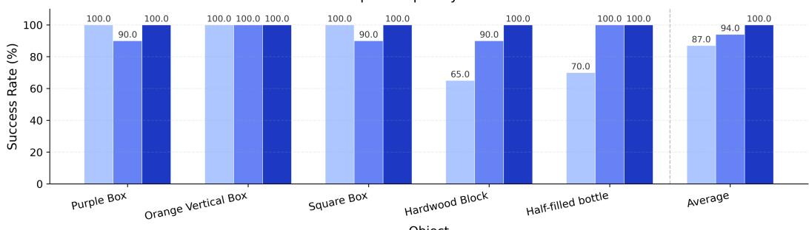  
Figure 10: Detailed Standalone Force Policy Results under Different Input and Inference Frequencies. We evaluate force/torque policies trained with different input frequencies, including 10Hz, 100Hz, and 500Hz, and test each policy under different inference frequencies, including 2Hz, 5Hz, and 25Hz. Results are reported across five test objects, with the average success rate shown on the right of each subplot. Increasing the inference frequency generally improves success rate, especially under low-frequency input, while high-frequency input combined with high-frequency inference achieves the best overall performance.

Polish Curve. For Polish Curve, the main challenge is to maintain stable and sufficiently strong contact while following the curved trajectory. Baselines with low inference frequency often fail to consistently maintain large contact force, resulting in weak or unstable polishing behavior. Visiononly policies may also enter the polishing stage before actual contact is established, since they cannot directly sense the contact state.

Compared with these baselines, LAG-Fusion better balances visual and force guidance. The visual policy provides global guidance, while the force/torque policy provides local guidance for contactsensitive correction. And it allows each modalities run at its native frequency. This makes the composed policy more reactive during contact transitions and more stable during sustained contact, leading to stronger performance on both tasks.