# CUPID: Curating Data your Robot Loves with Influence Functions

Christopher Agia1, Rohan Sinha1, Jingyun Yang1, Rika Antonova2, Marco Pavone1,3, Haruki Nishimura4, Masha Itkina4, Jeannette Bohg1 1Stanford University, 2University of Cambridge, 3NVIDIA Research, 4Toyota Research Institute

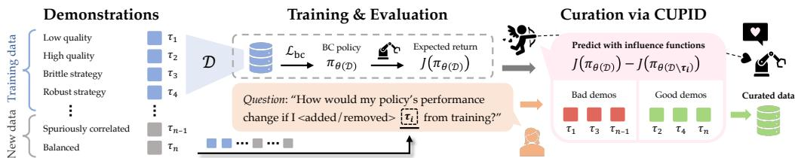  
Figure 1: We present CUPID, a robot data curation method that leverages influence functions to predictively answer counterfactual questions about the effect of each demonstration on downstream policy performance.

Abstract: In robot imitation learning, policy performance is tightly coupled with the quality and composition of the demonstration data. Yet, developing a precise understanding of how individual demonstrations contribute to downstream outcomes— such as closed-loop task success or failure—remains a persistent challenge. We propose CUPID, a robot data curation method based on a novel influence functiontheoretic formulation for imitation learning policies. Given a set of evaluation rollouts, CUPID estimates the influence of each training demonstration on the policy’s expected return. This enables ranking and selection of demonstrations according to their impact on the policy’s closed-loop performance. We use CUPID to curate data by 1) filtering out training demonstrations that harm policy performance and 2) subselecting newly collected trajectories that will most improve the policy. Extensive simulated and hardware experiments show that our approach consistently identifies which data drives test-time performance. For example, training with less than 33% of curated data can yield state-of-the-art diffusion policies on the simulated RoboMimic benchmark, with similar gains observed in hardware. Furthermore, hardware experiments show that our method can identify robust strategies under distribution shift, isolate spurious correlations, and even enhance the post-training of generalist robot policies. Videos and code are made available at: https://cupid-curation.github.io.

Keywords: Imitation Learning, Data Curation, Influence Functions

## 1 Introduction

While some of the largest breakthroughs in deep learning have emerged from architectural innovations, data often remains an underrecognized yet critical driver of a model’s overall performance. In particular, the success of scaling vision and language models has been followed by a rising interest in data attribution [1, 2, 3]—methods that causally link model behavior to training data—and in automatic data curation algorithms [4, 5, 6], grounded in the idea that not all data points contribute equally, or even positively, to a model’s performance. As parts of the robotics community scale imitation learning and robotics datasets become increasingly diverse [7, 8], developing a deeper understanding of (i) how demonstration data shapes policy behavior and (ii) how we can extract maximum utility from training datasets will be imperative to advancing policy performance toward reliable, open-world deployment.

Curating data for robot imitation learning has been the focus of several recent works [9, 10, 11]. A common approach retains demonstrations deemed most valuable under a heuristic, task-agnostic quality metric, resulting in a smaller dataset curated offline [10]. This approach typically rests on the implicit assumption that the designed quality metric aligns well with the policy’s downstream performance—an assumption that may not hold uniformly across diverse robotics tasks. While recent efforts attempt to learn performance-correlated heuristics using online policy experience [11], they do not establish strong causal links between training data and policy behavior. As a result, these methods risk misattributing the root cause of policy success or failure with respect to the training data [12].

In this work, we formally define data curation in imitation learning as the problem of identifying which expert demonstrations maximally contribute to the policy’s expected return. We then introduce CUPID (CUrating Performance-Influencing Demonstrations), a data curation method that directly targets this objective by leveraging influence functions [13, 14]—a technique popularized in the data attribution literature [15]—to identify which demonstrations influenced a policy’s predictions during closed-loop execution. We show that a demonstration’s influence on expected return decomposes into a tractable sum over its state-action transitions and can be efficiently approximated using a REINFORCE-style estimator [16] given a set of policy rollouts. Ranking demonstrations by their estimated performance impact facilitates curation in two settings: (a) filtering existing demonstrations from training sets and (b) selecting high-impact demonstrations from newly collected or pre-collected data—whereas prior work focuses solely on filtering [10, 11]. Finally, while our approach offers a general and effective standalone signal for curating demonstration data, we investigate its combined use with task-agnostic quality metrics (also derived from influence scores), identifying conditions under which the integration of performance- and quality-based metrics strengthens or weakens overall curation performance.

Our contributions are three-fold: (1) We formulate robot data curation as the problem of valuating demonstrations in accordance with their downstream impact on policy performance; (2) We propose CUPID, a novel approach for curating imitation learning datasets based on influence functions, causally linking demonstrations to the policy’s expected return; (3) We characterize the conditions under which the integration of task-agnostic quality metrics strengthens performance-based data curation, providing practical insights into when such integration is beneficial. Extensive simulation and hardware experiments show that curation with CUPID significantly improves policy performance in mixed-quality regimes, even when using only a fraction of the training data. Moreover, it identifies robust strategies under test-time distribution shifts and can disentangle spurious correlations in training data that hinder generalization—all by observing policy outcomes alone, without requiring additional supervision.

## 2 Related Work

Data Curation in Robotics. Assembling larger and more diverse datasets has been central to scaling efforts in robot imitation learning [7, 8, 17, 18, 19, 20, 21], yet how to extract greater utility from these datasets remains an open question. Several works have explored data augmentation [22, 23, 24, 25, 26] and mixture optimization [27]. Only recently has attention shifted to valuating individual demonstrations for data curation [9, 10, 11]. Hejna et al. [10] estimate demonstration quality offline via mutual information—without considering policy performance—while Chen et al. [11] train classifiers to distinguish successful and failed rollouts across policy checkpoints. In contrast, we directly measure the causal influence of each demonstration on the policy’s expected return, providing a signal that (a) does not require observing both successes and failures, (b) uses only a single policy checkpoint, (c) is robust to spurious correlations in the policy’s rollout distribution, and (d) naturally extends to selecting new data, whereas [10, 11] only filter existing data. Concurrent to our work is DataMIL [28], which uses datamodels to select from large multi-task datasets with an offline metric, whereas we focus on single-task curation with an influence measure that directly reflects closed-loop returns from online policy rollouts.

Data Attribution outside Robotics. Data attribution methods model the relationship between training data and learned behavior, with applications in model interpretability [2, 29], data valuation [30, 31], machine unlearning [32], and more [33]. Recent work has focused on improving the accuracy of data attribution methods [34, 35, 36], such as influence functions [13, 14], and extending them to increasingly complex generative architectures [1, 37, 38]. A related line of research explores improving language model pre-training [3] and fine-tuning [39, 40, 41] through data selection. However, these settings typically assume aligned training and evaluation objectives (i.e., prediction loss) and access to test-time labels. In contrast, robot imitation learning involves an objective mismatch: policies are trained via supervised learning but evaluated through closed-loop environment interactions, where task success depends on many sequential predictions and ground-truth action labels are unavailable at test-time.

## 3 Background: Data Attribution via Influence Functions

At a high-level, the goal of data attribution methodologies is to explicitly relate model performance and behavior to the training data, so that we can answer counterfactual questions about the contribution of training samples towards test-time predictions. Consider a standard supervised learning setting, where we fit model parameters $\theta$ on a given training dataset ${ \mathcal { D } } : = \{ z ^ { 1 } , \ldots , z ^ { n } \}$ of input-label pairs $z ^ { i } = ( x ^ { i } , y ^ { i } ) \in \mathcal { Z }$ with $\begin{array} { r } { \theta ( \mathcal { D } ) = \operatorname * { a r g m i n } _ { \theta ^ { \prime } } \{ \mathcal { L } ( \theta ^ { \prime } ; \mathcal { D } ) : = \frac { 1 } { n } \sum _ { i = 1 } ^ { n } \ell ( z ^ { i } ; \dot { \theta } ^ { \prime } ) \} } \end{array}$ . Moreover, let $f ( \hat { z } ; \theta ) \in \mathbb { R }$ be any chosen performance metric on a test sample $\hat { z } = ( \hat { x } , \hat { y } ) \in \mathcal { Z }$ given model parameters $\theta ( \mathrm { { e . g . } }$ cross-entropy loss for a classifier). Then, a data attribution method $\Psi ^ { \mathrm { o u t } } : \mathcal { Z } \times \mathcal { Z }  \mathbb { R }$ aims to approximate the change in the performance metric f if we were to exclude sample $z ^ { i }$ from the model’s training data. That is, we aim to design $\Psi ^ { \mathrm { o u t } }$ such that ${ \Psi } ^ { \mathrm { o u t } } \big ( \hat { z } , z ^ { i } \big ) \approx f \big ( \hat { z } ; \theta ( \mathcal { D } \setminus \{ z ^ { i } \} ) \big ) - f \big ( \hat { z } ; \theta ( \mathcal { D } ) \big )$

The influence function is a data attribution technique that approximates $\Psi ^ { \mathrm { o u t } }$ without retraining any models [15]. Consider perturbing the training objective as $\mathcal { L } _ { \epsilon , z } ( \theta ^ { \prime } ; \mathcal { D } ) : = \mathcal { L } ( \theta ^ { \prime } ; \mathcal { D } ) + \epsilon \ell ( z , \theta ^ { \prime } )$ , where we add an infinitesimal weight ϵ on the loss of some sample z to L. The influence function estimates the change in the performance metric f as a function of ϵ with a first-order Taylor approximation as

$$
\Psi_ {\mathrm{inf}} (\hat {z}, z) := \frac {d f (\hat {z} ; \theta)}{d \epsilon} \Bigg | _ {\epsilon = 0} = - \nabla_ {\theta} f (\hat {z}; \theta (\mathcal {D})) ^ {\top} H _ {\theta} ^ {- 1} \nabla_ {\theta} \ell (z; \theta (\mathcal {D})),\tag{1}
$$

where $\begin{array} { r } { H _ { \theta } = \frac { 1 } { n } { \sum _ { i = 1 } ^ { n } } \nabla _ { \theta } ^ { 2 } \ell ( z ^ { i } ; \theta ( \mathcal { D } ) ) } \end{array}$ denotes the Hessian of the training loss1 [13]. Therefore, we can use the influence function to directly approximate the leave-one-out influence $\Psi ^ { \mathrm { o u t } }$ of a sample $z ^ { i } \in \mathcal { D }$ as $\begin{array} { r } { \Psi _ { \mathrm { i n f } } ^ { \mathrm { o u t } } \left( \hat { z } , z ^ { i } \right) : = - \frac { 1 } { n } \Psi _ { \mathrm { i n f } } \left( \hat { z } , z ^ { i } \right) } \end{array}$ ). In addition, for $z \notin \mathcal { D }$ we similarly define the add-one-in influence as $\begin{array} { r } { \Psi _ { \mathrm { i n f } } ^ { \mathrm { i n } } ( \hat { z } , z ) : = \frac { 1 } { n } \Psi _ { \mathrm { i n f } } ^ { \mathrm { \ - i n } } ( \hat { z } , z ) \approx f ( \hat { z } ; \theta ( \mathcal { D } \cup \{ z \} ) ) - f ( \hat { z } ; \theta ( \mathcal { D } ) ) } \end{array}$ with z excluded from the Hessian $H _ { \theta }$

## 4 Problem Formulation

Imitation Learning (IL): The objective of this work is to understand how demonstration data contributes to closed-loop performance in robot imitation learning. Thus, we consider a Markov Decision Process $\langle s , \mathcal { A } , \mathcal { T } , R , \rho _ { 0 } \rangle$ with state space ${ \mathcal { S } } .$ , action space ${ \mathcal { A } } ,$ transition model $\tau _ { \ast }$ reward model $R ,$ initial state distribution $\rho _ { 0 }$ , and finite horizon $H$ . We train a policy πθ to minimize a behavior cloning (BC) ob jective, i.e., θ = argminθ′ $\begin{array} { r } { \{ \mathcal { L } _ { \mathrm { b c } } ( \theta ^ { \prime } ; \mathcal { D } ) : = \frac { 1 } { | \mathcal { D } | H } { \sum _ { \xi ^ { i } \in \mathcal { D } } } { \sum _ { ( s , a ) \in \xi ^ { i } } } \ell ( s , a ; \pi _ { \theta ^ { \prime } } ) \} } \end{array}$ , using a dataset of n expert demonstrations $\mathcal { D } = \{ \xi ^ { 1 } , . . . , \xi ^ { n } \}$ . Each demonstration $\xi ^ { i } = \big ( \big ( s _ { 0 } ^ { i } , a _ { 0 } ^ { i } \big ) , . . . , \big ( s _ { H } ^ { i } , a _ { H } ^ { i } \big ) \big )$ consists of a stateaction trajectory where the robot successfully completes the task. We treat a trajectory $\tau = ( s _ { 0 } , a _ { 0 } , . . . , s _ { H } )$ as either a success or afailure, corresponding to the binary returns $R ( \tau ) = 1$ and $R ( \tau ) = - 1$ respectively. Therefore, in IL, we train the policy $\pi _ { \theta }$ to match the distribution of successful behaviors in $\mathcal { D } _ { : }$ rather than directly maximize its expected return $J ( \pi _ { \theta } ) { : = } \mathbb { E } _ { p ( \tau | \pi _ { \theta } ) } [ R ( \tau ) ]$ ]. As a result, the policy’s performance is intimately linked to the relative suboptimality of the demonstration data—a function of its quality and composition—not just to validation losses, model capacity, or bias-variance tradeoffs. This makes it ex tremely challenging to systematically improve performance. Recent works underscore that simply scal ing demonstration collection may result in datasets that contain substantial redundancies and behaviors that may actually harm policy performance, even though $R ( \xi ^ { i } ) = 1$ for all demonstrations $\xi ^ { i } \in \mathcal { D } \left[ 4 2 \right]$

Robot Data Curation: While several recent works propose intuitive measures of quality to curate data, we find that such heuristics can misalign with how deep models actually learn, sometimes even worsening test-time performance compared to randomly choosing samples (see §6). Therefore, we first formally define robot data curation as the problem of identifying demonstration data that maximizes the policy’s closed-loop performance. In particular, assume that we have a base policy $\pi _ { \theta }$ trained on the demonstration data $\mathcal { D } .$ We consider two settings that are essential to a policy debugging toolchain. The first is that of data filtering, where our goal is to identify and remove redundant or harmful demonstrations from $\mathcal { D }$ that may be limiting the performance of the base policy $\pi _ { \theta }$

Task 1 (Filter-k demonstrations). Let $\Xi _ { k } ^ { - } = \{ S \subseteq { \mathcal { D } } | | S | = k \}$ denote all possible k-demonstration subsets of the training dataset $\mathcal { D } { = } \{ \xi ^ { 1 } , { \ldots } , { \bar { \xi } } ^ { n } \}$ , where $k \leq n .$ . Determine which k demonstrations should be removed from D to maximize policy performance with respect to the task objective J. That is, find

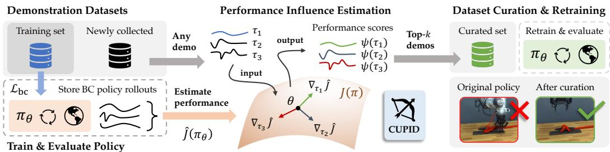  
Figure 2: Data curation with CUPID. Upon training a policy on a set of demonstrations using behavior cloning, we evaluate it online to collect closed-loop rollout trajectories and estimate the policy’s expected return. CUPID ranks demonstration based on their measured influence on this performance estimate and selects the top-k. Thus, curating with CUPID results in a dataset of demonstrations that most strongly influences closed-loop policy success.

$$
S ^ {\star} = \underset {S \in \Xi_ {k} ^ {-}} {\arg \max} J (\pi_ {\theta}) \quad \text { s.t. } \quad \theta = \underset {\theta^ {\prime}} {\operatorname{argmin}} \mathcal {L} _ {\mathrm{bc}} (\theta^ {\prime}; \mathcal {D} \backslash S).
$$

The second is that of data selection, where we seek to guide the subselection of new demonstration data to maximally improve our base policy, given a fixed budget.

Task 2 (Select-k demonstrations). Let $\Xi _ { k } ^ { + } = \{ S \subseteq { \mathcal { H } } | | S | = k \}$ denote all possible k-demonstration subsets ofa holdout dataset $\mathcal { H } = \{ \xi ^ { 1 } , . . . , \xi ^ { n ^ { \prime } } \}$ , where $k \leq n ^ { \prime }$ . Determine which k demonstrations should be added to Dfrom H to maximize policy performance with respect to the task objective J. That is,find

$$
S ^ {\star} = \underset {S \in \Xi_ {k} ^ {+}} {\arg \max} J (\pi_ {\theta}) \quad \text {s.t.} \quad \theta = \underset {\theta^ {\prime}} {\operatorname{argmin}} \mathcal {L} _ {\mathrm{bc}} (\theta^ {\prime}; \mathcal {D} \cup S).
$$

In Task 2, we consider the problem of identifying the most impactful trajectories from a newly collected batch of demonstrations or from an existing pre-collected dataset, akin to performing quality control.

Policy Testing & Evaluation: To make progress on Task 1 and Task $^ { 2 , }$ we assume access to a small dataset of m rollouts $\mathcal { D } _ { \tau } = \{ \tau ^ { 1 } , . . . , \tau ^ { m } \} \overset { \mathrm { i i d } } { \sim } p ( \tau | \pi _ { \theta } )$ of the base policy $\pi _ { \theta }$ along with their associated returns $\{ R ( \tau ^ { 1 } ) , . . . , R ( \tau ^ { m } ) \}$ to estimate $J ( \pi _ { \theta } )$ . This aligns with how we currently evaluate policies in prac tice [43], despite lacking principled strategies to leverage evaluations towards BC policy improvement.

## 5 CUPID: Curating Performance-Influencing Demonstrations

In the literature, the desiderata for curating demonstration data appears diverse and often context specific, with recent works valuating demonstrations upon heuristic measures of similarity [11], compatibility [44], uncertainty [45], and information gain [10]. The key insight of this work is that solving curation problems, i.e., Task 1 and Task 2 (§4), requires causally connecting training data to the policy’s closed-loop performance. Therefore, we first adapt techniques from data attribution, as defined in $\ S 3 ,$ to directly compute the influence of a training demonstration on the performance of a policy. This allows us to use our performance influence to directly curate data in alignment with our objectives.

## 5.1 Demonstration-Performance Influence

While existing data attribution methods can trace validation losses back to the training set D for curation purposes, the BC loss is not always reflective of a policy’s closed-loop performance [46]. Thus, we must first develop an analogous notion of the influence function to capture the impact of a demonstration trajectory on the closed-loop performance of an imitation learning policy. To do so, we group the BC training objective into trajectory-level losses by introducing $\begin{array} { r } { \ell _ { \mathrm { t r a j } } ( \xi ; \pi _ { \theta ^ { \prime } } ) : = \frac { 1 } { H } \sum _ { ( s , a ) \in \xi } \ell ( s , a ; \pi _ { \theta ^ { \prime } } ) } \end{array}$ so that $\begin{array} { r } { \mathcal { L } _ { \mathrm { b c } } ( \boldsymbol { \theta } ^ { \prime } ; \mathcal { D } ) = \frac { 1 } { | \mathcal { D } | } { \sum _ { \xi ^ { i } \in \mathcal { D } } } \ell _ { \mathrm { t r a j } } ( \xi ^ { i } ; \pi _ { \theta ^ { \prime } } ) } \end{array}$ . We now formally define the performance influence of a demonstration as the application of the influence function (see Eq. 1) on the policy’s expected return:

Definition 1 (Performance Influence). Let ξ be a demonstration of interest. Suppose we train a policy $\pi _ { \theta }$ to minimize the perturbed BC objective $\begin{array} { r } { \mathcal { L } _ { \mathrm { b c } } ^ { \epsilon , \xi } ( \theta ^ { \prime } ; \mathcal { D } ) : = \mathcal { L } _ { \mathrm { b c } } ( \theta ^ { \prime } ; \mathcal { D } ) + \epsilon \ell _ { \mathrm { t r a j } } ( \xi ; \pi _ { \theta ^ { \prime } } ) } \end{array}$ . Then, demonstration $\xi ^ { \prime } s$ performance influence is the derivative of the policy’s expected return $J ( \pi _ { \theta } )$ with respect to the weight ϵ. That is,

$$
\Psi_ {\pi \text {-inf}} (\xi) := \frac {d J (\pi_ {\theta})}{d \epsilon} \bigg | _ {\epsilon = 0} = - \nabla_ {\theta} J (\pi_ {\theta}) ^ {\top} H _ {\mathrm{bc}} ^ {- 1} \nabla_ {\theta} \ell_ {\mathrm{traj}} (\xi ; \pi_ {\theta}),
$$

where $H _ { \mathrm { b c } } : = \nabla _ { \boldsymbol { \theta } } ^ { 2 } \mathcal { L } _ { \mathrm { b c } } ( \boldsymbol { \theta } ; \mathcal { D } )$ denotes the Hessian ofthe BC objective.

In essence, Definition 1 enables us to predictively answer the counterfactual: “How would the policy’s expected return change if we upweighted—or by negating, downweighted—the loss on a demonstration $\xi$ during training $\varprojlim \varPsi$ While Definition 1 neatly aligns with the standard definition of the influence function in Eq. 1—using J as the performance metric and $\ell _ { \mathrm { t r a j } }$ as the demonstration-level loss—we distinguish the performance influence from the standard influence function [13] for two key reasons: (1) The performance influence attributes the outcome of a policy’s sequential decisions to time-series demonstrations, whereas the existing techniques discussed in $\ S 3$ only relate an individual labeled prediction to a single training sample; (2) We cannot directly compute $\Psi _ { \pi - \mathrm { i n f } }$ because the policy’s expected return $J ( \pi _ { \theta } )$ depends on the unknown transition dynamics and reward function. To alleviate these challenges, we show that we can decompose the performance influence into influence scores of individual action predictions, which we define as the action influence.

Definition 2 (Action Influence). The action influence ofa state-actionpair $^ { ( s , a ) }$ on a test state-action pair $( s ^ { \prime } , a ^ { \prime } )$ is the influence of(s,a) on the policy’s log-likelihood $\log \pi _ { \theta } ( a ^ { \prime } | s ^ { \prime } )$ . That $i s ,$

$$
\Psi_ {a \text {-inf}} ((s ^ {\prime}, a ^ {\prime}), (s, a)) := - \nabla_ {\theta} \mathrm{log} \pi_ {\theta} (a ^ {\prime} | s ^ {\prime}) ^ {\top} H _ {\mathrm{bc}} ^ {- 1} \nabla_ {\theta} \ell (s, a; \pi_ {\theta}).\tag{2}
$$

The advantage of the action influence is that we can easily compute the quantities in Eq. 2 given the policy weights θ and the training demonstrations D, e.g., using the attribution methods discussed in $\ S 3 .$ . However, we emphasize that computing action influences over state-action samples from a policy rollout $\tau \sim p ( \tau | \pi _ { \theta } )$ only tells us what demonstration data led to the policy taking those actions, without ascribing value to the resulting outcome (e.g., success or failure). We now show that the performance in fluence decomposes into the sum of individual action influences, weighted by the trajectory return $R ( \tau )$

Proposition 1. Assume that $\theta ( { \mathcal { D } } ) =$ argminθ′ $\mathcal { L } _ { \mathrm { b c } } ( \theta ^ { \prime } ; \mathcal { D } )$ , that ${ \mathcal { L } } _ { \mathrm { b c } }$ is twice differentiable in $\theta ,$ and that $H _ { \mathrm { b c } } \succ 0$ is positive definite $( i . e . , \theta ( \mathcal { D } )$ is not a saddle point)1. Then, it holds that2

$$
\Psi_ {\pi - \inf} (\xi) = \mathbb {E} _ {\tau \sim p (\tau | \pi_ {\theta})} \left[ \frac {R (\tau)}{H} \sum_ {(s ^ {\prime}, a ^ {\prime}) \in \tau} \sum_ {(s, a) \in \xi} \Psi_ {a - \inf} \big ((s ^ {\prime}, a ^ {\prime}), (s, a) \big) \right].\tag{3}
$$

In brief, we prove Proposition 1 using the log-derivative trick underlying policy gradient methods [16, 47] to decompose $\Psi _ { \pi - \mathrm { i n f } }$ into $\Psi _ { a - \mathrm { i n f } }$ (see §D.1 for proof). Because Proposition 1 relates the performance influence to the average action influence that a demonstration ξ has on the closed-loop distribution of policy rollouts, Proposition 1 directly provides a method to estimate $\Psi _ { \pi - \mathrm { i n f } } \colon$ Estimate $\Psi _ { \pi \cdot \mathrm { i n f } } \colon$ First, evaluate the policy πθ online to gather a set of rollouts $\mathcal { D } _ { \tau } = \{ \tau ^ { 1 } , . . . , \tau ^ { m } \}$ iid∼ $p ( \tau \vert \pi _ { \theta } )$ and their associated returns $\{ R ( \tau ^ { 1 } ) , . . . , R ( \tau ^ { m } ) \}$ . Then, construct an empirical estimate of the performance influence $\widehat { \Psi } _ { \pi - \mathrm { i n f } }$ using Eq. 3, by averaging action influences across the rollouts in $\mathcal { D } _ { \tau }$ We illustrate the performance influence in Fig. 2 and summarize its estimation procedure in Algorithm 1.

Algorithm 1: Performance Influence

1 Input: Policy $\pi_{\theta}$, training data $\mathcal{D}$, demonstration $\xi$, data attribution method $\Psi$

2 Collect rollouts $\mathcal{D}_{\tau} = \{\tau^{1}, \ldots, \tau^{m}\} \stackrel{\text{iid}}{\sim} p(\tau | \pi_{\theta})$ and returns $\{R(\tau^{1}), \ldots, R(\tau^{m})\}$

3 Use $\Psi, \mathcal{D}$ to compute $\Psi_{a-\inf}((s', a'), (s, a))$ for all $(s', a') \in \mathcal{D}_{\tau}$, $(s, a) \in \xi$

4 Estimate $\widehat{\Psi}_{\pi-\inf}(\xi) := \frac{1}{m} \sum_{\tau^i \in \mathcal{D}_{\tau}} \frac{R(\tau^i)}{H} \sum_{(s', a') \in \tau^i} \sum_{(s, a) \in \xi} \Psi_{a-\inf}((s', a'), (s, a)).$

5 Output: Estimated performance influence $\widehat{\Psi}_{\pi-\inf}(\xi)$

## 5.2 Data Curation with Performance Influence

In this section, we leverage the performance influence $\Psi _ { \pi - \mathrm { i n f } }$ , which we developed in §5.1, to curate data towards the filtering and selection tasks (Task 1 and Task 2) defined in §4. In particular, we use the estimates of $\Psi _ { \pi - \mathrm { i n f } }$ to make the following first-order Taylor approximations on the leave-one-out and add-one-in influence (as defined in $\ S 3 )$ of a demonstration trajectory as

$$
\Psi_ {\pi - \inf} ^ {\mathrm{out}} (\xi) := - \frac {\widehat {\Psi} _ {\pi - \inf} (\xi)}{| \mathcal {D} |} \approx J (\pi_ {\theta (\mathcal {D} \setminus \{\xi \})}) - J (\pi_ {\theta (\mathcal {D})}), \quad \Psi_ {\pi - \inf} ^ {\mathrm{in}} (\xi) := \frac {\widehat {\Psi} _ {\pi - \inf} (\xi)}{| \mathcal {D} |} \approx J (\pi_ {\theta (\mathcal {D} \cup \{\xi \})}) - J (\pi_ {\theta (\mathcal {D})}).
$$

Then, we use the leave-one-out and add-one-in influences to counterfactually estimate the change in expected return when removing or adding a set of demonstrations S with a linear approximation as $\begin{array} { r } { \Delta \hat { J } \big ( \bar { \pi } _ { \boldsymbol { \theta } ( \mathcal { D } \backslash S ) } \big ) \propto \frac { 1 } { | S | } { \sum _ { \boldsymbol { \xi } \in S } \Psi _ { \pi \mathrm { - i n f } } ^ { \mathrm { o u t } } } \big ( \boldsymbol { \xi } \big ) } \end{array}$ and $\begin{array} { r } { \Delta \widehat { J } ( \pi _ { \theta ( \mathcal { D } \cup S ) } ) \propto \frac { 1 } { | S | } \sum _ { \xi \in S } \Psi _ { \pi \cdot \mathrm { i n f } } ^ { \mathrm { i n } } ( \xi ) } \end{array}$ . As a result, optimally curating data under our approximate linear model on policy performance simply entails selecting the least influential demonstrations from the training data D—in the case of data filtering—or selecting the most influential demonstrations from a new set of demonstrations H—in the case of data selection: Task 1: Filter-k Demonstrations Task 2: Select-k Demonstrations

$$
S _ {\text { out }} ^ {\star} = \arg \operatorname{top-} k \left(\left\{\Psi_ {\pi - \inf} ^ {\text { out }} (\xi^ {i}): \xi^ {i} \in \mathcal {D} \right\}\right),\tag{4}
$$

$$
S _ {\text { in }} ^ {\star} = \arg \operatorname{top-} k \left(\left\{\Psi_ {\pi - \inf} ^ {\text { in }} (\xi^ {i}): \xi^ {i} \in \mathcal {H} \right\}\right).\tag{5}
$$

We note that by linearly approximating policy performance changes using $\Psi _ { \pi - \mathrm { i n f } } .$ we construct what is commonly termed a (linear) datamodel [48]. As shown in NLP [3], using such first-order approximations for data curation can often greatly improve model performance over manual notions of quality.

## 5.3 Additional Quality Metrics

In §5.1, we constructed a method to estimate $\Psi _ { \pi - \mathrm { i n f } }$ from a dataset of policy rollouts $\mathcal { D } _ { \tau }$ by relying on policy gradient methods. Therefore, the estimated performance influence $\widehat { \Psi } _ { \pi - \mathrm { i n f } }$ becomes increasingly noisy as we reduce the number of rollouts m to evaluate the policy—akin to the high variance problem of the REINFORCE algorithm. To complement the analysis in §5.1, we explore the integration of a reward-agnostic, heuristic demonstration quality metric based on the action influence scores $\Psi _ { a - \mathrm { i n f } } \colon$

$$
\Psi_ {\text {qual}} (\xi ; \mathcal {D} _ {\tau}) := \frac {1}{m} \sum_ {\tau \in \mathcal {D} _ {\tau}} \max _ {(s ^ {\prime}, a ^ {\prime}) \in \tau} \min _ {(s, a) \in \xi} \Psi_ {a - \inf} \big ((s ^ {\prime}, a ^ {\prime}), (s, a) \big) - \min _ {(s ^ {\prime}, a ^ {\prime}) \in \tau} \max _ {(s, a) \in \xi} \Psi_ {a - \inf} \big ((s ^ {\prime}, a ^ {\prime}), (s, a) \big).\tag{6}
$$

We base the quality score Eq. 6 on the intuition that we should penalize demonstrations containing outlier or noisy influence scores [13, Sec. 5.2], [10]. As such, we posit that this heuristic can reduce variance on tasks requiring precise motion, yet introduce bias uncorrelated with performance in other settings. Thus, in §6, we investigate when the quality score can complement $\Psi _ { \pi - \mathrm { i n f } }$ to curate data by taking their convex combination, $\alpha \Psi _ { \pi - \mathrm { i n f } } + ( 1 - \alpha ) \Psi _ { \mathrm { q u a l } }$ , ablating $\alpha { = } 1 \left( \mathrm { C U P I D } \right)$ and $\alpha { = } 1 / 2 \left( \mathrm { C U P I D { - } Q U A L I T Y } \right)$

## 6 Experiments

We conduct a series of experiments to test the efficacy of CUPID alongside state-of-the-art baselines for robot data curation. These experiments take place across three simulated tasks from the RoboMimic benchmark suite [49] and three real-world tasks with a Franka FR3 manipulator (see Fig. 4). These tasks comprise a taxonomy of settings where data curation may benefit policy performance. For a detailed description of our tasks, datasets, baselines, evaluation protocol, and hardware setup, please refer to §B

Evaluation. We study the filter-k (Task 1) and select-k (Task 2) curation tasks wherever applicable. For statistical significance, we start filter-k and select-k from random $\sim 2 / 3$ and $\sim 1 / 3$ subsets in RoboMimic (300 demonstrations per task total), and random ${ \sim } 9 / 1 0$ and ${ \sim } 4 / 1 0$ subsets on Franka tasks (120-160 demonstrations per task total), respectively. We use the official convolutional-based diffusion policy implementation [50] for all tasks to measure the effect of curation on a state-of-the-art policy architecture. Details on the influence function computation for diffusion models are provided in §A. We also consider the official $\pi _ { 0 }$ implementation [21] for real-world tasks. To reflect practical constraints, we limit the rollout budget (i.e., the number of rollouts in $\mathcal { D } _ { \tau } = \{ \tau ^ { i } \} _ { i = 1 } ^ { m }$ a curation algorithm may use, as described in §4) to $m = 1 0 0$ and $m = 2 5$ for simulated and real-world tasks, respectively. We report policy success rates over 500 rollouts averaged over the last 10 policy checkpoints for simulated tasks, and 25 rollouts performed with the last checkpoint for real-world tasks.

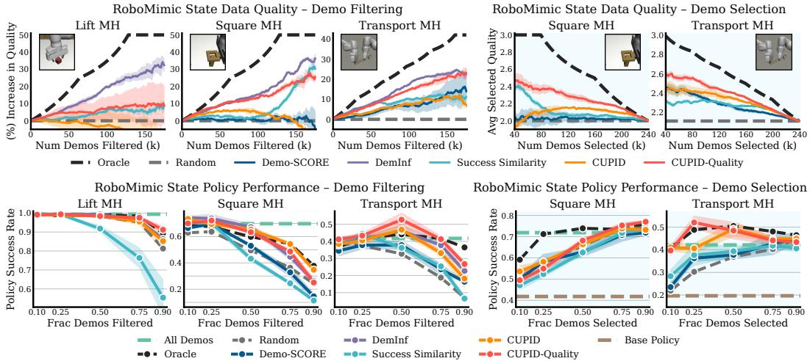  
Figure 3: RoboMimic mixed-quality curation results. Top: Data Quality. Baselines often prioritize demonstra tion quality (e.g., DemInf [10]), but higher demonstration quality does always translate to higher policy success rates. In contrast, CUPID targets demonstrations that most strongly contribute to downstream policy performance. Bottom: Policy Performance. Diffusion policies trained on data curated by CUPID achieve higher success rates than baselines, despite using demonstrations of perceived lower quality. Although combining performance and quality measures (CUPID-QUALITY) yields the best policies on mixed-quality datasets, quality measures can degrade performance in other settings (see Fig. 4). Results are averaged over 3 random seeds (500 policies trained across settings). Success rates are computed over 50 rollouts from the last 10 checkpoints (500 rollouts total).

Baselines. We consider baselines from several methodological categories: DemInf [10]—applicable only to filter-k (Task 1)—curates data offline (i.e., without rollouts) by maximizing mutual information, promoting diverse and predictable demonstrations; Demo-SCORE [11] trains binary classifiers to distinguish states from successful and failed rollouts, retaining demonstrations with a high average state success probability; Success Similarity is a custom method that ranks demonstrations by their average state similarity to successful rollouts; Random chooses demonstrations uniformly at random; Oracle approximates an upper bound on performance by curating data with privileged access to ground-truth demonstration labels, e.g., indicating demonstration quality, strategy robustness, or other properties.

## 6.1 Setting 1: Improving Policy Performance in Mixed-Quality Regimes

We first study curation of mixed-quality datasets, where training on lower-quality demonstrations may degrade policy performance [49, 10]. We use the “Lift,” “Square,” and “Transport” tasks from RoboMimic’s multi-human (MH) task suite, which provides ground-truth quality labels for demonstrations. The “Lift” and “Square” tasks contain three quality tiers {“low”, “medium”, “high”}, while the more complex bi-manual “Transport” task contains six quality tiers {“low-low”, “low-medium”, . . . }. On hardware, we design the “Figure-8” task (Fig. 4(a)), where the robot must tie a simplified cleat hitch—a knot that follows a figure-8 pattern—requiring precise manipulation of a deformable rope.

RoboMimic analysis. Fig. 3 presents the RoboMimic benchmark results: the top row shows data quality trends for filter-k and select-k across varying k, while the bottom row reports success rates of diffusion policies trained on the corresponding curated datasets. As expected, we first observe that DemInf— which targets demonstration quality—curates datasets of the highest overall quality by RoboMimic’s ground-truth labels for filter-k (top row, Fig. 3). However, policies trained on data curated by CUPID consistently match or outperform those of DemInf (bottom row, Fig. 3). This indicates that human perception ofdemonstration quality does not necessarily correspond to data that maximizes downstream policy success. Second, we find the state similarity heuristics employed by Demo-SCORE and Success Similarity to be relatively ineffective in challenging mixed-quality regimes, where successful and failed rollouts exhibit similar states. Lastly, CUPID-QUALITY, which evenly balances demonstration quality and downstream performance impact (§5.3), attains the highest policy success rates—surpassing the Oracle in 3/5 cases, and achieving an even higher success rate than the official diffusion policy [50] on “Transport MH” while using fewer than (i) 33% of the original 300 demonstrations and (ii) 10% of the model parameters. We provide an extended discussion of the RoboMimic results in §C.1.

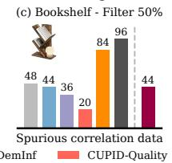

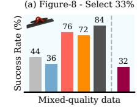

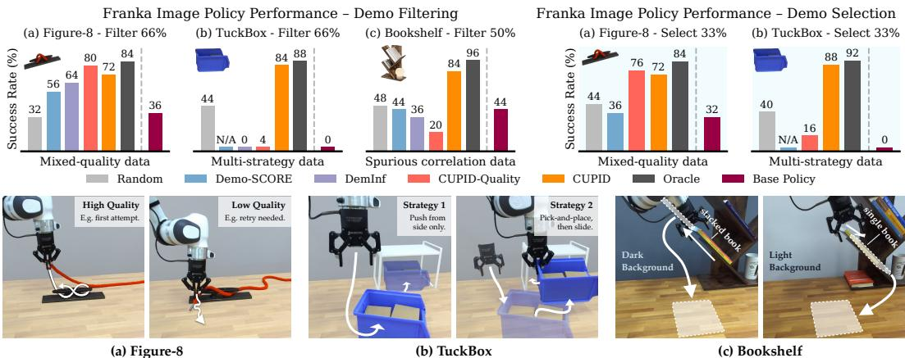

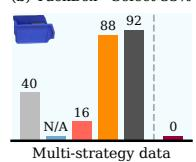  
Figure 4: Franka real-world diffusion policy performance. CUPID, which curates demonstrations w.r.t. policy performance, improves success rates on mixed-quality datasets, identifies robust strategies, and disentangles spurious correlations that hinder performance. Although quality measures (e.g., DemInf, CUPID-QUALITY) help in mixed-quality settings (Figure-8; Fig. 3), they degrade performance when higher-quality demonstrations induce brittle strategies at test time (TuckBox), or when quality is not the primary factor limiting policy success (Bookshelf). Overall, curating data based on performance (CUPID) maintains robustness across these settings.

Figure-8 analysis. Fig. 4(a) shows diffusion policy results on the real-world “Figure-8” task. First, CU PID improves over the base policy’s success rate by 38% (averaged over filtering and selection). Second, as in RoboMimic, CUPID-QUALITY further strengthens curation performance, corroborating the utility of quality metrics (Eq. 6) in mixed-quality regimes. As shown in Fig. 5(a) (filtering; see §C.5 for selec tion), both CUPID and CUPID-QUALITY successfully retain high-quality demonstrations, whereas base lines such as Demo-SCORE discard some in favor of lower-quality demonstrations. Overall, training on lower-quality demonstrations appears to adversely affect policy performance on the “Figure-8” task.

## 6.2 Setting 2: Identifying Robust Test-time Strategies from Policy Failures

Heterogeneous imitation learning datasets may contain multiple strategies for solving a task, some of which can fail under distribution shifts at deployment. We design a real-world “TuckBox” task, where a robot must tuck a recycling bin under a receptacle by (i) sliding or (ii) first repositioning it via pickand-place (see Fig. 4(b)). The dataset contains a 2:1 ratio of sliding to pick-and-place demonstrations, making sliding the dominant strategy. At test time, we induce an imperceptible distribution shift by altering the bin’s mass distribution, rendering sliding unreliable. In this setting, curation aims to rebalance the dataset to promote strategies that are more robust to unforeseen shifts at deployment.

TuckBox analysis. Fig. 4(b) shows the diffusion policy results on “TuckBox.” Due to the strategy imbalance, the base policy exclusively exhibits the sliding behavior, resulting in a 100% failure rate under the distribution shift. This immediately invalidates the use of Demo-SCORE, which requires both successful and failed rollouts. In contrast, CUPID does not require observing successes: by linking failures to the demonstrations that influenced them, curating with CUPID yields a policy that exhibits increased pick-and-place behavior, performing comparably (84%-88% success rate) to the Oracle. In contrast, both DemInfand CUPID-QUALITY incorrectly associate the higher-variance pick-and-place demonstra tions with lower quality, resulting in more uniform filtering across strategies (see Fig. 5(b)). As a result, policies trained on data curated by these baselines default to the brittle sliding strategy at deployment.

## 6.3 Setting 3: Disentangling Spurious Correlations in Demonstration Data

Spurious correlations in training data may cause a policy to rely on non-causal features, hindering generalization to variations in the input or task [12]. We design a real-world “Bookshelf” task, where a robot must extract a target book via (i) horizontal or (ii) vertical pulling motion, depending on whether another book is stacked above the target book. While both strategies are equally represented in the training set, each co-occurs more frequently with a certain background color (see Fig. 4(c)). At evaluation, we test the policy under slight variations in the number and position ofdistractor books, while keeping the white background fixed—the correlate associated with the horizontal pulling behavior.

\_ Sliding Strategy (Unreliable) Pick-and-Place Strategy (Robust)  
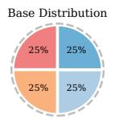

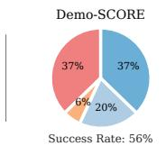

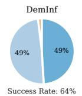

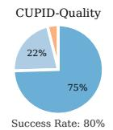  
Low Quality Low-Medium Quality Medium-High Quality High Quality

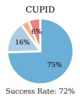

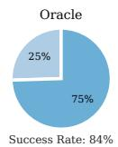

(a) Figure-8: Distribution of curated demonstrations after filtering 66%. Higher-quality demos are better.  
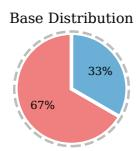

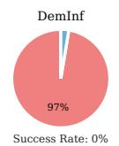

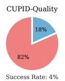

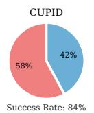

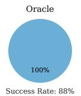

(b) TuckBox: Distribution of curated demonstrations afterfiltering 66%. Pick-and-place demos are better.  
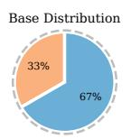

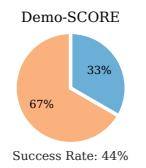

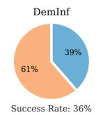

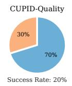  
Spuriously Correlated Balanced

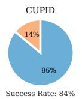

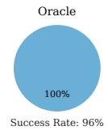  
(c) Bookshelf: Distribution of curated demonstrations afterfiltering 50%. Balanced data is better.  
Figure 5: Franka diffusion policy curated dataset distributions for filtering (Task 1). CUPID filters out lowerquality demonstrations (Figure-8), brittle strategies (TuckBox), and spuriously correlated examples (Bookshelf), improving policy performance across tasks. While curation heuristics employed by baselines may be effective in some cases (e.g., DemInf and CUPID-QUALITY in Figure-8), they can lead to suboptimal pruning in others.

Bookshelf analysis. Diffusion policy results are shown in Fig. 4(c). The base policy achieves only a 44% success rate, as the presence of the white background often causes the policy to extract the target book horizontally despite another book being stacked on top (causing it to fall). Interestingly, by train ing classifiers to distinguish failed from successful states, Demo-SCORE appears to misattribute failure to the presence of rollout correlates (the stacked book) rather than causal factors (the white background). In contrast, CUPID attains an 84% success rate by identifying demonstrations that causally drive failure— in this case, horizontal pulling motion with a white background—enabling dataset rebalancing that mitigates the effect of spurious correlations (see Fig. 5(c)). As in §6.2, DemInf and CUPID-QUALITY incorrectly prioritize the lower-variance horizontal pulling motion, yielding negligible performance gains.

## 7 Discussion & Ablations

## 7.1 How is curation performance affected by properties of the data and the task?

Our mixed-quality curation experiments (Fig. 3 and Fig. 4(a)) reveal that while curation strengthens performance on “Transport MH” and “Figure-8” (i.e., a fraction of the demonstrations harm policy performance), removing almost any demonstration degrades performance on “Square MH” (i.e., all demonstrations appear important). In contrast, only about 15% of the dataset is necessary to maximize performance on “Lift MH” (i.e., the dataset is highly redundant)3. These results indicate that the potential benefits ofdata curation depend on properties ofboth the data and the task. For example, one possible hypothesis is that curation is most effective in complex, precision-critical settings (e.g., “Transport MH”), whereas for tasks with greater tolerance for error (e.g., “Lift MH”), state-of-the-art policies [50] appear less sensitive to—and may even benefit from—training on lower-quality demonstrations.

## 7.2 How many policy rollouts are required for effective curation with CUPID?

CUPID uses a REINFORCE-style estimator to compute the performance influence of each demonstration (Eq. 3) for curation. Thus, the accuracy of estimated performance influences depends on the number of policy rollouts. While REINFORCE [16] often yields high-variance gradient estimates under limited rollout budgets, e.g., in reinforcement learning contexts [51], we highlight that our curation objective im poses a lower fidelity requirement: since curation with CUPID involves top-k selection (§5.2), it suffices to rank helpful demonstrations above harmful ones (requiring fewer rollouts) rather than to estimate performance influence precisely (requiring many rollouts). As shown in Fig. 6, the ranking of demon strations stabilizes with approximately m ∈ [25,50] rollouts on “Lift MH” and “Square MH,” and m ∈ [50,100] rollouts on “Transport MH.” Similarly, we use only $m = 2 5$ rollouts for our real-world Franka tasks (Fig. 4). These results support the practicality of CUPID under realistic rollout budgets, while noting that more complex tasks (e.g., “Transport MH”) may benefit from a greater number of rollouts.

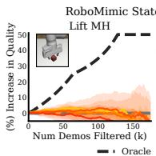

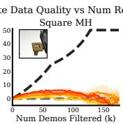

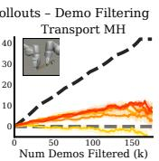

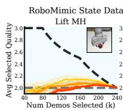

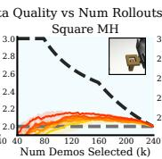

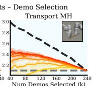  
Figure 6: CUPID ablation on the number of policy rollouts. Performance influences (Eq. 3) converge with m ∈ [25,50] rollouts on “Lift MH” and “Square MH” (yielding similar quality trends), and m ∈ [50,100] rollouts on “Transport MH,” validating the practical applicability of CUPID under realistic rollout budgets. Curation is performed on diffusion policies. Results are averaged over 3 random seeds. Errors bars represent standard error.

## 7.3 Can data curated for single-task policies strengthen generalist policy performance?

In Fig. 7, we show that datasets curated by CUPID for singletask diffusion policies can significantly improve the finetuned performance of a generalist Vision-Language-Action (VLA) model, π [21]. While CUPID is, in principle, tailored to the specific policy used during rollouts, it consistently identifies low-quality, stochastic behaviors in “Figure-8” and unreliable strategies in “TuckBox” (Fig. 5)—both intrinsic properties of the data. Filtering these poorer demonstrations (or selecting better ones) is thereby likely to improve the performance any policy. This highlights a promising direction to alleviate the computational cost of CUPID in large-scale

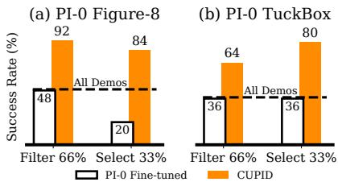  
Figure 7: Data curated for single-task diffusion policies improves π0 [21] post-training performance. Additional results in Fig. 15.

settings: use smaller, single-task policies to curate datasets for larger, multi-task models.

VLA Robustness. Fig. 7 also suggests that scaling the pre-training of VLA models does not inherently enable them to leverage their generalist knowledge to, e.g., ignore low-quality behaviors or brittle strategies in demonstration data. That is, data curation still appears important for VLA post-training.

## 8 Conclusion

In this work, we study the problem of data curation for robot imitation learning. We present CUPID, a novel data curation method that uses influence functions to measure the causal impact ofa demonstration on the policy’s closed-loop performance. Our results highlight the general utility of performance-based curation for two key curation tasks—filtering existing training demonstrations and subselecting new demonstrations—and across diverse curation settings, where a policy’s test-time performance varies with the choice of training data. Among many key problems in robotics, it is inherently difficult to develop strong intuitions about how training data influences downstream policy behavior, and to delineate why a policy trained exclusively on expert demonstration data would exhibit suboptimal performance at deployment. We hope this work spurs continued interest in pursuit of these questions.

## 9 Limitations

Curation tasks. The curation tasks considered in this work (Task 1 and Task 2) aim to curate performance-maximizing datasets for a specified filtering or selection quantity of demonstrations k. Determining the suitable quantity of demonstrations to curate represents a possible point of extension.

Data properties. Critically, future work should further investigate how properties of the data dictate the extent to which curation can improve policy performance, as discussed in §7.1.

Data explainability. Our methods focus on curating existing demonstrations as a first step. However, future work may seek to interpret the properties of influential demonstrations to actively inform subsequent data collection efforts—for example, by providing instructions to data collectors.

Selection methods. While the greedy selection procedures used in Eq. 4 and Eq. 5 are tractable to optimize and often improve over quality- and similarity-based measures [3], they ignore the interactions between demonstrations in the curated set [14, 48]. This can temper performance gains when the size of the curated set is large. Future work should investigate higher-order approximations that consider the joint diversity of the curated dataset, as is common in the active learning literature (e.g., [52, Sec. 4.3]).

Larger datasets. Estimating performance influences over the full demonstration dataset incurs a computational cost comparable to that of policy training. Reducing this expense in large-scale settings is an important future direction. For example, one could approximate group effects [14] via random sampling or limit influence estimation to smaller data subsets identified using coarse-grained heuristics.

Estimator variance. Finally, although we observe stable performance from CUPID across curation settings, the use of the REINFORCE estimator may result in high variance influence scores, e.g., when the number of policy rollouts is small. In such settings, variance reduction techniques, such as those typically used in reinforcement learning [51], may further improve the fidelity of our influence scores.

## Acknowledgments

The authors would like to thank Sam Park and Andrew Ilyas for the helpful conversations on data attribution, and Joey Hejna for early-staged technical feedback on the project. Toyota Research Institute provided funds to support this work. This work was also supported by the DARPA TIAMAT program.

## References

[1] R. Grosse, J. Bae, C. Anil, N. Elhage, A. Tamkin, A. Tajdini, B. Steiner, D. Li, E. Durmus, E. Perez, et al. Studying large language model generalization with influence functions. arXiv preprint arXiv:2308.03296, 2023.

[2] S. M. Park, K. Georgiev, A. Ilyas, G. Leclerc, and A. Madry. Trak: Attributing model behavior at scale. In International Conference on Machine Learning, pages 27074–27113. PMLR, 2023.

[3] L. Engstrom, A. Feldmann, and A. Madry. Dsdm: Model-aware dataset selection with datamodels. In International Conference on Machine Learning, pages 12491–12526. PMLR, 2024.

[4] K. Lee, D. Ippolito, A. Nystrom, C. Zhang, D. Eck, C. Callison-Burch, and N. Carlini. Deduplicating training data makes language models better. In S. Muresan, P. Nakov, and A. Villavicencio, editors, Proceedings of the 60th Annual Meeting of the Association for Computational Linguistics (Volume 1: Long Papers), pages 8424–8445, Dublin, Ireland, May 2022. Association for Computational Linguistics. doi:10.18653/v1/2022.acl-long.577. URL https://aclanthology.org/2022.acl-long.577/.

[5] K. Tirumala, D. Simig, A. Aghajanyan, and A. Morcos. D4: Improving llm pretraining via document de-duplication and diversification. Advances in Neural Information Processing Systems, 36:53983–53995, 2023.

[6] A. Albalak, Y. Elazar, S. M. Xie, S. Longpre, N. Lambert, X. Wang, N. Muennighoff, B. Hou, L. Pan, H. Jeong, C. Raffel, S. Chang, T. Hashimoto, and W. Y. Wang. A survey on data selection for language models. Transactions on Machine Learning Research, 2024. ISSN 2835-8856. URL https://openreview.net/forum?id=XfHWcNTSHp.

[7] A. O’Neill, A. Rehman, A. Maddukuri, A. Gupta, A. Padalkar, A. Lee, A. Pooley, A. Gupta, A. Mandlekar, A. Jain, A. Tung, A. Bewley, A. Herzog, A. Irpan, A. Khazatsky, A. Rai, A. Gupta, A. Wang, A. Singh, A. Garg, A. Kembhavi, A. Xie, A. Brohan, A. Raffin, A. Sharma, A. Yavary, A. Jain, A. Balakrishna, A. Wahid, B. Burgess-Limerick, B. Kim, B. Scholkopf, B. Wulfe,¨ B. Ichter, C. Lu, C. Xu, C. Le, C. Finn, C. Wang, C. Xu, C. Chi, C. Huang, C. Chan, C. Agia, C. Pan, C. Fu, C. Devin, D. Xu, D. Morton, D. Driess, D. Chen, D. Pathak, D. Shah, D. Buchler,¨ D. Jayaraman, D. Kalashnikov, D. Sadigh, E. Johns, E. Foster, F. Liu, F. Ceola, F. Xia, F. Zhao, F. Stulp, G. Zhou, G. S. Sukhatme, G. Salhotra, G. Yan, G. Feng, G. Schiavi, G. Berseth, G. Kahn, G. Wang, H. Su, H.-S. Fang, H. Shi, H. Bao, H. Ben Amor, H. I. Christensen, H. Furuta, H. Walke, H. Fang, H. Ha, I. Mordatch, I. Radosavovic, I. Leal, J. Liang, J. Abou-Chakra, J. Kim, J. Drake, J. Peters, J. Schneider, J. Hsu, J. Bohg, J. Bingham, J. Wu, J. Gao, J. Hu, J. Wu, J. Wu, J. Sun, J. Luo, J. Gu, J. Tan, J. Oh, J. Wu, J. Lu, J. Yang, J. Malik, J. Silverio, J. Hejna, J. Booher,´ J. Tompson, J. Yang, J. Salvador, J. J. Lim, J. Han, K. Wang, K. Rao, K. Pertsch, K. Hausman, K. Go, K. Gopalakrishnan, K. Goldberg, K. Byrne, K. Oslund, K. Kawaharazuka, K. Black, K. Lin, K. Zhang, K. Ehsani, K. Lekkala, K. Ellis, K. Rana, K. Srinivasan, K. Fang, K. P. Singh, K.-H. Zeng, K. Hatch, K. Hsu, L. Itti, L. Y. Chen, L. Pinto, L. Fei-Fei, L. Tan, L. J. Fan, L. Ott, L. Lee, L. Weihs, M. Chen, M. Lepert, M. Memmel, M. Tomizuka, M. Itkina, M. G. Castro, M. Spero, M. Du, M. Ahn, M. C. Yip, M. Zhang, M. Ding, M. Heo, M. K. Srirama, M. Sharma, M. J. Kim, N. Kanazawa, N. Hansen, N. Heess, N. J. Joshi, N. Suenderhauf, N. Liu, N. Di Palo, N. M. M. Shafiullah, O. Mees, O. Kroemer, O. Bastani, P. R. Sanketi, P. T. Miller, P. Yin, P. Wohlhart, P. Xu, P. D. Fagan, P. Mitrano, P. Sermanet, P. Abbeel, P. Sundaresan, Q. Chen, Q. Vuong, R. Rafailov, R. Tian, R. Doshi, R. Mart´ın-Mart´ın, R. Baijal, R. Scalise, R. Hendrix, R. Lin, R. Qian, R. Zhang, R. Mendonca, R. Shah, R. Hoque, R. Julian, S. Bustamante, S. Kirmani, S. Levine, S. Lin, S. Moore, S. Bahl, S. Dass, S. Sonawani, S. Song, S. Xu, S. Haldar, S. Karamcheti, S. Adebola, S. Guist, S. Nasiriany, S. Schaal, S. Welker, S. Tian, S. Ramamoorthy, S. Dasari, S. Belkhale, S. Park, S. Nair, S. Mirchandani, T. Osa, T. Gupta, T. Harada, T. Matsushima, T. Xiao, T. Kollar, T. Yu, T. Ding, T. Davchev, T. Z. Zhao, T. Armstrong, T. Darrell, T. Chung, V. Jain, V. Vanhoucke, W. Zhan, W. Zhou, W. Burgard, X. Chen, X. Wang, X. Zhu, X. Geng, X. Liu, X. Liangwei, X. Li, Y. Lu, Y. J. Ma, Y. Kim, Y. Chebotar, Y. Zhou, Y. Zhu, Y. Wu, Y. Xu, Y. Wang, Y. Bisk, Y. Cho, Y. Lee, Y. Cui, Y. Cao, Y.-H. Wu, Y. Tang, Y. Zhu, Y. Zhang, Y. Jiang, Y. Li, Y. Li, Y. Iwasawa, Y. Matsuo, Z. Ma, Z. Xu, Z. J. Cui, Z. Zhang, and Z. Lin. Open x-embodiment: Robotic learning datasets and rt-x models : Open x-embodiment collaboration0. In 2024 IEEE International Conference on Robotics and Automation (ICRA), pages 6892–6903, 2024. doi: 10.1109/ICRA57147.2024.10611477.

[8] A. Khazatsky, K. Pertsch, S. Nair, A. Balakrishna, S. Dasari, S. Karamcheti, S. Nasiriany, M. K. Srirama, L. Y. Chen, K. Ellis, P. D. Fagan, J. Hejna, M. Itkina, M. Lepert, Y. J. Ma, P. T. Miller, J. Wu, S. Belkhale, S. Dass, H. Ha, A. Jain, A. Lee, Y. Lee, M. Memmel, S. Park, I. Radosavovic, K. Wang, A. Zhan, K. Black, C. Chi, K. B. Hatch, S. Lin, J. Lu, J. Mercat, A. Rehman, P. R. Sanketi, A. Sharma, C. Simpson, Q. Vuong, H. R. Walke, B. Wulfe, T. Xiao, J. H. Yang, A. Yavary, T. Z. Zhao, C. Agia, R. Baijal, M. G. Castro, D. Chen, Q. Chen, T. Chung, J. Drake, E. P. Foster, J. Gao, D. A. Herrera, M. Heo, K. Hsu, J. Hu, D. Jackson, C. Le, Y. Li, R. Lin, Z. Ma, A. Maddukuri, S. Mirchandani, D. Morton, T. Nguyen, A. O’Neill, R. Scalise, D. Seale, V. Son, S. Tian, E. Tran, A. E. Wang, Y. Wu, A. Xie, J. Yang, P. Yin, Y. Zhang, O. Bastani, G. Berseth, J. Bohg, K. Goldberg, A. Gupta, A. Gupta, D. Jayaraman, J. J. Lim, J. Malik, R. Mart´ın-Mart´ın, S. Ramamoorthy, D. Sadigh, S. Song, J. Wu, M. C. Yip, Y. Zhu, T. Kollar, S. Levine, and C. Finn. DROID: A Large-Scale In-The-Wild Robot Manipulation Dataset. In Proceedings ofRobotics: Science and Systems, Delft, Netherlands, July 2024. doi:10.15607/RSS.2024.XX.120.

[9] S. Kuhar, S. Cheng, S. Chopra, M. Bronars, and D. Xu. Learning to discern: Imitating heterogeneous human demonstrations with preference and representation learning. In J. Tan, M. Toussaint, and K. Darvish, editors, Proceedings ofThe 7th Conference on Robot Learning, volume 229 of Proceedings ofMachine Learning Research, pages 1437–1449. PMLR, 06–09 Nov 2023.

[10] J. Hejna, S. Mirchandani, A. Balakrishna, A. Xie, A. Wahid, J. Tompson, P. Sanketi, D. Shah, C. Devin, and D. Sadigh. Robot data curation with mutual information estimators. arXiv preprint arXiv:2502.08623, 2025.

[11] A. S. Chen, A. M. Lessing, Y. Liu, and C. Finn. Curating demonstrations using online experience. arXiv preprint arXiv:2503.03707, 2025.

[12] P. De Haan, D. Jayaraman, and S. Levine. Causal confusion in imitation learning. Advances in neural information processing systems, 32, 2019.

[13] P. W. Koh and P. Liang. Understanding black-box predictions via influence functions. In International conference on machine learning, pages 1885–1894. PMLR, 2017.

[14] P. W. W. Koh, K.-S. Ang, H. Teo, and P. S. Liang. On the accuracy of influence functions for measuring group effects. Advances in neural information processing systems, 32, 2019.

[15] Z. Hammoudeh and D. Lowd. Training data influence analysis and estimation: A survey. Machine Learning, 113(5):2351–2403, 2024.

[16] R. S. Sutton, D. McAllester, S. Singh, and Y. Mansour. Policy gradient methods for reinforcement learning with function approximation. Advances in neural information processing systems, 12, 1999.

[17] A. Brohan, N. Brown, J. Carbajal, Y. Chebotar, J. Dabis, C. Finn, K. Gopalakrishnan, K. Hausman, A. Herzog, J. Hsu, J. Ibarz, B. Ichter, A. Irpan, T. Jackson, S. Jesmonth, N. Joshi, R. Julian, D. Kalashnikov, Y. Kuang, I. Leal, K.-H. Lee, S. Levine, Y. Lu, U. Malla, D. Manjunath, I. Mordatch, O. Nachum, C. Parada, J. Peralta, E. Perez, K. Pertsch, J. Quiambao, K. Rao, M. S. Ryoo, G. Salazar, P. R. Sanketi, K. Sayed, J. Singh, S. Sontakke, A. Stone, C. Tan, H. Tran, V. Vanhoucke, S. Vega, Q. H. Vuong, F. Xia, T. Xiao, P. Xu, S. Xu, T. Yu, and B. Zitkovich. RT-1: Robotics Transformer for Real-World Control at Scale. In Proceedings of Robotics: Science and Systems, Daegu, Republic of Korea, July 2023. doi:10.15607/RSS.2023.XIX.025.

[18] B. Zitkovich, T. Yu, S. Xu, P. Xu, T. Xiao, F. Xia, J. Wu, P. Wohlhart, S. Welker, A. Wahid, Q. Vuong, V. Vanhoucke, H. Tran, R. Soricut, A. Singh, J. Singh, P. Sermanet, P. R. Sanketi, G. Salazar, M. S. Ryoo, K. Reymann, K. Rao, K. Pertsch, I. Mordatch, H. Michalewski, Y. Lu, S. Levine, L. Lee, T.-W. E. Lee, I. Leal, Y. Kuang, D. Kalashnikov, R. Julian, N. J. Joshi, A. Irpan, B. Ichter, J. Hsu, A. Herzog, K. Hausman, K. Gopalakrishnan, C. Fu, P. Florence, C. Finn, K. A. Dubey, D. Driess, T. Ding, K. M. Choromanski, X. Chen, Y. Chebotar, J. Carbajal, N. Brown, A. Brohan, M. G. Arenas, and K. Han. Rt-2: Vision-language-action models transfer web knowledge to robotic control. In J. Tan, M. Toussaint, and K. Darvish, editors, Proceedings ofThe 7th Conference on Robot Learning, volume 229 of Proceedings ofMachine Learning Research, pages 2165–2183. PMLR, 06–09 Nov 2023. URL https://proceedings.mlr.press/v229/ zitkovich23a.html.

[19] Octo Model Team, D. Ghosh, H. Walke, K. Pertsch, K. Black, O. Mees, S. Dasari, J. Hejna, C. Xu, J. Luo, T. Kreiman, Y. Tan, L. Y. Chen, P. Sanketi, Q. Vuong, T. Xiao, D. Sadigh, C. Finn, and S. Levine. Octo: An open-source generalist robot policy. In Proceedings ofRobotics: Science and Systems, Delft, Netherlands, 2024.

[20] M. J. Kim, K. Pertsch, S. Karamcheti, T. Xiao, A. Balakrishna, S. Nair, R. Rafailov, E. P. Foster, P. R. Sanketi, Q. Vuong, T. Kollar, B. Burchfiel, R. Tedrake, D. Sadigh, S. Levine, P. Liang, and C. Finn. Openvla: An open-source vision-language-action model. In P. Agrawal, O. Kroemer, and W. Burgard, editors, Proceedings ofThe 8th Conference on Robot Learning, volume 270 of Proceedings ofMachine Learning Research, pages 2679–2713. PMLR, 06–09 Nov 2025.

[21] K. Black, N. Brown, D. Driess, A. Esmail, M. Equi, C. Finn, N. Fusai, L. Groom, K. Hausman, B. Ichter, et al. π0: A vision-language-action flow model for general robot control. URL https://arxiv.org/abs/2410.24164, 2024.

[22] A. Mandlekar, S. Nasiriany, B. Wen, I. Akinola, Y. Narang, L. Fan, Y. Zhu, and D. Fox. Mimicgen: A data generation system for scalable robot learning using human demonstrations. In J. Tan, M. Toussaint, and K. Darvish, editors, Proceedings of The 7th Conference on Robot Learning, volume 229 of Proceedings ofMachine Learning Research, pages 1820–1864. PMLR, 06–09 Nov 2023.

[23] T. Yu, T. Xiao, J. Tompson, A. Stone, S. Wang, A. Brohan, J. Singh, C. Tan, D. M, J. Peralta, K. Hausman, B. Ichter, and F. Xia. Scaling Robot Learning with Semantically Imagined Experience. In Proceedings of Robotics: Science and Systems, Daegu, Republic of Korea, July 2023. doi:10.15607/RSS.2023.XIX.027.

[24] Z. Mandi, H. Bharadhwaj, V. Moens, S. Song, A. Rajeswaran, and V. Kumar. Cacti: A framework for scalable multi-task multi-scene visual imitation learning. arXiv preprint arXiv:2212.05711, 2022.

[25] L. Smith, A. Irpan, M. G. Arenas, S. Kirmani, D. Kalashnikov, D. Shah, and T. Xiao. Steer: Flexible robotic manipulation via dense language grounding. arXiv preprint arXiv:2411.03409, 2024.

[26] M. Zawalski, W. Chen, K. Pertsch, O. Mees, C. Finn, and S. Levine. Robotic control via embodied chain-of-thought reasoning. In P. Agrawal, O. Kroemer, and W. Burgard, editors, Proceedings ofThe 8th Conference on Robot Learning, volume 270 of Proceedings ofMachine Learning Research, pages 3157–3181. PMLR, 06–09 Nov 2025.

[27] J. Hejna, C. A. Bhateja, Y. Jiang, K. Pertsch, and D. Sadigh. Remix: Optimizing data mixtures for large scale imitation learning. In P. Agrawal, O. Kroemer, and W. Burgard, editors, Proceedings of The 8th Conference on Robot Learning, volume 270 of Proceedings of Machine Learning Research, pages 145–164. PMLR, 06–09 Nov 2025.

[28] S. Dass, A. Khaddaj, L. Engstrom, A. Madry, A. Ilyas, and R. Mart´ın-Mart´ın. Datamil: Selecting data for robot imitation learning with datamodels. arXiv preprint arXiv:2505.09603, 2025.

[29] H. Shah, S. M. Park, A. Ilyas, and A. Madry. Modeldiff: A framework for comparing learning algorithms. In International Conference on Machine Learning, pages 30646–30688. PMLR, 2023.

[30] A. Ghorbani and J. Zou. Data shapley: Equitable valuation of data for machine learning. In International conference on machine learning, pages 2242–2251. PMLR, 2019.

[31] S. K. Choe, H. Ahn, J. Bae, K. Zhao, M. Kang, Y. Chung, A. Pratapa, W. Neiswanger, E. Strubell, T. Mitamura, et al. What is your data worth to gpt? llm-scale data valuation with influence functions. arXiv preprint arXiv:2405.13954, 2024.

[32] K. Georgiev, R. Rinberg, S. M. Park, S. Garg, A. Ilyas, A. Madry, and S. Neel. Attribute-to-delete: Machine unlearning via datamodel matching. In The Thirteenth International Conference on Learning Representations, 2025. URL https://openreview.net/forum?id=3vXpZpOn29.

[33] A. Madry, A. Ilyas, L. Engstrom, S. M. Park, and K. Georgiev. Data attribution at scale. https://ml-data-tutorial.org/, 2024. Tutorial at ICML 2024.

[34] S. Basu, P. Pope, and S. Feizi. Influence functions in deep learning are fragile. In International Conference on Learning Representations, 2021. URL https://openreview.net/forum? id=xHKVVHGDOEk.

[35] J. Bae, N. Ng, A. Lo, M. Ghassemi, and R. B. Grosse. If influence functions are the answer, then what is the question? Advances in Neural Information Processing Systems, 35:17953–17967, 2022.

[36] A. Ilyas and L. Engstrom. Magic: Near-optimal data attribution for deep learning. arXiv preprint arXiv:2504.16430, 2025.

[37] X. Zheng, T. Pang, C. Du, J. Jiang, and M. Lin. Intriguing properties of data attribution on diffusion models. In The Twelfth International Conference on Learning Representations, 2024. URL https://openreview.net/forum?id=vKViCoKGcB.

[38] K. Georgiev, J. Vendrow, H. Salman, S. M. Park, and A. Madry. The journey, not the destination: How data guides diffusion models. arXiv preprint arXiv:2312.06205, 2023.

[39] M. Xia, S. Malladi, S. Gururangan, S. Arora, and D. Chen. Less: Selecting influential data for targeted instruction tuning. In International Conference on Machine Learning, pages 54104– 54132. PMLR, 2024.

[40] Z. Liu, A. Karbasi, and T. Rekatsinas. Tsds: Data selection for task-specific model finetuning. Advances in Neural Information Processing Systems, 37, 2024.

[41] L. Engstrom, A. Ilyas, B. Chen, A. Feldmann, W. Moses, and A. Madry. Optimizing ml training with metagradient descent. arXiv preprint arXiv:2503.13751, 2025.

[42] S. Belkhale, Y. Cui, and D. Sadigh. Data quality in imitation learning. Advances in neural information processing systems, 36:80375–80395, 2023.

[43] J. A. Vincent, H. Nishimura, M. Itkina, P. Shah, M. Schwager, and T. Kollar. How generalizable is my behavior cloning policy? a statistical approach to trustworthy performance evaluation. IEEE Robotics andAutomation Letters, 2024.

[44] K. Gandhi, S. Karamcheti, M. Liao, and D. Sadigh. Eliciting compatible demonstrations for multi-human imitation learning. In K. Liu, D. Kulic, and J. Ichnowski, editors, Proceedings of The 6th Conference on Robot Learning, volume 205 of Proceedings of Machine Learning Research, pages 1981–1991. PMLR, 14–18 Dec 2023.

[45] Y. Cui, D. Isele, S. Niekum, and K. Fujimura. Uncertainty-aware data aggregation for deep imitation learning. In 2019 International Conference on Robotics and Automation (ICRA), pages 761–767. IEEE, 2019.

[46] S. Ross, G. Gordon, and D. Bagnell. A reduction of imitation learning and structured prediction to no-regret online learning. In Proceedings of the fourteenth international conference on artificial intelligence and statistics, pages 627–635. JMLR Workshop and Conference Proceedings, 2011.

[47] R. J. Williams. Simple statistical gradient-following algorithms for connectionist reinforcement learning. Machine learning, 8:229–256, 1992.

[48] A. Ilyas, S. M. Park, L. Engstrom, G. Leclerc, and A. Madry. Datamodels: Understanding predic tions with data and data with predictions. In K. Chaudhuri, S. Jegelka, L. Song, C. Szepesvari, G. Niu, and S. Sabato, editors, Proceedings ofthe 39th International Conference on Machine Learning, volume 162 of Proceedings ofMachine Learning Research, pages 9525–9587. PMLR, 17–23 Jul 2022.

[49] A. Mandlekar, D. Xu, J. Wong, S. Nasiriany, C. Wang, R. Kulkarni, L. Fei-Fei, S. Savarese, Y. Zhu, and R. Mart´ın-Mart´ın. What matters in learning from offline human demonstrations for robot manipulation. In A. Faust, D. Hsu, and G. Neumann, editors, Proceedings ofthe 5th Conference on Robot Learning, volume 164 of Proceedings of Machine Learning Research, pages 1678–1690. PMLR, 08–11 Nov 2022.

[50] C. Chi, Z. Xu, S. Feng, E. Cousineau, Y. Du, B. Burchfiel, R. Tedrake, and S. Song. Diffusion policy: Visuomotor policy learning via action diffusion. The International Journal of Robotics Research, page 02783649241273668, 2023.

[51] E. Greensmith, P. L. Bartlett, and J. Baxter. Variance reduction techniques for gradient estimates in reinforcement learning. Journal ofMachine Learning Research, 5(Nov):1471–1530, 2004.

[52] B. Settles. Active Learning. Morgan & Claypool Publishers, 2012.

[53] J. Ho, A. Jain, and P. Abbeel. Denoising diffusion probabilistic models. Advances in neural information processing systems, 33:6840–6851, 2020.

[54] Y. Song, J. Sohl-Dickstein, D. P. Kingma, A. Kumar, S. Ermon, and B. Poole. Score-based generative modeling through stochastic differential equations. In International Conference on Learning Representations, 2021. URL https://openreview.net/forum?id=PxTIG12RRHS.

[55] J. Lin, L. Tao, M. Dong, and C. Xu. Diffusion attribution score: Evaluating training data influence in diffusion model. In The Thirteenth International Conference on Learning Representations, 2025. URL https://openreview.net/forum?id=kuutidLf6R.

[56] J. Martens. New insights and perspectives on the natural gradient method. Journal ofMachine Learning Research, 21(146):1–76, 2020. URL http://jmlr.org/papers/v21/17-678. html.

[57] B. K. Mlodozeniec, R. Eschenhagen, J. Bae, A. Immer, D. Krueger, and R. E. Turner. Influence functions for scalable data attribution in diffusion models. In The Thirteenth International Conference on Learning Representations, 2025. URL https://openreview.net/forum? id=esYrEndGsr.

[58] T. Xie, H. Li, A. Bai, and C.-J. Hsieh. Data attribution for diffusion models: Timestep-induced bias in influence estimation. Transactions on Machine Learning Research, 2024. ISSN 2835-8856. URL https://openreview.net/forum?id=P3Lyun7CZs.

[59] W. B. Johnson, J. Lindenstrauss, et al. Extensions of lipschitz mappings into a hilbert space. Contemporary mathematics, 26(189-206):1, 1984.

[60] O. Khatib. A unified approach for motion and force control of robot manipulators: The operational space formulation. IEEE Journal on Robotics andAutomation, 3(1):43–53, 2003.

[61] E. J. Hu, Y. Shen, P. Wallis, Z. Allen-Zhu, Y. Li, S. Wang, L. Wang, W. Chen, et al. Lora: Low-rank adaptation of large language models. ICLR, 1(2):3, 2022.

[62] C. Agia, R. Sinha, J. Yang, Z. Cao, R. Antonova, M. Pavone, and J. Bohg. Unpacking failure modes of generative policies: Runtime monitoring of consistency and progress. In P. Agrawal, O. Kroemer, and W. Burgard, editors, Proceedings ofThe 8th Conference on Robot Learning, volume 270 of Proceedings of Machine Learning Research, pages 689–723. PMLR, 06–09 Nov 2025.

[63] Y. Dai, J. Lee, N. Fazeli, and J. Chai. Racer: Rich language-guided failure recovery policies for imitation learning. arXiv preprint arXiv:2409.14674, 2024.

[64] R. Sinha, A. Elhafsi, C. Agia, M. Foutter, E. Schmerling, and M. Pavone. Real-Time Anomaly Detection and Reactive Planning with Large Language Models. In Proceedings ofRobotics: Science and Systems, Delft, Netherlands, July 2024. doi:10.15607/RSS.2024.XX.114.

[65] K. He, X. Zhang, S. Ren, and J. Sun. Deep residual learning for image recognition. In Proceedings of the IEEE conference on computer vision and pattern recognition, pages 770–778, 2016.

[66] M. Oquab, T. Darcet, T. Moutakanni, H. Vo, M. Szafraniec, V. Khalidov, P. Fernandez, D. Haziza, F. Massa, A. El-Nouby, et al. Dinov2: Learning robust visual features without supervision. arXiv preprint arXiv:2304.07193, 2023.

## Appendix Overview – Curating Data your Robot Loves with Influence Functions

The appendix offers additional details w.r.t. the implementation of CUPID (§A), the experiments conducted (§B), along with extended results and analysis (§C), and finally, supporting derivations for our data curation methods (§D). Videos and code are made available at: https://cupid-curation.github.io.

Appendix A Implementation Details 18
A.1 Influence Functions for Diffusion Policies 18
A.2 CUPID Hyperparameters 19
A.3 Combining Score Functions 19
Appendix B Experimental Setup 20
B.1 Hardware Setup 20
B.2 Policy Architectures 20
B.3 Tasks & Datasets 21
B.4 Baseline Details 21
Appendix C Additional Results & Analysis 22
C.1 Extended Discussion on RoboMimic Results (§7.1) 22
C.2 Ablation on Number of Policy Rollouts in RoboMimic (§7.2) 23
C.3 Additional Data Quality Results in RoboMimic 24
C.4 Data Filtering Curation Distributions in Franka Real-World 24
C.5 Data Selection Curation Distributions in Franka Real-World 25
C.6 Additional Results for Franka π₀: Curated Dataset Transfer (§7.3) 25
Appendix D Derivations 26
D.1 Proof of Proposition 1 26
D.2 Derivation of Performance Influence for Variable Length Trajectories 27

## A Implementation Details

## A.1 Influence Functions for Diffusion Policies

For ease of reference in this section, we restate the definition of the action influence (Definition 2) and the proposition establishing performance influence (Proposition 1), both originally introduced in §5.

Restatement of Definition 2. The action influence ofa state-action pair $^ { ( s , a ) }$ on a test state-action pair $( s ^ { \prime } , a ^ { \prime } )$ is the influence $o f ( s , a )$ on the policy’s log-likelihood $\log \pi _ { \theta } ( a ^ { \prime } | s ^ { \prime } )$ . That $i s ,$ ,

$$
\Psi_ {a - \inf} ((s ^ {\prime}, a ^ {\prime}), (s, a)) := - \nabla_ {\theta} \log \pi_ {\theta} (a ^ {\prime} | s ^ {\prime}) ^ {\top} H _ {\mathrm{bc}} ^ {- 1} \nabla_ {\theta} \ell (s, a; \pi_ {\theta}).
$$

Restatement of Proposition 1. Assume that $\begin{array} { r } { \theta ( \mathcal { D } ) = \arg \operatorname* { m i n } _ { \theta ^ { \prime } } \mathcal { L } _ { \mathrm { b c } } ( \theta ^ { \prime } ; \mathcal { D } ) } \end{array}$ , that $\mathcal { L } _ { \mathrm { b c } }$ is twice differentiable in $\theta ,$ and that $H _ { \mathrm { b c } } \succ 0$ is positive definite $( i . e . , \theta ( \mathcal { D } )$ is not a saddle point)1. Then, it holds that 1

$$
\Psi_ {\pi - \inf} (\xi) = \mathbb {E} _ {\tau \sim p (\tau | \pi_ {\theta})} \left[ \frac {R (\tau)}{H} \sum_ {(s ^ {\prime}, a ^ {\prime}) \in \tau} \sum_ {(s, a) \in \xi} \Psi_ {a - \inf} \big ((s ^ {\prime}, a ^ {\prime}), (s, a) \big) \right].
$$

where $\Psi _ { \pi - \mathrm { i n f } } \left( \xi \right)$ is the performance influence of a demonstration ξ (as introduced in Definition 1).

## Computing the Action Influence

Although Proposition 1 provides a clean mechanism to attribute policy performance to its training data by leveraging influence scores on action log-likelihoods, computing $\nabla _ { \theta } \log \pi _ { \theta } ( a ^ { \prime } | s ^ { \prime } )$ (in the action influence $\Psi _ { a - \mathrm { i n f } } )$ for diffusion-based policy architectures is nontrivial due to the iterative denoising process [53, 54]. Instead, various works outside robotics propose to approximate the log-likelihood with the denoising loss $\ell ( s ^ { \prime } , a ^ { \prime } ; \pi _ { \theta } )$ for the purpose of data attribution [38], because the denoising loss is proportionate to the variational lower bound on log $\tau _ { \theta } ( a ^ { \prime } | s ^ { \prime } )$ . In $\ S 6 ,$ we apply a similar approximation to perform data attribution on state-of-the-art diffusion policies [50], which we describe below.

Diffusion Policy: Consider the standard diffusion policy architecture [50]. An action $a : = a ^ { 0 }$ is generated by iteratively denoising an initially random action $a ^ { T } \sim \mathcal { N } ( 0 , 1 )$ over $T$ steps as $a ^ { T } , \ldots , a ^ { 0 }$ using a noise prediction network $\epsilon _ { \theta }$ , where $a ^ { i }$ denotes the generated action at the i-th denoising iteration. Following the imitation learning setting described in §4, the parameters θ ofthe noise prediction network $\epsilon _ { \theta }$ are fit to the BC objective as θ =argmin ′ $\begin{array} { r } { \{ \mathcal { L } _ { \mathrm { b c } } ( \theta ^ { \prime } ; \mathcal { D } ) : = \frac { 1 } { | \mathcal { D } | H } { \sum _ { \xi ^ { i } \in \mathcal { D } } } { \sum _ { ( s , a ) \in \xi ^ { i } } } \ell ( s , a ; \pi _ { \theta ^ { \prime } } ) \} } \end{array}$ . Here, the noise prediction network $\epsilon _ { \theta }$ is trained to predict random noise $\epsilon ^ { i } \sim { \mathcal { N } } ( 0 , 1 )$ added to the action a at randomly sampled timesteps $i \sim \mathcal { U } [ 0 , T )$ of the diffusion process using the loss function ℓ defined as

$$
\ell (s, a; \pi_ {\theta^ {\prime}}) := \mathbb {E} _ {\epsilon^ {i}, i} \left[ | | \epsilon^ {i} - \epsilon_ {\theta^ {\prime}} (\sqrt {\bar {\alpha} _ {i}} a + \sqrt {1 - \bar {\alpha} _ {i}} \epsilon^ {i}, s, i) | | ^ {2} \right],\tag{7}
$$

where the constants $\bar { \alpha } _ { i }$ depend on the chosen noise schedule of the diffusion process.

Influence Approximations: Since the denoising loss ℓ in Eq. 7 is proportionate to the variational lower bound on the action log-likelihood log $\pi _ { \boldsymbol { \theta } } ( a | \boldsymbol { s } )$ , it may seem intuitive to substitute $\nabla _ { \theta } \log \pi _ { \theta } ( { a } ^ { \prime } | { s } ^ { \prime } )$ with $- \nabla _ { \boldsymbol { \theta } } \ell ( s ^ { \prime } , a ^ { \prime } ; \pi _ { \boldsymbol { \theta } } )$ —assuming gradient alignment—to approximate the action influence (Eq. 2) as

$$
\Psi_ {a - \inf} ((s ^ {\prime}, a ^ {\prime}), (s, a)) \approx \nabla_ {\theta} \ell (s ^ {\prime}, a ^ {\prime}; \pi_ {\theta}) ^ {\top} H _ {\mathrm{bc}} ^ {- 1} \nabla_ {\theta} \ell (s, a; \pi_ {\theta}).\tag{8}
$$

A similar approach is taken by Georgiev et al. [38] for attributing the generations of image-based diffusion models. However, consistent with more recent results in the data attribution literature $[ 3 7 , 5 5 ]$ we find this approximation to work poorly in practice, with highly influential training samples $( s , a ) \in \mathcal { D }$ rarely reflecting the test-time transitions $( s ^ { \prime } , a ^ { \prime } ) \in \tau$ over which the action influences are computed. Instead, we follow the approach of Zheng et al. [37], which entails replacing both logπθ $( a ^ { \prime } | s ^ { \prime } )$ and $\ell ( s , a ; \pi _ { \theta } )$ in Eq. 2 with a surrogate, label-agnostic output function $\ell _ { \mathrm { s q u a r e } } ( s , a ; \pi _ { \boldsymbol { \theta } } ) : = \mathbb { E } _ { \boldsymbol { \epsilon } ^ { i } , i } [ | | \epsilon _ { \boldsymbol { \theta } } ( \sqrt { \bar { \alpha } _ { i } } a +$ $\sqrt { 1 - \bar { \alpha } _ { i } } \epsilon ^ { i } , s , i ) | | ^ { 2 } ]$ ], making our final approximation of the action influence

$$
\Psi_ {a - \inf} ((s ^ {\prime}, a ^ {\prime}), (s, a)) \approx \nabla_ {\theta} \ell_ {\mathrm{square}} (s ^ {\prime}, a ^ {\prime}; \pi_ {\theta}) ^ {\top} H _ {\mathrm{square}} ^ {- 1} \nabla_ {\theta} \ell_ {\mathrm{square}} (s, a; \pi_ {\theta}).\tag{9}
$$

Here, $\begin{array} { r } { H _ { \mathrm { s q u a r e } } = \frac { 1 } { | \mathcal { D } | H } { \sum _ { \mathcal { E } ^ { i } \in \mathcal { D } } { \sum _ { ( s , a ) \in \mathcal { E } ^ { i } } { \nabla _ { \theta } \ell _ { \mathrm { s q u a r e } } ( s , a ; \pi _ { \theta } ) \nabla _ { \theta } \ell _ { \mathrm { s q u a r e } } ( s , a ; \pi _ { \theta } ) ^ { \top } } } } } \end{array}$ is the Gauss-Newton approximation of the Hessian—as introduced by Martens [56] and applied for stable and efficient influence estimation in [2, 35]—under the surrogate output function $\ell _ { \mathrm { s q u a r e } } .$

Additional Remarks: While the use of $\ell _ { \mathrm { s q u a r e } }$ may seem counterintuitive at first, it offers three key advantages for computing action influences:

1. Leave-one-out influences (§3) computed using $\ell _ { \mathrm { s q u a r e } } \left( \mathrm { E q . ~ } 9 \right)$ are empirically found to correlate better with actual changes in a diffusion model’s loss—i.e., the difference $\ell ( s ^ { \prime } , a ^ { \prime } ; \pi _ { \boldsymbol { \theta } ( \mathcal { D } \setminus ( s , a ) ) } ) - \ell ( s ^ { \prime } , a ^ { \prime } ; \pi _ { \boldsymbol { \theta } ( \mathcal { D } ) } )$ )—than those computed using the loss ℓ (Eq. 8) [37].

2. Theoretical analysis also shows that $\ell _ { \mathrm { s q u a r e } }$ more closely aligns with a distributional formulation of the leave-one-out influence compared to the loss ℓ [55]. In the case of diffusion policies, this distributional formulation would seek to design $\Psi _ { a - \mathrm { i n f } }$ such that it approximates the leave-one-out divergence $\Psi _ { a \cdot \mathrm { i n f } } \big ( \big ( s ^ { \prime } , a ^ { \prime } \big ) \big ) , \big ( s , a \big ) \big ) \approx D _ { \mathrm { K L } } \big ( \pi _ { \theta ( \mathcal { D } ) } \big ( a ^ { \prime } | s ^ { \prime } \big ) \big | \big | \pi _ { \theta ( \mathcal { D } \setminus \left( s , a \right) ) } \big ( a ^ { \prime } | s ^ { \prime } \big ) \big )$

3. Using $\ell _ { \mathrm { s q u a r e } }$ significantly reduces the computational cost of computing action influences for policies with high-dimensional action spaces, because the $\ell ^ { 2 } .$ -norm collapses the model’s prediction into a scalar $| | \epsilon _ { \theta } ( \sqrt { \bar { \alpha } _ { i } } a + \sqrt { 1 - \bar { \alpha } _ { i } } \epsilon ^ { i } , s , i ) | | ^ { 2 }$ . As a result, computing Eq. 9 requires only a single model gradient $\nabla _ { \boldsymbol { \theta } } \ell _ { \mathrm { s q u a r e } }$ per training and test sample. In contrast, while the technique proposed by Lin et al. [55] offers a more accurate estimate of the leave-one-out divergence $D _ { \mathrm { K L } } \big ( \pi _ { \boldsymbol { \theta } ( \mathcal { D } ) } \big ( \boldsymbol { a } ^ { \prime } | \boldsymbol { s } ^ { \prime } \big ) \big | \big | \pi _ { \boldsymbol { \theta } ( \mathcal { D } \setminus ( \boldsymbol { s } , \boldsymbol { a } ) ) } \big ( \boldsymbol { a } ^ { \prime } | \boldsymbol { s } ^ { \prime } \big ) \big )$ , its computational cost scales linearly with the dimensionality of the model’s output, which may be prohibitive.

Accuracy-Efficiency Tradeoff: We note that our approach for computing the performance influence of a demonstration $( \mathrm { E q } . 3 )$ is agnostic to the choice of influence estimation technique [38, 37, 55, 57, 58], allowing practitioners to trade off between accuracy and efficiency based on available computational resources, and enabling integration of improved data attribution methods $( \mathrm { e } . \mathrm { g } . , [ 3 6 ] )$ in the future.

## A.2 CUPID Hyperparameters

We use the same set of hyperparameters for CUPID and CUPID-QUALITY across all experiments.

Performance Influence $( \mathbf { E q } . 3 )$ : For all tasks, we define the trajectory return to be $R ( \tau ) = 1$ if τ completes the task and $R ( \tau ) = - 1$ otherwise. As a result, every rollout trajectory $\tau \sim p ( \cdot | \pi _ { \theta } )$ provides information on the utility of each demonstration toward the policy’s closed-loop performance. We also found CUPID to work with alternative return definitions—for example, focusing solely on successful rollouts by setting $R ( \tau ) = 0$ when τ fails. However, such choices may increase sample complexity.

Action Influence (Eq. 9): The action influence requires computing the gradient of an expectation $\nabla _ { \theta } \ell _ { \mathrm { s q u a r e } } ( s , a ; \pi _ { \theta } ) = \nabla _ { \theta } \mathbb { E } _ { \epsilon ^ { i } , i } [ | | \epsilon _ { \theta } ( \sqrt { \bar { \alpha _ { i } } } a + \sqrt { 1 - \bar { \alpha } _ { i } } \epsilon ^ { i } , s , i ) | | ^ { 2 } ]$ . For all tasks, we approximate the expectation using a batch of $B = 6 4$ samples $( \epsilon ^ { ( b ) } , i ^ { ( b ) } )$ ), where $\epsilon ^ { ( b ) } \sim \mathcal { N } ( 0 , 1 )$ and $i ^ { ( b ) } \sim \mathcal { U } [ 0 , T )$ are sampled independently.

Data Attribution: We leverage TRAK [2] to efficiently compute action influences as defined in Eq. 9. First, TRAK uses random projections $\mathbf { P } \sim \mathcal { N } ( 0 , 1 ) ^ { p \times \tilde { d } }$ , where p is the number of model parameters and $d < < p$ is the specified projection dimension, to reduce the dimensionality of the gradients as $g _ { \theta } { = } \mathbf { P } ^ { \top } \nabla _ { \theta } \ell _ { \mathrm { s q u a r e } }$ while preserving their inner products $g _ { \theta } \cdot g _ { \theta } \approx \nabla _ { \theta } \ell _ { \mathrm { s q u a r e } } \cdot \nabla _ { \theta } \ell _ { \mathrm { s q u a r e } } \left[ 5 9 \right]$ . Second, TRAK ensembles influence scores over C independently trained models (i.e., from different seeds) to account for non-determinism in learning. In our experiments, we use the standard projection dimension $d { = } 4 0 0 0$ and minimize computational cost by using only a single policy checkpoint $C = 1$ , noting that ensembling over $C > 1$ policy checkpoints is likely to improve the accuracy of our influence scores.

## A.3 Combining Score Functions

For ease ofexposition in §5.3, we express the overall score ofa demonstration as the convex combination of its performance influence and its quality score α $\Psi _ { \pi - \mathrm { i n f } } + ( 1 - \alpha ) \Psi _ { \mathrm { q u a l } }$ , where $\alpha = 1$ and $\alpha \in [ 0 , 1 )$ instantiates CUPID and CUPID-QUALITY, respectively. Here, we additionally note that taking weighted combinations of score functions requires first normalizing them to equivalent scales. Hence, our implementation uniformly normalizes demonstration scores within the range [0,1] (i.e., producing an absolute ranking of demonstrations) for each score function $\Psi _ { \pi - \mathrm { i n f } }$ and $\Psi _ { \mathrm { q u a l } }$ before combining them. This simple approach can be applied to combine an arbitrary number of demonstration score functions.

## B Experimental Setup

## B.1 Hardware Setup

As depicted in Fig. 4, our hardware experiments involve a Franka FR3 manipulator robot. We use a single ZED 2 camera to capture RGB-D observations and disregard the depth information. Our image-based policies process 256×256 downsampled RGB observations and predict sequences of end-effector poses for the manipulator, which are tracked using operational space control [60].

## B.2 Policy Architectures

Diffusion Policy (DP): We use the original diffusion policy implementation4 from Chi et al. [50]. Specifically, we use the convolutional-based diffusion policy architecture for efficiency. For state-based tasks $( \mathrm { e . g . }$ , in RoboMimic; Fig. 3), actions are generated solely using the noise prediction network $\epsilon _ { \theta }$ as described in §A.1. However, for image-based tasks (e.g., on hardware; Fig. 4), the policy $\pi _ { \theta }$ contains two sets of parameters $\theta = \left( \theta _ { o } , \theta _ { a } \right)$ corresponding to a ResNet-18 encoder $E _ { \theta _ { c } }$ and the noise prediction network $\epsilon _ { \theta _ { a } }$ . When scoring demonstrations, we compute action influences $( \mathrm { E q . 9 } )$ over all available policy parameters θ, noting that one might also consider using a subset of the parameters, e.g., those of the noise prediction network or an alternative action head, under reduced computational budgets.

Other optimizations: In preliminary experiments, we found that the original diffusion policy (a) was heavily over-parameterized and (b) converged in performance much earlier in training than the specified maximum number of epochs. Thus, to accelerate experimentation in RoboMimic (Fig. 3), we (a) manually determined the smallest model size that performed similarly to the original policy and (b) adjusted the maximum number of epochs to the point where additional training would result in no further performance gains. Importantly, we keep the model size and training epochs consistent across all curation methods for a given RoboMimic task. For real-world hardware experiments, we use the same model size and limit the number of training steps to 200K across all tasks, similar to Hejna et al. [10]. All other diffusion policy hyperparameters are consistent with the original implementation [50].

Generalist Robot Policy $( \pi _ { 0 } ) \colon$ We fine-tune Physical Intelligence’s $\pi _ { 0 }$ Vision-Language-Action (VLA) policy5 via Low-Rank Adaptation (LoRA) [61] on the “Figure-8” and “TuckBox” tasks. To ensure the post-trained policy’s performance is solely a result of the properties of the curated dataset used for training, we use the standard fine-tuning parameter configuration from Black et al. [21] and keep all hyperparameters fixed across experiments (see Table 1). We trained on 2 NVIDIA RTX 4090 GPUs, which took approximately 15 hours under the configuration in Table 1. In initial experiments, we found that training for 30K steps was necessary to compensate for mismatch between our robot’s action space (target end-effector poses tracked via operational space control) and the action spaces used to pre-train

<table><tr><td>Hyperparameter</td><td>Value</td></tr><tr><td>Training steps</td><td>30,000</td></tr><tr><td>Batch size</td><td>16</td></tr><tr><td>Optimizer</td><td>AdamW</td></tr><tr><td>Learning rate schedule</td><td>Cosine decay</td></tr><tr><td>EMA</td><td>Disabled</td></tr><tr><td>Action chunk length</td><td>50 steps</td></tr><tr><td>Control frequency</td><td>10 Hz</td></tr><tr><td>Image resolution</td><td>224 × 224</td></tr><tr><td>Observation history</td><td>1 frame</td></tr><tr><td>VLM backbone LoRA</td><td>Rank = 16, α = 16</td></tr><tr><td>Action expert LoRA</td><td>Rank = 32, α = 32</td></tr></table>

Table 1: Hyperparameter configuration used for $\pi _ { 0 }$ [21] post-training.

the base $\pi _ { 0 }$ policy (absolute joint angles). In addition, we found that using a descriptive prompt for the task was necessary to yield performant policies. We kept these prompts fixed across training, evaluation, and all curation settings. For the “TuckBox” task, we used the instruction “Move the blue box underneath the white shelf” to avoid biasing the policy towards a particular behavior mode (e.g., “sliding” or “pick-and-place”). For the “Figure-8” task, we used the instruction “Pick up the red rope, then tie a figure $8 ,  { \mathrm { ^ { * } } }$ where we found the two-step instruction to increase performance over shorter instructions like “Tie the cleat.” Similar to the diffusion policy experiment, we fine-tune a separate π model for each curation task—filter-k (Task 1) and select-k (Task 2)—using their corresponding base demonstration datasets. We then fine-tune additional $\pi _ { 0 }$ models on datasets curated by our methods.

## B.3 Tasks & Datasets

Here, we provide additional details regarding our real-world hardware tasks and their corresponding datasets. We refer to Mandlekar et al. [49] for details on the simulated RoboMimic benchmark.

Figure-8: A brief description of the task is provided in §6.1. The “Figure-8” dataset contains 160 demonstrations evenly split across four quality tiers. Higher quality demonstrations complete the task at a constant rate without errors, while lower-quality demonstrations vary in progression rate [62] and include retry or recovery behaviors. Therefore, the “Figure-8” task intends to reflect a practical setting where demonstrations of varying properties are introduced during data collection, whether organically or deliberately, e.g., to improve policy robustness to recoverable failures [63]. Therefore, we expect curation algorithms that distinguish demonstrations upon notions of quality (e.g., predictability [10]) to perform well on this task, which is consistent with our findings in Fig. 4(a) and Fig. 7(a).

TuckBox: A brief description of the task is provided in §6.2. As mentioned, the “TuckBox” dataset contains 120 demonstrations split 2:1 between two subsets: 80 demonstrations solve the task by sliding the box under the receptacle, while 40 demonstrations first reposition the box in front of the receptacle via pick-and-place. Although the sliding strategy appears more smooth and involves just a single step, it is rendered unreliable by imperceptible test-time distribution shifts to the box’s mass distribution. As such, “TuckBox” stands conceptually opposite to “Figure-8,” whereby attending to heuristic properties of demonstrations (e.g., quality) may result in poor curation performance (as shown in Fig. 4(b)).

Bookshelf: A brief description of the task is provided in §6.3. To summarize, the robot must extract a target book that is either shelved alone—affording a simple, horizontal pulling motion—or with another book stacked on top of it (i.e., a bookstack). In the bookstack case, the robot must extract the target book using a vertical pulling motion, such that the stacked book does not fall off the shelf in the process (see Fig. 4(c)). In total, the “Bookshelf” dataset contains 120 demonstrations split across three subsets: (a) 60 demonstrations feature the target book shelved alone with a white background, (b) 20 demonstrations feature the bookstack with a white background, and (c) 40 demonstrations feature the bookstack with a dark background. All subsets feature task-irrelevant distractor books on other shelves.

Spurious correlations in training data: Although the vertical pulling solution to the bookstack case is demonstrated in scenes with both white and dark backgrounds, the disproporionate number of demonstrations in subset (a) versus subset (b) spuriously correlates the horizontal pulling motion with the white background. Such spurious correlations may result in causal confusion [12], where the policy ignores the bookstack, attends the white background, and executes the failing horizontal strategy.

Spurious correlations in rollout data: Like “TuckBox,” “Bookshelf” represents another limiting case for curating data with quality metrics [10]. However, it also presents an additional challenge for methods that seek to curate data using online experience [11]. For example, approaches that attend to differences in states between successful and failed policy rollouts may be susceptible to spurious correlations in the rollout data. Consider the simple case: if we were to observe successful rollouts when the target book is shelved alone and failed rollouts when another book is stacked above the target, then training a classifier (i.e., as in Demo-SCORE [11]) to distinguish successful from failed states may wrongly attribute failures to the presence of the stacked book. Curating demonstrations with such a classifier would, in turn, worsen the spurious correlation in the training data. Thus, we posit that handling more challenging cases of spurious correlations in real-world data will require methods that causally attribute the outcomes of observed test-time experiences to the training data, such as CUPID.

## B.4 Baseline Details

DemInf: We use the official implementation6 provided by Hejna et al. [10]. We note that DemInf curates data offline—that is, without using any policy rollouts—and is at present only applicable to the demonstration filtering setting (i.e., filter-k, as defined in Task 1).

Demo-SCORE: We construct our own implementation based on the description provided by the authors [11]. Given our assumed fixed budget of m=100 rollouts for RoboMimic experiments (§6), we collect 25 rollouts from C =4 policy checkpoints throughout training. We train three-layer MLP classifiers with hidden dimensions [16,16,16] on the first three rollout sets, and select the best classifier via cross-validation on the last 25 rollouts, as described in [11]. Since we reduce the rollout budget to $m = 2 5$ rollouts for hardware experiments (§6), we collect 25 rollouts from the last $C = 1$ policy checkpoint. We then train a single ResNet-18 encoder and three-layer classification head with hidden dimensions [32,32,32] on 20 of the rollouts, leaving 5 validation rollouts to monitor for overfitting. We train all classifiers with a heavy dropout of 0.3 and an AdamW weight decay of 0.1 to prevent overfitting, in alignment with [11]. Although Chen et al. [11] only test Demo-SCORE for demonstration filtering, we extend its use for demonstration selection (i.e., select-k, as defined in Task 2).

Success Similarity: We design a custom robot data curation algorithm that, similar to Demo-SCORE, valuates demonstrations based on a heuristic measure of similarity w.r.t. successful policy rollouts. Instead of training classifiers, Success Similarity measures the average state-embedding similarity of a demonstration w.r.t. all successful rollouts as

$$
S (\xi ; \mathcal {D} _ {\tau}) = - \sum_ {\tau \in \mathcal {D} _ {\tau}} \left[ \mathbf {1} (R (\tau) = 1) \cdot \frac {1}{H ^ {2}} \sum_ {s ^ {\prime} \in \tau} \sum_ {s \in \xi} D \bigl (\phi (s ^ {\prime}), \phi (s) \bigr) \right],
$$

where the indicator function 1 evaluates to 1 if rollout τ is successful and 0 otherwise, H is the assumed length of all demonstrations $\xi \in \mathcal { D }$ and rollouts $\tau \in \mathcal { D } _ { \tau }$ for notational simplicity, ϕ is the state embedding function, and D is a specified distance function over state embeddings [64], such as the Mahalanobis, L2, or cosine distance. For image-based states, we experimented with various embedding functions ϕ, including ResNet [65], DINOv2 [66], and the policy’s vision encoder [62], and ultimately found the policy’s vision encoder to work best in RoboMimic. The embedding function is set to identity for low-dimensional states $( \mathrm { i } . \mathrm { e } . , \phi ( s ) = s )$ . Lastly, the distance function D is chosen for compatibility with ϕ: e.g., L2 distance for policy encoder embeddings and cosine distance for DINOv2 embeddings.

Comparison to Performance Influence (CUPID): One can interpret Success Similarity as replacing the action influence $\Psi _ { a - \mathrm { i n f } } \big ( \big ( s ^ { \prime } , a ^ { \prime } \big ) , ( s , a ) \big ) ( \mathrm { E q . } 2 )$ with a state-based proxy $- D ( \phi ( s ^ { \prime } ) , \phi ( s ) )$ in an attempt to estimate the performance contribution of a demonstration (Eq. 3). In our RoboMimic experiments (Fig. 3), this approach performs comparably to Demo-SCORE and, in some cases, even outperforms it—without requiring the training of any additional models. However, Success Similarity performs consistently worse than CUPID across all tasks, supporting prior findings that influence functions offer a substantially stronger causal signal than heuristic measures of similarity [2].

Oracle: For each task, the Oracle method represents a best attempt to curate data assuming privileged access to ground-truth demonstration labels. For the RoboMimic and “Figure-8” tasks, the Oracle ranks demonstrations in descending order of quality, choosing high-quality demonstrations before low-quality demonstrations. For the “TuckBox” task, the Oracle first chooses all demonstrations exhibiting the more robust pick-and-place strategy before any demonstration exhibiting the more brittle sliding strategy. Lastly, for the “Bookshelf” task, the Oracle chooses demonstrations to minimize the effect of the known spurious correlation (i.e., horizontal pulling motion in the presence of a white background), resulting in a more balanced curated dataset. These definitions of the Oracle apply identically to the filter-k (Task 1) and select-k (Task 2) curation tasks studied throughout this work.

Additional baselines: We implement a number of additional custom baselines that one might try in practice, such as curating data based on policy loss, policy uncertainty, state diversity, and action diversity. However, we exclude them from our experiments given their relatively poor performance.

## C Additional Results & Analysis

We present additional results and ablations for our RoboMimic and Franka real-world tasks that were cut from the main text due to space constraints.

## C.1 Extended Discussion on RoboMimic Results (§7.1)

We provide an extended discussion on §7.1 for our RoboMimic simulation results.

Performance versus Data Quality: One of our key findings is that the performance of a state-of-theart policy does not strictly correlate with the perceived quality of its training data. Factors such as redundancy, balance, and coverage of the dataset all play a role in determining policy performance. This is illustrated in the Oracle filter-k results (left three plots of Fig. 3). While the top row shows a monotonic increase in average dataset quality as lower-quality demonstrations are filtered out, the bottom row reveals (1) a consistent performance drop for diffusion policies on 2 out of 3 tasks, and (2) as expected, performance degradation when too many demonstrations are removed. Similar analysis applies to the select-k setting. These results highlight two important points: First, the impact of dataset curation should not be judged by quality labels alone, but by the downstream performance of models trained on curated datasets. Second, determining how much data to curate (i.e., the k in filter-k and select-k) remains another key challenge for effective data curation in practice.

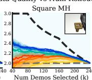

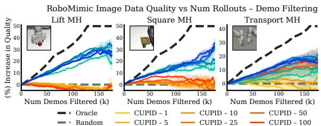

Performance versus Task Complexity: We evaluate curation performance across three RoboMimic tasks of increasing complexity—“Lift MH,” “Square MH,” and “Transport MH.” On the simplest task, “Lift $\mathrm { M H } _ { \mathfrak { s } } ^ { \mathfrak { s } }$ diffusion policies achieve 100% success despite training on all demonstrations, indicating that low-quality demonstrations have minimal impact and can be safely filtered. We observe a similar trend for the moderately difficult “Square MH” task, where the policy benefits from access to all demonstrations regardless of their quality. However, performance degrades more quickly as demonstrations are filtered, suggesting increased sensitivity to data quantity due to the task’s higher complexity relative to “Lift MH.” Finally, on the challenging “Transport $\mathbf { M H } ^ { \prime \prime }$ task, which requires precise bi-manual coordination, both CUPID and CUPID-QUALITY significantly outperform the base policy. These results suggest that curation of mixed-quality datasets is most beneficial for complex, precision-critical tasks, where training on lower-quality data is more likely to hinder performance.

## C.2 Ablation on Number of Policy Rollouts in RoboMimic (§7.2)

We conduct an ablation study in RoboMimic evaluating the quality of datasets curated by CUPID and CUPID-QUALITY under varying numbers of rollouts, $m \in \{ 1 , 5 , 1 0 , 2 5 , 5 0 , 1 0 0 \}$ . The results for state-based and image-based diffusion policies are shown in Fig. 8 and Fig. 9, respectively. For “Lift $\mathbf { M H } ^ { \prime \prime }$ and “Square $\mathrm { M H } _ { \ l } ^ { \ l , \ d }$ performance influences $( \mathrm { E q } . 3 )$ ) stabilize around $m \in [ 2 5 , 5 0 ]$ , yielding quality trends similar to those obtained with $m { = } 1 0 0$ . For “Transport $\mathrm { M H } _ { \ l } ^ { \ l ^ { \prime } }$ quality trends continue to evolve until approximately $m \in [ 5 0 , 1 0 0 ]$ rollouts, indicating that more rollouts are beneficial for accurate influence estimation in complex task settings—where curation has the greatest effect on performance.

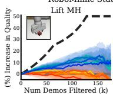

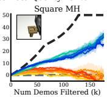  
CUPID – 1 CUPID – 10 CUPID – 50 CUPID – 5 CUPID – 25 CUPID – 10

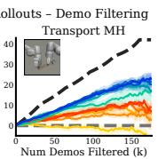

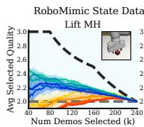

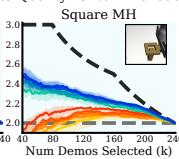

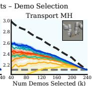  
CUPID-Quality – 1 CUPID-Quality – 10 CUPID-Quality – 50 CUPID-Quality – 5 CUPID-Quality – 25 CUPID-Quality – 100  
Figure 8: RoboMimic state ablation: Data quality trends under varying number of rollouts. Performance influences (Eq. 3) converge around $m \in [ 2 5 , 5 0 ]$ ] rollouts for “Lift MH” and “Square $\mathbf { M H } ^ { \prime \prime }$ (yielding similar quality trends), but continue to evolve until m ∈ [50,100] rollouts for “Transport MH.” Curation performed on state-based diffusion policies. Results are averaged over 3 random seeds. Errors bars represent the standard error.

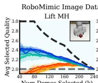

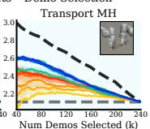  
CUPID-Quality – 1 CUPID-Quality – 10 CUPID-Quality – 50 CUPID-Quality – 5 CUPID-Quality – 25 CUPID-Quality – 100  
Figure 9: RoboMimic image ablation: Data quality trends under varying number of rollouts. Performance influences (Eq. 3) converge around $m \in [ 2 5 , 5 0 ]$ rollouts for “Lift MH” and “Square MH” (yielding similar quality trends), but continue to evolve until $m \in [ 5 0 , 1 0 0 ]$ rollouts for “Transport MH.” Curation performed on image-based diffusion policies. Results are averaged over 3 random seeds. Errors bars represent the standard error.

Success Similarity

Low Quality

CUPID-Quality

## C.3 Additional Data Quality Results in RoboMimic

We provide full data quality results in RoboMimic. Fig. 10 is identical to the top row of Fig. 3 in the main text, but also includes data quality trends for select-k curation on “Lift MH.” Fig. 11 shows data quality results for image-based diffusion policies. We do not retrain image-based policies on curated datasets (as in the bottom row of Fig. 3) due to the substantial computational resources required.

CUPID CUPID-Quality  
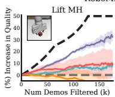

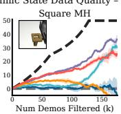

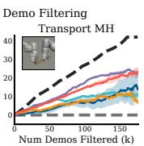

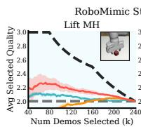

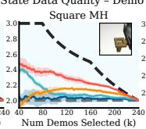

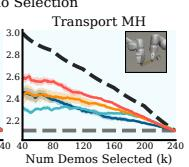  
Figure 10: RoboMimic state data quality results. Curation performed on state-based diffusion policies. Results are averaged over 3 random seeds. Errors bars represent the standard error.

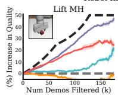

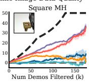

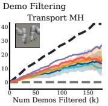

  
Figure 11: RoboMimic image data quality results. Curation performed on image-based diffusion policies. Results are averaged over 3 random seeds. Errors bars represent the standard error.

## C.4 Data Filtering Curation Distributions in Franka Real-World

Uniform Random

  
Demo-SCORE

  
Success Rate: 56%

  
Success Rate: 64%  
Low-Medium Quality  
CUPID-Quality

  
Success Rate: 80%  
Medium-High Quality

  
Success Rate: 72%  
High Quality

  
Success Rate: 84%

(a) Figure-8: Distribution of demonstrations filtered. Filtering lower-quality demos is better.  

  
Success Rate: N/A

  
Sliding Strategy (Unreliable)  
Success Rate: 0%

  
Success Rate: 4%  
Pick-and-Place Strategy (Robust)

  
Success Rate: 84%

  
Success Rate: 88%

(b) TuckBox: Distribution of demonstrationsfiltered. Filtering sliding demos is better.  

  
Success Rate: 44%

  
Spuriously Correlated

  
Success Rate: 20%  
Balanced

  
Success Rate: 84%

  
Success Rate: 96%

(c) Bookshelf: Distribution of demonstrationsfiltered. Filtering spurious correlations is better.

Figure 12: Franka diffusion policy – distribution of demonstrations filtered (S⋆ in Task 1). See Fig. 5 for distributions of the corresponding curated datasets used for policy training.

Success Rate: 16%

Demo-SCORE

Success Rate: 76%

Sliding Strategy (Unreliable)

Success Rate: 36%

Success Rate: 36%

Success Rate: N/A

## C.5 Data Selection Curation Distributions in Franka Real-World

  
Success Rate: 72%  
Success Rate: 84%

  
Low Quality Low-Medium Quality Medium-High Quality High Quality

(a) Figure-8: Distribution of curated demonstrations after selecting 33%. Higher-quality demos are better.  

  
Sliding Strategy (Unreliable)

  
(b) TuckBox: Distribution of curated demonstrations after selecting 33%. Pick-and-place demos are better.  
Figure 13: Franka diffusion policy curated dataset distributions for selection (Task 2). CUPID selects higher-quality demonstrations (Figure-8) and robust strategies (TuckBox), improving policy performance across tasks (see Fig. 4). While curation heuristics employed by baselines may be effective in some cases (e.g., CUPID-QUALITY in Figure-8), they can lead to suboptimal selection in others.

  
Low Quality Low-Medium Quality Medium-High Quality High Quality

(a) Figure-8: Distribution of demonstrations selected. Selecting higher-quality demos is better.  

  
Success Rate: 88%

  
Success Rate: 92%

(b) TuckBox: Distribution of demonstrations selected. Selecting pick-and-place demos is better.

Figure 14: Franka diffusion policy – distribution of demonstrations selected (S⋆ in Task 2). See Fig. 13 for distributions of the corresponding curated datasets used for policy training.

## C.6 Additional Results for Franka π : Curated Dataset Transfer (§7.3)

Fig. 15 contains the full results of our π0 ablation (Fig. 7), including the performance of $\dot { } \pi _ { 0 }$ [21] trained on datasets curated by CUPID and CUPID-QUALITY for both the “Figure-8” and “TuckBox” tasks.

  
Figure 15: Data curated for single-task diffusion policies improves $\pi _ { 0 } \left[ 2 1 \right]$ post-training performance. As in Fig. 4, quality measures (CUPID-QUALITY) may degrade performance when higher-quality demonstrations induce brittle strategies at test time (TuckBox), whereas curating based on performance (CUPID) is robust across settings.

In this experiment, we investigate two questions: (1) Can datasets curated with one policy architecture result in increased performance when used to train another policy with a different architecture? (2) How influential is curation for policies that have been pre-trained on large-scale multi-task datasets?

Curation Transfer: Towards the first question, Fig. 15 shows that datasets curated using diffusion policies significantly increase the performance of fine-tuned $\pi _ { 0 }$ policies relative to fine-tuning on the base, uncurated datasets. We attribute these results to two causes: First, we find that both the diffusion policy and $\pi _ { 0 }$ have sufficient capacity to accurately fit the training data distribution, and thus, they should learn a similar behavior distribution from the training data. This implies that the observed performance gains in Fig. 15 result from curation transfer between policies. Second, as the “TuckBox” experiment shows in Fig. 4(b), our method is able to effectively identify behaviors in the demonstration data that are not robust. While on-policy evaluations (i.e., rollouts) are necessary to identify such brittle behaviors, these are purely properties of the training demonstration data. Therefore, filtering out poor behaviors will increase the performance of any policy. Similarly, on the high-precision “Figure-8” task, filtering out more noisy, low-quality demonstrations is likely to improve performance for any policy.

VLA Robustness: Towards the second question, we find that even when the base policy is pre-trained on a large, diverse, multi-task dataset, curation is still essential to yield strong fine-tuned performance. As shown in Fig. 15, π policies trained on the base demonstration datasets are unable to reliably complete our tasks. In contrast, policies trained on curated datasets attain significantly higher success rates. As such, our results indicate that simply training VLM-based policies on more data and more tasks does not strictly result in pre-conditioned policies that use their generalist knowledge to “ignore” low-quality behaviors or brittle strategies in demonstration data—i.e., data curation still appears essential.

Concluding Remarks: Overall, these results indicate that using smaller, single-task policies to curate individual datasets, which may then benefit a larger, multi-task policy is a promising direction to alleviate the computational cost of applying our method to generalist policies. Still, we emphasize that datasets curated using our method are not completely model agnostic, as the same demonstrations may influence different models in different ways. As such, while $\pi _ { 0 }$ achieves a higher base performance than the diffusion policy, the $\pi _ { 0 }$ policies trained on curated datasets perform similarly to or slightly worse than the diffusion policies (for which those datasets were curated).

## D Derivations

## D.1 Proof of Proposition 1

Proof. As presented in §3, applying the basic derivation of the influence function1 in [13] gives us that

$$
\begin{array}{r l} & {\Psi_ {\pi \text {-inf}} (\xi) := \frac {d J (\pi_ {\theta})}{d \epsilon} \bigg | _ {\epsilon = 0}} \\ & {\qquad = - \nabla_ {\theta} J (\pi_ {\theta}) ^ {\top} \nabla_ {\theta} ^ {2} \mathcal {L} _ {\mathrm{bc}} (\theta ; \mathcal {D}) ^ {- 1} \nabla_ {\theta} \ell_ {\mathrm{traj}} (\xi ; \pi_ {\theta}).} \end{array}
$$

Next, note that the standard log-derivative trick underlying policy gradient methods [16, 47] tells us that

$$
\nabla_ {\theta} J (\pi_ {\theta}) = \mathbb {E} _ {\tau \sim p (\tau | \pi_ {\theta})} \left[ R (\tau) \sum_ {(s ^ {\prime}, a ^ {\prime}) \in \tau} \nabla_ {\theta} \log \pi_ {\theta} (a ^ {\prime} | s ^ {\prime}) \right].
$$

Therefore, since ${ \mathcal { L } } _ { \mathrm { b c } }$ and $\ell _ { \mathrm { t r a j } }$ are deterministic functions of $\theta , \xi ,$ and ${ \mathcal { D } } ,$ it holds that

$$
\Psi_ {\pi - \inf} (\xi) = \mathbb {E} _ {\tau \sim p (\tau | \pi_ {\theta})} \left[ R (\tau) \sum_ {(s ^ {\prime}, a ^ {\prime}) \in \tau} - \nabla_ {\theta} \log \pi_ {\theta} (a ^ {\prime} | s ^ {\prime}) ^ {\top} H _ {\mathrm{bc}} ^ {- 1} \nabla_ {\theta} \ell_ {\text {traj}} (\xi ; \pi_ {\theta}) \right]
$$

by linearity of expectation. Finally, by simply noting that $\begin{array} { r } { \ell _ { \mathrm { t r a j } } ( \xi ; \pi _ { \theta } ) = \frac { 1 } { H } \sum _ { ( s , a ) \in \xi } \ell ( s , a ; \theta ) } \end{array}$ and applying the definition of $\Psi _ { a \mathrm { - i n f } }$ , we have the result:

$$
\Psi_ {\pi - \inf} (\xi) = \mathbb {E} _ {\tau \sim p (\tau | \pi_ {\theta})} \left[ \frac {R (\tau)}{H} \sum_ {(s ^ {\prime}, a ^ {\prime}) \in \tau} \sum_ {(s, a) \in \xi} \Psi_ {a - \inf} \big ((s ^ {\prime}, a ^ {\prime}), (s, a) \big) \right].
$$

## D.2 Derivation of Performance Influence for Variable Length Trajectories

In §4 and §5, we assumed that all trajectories in the demonstration dataset D were of an equal length H for notational simplicity. Here, we show that without loss of generality, our analysis extends to the case where the length of demonstration trajectories vary. Suppose each demonstration $\xi ^ { i } \in \mathcal { D }$ has length $H ^ { i }$ so that the base policy $\pi _ { \theta }$ minimizes the average loss across all samples in the demonstration data, i.e.,

$$
\theta = \operatorname * {a r g m i n} _ {\theta^ {\prime}} \{\tilde {\mathcal {L}} _ {\mathrm{bc}} (\theta^ {\prime}; \mathcal {D}) := \frac {1}{(\sum_ {i = 1} ^ {n} H ^ {i})} \sum_ {\xi^ {i} \in \mathcal {D}} \sum_ {(s, a) \in \xi^ {i}} \ell (s, a; \pi_ {\theta^ {\prime}}) \}.\tag{10}
$$

Note that the objective in Eq. 10 is equivalent to an unweighted BC loss

$$
\mathcal {L} _ {\mathrm{bc}} ^ {\prime} \left(\theta^ {\prime}; \mathcal {D}\right) := \sum_ {\xi^ {i} \in \mathcal {D}} \sum_ {(s, a) \in \xi^ {i}} \ell (s, a; \pi_ {\theta^ {\prime}}),
$$

which decomposes into its unweighted trajectory losses $\begin{array} { r } { \ell _ { \mathrm { t r a j } } ^ { \prime } ( \xi ; \pi _ { \theta ^ { \prime } } ) : = \sum _ { ( s , a ) \in \xi } \ell ( s , a ; \pi _ { \theta ^ { \prime } } ) } \end{array}$ , so that $\begin{array} { r } { \mathcal { L } _ { \mathrm { b c } } ^ { \prime } ( \theta ^ { \prime } , \mathcal { D } ) = \sum _ { \xi ^ { i } \in \mathcal { D } } \ell _ { \mathrm { t r a j } } ^ { \prime } ( \xi ^ { i } ; \pi _ { \theta ^ { \prime } } ) } \end{array}$ . We can then derive an equivalent statement to Proposition 1 for the unweighted loss functions that applies when the demonstrations have variable length.

Proposition 2. Assume that θ(D)=argminθ′ $\mathcal { L } _ { \mathrm { b c } } ^ { \prime } ( \theta ^ { \prime } ; \mathcal { D } )$ , that $\mathcal { L } _ { \mathrm { b c } } ^ { \prime }$ is twice differentiable in θ, and that $H _ { \mathrm { b c } } \succ 0$ is positive definite $( i . e . , \theta ( \mathcal { D } )$ is not a saddle point)1. Then, it holds that

$$
\Psi_ {\pi - \inf} (\xi) = \mathbb {E} _ {\tau \sim p (\tau | \pi_ {\theta})} \left[ R (\tau) \sum_ {(s ^ {\prime}, a ^ {\prime}) \in \tau (s, a) \in \xi} \sum_ {} \Psi_ {a - \inf} \big ((s ^ {\prime}, a ^ {\prime}), (s, a) \big) \right].\tag{11}
$$

Proof. As presented in §3, applying the basic derivation of the influence function1 in [13] gives us that

$$
\begin{array}{c} \Psi_ {\pi \text {-inf}} (\xi) := \frac {d J (\pi_ {\theta})}{d \epsilon} \bigg | _ {\epsilon = 0} \\ = - \nabla_ {\theta} J (\pi_ {\theta}) ^ {\top} \nabla_ {\theta} ^ {2} \mathcal {L} _ {\mathrm{bc}} ^ {\prime} (\theta ; \mathcal {D}) ^ {- 1} \nabla_ {\theta} \ell_ {\mathrm{traj}} ^ {\prime} (\xi ; \pi_ {\theta}). \end{array}
$$

Next, note that the standard log-derivative trick underlying policy gradient methods $[ 1 6 , 4 7 ]$ tells us that

$$
\nabla_ {\theta} J (\pi_ {\theta}) = \mathbb {E} _ {\tau \sim p (\tau | \pi_ {\theta})} \left[ R (\tau) \sum_ {(s ^ {\prime}, a ^ {\prime}) \in \tau} \nabla_ {\theta} \log \pi_ {\theta} (a ^ {\prime} | s ^ {\prime}) \right].
$$

Therefore, since $\mathcal { L } _ { \mathrm { b c } } ^ { \prime }$ and $\ell _ { \mathrm { t r a j } } ^ { \prime }$ are deterministic functions of $\theta , \xi ,$ and ${ \mathcal { D } } ,$ it holds that

$$
\Psi_ {\pi \text {-inf}} (\xi) = \mathbb {E} _ {\tau \sim p (\tau | \pi_ {\theta})} \big [ R (\tau) \sum_ {(s ^ {\prime}, a ^ {\prime}) \in \tau} - \nabla_ {\theta} \mathrm{log} \pi_ {\theta} (a ^ {\prime} | s ^ {\prime}) ^ {\top} H _ {\mathrm{bc}} ^ {- 1} \nabla_ {\theta} \ell_ {\mathrm{traj}} ^ {\prime} (\xi ; \pi_ {\theta}) \big ]
$$

by linearity of expectation. Finally, by simply noting that $\begin{array} { r } { \ell _ { \mathrm { t r a j } } ^ { \prime } ( \boldsymbol { \xi } ; \pi _ { \boldsymbol { \theta } } ) = \sum _ { ( s , a ) \in \boldsymbol { \xi } } \ell ( s , a ; \boldsymbol { \theta } ) } \end{array}$ and applying the definition of $\Psi _ { a - \mathrm { i n f } } .$ , we have the result:

$$
\Psi_ {\pi - \inf} (\xi) = \mathbb {E} _ {\tau \sim p (\tau | \pi_ {\theta})} \left[ R (\tau) \sum_ {(s ^ {\prime}, a ^ {\prime}) \in \tau (s, a) \in \xi} \sum_ {} \Psi_ {a - \inf} \big ((s ^ {\prime}, a ^ {\prime}), (s, a) \big) \right].
$$