# CHRONOS POLICY: LEARNING ROBOT POLICIES ON PHYSICAL TIME

Changhao Wang Jaden Clark Shuran Song Stanford University

## ABSTRACT

Robot policies often convert sensing and control into fixed-rate observation–action sequences, leaving physical time implicit in sequence position. This assumption breaks when observation rates or delays vary, or when inference latency changes. We introduce Chronos Policy1, which makes physical time explicit by conditioning on observation capture times and desired action execution times. We study two ways to incorporate time into a diffusion transformer: adding timestamp embeddings to token features, or encoding physical time in positional encod ing through time-aware rotary positional encodings (time-aware RoPE). We find that time-aware RoPE is more robust, allowing attention to depend directly on physical time while keeping token content unchanged. During training, we temporally randomize which observations are sampled and when the action chunk begins, exposing the policy to a wider range of sensing and execution schedules that may occur during deployments. This also enables learning from asynchronous, multi-rate data without forcing all measurements onto a fixed temporal grid. Across simulation and real-world experiments, Chronos Policy improves performance on dynamic tasks, where observation-to-action timing is critical, and on multisensory tasks, where the relative timing between observations matters. On standard quasi-static tasks, it preserves nominal performance while improving robustness to changes in sensing and inference timing. Project website: https://changhaowang.github.io/chronospolicy/.

## 1 INTRODUCTION

Real robot systems rarely run on a fixed clock. Consider a robot grasping a moving object from a conveyor belt: the same displacement between two images can correspond to very different object velocities depending on whether the images were captured 20 ms or 200 ms apart. Likewise, the appropriate grasp depends on when the predicted action will actually be executed. Successful control therefore depends not only on what the robot observes, but also on when observations are captured and when actions execute.

More generally, robot learning systems are exposed to timing variation at every stage of sensing and control. Sensors operate at different rates and latencies, inference takes time, controllers may execute at different frequencies. Yet many imitation learning methods convert demonstrations into fixed-rate observation–action sequences, using sequence position as a proxy for physical time. This assumes a consistent relationship between sequence position and elapsed time; when that relationship changes, the policy cannot tell how much time has passed between observations or how far in the future an action will execute. Prior work has addressed specific deployment-time effects, such as latency matching (Chi et al., 2024) and asynchronous action-chunk execution (Black et al., 2026). We take a different approach: instead of treating timing variation as an external mismatch to correct, we represent it explicitly as part of the policy input.

Concretely, we formulate the policy as:

$$
\mathbf {A} _ {t _ {a}} = f _ {\theta} (\mathbf {O} _ {t _ {o}}, \mathbf {t} _ {o}, \mathbf {t} _ {a}).\tag{1}
$$

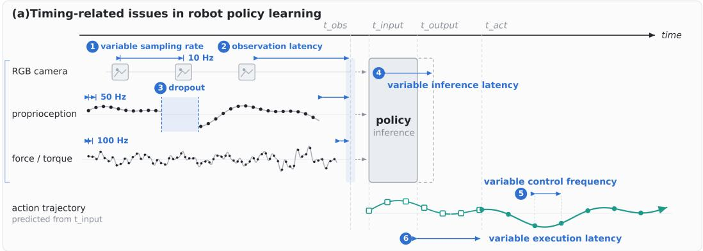

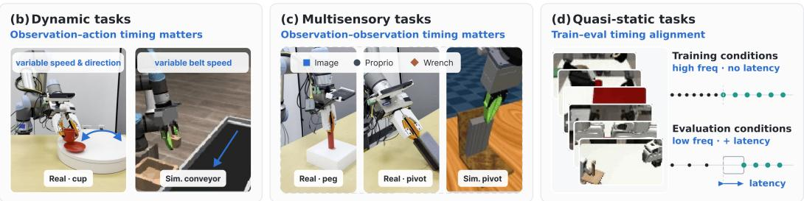  
Figure 1: Timing-related issues in robot policy learning. (a) Real robot systems exhibit multiple sources of temporal variation, including variable sensor sampling rate, observation latency and dropout, inference latency, control frequency, and execution latency. These timing effects matter differently across tasks. (b) In dynamic tasks, the key temporal relationship is between when an observation is captured and when an action takes effect. (c) In multisensory tasks, the key temporal relationship is between when different observations are captured. (d) Even in quasi-static tasks, differences between data-collection and deployment timing can create temporal mismatch. Standard fixed-rate policy representations obscure these distinctions by treating sequence position as a proxy for time.

Here, $t _ { o }$ specifies when observations were captured and $t _ { a }$ when actions should be executed. Their relative timing represents observation spacing, measurement age, and the requested execution sched ule.

A key design choice is how this timing information should enter the policy. One option is to encode timestamps and add them directly to the token embeddings, mixing what a token represents with when it occurs. We instead find it more effective to keep the token content unchanged and use physical time only as positional encoding in attention. Chronos Policy therefore replaces index-based positional encoding with time-aware rotary positional encodings (time-aware RoPE): observation tokens use their capture times $t _ { o } ,$ while noisy action tokens use their queried execution times $t _ { a }$ as rotary coordinates. Attention then depends on elapsed time $t _ { i } - t _ { j } ,$ , directly representing observation to-observation, observation-to-action, and action-to-action timing while remaining invariant to the choice of clock origin.

Timestamps also allow us to vary the timing of training examples. We randomly change which observations are selected and when the action chunk starts. Because the policy sees these timestamps, it can correctly interpret each sampled sequence even when its timing differs from the nominal training setup. This exposes the policy to timing variations that may occur at deployment and lets it use measurements that fixed-rate downsampling would otherwise discard.

We evaluate Chronos Policy across three types of tasks: dynamic tasks, where observation-to-action timing affects the correct control; multisensory tasks, where the relative timing between observations matters; and standard quasi-static tasks, where precise timing is less critical. Across simulation and real-robot experiments, Chronos Policy improves robustness to sensing and inference variation while preserving performance on quasi-static tasks where timing matters less.

Our contributions are threefold:

• We formulate robot policy learning in physical time by conditioning on observation capture times and queried action execution times.

• We introduce Chronos Policy, a diffusion transformer with time-aware RoPE that learns directly from asynchronous, multi-rate observations, without aligning them to a fixed temporal grid.

• We develop benchmarks that implement realistic timing variation and show that Chronos Policy improves dynamic manipulation through better observation–action timing and multisensory manip ulation through better observation–observation timing, while preserving nominal performance on standard tasks and improving robustness to deployment-time mismatch.

## 2 RELATED WORK

Asynchronous multisensory learning. Multisensory observations provide feedback that enables imitation learning policies to succeed on contact-rich tasks where vision alone is insufficient (Li et al., 2022; Wang et al., 2022; Zhang et al., 2022; 2023; Hou et al., 2025; Yin et al., 2026; Choi et al., 2026; Clark et al., 2026). However, heterogeneous sensors often operate at different sampling rates, motivating methods that explicitly account for these differing temporal resolutions. Reactive Diffusion Policy combines slow visual planning with fast tactile feedback using separate modules (Xue et al., 2025), while ImplicitRDP integrates both streams within a single network (Chen et al., 2026). ManipForce uses frequency-aware embeddings and cross-attention to fuse asynchronous RGB and force/torque streams (Lee et al., 2025). LAG-Fusion composes modality-specific diffusion policies at their native inference rates, rebasing delayed guidance before fusion (He et al., 2026), and FA-RDP adapts inference frequency to the manipulation phase (Zhuo et al., 2026). These approaches establish the importance of preserving high frequency feedback.

Inference delay and chunk continuity. Inference delay creates a mismatch between when observations are captured, when a policy predicts an action, and when that action is executed (Xiao et al., 2020; Chi et al., 2024). For action-chunk policies, this also raises a consistency problem between newly predicted actions and commands already committed for execution. Prior work addresses this through consistency-based decoding (Liu et al., 2025), overlapping inference and execution with prefix inpainting (Black et al., 2026), training-time conditioning on committed actions (Black et al., 2025), masked action generation (Wang et al., 2026b;a), or predicting the future execution-time state (Tang et al., 2025). Most closely related, Delay-Aware Diffusion Policy conditions on measured inference delay and constructs delay-compensated targets (Liao et al., 2025). Another line of work reduces inference latency by changing the diffusion process itself. Diffusion Forcing introduces independent noise levels for individual sequence positions, enabling flexible partial denoising sched ules (Chen et al., 2024), while Streaming Diffusion Policy applies variable noise levels across the action horizon to generate near-term actions with fewer denoising steps and lower latency (Høeg et al., 2024). These approaches reduce the timing mismatch by making policy inference faster, while Chronos Policy makes the remaining sensing and execution timing explicit to the policy; the two directions are complementary.

Explicit time in robot control. In addition to observation and inference delay, prior work has also made time an explicit variable in robot control. Locomotion policies have conditioned on the time available to reach a target, allowing behavior to adapt to temporal requirements (Rudin et al., 2022). More recently, manipulation policies have been conditioned on remaining task time and a time-ratio signal, enabling a single policy to vary its execution strategy across different temporal regimes (Jia & Chen, 2025). Other work makes control timing itself adaptive: CTCO selects continuous options with variable durations (Karimi et al., 2023), while TARC jointly predicts actions and their application durations to vary control frequency online (Sukhija et al., 2025). These works use time to control the speed or duration of behavior. Chronos Policy instead represents when observations are captured and when actions are executed. This gives a more general and natural formulation that covers observation rate, sensor delay, cross-modal timing, and action execution delay within a single policy.

Continuous-time representations and attention. Explicit time representations are well established for irregular time series. mTAN learns continuous-time embeddings for attention over irregular obser vations (Shukla & Marlin, 2021), and ContiFormer combines continuous dynamics with transformer attention (Chen et al., 2023). RoPE introduces relative positional dependence through rotations of attention queries and keys (Su et al., 2024). Recent video models have similarly moved beyond fixed sequence indices: variable-frame-rate video models adapt positional representations to changing temporal spacing (Zhong et al., 2026), while VideoRoPE introduces adjustable temporal spacing within rotary embeddings for video (Wei et al., 2025). Most closely related, BulletTime conditions video generation on continuous world-time coordinates through time-aware rotary embeddings (Wang et al., 2026c). Chronos Policy brings this continuous-time view to robot imitation learning, jointly representing the timestamps of heterogeneous observations and the requested execution times of actions.

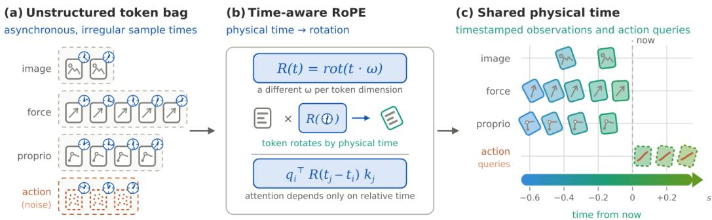  
Figure 2: Overview of Chronos Policy. Tokens are paired with their physical times. Time-aware RoPE uses these physical timestamps as positional coordinates, so attention depends on elapsed time rather than sequence index. The diffusion transformer then predicts an action chunk at the requested execution times.

## 3 METHOD

Chronos Policy makes observation and action timing explicit in the policy. Each observation is associated with when it was captured, and each predicted action with when it should execute. We implement this interface with a diffusion transformer using time-aware RoPE, which introduces time through attention while leaving the token embeddings unchanged. During training, we also vary observation and action timing while preserving the corresponding timestamps, so the policy learns to interpret the timing changes it may encounter at deployment.

## 3.1 POLICY FORMULATION ON PHYSICAL TIME

Let $\mathbf { O } _ { \mathbf { t } _ { o } }$ denote observations captured at times $\mathbf { t } _ { o } .$ . At time t, we query an H-step action chunk at

$$
t _ {a, j} = t + d _ {t} + j \Delta t _ {a}, \qquad j = 0, \ldots , H - 1,\tag{2}
$$

where $d _ { t }$ is the delay before the first queried action and $\Delta t _ { a }$ is the action interval. The policy is therefore

$$
\mathbf {A} _ {\mathbf {t} _ {a}} \sim \pi_ {\theta} (\cdot | \mathbf {O} _ {\mathbf {t} _ {o}}, \mathbf {t} _ {o}, \mathbf {t} _ {a}).\tag{3}
$$

This formulation makes the timing information explicit. The spacing of $\mathbf { t } _ { o }$ captures observation rate, the gap between observation and action times captures measurement delay and execution latency, and $\mathbf { t } _ { a }$ specifies the desired execution frequency. For multimodal sensing, each modality simply keeps its own capture times rather than being aligned to a common sampling grid.

## 3.2 ENCODING PHYSICAL TIME IN THE POLICY

Given explicit timestamps in the policy inputs, we must decide how temporal information should enter the network. One option is to encode each timestamp and add it directly to the corresponding token embedding, allowing time to modify the token representation itself. An alternative is to keep the token embedding unchanged and use time only through the positional encoding in attention. We compare these two choices in Section 4.3; the latter is consistently more robust to temporal variation. We therefore adopt time-aware RoPE.

Every token is assigned a physical timestamp relative to the policy request time t. Image patches inherit the capture time of their frame, proprioceptive and force/torque tokens use their measurement times, and action tokens use their queried execution times. Thus, observation timestamps describe when measurements were captured relative to the request, while action timestamps lie in the future according to the requested execution schedule. Modality and spatial embeddings continue to represent token content, while physical time enters separately through the rotary positional encoding.

We express all timestamps relative to the policy request time,

$$
\tilde {t} _ {i} = t _ {i} - t.\tag{4}
$$

For action tokens, this gives $\tilde { t } _ { a , j } = d _ { t } + j \Delta t _ { a }$ , so inference latency directly shifts the queried action times into the future. We use $t _ { i }$ as the rotary coordinate:

$$
\widetilde {q} _ {i} = R (\tilde {t} _ {i}) q _ {i}, \quad \widetilde {k} _ {i} = R (\tilde {t} _ {i}) k _ {i}.\tag{5}
$$

The resulting query–key interaction depends only on elapsed physical time,

$$
\widetilde {q} _ {i} ^ {\top} \widetilde {k} _ {j} = q _ {i} ^ {\top} R (t _ {j} - t _ {i}) k _ {j}.\tag{6}
$$

Thus, attention depends directly on elapsed physical time $t _ { j } - t _ { i }$ . Two observations separated by 20 ms and 200 ms receive different temporal relationships even if they occupy the same sequence positions. At the same time, shifting all timestamps by the same amount leaves the representation unchanged. Compared with adding time directly to token embeddings, time-aware RoPE keeps token content and timing separate while making pairwise temporal relationships explicit in attention.

## 3.3 TRAINING WITH TEMPORAL RANDOMIZATION

During training, we expose the policy to different sensing and execution timings through temporal randomization. For each demonstration, we randomly vary the observation rate and delivery delay of each modality. We then select the measurements that would be available at that request time, while keeping their original capture timestamps. We also randomize when the predicted action chunk should begin. Sampling the start delay $d _ { t }$ gives the queried execution times in Eq. 2.

Together, these two randomizations expose the policy to temporal settings that may occur at deployment. They also allow different measurements from the recorded trajectory to be used across training examples, including measurements that a fixed-rate downsampling scheme would otherwise discard.

The timestamps are what make this possible. After randomization, the same token positions can correspond to different physical intervals. Without explicit time, these examples would be ambiguous. In Chronos Policy, the observation values $\mathbf { O _ { t _ { o } } }$ enter the network as token content, while $\mathbf { t } _ { o }$ and $\mathbf { t } _ { a }$ are used only as temporal coordinates in time-aware RoPE. Thus, the timestamps tell the transformer when each observation was captured and when each action is requested without being concatenated to the token features. Changing $\mathbf { t } _ { a }$ therefore changes the execution times being queried, allowing the same policy to predict actions for different future times.

We train Chronos Policy with the standard diffusion objective. Given a target action chunk $\mathbf { A } _ { \mathbf { t } _ { c } } ^ { * }$ , we sample diffusion step k and noise ϵ,

$$
\mathbf {A} ^ {(k)} = \alpha_ {k} \mathbf {A} _ {\mathbf {t} _ {a}} ^ {*} + \sigma_ {k} \boldsymbol {\epsilon}, \qquad \boldsymbol {\epsilon} \sim \mathcal {N} (0, I),\tag{7}
$$

and train the denoiser conditioned on the observations and queried action times:

$$
\mathcal {L} (\theta) = \mathbb {E} \left[ \ell \left(D _ {\theta} \left(\mathbf {A} ^ {(k)}, k, \mathbf {O} _ {\mathbf {t} _ {o}}, \mathbf {t} _ {o}, \mathbf {t} _ {a}\right), \mathbf {y} ^ {(k)}\right) \right].\tag{8}
$$

Here, $\mathbf { y } ^ { ( k ) }$ denotes the diffusion prediction target. We use clean-action prediction with an $\ell _ { 1 }$ loss in simulation and real world.

## 3.4 USING PHYSICAL TIME AT DEPLOYMENT

At deployment, we use the same physical-time interface as during training. Each available observation retains its capture time $\mathbf { t } _ { o } ,$ while the noisy action tokens are assigned queried execution times $\mathbf { t } _ { a } .$ These action times enter time-aware RoPE during denoising, so when action tokens attend to observations or to one another, the attention depends on the corresponding observation-to-action and action-to-action time differences. Changing $\mathbf { t } _ { a }$ therefore changes the actions predicted by the policy.

During deployment, we execute action chunks asynchronously: while the next chunk is being predicted, the robot continues executing the previous one. In simulation, the action start delay $d _ { t }$ is set from the injected inference latency. On the real robot, the current inference time is not known in advance, so we estimate $d _ { t }$ from previously completed requests. When a new prediction arrives, actions whose queried execution times have already passed are discarded, and the remaining actions are executed according to $\mathbf { t } _ { a }$

## 4 EXPERIMENTS

We structure our experiments around three questions. (1) when is time information useful? We study dynamic tasks, where the correct action depends on how the environment changes over time, and multisensory tasks, where the timing between different observations matters. (2) which parts ofthe time-aware policy matter? We ablate the time representation and temporal randomization used during training. (3) does adding time hurt tasks where timing is less important? We evaluate on standard quasi-static manipulation tasks to test whether Chronos Policy preserves nominal performance while improving robustness to timing changes at deployment.

## 4.1 TASKS AND EVALUATION SETUP

We evaluate Chronos Policy in three types of tasks. Conveyor is a dynamic pick-and-place task with randomized belt speed, where the policy must account for object motion and the time between sensing and action execution. Pivoting is a contact-rich multisensory task that combines vision, proprioception, and force/torque measurements acquired at different rates and times. We also evaluate on six standard quasi-static manipulation tasks to test whether explicit time modeling preserves performance when timing is less critical.

We evaluate each policy under different timing conditions. Nominal uses the timing seen during training. We then vary observation timing by changing sensing frequency and delay, and vary inference latency by changing the delay before predicted actions are executed. Finally, the combined setting varies both observation timing and inference latency, providing a stronger test of robustness to temporal mismatch.

## 4.2 WHEN IS TIME INFORMATION USEFUL?

Time substantially improves dynamic manipulation. Figure 4a shows a clear advantage on Conveyor. Under nominal timing, Chronos Policy improves success from 73.1% to 82.0%. More importantly, the gap grows when deployment timing changes. With moderate observation variation, Diffusion Policy drops to 15.6% while Chronos Policy retains 77.6%; under inference delays up to 200 ms, Diffusion Policy falls to 1.8% while Chronos Policy achieves 76.4%. Even under the combined perturbation, Chronos Policy retains 32.7% success while Diffusion Policy fails entirely.

This result shows that sequence order alone is not enough to determine object motion when observation intervals vary, nor to determine how far ahead to act when execution is delayed. Providing both observation and action times allows the policy to interpret these changes directly.

Time improves robustness in multisensory manipulation. The Pivoting results show a different pattern (Fig. 4b). Under mild timing changes, Chronos Policy and Diffusion Policy perform similarly, while the advantage of explicit time becomes larger as temporal mismatch increases. Under inference delays up to 200 ms, success improves from 51.3% to 60.2%, and under the combined condition from 19.6% to 38.4%.

(b) Multi-sensory task Pivoting  
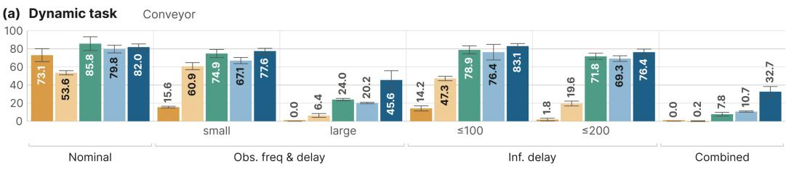

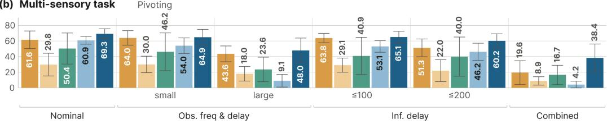  
Figure 3: Simulation ablation of Chronos Policy design. We compare temporal randomization, additive time encoding, and time-aware RoPE to identify an effective recipe for time awareness. Temporal randomization is most effective when paired with explicit timestamps, while time-aware RoPE provides the strongest robustness across Conveyor and Pivoting.  
(a) Conveyor dynamic task

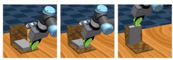

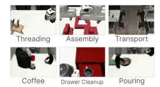

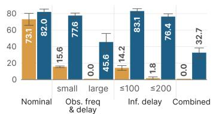

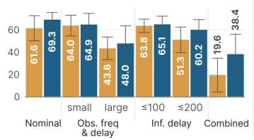

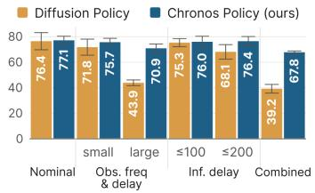  
Figure 4: Simulation evaluation across manipulation settings. We compare Diffusion Policy and Chronos Policy on (a) dynamic Conveyor, (b) multisensory Pivoting, and (c) six standard DexMimicGen tasks under nominal and perturbed sensing and inference timing.

Unlike Conveyor, Pivoting does not require continuously predicting the future position of a moving target. Instead, timestamps become useful when the relative times of vision, proprioception, and force/torque measurements vary enough that their sequence positions no longer reliably indicate when they were acquired.

## 4.3 WHAT MAKES A POLICY TIME-AWARE?

The previous results show that explicit time improves robustness to temporal mismatch. We then study what makes a time-aware policy effective by ablating two key design choices in Chronos Policy: temporal variation during training and the representation of physical time in the transformer (Fig. 3).

Temporal randomization requires explicit time information. Temporal randomization has two effects: it exposes the policy to a wider range of sensing and execution schedules that may occur during deployment, and it allows training to use measurements that would otherwise be discarded when demonstrations are downsampled to a fixed temporal grid. This additional diversity can act as useful data augmentation. On Conveyor, temporal randomization alone increases Diffusion Policy’s average success across the five perturbed conditions from 6.3% to 26.9%. Thus, even without timestamps, exposing the policy to more temporal variation can improve robustness when the relevant timing structure is relatively simple.

The same strategy does not generalize to multisensory Pivoting. There, temporal randomization reduces the perturbed-condition average from 48.4% to 21.6%. Without timestamps, the policy cannot tell what timing produced each sampled history: the same sequence positions may correspond to different physical intervals, and asynchronous measurements from different modalities become difficult to interpret. Once physical time is explicit, however, temporal randomization becomes consistently useful. It increases the perturbed-condition average from 48.8% to 63.1% on Conveyor and from 33.3% to 55.3% on Pivoting. Temporal randomization therefore broadens the training distribution, while timestamps make that variation interpretable.

Time-aware RoPE provides a better representation of physical time. We compare Chronos-RoPE with Chronos-AddTime, which follows the common choice of encoding continuous time with Fourier features (Tancik et al., 2020). Each timestamp, expressed relative to the policy request time, is mapped through Fourier features and an MLP, and the resulting time embedding is added directly to the corresponding token. Observation tokens use their capture times, while action tokens use their queried execution times; for action tokens, the time embedding is added to the noisy action representation at each diffusion step. In contrast, Chronos-RoPE keeps the token embeddings unchanged and introduces the same physical timestamps only through the positional encoding in attention.

On Conveyor, Chronos-AddTime performs slightly better under nominal timing, but Chronos-RoPE performs better in every other setting, increasing the temporal condition average from 51.5% to 63.1%. On Pivoting, Chronos-RoPE outperforms Chronos-AddTime in every condition and improves the perturbed-condition average from 33.5% to 55.3%. We hypothesize this is due to its simpler separation of content and time, and to the fact that pairwise elapsed time directly modulates attention rather than being inferred from additive token features. We therefore use Chronos-RoPE as Chronos Policy in the experiments.

## 4.4 DOES TIME HURT STANDARD QUASI-STATIC MANIPULATION?

We next evaluate six standard quasi-static manipulation tasks, where precise timing is less critical to the task. Under nominal timing, Chronos Policy and Diffusion Policy achieve comparable performance as shown in Fig. 4c (full results are shown in the Appendix), showing that explicitly modeling time does not sacrifice performance.

The advantage becomes clear when deployment timing differs from training. Averaged across the five perturbed conditions, success improves from 59.7% with Diffusion Policy to 73.4% with Chronos Policy, with the largest gains under wide sensing variation and combined perturbations.

Overall, Chronos Policy preserves nominal performance while providing substantially greater robustness to temporal mismatch. When timing is close to the training setup, explicit time does not sacrifice any performance; when sensing or inference timing changes, it gives the policy information about the observation and action timing that is absent from the baseline.

## 4.5 DOES TIME AWARENESS IMPROVE REAL-WORLD ROBUSTNESS?

We finally ask whether the benefits of explicit time carry over to real robot deployment, where sensing and inference timing vary naturally. As shown in Figure 5, we evaluate three tasks that mirror the two settings studied in simulation: Dynamic Cup is a dynamic manipulation task, similar to Conveyor, where the robot must place a cup onto a moving saucer; Peg Insertion and Pivoting are contact-rich multisensory tasks that combine vision, proprioception, and force/torque feedback. We compare asynchronous Diffusion Policy, Diffusion Policy with Real-Time Chunking (RTC), and Chronos Policy. Under asynchronous updates, the robot continues executing the previous action chunk while the next prediction is computed. Both RTC and Chronos Policy estimate inference latency from previously completed requests.

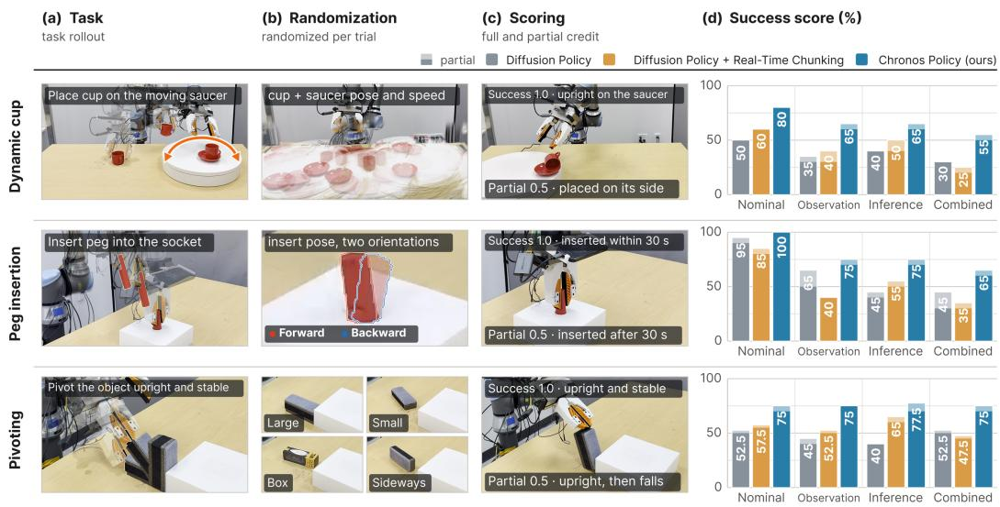  
Figure 5: Real-world evaluation under timing variation. We compare Diffusion Policy, Diffusion Policy with RTC, and Chronos Policy on Dynamic Cup, Peg Insertion, and Pivoting under nominal, observation, inference, and combined timing conditions. Lighter bar segments indicate partial success.

Chronos Policy achieves the highest task score in every evaluated condition across all three tasks. The advantage persists under observation perturbations, inference latency, and their combination, showing that the benefit of explicit time extends beyond controlled simulation. The gains also span both moving-target and contact-rich manipulation, suggesting that the same physical-time interface can handle different sources of temporal variation.

RTC improves robustness to inference latency in several settings. However, RTC does not explicitly account for changes in observation timing, so its benefit does not consistently extend to sensing perturbations. In contrast, Chronos Policy represents both when each observation was captured and when each predicted action should execute, allowing sensing and execution timing to be modeled within the same policy architecture. These results suggest that asynchronous execution and explicit time awareness address complementary aspects of temporal mismatch.

## 5 CONCLUSION AND FUTURE WORK

We introduce Chronos Policy, which grounds robot policy learning in physical time by conditioning on when observations are captured and when actions should execute. This formulation provides a unified representation of sensing rate, measurement delay, and inference latency within a single policy. Across dynamic, multisensory, and standard quasi-static manipulation tasks in simulation and on real robots, Chronos Policy improves robustness to temporal mismatch while preserving nominal performance.

A direction for future work is to extend Chronos policies beyond fixed action rates to variable control frequencies and temporal scaling, allowing robots to execute the same behavior faster or slower than demonstration.

## 6 ACKNOWLEDGMENT

We thank all members of REALab at Stanford for helpful discussions and feedback. This work was supported in part by the Knight-Hennessy Fellowship and the NSF Graduate Research Fellowships Program (GRFP), NSF Award #2143601, #2037101, and #2132519, Samsung, Stanford HAI Center. The views and conclusions contained herein are those of the authors and should not be interpreted as necessarily representing the official policies, either expressed or implied, of the sponsors.

## REFERENCES

Kevin Black, Allen Z Ren, Michael Equi, and Sergey Levine. Training-time action conditioning for efficient real-time chunking. arXiv preprint arXiv:2512.05964, 2025.

Kevin Black, Manuel Galliker, and Sergey Levine. Real-time execution of action chunking flow policies. Advances in Neural Information Processing Systems, 38:33383–33407, 2026.

Boyuan Chen, Diego Mart´ı Monso, Yilun Du, Max Simchowitz, Russ Tedrake, and Vincent Sitzmann.´ Diffusion forcing: Next-token prediction meets full-sequence diffusion. Advances in Neural Information Processing Systems, 37:24081–24125, 2024.

Wendi Chen, Han Xue, Yi Wang, Fangyuan Zhou, Jun Lv, Yang Jin, Shirun Tang, Chuan Wen, and Cewu Lu. Implicitrdp: An end-to-end visual-force diffusion policy with structural slow-fast learning. IEEE Robotics and Automation Letters, 2026.

Yuqi Chen, Kan Ren, Yansen Wang, Yuchen Fang, Weiwei Sun, and Dongsheng Li. Contiformer: Continuous-time transformer for irregular time series modeling. Advances in Neural Information Processing Systems, 36:47143–47175, 2023.

Cheng Chi, Zhenjia Xu, Chuer Pan, Eric Cousineau, Benjamin Burchfiel, Siyuan Feng, Russ Tedrake, and Shuran Song. Universal manipulation interface: In-the-wild robot teaching without in-the-wild robots. arXiv preprint arXiv:2402.10329, 2024.

Hojung Choi, Yifan Hou, Chuer Pan, Seongheon Hong, Austin Patel, Xiaomeng Xu, Mark R Cutkosky, and Shuran Song. In-the-wild compliant manipulation with umi-ft. arXiv preprint arXiv:2601.09988, 2026.

Jaden Clark, Changhao Wang, Yihuai Gao, Seongheon Hong, Hojung Choi, Mark Cutkosky, Yifan Hou, and Shuran Song. Multisensory continual learning: Adapting pretrained visuomotor policies to force. arXiv preprint arXiv:2606.30988, 2026.

Zihao He, Hongjie Fang, Shirun Tang, Cewu Lu, and Haoshu Fang. Asynchronous multimodal diffusion policy composition via latency-aware guidance fusion. arXiv preprint arXiv:2607.17257, 2026.

Sigmund H Høeg, Yilun Du, and Olav Egeland. Streaming diffusion policy: Fast policy synthesis with variable noise diffusion models. arXiv preprint arXiv:2406.04806, 2024.

Yifan Hou, Zeyi Liu, Cheng Chi, Eric Cousineau, Naveen Kuppuswamy, Siyuan Feng, Benjamin Burchfiel, and Shuran Song. Adaptive compliance policy: Learning approximate compliance for diffusion guided control. In 2025 IEEE International Conference on Robotics and Automation (ICRA), pp. 4829–4836. IEEE, 2025.

Yinsen Jia and Boyuan Chen. Time as a control dimension in robot learning. arXiv preprint arXiv:2511.07654, 2025.

Amirmohammad Karimi, Jun Jin, Jun Luo, A Rupam Mahmood, Martin Jagersand, and Samuele Tosatto. Dynamic decision frequency with continuous options. In 2023 IEEE/RSJ International Conference on Intelligent Robots and Systems (IROS), pp. 7545–7552. IEEE, 2023.

Geonhyup Lee, Yeongjin Lee, Kangmin Kim, Seongju Lee, Sangjun Noh, Seunghyeok Back, and Kyoobin Lee. Manipforce: Force-guided policy learning with frequency-aware representation for contact-rich manipulation. arXiv preprint arXiv:2509.19047, 2025.

Hao Li, Yizhi Zhang, Junzhe Zhu, Shaoxiong Wang, Michelle A Lee, Huazhe Xu, Edward Adelson, Li Fei-Fei, Ruohan Gao, and Jiajun Wu. See, hear, and feel: Smart sensory fusion for robotic manipulation. arXiv preprint arXiv:2212.03858, 2022.

Aileen Liao, Dong-Ki Kim, Max Olan Smith, Ali-akbar Agha-mohammadi, and Shayegan Omidshafiei. Delay-aware diffusion policy: Bridging the observation-execution gap in dynamic tasks. arXiv preprint arXiv:2512.07697, 2025.

Yuejiang Liu, Jubayer Hamid, Annie Xie, Yoonho Lee, Max Du, and Chelsea Finn. Bidirectional decoding: Improving action chunking via guided test-time sampling. In International Conference on Learning Representations, volume 2025, pp. 4594–4627, 2025.

Nikita Rudin, David Hoeller, Marko Bjelonic, and Marco Hutter. Advanced skills by learning locomotion and local navigation end-to-end. In 2022 IEEE/RSJ International Conference on Intelligent Robots and Systems (IROS), pp. 2497–2503. IEEE, 2022.

Satya Narayan Shukla and Benjamin M Marlin. Multi-time attention networks for irregularly sampled time series. In ... International Conference on Learning Representations, volume 2021, pp. 14897, 2021.

Jianlin Su, Murtadha Ahmed, Yu Lu, Shengfeng Pan, Wen Bo, and Yunfeng Liu. Roformer: Enhanced transformer with rotary position embedding. Neurocomputing, 568:127063, 2024.

Arnav Sukhija, Lenart Treven, Jin Cheng, Florian Dorfler, Stelian Coros, and Andreas Krause. Tarc:¨ Time-adaptive robotic control. arXiv preprint arXiv:2510.23176, 2025.

Matthew Tancik, Pratul Srinivasan, Ben Mildenhall, Sara Fridovich-Keil, Nithin Raghavan, Utkarsh Singhal, Ravi Ramamoorthi, Jonathan Barron, and Ren Ng. Fourier features let networks learn high frequency functions in low dimensional domains. Advances in neural information processing systems, 33:7537–7547, 2020.

Jiaming Tang, Yufei Sun, Yilong Zhao, Shang Yang, Yujun Lin, Zhuoyang Zhang, James Hou, Yao Lu, Zhijian Liu, and Song Han. Vlash: Real-time vlas via future-state-aware asynchronous inference. arXiv preprint arXiv:2512.01031, 2025.

Changhao Wang, Xiang Zhang, Zhian Kuang, and Masayoshi Tomizuka. Safe online gain optimization for cartesian space variable impedance control. In 2022 IEEE 18th International Conference on Automation Science and Engineering (CASE), pp. 751–757. IEEE, 2022.

Haoxuan Wang, Gengyu Zhang, Yan Yan, Yuzhang Shang, Ramana Kompella, and Gaowen Liu. Real-time robot execution with masked action chunking. In International Conference on Learning Representations, volume 2026, pp. 120161–120179, 2026a.

Pengcheng Wang, Kaiwen Hong, Chensheng Peng, Katherine Driggs-Campbell, Masayoshi Tomizuka, Chenfeng Xu, and Chen Tang. Discretertc: Discrete diffusion policies are natural asynchronous executors. arXiv preprint arXiv:2604.25050, 2026b.

Yiming Wang, Qihang Zhang, Shengqu Cai, Tong Wu, Jan Ackermann, Zhengfei Kuang, Yang Zheng, Frano Rajic, Siyu Tang, and Gordon Wetzstein. Bullettime: Decoupled control of time and cameraˇ pose for video generation. In Proceedings ofthe IEEE/CVF Conference on Computer Vision and Pattern Recognition, pp. 18319–18330, 2026c.

Xilin Wei, Xiaoran Liu, Yuhang Zang, Xiaoyi Dong, Pan Zhang, Yuhang Cao, Jian Tong, Haodong Duan, Qipeng Guo, Jiaqi Wang, et al. Videorope: What makes for good video rotary position embedding? arXiv preprint arXiv:2502.05173, 2025.

Ted Xiao, Eric Jang, Dmitry Kalashnikov, Sergey Levine, Julian Ibarz, Karol Hausman, and Alexander Herzog. Thinking while moving: Deep reinforcement learning with concurrent control. arXiv preprint arXiv:2004.06089, 2020.

Han Xue, Jieji Ren, Wendi Chen, Gu Zhang, Yuan Fang, Guoying Gu, Huazhe Xu, and Cewu Lu. Reactive diffusion policy: Slow-fast visual-tactile policy learning for contact-rich manipulation. arXiv preprint arXiv:2503.02881, 2025.

Jessica Yin, Haozhi Qi, Youngsun Wi, Sayantan Kundu, Mike Lambeta, William Yang, Changhao Wang, Tingfan Wu, Jitendra Malik, and Tess Hellebrekers. Osmo: Open-source tactile glove for human-to-robot skill transfer. IEEE Robotics and Automation Letters, 2026.

Xiang Zhang, Shiyu Jin, Changhao Wang, Xinghao Zhu, and Masayoshi Tomizuka. Learning insertion primitives with discrete-continuous hybrid action space for robotic assembly tasks. In 2022 International conference on robotics and automation (ICRA), pp. 9881–9887. IEEE, 2022.

Xiang Zhang, Changhao Wang, Lingfeng Sun, Zheng Wu, Xinghao Zhu, and Masayoshi Tomizuka. Efficient sim-to-real transfer of contact-rich manipulation skills with online admittance residual learning. In Conference on robot learning, pp. 1621–1639. PMLR, 2023.

Tianxiong Zhong, Xingye Tian, Boyuan Jiang, Xuebo Wang, Xin Tao, Pengfei Wan, and Zhiwei Zhang. Vfrtok: Variable frame rates video tokenizer with duration-proportional information assumption. Advances in Neural Information Processing Systems, 38:3325–3345, 2026.

Lifeng Zhuo, Wendi Chen, Han Xue, Shirun Tang, Jun Lv, Cewu Lu, and Chuan Wen. Fa-rdp: A frequency-adaptive reactive diffusion policy for contact-rich manipulation. arXiv preprint arXiv:2607.28596, 2026.

## A IMPLEMENTATION DETAILS

## A.1 POLICY ARCHITECTURE AND INPUT REPRESENTATIONS

Our implementation of Diffusion Policy (DP) and Chronos Policy uses the same backbone: a 16-layer diffusion transformer with width 512 and eight attention heads. A pretrained SigLIP2 base encoder extracts 768-dimensional image-patch features at 256 × 256 resolution, which are projected into the transformer. Proprioceptive and action vectors are embedded as separate tokens; Pivoting and Insertion tasks additionally include force/torque tokens. Transformer blocks combine self-attention over non-image tokens with cross-attention to image patches (Fig. 6).

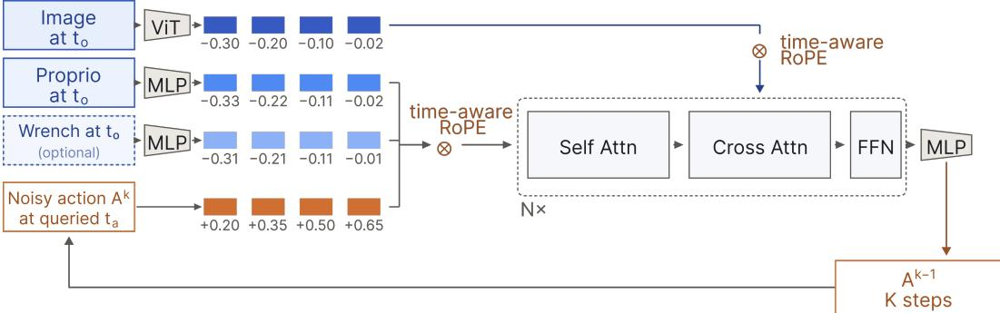  
Figure 6: Architecture of Chronos Policy. Proprioceptive, optional force/torque, and noisy action tokens interact through self-attention and attend to image features through cross-attention. Timeaware RoPE encodes observation capture times and queried action times in attention. The transformer iteratively denoises the action chunk.

Conveyor and the six standard tasks use two image observations per camera and two proprioceptive observations. Simulated Pivoting uses two images, three pose observations, and 32 six-dimensional force/torque samples. We represent a pose by its position and 6D rotation. Pivoting predicts a 19-dimensional adaptive-compliance action containing a nominal pose, a virtual-target pose, and stiffness following (Hou et al., 2025); the same controller and action representation are used for all methods. Other simulation tasks use absolute pose and gripper or hand commands. Every policy predicts 16 actions at 20 Hz.

## A.2 BASELINES AND TIME-AWARE VARIANTS

Diffusion Policy. The transformer-based baseline uses sequence position without observation or action timestamps. Its temporal-randomization variant uses the same randomized observation schedules and action-start delays as Chronos Policy, but does not receive their physical times.

Chronos Policy. Time-aware RoPE uses physical timestamps in seconds, measured relative to the policy request time. Observation tokens use their capture times, while action tokens use their queried execution times, so inference latency shifts the action timestamps into the future. We rotate 16 query–key coordinate pairs using logarithmically spaced periods between 0.1 and 2 s. Images, proprioception, force/torque, and actions retain their respective capture or query times.

Chronos AddTime. The AddTime variant replaces time-aware RoPE with 16 sine and 16 cosine features of the same timestamps. A shared 32 → 512 → 512 MLP with GELU maps these features into an embedding added to each timed token. For action tokens, this embedding is added at each denoising step. AddTime and RoPE share the same data, token layout, diffusion conditioning, and temporal randomization.

Real-Time Chunking. For the real-world baseline, we adapt RTC (Black et al., 2026) to the Diffu sion Policy DDIM sampler using action-prefix inpainting. Previously committed actions constrain the next chunk while inference overlaps execution. RTC and Chronos Policy estimate inference latency from completed requests; DP and RTC do not receive observation capture timestamps as policy inputs.

## A.3 TRAINING DETAILS

We use $\ell _ { 1 }$ loss for action prediction and a cosine diffusion-noise schedule. We optimize with AdamW, learning rate $3 \times 1 0 ^ { - 4 }$ , betas (0.95, 0.999), and weight decay $1 0 ^ { - 6 }$ ; the pretrained image encoder uses one tenth of the learning rate. Training uses BF16 and a cosine learning-rate schedule. All policies are trained for 50 epochs, where one epoch is one complete pass through the training dataset. Table 1 lists the task-specific settings. Non-rotational action and proprioceptive dimensions use range normalization; 6D rotation coordinates are left unchanged. Image augmentation applies random cropping and color jitter, each with probability 0.3, followed by antialiased resizing to the encoder resolution.

Table 1: Simulation training and execution settings. The action prediction horizon is 16 and action frequency is 20 Hz for every task.

<table><tr><td>Setting</td><td>Standard tasks</td><td>Conveyor</td><td>Pivoting</td></tr><tr><td>Training epochs</td><td>50</td><td>50</td><td>50</td></tr><tr><td>Crop resolution</td><td> $224 \times 224$ </td><td> $196 \times 196$ </td><td> $196 \times 196$ </td></tr><tr><td>DDIM steps: training / inference</td><td>24 / 8</td><td>24 / 8</td><td>24 / 8</td></tr><tr><td>Action excursion horizon</td><td>12</td><td>8</td><td>8</td></tr></table>

For real-world policies, we use clean action prediction with an $\ell _ { 1 }$ loss and DDIM with 50 training and 16 inference steps. Images use a 212-pixel random crop during training and a center crop at evaluation, resized to $2 5 6 \times 2 5 6$ . The Pivoting training configuration uses effective batch size 128, AdamW at $3 \times 1 0 ^ { - 4 }$ , an encoder learning-rate multiplier of 0.1, and cosine decay with 2,000 warmup updates.

## B ADDITIONAL SIMULATION AND ABLATION RESULTS

## B.1 CHECKPOINT SELECTION AND EVALUATION SETUP

We train three seeds for each policy. We evaluate checkpoints on the nominal validation setting every five epochs and select the checkpoint with the highest nominal success rate. For the DexMimicGen benchmark, we evaluate 50 episodes per training seed, following the original paper evaluation setup. For the Conveyor and Pivoting ablations in Fig. 3, each selected training checkpoint is evaluated with three evaluation seeds, with 50 episodes per seed and condition. We first average across the three evaluation seeds for each training seed, and then report the mean and sample SD across the three training seeds, for a total of 450 episodes per method and condition.

## B.2 TEMPORAL SETTINGS

Training. All the tasks sample observation rates of 12.5–33.33 Hz and delivery delays of 0–50 ms independently across sensor streams, using a 100 Hz original dataset. For Pivoting, force/torque is sampled from 1–100 Hz with 0–100 ms delivery delay. Half of the action chunks start with zero delay; the rest sample a start delay up to 100 ms.

Evaluation. Table 2 specifies observation frequency and delay. The two inference conditions sample an inference delay from 0–100 ms or 0–200 ms. Combined uses the large-observation setting and the large inference distribution.

## B.3 DYNAMIC AND MULTISENSORY TASKS: FULL ABLATIONS

Table 3 provides the full ablation results behind Fig. 3.

Table 2: Simulation observation-timing conditions. Sensor frequencies are in Hz and delivery delays are in ms. Small and Large correspond to the observation perturbations used in the main figures; sensor streams are sampled independently.

<table><tr><td>Condition</td><td>Image</td><td>Pose</td><td>Force/torque</td><td>Delay</td></tr><tr><td>Nominal</td><td>20</td><td>20</td><td>100</td><td>0</td></tr><tr><td>Small</td><td>12.5–33.33</td><td>12.5–33.33</td><td>75–100</td><td>0–50</td></tr><tr><td>Large</td><td>1–50</td><td>1–50</td><td>1–100</td><td>0–100</td></tr></table>

Temporal randomization alone can improve robustness, but does not resolve temporal ambiguity. On Conveyor, adding temporal randomization to Diffusion Policy substantially improves several perturbation settings. Success increases from 15.6% to 60.9% under Small observation variation and from 14.2% to 47.3% under delays up to 100 ms. This suggests that exposing the policy to a broader range of observation and execution schedules can itself act as useful data augmentation. However, the benefit does not extend cleanly to more severe shifts: under Wide sensing, success only improves from 0.0% to 6.4%, and both variants remain near zero under the Combined condition. Randomization also lowers nominal Conveyor performance from 73.1% to 53.6%, indicating a trade-off when temporal variation is introduced without telling the policy what timing generated each sample.

This limitation is more pronounced on Pivoting. Adding temporal randomization to Diffusion Policy reduces performance in every condition, including nominal success from 61.6% to 29.8%. Unlike Conveyor, Pivoting requires relating vision, proprioception, and force/torque measurements sampled at different times. When these schedules are randomized but their timestamps are hidden, the same token positions can correspond to different cross-modal time offsets. The additional diversity therefore also introduces ambiguity that the policy cannot resolve.

Timestamps and temporal randomization are complementary. Explicit time without temporal randomization already provides substantial robustness to execution delay. On Conveyor, RoPE without randomization reaches 76.4% and 69.3% under delays up to 100 and 200 ms, respectively. However, it is much less robust when observation timing changes, dropping to 20.2% under Wide sensing and 10.7% under the Combined condition. Adding temporal randomization raises these results to 45.6% and 32.7%, respectively. A similar pattern appears on Pivoting: RoPE without randomization drops to 9.1% under Wide sensing and 4.2% under Combined, whereas the full model reaches 48.0% and 38.4%.

These results clarify the roles of the two components. Timestamps make a particular sensing and execution schedule interpretable, while temporal randomization exposes the policy to a broader set of such schedules during training. Neither component alone provides the same robustness as their combination.

The representation of time also matters. AddTime and RoPE receive the same timestamps and temporal randomization, isolating how physical time enters the transformer. AddTime achieves slightly higher nominal performance on Conveyor (85.8% versus 82.0%), but RoPE performs better in every perturbed condition. The difference is especially large under Wide sensing (45.6% versus 24.0%) and Combined perturbations (32.7% versus 7.8%). On Pivoting, RoPE has higher mean success than AddTime in every condition, including 48.0% versus 23.6% under Wide sensing and 38.4% versus 16.7% under Combined. Since the two variants differ only in how the same physical timestamps are represented, these results are consistent with directly encoding pairwise elapsed time in attention being more robust than adding time to token content.

## B.4 STANDARD MANIPULATION: TASK-LEVEL RESULTS

Table 4 reports the task-level results in Fig. 4c. On average, Chronos Policy achieves comparable performance under nominal timing and better performance under temporal perturbations, with the clearest gains on Assembly, Coffee, and Pouring, especially under observation and combined timing changes.

Table 3: Full Conveyor and Pivoting results and design ablations. Success rate (%), mean ± sample SD across three training seeds after averaging three paired evaluation batches within each seed. Each condition contains 450 episodes per method. RoPE is the full Chronos Policy; AddTime changes only the time encoding. Rand. denotes temporal randomization. Best mean performance within each task and condition is shown in bold.

<table><tr><td>Method</td><td>Nominal</td><td>Small obs.</td><td>Wide sensors</td><td>Delay 0–100 ms</td><td>Delay 0–200 ms</td><td>Combined</td></tr><tr><td colspan="7">Conveyor</td></tr><tr><td>DP</td><td> $73.1 \pm 7.2$ </td><td> $15.6 \pm 1.0$ </td><td> $0.0 \pm 0.0$ </td><td> $14.2 \pm 2.8$ </td><td> $1.8 \pm 1.5$ </td><td> $0.0 \pm 0.0$ </td></tr><tr><td>DP + rand.</td><td> $53.6 \pm 2.3$ </td><td> $60.9 \pm 3.9$ </td><td> $6.4 \pm 2.1$ </td><td> $47.3 \pm 2.4$ </td><td> $19.6 \pm 2.7$ </td><td> $0.2 \pm 0.4$ </td></tr><tr><td>RoPE w/o rand.</td><td> $79.8 \pm 4.2$ </td><td> $67.1 \pm 3.4$ </td><td> $20.2 \pm 0.8$ </td><td> $76.4 \pm 8.6$ </td><td> $69.3 \pm 3.1$ </td><td> $10.7 \pm 0.7$ </td></tr><tr><td>AddTime</td><td> $85.8 \pm 7.6$ </td><td> $74.9 \pm 4.5$ </td><td> $24.0 \pm 1.3$ </td><td> $78.9 \pm 4.4$ </td><td> $71.8 \pm 3.4$ </td><td> $7.8 \pm 2.0$ </td></tr><tr><td>RoPE (ours)</td><td> $82.0 \pm 3.5$ </td><td> $77.6 \pm 3.0$ </td><td> $45.6 \pm 10.2$ </td><td> $83.1 \pm 2.8$ </td><td> $76.4 \pm 3.4$ </td><td> $32.7 \pm 5.7$ </td></tr><tr><td colspan="7">Pivoting</td></tr><tr><td>DP</td><td> $61.6 \pm 11.3$ </td><td> $64.0 \pm 9.3$ </td><td> $43.6 \pm 10.1$ </td><td> $63.8 \pm 6.0$ </td><td> $51.3 \pm 11.4$ </td><td> $19.6 \pm 15.2$ </td></tr><tr><td>DP + rand.</td><td> $29.8 \pm 14.5$ </td><td> $30.0 \pm 10.6$ </td><td> $18.0 \pm 9.3$ </td><td> $29.1 \pm 9.1$ </td><td> $22.0 \pm 14.0$ </td><td> $8.9 \pm 5.4$ </td></tr><tr><td>RoPE w/o rand.</td><td> $60.9 \pm 5.0$ </td><td> $54.0 \pm 10.0$ </td><td> $9.1 \pm 8.1$ </td><td> $53.1 \pm 7.5$ </td><td> $46.2 \pm 11.0$ </td><td> $4.2 \pm 4.3$ </td></tr><tr><td>AddTime</td><td> $50.4 \pm 19.9$ </td><td> $46.2 \pm 24.2$ </td><td> $23.6 \pm 15.7$ </td><td> $40.9 \pm 23.8$ </td><td> $40.0 \pm 25.1$ </td><td> $16.7 \pm 12.2$ </td></tr><tr><td>RoPE (ours)</td><td> $69.3 \pm 6.4$ </td><td> $64.9 \pm 10.0$ </td><td> $48.0 \pm 15.8$ </td><td> $65.1 \pm 7.3$ </td><td> $60.2 \pm 9.1$ </td><td> $38.4 \pm 17.8$ </td></tr></table>

Table 4: Full results on the six standard manipulation tasks. Success rate (%), mean ± sample SD over three training seeds. Each seed is evaluated for 50 episodes per condition. DP denotes the transformer-based Diffusion Policy baseline. Best mean success within each task and condition is shown in bold.

<table><tr><td>Method</td><td>Nominal</td><td>Small obs.</td><td>Wide sensors</td><td>Delay 0–100 ms</td><td>Delay 0–200 ms</td><td>Combined</td></tr><tr><td colspan="7">Threading</td></tr><tr><td>DP</td><td> $89.3 \pm 8.3$ </td><td> $88.7 \pm 5.0$ </td><td> $78.7 \pm 11.0$ </td><td> $90.0 \pm 7.2$ </td><td> $79.3 \pm 5.0$ </td><td> $77.3 \pm 8.1$ </td></tr><tr><td>Chronos Policy</td><td> $88.7 \pm 3.1$ </td><td> $90.0 \pm 2.0$ </td><td> $77.3 \pm 3.1$ </td><td> $84.7 \pm 5.0$ </td><td> $86.7 \pm 3.1$ </td><td> $63.3 \pm 3.1$ </td></tr><tr><td colspan="7">Assembly</td></tr><tr><td>DP</td><td> $75.3 \pm 7.0$ </td><td> $73.3 \pm 5.0$ </td><td> $13.3 \pm 6.4$ </td><td> $72.7 \pm 7.6$ </td><td> $72.7 \pm 1.2$ </td><td> $0.0 \pm 0.0$ </td></tr><tr><td>Chronos Policy</td><td> $68.7 \pm 1.2$ </td><td> $73.3 \pm 2.3$ </td><td> $61.3 \pm 3.1$ </td><td> $71.3 \pm 6.1$ </td><td> $71.3 \pm 6.4$ </td><td> $57.3 \pm 7.6$ </td></tr><tr><td colspan="7">Transport</td></tr><tr><td>DP</td><td> $84.0 \pm 5.3$ </td><td> $81.3 \pm 5.0$ </td><td> $78.0 \pm 5.3$ </td><td> $87.3 \pm 9.9$ </td><td> $84.7 \pm 7.6$ </td><td> $73.3 \pm 8.1$ </td></tr><tr><td>Chronos Policy</td><td> $87.3 \pm 7.0$ </td><td> $81.3 \pm 11.0$ </td><td> $77.3 \pm 6.1$ </td><td> $85.3 \pm 9.0$ </td><td> $84.0 \pm 6.0$ </td><td> $70.0 \pm 10.4$ </td></tr><tr><td colspan="7">Coffee</td></tr><tr><td>DP</td><td> $47.3 \pm 6.1$ </td><td> $34.7 \pm 6.1$ </td><td> $14.7 \pm 1.2$ </td><td> $41.3 \pm 14.2$ </td><td> $27.3 \pm 7.6$ </td><td> $2.7 \pm 3.1$ </td></tr><tr><td>Chronos Policy</td><td> $51.3 \pm 14.0$ </td><td> $58.0 \pm 12.2$ </td><td> $57.3 \pm 9.0$ </td><td> $52.7 \pm 15.1$ </td><td> $57.3 \pm 14.5$ </td><td> $60.0 \pm 5.3$ </td></tr><tr><td colspan="7">Drawer Cleanup</td></tr><tr><td>DP</td><td> $83.3 \pm 6.1$ </td><td> $81.3 \pm 4.2$ </td><td> $76.7 \pm 7.0$ </td><td> $82.0 \pm 4.0$ </td><td> $80.7 \pm 1.2$ </td><td> $79.3 \pm 9.0$ </td></tr><tr><td>Chronos Policy</td><td> $87.3 \pm 6.4$ </td><td> $79.3 \pm 13.3$ </td><td> $82.0 \pm 14.4$ </td><td> $85.3 \pm 8.1$ </td><td> $84.7 \pm 8.1$ </td><td> $78.7 \pm 8.1$ </td></tr><tr><td colspan="7">Pouring</td></tr><tr><td>DP</td><td> $79.3 \pm 29.1$ </td><td> $71.3 \pm 38.2$ </td><td> $2.0 \pm 2.0$ </td><td> $78.7 \pm 30.3$ </td><td> $64.0 \pm 36.7$ </td><td> $2.7 \pm 1.2$ </td></tr><tr><td>Chronos Policy</td><td> $79.3 \pm 6.4$ </td><td> $72.0 \pm 6.9$ </td><td> $70.0 \pm 3.5$ </td><td> $76.7 \pm 4.2$ </td><td> $74.7 \pm 1.2$ </td><td> $77.3 \pm 5.0$ </td></tr></table>

## C ADDITIONAL REAL-WORLD SETUP AND RESULTS

## C.1 TASK SETUP AND DEMONSTRATIONS

We evaluate three real-world tasks: Dynamic Cup, Peg Insertion, and Pivoting. Table 5 summarizes the number of demonstrations and the success criteria for each task. Dynamic Cup is evaluated across different saucer speeds, positions, and rotation directions. Peg Insertion is evaluated with five trials for each of two hole orientations, forward and backward. Pivoting is evaluated with five trials in each of four settings: a large eraser, a small eraser, a box, and a sideways configuration.

Table 5: Real-world datasets and scoring. Full success receives one credit, partial success half a credit, and failure zero. Demonstration counts are training / validation.

<table><tr><td>Task</td><td>Demos</td><td>Full success</td><td>Partial success</td></tr><tr><td>Dynamic Cup</td><td>252 / 13</td><td>Cup upright on the moving saucer</td><td>Cup placed on its side on the saucer</td></tr><tr><td>Peg Insertion</td><td>220 / 11</td><td>Peg inserted within 30 s</td><td>Peg inserted after 30 s</td></tr><tr><td>Pivoting</td><td>322 / 17</td><td>Object brought upright and stable</td><td>Object reaches upright, then falls</td></tr></table>

All tasks use two RGB observations together with histories of relative pose and measured gripper width at a nominal rate of 20 Hz. Peg Insertion and Pivoting additionally use 32 six-dimensional force/torque measurements from each finger. The force/torque streams are recorded at approximately 360 Hz and sampled with stride four, giving a nominal history rate of approximately 90 Hz.

## C.2 TEMPORAL SETTINGS AND EXECUTION

Evaluation observation settings are listed in Table 6. The inference condition adds a delay sampled from {0, 50, 100, 150, 200} ms. The Combined condition applies both the observation perturbation and the inference delay. Nominal uses no injected perturbations, while retaining the system’s natural sensing and inference latency.

Table 6: Real-world observation-timing settings. Each stream has an independent delivery delay. Force/torque applies to Peg Insertion and Pivoting.

<table><tr><td>Stream</td><td>Nominal rate (Hz)</td><td>Perturbed rate (Hz)</td><td>Added delay (ms)</td></tr><tr><td>RGB</td><td>20</td><td>12.5–33.33</td><td>0–100</td></tr><tr><td>Pose / gripper</td><td>20</td><td>8.33–33.33</td><td>0–100</td></tr><tr><td>Force/torque</td><td>90</td><td>37.5–150</td><td>0–100</td></tr></table>

## C.3 FULL RESULTS AND ANALYSIS

For N trials with F full and P partial successes, the task score is $1 0 0 ( F + 0 . 5 P ) / N$ . Tables 7–9 report detailed results, with each cell showing task score (%) followed by full/partial/failure counts.

Table 7: Dynamic Cup results by motion direction. Each direction contains five trials; Overall aggregates all 10 trials per policy and timing condition. Each cell reports task score (%) followed by full/partial/failure counts.

<table><tr><td>Policy</td><td>Scenario</td><td>Nominal</td><td>Observation</td><td>Inference</td><td>Combined</td></tr><tr><td rowspan="3">DP</td><td>Clockwise</td><td>40.0 (2/0/3)</td><td>50.0 (2/1/2)</td><td>20.0 (1/0/4)</td><td>40.0 (2/0/3)</td></tr><tr><td>Counterclockwise</td><td>60.0 (3/0/2)</td><td>20.0 (1/0/4)</td><td>60.0 (3/0/2)</td><td>20.0 (1/0/4)</td></tr><tr><td>Overall</td><td>50.0 (5/0/5)</td><td>35.0 (3/1/6)</td><td>40.0 (4/0/6)</td><td>30.0 (3/0/7)</td></tr><tr><td rowspan="3">DP + RTC</td><td>Clockwise</td><td>60.0 (3/0/2)</td><td>30.0 (1/1/3)</td><td>60.0 (2/2/1)</td><td>20.0 (1/0/4)</td></tr><tr><td>Counterclockwise</td><td>60.0 (3/0/2)</td><td>50.0 (2/1/2)</td><td>40.0 (2/0/3)</td><td>30.0 (1/1/3)</td></tr><tr><td>Overall</td><td>60.0 (6/0/4)</td><td>40.0 (3/2/5)</td><td>50.0 (4/2/4)</td><td>25.0 (2/1/7)</td></tr><tr><td rowspan="3">Chronos Policy</td><td>Clockwise</td><td>80.0 (4/0/1)</td><td>80.0 (4/0/1)</td><td>70.0 (3/1/1)</td><td>50.0 (2/1/2)</td></tr><tr><td>Counterclockwise</td><td>80.0 (4/0/1)</td><td>50.0 (2/1/2)</td><td>60.0 (3/0/2)</td><td>60.0 (3/0/2)</td></tr><tr><td>Overall</td><td>80.0 (8/0/2)</td><td>65.0 (6/1/3)</td><td>65.0 (6/1/3)</td><td>55.0 (5/1/4)</td></tr></table>

Table 8: Peg Insertion results by hole orientation. Forward and backward orientations each contain five trials; Overall aggregates all 10 trials. Each cell reports task score (%) followed by full/partial/failure counts.

<table><tr><td>Policy</td><td>Scenario</td><td>Nominal</td><td>Observation</td><td>Inference</td><td>Combined</td></tr><tr><td rowspan="3">DP</td><td>Forward</td><td>90.0 (4/1/0)</td><td>50.0 (2/1/2)</td><td>50.0 (2/1/2)</td><td>50.0 (2/1/2)</td></tr><tr><td>Backward</td><td>100.0 (5/0/0)</td><td>80.0 (3/2/0)</td><td>40.0 (2/0/3)</td><td>40.0 (1/2/2)</td></tr><tr><td>Overall</td><td>95.0 (9/1/0)</td><td>65.0 (5/3/2)</td><td>45.0 (4/1/5)</td><td>45.0 (3/3/4)</td></tr><tr><td rowspan="3">DP + RTC</td><td>Forward</td><td>80.0 (4/0/1)</td><td>20.0 (1/0/4)</td><td>50.0 (2/1/2)</td><td>70.0 (3/1/1)</td></tr><tr><td>Backward</td><td>90.0 (4/1/0)</td><td>60.0 (3/0/2)</td><td>60.0 (3/0/2)</td><td>0.0 (0/0/5)</td></tr><tr><td>Overall</td><td>85.0 (8/1/1)</td><td>40.0 (4/0/6)</td><td>55.0 (5/1/4)</td><td>35.0 (3/1/6)</td></tr><tr><td rowspan="3">Chronos Policy</td><td>Forward</td><td>100.0 (5/0/0)</td><td>70.0 (3/1/1)</td><td>80.0 (4/0/1)</td><td>70.0 (3/1/1)</td></tr><tr><td>Backward</td><td>100.0 (5/0/0)</td><td>80.0 (4/0/1)</td><td>70.0 (3/1/1)</td><td>60.0 (3/0/2)</td></tr><tr><td>Overall</td><td>100.0 (10/0/0)</td><td>75.0 (7/1/2)</td><td>75.0 (7/1/2)</td><td>65.0 (6/1/3)</td></tr></table>

Table 9: Pivoting results by object and generalization setting. Large and small erasers are in-distribution (ID); the box and sideways setting are out-of-distribution (OOD). Each individual scenario contains five trials, and Overall aggregates all 20 trials. Each cell reports task score (%) followed by full/partial/failure counts.

<table><tr><td>Policy</td><td>Scenario</td><td>Nominal</td><td>Observation</td><td>Inference</td><td>Combined</td></tr><tr><td rowspan="5">DP</td><td>Large eraser (ID)</td><td>100.0 (5/0/0)</td><td>100.0 (5/0/0)</td><td>80.0 (4/0/1)</td><td>100.0 (5/0/0)</td></tr><tr><td>Small eraser (ID)</td><td>60.0 (3/0/2)</td><td>60.0 (3/0/2)</td><td>60.0 (3/0/2)</td><td>60.0 (3/0/2)</td></tr><tr><td>Box (OOD)</td><td>40.0 (2/0/3)</td><td>20.0 (0/2/3)</td><td>20.0 (1/0/4)</td><td>40.0 (2/0/3)</td></tr><tr><td>Sideways (OOD)</td><td>10.0 (0/1/4)</td><td>0.0 (0/0/5)</td><td>0.0 (0/0/5)</td><td>10.0 (0/1/4)</td></tr><tr><td>Overall</td><td>52.5 (10/1/9)</td><td>45.0 (8/2/10)</td><td>40.0 (8/0/12)</td><td>52.5 (10/1/9)</td></tr><tr><td rowspan="5">DP + RTC</td><td>Large eraser (ID)</td><td>100.0 (5/0/0)</td><td>100.0 (5/0/0)</td><td>100.0 (5/0/0)</td><td>80.0 (4/0/1)</td></tr><tr><td>Small eraser (ID)</td><td>100.0 (5/0/0)</td><td>60.0 (3/0/2)</td><td>80.0 (4/0/1)</td><td>60.0 (3/0/2)</td></tr><tr><td>Box (OOD)</td><td>30.0 (1/1/3)</td><td>40.0 (2/0/3)</td><td>60.0 (3/0/2)</td><td>40.0 (2/0/3)</td></tr><tr><td>Sideways (OOD)</td><td>0.0 (0/0/5)</td><td>10.0 (0/1/4)</td><td>20.0 (0/2/3)</td><td>10.0 (0/1/4)</td></tr><tr><td>Overall</td><td>57.5 (11/1/8)</td><td>52.5 (10/1/9)</td><td>65.0 (12/2/6)</td><td>47.5 (9/1/10)</td></tr><tr><td rowspan="5">Chronos Policy</td><td>Large eraser (ID)</td><td>100.0 (5/0/0)</td><td>100.0 (5/0/0)</td><td>100.0 (5/0/0)</td><td>100.0 (5/0/0)</td></tr><tr><td>Small eraser (ID)</td><td>80.0 (4/0/1)</td><td>100.0 (5/0/0)</td><td>100.0 (5/0/0)</td><td>100.0 (5/0/0)</td></tr><tr><td>Box (OOD)</td><td>60.0 (3/0/2)</td><td>40.0 (2/0/3)</td><td>80.0 (4/0/1)</td><td>60.0 (3/0/2)</td></tr><tr><td>Sideways (OOD)</td><td>60.0 (2/2/1)</td><td>60.0 (3/0/2)</td><td>30.0 (0/3/2)</td><td>40.0 (1/2/2)</td></tr><tr><td>Overall</td><td>75.0 (14/2/4)</td><td>75.0 (15/0/5)</td><td>77.5 (14/3/3)</td><td>75.0 (14/2/4)</td></tr></table>