# DDPG-Based Adaptive Robust Tracking Control for Aerial Manipulators With Decoupling Approach

Yen-Chen Liu , Senior Member, IEEE, and Chi-Yu Huang

Abstract—Aerial manipulators have the potential to perform various tasks with high agility and mobility, but the requirement of system parameters and the complicated dynamic model impede the implementation in practice. To deal with uncertain parameters and complexity of the coupled dynamic model, a decoupling approach is presented in this article by utilizing the adaptive/robust techniques and reinforcement learning approach for the tracking control of quadrotors with position control on the robotic arm. A reinforcement learning approach is proposed to control the robotic arm ensuring minimal effect on the quadrotor dynamics while following the desired trajectory. With the design of nominal inputs, the dynamic uncertainties from the quadrotor, robotic arm, and payload are coped with by utilizing the proposed adaptive algorithms. In addition, the residue of interactive force/torque after the use of DDPG is compensated by robust controllers so that the stability and tracking performance are guaranteed. Numerical examples and experiments are illustrated to demonstrate the efficacy of the presented aerial manipulator control structure and algorithms.

Index Terms—Adaptive tracking control, aerial manipulator, decoupled dynamics, deep deterministic policy gradient (DDPG), dynamics uncertainty, robustness.

## TABLE OF NOMENCLATURE

<table><tr><td>Symbols</td><td>Notations</td></tr><tr><td> $\zeta = [x, y, z]^{T}$ </td><td>Position of quadrotor.</td></tr><tr><td> $\Phi = [\phi, \theta, \psi]^{T}$ </td><td>Roll, pitch, yaw angles of quadrotor.</td></tr><tr><td>R</td><td>Rotational matrix, z-x-y Euler angles.</td></tr><tr><td> $V_{B}$ </td><td>Linear velocity.</td></tr><tr><td> $\omega_{B}$ </td><td>Angular velocity.</td></tr><tr><td>T</td><td>Translational matrix.</td></tr><tr><td> $\eta = [\eta_{1}, \eta_{2}]^{T}$ </td><td>Joint angles of robotic arm.</td></tr><tr><td> $X_{e} = [x_{e}, y_{e}, z_{e}]^{T}$ </td><td>End-effector position of robotic arm.</td></tr><tr><td> $\Sigma_{B}$ </td><td>Body frame of quadrotor.</td></tr><tr><td> $\Sigma_{W}$ </td><td>World frame.</td></tr><tr><td>B</td><td>Input transformation matrix.</td></tr></table>

Manuscript received 1 June 2020; revised 20 October 2020; accepted 3 January 2021. Date of publication 2 February 2021; date of current version 19 July 2022. This work was supported in part by the Ministry of Science and Technology, Taiwan, under Grant MOST 109-2636-E-006-019, and in part by the Higher Education Sprout Project, Ministry of Education to the Headquarters of University Advancement at National Cheng Kung University (NCKU). This article was recommended by Associate Editor D. Zhao. (Corresponding author: Yen-Chen Liu.)

The authors are with the Department of Mechanical Engineering, National Cheng Kung University, Tainan 70101, Taiwan (e-mail: yliu@mail.ncku.edu.tw; wsdrkenny@gmail.com).

This article has supplementary material provided by the authors and color versions of one or more figures available at https://doi.org/10.1109/TCYB.2021.3049555.

Digital Object Identifier 10.1109/TCYB.2021.3049555

$M ( q )$ Inertia matrix of aerial manipulator. $C ( q , \dot { q } )$ Coriolis matrix of aerial manipulator. $\boldsymbol { q } = [ \boldsymbol { \zeta } ^ { T } , \boldsymbol { \Phi } ^ { T } , \boldsymbol { \eta } ^ { T } ] ^ { T }$ Generalized coordinate variables. $\mathbb { U }$ Potential energy. $\zeta _ { i } ^ { W }$ Center mass position of the ith link with $\Sigma _ { W }$ $\zeta _ { i } ^ { B }$ Center mass position of the ith link with $\Sigma _ { B } .$ $l _ { i }$ Length of the ith link of robotic arm. $\tau _ { \mathrm { e x t } }$ Exerted torque on quadrotor. $F _ { \mathrm { e x t } }$ Exerted force on quadrotor. $\tau _ { q } = [ \tau _ { q , x } , \tau _ { q , y } , \tau _ { q , z } ] ^ { T }$ Thrust moment toque. $F _ { q }$ Thrust force. $I _ { x } , I _ { y } , I _ { z }$ Rotational inertia with respect to x, $y ,$ and $z .$ $\tau _ { \mathrm { e x t } , x } , \tau _ { \mathrm { e x t } , y } , \tau _ { \mathrm { e x t } , z }$ Exerted torque on quadrotor. $\Theta _ { \phi } , \Theta _ { \theta } , \Theta _ { \psi }$ Modified rotational inertia. $F _ { 1 } , F _ { 2 } , F _ { 3 } , F _ { 4 }$ Lifting force from the ith motor. $\mathbf { w } _ { 1 } , \mathbf { w } _ { 2 } , \mathbf { w } _ { 3 } , \mathbf { w } _ { 4 }$ Rotational velocity of the ith motor. $k _ { M }$ Coefficient of the motor moment. $K _ { F }$ Coefficient of lifting force. $\tau _ { \mathrm { i n t } , r }$ Interactive torque on quadrotor. $F _ { \mathrm { i n t } , r }$ Interactive force on quadrotor. $\omega _ { \zeta } , \omega _ { \phi } , \omega _ { \theta } , \omega _ { \psi }$ Disturbances from interactive force/torque. $\zeta _ { d }$ Desired trajectory in quadrotor position. $\phi _ { d } , \theta _ { d } , \psi _ { d }$ Desired Euler angles of quadrotor. $\eta _ { 1 d } , \eta _ { 2 d }$ Desired joint angles of robotic arm. $x _ { \mathrm { e d } } , z _ { \mathrm { e d } }$ Desired end-effector of robotic arm. $s _ { t }$ State in DDPG learning. $a _ { t }$ Action in DDPG learning. $\pi$ Policy in DDPG. $r ( s _ { t } , a _ { t } )$ Reward function. $H ( \pi )$ Performance objective. $L ( p ^ { Q } )$ Loss. $p ^ { { \cal Q } ^ { \prime } }$ Weights of target network of critic. $p ^ { \mu ^ { \prime } }$ Weights of target network of actor. $\beta _ { 1 } , \beta _ { 2 }$ Negative constant gains of reward function. $\mu _ { 3 } = [ 0 , 0 , 1 ] ^ { T }$ Unit vector. $\bar { F }$ Nominal force input. $\bar { \tau } _ { q , x } , \bar { \tau } _ { q , y } , \bar { \tau } _ { q , z }$ Nominal torque input. $\hat { m }$ Estimate of mass. $\hat { I } _ { x } , \hat { I } _ { y } , \hat { I } _ { z }$ Estimates of rotational inertia. $c _ { i }$ Positive control gains. $e _ { i }$ Quadrotor tracking errors.

<table><tr><td> $s_{\zeta}$ </td><td>Transformed error.</td></tr><tr><td> $\hat{\omega}_{\zeta}, \hat{\omega}_{\phi}, \hat{\omega}_{\theta}, \hat{\omega}_{\psi}$ </td><td>Estimated of disturbances.</td></tr><tr><td> $\delta\omega_{\zeta}, \delta\omega_{\phi}, \delta\omega_{\theta}, \delta\omega_{\psi}$ </td><td>Additional robust input.</td></tr><tr><td> $d_{j}, \varepsilon_{j}$ </td><td>Robust control constants.</td></tr><tr><td> $\Pi$ </td><td>Accumulated robust constant.</td></tr></table>

## I. INTRODUCTION

ULTIROTOR unmanned aerial vehicles (UAVs) have ety of applications resulting from their vertical take-off and landing (VTOL) capabilities and simple structure for the past decade [1]–[3]. With the advantages of high agility and mobility, UAVs have been demonstrated as a promising tool for various applications in transportation, surveillance, and manipulation [4]–[6]. More important, there is a great interest in combining UAVs to a variety of tools with appropriate controllers to realize aerial manipulation platforms in practice. Various control techniques and intelligent control algorithms have been extensively developed for the control of quadrotor systems [7]–[9].

Recently, the combination of quadrotor mobility and robotic arm versatility can significantly maximize the utility of mobile manipulation. Preliminary research on aerial manipulation falls into three main areas, namely: 1) quadrotors with cables; 2) grippers; and 3) robotic arms [2], [3], [10]–[12]. A cablesuspended payload of uncertain mass was addressed by using an adaptive controller for a UAV [2]. To perform trajectory tracking of a cable-suspended payload, a reinforcement learning controller was subsequently presented in [3]. In [11], a team of quadrotors was presented for cooperative transportation and placement of plastic blocks using grippers mounted on quadrotors. The sliding-mode control, Cartesian impedance control, and backstepping-like control have been presented for the control of quadrotors with a robotic arm [13].

Aerial manipulators, the integration of robotic arm with quadrotors, can provide not only good manipulability but also high mobility, so several control algorithms have been developed and applied on the aerial manipulator [13]. To cope with the complexity of the complicated dynamic model, the technique of linearization and assumption of negligible terms have been explored in the design of the controller for aerial manipulators. The Coriolis matrix was neglected in [14] due to the fact that when in near-hover flight, the term of the Coriolis matrix is very small. Another common practice is to consider the dynamics of each part independently and simplify the design of the controller. Decoupling dynamic models requires less computational cost [15], but when considering each part independently, the net weight of the robot arms should be relatively lighter than the net weight of the quadrotor.

The dynamics model of aerial manipulators is highly coupled and composed of both the aerial quadrotor and robotic manipulator. Therefore, the resultant force between the motion of quadrotors and robotic arms should be carefully considered in the design of the controller. Moreover, if the internal force between the arm to the quadrotor is not well addressed, the stability of aerial manipulators would significantly degrade due to the reaction forces. Therefore, an aerial manipulator should be able to tolerate the interactive forces from the object or external environment. The motion of the robot arm during manipulation (e.g., grasping and releasing) may adversely affect the stabilization of the quadrotor, and lead, in turn, to positioning errors of the end effector of the robot arm.

The problem of developing accurate and robust controllers for aerial manipulator systems comprising quadrotors with installed robot arms remains a significant concern [15], [16]. To deal with this issue, a decoupling method is proposed in this article to control quadrotors and robotic arms separately. First, a DDPG-based reinforcement learning is exploited and implemented with the full dynamic model on the robotic arm for the end-effector control. The approach of reinforcement learning has been exploited for the control of quadrotors, but only the autonomous landing and attitude control were considered [17], [18]. In this article, by using the simplified model, the computational efficiency in the quadrotor part can remain, and the robot arm can be controlled provided there is minimum influence to the movement of the quadrotor. The reinforcement learning controller is trained to give a high-level command that can simplify the design of the reward function. With the help of the virtual environment, we can adjust and tune the reward function. Finally, the reinforcement learning controller is accomplished to control the position of the end effector while minimizing the disturbance to the quadrotor.

In the control of aerial manipulators, not only does the interactive force/torque from the motion of the robotic arm play an important role, but so does the knowledge of dynamic parameters in stability and tracking performance. For the control of quadrotors, an adaptive tracking controller is applied by taking into account the parameter uncertainties resulting from the dynamics and the motion of the robotic arm. It is noted that the use of DDPG can minimize the interactive force/torque to a small quantity, but they are not negligible. Hence, the residues of the force/torque are considered as disturbances in the quadrotor dynamics. Subsequently, a robust control law is proposed to compensate the disturbances, which are residues of interactive force/torque after the use of DDPG. Numerical examples and experiments are illustrated to show the efficiency and performance of the proposed approaches for the trajectory tracking control of aerial manipulators.

The contributions of this article are listed as follows.

1) A decoupling approach for the control of aerial manipulator is presented for the robotic arm and the quadrotor system separately. By using the DDPG to regulate robotic arms while minimizing the influence to the quadrotor, the computational cost by using the proposed method is improved significantly compared to previous methods.

2) Dynamic parameters and interactive force in the control of the aerial manipulator are crucial for stability and performance. Different from prior work, the proposed adaptive control, with the new idea of nominal input, can guarantee trajectory tracking without the knowledge of dynamic parameters from the quadrotor and the robotic arm.

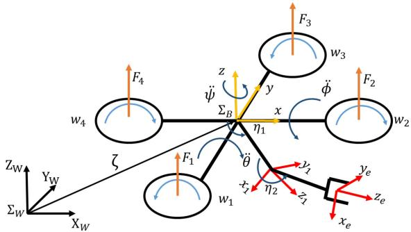  
Fig. 1. Sketch and coordinates of the aerial manipulator, a quadrotor mounted with a 2-DoF robotic arm.

3) To deal with the interactive force/torque from the motion of robotic arms to the dynamics of the quadrotor after using DDGP, a robust controller is presented to compensate the residues of internal force. The control system is demonstrated to be ultimately bounded, and if the control parameters are exponentially decaying, the asymptotical stability can be ensured.

4) Numerical examples and experiments are illustrated to demonstrate that under the decoupling framework, the use of DDPG for the robotic arm can ensure the efficiency of the aerial manipulator without causing instability. Moreover, the efficacy of the adaptive/robust controller in trajectory tracking with a sudden change of mass from picking up and dropping off the payload is guaranteed.

This article is organized as follows. The dynamic model of the aerial manipulator and the model of disturbances resulting from the interactive force are addressed in Section II. The design and theoretical analysis of the adaptive/robust tracking controller and reinforcement learning approach are presented in Section III. Numerical examples and experiments are illustrated in Section IV to show the efficiency of the proposed aerial manipulator system. Finally, the conclusion and future research direction are summarized in Section V.

## II. PRELIMINARIES AND SYSTEM MODELING

## A. Dynamics of Aerial Manipulator

The aerial manipulator system, as illustrated in Fig. 1, is composed of a quadrotor system with a two-DoF robotic arm. We consider $\zeta = [ x , y , z ] ^ { \dot { T } } \in \mathbb R ^ { 3 }$ and $\Phi = [ \phi , \theta , \psi ] ^ { T } \in \mathbb { R } ^ { 3 }$ as the position and orientation of the quadrotor body frame $\Sigma _ { B }$ with respect to the world frame $\Sigma _ { W }$ . For the robotic arm, the generalized coordinates are given as $\eta = [ \eta _ { 1 } , \eta _ { 2 } ] ^ { T } \in \mathbb { R } ^ { 2 }$ and $X _ { e } = [ x _ { e } , y _ { e } , z _ { e } ] ^ { T } \in \mathbb { R } ^ { 3 }$ , where $\eta$ is the vector of joint angles and $X _ { e }$ is the end-effector position of the robot arm with respect to the quadrotor body frame $\Sigma _ { B }$ . The two revolute joints of the robotic arm are considered to rotate with respect to the y-axis of $\Sigma _ { B }$ , so that $y _ { e } = 0$ for $\Sigma _ { B }$ . Therefore, the two-DoF robotic arm is constrained to move on the $x { - } z$ plane of $\Sigma _ { B }$ , and the end-effector positions $x _ { e }$ and $z _ { e }$ are controlled by the joint angles $\eta _ { 1 }$ and $\eta _ { 2 }$ as a planar manipulator.

Let us consider the generalized coordinates of the quadrotor with a robotic arm as $q = [ \zeta ^ { T } , \Phi ^ { T } , \eta ^ { T } ] ^ { T } \in \mathbb { R } ^ { 8 }$ , where $\Phi \ : = \ : [ \phi , \theta , \psi ] ^ { T }$ is the Euler angles of the quadrotor, and $\eta = [ \eta _ { 1 } , \eta _ { 2 } ] ^ { T } \in \mathbb { R } ^ { 2 }$ is the joint angles of the robotic arm. The velocity of the coordinates between $\Sigma _ { W }$ to $\Sigma _ { B }$ can be given as $\dot { \zeta } = R V _ { B }$ and $\Omega = T \omega _ { B }$ , where $V _ { B } , \omega _ { B } \in \mathbb { R } ^ { 3 }$ are the linear and angular velocities, respectively; $R \in \mathbb { R } ^ { 3 \times 3 }$ is the rotational matrix; and $T \in \mathbb { R } ^ { 3 \times 3 }$ is the translational matrix. The rotational matrix $R \in S O ( 3 )$ is defined from $\Sigma _ { B }$ to $\Sigma _ { W }$ with the use of $z { - } x { - } y$ Euler angles, and given as

$$
R = \left[ \begin{array}{c c c} c \psi c \theta - s \phi s \psi s \theta & - c \phi s \psi & c \psi s \theta + c \theta s \phi s \psi \\ c \theta s \psi + c \psi s \phi s \theta & c \phi c \psi & s \psi s \theta - c \psi c \theta s \phi \\ - c \phi s \theta & s \phi & c \phi c \theta \end{array} \right]\tag{1}
$$

where the Euler angles are given with $\theta , \phi \in ( - \pi / 2 , \pi / 2 )$ and $\psi \in ( - \pi , \pi )$ while $s ( j ) , c ( j )$ denote sin(j), cos(j), respectively, for $j = \{ \phi , \theta , \psi \}$

The dynamic model of the aerial manipulator can be expressed by the Euler–Lagrange equations and given as

$$
M (q) \ddot {q} + C (q, \dot {q}) \dot {q} + G (q) = B \tau\tag{2}
$$

where $\tau \in \mathbb { R } ^ { 6 }$ is the generalized force/torque input, $B \in \mathbb { R } ^ { 8 \times 6 }$ is the input transformation matrix, $M ( q ) \in \mathbb { R } ^ { 8 \times 8 }$ is the inertia matrix, $\mathbf { \bar { \Gamma } } _ { C ( q , \dot { q } ) } \in \mathbb { R } ^ { 8 \times 8 }$ represents the Coriolis matrix, and $G ( q ) \in \mathbb { R } ^ { 8 }$ denotes the vector of gravitational force. In the dynamic model, the inertia matrix $M ( q )$ is given as

$$
\begin{array}{l} M (q) = M _ {t, q} ^ {T} m _ {q} M _ {t, q} + M _ {r, q} ^ {T} \mathrm{RJR} ^ {T} M _ {r, q} \\ \qquad + \sum_ {i = 1} ^ {2} \bigl \{M _ {t, i} ^ {T} m _ {i} M _ {t, i} + M _ {r, i} ^ {T} (\mathrm{RR} _ {i}) J _ {i} (\mathrm{RR} _ {i}) ^ {T} M _ {r, i} \bigr \} \end{array}\tag{3}
$$

where $M _ { t , q } , M _ { r , q } , M _ { t , i } , M _ { r , i } \in \mathbb { R } ^ { 3 \times 8 }$ are the matrices from the velocity relationship $[ 1 4 ] , J _ { i }$ is the diagonal matrix of the rotational inertia of the ith link, and $R _ { i }$ denotes the rotational matrix from the body frame to the center mass of the ith link. Furthermore, the Christoffel symbols can be utilized to obtain the matrix $C ( q , \dot { q } )$ , and the gravitational vector is obtained from $G ( q ) = \partial \mathbb { U } / \partial q$ with $\begin{array} { r } { \mathbb { U } ^ { ^ { \sim } } = m _ { q } g \mu _ { 3 } ^ { T } \zeta + \sum _ { i = 1 } ^ { 2 } m _ { i } g \mu _ { 3 } ^ { T } \zeta _ { i } ^ { W } } \end{array}$ where $\boldsymbol { \zeta } _ { i } ^ { W }$ is the center mass position of the ith link on $\Sigma _ { W }$ defined as $\zeta _ { i } ^ { W } = \zeta + R \zeta _ { i } ^ { B }$ with $\zeta _ { i } ^ { B }$ being the position with respect to the body frame $\Sigma _ { B }$ . It is noted that $\zeta _ { i } ^ { \dot { W } }$ depends on the joint angles $\eta _ { 1 }$ and $\eta _ { 2 }$ and the lengths of robotic links $l _ { 1 }$ and $l _ { 2 }$ .

## B. Modeling of the Quadrotor With Interactive Force

Although the Euler–Lagrange dynamics (2) can describe the motion of the aerial manipulator, the accumulated dynamic model is too complicated to design an efficient controller with enhanced performance by considering the entire system composed of the quadrotor and robotic arm. To relax highly coupled dynamics that would cause computational complexity, a decoupling approach is presented in this article to control the trajectory tracking of the quadrotor and the mounted robotic arm separately. The main objective is to consider the coupling effect from the motion of the manipulator as disturbances to the dynamics of quadrotor so that the efficiency of control implementation can be enhanced significantly.

The dynamics of a quadrotor system is addressed by using the Newton–Euler method. Under the assumption of a rigid body and symmetric structure with negligible aerodynamic effects, the dynamic equations of a quadrotor are described as [19]

$$
m \ddot {\zeta} = F _ {\mathrm{ext}} R \mu_ {3} - \mathrm{mg} \mu_ {3}\tag{4}
$$

$$
J \dot {\Omega} _ {B} = \tau_ {\mathrm{ext}} - \Omega \times J \Omega\tag{5}
$$

where m denotes the mass of the entire system, including the masses of the quadrotor $m _ { q } ,$ , robotic arm, $m _ { r } = m _ { 1 } + m _ { 2 }$ and carrying object $m _ { o } ,$ , such that $m \ = \ m _ { q } + m _ { r } + m _ { o } $ $\zeta = [ x , \overset { \cdot } { y } , z ] ^ { T } \in \mathbb { R } ^ { 3 }$ denotes the position of the quadrotor with respect to the inertial frame $\Sigma _ { W } , \ \Omega \ \in \ \mathbb { R } ^ { 3 }$ denotes the angular velocity of the quadrotor on $\Sigma _ { B } , g$ is the gravity constant, $\mu _ { 3 } = [ 0 , 0 , 1 ] ^ { T }$ , and $J = \mathrm { d i a g } \{ I _ { x } , I _ { y } , I _ { z } \} \in \mathbb { R } ^ { 3 \times 3 }$ denotes the total inertia matrix of the quadrotor and robotic arm with respect to $\Sigma _ { B }$ , where diag $\{ d _ { 1 } , d _ { 2 } , d _ { 3 } \}$ represents a diagonal matrix. In addition, $F _ { \mathrm { e x t } } \in \mathbb { R }$ is the exerted force on $\Sigma _ { B }$ , and $\tau _ { \mathrm { e x t } } = [ \tau _ { \mathrm { e x t } , x } , \tau _ { \mathrm { e x t } , y } , \tau _ { \mathrm { e x t } , z } ] ^ { T } \in \mathbb { R } ^ { 3 }$ denotes the torque exerted on the quadrotor with respect to $\Sigma _ { B } .$ . Since the decoupling approach is used in this article, $F _ { \mathrm { e x t } }$ and $\tau _ { \mathrm { e x t } }$ contain input thrust from the four rotors and the interactive force/moment from the movement of the robotic arm.

By assuming that the quadrotor operates within small roll and pitch angles in R,  can be approximated by the angular velocity with respect to the inertial frame $\Sigma _ { W }$ [20]. Therefore, the dynamic equations of the decoupled quadrotor can be expressed as [16], [21]

$$
\left[ \begin{array}{c} \ddot {x} \\ \ddot {y} \\ \ddot {z} \end{array} \right] = \left[ \begin{array}{c} c \psi s \theta + c \theta s \phi s \psi \\ s \theta s \psi - s \phi c \theta c \psi \\ c \theta c \phi \end{array} \right] \frac {F _ {\text {ext}}}{m} - \mu_ {3} ^ {T} g\tag{6}
$$

$$
\left[ \begin{array}{c} \ddot {\phi} \\ \ddot {\theta} \\ \ddot {\psi} \end{array} \right] = \left[ \begin{array}{c} \Theta_ {\phi} \dot {\theta} \dot {\psi} \\ \Theta_ {\theta} \dot {\phi} \dot {\psi} \\ \Theta_ {\psi} \dot {\phi} \dot {\theta} \end{array} \right] + \left[ \begin{array}{c c c} 1 / I _ {x} & 0 & 0 \\ 0 & 1 / I _ {y} & 0 \\ 0 & 0 & 1 / I _ {z} \end{array} \right] \tau_ {\mathrm{ext}}\tag{7}
$$

where $\Theta _ { j }$ for $j = \{ \phi , \theta , \psi \}$ are given by $\Theta _ { \phi } = ( I _ { y } - I _ { z } ) / I _ { x }$ $\Theta _ { \theta } = ( I _ { z } - I _ { x } ) / I _ { y }$ , and $\Theta _ { \psi } = ( I _ { x } - I _ { y } ) / I _ { z }$ . It is noted that $F _ { \mathrm { e x t } }$ and $\tau _ { \mathrm { e x t } }$ are the resultant force and torque applied on the quadrotor, including the equivalent force and torque from the movement of robotic arms. Hence, the total force and torque are given as $F _ { \mathrm { e x t } } = F _ { q } + F _ { \mathrm { i n t , } i }$ r and $\tau _ { \mathrm { e x t } } = \tau _ { q } + \tau _ { \mathrm { i n t } , r }$ , where $F _ { \mathrm { i n t } , \prime }$ r and $\tau _ { \mathrm { i n t } , r }$ are the interactive force/torque resulting from the motion of the robotic arm on the quadrotor, and $F _ { q }$ and ${ \tau } _ { q } = [ \tau _ { q , x } , \tau _ { q , y } , \tau _ { q , z } ] ^ { T }$ denote the thrust force and moment torque from the rotors.

A quadrotor system is actuated by the rotational speed of the four motors, which can be converted to the control input force $F _ { q }$ and moment torque $\tau _ { q }$ [21], [22]. Therefore, the force generated from each motor can be obtained by $F _ { i } = k _ { F } \mathbf { w } _ { i } ^ { 2 }$ , where $F _ { i }$ are the lifting force of the ith motor, $\mathbf { W } _ { i }$ is the motor speed of the ith motor, and $k _ { F } > 0$ as the lifting force coefficient. For the moment resulting from the motor, we have that $M _ { i } = k _ { M } \mathbf { w } _ { i } ^ { 2 }$ for $i = 1 , 2 , 3 , 4$ , where $M _ { i }$ is the moment from the ith motor, and $k _ { M } ~ > ~ 0$ is the coefficient of the motor moment. By denoting d as the distance from the rotor axes to the quadrotor epicenter, we obtain $\begin{array} { r } { F _ { q } = \sum _ { i = 1 } ^ { 4 } F _ { i } , \tau _ { q , x } = d ( F _ { 2 } - F _ { 4 } ) } \end{array}$ $\tau _ { q , y } = d ( F _ { 3 } - F _ { 1 } )$ , and $\begin{array} { r } { \tau _ { q , z } = \sum _ { i = 1 } ^ { 4 } ( - 1 ) ^ { i + 1 } M _ { i } } \end{array}$

For the decoupling dynamics, the thrust force and moment torque from the rotors, $F _ { q }$ and $\tau _ { q } .$ are generated from the control design with the aforementioned transformation. However, the interactive force/torque from the motion of a robotic arm, $F _ { \mathrm { i n t } , I }$ r and $\tau _ { \mathrm { i n t } , r } = [ \tau _ { \mathrm { i n t } , r \phi } , \tau _ { \mathrm { i n t } , r \theta } , \tau _ { \mathrm { i n t } , r \psi } ] ^ { T }$ , are relatively difficult to obtain precisely. By considering these interactive terms as the disturbances to the dynamic of the quadrotor system, the inputs to the quadrotor system in (6) and (7) can be rewritten as

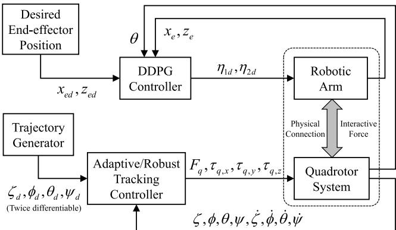  
Fig. 2. Block diagram of the proposed adaptive/robust control algorithms with the DDPG controller for the aerial manipulator.

$$
\frac {F _ {\mathrm{ext}}}{m} = \frac {F _ {q}}{m} + \frac {F _ {\mathrm{int} , r}}{m} := \frac {F _ {q}}{m} + \omega_ {\zeta}\tag{8}
$$

$$
\frac {\tau_ {\mathrm{ext} , x}}{I _ {x}} = \frac {\tau_ {q , x}}{I _ {x}} + \frac {\tau_ {\mathrm{ext} , r \phi}}{I _ {x}} := \frac {\tau_ {q , x}}{I _ {x}} + \omega_ {\phi}\tag{9}
$$

$$
\frac {\tau_ {\mathrm{ext} , y}}{I _ {y}} = \frac {\tau_ {q , y}}{I _ {y}} + \frac {\tau_ {\mathrm{ext} , r \theta}}{I _ {y}} := \frac {\tau_ {q , y}}{I _ {y}} + \omega_ {\theta}\tag{10}
$$

$$
\frac {\tau_ {\mathrm{ext} , z}}{I _ {z}} = \frac {\tau_ {q , z}}{I _ {z}} + \frac {\tau_ {\mathrm{ext} , r \psi}}{I _ {z}} := \frac {\tau_ {q , z}}{I _ {z}} + \omega_ {\psi}\tag{11}
$$

where $\omega _ { \zeta } , \omega _ { \phi } , \omega _ { \theta }$ , and $\omega _ { \psi } \in \mathbb { R }$ are the interactive force/torque exerted on the quadrotor from the motion of the robotic arm.

## III. AERIAL QUADROTOR WITH ROBOTIC MANIPULATOR

In the decoupling approach for aerial manipulators, the interactive force/torque from the robotic arm and the presence of dynamic uncertainties would significantly affect the dynamics of quadrotors. In this article, the DDPG approach is utilized to control the setpoint of the manipulator to minimize the interactive force so that the decoupled dynamics and the assumption of small roll and pitch angles can be valid. The residues of the interactive force/torque after the use of DDPG are considered as disturbances to the quadrotor dynamics, and handled by a robust controller to ensure that the system is ultimately bounded. In addition, an adaptive tracking controller is presented to deal with unknown parameters on the dynamics of the aerial manipulator so as to ensure stability and trajectory tracking.

The control block diagram is illustrated in Fig. 2, where both the adaptive/robust tracking controller and DDPG controller are mentioned. In the proposed system, the adaptive/robust control requires the desired trajectories for the quadrotor to follow that are obtained from a trajectory generator according to the applications and tasks [23]. The twice differentiable desired trajectories $\zeta _ { d } , \ \phi _ { d } , \ \theta _ { d } ,$ and $\psi _ { d }$ are fed into the adaptive/robust tracking controller to ensure the position/orientation tracking of the quadrotor in the presence of external/internal disturbance. Meanwhile, the desired endeffector positions $x _ { \mathrm { e d } }$ and $z _ { \mathrm { e d } }$ and the current end-effector position are included in the reward function of the DDPG controller to generate the desired joint angles for the robotic arm. Hence, the motors on the robotic arm regulate the joint to the desired angles $\eta _ { 1 d }$ and $\eta _ { 2 d }$ so that the end effector can be controlled to track the desired position $x _ { \mathrm { e d } }$ and $z _ { \mathrm { e d } }$

## A. DDPG-Based Reinforcement Learning for Manipulator

When controlling the robotic arm and the quadrotor simultaneously, the quadrotor can be unstable if the robotic arm has a wide range or rapid movements. To diminish the effect from the motion of the robotic arm on the quadrotor dynamics, a reinforcement learning approach is presented subsequently on the control of the robotic arm. The angles of the manipulator η1 and $\eta _ { 2 }$ are regulated to the desired angles of the manipulators $\eta _ { 1 d }$ and $\eta _ { 2 d }$ which are obtained from the learning approach as illustrated in Fig. 2.

The DDPG [24] is utilized in this article to deal with the movement of the robotic arm by ensuring minimized influence to the quadrotor motion. DDPG is one of the reinforcement learning algorithms, making use of the recursive relationship so-called Bellman equation described by

$$
Q ^ {\pi} (s _ {t}, a _ {t}) = \mathbb {E} _ {s _ {t + 1} \sim \epsilon (\pi), a _ {t} \sim \pi} \big [ r (s _ {t}, a _ {t}) + \gamma \mathbb {E} \big [ Q ^ {\pi} (s _ {t + 1}, a _ {t + 1}) \big ] \big ]
$$

where $s _ { t }$ is the state under $\epsilon ( \pi )$ distribution, $a _ { t }$ is the behavior of the agent defined by a policy $\pi , r ( s _ { t } , a _ { t } )$ denotes the reward function, and $\gamma \in [ 0 , 1 )$ denotes the discount factor. Since the target policy is deterministic in a robotic arm, the Bellman equation can be written as follows:

$$
Q ^ {\mu} (s _ {t}, a _ {t}) = \mathbb {E} _ {s _ {t + 1} \sim \epsilon (\pi)} \big [ r (s _ {t}, a _ {t}) + \gamma Q ^ {\mu} (s _ {t + 1}, \mu (s _ {t + 1})) \big ].
$$

DDPG is an actor–critic method based on the DPG algorithm [25]. The critic $Q ( s _ { t } , a _ { t } )$ is updated by considering a function approximator $Q ( s _ { t } , a _ { t } | p ^ { Q } )$ , which can be optimized by minimizing the loss given as $L ( p ^ { Q } ) \ =$ $\mathbb { E } _ { s _ { t } \sim \epsilon ( \pi ) , r _ { t } \sim E } [ ( Q ( s _ { t } , a _ { t } | p ^ { Q } ) - y _ { t } ) ^ { 2 } ]$ , where $p ^ { Q }$ is the weight of the function approximator of the critic, and $y _ { t }$ is defined as $y _ { t } = r ( s _ { t } , a _ { t } ) + \gamma Q ( s _ { t + 1 } , \mu ( s _ { t + 1 } ) | p ^ { Q } )$ . Subsequently, the performance objective $H ( \pi )$ is defined as

$$
H (\pi) = \mathbb {E} \left[ \sum_ {k = 1} ^ {\infty} \gamma^ {k} r _ {t + k} \right].\tag{12}
$$

Meanwhile, the actor $\mu ( s )$ is also updated by considering a function approximator $\mu ( s | p ^ { \mu } )$ , which can be updated by the gradient of the performance objective H with respect to the parameter $p ^ { \mu }$

$$
\begin{array}{r l} & {\nabla_ {p ^ {\mu}} H (\pi) \approx \mathbb {E} _ {s _ {t} \sim \epsilon (\pi)} \Big [ \nabla_ {p ^ {\mu}} Q (s _ {t}, a | p ^ {Q}) | _ {a = \mu (s _ {t} | p ^ {\mu})} \Big ]} \\ & {\qquad = \mathbb {E} _ {s _ {t} \sim \epsilon (\pi)} \Big [ \nabla_ {a} Q (s _ {t}, a | p ^ {Q}) | _ {a = \mu (s _ {t})} \nabla_ {p ^ {\mu}} \mu (s _ {t} | p ^ {\mu}) \Big ]} \end{array}\tag{13}
$$

where $p ^ { \mu }$ is the weights of the function approximators of the actor. Thus, the weights of the actor can be updated as follows [26]:

$$
\Delta p ^ {\mu} \approx \alpha \nabla_ {p ^ {\mu}} H,
$$

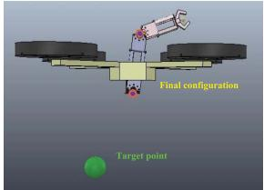  
(a)

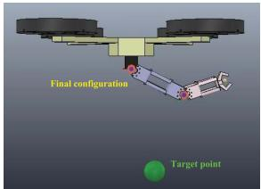  
(b)

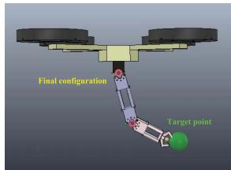  
(c)

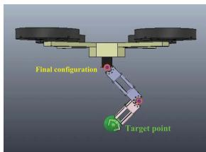  
(d)  
Fig. 3. Training states of the proposed DDPG approach for the robotic arm mounted on the quadrotor in V-REP. (a) Beginning period. (b) Prior period. (c) Middle period. (d) Last period.

where α is a positive constant regarding the step size. When using the nonlinear function approximators, the convergence of learning tends to be unstable. The replay buffer was used to address these issues in [24] and [27]. It is demonstrated that the algorithm can learn in large state and action spaces, so the use of the target network can greatly improve the stability of learning. Hence, the target network can be updated as follows:

$$
p ^ {\mu^ {\prime}} \leftarrow \lambda p ^ {\mu} + (1 - \lambda) p ^ {\mu^ {\prime}}\tag{14}
$$

$$
p ^ {Q ^ {\prime}} \leftarrow \lambda p ^ {Q} + (1 - \lambda) p ^ {Q ^ {\prime}}\tag{15}
$$

where $p ^ { Q ^ { \prime } }$ is the weights of the target network of the critic, $p ^ { \mu ^ { \prime } }$ is the weights of the target network of the actor, and $\lambda \ll 1$

The DDPG algorithm is to control an agent to interact with an environment, and the interaction will respond with a reward to the system based on the defined reward function. The main purpose of the DDPG algorithm is to obtain the highest reward from the environment. Instead of learning to control the motor torque of the robotic arm directly, we make the DDPG controller learn to give the high-level command while neglecting the changes of parameters on the manipulator. Hence, we can simplify the problem to design the reward function. Since the states of the quadrotor are taken into the design of the reward function, if the movement of the manipulator causes the quadrotor to be unstable, a relative smaller score will be obtained from the reward function. Therefore, the learning result would ensure a smooth motion of the manipulator to reduce the impact to the quadrotor.

In this article, the DDPG controller is trained in a virtual environment, where the training environment is built based on the exact model of the aerial manipulator in the real-world experiment in Section IV-B and accomplished in the virtual robot experimentation platform (V-REP) [28] as shown in Fig. 3. The states for observation are denoted by $\boldsymbol { \xi } = [ \theta , x _ { 1 } , z _ { 1 } , x _ { e } , z _ { e } , x _ { \mathrm { e d } } , z _ { \mathrm { e d } } ]$ as shown in Fig. 1 with $\{ x _ { \mathrm { e d } } , z _ { \mathrm { e d } } \}$ as the desired position for the end-effector. Since the robotic arm is a 2-DoF manipulator operating on the x-z plane, only the pitch angle θ would be influenced from the movement of the robotic arm. By following the objective, the reward function is designed based on controlling the end effector of the manipulator to the desired position while having slight perturbation to the quadrotor. Consequently, the reward function can be defined as

$$
r (\xi) = \beta_ {1} \sqrt {(x _ {\mathrm{ed}} - x _ {e}) ^ {2} + (z _ {\mathrm{ed}} - z _ {e}) ^ {2}} + \beta_ {2} | \theta |\tag{16}
$$

where $\beta _ { 1 }$ and $\beta _ { 2 }$ are negative constant gains so that maximizing the rewards can lead to the desired performance. In order to obtain the highest reward, the DDPG controller needs to control the end effector to the desired position while having relatively small perturbation to the quadrotor. The parameters of the reward function $\beta _ { 1 }$ and $\beta _ { 2 }$ need to be tuned and adjusted based on the performance of the virtual agent. After the training section is complete, the trained DDPG controller can be directly implanted to the real-world agent provided minimum influence to the quadrotor with position control.

Remark 1: In the proposed decoupling approach, the robotic arm and the quadrotor are continuous-time systems; hence, the policy gradient algorithms are more appropriate to provide a better training result. In addition, since the control of an aerial manipulator for tracking desired trajectories is not stochastic, a deterministic approach would be suitable for this research objective. Therefore, deep deterministic policy gradient algorithm (DDPG) is considered in this article.

Remark 2: A quadrotor system is an inherently unstable system and the change of the dynamic parameters may be a challenging issue in designing a controller [29]. Reinforcement learning has the reward hacking problem and overfitting issue [30], so the random exploration for control strategy would cause robustness problem under varying system parameters in operation [31]. In addition, to control the quadrotor of the aerial manipulator, the final learning results may be unpredictable or even unstable. Therefore, to avoid the aforementioned issues in practice, the identical aerial manipulator system is built in V-REP to provide more realistic training (see the supplementary material). Moreover, instead of using reinforcement learning to control the quadrotor, we consider the adaptive/robust controller to guarantee stability and trajectory tracking for the quadrotors.

## B. Adaptive/Robust Tracking Controller for Quadrotors

For the control of a quadrotor, the dynamic parameters may change when an object is attached to or detached from the aerial manipulator; on the other hand, during the phase of manipulation, the manipulator would also perturb the quadrotor. Since the dynamic parameters m, $I _ { x } , I _ { y } ,$ and $I _ { z }$ are not able to measure precisely, and the interactive force/torque is crucial for the control of a quadrotor, adaptive and robust control algorithms are presented and exploited in this section.

To cope with these issues, we exploit an adaptive control for the quadrotor to follow a desired trajectory under dynamic uncertainties. The uncertainties could contain the unknown inertia of the quadrotor, and also the influence from the payload of the robot arm. In addition, a robust controller is presented to deal with the residues of interactive force from the movement of the robotic arm with the use of DDPG. The main purpose of the controllers focuses on ensuring stability and quadrotor tracking performance without the knowledge of dynamic uncertainties, including payloads, and interactive disturbance from the robotic arm.

By following the notations stated in (8)–(11), the quadrotor dynamics can be modified by taking the disturbances into account and given as

$$
\left[ \begin{array}{c} \ddot {x} \\ \ddot {y} \\ \ddot {z} \end{array} \right] = \left[ \begin{array}{c} c \psi s \theta + c \theta s \phi s \psi \\ s \theta s \psi - s \phi c \theta c \psi \\ c \theta c \phi \end{array} \right] \left(\frac {F _ {q}}{m} + \omega_ {\zeta}\right) - \mu_ {3} ^ {T} g\tag{17}
$$

$$
\left[ \begin{array}{c} \ddot {\phi} \\ \ddot {\theta} \\ \ddot {\psi} \end{array} \right] = \left[ \begin{array}{c} \Theta_ {\phi} \dot {\theta} \dot {\psi} \\ \Theta_ {\theta} \dot {\phi} \dot {\psi} \\ \Theta_ {\psi} \dot {\phi} \dot {\theta} \end{array} \right] + \left[ \begin{array}{c} \tau_ {q, x} / I _ {x} \\ \tau_ {q, y} / I _ {y} \\ \tau_ {q, z} / I _ {z} \end{array} \right] + \left[ \begin{array}{c} \omega_ {\phi} \\ \omega_ {\theta} \\ \omega_ {\psi} \end{array} \right].\tag{18}
$$

By observing the input command to the quadrotor, the lifting force and moment torque on the quadrotor are divided by either the accumulative mass m or the equivalent rotational inertia $I _ { q , i }$ for $i = \{ x , y , z \}$ . To better handle the dynamic uncertainties, we separate the mass/rotational inertia from the input so that the parameters can be addressed by using adaptive control algorithms. With the concept of nominal input, the thrust and torque inputs are rewritten as

$$
F _ {q} = \hat {m} \bar {F} _ {q}, \tau_ {q, x} = \hat {I} _ {x} \bar {\tau} _ {q, x}, \tau_ {q, y} = \hat {I} _ {y} \bar {\tau} _ {q, y}, \tau_ {q, z} = \hat {I} _ {z} \bar {\tau} _ {q, z}\tag{19}
$$

where $\bar { F } _ { q } , \bar { \tau } _ { q , x } , \bar { \tau } _ { q , y } .$ and $\bar { \tau } _ { q , z }$ are the nominal inputs, and $\hat { m } ,$ ${ \hat { I } } _ { x } , \ { \hat { I } } _ { y } ,$ and $\hat { I } _ { z }$ are the estimation of the accumulative mass and equivalent inertia from quadrotor parameters and influence from the robotic arm and the payload.

The control algorithm is proposed to ensure that without the knowledge of dynamic parameters, the quadrotor can track a desired trajectory denoted by the desired quadrotor position $\zeta _ { d } ( t ) \in \mathbb { R } ^ { 3 }$ and the desired Euler angles $\Phi _ { d } ( t )$ . It is noted that $\zeta _ { d } ( t )$ and $\Phi _ { d } ( t )$ are bounded and twice differentiable, such as the trajectory obtained by using the minimum snap trajectory generation [23]. Hence, we define the tracking errors as

$$
e _ {1} = \zeta - \zeta_ {d}, e _ {2} = \dot {e} _ {1} + c _ {1} e _ {1}, e _ {3} = \phi - \phi_ {d}\tag{20}
$$

$$
e _ {4} = \dot {e} _ {3} + c _ {3} e _ {3}, \quad e _ {5} = \theta - \theta_ {d}, \quad e _ {6} = \dot {e} _ {5} + c _ {5} e _ {5}\tag{21}
$$

$$
e _ {7} = \psi - \psi_ {d}, e _ {8} = \dot {e} _ {7} + c _ {7} e _ {7}\tag{22}
$$

where $c _ { i }$ for $i = \{ 1 , 3 , 5 , 7 \}$ are positive control gains, $e _ { 1 } , e _ { 2 } \in$ ${ \mathbb { R } } ^ { 3 }$ , and $e _ { 3 } , e _ { 4 } , e _ { 5 } , e _ { 6 } , e _ { 7 } , e _ { 8 } \in \mathbb { R }$

By denoting $R _ { f } = R \mu _ { 3 } \in \mathbb { R } ^ { 3 }$ and $s _ { \zeta } ~ = ~ e _ { 2 } ^ { T } R _ { f } ~ \in \mathbb { R }$ , the nominal control inputs are given as

$$
\bar {F} _ {q} = s _ {\zeta} ^ {- 1} \big (e _ {2} ^ {T} \big (- e _ {1} - c _ {2} e _ {2} + g \mu_ {3} + \ddot {\zeta} _ {d} - c _ {1} \dot {e} _ {1} - \hat {\omega} _ {\zeta} R _ {f} \big) \big)\tag{23}
$$

$$
\bar {\tau} _ {q, x} = - e _ {3} - c _ {4} e _ {4} + \ddot {\phi} _ {d} - c _ {3} \dot {e} _ {3} - \hat {\Theta} _ {\phi} \dot {\theta} \dot {\psi} - \hat {\omega} _ {\phi}\tag{24}
$$

$$
\bar {\tau} _ {q, y} = - e _ {5} - c _ {6} e _ {6} + \ddot {\theta} _ {d} - c _ {5} \dot {e} _ {5} - \hat {\Theta} _ {\theta} \dot {\phi} \dot {\psi} - \hat {\omega} _ {\theta}\tag{25}
$$

$$
\bar {\tau} _ {q, z} = - e _ {7} - c _ {8} e _ {8} + \ddot {\psi} _ {d} - c _ {7} \dot {e} _ {7} - \hat {\Theta} _ {\psi} \dot {\phi} \dot {\theta} - \hat {\omega} _ {\psi}\tag{26}
$$

where $ { \hat { \Theta } } _ { \phi } ,  { \hat { \Theta } } _ { \theta }$ , and $\hat { \Theta } _ { \psi }$ are the estimates of unknown parameters as defined in $( 7 )$ , and $\hat { \omega } _ { \zeta } , ~ \hat { \omega } _ { \phi } , ~ \hat { \omega } _ { \theta }$ , and $\hat { \omega } _ { \psi }$ are the estimates of the unknown disturbances according to (8)–(11), after the utilization of DDPG. To cope with the uncertainties, we propose the adaptive laws such that

$$
\dot {\hat {m}} = - \rho_ {m} \bar {F} _ {q} s _ {\zeta}\tag{27}
$$

$$
\dot {\hat {I}} _ {x} = - \rho_ {x} e _ {4} \bar {\tau} _ {x}, \dot {\hat {I}} _ {y} = - \rho_ {y} e _ {6} \bar {\tau} _ {y}, \dot {\hat {I}} _ {z} = - \rho_ {z} e _ {8} \bar {\tau} _ {z}\tag{28}
$$

$$
\dot {\hat {\Theta}} _ {\phi} = \rho_ {\phi} e _ {4} \dot {\theta} \dot {\psi}, \dot {\hat {\Theta}} _ {\theta} = \rho_ {\theta} e _ {6} \dot {\phi} \dot {\psi}, \dot {\hat {\Theta}} _ {\psi} = \rho_ {\psi} e _ {8} \dot {\phi} \dot {\theta}\tag{29}
$$

where $\rho _ { i }$ for $i = \{ m , \phi , \theta , \psi , x , y ,$ z} are the positive estimation gains.

In addition to the aforementioned nominal control inputs and adaptive algorithms, the disturbances are coped with in this article by using robust controllers. For the dynamics of the quadrotor position, it is assumed that there exist a bounded function $\omega _ { \zeta 0 } ( t )$ and a positive constant $d _ { \zeta }$ such that $\| \omega _ { \zeta 0 } -$ $\omega _ { \zeta } \parallel \leq d _ { \zeta }$ . Thus, the estimation of unknown disturbance in the quadrotor position is given as $\hat { \omega } _ { \zeta } = \omega _ { \zeta 0 } + \delta \omega _ { \zeta }$ , where $\delta \omega _ { \zeta }$ is an additional input that is given as

$$
\delta \omega_ {\zeta} = \left\{ \begin{array}{l l} d _ {\zeta} \frac {s _ {\zeta}}{\| s _ {\zeta} \|}, & \text { if } \| s _ {\zeta} \| > \varepsilon_ {\zeta} \\ \frac {d _ {\zeta}}{\varepsilon_ {\zeta}} s _ {\zeta}, & \text { if } \| s _ {\zeta} \| \leq \varepsilon_ {\zeta} \end{array} \right.\tag{30}
$$

with $\varepsilon _ { \zeta }$ as a positive control gain.

A similar design for the disturbance in the orientation of the quadrotor dynamics with $j = \{ \phi , \theta , \psi \}$ can be given as $\hat { \omega } _ { j } = \omega _ { j 0 } + \delta \omega _ { j }$ , where $\omega _ { j 0 } ( t )$ is a bounded function such that $\| \omega _ { j 0 } - \omega _ { j } \| \le d _ { j }$ with $d _ { j }$ as positive constants. For $\varepsilon _ { j }$ being positive control gains and $s _ { \phi } = e _ { 4 } , s _ { \theta } = e _ { 6 } , s _ { \psi } = e _ { 8 }$ , the additional inputs δωj are given as

$$
\delta \omega_ {j} = \left\{ \begin{array}{l l} d _ {j} \frac {s _ {j}}{\| s _ {j} \|}, & \text { if } \| s _ {j} \| > \varepsilon_ {j} \\ \frac {d _ {j}}{\varepsilon_ {j}} s _ {j}, & \text { if } \| s _ {j} \| \leq \varepsilon_ {j} \end{array} \right.\tag{31}
$$

for $j = \{ \phi , \theta , \psi \}$ . The presented adaptive and robust algorithms are utilized to control the quadrotor under the framework of the proposed decoupling approach.

## C. Stability and Tracking Performance Analyses

The next theorem addresses the stability and convergence of tracking errors for quadrotors under the influence of coupling force from the robotic arm and dynamic uncertainties.

Theorem 1: Consider the quadrotor system, described by (17) and (18), mounted with a robotic arm. With the use of DDPG for the control of robotic arm, the nominal control inputs in (23)–(26) with the adaptive laws described in $( 2 7 ) -$ (29), and the robust control inputs in (30) and (31) ensure that the aerial manipulator is stable and all states are ultimately bounded by $d _ { \zeta } , \varepsilon _ { \zeta } , d _ { j } .$ , and $\varepsilon _ { j }$ for $j = \{ \phi , \theta , \psi \}$ . In addition, if $\varepsilon _ { \zeta }$ and $\varepsilon _ { j }$ are exponential decaying variables such that $\varepsilon _ { \zeta } = a _ { \zeta } \exp ( - b _ { \zeta } t )$ and $\varepsilon _ { j } = a _ { j } \exp ( - b _ { j } t )$ with $a _ { \zeta } , b _ { \zeta } , a _ { j }$ and $b _ { j }$ being positive constants, then the position and velocity tracking errors of the quadrotor system $e _ { 1 } , e _ { 2 } , e _ { 3 } , e _ { 4 } , e _ { 5 } , e _ { 6 } ,$ $e _ { 7 } .$ , and $e _ { 8 }$ converge to the origin asymptotically.

Proof: The dynamics of the quadrotor with the coupling effect from the robotic arm can be described by (17) and (18). Let us consider the positive-definite Lyapunov function candidate as

$$
\begin{array}{l} V = \frac {1}{2} \left(\sum_ {i = 1} ^ {2} e _ {i} ^ {T} e _ {i} + \sum_ {i = 3} ^ {8} e _ {i} ^ {2} + \frac {\tilde {m} ^ {2}}{\rho_ {m} m} + \frac {\tilde {I} _ {x} ^ {2}}{\rho_ {x} I _ {x}} \right. \\ \left. + \frac {\tilde {I} _ {y} ^ {2}}{\rho_ {y} I _ {y}} + \frac {\tilde {I} _ {z} ^ {2}}{\rho_ {z} I _ {z}} + \frac {\tilde {\Theta} _ {\phi} ^ {2}}{\rho_ {\phi}} + \frac {\tilde {\Theta} _ {\theta} ^ {2}}{\rho_ {\theta}} + \frac {\tilde {\Theta} _ {\psi} ^ {2}}{\rho_ {\psi}}\right) \end{array}\tag{32}
$$

where $\tilde { m } = m - \hat { m } , \tilde { I } _ { i } = I _ { i } - \hat { I } _ { i }$ for $i = \{ x , y , z \}$ , and $\tilde { \Theta } _ { j } =$ $\Theta _ { j } - \hat { \Theta } _ { j } \operatorname { f o r } j = \{ \phi , \theta ,$ , ψ} are the estimate errors of the enclosed signals. By taking the time derivative of V, we have

$$
\begin{array}{l} \dot {V} = \underbrace {\sum_ {i = 1} ^ {2} e _ {i} ^ {T} \dot {e} _ {i} - \frac {\tilde {m} \dot {\hat {m}}}{\rho_ {m} m}} _ {\mathrm{dV} _ {\mathrm{pos}}} + \underbrace {\sum_ {i = 3} ^ {4} e _ {i} \dot {e} _ {i} - \frac {\tilde {I} _ {x} \dot {\hat {I}} _ {x}}{\rho_ {x} I _ {x}} - \frac {\tilde {\Theta} _ {\phi} \dot {\hat {\Theta}} _ {\phi}}{\rho_ {\phi}}} _ {\mathrm{dV} _ {\phi}} \\ + \underbrace {\sum_ {i = 5} ^ {6} e _ {i} \dot {e} _ {i} - \frac {\tilde {I} _ {y} \dot {\hat {I}} _ {y}}{\rho_ {x} I _ {y}} - \frac {\tilde {\Theta} _ {\theta} \dot {\hat {\Theta}} _ {\theta}}{\rho_ {\theta}}} _ {\mathrm{dV} _ {\theta}} + \underbrace {\sum_ {i = 7} ^ {8} e _ {i} \dot {e} _ {i} - \frac {\tilde {I} _ {z} \dot {\hat {I}} _ {z}}{\rho_ {x} I _ {z}} - \frac {\tilde {\Theta} _ {\psi} \dot {\hat {\Theta}} _ {\psi}}{\rho_ {\psi}}} _ {\mathrm{dV} _ {\psi}}. \end{array}\tag{33}
$$

Let us first focus on $\mathrm { { d V } _ { p o s } , }$ , the position portion of the quadrotor in $\dot { V } .$ From the definition of $e _ { 2 }$ and its time derivative, we obtain that ${ \dot { e } } _ { 1 } = e _ { 2 } - c _ { 1 } e _ { 1 }$ and ${ \dot { e } } _ { 2 } = { \ddot { e } } _ { 1 } + c _ { 1 } { \dot { e } } _ { 1 }$ . Consequently, $\mathrm { { d V _ { p o s } } }$ with the substitution of ${ \dot { e } } _ { 1 }$ and ${ \dot { e } } _ { 2 }$ becomes

$$
\mathrm{dV} _ {\mathrm{pos}} = e _ {1} ^ {T} (e _ {2} - c _ {1} e _ {1}) + e _ {2} ^ {T} \big (\ddot {\zeta} - \ddot {\zeta} _ {d} + c _ {1} \dot {e} _ {1} \big) - \frac {\tilde {m} \dot {\hat {m}}}{\rho_ {m} m}.\tag{34}
$$

By considering the quadrotor dynamics (17) in the compact form (4), we obtain

$$
\ddot {\zeta} = \frac {F _ {\mathrm{ext}} R \mu_ {3}}{m} - g \mu_ {3} = \frac {F _ {q}}{m} R _ {f} + \omega_ {\zeta} R _ {f} - g \mu_ {3}.\tag{35}
$$

From the design of the nominal input, $F _ { q } = \hat { m } \bar { F } _ { q } .$ , and the estimation error $\tilde { m } = m - \hat { m }$ , we have that $F _ { q } = \hat { m } \bar { F } _ { q } =$ $( m - \tilde { m } ) \bar { F } _ { q }$ . Subsequently, we obtain that $F _ { q } / m = \bar { F } _ { q } - \bar { F } _ { q } \tilde { m } / m$ By substituting $\ddot { \zeta }$ in (35) and $F _ { q } / m$ into (34), we obtain that

$$
\begin{array}{c} \mathrm {dV_ {pos}} = e _ {1} ^ {T} e _ {2} - c _ {1} e _ {1} ^ {T} e _ {1} + e _ {2} ^ {T} \bigg (\bigg (\bar {F} _ {q} - \bar {F} _ {q} \frac {\tilde {m}}{m} \bigg) R _ {f} + \omega_ {\zeta} R _ {f} \\ - g \mu_ {3} - \ddot {\zeta} _ {d} + c _ {1} \dot {e} _ {1} \bigg) - \frac {\tilde {m} \dot {\hat {m}}}{\rho_ {m} m}. \end{array}\tag{36}
$$

With the use of the proposed adaptive law (27), we have, as $\bar { F } _ { q }$ and $\tilde { m } / m$ are scalars, that

$$
- e _ {2} ^ {T} \bar {F} _ {q} \frac {\tilde {m}}{m} R _ {f} - \frac {\tilde {m} \dot {\bar {m}}}{\rho_ {m} m} = - \bar {F} _ {q} \frac {\tilde {m}}{m} s _ {\zeta} + \frac {\tilde {m} \rho_ {m} \bar {F} _ {q} s _ {\zeta}}{\rho_ {m} m} = 0.\tag{37}
$$

Hence, $\mathrm { { d V _ { p o s } } }$ becomes

$$
\begin{array}{c} \mathrm{dV} _ {\text {pos}} = e _ {1} ^ {T} e _ {2} - c _ {1} e _ {1} ^ {T} e _ {1} + \bar {F} _ {q} s _ {\zeta} + \omega_ {\zeta} s _ {\zeta} - e _ {2} ^ {T} g \mu_ {3} \\ - e _ {2} ^ {T} \ddot {\zeta} _ {d} + c _ {1} e _ {2} ^ {T} \dot {e} _ {1}. \end{array}\tag{38}
$$

By rewritting $\mathrm { { d V _ { p o s } } }$ with $\hat { \omega } _ { \zeta } s _ { \zeta }$ , we obtain

$$
\begin{array}{r l} \mathrm{dV} _ {\text {pos}} & = e _ {1} ^ {T} e _ {2} - c _ {1} e _ {1} ^ {T} e _ {1} + \left(\bar {F} _ {q} s _ {\zeta} + \hat {\omega} _ {\zeta} s _ {\zeta} - e _ {2} ^ {T} g \mu_ {3} - e _ {2} ^ {T} \ddot {\zeta} _ {d} + c _ {1} e _ {2} ^ {T} \dot {e} _ {1}\right) \\ & + \left(\omega_ {\zeta} - \hat {\omega} _ {\zeta}\right) s _ {\zeta}. \end{array} \tag {39}
$$

By utilizing the additional input $\delta \omega _ { \zeta }$ in (30) and $\hat { \omega } _ { \zeta } = \omega _ { \zeta 0 } +$ $\delta \omega _ { \zeta }$ to the last term in the above equation, we have that $( \omega _ { \zeta } -$ $\omega _ { \zeta 0 } - \delta \omega _ { \zeta } ) s _ { \zeta }$ is upper bounded by $\varepsilon _ { \zeta } d _ { \zeta } / 4$ [32]. Hence, by substituting the nominal input (23) to $\mathrm { { d V _ { p o s } } }$ , we obtain that

$$
\begin{array}{r l} \mathrm{dV} _ {\text {pos}} & \leq e _ {1} ^ {T} e _ {2} - c _ {1} e _ {1} ^ {T} e _ {1} + \left(\bar {F} _ {q} s _ {\zeta} + \hat {\omega} _ {\zeta} s _ {\zeta} - e _ {2} ^ {T} g \mu_ {3} - e _ {2} ^ {T} \ddot {\zeta} _ {d} \right. \\ & \quad \left. + c _ {1} e _ {2} ^ {T} \dot {e} _ {1}\right) + \frac {\varepsilon_ {\zeta} d _ {\zeta}}{4} \\ & = - c _ {1} e _ {1} ^ {T} e _ {1} - c _ {2} e _ {2} ^ {T} e _ {2} + \frac {\varepsilon_ {\zeta} d _ {\zeta}}{4}. \end{array} \tag {4}\tag{40}
$$

Next, let us consider the proof for the roll angle $\mathrm { d } \mathrm { V } _ { \phi }$ in (33). From (18), the dynamics of the roll angle of the quadrotor with disturbance is

$$
\ddot {\phi} = \Theta_ {\phi} \dot {\theta} \dot {\psi} + \frac {\tau_ {q , x}}{I _ {x}} + \omega_ {\phi}.\tag{41}
$$

By rewritting $e _ { 4 }$ in (24) and taking the time derivative of $e _ { 4 }$ , we obtain $\dot { e } _ { 3 } = e _ { 4 } - c _ { 3 } e _ { 3 }$ and $\dot { e } _ { 4 } = \ddot { e } _ { 3 } + c _ { 3 } \dot { e } _ { 3 }$ . Thus, $\mathrm { d V } _ { \phi }$ becomes

$$
\mathrm{dV} _ {\phi} = e _ {3} e _ {4} - c _ {3} e _ {3} ^ {2} + c _ {3} e _ {4} \dot {e} _ {3} + e _ {4} \left(\Theta_ {\phi} \dot {\theta} \dot {\psi} + \frac {\tau_ {q , x}}{I _ {x}} + \omega_ {\phi} - \ddot {\phi} _ {d}\right)
$$

$$
- \frac {\tilde {I} _ {x} \dot {\hat {I}} _ {x}}{\rho_ {x} I _ {x}} - \frac {\tilde {\Theta} _ {\phi} \dot {\hat {\Theta}} _ {\phi}}{\rho_ {\phi}}.\tag{42}
$$

By using the adaptive laws for $\dot { \hat { I } } _ { x }$ and $\dot { \hat { \Theta } } _ { \phi }$ with the substitution that $\tau _ { q , x } / I _ { x } = \bar { \tau } _ { q , x } - \bar { \tau } _ { q , x } \tilde { I } _ { x } / I _ { x } ,$ , we have that

$$
\begin{array}{r l} \mathrm{dV} _ {\phi} & = e _ {3} e _ {4} - c _ {3} e _ {3} ^ {2} + e _ {4} \left(\Theta_ {\phi} \dot {\theta} \dot {\psi} - \ddot {\phi} _ {d} + c _ {3} \dot {e} _ {3} + \bar {\tau} _ {q, x} + \omega_ {\phi}\right) \\ & = e _ {3} e _ {4} - c _ {3} e _ {3} ^ {2} + e _ {4} \left(\Theta_ {\phi} \dot {\theta} \dot {\psi} - \ddot {\phi} _ {d} + c _ {3} \dot {e} _ {3} + \bar {\tau} _ {q, x} + \hat {\omega} _ {\phi}\right) \\ & + (\omega_ {\phi} - \hat {\omega} _ {\phi}) e _ {4}. \end{array} \tag {43}\tag{43}
$$

For $\hat { \omega } _ { \phi } = \omega _ { \phi 0 } + \delta \omega _ { \phi }$ with the additional input (31), the last term in the above equation is upper bounded by $\varepsilon _ { \phi } d _ { \phi } / 4$ . With the design of the nominal input for $\bar { \tau } _ { q , x } .$ , we further obtain that

$$
\mathrm{dV} _ {\phi} \leq - c _ {3} e _ {3} ^ {2} - c _ {4} e _ {4} ^ {2} + \frac {\varepsilon_ {\phi} d _ {\phi}}{4}.\tag{44}
$$

A similar mathematical derivation for the orientation tracking and uncertainties on rotational inertia can be accomplished for $\mathrm { d V } _ { \theta }$ and $\mathrm { d } \mathrm { V } _ { \psi }$ with the proposed adaptive laws and robust controllers. Consequently, we have that

$$
\dot {V} \leq - \sum_ {i = 1} ^ {2} c _ {i} e _ {i} ^ {T} e _ {i} - \sum_ {i = 3} ^ {8} c _ {i} e _ {i} ^ {2} + \Pi\tag{45}
$$

where $\Pi : = ( \varepsilon _ { \zeta } d _ { \zeta } + \varepsilon _ { \phi } d _ { \phi } + \varepsilon _ { \theta } d _ { \theta } + \varepsilon _ { \psi } d _ { \psi } ) / 4$ . By denoting the augmented state vector $\dot { X } = [ e _ { 1 } ^ { T } e _ { 2 } ^ { T } e _ { 3 } ^ { - } e _ { 4 } ^ { - } e _ { 5 } e _ { 6 } e _ { 7 } e _ { 8 } ] ^ { T } \in \mathbb { R } ^ { 1 2 }$ the above equation $\dot { V }$ can be rewritten as

$$
\begin{array}{l} \dot {V} \leq - c _ {\min} X ^ {T} X + \Pi \\ \quad \leq - \eta c _ {\min} \| X \| ^ {2} - (1 - \eta) c _ {\min} \| X \| ^ {2} + \Pi \\ \quad \leq - (1 - \eta) c _ {\min} \| X \| ^ {2} \quad \forall \| X \| \geq \sqrt {\frac {\Pi}{\eta c _ {\min}}} \end{array}\tag{46}
$$

where $c _ { \operatorname* { m i n } } = \operatorname* { m i n } \{ c _ { i } \}$ for $i = 1 , \ldots , 8 ,$ , and $0 < \eta < 1$ is a constant. As $c _ { \mathrm { m i n } } , \eta ,$ and  are bounded away from $0 ,$ for a large value of $\lVert X \rVert , \dot { V } < 0 \ \forall X \neq 0 \ [ 3 2 ]$ . Therefore, the trajectories of the states of the quadrotor system with the influence of disturbances from the robotic arm are ultimately bounded.

To prove for asymptotical stability, the constants in the additional controls for disturbances can be replaced by exponential decay variables such that $\varepsilon _ { \zeta } = a _ { \zeta } \exp ( - b _ { \zeta } t )$ and $\varepsilon _ { j } =$ $a _ { j } \exp ( - b _ { j } t )$ . Without loss of generality, the convergence of $\varepsilon _ { \zeta }$ and $\varepsilon _ { j }$ to the origin gives that $\begin{array} { r } { \dot { V } = - \dot { \sum } _ { i = 1 } ^ { 2 } c _ { i } e _ { i } ^ { T } e _ { i } - \sum _ { i = 3 } ^ { 8 } c _ { i } e _ { i } ^ { 2 } } \end{array}$ which is a negative semidefinite function. Therefore, we conclude that all the signals in the Lyapunov function candidate V are bounded because $V ( t ) \leq V ( 0 ) . \operatorname { A s } e _ { 1 }$ and $e _ { 2 }$ are bounded, ${ \dot { e } } _ { 1 } \in { \mathcal { L } } _ { \infty } .$ Similarly, we have that $\dot { e } _ { 3 } , \ \dot { e } _ { 5 } ,$ , and $\dot { e } _ { 7 } ~ \in ~ \mathcal { L } _ { \infty }$ Since $\dot { \zeta } _ { d } , \ddot { \zeta } _ { d } , e _ { 1 } , \dot { e } _ { 1 }$ , and $e _ { 2 }$ are bounded, we obtain that $\bar { F } _ { q }$ is bounded by observing (23). Furthermore, we obtain that $F _ { q } = \hat { m } \bar { F } _ { q } \in \mathcal { L } _ { \infty }$ as $\hat { m } \in \mathcal { L } _ { \infty }$ from $V ( t ) \leq V ( 0 )$

From the position dynamics (17), $F _ { q }$ being bounded leads to that ${ \ddot { x } } , \ { \ddot { y } } ,$ and $\ddot { z }$ are bounded, so does $\ddot { \zeta } \in \mathcal { L } _ { \infty }$ . Hence, $\ddot { e } _ { 1 } = \ddot { \zeta } - \dot { \zeta } _ { d }$ is also bounded. By taking the time derivative of $e _ { 2 } .$ , we obtain that ${ \dot { e } } _ { 2 } = { \ddot { e } } _ { 1 } + c _ { 1 } { \dot { e } } _ { 1 }$ . Moreover, the boundedness of $\ddot { e } _ { 1 } , \dot { e } _ { 1 } \in \mathcal { L } _ { \infty }$ gives that $\dot { e } _ { 2 }$ is bounded. Since $\dot { \boldsymbol { e } } _ { 3 }$ ${ \dot { e } } _ { 5 } ,$ , and $\dot { \boldsymbol { e } } _ { 7 }$ are bounded, we further have that $\dot { \phi } , \dot { \theta } , \dot { \psi } \in \mathcal { L } _ { \infty }$ Consequently, we obtain $\bar { \tau } _ { q x } , ~ \bar { \tau } _ { q y }$ , and $\bar { \tau } _ { q z }$ are bounded which leads to $\ddot { \phi } , \bar { \theta } , \ddot { \psi } \in \mathcal { L } _ { \infty }$ from the orientation dynamics (18). By analogous to the aforementioned analysis, we conclude that $\dot { e } _ { 4 } , \dot { e } _ { 6 } , \dot { e } _ { 8 } \in \mathcal { L } _ { \infty }$

By taking the time derivative of $\dot { V }$ again, we have that $\begin{array} { r } { \ddot { V } = - 2 \sum _ { i = 1 } ^ { \tilde { 2 } } c _ { i } e _ { i } ^ { T } \dot { e } _ { i } - 2 \sum _ { i = 3 } ^ { 8 } c _ { i } e _ { i } \dot { e } _ { i } } \end{array}$ . By following the aforementioned analysis, we obtain that $\check { \ddot { V } }$ is bounded, which implies that $\dot { V }$ is uniformly continuous. Thus, we have lim $\mathbf { \dot { \eta } } _ { 1 _ { t }  \infty } \dot { V } ( t ) = 0$ so as $\begin{array} { r } { \operatorname* { l i m } _ { t \to \infty } e _ { i } ( t ) = 0 } \end{array}$ for $i = 1 , \dots , 8$ by invoking Barbalat’s lemma [33]. Therefore, the convergence of the position tracking errors $e _ { 1 } , e _ { 3 } , e _ { 5 } ,$ , and $e _ { 7 }$ to the origin demonstrates that the quadrotor system can be guaranteed to go to the desired trajectories. From the definition of $e _ { 2 } , e _ { 4 } , e _ { 6 } , e _ { 8 } , \operatorname* { l i m } _ { t  \infty } e _ { i } ( t ) = 0$ for $i = 1 , \dots , 8$ ensures that $\begin{array} { r } { \operatorname* { l i m } _ { t \to \infty } \dot { e } _ { i } ( t ) = 0 \mathrm { ~ f o r ~ } i = 1 , 3 , 5 , 7 } \end{array}$ . Consequently, both the position/orientation and velocities tracking errors convergent to the origin so that the performance of the quadrotor tracking system is guaranteed. ■

Remark 3: During aerial manipulation, picking up and dropping off an object are important operations. A sudden change of mass and rotational inertia, and interactive force/torque from the gripper to the quadrotor would significantly affect the motion and control performance of the aerial manipulator. In this article, DDPG is presented to regulate the robotic arm by minimizing the influence to the orientation of the quadrotor that would lead to higher tracking errors. For the dynamic parameters, resulting from the arm and the attached/detached object, the adaptive/robust control algorithms are proposed to handle the perturbation while ensuring stability and trajectory tracking. The stability when grabbing and dropping a payload can be well handled with the use of the proposed algorithms and decoupling approach. Numerical and experimental validations are addressed in the next section to demonstrate the efficiency and efficacy of the proposed system.

## IV. VERIFICATION RESULTS

## A. Numerical Examples

The validation results of the proposed aerial manipulator are illustrated in this section via numerical examples. The model of DJI-F450, identical to the quadrotor in the experiments, is considered and built for simulations. The physical parameters are given as $m _ { q } = 1 . 2 \ \mathrm { k g } , I _ { x } = 5 \times 1 0 ^ { - 3 } , I _ { y } = 5 \times 1 0 ^ { - 3 }$ , and $I _ { z } = 9 { \times } 1 0 ^ { - 3 } \mathrm { k g } \mathrm { - m } ^ { 2 }$ . The robotic arm is considered as a 2-DoF manipulator, whose length of the two links is $l _ { 1 } = 0 . 1 3 5$ m and $l _ { 2 } = 0 . 1 0 5$ m with $m _ { 1 } = 0 . 0 8 ~ \mathrm { k g } , I _ { x 1 } = 2 . 3 \times 1 0 ^ { - 5 } , I _ { y 1 } =$ $2 . 3 \times 1 0 ^ { - 5 }$ , and $I _ { z 1 } = 5 \times 1 0 ^ { - 6 } ~ \mathrm { k g } – \mathrm { m } ^ { 2 }$ for the first link, and $m _ { 2 } = 0 . 0 6 \mathrm { k g } , I _ { x 1 } = 2 . 3 \times 1 0 ^ { - 5 } , I _ { y 1 } = 2 . 3 \times 1 0 ^ { - 5 }$ and $I _ { z 1 } = 5 \times 1 0 ^ { - 6 } ~ \mathrm { k g } – \mathrm { m } ^ { 2 }$ for the second link. It is noted that the dynamic parameters are given for simulation, and in the proposed control algorithms, the knowledge of quadrotor parameters, robotic arm, and object payload is not required.

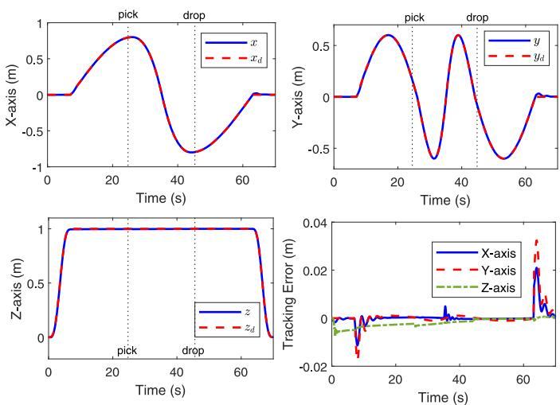

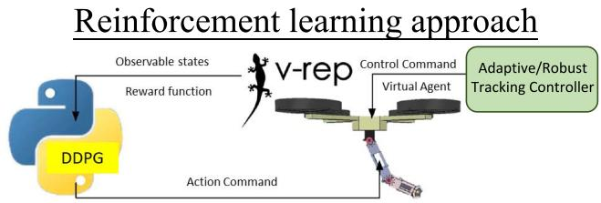

Fig. 4. Structure of DDPG training in V-REP with the model of an F450 quadrotor system using the robotic arm.  
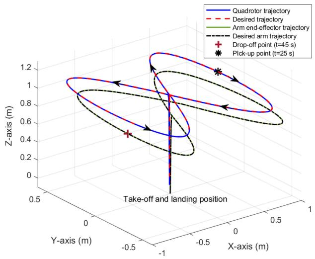  
Fig. 5. 3-D tracking of the quadrotor position and the end-effector position of the robotic arm by using the proposed decoupling approach with DDPG and adaptive/robust controller.

To train the DDPG policy, the dynamic model of the F450 quadrotor and robotic arm from the experiments are accomplished in V-REP, which is illustrated in Fig. 4. The motor controller of the manipulator is accomplished by the regular servomotor controller built in the V-REP environment, where the servomotor is set with a torque saturation of 4.5 N-m. The proposed DDPG controller is trained to give high-level commands to the rotor controller via $\eta _ { 1 d }$ and $\eta _ { 2 d } .$ . The learning rates are $1 0 ^ { - 4 }$ for both actor and critic, and the training section performs 1000 episodes with 500 steps in each episode. Moreover, the discount factor $\gamma { \mathrm { ~ i s ~ } } 0 . 9 .$ and the reward constants are $\beta _ { 1 } ~ = ~ - 9 5$ and $\beta _ { 2 } ~ = ~ - 5 0$ . The quadrotor is controlled to hover at $\zeta _ { d } = [ 0 . 5 , 0 , 1 ]$ m for 160 s, and then the robotic arm is trained to track the target position. The training states of the motion of the robotic arm mounted on the quadrotor are illustrated in Fig. 3. In the last period of learning, the manipulator is able to track any end-effector position assigned to the controller (see multimedia attachment).

1) Simulation of Aerial Manipulator: The proposed quadrotor system with a robotic arm is presented to show the efficiency and performance by tracking a 2-D lemniscate trajectory. The quadrotor takes off from $z = 0$ m to z = 1 m in the beginning, and then starts to track the lemniscate trajectory on the xy-plane while keeping a fixed height on the z-axis. Since the dynamic parameters and interactive force are unknown to the system, both the adaptive and robust controller are utilized in the tracking control of the quadrotor. In addition, the trained DDPG policy in V-REP is utilized to control the motion of the robotic arm. Meanwhile, in order to validate that the controller can ensure trajectory tracking with changes of system parameters, the quadrotor is planned to grab a payload of 0.1 kg in the midway during the tracking mission.

Fig. 6. Quadrotor position and tracking errors by using the proposed decoupling approach.  
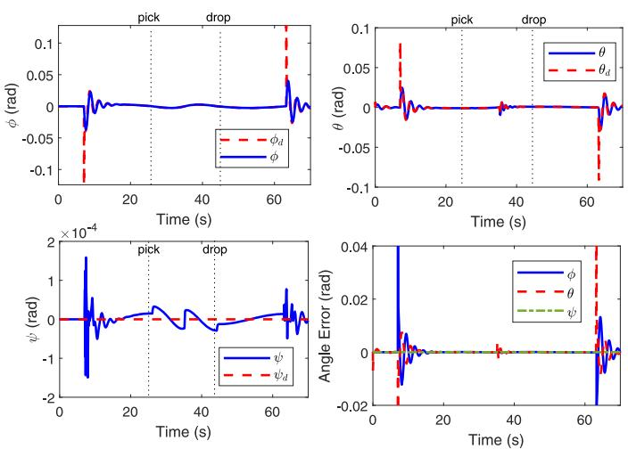  
Fig. 7. Quadrotor orientation and tracking errors by using the proposed decoupling approach.

In the simulation, the manipulator starts from $\eta _ { 1 } ( 0 ) = 4 . 7 1$ rad and $\eta _ { 2 } ( 0 ) = 0$ rad, and to track a trajectory described by $\eta _ { 1 d } ( t ) ~ = ~ 4 . 7 1 + 0 . 0 1 7 5 t$ rad and $\eta _ { 2 d } ( t ) ~ = ~ 0 . 0 1 7 5 t$ rad for $t ~ = ~ 0$ to 35 s, and reverse for $t ~ = ~ 3 5 ~ \mathrm { ~ t o ~ } ~ 7 0 ~ \mathrm { ~ s } .$ The control gains are given as $c _ { 1 } = \mathrm { d i a g } \{ 0 . 6 3 , 0 . 5 4 , 0 . 0 3 \}$ c2 = diag{11.97, 12.06.6.97}, $c _ { 3 } ~ = ~ 1 8 . 9 2$ $c _ { 4 } ~ = ~ 1 5 . 1$ c5 = 18.2, $c _ { 6 } ~ = ~ 1 7 . 5$ $c _ { 7 } ~ = ~ 1 8 . 4 ,$ and $c _ { 8 } ~ = ~ 1 1 . 1$ . For the adaptive controller, the update rates are $\rho _ { m } ~ = ~ 7 . 0 7 .$ $\rho _ { x } ~ = ~ 0 . 5 5$ $\rho _ { \mathrm { y } } ~ = ~ 1 . 1$ $\rho _ { z } ~ = ~ 1 . 5 ,$ $\rho _ { \phi } \ = \ 5 . 3 ,$ $\rho _ { \theta } ~ = ~ 4 . 2$ and $\rho _ { \psi } ~ = ~ 3 . 4$ with initial conditions $\hat { m } ( 0 ) = 0 . 0 2$ kg and $\hat { I } _ { q r , x } ( 0 ) = \hat { I } _ { q r , y } ( 0 ) = \hat { I } _ { q r , z } ( 0 ) = 0 . 0 0 1 \ \mathrm { k g - m ^ { 2 } }$ . In addition, the robust control gains are selected as $\varepsilon _ { i } = 3$ and $d _ { i } = 0 . 0 1$ . With the aforementioned modeling and parameters, the simulation results are shown in Figs. 5–9.

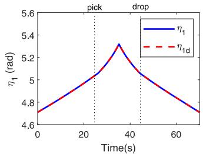

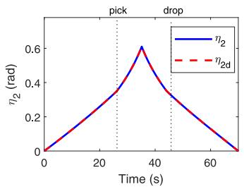

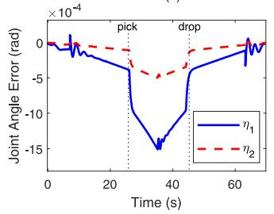

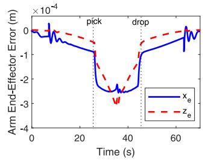

Fig. 8. Joint angles, joint errors, and end-effector errors of the robotic arm mounted on the quadrotor by using the DDPG in the proposed decoupling approach.  
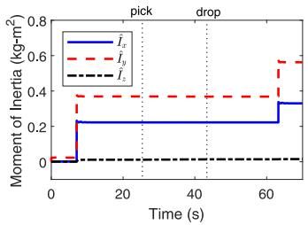

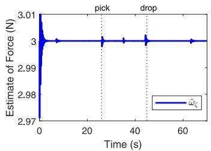

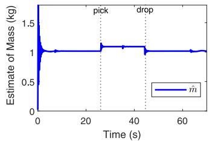

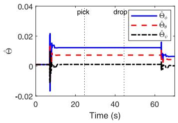  
Fig. 9. 3-D tracking of the quadrotor position and the end-effector position of the robotic arm by using the proposed decoupling approach with DDPG and adaptive/robust controller.

Fig. 5 illustrates that with the proposed adaptive/robust controllers, the quadrotor can track the desired trajectory while the robotic arm picks up a payload suddenly at $t = 3 5 \mathrm { ~ s ~ } ,$ and drops the payload at $t = 4 5 \mathrm { ~ s ~ } .$ The quadrotor tracking performance and errors are shown in Fig. 6, where the errors are bounded and closed to the origin, as stated in Theorem 1. For the robotic arm, the joint angles and tracking errors in the end effector are illustrated in Fig. 8. Without the knowledge of dynamic parameters and internal interacting force, the proposed adaptive/robust controller can guarantee tracking performance with the estimations of system parameters as illustrated in Fig. 9. It can be observed that when the object is picked up and dropped out, the estimation of the entire mass is slightly increased and the interactive force is also respond to the changes. The unknown dynamic parameters and stability during grabbing and dropping the payload are demonstrated.

## TABLE I

COMPUTATIONAL TIME OF TEN CONSECUTIVE LOOPS AND AVERAGE LOOP TIME DURING AERIAL MANIPULATOR TRACKING. IT IS NOTED THAT [13] AND [14] REQUIRE THE KNOWLEDGE OF DYNAMIC PARAMETER OF THE QUADROTOR SYSTEM, AND THE PROPOSED APPROACH NEEDS NOT

<table><tr><td>Computational Time (sec)</td><td>Proposed</td><td>[13]</td><td>[14]</td></tr><tr><td>Ave. time/loop (sec)</td><td>0.0059</td><td>0.1174</td><td>0.0206</td></tr><tr><td>Ave. frequency (1/sec)</td><td>169.49</td><td>8.52</td><td>48.47</td></tr></table>

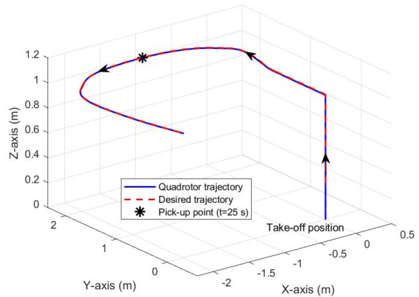  
(a)

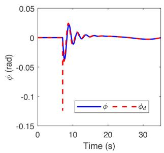

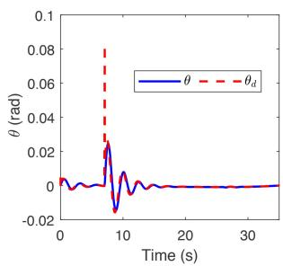  
(b)  
Fig. 10. Quadrotor system with a robot arm in tracking a minimum snap trajectory by using the proposed decoupling approach. (a) 3-D quadrotor position. (b) Roll and pitch angles.

2) Comparisons With Prior Work: One of the advantages of the proposed decoupling approach is the reduction of computational time. To see the efficiency, the computational time is obtained by using the proposed approach and the prior work on the coupled aerial manipulator (2) to track a trajectory and pick up an object. The simulation programming is accomplished in MATLAB R2019a with the ROS library to emulate a real communication architecture. The function of the stopwatch timer is utilized in the simulation to measure the elapsed time for each of the simulation loop. The elapsed times for a ten consecutive loops with the proposed and coupled dynamics [13], [14] during the trajectory tracking of aerial manipulator are listed in Table I. The consequence shows that the computational time can be dramatically reduced, even without the knowledge of dynamic parameters, to avoid instability in controlling quadrotors system with low frequency by using the proposed decoupling approach. Since low computational frequency could lead to instability of a quadrotor system, the proposed approach with lower computational time is superior to previously developed methods.

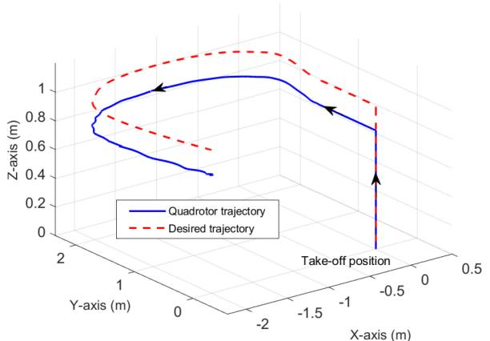  
(a)

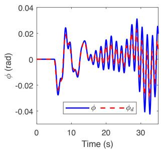

(b)  
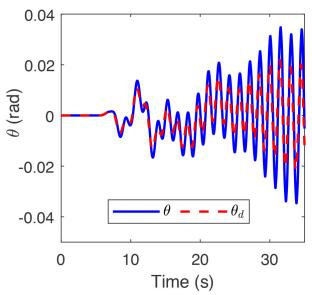  
Fig. 11. Comparison results of the quadrotor system without a robot arm in tracking a minimum snap trajectory by using the parameter-required controller [34]. (a) 3-D quadrotor position. (b) Roll and pitch angles.

Several control schemes have been proposed for position and altitude control under the assumption that the system parameters are precisely obtained [34]–[36]; however, it is difficult to measure the accurate system parameters, which could change during the operation. The comparison results to a previously proposed tracking controller are presented subsequently for a minimum snap trajectory. With the decoupling approach, the simulation results are shown in Fig. 10, where the robotic arm is controlled by using DDPG and pick up an object at $t = 2 5 \ \mathrm { s } .$ . Since the robotic arm is controlled to minimize the influence to the quadrotor, and the adaptive/robust algorithms are utilized to cope with dynamic uncertainties and interactive force from the arm, the tracking performance is satisfactory with stable orientation control.

However, if the scenario is implemented in a previously developed controller without a robotic arm [34], which requires the precise information of the dynamic parameters, the tracking performance is not guaranteed as illustrated in Fig. 11. It can be observed that the quadrotor with the use of the previous controller may encounter a non-negligible error in the altitude tracking due to imprecise mass parameters. An obvious oscillation is observed in the tracking of the pitch and yaw angles, which results from inaccurate moment inertia, even without a robotic arm. Thus, unprecise system parameters in the previous schemes may degrade the tracking performance of the control system and even destabilize the aerial manipulator.

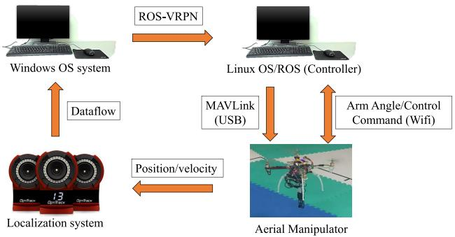  
Fig. 12. Setup of the aerial manipulator in the experiments.

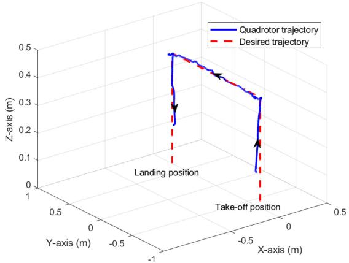  
Fig. 13. 3-D quadrotor position tracking in the experiment of the aerial manipulator.

The comparison results demonstrate the superiority of the proposed decoupling approach and adaptive/robust algorithms.

## B. Experiment Verification

1) Hardware Setup: The proposed aerial manipulator controller is implemented on a DJI-F450 quadrotor mounted with a 2-DOF robotic manipulator, as shown in Fig. 12. The quadrotor has a net weight of approximately 1.25 kg with a Pixhawk flight controller, where the manipulator consists of two links driven by Dynamixel XH430-W350-T servomotors [37]. The robotic arm is fabricated by using a 3-D printer (Flux Delta+), and the lengths of two links are $l _ { 1 } = 0 . 1 3$ m and $l _ { 2 } = 0 . 1 0 5 \mathrm { m }$ The manipulator has a net weight of approximately 0.4 kg. The position and attitude of the quadrotor and robotic arm during aerial manipulation were obtained by using the motion capture (MOCAP) system consisting of IR cameras (Optitrack Flex 13) is used to track the 3-D pose of the quadrotor and arm within the venue of the experiments. The motion tracking frequency is set at 120 Hz. In the experiment, due to the hardware limitation, the proposed torque control and the corresponding moment of inertial estimation were not implemented. Nevertheless, the attitude controller built in the Pixhawk flight control board is utilized to control the attitude of the quadrotor.

In this experiment, the quadrotor performs trajectory tracking while the manipulator moves autonomously by using DDPG during the flight. It is noted that the arm moves during the flying operation, but no object is attached to or detached from the robotic arm in this case. The tracking performance of the quadrotor and the trajectory of the end effector are shown in Fig. 13. The proposed adaptive/robust controller ensures the trajectory tracking of the quadrotor in Fig. 14, and the desired set-point angles of the robotic arm are obtained from the DDPG-based reinforcement learning as illustrated in Fig. 15. The Euler angles of the quadrotor are illustrated in Fig. 16, which shows that the movement of the manipulator causes only small disturbance to the pitch angle. The adaptive estimation of uncertain mass, with the use of the projection operator [38] for the upper bound and lower bound as 1.8 and 0.8 kg, is shown in Fig. 16.

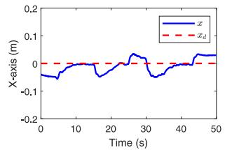

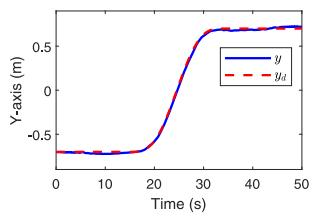

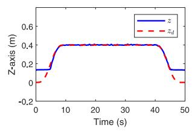

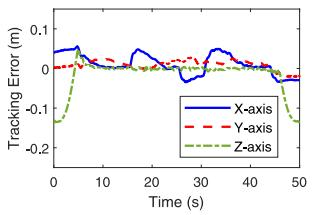

Fig. 14. Position trajectories and tracking errors of the quadrotor in the experiments of the aerial manipulator.  
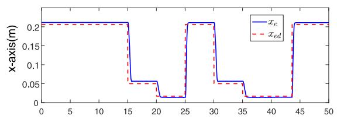

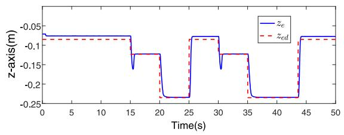  
Fig. 15. End effector of the robotic arm, without picking or dropping an object, in the experiment of the aerial manipulator.

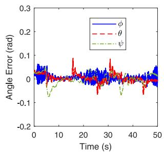

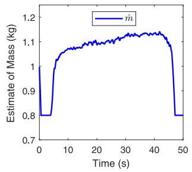  
Fig. 16. Errors of Euler angles and estimate of mass in the experiment of the aerial manipulator.

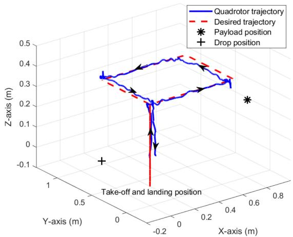  
Fig. 17. 3-D quadrotor position in the experiment of the aerial manipulator while picking/dropping an object during the operation.

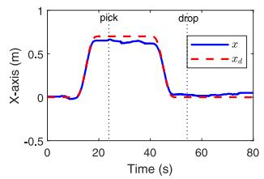

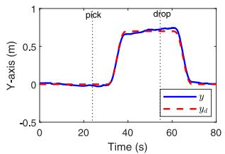

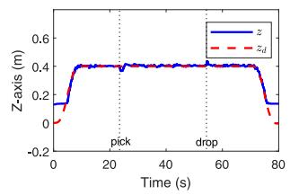

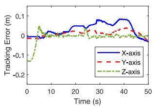  
Fig. 18. Position trajectories and tracking errors of the quadrotor in the experiments of the aerial manipulator while picking and dropping an object during the operation.

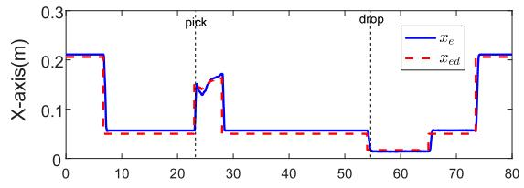

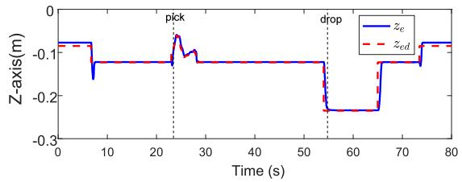  
Fig. 19. End effector of the robotic arm, without picking or dropping an object, in the experiment of the aerial manipulator while picking and dropping an object during the operation.

Suddenly attaching and detaching an object without the information of mass and rotational inertia is a crucial research topic in the control of aerial manipulators. The aerial manipulator to pick up and drop off an object at the final destination is implemented subsequently. The experimental results by using the proposed approach are illustrated in Figs. 17–20. Since the quadrotor is moving and $[ x _ { e } , z _ { e } ]$ is defined according to $\Sigma _ { B } ,$ the desired position of the end effector of the robotic arm is obtained with respect to the position of the object to the quadrotor. In the experiment, several markers have been attached to the object so that the desired position of the object is available for the control of robotic arm to pick up, as shown in the multimedia attachment and Fig. 19. It is shown that the adaptive/robust controller and DDPG reinforcement learning can deal with the sudden change of mass and inertia provided stability and good tracking performance. The errors of Euler angles and the estimate of mass are illustrated in Fig. 20. The results demonstrate the robustness and performance of the proposed methods in real-time applications (see multimedia attachment).

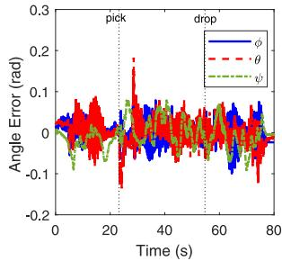

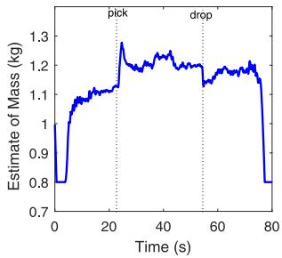  
Fig. 20. Errors of Euler angles and estimate of mass in the experiment of aerial manipulator while picking/dropping an object during the operation.

## V. CONCLUSION

Due to the complex and coupled dynamic model of aerial manipulators, proposing an efficient and effective control algorithm is significant to the communities of robotics, control, and cybernetics. The motion of the robotic arm and the change of system parameters may perturb the quadrotor and degrade trajectory tracking, especially in the absence of parameter information. In this article, by decoupling the quadrotor and robotic arm, the DDPG-based reinforcement learning approach was presented to ensure that the influence from the motion of robotic arm to the quadrotor is diminished. In addition, an adaptive/robust control with the design of the nominal input was presented for the quadrotor to follow a desired trajectory in the presence of dynamic uncertainties. The efficiency and efficacy of the proposed system are valid via simulations and experiments, which demonstrated the computational time can be reduced in order to ensure better performance compared to conventional methods. Future work encompasses the cooperative transportation of multiple aerial manipulators and robustness to unknown external disturbance. The utilization of emerging reinforcement learning methods on the robotic arm in the decoupling approach would also require further investigation.

## ACKNOWLEDGMENT

The authors would like to thank the Associate Editor and the anonymous reviewers for their valuable and constructive suggestions that led to significant improvements of this article.

## REFERENCES

[1] T. Zhang, Y. Xu, J. Lo, D. Yang, and L. Xiao, “Joint computation and communication design for UAV-assisted mobile edge computing in IoT,” IEEE Trans. Ind. Informat., vol. 16, no. 8, pp. 5505–5516, Aug. 2020.

[2] S. Dai, T. Lee, and D. S. Bernstein, “Adaptive control of a quadrotor UAV transporting a cable-suspended load with unknown mass,” in Proc. IEEE Conf. Decis. Control, Dec. 2014, pp. 6149–6154.

[3] I. Palunko, A. Faust, P. Cruz, L. Tapia, and R. Fierro, “A reinforcement learning approach towards autonomous suspended load manipulation using aerial robots,” in Proc. IEEE Int. Conf. Robot. Autom., May 2013, pp. 4896–4901.

[4] H. Liu, T. Ma, F. L. Lewis, and Y. Wan, “Robust formation control for multiple quadrotors with nonlinearities and disturbances,” IEEE Trans. Cybern., vol. 50, no. 4, pp. 1362–1371, Apr. 2020.

[5] H. Du, W. Zhu, G. Wen, Z. Duan, and J. Lü, “Distributed formation control of multiple quadrotor aircraft based on nonsmooth consensus algorithms,” IEEE Trans. Cybern., vol. 49, no. 1, pp. 342–353, Jan. 2019.

[6] G. Shao, Y. Ma, E. Malekian, X. Yan, and Z. Li, “A novel cooperative platform design for coupled USV–UAV systems,” IEEE Trans. Ind. Informat., vol. 15, no. 9, pp. 4913–4922, Sep. 2019.

[7] Y. Wang, J. Sun, H. He, and C. Sun, “Deterministic policy gradient with integral compensator for robust quadrotor control,” IEEE Trans. Syst., Man, Cybern., Syst., vol. 50, no. 10, pp. 3713–3725, Oct. 2020.

[8] X. Zhang et al., “Compound adaptive fuzzy quantized control for quadrotor and its experimental verification,” IEEE Trans. Cybern., early access, May 14, 2020, doi: 10.1109/TCYB.2020.2987811.

[9] M. Chen, S. Ziong, and Q. Wu, “Tracking flight control of quadrotor based on disturbance observer,” IEEE Trans. Syst., Man, Cybern., Syst., early access, Mar. 14, 2019, doi: 10.1109/TSMC.2019.2896891.

[10] H. Liu, X. Wang, and Y. Zhong, “Quaternion-based robust attitude control for uncertain robotic quadrotors,” IEEE Trans. Ind. Informat., vol. 11, no. 2, pp. 406–415, Apr. 2015.

[11] Q. Lindsey, D. Mellinger, and V. Kumar, “Construction of cubic structures with quadrotor teams,” in Robotics: Science and Systems. Cambridge, MA, USA: MIT Press, 2012, pp. 177–184.

[12] H. Yang and D. Lee, “Dynamics and control of quadrotor with robotic manipulator,” in Proc. IEEE Int. Conf. Robot. Autom., May 2014, pp. 5544–5549.

[13] S. Kim, S. Choi, and H. J. Kim, “Aerial manipulation using a quadrotor with a two DOF robotic arm,” in Proc. IEEE/RSJ Int. Conf. Intell. Robots Syst., Nov. 2013, pp. 4990–4995.

[14] S. Kim, H. Seo, S. Choi, and H. J. Kim, “Vision-guided aerial manipulation using a multirotor with a robotic arm,” IEEE/ASME Trans. Mechatronics, vol. 21, no. 4, pp. 1912–1923, Aug. 2016.

[15] H. B. Khamseh, F. Janabi-Sharifi, and A. Abdessameud, “Aerial manipulation—A literature survey,” Robot. Auton. Syst., vol. 107, pp. 221–235, Sep. 2018.

[16] T.-W. Ou and Y.-C. Liu, “Adaptive backstepping tracking control for quadrotor aerial robots subject to uncertain dynamics,” in Proc. Amer. Control Conf., Jul. 2019, pp. 1–6.

[17] R. Polvara et al., “Autonomous quadrotor landing using deep reinforcement learning,” Sep. 2017. [Online]. Available: arXiv:1709.03339.

[18] J. Hwangbo, I. Sa, R. Siegwart, and M. Hutter, “Control of a quadrotor with reinforcement learning,” IEEE Robot. Autom. Lett., vol. 2, no. 4, pp. 2096–2103, Oct. 2017.

[19] R. Mahony, V. Kumar, and P. Corke, “Multirotor aerial vehicles: Modeling, estimation, and control of quadrotor,” IEEE Robot. Autom. Mag., vol. 19, no. 3, pp. 20–32, Sep. 2012.

[20] R. Xu and U. Özgüner, “Sliding mode control of a class of underactuated systems,” Automatica, vol. 44, no. 1, pp. 233–241, 2008.

[21] Y.-C. Choi and H.-S. Ahn, “Nonlinear control of quadrotor for point tracking: Actual implementation and experimental tests,” IEEE/ASME Trans. Mechatronics, vol. 20, no. 3, pp. 1179–1192, Jun. 2015.

[22] N. Michael, D. Mellinger, Q. Lindsey, and V. Kumar, “The GRASP multiple micro-UAV testbed,” IEEE Robot. Autom. Mag., vol. 17, no. 3, pp. 56–65, Sep. 2010.

[23] D. Mellinger and V. Kumar, “Minimum snap trajectory generation and control for quadrotors,” in Proc. IEEE Int. Conf. Robot. Autom., 2011, pp. 2520–2525.

[24] T. P. Lillicrap et al., “Continuous control with deep reinforcement learning,” Sep. 2015. [Online]. Available: arXiv:1509.02971.

[25] D. Silver, G. Lever, N. Heess, T. Degris, D. Wierstra, and M. Riedmiller, “Deterministic policy gradient algorithms,” in Proc. Int. Conf. Mach. Learn., vol. 32, Jun. 2014, pp. 387–395.

[26] R. S. Sutton, D. McAllester, S. Singh, and Y. Mansour, “Policy gradient methods for reinforcement learning with function approximation,” in Proc. Int. Conf. Neural Inf. Process. Syst., 1999, pp. 1057–1063.

[27] V. Mnih et al., “Playing atari with deep reinforcement learning,” Dec. 2013. [Online]. Available: arXiv:1312.5602.

[28] E. Rohmer, S. P. N. Singh, and M. Freese, “V-REP: A versatile and scalable robot simulation framework,” in Proc. IEEE/RSJ Int. Conf. Intell. Robots Syst., Nov. 2013, pp. 1321–1326.

[29] M. Achtelik, T. Bierling, J. Wang, L. Höcht, and F. Holzapfel, “Adaptive control of a quadcopter in the presence of large/complete parameter uncertainties,” in Proc. AIAA Infortech@Aerospace, 2011, pp. 29–31.

[30] J. Hwangbo et al., “Learning agile and dynamic motor skills for legged robots,” Sci. Robot., vol. 4, no. 26, 2019, Art. no. eaau5872.

[31] D. Amodei, C. Olah, J. Steinhardt, P. F. Christiano, J. Schulman, and D. Mané, “Concrete problems in AI safety,” Jun. 2016. [Online]. Available: arXiv:1606.06565.

[32] Y.-C. Liu, P. N. Dao, and K. Y. Zhao, “On robust control of nonlinear teleoperators under dynamic uncertainties with variable time delays and without relative velocity,” IEEE Trans. Ind. Informat., vol. 16, no. 2, pp. 1272–1280, Feb. 2020.

[33] H. K. Khalil, Nonlinear Systems. Upper Saddle River, NJ, USA: Prentice Hall, 2002.

[34] V. K. Tripathi, L. Behera, and N. Verma, “Design of sliding mode and backstepping controllers for a quadcopter,” in Proc. Nat. Syst. Conf., Dec. 2015, pp. 1–6.

[35] T. Madani and A. Benallegue, “Backstepping control for a quadrotor helicopter,” in Proc. IEEE/RSJ Int. Conf. Intell. Robots Syst., Oct. 2006, pp. 3255–3260.

[36] M. A. M. Basri, “Enhanced backstepping controller design with application to autonomous quadrotor unmanned aerial vehicle,” J. Intell. Robot. Syst., vol. 79, no. 2, pp. 295–321, 2015.

[37] Robotis. Accessed: Jan. 5, 2021. [Online]. Available: http://www.robotis.us/dynamixel/

[38] Y.-C. Liu and M.-H. Khong, “Adaptive control for nonlinear teleoperators with uncertain kinematics and dynamics,” IEEE/ASME Trans. Mechatronics, vol. 20, no. 5, pp. 2550–2562, Oct. 2015.

Yen-Chen Liu (Senior Member, IEEE) received the B.S. and M.S. degrees in mechanical engineering from National Chiao Tung University, Hsinchu, Taiwan, in 2003 and 2005, respectively, and the Ph.D. degree in mechanical engineering from the University of Maryland at College Park, College Park, MD, USA, in 2012.

He is currently an Associate Professor with the Department of Mechanical Engineering, National Cheng Kung University, Tainan, Taiwan. His research interests include the control of networked

robotic systems, bilateral teleoperation, multirobot systems, mobile robot network, and human–robot interaction.

Dr. Liu was a recipient of the Ta-You Wu Memorial Award, Ministry of Science and Technology, Taiwan, in 2016, the Kwoh-Ting Li Researcher Award, National Cheng Kung University, Taiwan, in 2018, and the Young Scholar Fellowship—Columbus Program, MOST, Taiwan, in 2019.

Chi-Yu Huang received the B.S. degree from the Department of Mechanical and Electromechanical Engineering, National Sun Yat-sen University, Kaohsiung, Taiwan, in 2017, and the M.S. degree from the Department of Mechanical Engineering, National Cheng Kung University, Tainan, Taiwan, in 2019.

His research interests are in the area of aerial manipulator, quadrotor control, and reinforcement learning.