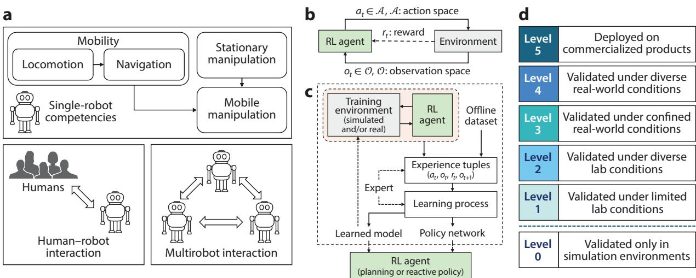

Annual Review ofControl, Robotics, and Autonomous Systems

# Deep Reinforcement Learning for Robotics: A Survey of Real-World Successes

## ANNUAL CONNECT REVIEWS

www.annualreviews.org

• Download figures

• Navigate cited references

• Keyword search

• Explore related articles

• Share via email or social media

Annu. Rev. Control Robot. Auton. Syst. 2025. 8:153–88

First published as a Review in Advance on November 26, 2024

The Annual Review ofControl, Robotics, and Autonomous Systems is online at control.annualreviews.org

https://doi.org/10.1146/annurev-control-030323- 022510

Copyright © 2025 by the author(s). This work is licensed under a Creative Commons Attribution 4.0 International License, which permits unrestricted use, distribution, and reproduction in any medium, provided the original author and source are credited. See credit lines of images or other third-party material in this article for license information.

∗These authors contributed equally to this article

Chen Tang,1,∗ Ben Abbatematteo,1,∗ Jiaheng Hu,1,∗ Rohan Chandra,2 Roberto Martín-Martín,1 and Peter Stone1,3

1Department of Computer Science, The University of Texas at Austin, Austin, Texas, USA; email: chen.tang@utexas.edu, abba@cs.utexas.edu, jiahengh@utexas.edu, robertomm@cs.utexas.edu, pstone@utexas.edu

2Department of Computer Science, The University of Virginia, Charlottesville, Virginia, USA; email: rohanchandra@virginia.edu

3Sony AI, New York, NY, USA

## Keywords

robotics, reinforcement learning, deep learning, learning for control, real-world applications

## Abstract

Reinforcement learning (RL), particularly its combination with deep neural networks, referred to as deep RL (DRL), has shown tremendous promise across a wide range of applications, suggesting its potential for enabling the development of sophisticated robotic behaviors. Robotics problems, however, pose fundamental difficulties for the application of RL, stemming from the complexity and cost of interacting with the physical world. This article provides a modern survey of DRL for robotics, with a particular focus on evaluating the real-world successes achieved with DRL in realizing several key robotic competencies. Our analysis aims to identify the key factors underlying those exciting successes, reveal underexplored areas, and provide an overall characterization of the status of DRL in robotics. We highlight several important avenues for future work, emphasizing the need for stable and sample-efficient real-world RL paradigms; holistic approaches for discovering and integrating various competencies to tackle complex long-horizon, open-world tasks; and principled development and evaluation procedures. This survey is designed to offer insights for both RL practitioners and roboticists toward harnessing RL’s power to create generally capable real-world robotic systems.

## 1. INTRODUCTION

Reinforcement learning (RL) (1) refers to a class of decision-making problems in which an agent must learn through trial and error to act in a way that maximizes its accumulated return, as encoded by a scalar reward function that maps the agent’s states and actions to immediate rewards. RL algorithms—particularly their combination with deep neural networks, referred to as deep RL (DRL) (2)—have shown remarkable capabilities in solving complex decision-making problems even with high-dimensional observations in domains such as board games (3), video games (4), healthcare (5), and recommendation systems (6).

These successes underscore the potential of DRL for controlling robotic systems with highdimensional state or observation spaces and highly nonlinear dynamics to perform challenging tasks that conventional decision-making, planning, and control approaches (e.g., classical control, optimal control, and sampling-based planning) cannot handle effectively. Yet the most notable milestones of DRL so far have been achieved in simulation or game environments, where RL agents can learn from extensive experience. In contrast, robots need to complete tasks in the physical world, which presents additional challenges. It is often inefficient and/or unsafe for the RL agents to collect trial-and-error samples directly in the physical world, and it is usually impossible to create an exact replica of the complex real world in simulation. These challenges notwithstanding, recent advances have enabled DRL to succeed at some real-world robotic tasks. For instance, DRL has enabled champion-level drone racing (7) and versatile quadruped locomotion control integrated into production-level quadruped systems, such as the ones from ANYbotics (8), Swiss-Mile (https://www.swiss-mile.com), and Boston Dynamics (9). However, the maturity of state-of-the-art DRL solutions varies significantly across different robotic applications. In some domains, such as urban autonomous driving, DRL-based solutions remain limited to simulation or strictly confined field tests (10).

This survey aims to comprehensively evaluate the current progress of DRL in real-world robotic applications, identifying key factors behind the most exciting successes and open challenges that remain in less mature areas. Specifically, we assess the maturity of DRL for a variety of problem domains and contrast the DRL literature across domains to pinpoint broadly applicable techniques, underexplored areas, and common open challenges that need to be addressed to advance DRL’s applications in robotics. We aim for this survey to provide researchers and practitioners with a thorough understanding of the status of DRL in robotics, offering valuable insights to guide future research and facilitate broadly deployable DRL solutions for real-world robotic tasks.

## 2. WHY ANOTHER SURVEY ON REINFORCEMENT LEARNING FOR ROBOTICS?

Although some previous articles have surveyed RL for robotics, we make three contributions that provide unique perspectives on the literature and fill gaps in knowledge. First, we focus on work that has demonstrated at least some degree of real-world success, aiming to assess the current state and open challenges of DRL for real-world robotic applications. Most existing surveys on RL for robotics do not explicitly address this topic; for example, Dulac-Arnold et al. (11) discussed the general challenges of real-world RL not specific to robotics, and Ibarz et al. (12) listed open challenges of DRL unique to real-world robotics settings but based on case studies drawn only from their own research. In contrast, our discussion is grounded in a comprehensive assessment of the real-world successes achieved by DRL in robotics, with one aspect of our evaluation being the level of real-world deployment (see Section 3.4).

Second, we present a novel and comprehensive taxonomy that categorizes DRL solutions along multiple axes: robot competencies learned with DRL, problem formulation, solution approach, and level of real-world success. Prior surveys on RL for robotics and broader robot learning have often focused on specific tasks (13, 14) or particular techniques (15, 16). By contrast, our taxonomy allows us to survey the complete landscape of DRL solutions that are effective in robotics application domains, in addition to reviewing the literature of each application domain separately. Within this framework, we compare and contrast solutions and identify common patterns, broadly applicable approaches, underexplored areas, and open challenges for realizing successful robotic systems.

Third, while some past surveys have shared our motivation to provide a broad analysis of the field, the fast and impressive pace of DRL progress has created the need for a renewed analysis of the field, its successes, and limitations. The seminal survey by Kober et al. (17) was written before the deep learning era, and the survey on general deep learning for robotics by Sünderhauf et al. (18) was written when DRL accomplishments were primarily in simulation. We provide a refreshed overview of the field by focusing on DRL, which is behind the most notable real-world successes of RL in robotics, paying particular attention to papers published in the last five years, during which most of the successes occurred.

## 3. TAXONOMY

This section presents the novel taxonomy we introduce to categorize the literature on DRL. The unique focus of our survey on the real-world successes of DRL in robotics necessitates a new taxonomy to categorize and analyze the literature, which should enable us to assess the maturity of DRL solutions across various robotic applications and derive valuable lessons from both successes and failures. Specifically, we should identify the specific robotic problem addressed in each paper, understand how it has been abstracted as an RL problem, and summarize the DRL techniques applied to solve it. More importantly, we should evaluate the maturity of these DRL solutions, as demonstrated in their experiments. Consequently, we introduce a taxonomy spanning four axes: robot competencies learned with DRL, problem formulation, solution approach, and level of realworld success (Figure 1).

Figure 1  
  
The four aspects of our taxonomy: (a) robot competencies learned with DRL, (b) problem formulation, (c) solution approach, and (d) level of real-world success. Abbreviations: DRL, deep reinforcement learning; RL, reinforcement learning.

## 3.1. Robot Competencies Learned with Deep Reinforcement Learning

Our primary axis focuses on the target robotic task studied in each paper. A robotic task, especially in open real-world scenarios, may require multiple competencies. One may apply DRL to synthesize an end-to-end system to realize all the competencies or learn submodules to enable a subset of them. Since our focus is DRL, we classify papers based on the specific robot competencies learned and realized with DRL. We first classify the competencies into single-robot (competencies required for a robot to complete tasks on its own) and multiagent (competencies required to interact with other agents sharing the workspace with the robot and affecting its task completion).

Single-robot competencies are those required for an individual robot to interact with and affect the physical world: mobility (moving in the environment) and manipulation (moving or rearranging objects) (19–21). In the robotics literature, mobility1 is typically split into two problems: locomotion and navigation (20, 22). Locomotion focuses on motor skills that enable robots ofvarious morphologies (e.g., quadrupeds, humanoids, wheeled robots, and drones) to traverse different environments, while navigation focuses on strategies that direct a robot to its destination efficiently without collision. Typical navigation policies generate high-level motion commands, such as desired states at the center of mass, while assuming effective locomotion control to execute them (20). Some works jointly address the locomotion and navigation problems, which is particularly useful for tasks in which the navigation strategies are heavily affected by the robot’s capability to traverse the environment, as determined by the robot dynamics and locomotion control [e.g., navigating through challenging terrains (22) or racing (23)]. We review these papers alongside other navigation papers since their ultimate goal is navigation.

In the robotics literature, manipulation is often studied in tabletop settings, such as robotic arms or hands mounted on a stationary base with fixed sensors observing the scene. Some other realworld tasks further require robots to interact with the environment while moving their base (e.g., household and warehouse robots), which necessitates a synergistic integration of manipulation and mobility capabilities. We review the former case under the stationary manipulation category and the latter under mobile manipulation (MoMa).

When the task completion is affected by the other agents in the workspace, the robot needs to be further equipped with abilities to interact with other agents, which we place under the heading of multiagent competencies. Note that some single-robot competencies may still be required while the robot interacts with others, such as crowd navigation or collaborative manipulation. In this category, we focus on papers where DRL occurs at the agent-interaction level, i.e., learning interaction strategies given certain single-robot competencies or learning policies that jointly optimize interaction and single-robot competencies. We further split these works into two subcategories based on the types of agents the robot interacts with: human–robot interaction (HRI) and multirobot interaction. HRI concerns a robot’s ability to operate alongside humans. The presence of humans introduces additional challenges due to their sophisticated behavior and the stringent safety requirements for robots operating around humans. Multirobot interaction refers to a robot’s ability to interact with a group of robots. A class of RL algorithms, multiagent RL (MARL), is typically applied to solve this problem. In MARL, each robot is a learning agent evolving its policy based on its interactions with the environment and other robots, which complicates the learning mechanism. Depending on whether the robots’ objectives align, their interactions could be cooperative, adversarial, or general-sum. In addition, practical scenarios often require decentralized decision-making under partial observability and limited communication bandwidth.

## 3.2. Problem Formulation

The second axis of our taxonomy is the formulation of the RL problem, which specifies the optimal control policy for the targeted robot competency. RL problems are typically modeled as partially observable Markov decision processes (POMDPs) for single-agent RL and decentralized POMDPs for MARL. Specifically, we categorize the papers based on three elements of the problem formulation: (a) the action space, i.e., whether the actions are low level (joint or motor commands), midlevel (task-space commands), or high level (temporally extended task-space commands or subroutines); (b) the observation space, i.e., whether the observations are high dimensional sensor inputs (e.g., images and/or lidar scans) or estimated low-dimensional state vectors; and (c) the reward function, i.e., whether the reward signals are sparse or dense. Due to space limitations, we provide detailed definitions of these terms in the Supplemental Material.

## 3.3. Solution Approach

Another axis closely related to the previous one is the solution approach used to solve the RL problem, which is composed of the RL algorithm and associated techniques that enable a practical solution for the target robotic problem. Specifically, we classify the solution approach from the following perspectives: (a) simulator usage, i.e., whether and how simulators are used, categorized into zero-shot, few-shot sim-to-real transfer, or directly learning offline or in the real world without simulators; (b) model learning, i.e., whether (a part of) the transition dynamics model is learned from robot data; (c) expert usage, i.e., whether expert (e.g., human or oracle policy) data are used to facilitate learning; (d) policy optimization, i.e., the policy optimization algorithm adopted, including planning or offline, off-policy, or on-policy RL; and (e) policy/model representation, i.e., the classes of neural network architectures used to represent the policy or dynamics model, including multilayer perceptrons, convolutional neural networks, recurrent neural networks, and transformers. The Supplemental Material provides detailed definitions of these terms.

## 3.4. Level of Real-World Success

To evaluate the practicality of DRL in real-world robotic tasks, we categorize the papers based on the maturity of their DRL methods. By comparing the effectiveness of DRL across different robotic tasks, we aim to identify domains where the gaps between research prototypes and real-world deployment are more or less significant. This requires a metric to quantify real-world success across tasks, which, to our knowledge, has not been attempted in the literature on DRL for robotics. Inspired by the levels of autonomous driving (24) and technology readiness level for machine learning (25), we introduce the concept of levels of real-world success. We classify the papers into six levels based on the scenarios where the proposed methods have been validated: (a) level 0, validated only in simulation; (b) level 1, validated in limited lab conditions; (c) level 2, validated in diverse lab conditions; (d) level 3, validated under confined real-world operational conditions; (e) level 4, validated under diverse, representative real-world operational conditions; and (f) level 5, deployed on commercialized products. We consider levels 1–5 to represent at least some degree of real-world success. The only information we can use to assess the level of realworld success is the experiments reported by the authors; however, many papers described only a single real-world trial, and while we strive to provide accurate estimates, this assessment can be subjective due to limited information. Additionally, we use the level of real-world success to quantify the maturity of a solution for its target problem, irrespective of its complexity.

Table 1 Locomotion papers reviewed in Section 4.1, categorized into quadruped locomotion, biped locomotion, and quadrotor flight control

<table><tr><td>Category</td><td>Papers</td></tr><tr><td>Quadruped</td><td>30, 31, 32, 33, 34, 35, 36, 37, 38, 39, 40, 41, 42, 43, 44, 45, 46, 47, 48, 49, 50, 51, 52, 53, 54, 55</td></tr><tr><td>Biped</td><td>29, 56, 57, 58, 59, 60, 61, 62, 63, 64</td></tr><tr><td>Flight</td><td>65, 66, 67, 68, 69</td></tr></table>

Colors indicate the level of real-world success: limited lab, diverse lab, limited real, or diverse real

## 4. COMPETENCY-SPECIFIC REVIEW

Supplemental Material >

This section provides a detailed review of the DRL literature, with each subsection focusing on a specific robot competency. In each subsection, we further organize the review based on subcategories specific to each type of competency. After discussing the papers, we conclude each subsection by summarizing the trends and open challenges for learning the competency in question. To aid understanding, each subsection includes a table that provides an overview of the reviewed papers. Since our main objective is to assess the maturity of DRL solutions, the tables specify the level of real-world success achieved by each paper. Supplemental Tables 1–6 provide a comprehensive categorization of the papers.

## 4.1. Locomotion

Locomotion research aims to develop motor skills for robots to traverse various real-world environments. Prior to the deep learning era, several pioneering works explored RL for locomotion control and delivered promising hardware demos, such as quadruped walking (26) and helicopter control (27, 28). This subsection reviews DRL solutions for locomotion separately from navigation, where the controllers follow high-level navigation commands. Since locomotion mainly concerns motor skills, the problem complexity is influenced primarily by the system dynamics (29). We organize this subsection accordingly and review three representative locomotion problems: quadruped locomotion, biped locomotion, and quadrotor flight control. Table 1 provides an overview of the papers reviewed.

4.1.1. Quadruped locomotion. Quadruped locomotion is one of the robotic domains where DRL has provided mature real-world solutions. Multiple robotics companies, such as ANYbotics, Swiss-Mile, and Boston Dynamics, have reported that DRL was integrated into their quadruped control for applications including industrial inspection, last-mile delivery, and rescue operations. In the literature, DRL methods were first validated for blind quadruped walking, i.e., relying solely on proprioceptive sensors on flat indoor surfaces (30, 31). These policies were typically trained in simulation and deployed zero-shot in the real world. The main challenge lies in the sim-toreal gap in quadrupeds’ intrinsic dynamics. Several strategies have been explored to bridge the reality gap: (a) learning actuator models—either analytical (30) or neural network–based (31)— from robot data to improve simulation fidelity; (b) randomizing dynamics parameters (30, 31) and, even further, randomizing morphology (32), which enables generalization to unseen quadrupeds; and (c) adopting a hierarchical structure with a low-level, model-based controller to handle dynamics discrepancy and external disturbances while facilitating efficient learning. The interface between the DRL policy and the model-based controller could be defined at various levels, such as joint positions (33–35), leg poses (30), gait parameters (36, 37), or temporally extended macro-actions (38).

As robots venture beyond controlled lab environments, they encounter more challenging terrains, such as discontinuous, deformable, or slippery surfaces. Four main techniques have been used to address the additional challenges. First, the terrain and contact information are not directly observable. Privileged learning has been commonly adopted as a solution (35, 36), where a policy with privileged terrain information is trained first and then distilled into a student policy operating on realistic sensor inputs. Alternatively, end-to-end training can be achieved with the help of state estimation (39, 40) and asymmetric actor–critic (40, 70). In both cases, an extended history of observations is often set as input.

Second, policies should be exposed to diverse conditions during training for generalization in the wild. A learning curriculum that progressively increases task difficulty is often adopted to facilitate training (35, 36, 38–40). Advanced terrain models can also improve performance on terrains with complex contact dynamics, e.g., deformable surfaces (39).

Third, exteroceptive sensors are crucial for traversing risky terrains, as they allow the quadruped to adapt to terrains without stepping on them. For example, they have fostered more efficient and robust stair traversal (37, 44). Exteroceptive observations are typically in the form of terrain height maps (37, 38), depth images (45, 46), and RGB images (44). Privileged learning is widely used to facilitate policy learning from these high-dimensional observations (37, 45, 46). To reduce the sim-to-real gap in sensor inputs, techniques such as injecting simulated sensor noise (37), postprocessing depth images (51), and learning vision encoders from real-world samples (44) have been effective. Additionally, policies benefit from improved representation via self-supervised learning (37, 38), cross-modal embedding matching (44, 45), or using models with higher capacity, such as transformers (46, 71).

Fourth, traversing certain complex terrains demands advanced locomotion skills beyond regular walking gaits. For example, end-to-end DRL policies typically struggle with terrains that have sparse contact regions. Jenelten et al. (47) showed that training an RL policy to track ref erence footholds provided by trajectory optimization results in more accurate and robust foot placement on sparse terrains. Jumping further extends the robots’ ability to cross gaps beyond their body length. For example, Yang et al. (48) trained a DRL policy to generate trajectories with a model-based tracking controller handling the complex jumping dynamics. Fall recovery is another essential skill, especially for automatic reset in real-world RL (49, 54). Several works have trained DRL policies for fall recovery (31, 33, 34, 42, 49). However, both jumping and fall recovery have only been validated on flat surfaces so far.

To effectively leverage agile locomotion skills for complex downstream tasks like parkour (50, 51), it is crucial to develop multiskill policies. Learning multiple skills jointly has also been effective in fostering policy robustness (64). One approach is to create a set of RL policies (34, 51, 52), each tailored to a specific skill, and then train a high-level policy to select the optimal skill (34). Alternatively, a single policy can be distilled from specialized skill policies through behavior cloning (51). To avoid the cumbersome procedure of training multiple specialized policies, several works explored constructing a unified policy directly. For instance, Margolis & Agrawal (53) encoded various locomotion strategies into a single policy conditioned on gait parameters. Cheng et al. (50) used a unified reward consisting of waypoint and velocity tracking terms to learn diverse parkour skills. Fu et al. (43) showed that energy minimization led to smooth gait transitions. Motion imitation reward is another widely used and unified approach for learning naturalistic and diverse locomotion skills (41, 52).

We conclude the review on quadruped locomotion with a remark on the RL algorithms used in the literature. The most mature DRL solutions for quadruped locomotion followed the zero-shot sim-to-real transfer scheme, predominantly using on-policy model-free RL, such as proximal policy optimization (72), due to its robustness to hyperparameters. Gangapurwala et al. (38) noted that on-policy RL could be less favorable when the action space is temporally extended or deterministic control actions are preferred. Meanwhile, researchers have explored few-shot adaptation and real-world RL, either model-free (49, 54) or model-based (55), to update policies using real-world rollouts to further generalize policies to novel situations without accurate simulation. However, most works along this line have only been validated in limited lab settings. The state-of-the-art performance for real-world fine-tuning (49) and learning from scratch (54) was achieved by using off-policy RL to learn walking and fall recovery. However, the tested conditions remain limited compared with those for mature zero-shot solutions.

4.1.2. Biped locomotion. Compared with the quadruped case, the DRL literature on bipedal locomotion is sparser, and the real-world capabilities demonstrated are more limited. We confine the discussion to 3D bipedal robots, which can move freely in all spatial dimensions, unlike 2D bipeds that are attached to booms and confined to 2D planar motion (73), for their greater practical utility. The literature begins with walking on flat indoor surfaces (56, 58) and extends to walking on various indoor (29, 57, 59) and outdoor (61, 63) terrains and under external forces (29, 59). Other demonstrated skills include stair traversal (60), hopping (58), running (58, 64), jumping (64), and traversing obstacles and gaps (62). More advanced skills have been showcased by industrial companies such as Unitree (74) and Boston Dynamics (75), but no technical reports are publicly available to reveal whether RL was used in their demos. Notably, some of these works deployed their locomotion policies on humanoid robots (57, 61, 63), while others deployed them on bipeda robots without upper bodies (29, 56, 59, 60, 62, 64).

The DRL techniques for bipedal locomotion largely overlap with those for quadrupeds but show three distinct trends due to the complex and underactuated dynamics of bipeds. First, learning basic standing and walking skills is already challenging due to bipeds’ nonstatically stable dynamics (56). Thus, model-based approaches are frequently used to facilitate RL, either by generating reference gaits to guide RL (56, 59, 64) or by handling low-level control for high-level RL policies (61). Alternatively, Siekmann et al. (58) offered an end-to-end solution with a referencefree periodic reward design based on periodic composition. Second, the role of state and action memories is particularly notable (56), especially a combination of both long- and short-term memories (64). Thus, most works have adopted sequence models in their policy architecture (56, 58, 60, 62–64). Third, almost all these policies were zero-shot transferred from simulation. One exception is the Grounded Action Transformation (GAT) algorithm (57), where the authors collected realworld samples to refine a simulator iteratively, enabling a NAO robot to walk on uneven carpets. The limited real-world learning examples are likely due to bipeds’ limited recovery capabilities, which hinder their resilience in trials, particularly their ability to auto-reset.

4.1.3. Quadrotor flight control. Flight control for unmanned aerial vehicles, particularly quadrotors, is another problem where DRL has shown compelling performance. Hwangbo et al. (65) developed the first DRL quadrotor control policy that was successfully validated on hardware for waypoint tracking and recovery from harsh initialization. Later studies showed that carefully designed simulated dynamics, domain randomization (66), and carefully designed action space, specifically collective thrust and body rates (67), can facilitate policy robustness. Zhang et al. (68) applied the Rapid Motor Adaptation (RMA) algorithm to train a robust near-hover position controller adaptable to unseen disturbances. Eschmann et al. (69) introduced the first off-policy RL paradigm for quadrotor control, capable of training a deployable control policy within 18 seconds for waypoint tracking.

In summary, DRL has demonstrated better robustness than classical feedback controllers [e.g., proportional–integral–derivative (PID)] in hovering control (66, 68). However, DRL policies tend to have larger tracking errors than carefully designed optimization-based controllers for waypoint tracking (65, 67). Yet the fundamental advantage of RL over optimal control is that it enables joint optimization for planning and control (23), making it an ideal candidate for agile navigation such as racing (see Section 4.2).

4.1.4. Trends and open challenges. DRL has shown effectiveness in synthesizing robust and adaptive locomotion controllers for challenging conditions. DRL techniques used for quadruped, biped, and flight control heavily overlap. For instance, RMA (35), initially proposed for quadruped locomotion, has been adapted for both biped (29) and quadrotor flight (68) control. However, the maturity of DRL solutions varies across domains. Quadrupeds can traverse various indoor and outdoor terrains via DRL, while real-world bipedal locomotion skills achieved by DRL are more limited. For quadrotors, most tests remain confined to controlled, obstacle-free indoor environments. Hardware accessibility is a contributing factor. The introduction of low-cost quadrupeds has spurred quadruped research and led to open-sourced and unified software packages. Con versely, the high cost of bipedal hardware limits extensive real-world testing, though recent advances in humanoid hardware are expected to boost biped research. More importantly, the quadruped dynamics are inherently more stable, whereas bipeds and quadrotors are more prone to catastrophic failures under control errors, imposing higher requirements on both robustness and precision of control (64). High-speed quadrotor control in outdoor scenarios with complex obstacles further requires the policy to ensure the long-horizon feasibility of the closed-loop trajectories (76). End-to-end RL integrating long-horizon planning and short-horizon control shows promise as a solution (7). In addition to ensuring long-horizon feasibility, integrating locomotion with downstream tasks (e.g., loco-manipulation) is an exciting direction in general, but how to discover the skills necessary for downstream tasks remains an open question.

4.1.5. Key takeaways. The key takeaways from this section are as follows:

■ DRL has enabled mature quadruped locomotion control, yet the maturity of DRL-based solutions for other locomotion problems is lower.

■ Hardware accessibility is an important contributing factor. Low-cost and standard hardware platforms would facilitate DRL development.

■ The inherently complex dynamics of certain locomotion problems present fundamental challenges to the reliable deployment of DRL locomotion controllers.

■ Even in the mature quadruped locomotion domain, open questions remain, such as how to effectively integrate locomotion with downstream tasks via RL and how to enable safe and efficient real-world learning.

## 4.2. Navigation

Navigation focuses on the decision-making challenge in mobility: transporting an agent to a goal location while avoiding collisions, typically assuming effective locomotion. As a fundamental mobility capability, navigation has an extensive history in robotics research (20). Classical navigation approaches employ mapping, localization, and planning modules to determine and execute a path to a goal. Planning is typically decomposed into global planning, which produces a coarse path, and local planning, which tracks the global plan and handles collision avoidance. In this section, we delineate navigation works by embodiment—wheeled, legged, and aerial navigation—and identify capabilities enabled by RL in each setting. Social navigation, where the robot navigates in the presence of humans, is deferred to Section 4.5, and multirobot navigation is similarly deferred to Section 4.6. Table 2 provides an overview of the papers reviewed.

4.2.1. Wheeled navigation. Navigation for wheeled robots, in particular, has a long history in robotics (20). We discuss several common wheeled navigation settings, including geometric navigation, visual navigation, and offroad navigation.

Table 2 Navigation papers reviewed in Section 4.2, categorized into wheeled, legged, and aerial navigation

<table><tr><td>Category</td><td>Papers</td></tr><tr><td>Wheeled</td><td>77, 78, 79, 80, 81, 82, 83, 84, 85, 86, 87, 88, 89, 90</td></tr><tr><td>Legged</td><td>22, 91, 92, 93, 94, 95, 96, 97, 98, 99, 100</td></tr><tr><td>Aerial</td><td>7, 23, 101, 102, 103</td></tr></table>

Colors indicate the level of real-world success: limited lab, diverse lab, limited real, or diverse real

4.2.1.1. Geometric navigation. Early attempts that aimed to verify RL’s capability in solving navigation problems typically solved them with modular classical approaches (77). These RL policies directly map 2D laser scans to control actions, unlike classical methods that construct explicit maps from the laser scans. While showing promise, they often were not compared against classical approaches or failed to outperform them (14). Some recent studies have benchmarked such RL-based approaches and found them superior in challenging problems with dense obstacles and narrow passages (78). Instead of replacing the entire navigation stack with an RL policy, modular approaches replace specific components like the local planner (79) or the exploration algorithm (80) with RL, enabling better performance than classical baselines. However, these improvements were observed mainly in limited real settings. Most commercially deployed systems still primarily adopt classical stacks, owing to the lack of safety, interpretability, and generalization of RL-based methods (14, 78).

4.2.1.2. Visual navigation. Visual navigation refers to problems where agents navigate to a goal based on visual observations. The additional input and task complexity pose challenges but enable agents to learn common strategies for navigating in similar environments (e.g., homes), where structural patterns emerge in visual data. Goals are typically specified as a point relative to the agent (termed point-goal navigation) or as an image of a particular object (object-goal or image-goal navigation). RL is also commonly applied to vision-and-language navigation problems (104), though very little work has demonstrated these capabilities on a real robot. Many works (81, 105) map visual observations to actions directly without mapping or planning modules. These end-to-end methods have achieved near-perfect results on point-goal tasks in visually realistic simulations (106). However, training such policies is challenging due to the need for scene understanding, intelligent exploration, and episodic memory. Their applicability for real-world navigation remains unclear, as they have been validated mostly in limited real or lab settings. Other works have investigated modular designs, e.g., using RL as a global exploration policy together with explicit mapping and local planning (82, 83). They have outperformed both classical and end-to-end learning baselines on point-goal and image-goal tasks. However, some challenges with such modular approaches exist, such as dynamic obstacles, where end-to-end methods have shown promise (91).

Despite the plethora of RL works on visual navigation, most are limited to simulation. While these simulators are typically constructed with real-world scans (104, 107), their transferability to the real world remains debatable. Some works reported poor transfer due to visual domain differences (83), while others found success through parameter tuning (84), abstraction of dynamics (92), or employing only depth images rather than RGB-D (91, 93).

4.2.1.3. Off-road navigation. Navigating off-road presents additional challenges due to the dynamics and traversability of different terrains. Some methods have tackled these challenges with model-based RL to learn predictive models of events or disengagements (85) or utilized demonstration data with offline RL (86). Success has also been achieved in high-speed off-road driving with model-based RL (87) and, recently, vision-based model-free RL (88).

4.2.1.4. Autonomous driving. Autonomous driving extends wheeled navigation to full-size passenger vehicles operating at higher speeds in more complex and safety-critical environments. RL has achieved limited real-world success for autonomous driving (10) with a few examples under specific conditions. Kendall et al. (89) trained a lane-following policy by learning to maximize its progress before the safety driver intervenes. More recently,Jang et al. (90) trained a cruise control policy, where the policy command is wrapped by manually specified thresholds to ensure safety. In a field test, they deployed their policy onto 100 vehicles to smooth traffic flow. Their work suggested a pragmatic approach to embed RL into self-driving stacks and showed its potential benefits at the fleet level.

4.2.2. Legged navigation. Legged navigation shares many challenges with wheeled navigation but also enables transversal of more complex terrains. Some works have shown that robust visual– legged navigation policies can be learned with low-fidelity, kinematic-only simulation for both indoors (91, 92) and outdoors (92, 94). The policies thus focus on kinematic-level control while assuming effective low-level locomotion control during deployment. Truong et al. (92) showed that this approach, in contrast to learning end-to-end policies with high-fidelity simulation, facilitates faster simulation and improves policy generalizability. With legged locomotion dynamics abstracted away, the approaches are similar to the wheeled case, with the main challenge being the visual domain gap. Unsupervised representation learning (91) and pretrained vision models (94) have been used to facilitate robust visual policies. For outdoor scenes, Truong et al. (93) zeroshot transferred policies trained in well-established indoor simulators to outdoors, using goal vector normalization and camera pitch randomization to bridge the indoor-to-outdoor domain gap. Sorokin et al. (94) used a high-fidelity autonomous driving simulator and extracted visual features from a pretrained semantic segmentation model for robust sim-to-real transfer to sidewalk navigation.

While abstracting away low-level locomotion has advantages, it limits the system from fully utilizing the agile locomotion skills endowed by advanced locomotion controllers. Recent research has explored DRL frameworks integrating locomotion with navigation, achieving high-speed obstacle avoidance (100) and agile navigation over challenging terrains (e.g., stairs, gaps, and boxes) (22, 96) and through confined 3D space (98, 99). In particular, Lee et al. (97) demonstrated kilometer-scale navigation with a wheeled–legged robot in urban scenarios, overcoming challenging terrains and dynamic obstacles. The integrated policy network can be end-to-end, taking goal coordinates as input and outputting locomotion commands (22, 99). He et al. (100) further introduced a recovery policy coordinated using a learned reach–avoid value network. Alternatively, training efficiency can be improved with hierarchical architectures, where a high-level policy governs pretrained low-level locomotion policies (95–98). Despite the potential of integrating locomotion with navigation, policy training could be costly and unstable due to the complex low-level dynamics together with the long-horizon nature and sparse rewards of the navigation tasks (22, 96). Classical planning algorithms are often used for generating local waypoints to reduce the navigation horizon and synthesizing feasible paths to guide initial training (97).

4.2.3. Aerial navigation. Compared with wheeled and legged robots, aerial vehicles such as quadrotors are more fragile, requiring higher robustness and safety in navigation policies. The weight and power constraints of quadrotors also limit the use of sophisticated sensors. Several works have explored DRL-based aerial navigation using low-cost monocular cameras (101, 102). Sadeghi & Levine (101) leveraged visual domain randomization to achieve zero-shot sim-to-real transfer for indoor aerial navigation. Kang et al. (102) showed the value of (a) task-specific pretraining in simulation for learning generalizable visual representation and (b) the use of real-world data for learning accurate dynamics (105). Similar to quadruped navigation, DRL has been used to develop end-to-end navigation and locomotion policies for agile aerial navigation. Kaufmann et al. (7) achieved human champion-level performance in drone racing. A key recipe behind their success was augmenting simulation with data-driven residual models of the drone’s perception and dynamics. Their subsequent study (23) showed that RL’s advantage over model-based methods lies in its ability to directly optimize the long-horizon racing task objective. However, DRL-based policies are still less robust than human pilots, limiting their operational conditions. Integrating actor–critic RL with differential model predictive control has shown promise in enhancing robustness (103).

4.2.4. Trends and challenges. RL has shown potential for various submodules of navigation systems, such as local planning (79, 108) and global exploration (80, 82, 83), and for constructing end-to-end navigation solutions (78). However, RL-based solutions for navigation lack the generalization, explainability, and safety guarantees of classical systems and thus have not seen widespread real-world deployment (14, 78).

In visual navigation, model-free, end-to-end policies show promise for structured indoor environments like homes (106), while modular architectures boost performance without sacrificing guarantees and generalization (82, 83). Striking the right balance between learned and classical modules remains an open challenge. Hybrid approaches may be promising, for example, leveraging implicit maplike representations learned by end-to-end approaches (109) or using differentiable scene representations (110) to enable RL with algorithmic structure. RLbased vision-and-language navigation (104) is relatively underexplored in real-world settings but promising given the recent advances in vision–language models.

In legged navigation, abstracting away low-level dynamics facilitates sim-to-real transfer for navigation (92). For agile legged and aerial navigation, where low-level complexity is unavoidable, jointly learning navigation and locomotion yields promising results (7, 22, 96, 100). However, involving locomotion complicates the training of long-horizon navigation policies, which requires future developments to stabilize learning.

Finally, learning navigation (particularly collision avoidance) for safety-critical systems, like urban autonomous vehicles and drones, is challenging due to stringent robustness requirements in perception and control. These domains have seen fewer real-world successes as a result. Realworld data can help improve simulation fidelity for this purpose (7, 23, 103), though establishing guarantees on their performance remains difficult.

4.2.5. Key takeaways. The key takeaways from this section are as follows:

■ While end-to-end RL excels at visual navigation in simulation, most real-world successes deploy modular designs and learn components of the navigation stack.

■ Integrating RL into these modular architectures (e.g., for local planning or semantic exploration) is a promising avenue.

■ Recent work reasoning jointly about navigation and locomotion enables agile legged and aerial navigation, but learning long-horizon navigation stably and efficiently with low-level control in the loop remains an open challenge.

■ Safety-critical applications like urban autonomous driving or outdoor drone flight have seen few real-world successes due to the higher requirements for robustness and the lack of explainability and generalization on the part of RL algorithms.

## 4.3. Manipulation

Manipulation refers to an agent’s control of its environment through selective contact (21). To perform useful work in the world, robots require manipulation capabilities such as pick-and-place, mechanical assembly, in-hand manipulation, nonprehensile manipulation, and beyond. Manipulation poses several challenges for both analytical and learning-based methods (13), as the mechanics of contact are complex and difficult to model, and open-world manipulation requires strong generalization and fast online learning. RL is well suited to these challenges, but manipulation poses fundamental difficulties for RL: Large observation and action spaces make real-world exploration prohibitively time-consuming and unsafe, reward function design requires domain knowledge, tasks are often long-horizon, and instantaneous environment resets are usually unrealistic in real-world tasks. Despite these challenges, DRL has recently achieved notable successes in manipulation.

Table 3 Manipulation papers reviewed in Section 4.3, categorized into pick-and-place, contact-rich, in-hand, and nonprehensile manipulation

<table><tr><td>Category</td><td>Subcategory</td><td>Papers</td></tr><tr><td rowspan="2">Pick-and-place</td><td>Grasping</td><td>111, 112, 113, 114, 115</td></tr><tr><td>End-to-end pick-and-place</td><td>55, 116, 117, 118, 119, 120, 121, 122, 123, 124, 125, 126, 127, 128</td></tr><tr><td rowspan="3">Contact-rich</td><td>Assembly</td><td>129, 130, 131, 132, 133</td></tr><tr><td>Articulated objects</td><td>125, 134, 135, 136</td></tr><tr><td>Deformable objects</td><td>137, 138, 139, 140</td></tr><tr><td>In-hand</td><td>—</td><td>141, 142, 143, 144, 145</td></tr><tr><td>Nonprehensile</td><td>—</td><td>112, 121, 146, 147, 148</td></tr></table>

Colors indicate the level of real-world success: limited lab, diverse lab, limited real, or diverse real

In this subsection, we review progress in several manipulation capabilities enabled by DRL, following the outline from Mason’s seminal review (21): pick-and-place, contact-rich manipulation, in-hand manipulation, and nonprehensile manipulation. Table 3 provides an overview of the papers reviewed. Note that this subsection focuses on stationary manipulators, and we defer MoMa to Section 4.4.

4.3.1. Pick-and-place. Picking and placing objects is a long-standing challenge in manipulation, requiring the ability to perceive objects, grasp them, determine appropriate placements, and generate collision-free motion. Structured pick-and-place, in which the environment is engineered to reduce complexity and objects are known a priori, is well understood and widely deployed in manufacturing contexts. Open-world, unstructured pick-and-place—rearranging arbitrary objects in the wild—remains a challenge. In recent years, more traditional robotic approaches have seen success in industrial applications like fulfillment, employing machine learning for object detection and grasping but deferring control to analytical methods (21). While pickand-place tasks serve as a common test bed for new RL algorithms (55, 118–122), end-to-end RL methods still lack the ability to pick and place novel objects in the open world with generality. However, modular approaches, such as solving grasping with RL, have enabled some real-world successes. We review RL-based solutions to the subproblem of grasping and then discuss endto-end RL methods, omitting a discussion of motion generation, for which RL is not commonly used.

4.3.1.1. Grasping. Grasping objects is a fundamental capability essential for pick-and-place and other downstream tasks, such as in-hand manipulation and assembly. Some of the first largescale successes of DRL for manipulation were in grasping objects with unknown geometry and appearance (111). Where analytical methods had achieved grasping of known objects using taxonomies and databases, these works leveraged thousands or millions of grasp attempts to learn grasping behaviors through interaction. Many works frame grasping as a bandit or classification problem, where the action space consists of discrete grasp candidates and the picking motion is executed open-loop (111, 112). These methods commonly employ sparse rewards that indicate success when an object is lifted and collect data in a self-supervisory manner. Similar systems have been reportedly integrated into fulfillment applications [e.g., from Ambi Robotics (https://www. ambirobotics.com) and Covariant (149)] with diverse objects. Closed-loop grasping—controlling the end-effector pose and/or fingers directly to achieve stable grasps—can be formulated as a sequential decision-making problem and solved with RL. While some successes have been seen (113–115), closed-loop grasping remains challenging due to the additional complexity of learning vision-based closed-loop control, and such systems have not seen the same level of realworld success as open-loop ones. In both closed- and open-loop grasping, while some works exclusively collect real-world data (112, 113, 115), the common recipe is to use simulation for data collection (111) or policy training (114), often employing domain adaptation to ensure visual similarity between the simulator and real world.

4.3.1.2. End-to-end pick-and-place. Learning general-purpose pick-and-place in the open world remains daunting for end-to-end RL, owing to the sheer variety of objects and tasks and the limited generalization of current algorithms. This variety also precludes the common sim-toreal recipe successful in other domains, such as grasping and in-hand manipulation, where tasks and objects can be enumerated during training. Nonetheless, some major milestones in end-toend pick-and-place have been observed: Levine et al. (116) demonstrated the potential of deep visuomotor policies, Riedmiller et al. (122) demonstrated pick-and-place manipulation with a hierarchical policy trained in the real world, and Lee et al. (119) achieved stacking of diverse objects through sim-to-real transfer. Augmenting the action space with primitives (126) can help in reducing the task horizon and is a natural means to incorporate human engineering. Recent work leveraging large vision–language models shows promise in handling open-ended diverse objects and task objectives specified by natural language (127). The potential of RL to solve this longstanding challenge is only now coming into focus with emerging large-scale robotic datasets and foundation models. Despite not yet achieving widespread success in real-world deployments, many important RL innovations have been demonstrated in pick-and-place problems, addressing challenges such as multitask learning (117, 118, 128), sample efficiency (55), defining and computing rewards (123, 124), resetting the environment (120), and utilizing human demonstrations or offline data (119, 125, 127).

4.3.2. Contact-rich manipulation. While pick-and-place tasks are often assumed to be strictly kinematic, contact-rich tasks like mechanical assembly (e.g., peg insertion), interacting with articulated objects (e.g., opening doors), and manipulating deformable objects require reasoning about dynamics and relaxing the rigid-body assumption of the objects. We discuss several contact-rich tasks where RL has advanced the state of the art: assembly, articulated object manipulation, and deformable object manipulation.

4.3.2.1. Assembly. Assembly tasks are crucial in manufacturing, and automating them is a longstanding challenge in robotics. Existing industrial solutions tend to rely on extensive engineering of the environment and robot motions, resulting in behaviors that are sensitive to small perturbations and costly to design. Assembly is challenging for RL due to the difficulty in controlling contact-rich interactions and the stringent requirements for accuracy and precision, coupled with the need to handle diverse object parts. While RL has not seen widespread deployment in industrial contexts, some notable successes have been observed in recent years. Many approaches employ sim-to-real transfer to achieve assembly (133), though some train policies directly in the real world (129–132), typically leveraging human demonstrations. Luo et al. (131) notably compared their RL-based policies against solutions provided by integrators and found that their policies were more robust to perturbation. A common strategy among approaches to assembly is using residual RL (129), in which a residual policy is learned on top of a reference trajectory. Most works assume that the object is already grasped before assembly. By contrast, Tang et al. (133) presented a sim-to-real RL framework for the entire assembly pipeline, including object detection, grasping, and insertion, achieving diverse assembly tasks by leveraging recent advances in contact simulation and developing algorithmic advances for sim-to-real transfer.

4.3.2.2. Articulated objects. Some limited successes have been observed in constrained manipulation tasks like opening drawers. Most commonly, these tasks are used to demonstrate RL capabilities without dedicated efforts to realize practical deployment (125, 134). Other works target this class of skills in particular (135, 136), with limited success.

4.3.2.3. Deformable objects. Deformable objects, such as cloth, present additional challenges owing to the difficulty in accurately modeling soft materials. Tasks like cloth folding (137–139) and assistive dressing (140) have thus received considerable attention in RL. These works often employ sim-to-real transfer (137, 139, 140) and often simplify the tasks using primitives such as pick-and-place (138) and flinging (139).

In summary, open-world contact-rich manipulation inherits the challenges of unstructured pick-and-place (namely, generalization to novel objects and tasks) and the additional challenge of controlling contact-rich interactions. Nonetheless, some successes have been demonstrated in contact-rich tasks, particularly assembly and deformable objects, where tasks are predefined, objects are enumerable, and rigid grasps are usually assumed.

4.3.3. In-hand manipulation. Humans exhibit many in-hand manipulation behaviors, reorienting and repositioning objects to facilitate downstream manipulation. Impressive strides in the development of these capabilities have been made with DRL in recent years, allowing agents to learn such complex in-hand manipulation behaviors with impressive generalization. Several works have focused on reorienting single objects to target configurations (141, 142), employing pose estimation modules trained in simulation or using proprioception alone (150). Nagabandi et al. (143) similarly demonstrated rotating Baoding balls with model-based RL. While showing impressive dexterity, these works focus on manipulating known objects (e.g., a given cube) with low-dimensional observations. Recent methods leveraging vision and/or tactile data have demonstrated rotating arbitrary objects about arbitrary axes (144), even against gravity (145, 151). These approaches employ extensive domain randomization and typically leverage privileged information (e.g., object shape information or dynamic properties) and dense rewards when training in simulation. An open challenge is integrating these in-hand manipulation skills with other manipulation abilities (e.g., tool use), which require reorientation to a target configuration suitable for a downstream task.

4.3.4. Nonprehensile manipulation. Nonprehensile manipulation—that is, moving objects without grasping—is crucial when objects are too large to be grasped, when grasps are occluded, or in tool use. Object-pushing abilities have long been demonstrated with RL (121) and studied in connection to grasping (112, 146). Recently, general nonprehensile reorientation of diverse objects has been enabled through sim-to-real transfer of RL policies (147, 148). Similar to in hand manipulation, learning with privileged information (i.e., object geometry) before distilling a student policy is a common approach. Further work is warranted to integrate these skills with prehensile and in-hand behaviors and to develop extrinsic dexterity, where the environment is used to facilitate manipulation. How to synthesize these capabilities for general-purpose, open-world manipulation remains an open question.

Supplemental Material >

4.3.5. Trends and open challenges. RL is beginning to achieve real-world success in various manipulation problems. Generally, RL has been more successful in domains where the space of tasks is more constrained (grasping, in-hand manipulation, and assembly) rather than less (e.g., end-to-end pick-and-place). The more constrained tasks allow for a priori reward design and zero-shot sim-to-real transfer, whereas open-world pick-and-place and contact-rich manipulation require generalizing to diverse objects and tasks (Supplemental Tables 2 and 3). The limitations of physical simulation may also preclude scaling sim-to-real for contact-rich tasks. Differentiable simulation has shown promise for this challenge (152). Open-world manipulation will require several advances, including scaling collections of simulated assets and tasks; few-shot sim-to-real (134); multitask learning (117, 128); learning autonomously in the real world (55, 120, 123); learning reward functions from examples (123) or human videos (124); and utilizing human demonstrations (130), offline data (125), and foundation models (127). Incorporating priors, such as symmetry (115) and geometry (153), is promising for improving sample efficiency, generalization, and safety. Learning more complex behaviors, such as bimanual manipulation (154) or performing dynamic tasks like playing table tennis (155), is another important avenue for future work (13, 21).

Additionally, action spaces are typically chosen by domain experts to match each problem at hand. Open-loop grasping tends to employ an abstraction of motion generation for reaching and closing the fingers, whereas closed-loop grasping, assembly, and end-to-end pick-and-place methods typically control the end-effector Cartesian pose or velocity. Most in-hand manipulation approaches control the fingers in configuration space, keeping the end effector itself in a fixed position (Supplemental Table 1). Equipping one agent with these various manipulation abilities remains an important challenge for deploying capable manipulators in the real world. Moreover, many of these real-world successes are demonstrated on short-horizon tasks; further work is warranted to build agents that can reason over longer periods of time and compose learned abilities together to solve long-horizon tasks (13, 126, 135, 156, 157).

4.3.6. Key takeaways. The key takeaways from this section are as follows:

■ RL solutions for manipulation are generally less mature than those for locomotion, with few deployments in the wild, yet there exist many impressive demonstrations in representative real-world conditions.

■ Manipulation subproblems where tasks can be enumerated a priori—e.g., grasping, in-hand manipulation, and assembly—allow for zero-shot sim-to-real transfer, facilitating many of the real-world successes.

■ Integrating manipulation subfields and connecting with task planning to build a generally competent manipulator remains an open challenge.

## 4.4. Mobile Manipulation

Mobile manipulators are robotic agents combining mobility and manipulation competencies, unlocking applications in households, healthcare, and logistics. MoMa problems present unique challenges that require more than a simple concatenation of locomotion and manipulation, including the need to control and synchronize many degrees of freedom governing multiple body components [e.g., head, arm(s), and base/legs], strong partial observability, and tasks with a natural long horizon. DRL has been applied to tackle various types of MoMa tasks, including (a) learning precise, real-time whole-body control; (b) learning object perception and interaction in short-horizon interactive tasks; and (c) performing high-level decision-making in long-horizon interactive tasks. In this section, we review works addressing these three problems; Table 4 provides an overview of the papers reviewed.

Table 4 Mobile manipulation papers reviewed in Section 4.4, categorized into whole-body control, short-horizon interactive tasks, and long-horizon interactive tasks

<table><tr><td>Category</td><td>Papers</td></tr><tr><td>Whole-body control</td><td>158, 159, 160, 161</td></tr><tr><td>Short-horizon tasks</td><td>162, 163, 164, 165, 166, 167, 168, 169, 170, 171, 172, 173</td></tr><tr><td>Long-horizon tasks</td><td>174, 175, 176</td></tr></table>

Colors indicate the level of real-world success: limited lab, diverse lab, limited real, or diverse real

4.4.1. Learning whole-body control. The common goal in whole-body control for mobile manipulators is to determine an action or sequence of actions for all degrees of freedom of the body to reach a desired configuration, possibly fulfilling additional constraints. Frequently, the desired configuration is specified as the desired position or pose of one or more of the links of the agent, such as the desired pose of the end effector (158–161). While there exist modelbased analytical methods for whole-body control in the advanced control theory literature (177), DRL has been explored as a powerful alternative when either the system dynamics are hard to model (e.g., leg–ground contact, slippery wheels, and unknown manipulator dynamics) or the inference-time computation is constrained—a frequent problem in MoMa tasks due to the robot embodiment’s complexity. For example, Wang et al. (160) and Fu et al. (159) trained whole-body policies that enabled a wheeled mobile manipulator and a quadruped with an arm to reach points in 3D space with their end effectors, and Ma et al. (158) trained a locomotion policy robust to random wrench perturbation and used a model predictive control planner to control the arm for point reaching.

Typically, whole-body control problems focus on precise control of the end effector without taking into account the agent’s surroundings; the policy takes proprioceptive sensing as the ob servation and tries to minimize the difference to the desired configuration. Notably, recent works have explored how to integrate low-level whole-body control skills into hierarchical RL architectures (165, 172, 175), where the higher level perceives the surroundings and queries a low-level whole-body skill with the right desired pose as the goal. This extends the success of DRL in learning whole-body control to more complex interactive MoMa tasks.

4.4.2. Short-horizon interactive tasks. Short-horizon interactive tasks often focus on learning specific sensorimotor skills that require no memory or planning capabilities. Many works have explored applying DRL to these short-horizon tasks, including grasping (168, 169, 172), ball kicking (165, 166), collision-free target tracking (162, 167, 171), interactive navigation (173), and door opening (163, 170). Notably, Ji et al. (165) used hierarchical RL to learn soccer kicking skills, where a high-level policy generates the desired end-effector trajectory executed by a low-level policy. Hu et al. (162) improved the training efficiency by deriving a low-variance policy gradient update through action space decomposition. Cheng et al. (164) learned separate skills for locomotion and manipulation on a quadruped and chained different skills via a behavior tree. Ji et al. (166) zero-shot transferred a whole-body dribbling policy from simulation to the real world using extensive domain randomization in visual input and simulation parameters. Liu et al. (172) learned grasping policies via hierarchical RL and teacher–student distillation, where an imagebased student policy is distilled from a state-based teacher policy. Interactive tasks require policies to make decisions based on exteroceptive observations. Therefore, the policy usually takes in highdimensional observations, such as camera or lidar readings (Supplemental Table 2). Also, these tasks often involve hard-to-model dynamics, such as contact forces or articulated object motion, making model-free RL an appealing alternative both to classical methods and to model-based RL (Supplemental Table 4).

Supplemental Material >

4.4.3. Long-horizon interactive tasks. For a mobile manipulator to function in unstructured environments such as offices (176), homes, or kitchens (174), it needs to handle tasks with long horizons and strong partial observability. However, end-to-end RL struggles on long-horizon tasks due to the difficulty of exploring the state–action space to find successful strategies, requiring many samples to train. Partial observability is also challenging for DRL as it requires complex network architectures that can encode observation history (e.g., recurrent neural networks or long short-term memory networks) or some other mechanism to aggregate observations and model the environment (e.g., mapping or 3D reconstruction). One possible way to mitigate this issue is to make use of expert demonstrations or simulation data to bootstrap the learning process. For instance, Herzog et al. (176) exploited simulation data and scripted policies to speed up the training process for off-policy RL in a waste-sorting task. Another promising direction is to take a divide-and-conquer approach by sequentially chaining short-horizon interactive skills through planning (174) or hierarchical RL (175). Overall, solving long-horizon interactive tasks using DRL is an open challenge and underexplored area, but solving this type of task is necessary to create truly capable household and human-assistant robots.

4.4.4. Trends and open challenges. Thanks to the increasing capabilities of humanoids and other robot embodiments, as well as the advances in locomotion and stationary manipulation, DRL for MoMa is a growing field with increasing research attention. Based on our analysis, we infer some trends and open questions. First, compared with stationary manipulation, MoMa tasks have a significantly larger workspace, making safe real-world exploration challenging. As such, existing works perform training mainly in simulation, where safety is not a concern (Supplemental Table 3). In the rare occurrences of real-world RL, strong domain knowledge—e.g., in the form of motion priors (168, 170) and/or demonstrations (170, 176)—is used to enable safe and efficient exploration. In addition, MoMa’s large workspace demands a more sophisticated form of memory and scene representation. Representations that work well for navigation often fail to capture the dynamic characteristics in manipulation. While advances in sample efficiency, memory, and safe real-world RL promise new opportunities, scaling them to the open-worldness and vast workspaces inherent to MoMa remains challenging.

Second, mobile manipulators have highly diverse morphologies compared with those of other types of robots, including wheeled robots with arms (160, 162, 163, 167–170, 174, 176), quadrupeds with arms (158, 159, 172, 175), humanoids (161), and even quadrupeds using their legs for both locomotion and manipulation, i.e., loco-manipulation (164–166, 173). Each morphology brings unique challenges and opportunities. For example, wheeled mobile manipulators are easier to model and generally more kinematically stable, facilitating learning only for the manipulation component, while legged mobile manipulators can traverse uneven terrains but are harder to control, even for simple navigation phases. New research in both morphology-agnostic and morphology-specific RL methods is necessary for MoMa.

Third, perhaps due to the diverse morphologies, highly diverse choices of action spaces are observed in the MoMa literature (Supplemental Table 1), including direct joint control (42, 162, 163), task-space control using classical model-based approaches (167, 169), task-space control with learned low-level controllers (164, 165, 175), and even factored actions that only control a part of the embodiment (158, 167). Choosing the right action space is crucial for performance, as it affects the temporal abstraction levels and robot controllability. However, there is currently no principled way to select the appropriate action space for the diverse set of MoMa tasks.

## 4.4.5. Key takeaways. The key takeaways from this section are as follows:

■ DRL has achieved initial success in MoMa, in particular on short-horizon tasks, especially by leveraging training in simulation.

Table 5 Human–robot interaction (HRI) papers reviewed in Section 4.5, categorized into collaborative physical HRI (pHRI), noncollaborative pHRI, and shared autonomy

<table><tr><td>Category</td><td>Papers</td></tr><tr><td>Collaborative pHRI</td><td>178, 179, 180, 181</td></tr><tr><td>Noncollaborative pHRI</td><td>182, 183, 184, 185, 186</td></tr><tr><td>Shared autonomy</td><td>187, 188, 189</td></tr></table>

Colors indicate the level of real-world success: sim only, limited lab, diverse lab, or limited real.

■ Defining a suitable action space is critical for RL in MoMa, especially given the diversity in the morphologies of existing MoMa systems and characteristic long-horizon tasks.

■ The successes notwithstanding, existing methods are still insufficient for tackling multitasking, representing long-term memory, and performing safe exploration in the real world, providing opportunities for future improvements.

## 4.5. Human–Robot Interaction

In this subsection, we review works where DRL has been applied to HRI on robotic systems for use by or with humans. While HRI tasks can have varying objectives and involve robots with distinct morphologies, the presence of humans introduces shared challenges, including safety, interpretability, and human modeling, that distinguish HRI from other robot problems not involving humans. Note that this section focuses on robotic systems with HRI competencies (i.e., interact with humans during task execution), whereas works that only involve humans during training are out of the scope of this section.

HRI tasks can be broadly classified into three main categories: collaborative physical HRI (pHRI), where the robot and humans physically collaborate with a shared objective; noncollaborative pHRI, where the robot and humans share the same physical space but have distinct objectives; and shared autonomy, where humans act as teleoperators, and the robot autonomously interprets and executes the teleoperation command. In this section, we review works from these three categories. Table 5 provides an overview of the papers reviewed.

4.5.1. Collaborative physical human–robot interaction. The most intuitive type of HRI arises when a robot and a human physically collaborate on accomplishing a shared goal—a common theme for service robots that assist humans in household activities. For example, Ghadirzadeh et al. (178) tackled the collective packaging task, where recurrent Q-learning is combined with a behavior tree to minimize the packaging time for a human worker. Christen et al. (179, 180) focused on object handover from a human to a robot, using RL to learn a simulated human handover policy and a robot policy to grasp the objects handed over by the human. Notably, existing works for collaborative pHRI share a similar procedure: learning a human model from precollected data to train a robot policy in simulation. This similarity is likely due to the high cost of collecting online interactions for collaborative tasks, which require continuous human attention and physical responses to the robot’s behavior.

4.5.2. Noncollaborative physical human–robot interaction. In noncollaborative pHRI tasks, a robot operates alongside humans in the same physical space but with different objectives. A representative example is social navigation, where a robot navigates through a crowded environment. Chen et al. (182) trained a robot for social navigation in simulation, using a hand-crafted reward to encourage socially compliant behavior, and zero-shot transferred the policy to a realworld corridor. Everett et al. (183) expanded on this work to incorporate human motion histories into decision-making by modeling the value network with a long short-term memory network.

Liang et al. (184) developed a high-fidelity simulator of human motions to train navigation policies, taking lidar scans as inputs, and demonstrated reliable sim-to-real transfer capabilities. Hirose et al. (185) fine-tuned an offline pretrained social navigation policy online from real-world experience.

Unlike in collaborative tasks, humans do not actively participate in the robot’s activities in noncollaborative tasks, making it easier to hard-code human behaviors (182–184) or train in the real world (185), resulting in successful real-world implementations. Aside from social navigation, Liu et al. (186) considered manipulation while avoiding collision with humans, conducting an action space transformation to ensure safe exploration in RL.

4.5.3. Shared autonomy. Shared autonomy is an HRI paradigm that does not involve physical contact between humans and robots. Instead, the robot takes actions to complete tasks based on human instructions, such as keyboard control or language commands. In this setting, RL can be used to learn a policy that conditions on human inputs and generates robot actions that optimize some external task rewards or constraints while aligning with the user instructions. For instance, Reddy et al. (188) tackled the quadrotor perching task, where a Q-function was learned based on a task reward, and the robot chose actions that were close to the user input and above a preset task value threshold. Schaff & Walter (189) formulated shared autonomy for simulated quadrotor control as a constrained optimization problem, where a residual RL policy was learned to minimally change the human input policy while satisfying a set of task-invariant constraints.

More recently, advances in natural language processing have opened up the possibility for shared autonomy through natural language instructions. For example, Nair et al. (187) learned a language-conditioned policy for tabletop manipulation using model-based RL on a precollected dataset with hand-labeled language instructions.

4.5.4. Trends and open challenges. Despite the importance of HRI for household robot applications, RL has seen fewer successes in HRI compared with other robotics domains, like locomotion and manipulation. A primary challenge for applying RL to HRI problems is properly incorporating human or human-like priors into the training process, which can often be non-Markovian, have limited rationality, and are often costly to collect. Existing works have primarily tackled this challenge in one of three ways.

First, a straightforward approach is to train the policies directly in real-world environments alongside humans. However, this approach presents significant challenges to the sample complexity of the algorithm, since collecting real-world interaction data is costly, especially when humans are actively involved. As such, works using this approach either focus on simple tasks (181) or rely on pretraining to derive a good initial policy and reduce sample complexity (185).

Second, an alternative to avoid costly real-world learning is to learn a reasonable human model to simulate humans during training. This approach is particularly appealing in domains where human actions are fairly easy to model, such as shared autonomy, where a human policy can be learned by imitating a set of human actors (188, 189). In tasks where human actions are more complex, human models have been created using motion capture (178, 186), crowdsourcing (187), and RL (179).

Third, when human behaviors are simple, human models can be directly hard-coded using domain knowledge (182–184) and incorporated either as parts of the simulation or as behavioral constraints. Although this approach is not scalable and is inapplicable for many tasks, these simplified human models can serve as a useful source for pretraining to improve sample efficiency for real-world learning.

Overall, two promising future directions emerge: (a) developing safe and sample-efficient RL algorithms to enable direct real-world RL, possibly by leveraging known human behavior models, and (b) building high-fidelity human behavior simulation to bridge sim-to-real gaps for zeroshot sim-to-real transfer. Future advances in these directions promise to significantly broaden the application of RL to HRI problems.

Table 6 Multirobot interaction papers reviewed in Section 4.6, categorized into collision avoidance, multirobot loco-manipulation, and robot soccer

<table><tr><td>Category</td><td>Papers</td></tr><tr><td>Collision avoidance</td><td>190, 191, 192, 193, 194</td></tr><tr><td>Multirobot loco-manipulation</td><td>195</td></tr><tr><td>Robot soccer</td><td>196</td></tr></table>

Colors indicate the level of real-world success: limited lab or diverse lab

4.5.5. Key takeaways. The key takeaways from this section are as follows:

■ Compared with other robotics domains, DRL has achieved limited success in HRI, especially on tasks that require the robot to collaborate with humans physically.

■ A key challenge for applying RL to HRI lies in collecting realistic interactive experiences with humans, which can, in principle, be obtained either by directly training in the real world or by building high-fidelity human models for simulations.

■ Existing works have explored both approaches in simple tasks. However, whether and (if so) how we can scale up these approaches to more difficult tasks remains unclear.

## 4.6. Multirobot Interaction

Multirobot interaction is often solved as a MARL problem, which, in the most general case, is described using a partially observable stochastic game with distinct reward functions and action and observation spaces, although most cooperative real-world problems model the problem as decentralized POMDPs. We highlight three real-world domains where DRL has been successfully applied to learn multirobot interaction: collision avoidance, multiagent loco-manipulation, and robot soccer. Table 6 provides an overview of the papers reviewed.

4.6.1. Multiagent collision avoidance. Chen et al. (190) and Everett et al. (191) modeled a decentralized Markov decision process in which the policy takes the state vector consisting of positions, velocities, and radii of all the robots as input to predict the velocity for each robot. The policy is preconditioned via fine-tuning using the Optimal Reciprocal Collision Avoidance (ORCA) algorithm (197). The reward function is sparse, consisting of a goal-reaching reward and collision penalties. These works successfully developed collision-avoidance policies in simulation and showcased hardware results on aerial and ground robots. The multirotors used onboard sensors and controllers to execute maneuvers suggested by the policy. The ground robot, equipped with affordable onboard sensors (under US\$1,000), was able to navigate through pedestrian traf fic, effectively avoiding collisions despite imperfect perception and diverse pedestrian behaviors unseen during training.

Other works (192, 193) have also modeled the problem as a decentralized Markov decision process with the objective of time-to-goal minimization. These methods differ from the previous approaches in multiple respects. First, the policy takes raw lidar scans as input instead of the states of the other agents and thus does not depend on precise sensing and perception. Second, they do not precondition or fine-tune the policy using ORCA but instead employ curriculum learning and a dense reward function to facilitate training. Third, to deal with more complex multiagent scenarios, they utilize a hybrid controller to swap out the learned policy with a classical controller instead of restricting the other robots’ motion via constant linear velocity models.

Finally, Sartoretti et al. (194) used DRL to prevent agents from blocking each other in multiagent pathfinding problems. A blocking penalty is applied when an agent reaches its goal but prevents another agent from doing the same. This strategy, combined with imitation learning and environment sampling, expedites convergence. The algorithm was tested on a small fleet of autonomous ground vehicles in a factory floor mock-up.

4.6.2. Multiagent loco-manipulation. We highlight a recent result (195) in multiagent manipulation via locomotion (i.e., loco-manipulation). This involves multiple robots using movement to manipulate objects or interact with environments. Nachum et al. (195) focused on enabling multiple quadrupeds to perform complex tasks like manipulation and coordination using model-free RL. A significant challenge in applying RL to coordination or manipulation tasks with multiple legged robots is the complexity of interactions between agents or between agents and objects, which usually requires extensive real-world trial-and-error learning. To address this issue, this work employed a hierarchical sim-to-real approach demonstrating zero-shot sim-to-real transfer for object avoidance and targeted object pushing. Additionally, it showcased a multiagent scenario where two quadrupeds coordinated to move a heavy block to a specified location and orientation, illustrating the potential of using locomotion for coordinated multiagent manipulation.

4.6.3. Robot soccer. RL has also been successful in real physical soccer-playing robots in the RoboCup Standard Platform League. Many of these works focus on training a policy for a single robot, which is then transferred to multiple robots (for discussions of these works focusing on single-robot competencies for robot soccer, see Sections 4.1 and 4.4). A recent work (196) further applied RL to learn a variety of dynamic and complex movement skills, such as walking, turning, kicking, and rapid recovery from falls, in one-on-one robot soccer play. The agents learn to apply skills appropriately via self-play and showcase sophisticated multiagent competencies such as opponent interception.

4.6.4. Trends and open challenges. One of the most significant challenges in multiagent systems is managing the complexity and scalability of the systems as the number of agents increases. This challenge is evident in multiagent manipulation via locomotion and robot soccer, where the increase in team size exponentially escalates the complexity of the interactions. The transition from controlled, simulated environments to unpredictable real-world conditions remains a formidable challenge. Although promising results have been shown in domains like collision avoidance, the variability in real-world dynamics, such as sensor inaccuracies, unexpected obstacles, and dynamic human interactions, often degrades system performance. Next, while RL has provided impressive results in learning complex behaviors autonomously, integrating these learned behaviors with classical control methods is an increasingly popular area of research. Finally, the ability of multirobot systems to generalize across tasks and environmental conditions presents a substantial opportunity for research.

## 4.6.5. Key takeaways. The key takeaways from this section are as follows:

■ The current state of the art in RL-based multirobot interaction is limited to cooperative settings with identical reward functions, action spaces, and observation spaces.

■ DRL in multirobot settings is applied predominantly to collision avoidance among ground robots (as compared with manipulation via locomotion and robot soccer).

■ Critical research areas for the future include dealing with communication and networking between agents, convergence and stability, scalability, general noncooperative settings, and different robot morphologies and applications.

## 5. GENERAL TRENDS AND OPEN CHALLENGES

Supplemental Material >

We conclude this survey by summarizing the patterns behind current real-world successes in robotics achieved with DRL and the characteristics of those less successful cases. Overall, more mature solutions (i.e., levels 3 and 4) have often followed the zero-shot sim-to-real transfer scheme (Supplemental Table 3), which works particularly well for locomotion and navigation. The dynamics involved in these competencies, especially terrestrial locomotion and navigation, are relatively stable and easy to simulate. Dense and shaped rewards, which simplify exploration and improve sample efficiency, have also been effective (Supplemental Table 2), leading to the predominant use of stable and robust model-free, on-policy algorithms in these domains (Supplemental Table 5). The sim-to-real scheme has been successful for manipulation problems in which dense reward functions can be designed a priori (e.g., grasping, assembly, in-hand, and nonprehensile manipulation) but less so in tasks with more diversity (e.g., pick-and-place). The community has been striving to explore alternative solutions that do not require simulation (Supplemental Table 3) or reward shaping (Supplemental Table 2) and adopt policy optimization algorithms with better sample efficiency (Supplemental Table 5). Human demonstrations (Supplemental Table 4) are effective for enabling real-world learning, particularly in manipulation tasks that are not prohibitively complex to demonstrate. For competencies where both accurate simulation and real-world rollouts are prohibitive (e.g., HRI) or where stable, scalable RL algorithms are missing (e.g., multirobot interaction), successful real-world examples are much sparser. In the remainder of this section, we identify several concrete open challenges that are opportunities for further extending DRL’s applications, in particular for currently less successful domains.

## 5.1. Improving Stability and Sample Efficiency in Reinforcement Learning Algorithms

While on-policy RL methods are often preferred due to their robustness to hyperparameters, collecting large amounts of on-policy data can be prohibitive, especially for real-world RL. Even in the predominant zero-shot sim-to-real setting, the sample efficiency of on-policy RL is problematic for tasks such as long-horizon MoMa (174, 176) and agile legged navigation (22, 96), where the long task horizons, large operational spaces, sparse rewards, and complex contact dynamics hinder efficient exploration and stable learning. Sample efficiency can also be a crucial issue in problems with temporally extended action spaces (34, 38). Fundamental algorithmic advances to develop RL algorithms that are at least as robust as but more sample-efficient than on-policy methods are thus crucial for expanding RL’s applications in robotics.

One appealing direction is leveraging off-policy or offline samples to complement or replace on-policy exploration. However, off-policy and offline RL are often less stable due to the distributional shift between behavioral and learning policy experiences. Promising efforts have been made to derive scalable and more stable off-policy (113) and offline RL algorithms (127) for manipulation and MoMa (176). Fine-tuning offline learned policies with online updates can further enhance performance in an efficient manner (49, 125). However, stable online fine-tuning is nontrivial, especially for value-based RL (198, 199). Combining model-free and model-based approaches is another promising direction to derive sample-efficient RL algorithms (200).

Lastly, these advances have primarily focused on single-robot problems. Multirobot problems present greater challenges as the complexity of multirobot interaction escalates exponentially with the number of robots. The scalability and stability of MARL remain open questions that hinder RL’s application for multirobot interaction.

## 5.2. Real-World Learning

Supplemental Material >

In our analysis of RL for robot competencies (Section 4), real-world learning was often mentioned as one of the open challenges. A learning process carried out in the real world is crucial for robotic problems where the zero-shot sim-to-real transfer procedure is impractical due to the lack of high-fidelity simulation, such as open-world and contact-rich manipulation, lightweight quadrotor navigation, and physical HRI. Although some progress has been made, particularly for manipulation (Supplemental Table 3), successful real-world learning examples are much rarer than zero-shot sim-to-real transfer, presenting exciting opportunities for future research. Two main issues need to be addressed for real-world RL learning.

The first issue is how to collect many useful experiences in a safe manner. In domains where oracle policies, like humans (127) and scripts (176), are available, demonstrations can be collected for offline learning. However, offline RL faces challenges such as distributional shifts, and the demonstration data can be suboptimal and costly to collect for human experts. Real-world rollouts require automatic resets (54, 120, 123) and safe exploration mechanisms (170) to minimize human effort and ensure safety. Such mechanisms are still missing in most problem domains and present an opportunity for future development, especially for safety-critical applications (89, 102). To date, human-in-the-loop learning (for resets and safety) is currently the only alternative (89), leaving automated real-world learning a desirable future capability. In addition to procedural and algorithmic improvements, safe real-world exploration may also be facilitated through hardware advances, such as adaptive and less fragile hardware and mechanisms that ensure safety passively (201).

The second issue is how to accelerate training to require fewer experiences. One promising avenue is to explore what modules can be updated with real-world samples and how to do so. Instead of updating the entire policy with model-free RL, some solutions explore adapting vision encoders (44) or learning (residual) dynamics models (7, 57, 102) from real-world samples. These alternatives improve efficiency; we predict future successful real-world training procedures exploring alternative combinations of frozen-trainable modules.

## 5.3. Learning for Long-Horizon Robotic Tasks

Long-horizon tasks pose a fundamental challenge to RL algorithms, requiring directed exploration and temporal credit assignment over long stretches of time. Many such real-world tasks require integrating diverse abilities. By contrast, the vast majority of the RL successes we have reviewed are in short-horizon problems, such as controlling a quadruped to walk at a given velocity or controlling a manipulator to rotate an object in hand. A promising avenue for solving longhorizon tasks is learning skills and composing them, enabling compositional generalization. This approach has seen success in navigation (96, 97), manipulation (13, 118, 135, 156), and MoMa (174, 175).

One critical question for future work is what skills a robot should learn. While some successes have been achieved with manually specified skills and reward functions (34, 51, 96, 117, 126, 156), these approaches heavily rely on domain knowledge. Some efforts have been made to explore unified reward designs for learning multiskill locomotion policies (43, 50, 52). Formulating skil learning as goal-conditioned (128) or unsupervised (202, 203) RL is promising for more general problems.

A second critical question is how these skills should be combined to solve long-horizon tasks. Various designs have been explored, including hierarchical RL (34, 175), end-to-end training (50, 126), and planning (135, 156, 174). This question will also be central to integrating various competencies toward general-purpose robots; recent advances along this line have opened up exciting possibilities, including wheeled–legged navigation (97) and loco-manipulation (52, 164–166, 173).

## 5.4. Designing Principled Approaches for Reinforcement Learning Systems

For each robotic task, RL practitioners must choose among the many alternatives that will define the RL system, both in the problem formulation and in the solution space (Supplemental Tables 1–6). Many of these choices are made based on expert knowledge and heuristics, which are not necessarily optimal and can even harm performance (204, 205). Principled approaches to RL system design that rely less on heuristics and manual effort will be essential for scalable development and deployment, especially for open-world tasks. Here, we note some particularly important examples.

First, many real-world successes have been achieved with dense and shaped rewards designed with heavy engineering efforts, particularly in locomotion and navigation (Supplemental Table 2). Efforts are being made to explore principled reward designs for specific competencies (43, 50, 52) and more general problems using goal-conditioned (128) or unsupervised (202, 203) RL. Second, various action spaces are used, particularly for manipulation and MoMa (Supplemental Table 1). The action space choices affect the temporal abstraction levels and robustness of the RL policies. Some studies have attempted to benchmark different action spaces (67, 92, 205), but such principled studies and guidelines are still lacking for many problems. Another related design choice is the integration of RL with classical planning and control modules. The different levels of integration result in different abstraction levels of the action spaces. The effectiveness of end-to-end versus hybrid modular solutions varies by problem (23, 83, 92, 206); neither approach is universally superior. There are many other dimensions that require such principled studies, which are crucial for advancing DRL’s success, in addition to exploring new frontiers in algorithms and applications.

## 5.5. Benchmarking Real-World Success

In this survey, we classify papers into six levels of real-world success to assess the maturity of the DRL-based solutions. However, precisely determining these levels can be challenging since the only source of information is the experimental results reported by the authors, but the varying testing conditions and evaluation metrics make direct comparison difficult. This highlights the need for standard evaluation protocols and benchmarks for real-world performance. The widespread adoption of low-cost hardware, as seen with quadrupeds, has enabled standardization of experimental platforms but is not sufficient on its own. Test environments and tasks must also resemble real-world conditions and, more importantly, be reproducible. Multiple real-world benchmarks have been established, including those for manipulation (207, 208) and domestic service robots (209). However, when it comes to complex open-world problems, the evaluation procedure must also scale up to be realistic and informative (210). Overall, developing scalable evaluation protocols and benchmarks remains an exciting open research direction for many problems.

## 5.6. Leveraging Foundation Models

Recent advances in foundation models (211, 212) present exciting open opportunities for RL successes in the real world. Foundation models have demonstrated impressive generalization capabilities across domains for reasoning and decision-making tasks (213), showing promise for addressing several of the aforementioned challenges of DRL for robotics. For instance, the recently introduced DrEureka algorithm (214) leverages large language models to automate reward design and domain randomization configuration for sim-to-real transfer without manual tuning. In addition, large language models and vision–language models open up new opportunities to create language-conditioned RL policies for novel applications. We refer readers to existing surveys for detailed discussions on the opportunities foundation models offer in general (211, 212), but we anticipate an increased integration of foundation models into RL solutions for real-world robotic tasks.

## 6. CONCLUSION

DRL has recently played an important role in many real-world successes in robotics. This survey reviewed and categorized these successes, delineating them based on their specific robotic competencies, problem formulations, and solution approaches. Our analysis across these axes has revealed general trends and important avenues for future work, including algorithmic and procedural improvements, ingredients for real-world learning, and holistic approaches toward synthesizing all of the competencies discussed herein. Harnessing RL’s power to produce capable real-world robotic systems will require solving fundamental challenges and innovations in its application; nonetheless, we expect that RL will continue to play a central role in the development of generally intelligent robots.

## DISCLOSURE STATEMENT

Peter Stone serves as the chief scientist of Sony AI and receives financial compensation for this work. The terms of this arrangement have been reviewed and approved by the University of Texas at Austin in accordance with its policy on objectivity in research.

## ACKNOWLEDGMENTS

We thank Pieter Abbeel, Jan Peters, Yuchen Cui, Shivin Dass, George Konidaris, Eric Rosen, Koushil Sreenath, Eugene Vinitsky, and Zhaoming Xie for their feedback. A portion of the work on this article took place in the Learning Agents Research Group (LARG) at the Artificial Intelligence Laboratory at the University of Texas at Austin. LARG research is supported in part by the National Science Foundation (FAIN-2019844, NRT-2125858), the Office of Naval Research (N00014-18-2243), the Army Research Office (E2061621), Bosch, Lockheed Martin, and Good Systems, a research grand challenge at the University of Texas at Austin. The views and conclusions contained in this article are those of the authors alone.

## LITERATURE CITED

1. Sutton RS, Barto AG. 2018. Reinforcement Learning: An Introduction. Cambridge, MA: MIT Press. 2nd ed.

2. François-Lavet V, Henderson P, Islam R, Bellemare MG, Pineau J, et al. 2018. An introduction to deep reinforcement learning. Found. Trends Mach. Learn. 11(3–4):219–354

3. Schrittwieser J, Antonoglou I, Hubert T, Simonyan K, Sifre L, et al. 2020. Mastering Atari, Go, chess and shogi by planning with a learned model. Nature 588(7839):604–9

4. Wurman PR, Barrett S, Kawamoto K, MacGlashan J, Subramanian K, et al. 2022. Outracing champion Gran Turismo drivers with deep reinforcement learning. Nature 602(7896):223–28

5. Yu C, Liu J, Nemati S, Yin G. 2021. Reinforcement learning in healthcare: a survey. ACM Comput. Surv. 55(1):5

6. Afsar MM, Crump T, Far B. 2022. Reinforcement learning based recommender systems: a survey. ACM Comput. Surv. 55(7):145

7. Kaufmann E, Bauersfeld L, Loquercio A, Müller M, Koltun V, Scaramuzza D. 2023. Champion-level drone racing using deep reinforcement learning. Nature 620(7976):982–87

8. ANYbotics. 2023. Superior robot mobility—where AI meets the real world. ANYbotics, Oct. 30. https:// www.anybotics.com/news/superior-robot-mobility-where-ai-meets-the-real-world

9. Boston Dyn. 2024. Starting on the right foot with reinforcement learning. Boston Dynamics. https:// bostondynamics.com/blog/starting-on-the-right-foot-with-reinforcement-learning

10. Kiran BR, Sobh I, Talpaert V, Mannion P, Al Sallab AA, et al. 2021. Deep reinforcement learning for autonomous driving: a survey. IEEE Trans. Intell. Transp. Syst. 23(6):4909–26

11. Dulac-Arnold G, Levine N, Mankowitz DJ, Li J, Paduraru C, et al. 2021. Challenges of real-world reinforcement learning: definitions, benchmarks, and analysis. Mach. Learn. 110(9):2419–68

12. Ibarz J, Tan J, Finn C, Kalakrishnan M, Pastor P, Levine S. 2021. How to train your robot with deep reinforcement learning: lessons we have learned. Int.J. Robot. Res. 40(4–5):698–721

13. Kroemer O, Niekum S, Konidaris G. 2021. A review of robot learning for manipulation: challenges, representations, and algorithms.J. Mach. Learn. Res. 22(30):1–82

14. Xiao X, Liu B, Warnell G, Stone P. 2022. Motion planning and control for mobile robot navigation using machine learning: a survey. Auton. Robots 46(5):569–97

15. Deisenroth MP. 2011. A survey on policy search for robotics. Found. Trends Robot. 2(1–2):1–142

16. Brunke L, GreeffM, Hall AW, Yuan Z, Zhou S, et al. 2022. Safe learning in robotics: from learning-based control to safe reinforcement learning. Annu. Rev. Control Robot. Auton. Syst. 5:411–44

17. Kober J, Bagnell JA, Peters J. 2013. Reinforcement learning in robotics: a survey. Int. J. Robot. Res. 32(11):1238–74

18. Sünderhauf N, Brock O, Scheirer W, Hadsell R, Fox D, et al. 2018. The limits and potentials of deep learning for robotics. Int.J. Robot. Res. 37(4–5):405–20

19. Mason MT. 2001. Mechanics of Robotic Manipulation. Cambridge, MA: MIT Press

20. Siciliano B, Khatib O, Kröger T. 2008. Springer Handbook of Robotics. Berlin: Springer

21. Mason MT. 2018. Toward robotic manipulation. Annu. Rev. Control Robot. Auton. Syst. 1:1–28

22. Rudin N, Hoeller D, Bjelonic M, Hutter M. 2022. Advanced skills by learning locomotion and local navigation end-to-end. In 2022 IEEE/RSJ International Conference on Intelligent Robots and Systems, pp. 2497–503. Piscataway, NJ: IEEE

23. Song Y, Romero A, Müller M, Koltun V, Scaramuzza D. 2023. Reaching the limit in autonomous racing: optimal control versus reinforcement learning. Sci. Robot. 8(82):eadg1462

24. On-Road Autom. Driv. (ORAD) Comm. 2018. Taxonomy and definitions for terms related to driving automation systemsfor on-road motor vehicles. Stand. J3016\_202104, SAE Int., Warrendale, PA

25. Lavin A, Gilligan-Lee CM, Visnjic A, Ganju S, Newman D, et al. 2022. Technology readiness levels for machine learning systems. Nat. Commun. 13(1):6039

26. Kohl N, Stone P. 2004. Policy gradient reinforcement learning for fast quadrupedal locomotion. In 2004 IEEE International Conference on Robotics and Automation, Vol. 3, pp. 2619–24. Piscataway, NJ: IEEE

27. Bagnell JA, Schneider JG. 2001. Autonomous helicopter control using reinforcement learning policy search methods. In 2001 IEEE International Conference on Robotics and Automation, Vol. 2, pp. 1615–20. Piscataway, NJ: IEEE

28. Abbeel P, Coates A, Quigley M, Ng AY. 2006. An application of reinforcement learning to aerobatic helicopter flight. In Advances in Neural Information Processing Systems 19, ed. B Schölkopf, J Platt, T Hoffman, pp. 1–9. Red Hook, NY: Curran

29. Kumar A, Li Z, Zeng J, Pathak D, Sreenath K, Malik J. 2022. Adapting rapid motor adaptation for bipedal robots. In 2022 IEEE/RSJ International Conference on Intelligent Robots and Systems, pp. 1161–68. Piscataway, NJ: IEEE

30. Tan J, Zhang T, Coumans E, Iscen A, Bai Y, et al. 2018. Sim-to-real: learning agile locomotion for quadruped robots. In Robotics: Science and Systems XIV, ed. H Kress-Gazit, S Srinivasa, T Howard, N Atanasov, pap. 10. San Francisco: Robot. Sci. Syst. Found.

31. Hwangbo J, Lee J, Dosovitskiy A, Bellicoso D, Tsounis V, et al. 2019. Learning agile and dynamic motor skills for legged robots. Sci. Robot. 4(26):eaau5872

32. Feng G, Zhang H, Li Z, Peng XB, Basireddy B, et al. 2023. GenLoco: generalized locomotion controllers for quadrupedal robots. In Proceedings ofthe 6th Conference on Robot Learning, ed. K Liu, D Kulic, J Ichnowski, pp. 1893–903. Proc. Mach. Learn. Res. 205. N.p.: PMLR

33. Lee J, Hwangbo J, Hutter M. 2019. Robust recovery controller for a quadrupedal robot using deep reinforcement learning. arXiv:1901.07517 [cs.RO]

34. Yang C, Yuan K, Zhu Q, Yu W, Li Z. 2020. Multi-expert learning of adaptive legged locomotion. Sci. Robot. 5(49):eabb2174

35. Kumar A, Fu Z, Pathak D, Malik J. 2021. RMA: rapid motor adaptation for legged robots. In Robotics: Science and Systems XVII, ed. D Shell, M Toussaint, MA Hsieh, pap. 11. San Francisco: Robot. Sci. Syst. Found.

36. Lee J, Hwangbo J, Wellhausen L, Koltun V, Hutter M. 2020. Learning quadrupedal locomotion over challenging terrain. Sci. Robot. 5(47):eabc5986

37. Miki T, Lee J, Hwangbo J, Wellhausen L, Koltun V, Hutter M. 2022. Learning robust perceptive locomotion for quadrupedal robots in the wild. Sci. Robot. 7(62):eabk2822

38. Gangapurwala S, Geisert M, Orsolino R, Fallon M, Havoutis I. 2022. RLOC: terrain-aware legged locomotion using reinforcement learning and optimal control. IEEE Trans. Robot. 38(5):2908–27

39. Choi S, Ji G, Park J, Kim H, Mun J, et al. 2023. Learning quadrupedal locomotion on deformable terrain. Sci. Robot. 8(74):eade2256

40. Nahrendra IMA, Yu B, Myung H. 2023. DreamWaQ: learning robust quadrupedal locomotion with implicit terrain imagination via deep reinforcement learning. In 2023 IEEE International Conference on Robotics and Automation, pp. 5078–84. Piscataway, NJ: IEEE

41. Escontrela A, Peng XB, Yu W, Zhang T, Iscen A, et al. 2022. Adversarial motion priors make good substitutes for complex reward functions. In 2022 IEEE/RSJ International Conference on Intelligent Robots and Systems, pp. 25–32. Piscataway, NJ: IEEE

42. Ma Y, Farshidian F, Hutter M. 2023. Learning arm-assisted fall damage reduction and recovery for legged mobile manipulators. In 2023 IEEE International Conference on Robotics and Automation, pp. 12149– 55. Piscataway, NJ: IEEE

43. Fu Z, Kumar A, Malik J, Pathak D. 2022. Minimizing energy consumption leads to the emergence of gaits in legged robots. In Proceedings ofthe 5th Conference on Robot Learning, ed. A Faust, D Hsu, G Neumann, pp. 928–37. Proc. Mach. Learn. Res. 164. N.p.: PMLR

44. Loquercio A, Kumar A, Malik J. 2023. Learning visual locomotion with cross-modal supervision. In 2023 IEEE International Conference on Robotics and Automation, pp. 7295–302. Piscataway, NJ: IEEE

45. Agarwal A, Kumar A, Malik J, Pathak D. 2023. Legged locomotion in challenging terrains using egocentric vision. In Proceedings of the 6th Conference on Robot Learning, ed. K Liu, D Kulic, J Ichnowski, pp. 403–15. Proc. Mach. Learn. Res. 205. N.p.: PMLR

46. Yang R, Yang G, Wang X. 2023. Neural volumetric memory for visual locomotion control. In 2023 IEEE/CVF Conference on Computer Vision and Pattern Recognition, pp. 1430–40. Piscataway, NJ: IEEE

47. Jenelten F, He J, Farshidian F, Hutter M. 2024. DTC: deep tracking control. Sci. Robot. 9(86):eadh5401

48. Yang Y, Shi G, Meng X, Yu W, Zhang T, et al. 2023. CAJun: continuous adaptive jumping using a learned centroidal controller. In Proceedings of the 7th Conference on Robot Learning, ed. J Tan, M Toussaint, K Darvish, pp. 2791–806. Proc. Mach. Learn. Res. 229. N.p.: PMLR

49. Smith L, Kew JC, Peng XB, Ha S, Tan J, Levine S. 2022. Legged robots that keep on learning: finetuning locomotion policies in the real world. In 2022 International Conference on Robotics and Automation, pp. 1593–99. Piscataway, NJ: IEEE

50. Cheng X, Shi K, Agarwal A, Pathak D. 2024. Extreme parkour with legged robots. In 2024 IEEE International Conference on Robotics and Automation, pp. 11443–50. Piscataway, NJ: IEEE

51. Zhuang Z, Fu Z, Wang J, Atkeson CG, Schwertfeger S, et al. 2023. Robot parkour learning. In Proceedings of the 7th Conference on Robot Learning, ed. J Tan, M Toussaint, K Darvish, pp. 73–92. Proc. Mach. Learn. Res. 229. N.p.: PMLR

52. Vollenweider E, Bjelonic M, Klemm V, Rudin N, Lee J, Hutter M. 2023. Advanced skills through multiple adversarial motion priors in reinforcement learning. In 2023 IEEE International Conference on Robotics and Automation, pp. 5120–26. Piscataway, NJ: IEEE

53. Margolis GB, Agrawal P. 2023. Walk these ways: tuning robot control for generalization with multiplicity of behavior. In Proceedings of the 6th Conference on Robot Learning, ed. K Liu, D Kulic, J Ichnowski, pp. 22–31. Proc. Mach. Learn. Res. 205. N.p.: PMLR

54. Smith L, Kostrikov I, Levine S. 2023. Demonstrating a walk in the park: learning to walk in 20 minutes with model-free reinforcement learning. In Robotics: Science and Systems XIX, ed. K Bekris, K Hauser, S Herbert, J Yu, pap. 56. San Francisco: Robot. Sci. Syst. Found.

55. Wu P, Escontrela A, Hafner D, Abbeel P, Goldberg K. 2023. DayDreamer: world models for physical robot learning. In Proceedings of the 6th Conference on Robot Learning, ed. K Liu, D Kulic, J Ichnowski, pp. 2226–40. Proc. Mach. Learn. Res. 205. N.p.: PMLR

56. Siekmann J, Valluri S, Dao J, Bermillo L, Duan H, et al. 2020. Learning memory-based control for human-scale bipedal locomotion. In Robotics: Science and Systems XVI, ed. M Toussaint, A Bicchi, T Hermans, pap. 31. San Francisco: Robot. Sci. Syst. Found.

57. HannaJP, Desai S, Karnan H, Warnell G, Stone P. 2021. Grounded action transformation for sim-to-real reinforcement learning. Mach. Learn. 110(9):2469–99

58. Siekmann J, Godse Y, Fern A, Hurst J. 2021. Sim-to-real learning of all common bipedal gaits via periodic reward composition. In 2021 IEEE International Conference on Robotics and Automation, pp. 7309–15. Piscataway, NJ: IEEE

59. Li Z, Cheng X, Peng XB, Abbeel P, Levine S, et al. 2021. Reinforcement learning for robust parameterized locomotion control of bipedal robots. In 2021 IEEE International Conference on Robotics and Automation, pp. 2811–17. Piscataway, NJ: IEEE

60. Siekmann J, Green K, Warila J, Fern A, Hurst J. 2021. Blind bipedal stair traversal via sim-to-real reinforcement learning. In Robotics: Science and Systems XVII, ed. D Shell, M Toussaint, MA Hsieh, pap. 61. San Francisco: Robot. Sci. Syst. Found.

61. Castillo GA, Weng B, Zhang W, Hereid A. 2022. Reinforcement learning-based cascade motion policy design for robust 3D bipedal locomotion. IEEE Access 10:20135–48

62. Duan H, Pandit B, Gadde MS, van Marum BJ, DaoJ, et al. 2023. Learning vision-based bipedal locomotion for challenging terrain. In 2024 IEEE International Conference on Robotics and Automation, pp. 56–62. Piscataway, NJ: IEEE

63. Radosavovic I, Xiao T, Zhang B, Darrell T, Malik J, Sreenath K. 2023. Real-world humanoid locomotion with reinforcement learning. Sci. Robot. 9(89):eadi9579

64. Li Z, Peng XB, Abbeel P, Levine S, Berseth G, Sreenath K. 2024. Reinforcement learning for versatile, dynamic, and robust bipedal locomotion control. arXiv:2401.16889 [cs.RO]

65. Hwangbo J, Sa I, Siegwart R, Hutter M. 2017. Control of a quadrotor with reinforcement learning. IEEE Robot. Autom. Lett. 2(4):2096–103

66. Molchanov A, Chen T, Hönig W, Preiss JA, Ayanian N, Sukhatme GS. 2019. Sim-to-(multi)-real: transfer of low-level robust control policies to multiple quadrotors. In 2019 IEEE/RSJ International Conference on Intelligent Robots and Systems, pp. 59–66. Piscataway, NJ: IEEE

67. Kaufmann E, Bauersfeld L, Scaramuzza D. 2022. A benchmark comparison of learned control policies for agile quadrotor flight. In 2022 International Conference on Robotics and Automation, pp. 10504–10. Piscataway, NJ: IEEE

68. Zhang D, Loquercio A, Wu X, Kumar A, Malik J, Mueller MW. 2023. Learning a single near-hover position controller for vastly different quadcopters. In 2023 IEEE International Conference on Robotics and Automation, pp. 1263–69. Piscataway, NJ: IEEE

69. Eschmann J, Albani D, Loianno G. 2024. Learning to fly in seconds. IEEE Robot. Autom. Lett. 9(7):6336– 43

70. Pinto L, Andrychowicz M, Welinder P, Zaremba W, Abbeel P. 2018. Asymmetric actor critic for imagebased robot learning. In Robotics: Science and Systems XIV, ed. H Kress-Gazit, S Srinivasa, T Howard, N Atanasov, pap. 8. San Francisco: Robot. Sci. Syst. Found.

71. Yang R, Zhang M, Hansen N, Xu H, Wang X. 2022. Learning vision-guided quadrupedal locomotion end-to-end with cross-modal transformers. In The Tenth International Conference on Learning Representations. La Jolla, CA: Int. Conf. Learn. Represent. https://openreview.net/forum?id=nhnJ3oo6AB

72. Schulman J, Wolski F, Dhariwal P, Radford A, Klimov O. 2017. Proximal policy optimization algorithms. arXiv:1707.06347 [cs.LG]

73. Grizzle JW, Hurst J, Morris B, Park HW, Sreenath K. 2009. MABEL, a new robotic bipedal walker and runner. In 2009 American Control Conference, pp. 2030–36. Piscataway, NJ: IEEE

74. Unitree Robot. 2024. Unitree H1 the world’s first full-size motor drive humanoid robot flips on ground. YouTube. https://www.youtube.com/watch?v=V1LyWsiTgms

75. Boston Dyn. 2021. Atlas # partners in parkour. YouTube. https://www.youtube.com/watch?v= tF4DML7FIWk

76. Loquercio A, Kaufmann E, Ranftl R, Müller M, Koltun V, Scaramuzza D. 2021. Learning high-speed flight in the wild. Sci. Robot. 6(59):eabg5810

77. Tai L, Paolo G, Liu M. 2017. Virtual-to-real deep reinforcement learning: continuous control of mobile robots for mapless navigation. In 2017 IEEE/RSJ International Conference on Intelligent Robots and Systems, pp. 31–36. Piscataway, NJ: IEEE

78. Xu Z, Liu B, Xiao X, Nair A, Stone P. 2023. Benchmarking reinforcement learning techniques for autonomous navigation. In 2023 IEEE International Conference on Robotics and Automation, pp. 9224–30. Piscataway, NJ: IEEE

79. Chiang HTL, Faust A, Fiser M, Francis A. 2019. Learning navigation behaviors end-to-end with autoRL. IEEE Robot. Autom. Lett. 4(2):2007–14

80. Stein GJ, Bradley C, Roy N. 2018. Learning over subgoals for efficient navigation of structured, unknown environments. In Proceedings of the 2nd Conference on Robot Learning, ed. A Billard, A Dragan, J Peters, J Morimoto, pp. 213–22. Proc. Mach. Learn. Res. 87. N.p.: PMLR

81. Zhu Y, Mottaghi R, Kolve E, Lim JJ, Gupta A, et al. 2017. Target-driven visual navigation in indoor scenes using deep reinforcement learning. In 2017 IEEE International Conference on Robotics and Automation, pp. 3357–64. Piscataway, NJ: IEEE

82. Chaplot DS, Gandhi DP, Gupta A, Salakhutdinov RR. 2020. Object goal navigation using goaloriented semantic exploration. In Advances in Neural Information Processing Systems 33, ed. H Larochelle, M Ranzato, R Hadsell, MF Balcan, H Lin, pp. 4247–58. Red Hook, NY: Curran

83. Gervet T, Chintala S, Batra D, Malik J, Chaplot DS. 2023. Navigating to objects in the real world. Sci. Robot. 8(79):eadf6991

84. Kadian A, TruongJ, Gokaslan A, Clegg A, Wijmans E, et al. 2020. Sim2real predictivity: Does evaluation in simulation predict real-world performance? IEEE Robot. Autom. Lett. 5(4):6670–77

85. Kahn G, Abbeel P, Levine S. 2021. BADGR: an autonomous self-supervised learning-based navigation system. IEEE Robot. Autom. Lett. 6(2):1312–19

86. Shah D, Bhorkar A, Leen H, Kostrikov I, Rhinehart N, Levine S. 2023. Offline reinforcement learning for visual navigation. In Proceedings ofthe 6th Conference on Robot Learning, ed. K Liu, D Kulic,J Ichnowski, pp. 44–54. Proc. Mach. Learn. Res. 205. N.p.: PMLR

87. Williams G, Wagener N, Goldfain B, Drews P, Rehg JM, et al. 2017. Information theoretic MPC for model-based reinforcement learning. In 2017 IEEE International Conference on Robotics and Automation, pp. 1714–21. Piscataway, NJ: IEEE

88. Stachowicz K, Shah D, Bhorkar A, Kostrikov I, Levine S. 2023. FastRLAP: a system for learning highspeed driving via deep RL and autonomous practicing. In Proceedings of the 7th Conference on Robot Learning, ed. J Tan, M Toussaint, K Darvish, pp. 3100–11. Proc. Mach. Learn. Res. 229. N.p.: PMLR

89. Kendall A, Hawke J, Janz D, Mazur P, Reda D, et al. 2019. Learning to drive in a day. In 2019 IEEE International Conference on Robotics and Automation, pp. 8248–54. Piscataway, NJ: IEEE

90. Jang K, Lichtlé N, Vinitsky E, Shah A, Bunting M, et al. 2024. Reinforcement learning based oscillation dampening: scaling up single-agent RL algorithms to a 100 AV highway field operational test. arXiv:2402.17050 [eess.SY]

91. Hoeller D, Wellhausen L, Farshidian F, Hutter M. 2021. Learning a state representation and navigation in cluttered and dynamic environments. IEEE Robot. Autom. Lett. 6(3):5081–88

92. Truong J, Rudolph M, Yokoyama NH, Chernova S, Batra D, Rai A. 2023. Rethinking sim2real: lower fidelity simulation leads to higher sim2real transfer in navigation. In Proceedings ofthe 6th Conference on Robot Learning, ed. K Liu, D Kulic, J Ichnowski, pp. 859–70. Proc. Mach. Learn. Res. 205. N.p.: PMLR

93. Truong J, Zitkovich A, Chernova S, Batra D, Zhang T, et al. 2024. IndoorSim-to-OutdoorReal: learning to navigate outdoors without any outdoor experience. IEEE Robot. Autom. Lett. 9(5):4798–805

94. Sorokin M, Tan J, Liu CK, Ha S. 2022. Learning to navigate sidewalks in outdoor environments. IEEE Robot. Autom. Lett. 7(2):3906–13

95. Zhang C, Jin J, Frey J, Rudin N, Mattamala Aravena ME, et al. 2024. Resilient legged local navigation: learning to traverse with compromised perception end-to-end. In 2024 IEEE International Conference on Robotics and Automation, pp. 34–41. Piscataway, NJ: IEEE

96. Hoeller D, Rudin N, Sako D, Hutter M. 2024. ANYmal parkour: learning agile navigation for quadrupedal robots. Sci. Robot. 9(88):eadi7566

97. Lee J, Bjelonic M, Reske A, Wellhausen L, Miki T, Hutter M. 2024. Learning robust autonomous navigation and locomotion for wheeled-legged robots. Sci. Robot. 9(89):eadi9641

98. Miki T, Lee J, Wellhausen L, Hutter M. 2024. Learning to walk in confined spaces using 3D representation. In 2024 IEEE International Conference on Robotics and Automation, pp. 8649–56. Piscataway, NJ: IEEE

99. Xu Z, Raj AH, Xiao X, Stone P. 2024. Dexterous legged locomotion in confined 3D spaces with reinforcement learning. In 2024 IEEE International Conference on Robotics and Automation, pp. 11474–80. Piscataway, NJ: IEEE

100. He T, Zhang C, Xiao W, He G, Liu C, Shi G. 2024. Agile but safe: learning collision-free high-speed legged locomotion. arXiv:2401.17583 [cs.RO]

101. Sadeghi F, Levine S. 2017. CAD2RL: real single-image flight without a single real image. In Robotics: Science and Systems XIII, ed. N Amato, S Srinivasa, N Ayanian, S Kuindersma, pap. 34. San Francisco: Robot. Sci. Syst. Found.

102. Kang K, Belkhale S, Kahn G, Abbeel P, Levine S. 2019. Generalization through simulation: integrating simulated and real data into deep reinforcement learning for vision-based autonomous flight. In 2019 IEEE International Conference on Robotics and Automation, pp. 6008–14. Piscataway, NJ: IEEE

103. Romero A, Song Y, Scaramuzza D. 2024. Actor-critic model predictive control. In 2024 IEEE International Conference on Robotics and Automation, pp. 14777–84. Piscataway, NJ: IEEE

104. Anderson P, Wu Q, Teney D, Bruce J, Johnson M, et al. 2018. Vision-and-language navigation: interpreting visually-grounded navigation instructions in real environments. In 2018 IEEE/CVF Conference on Computer Vision and Pattern Recognition, pp. 3674–83. Piscataway, NJ: IEEE

105. Kahn G, Villaflor A, Ding B, Abbeel P, Levine S. 2018. Self-supervised deep reinforcement learning with generalized computation graphs for robot navigation. In 2018 IEEE International Conference on Robotics and Automation, pp. 5129–36. Piscataway, NJ: IEEE

106. Wijmans E, Kadian A, Morcos A, Lee S, Essa I, et al. 2019. DD-PPO: learning near-perfect PointGoal navigators from 2.5 billion frames. arXiv:1911.00357 [cs.CV]

107. Savva M, Kadian A, Maksymets O, Zhao Y, Wijmans E, et al. 2019. Habitat: a platform for embodied AI research. In 2019 IEEE/CVF Conference on Computer Vision and Pattern Recognition, pp. 9339–47. Piscataway, NJ: IEEE

108. Xie L, Wang S, Markham A, Trigoni N. 2017. Towards monocular vision based obstacle avoidance through deep reinforcement learning. arXiv:1706.09829 [cs.RO]

109. Wijmans E, Savva M, Essa I, Lee S, Morcos AS, Batra D. 2023. Emergence of maps in the memories of blind navigation agents. In The Eleventh International Conference on Learning Representations. La Jolla, CA: Int. Conf. Learn. Represent. https://openreview.net/forum?id=lTt4KjHSsyl

110. Rosinol A, Leonard JJ, Carlone L. 2023. NeRF-SLAM: real-time dense monocular slam with neural radiance fields. In 2023 IEEE/RSJ International Conference on Intelligent Robots and Systems, pp. 3437–44. Piscataway, NJ: IEEE

111. Mahler J, Matl M, Satish V, Danielczuk M, DeRose B, et al. 2019. Learning ambidextrous robot grasping policies. Sci. Robot. 4(26):eaau4984

112. Zeng A, Song S, Welker S, Lee J, Rodriguez A, Funkhouser T. 2018. Learning synergies between pushing and grasping with self-supervised deep reinforcement learning. In 2018 IEEE/RSJ International Conference on Intelligent Robots and Systems, pp. 4238–45. Piscataway, NJ: IEEE

113. Kalashnikov D, Irpan A, Pastor P, Ibarz J, Herzog A, et al. 2018. Scalable deep reinforcement learning for vision-based robotic manipulation. In Proceedings of the 2nd Conference on Robot Learning, ed. A Billard, A Dragan, J Peters, J Morimoto, pp. 651–73. Proc. Mach. Learn. Res. 87. N.p.: PMLR

114. James S, Wohlhart P, Kalakrishnan M, Kalashnikov D, Irpan A, et al. 2019. Sim-to-real via sim-to-sim: data-efficient robotic grasping via randomized-to-canonical adaptation networks. In 2019 IEEE/CVF Conference on Computer Vision and Pattern Recognition, pp. 12627–37. Piscataway, NJ: IEEE

115. Wang D, Jia M, Zhu X, Walters R, Platt R. 2023. On-robot learning with equivariant models. In Proceedings of the 6th Conference on Robot Learning, ed. K Liu, D Kulic, J Ichnowski, pp. 1345–54. Proc. Mach. Learn. Res. 205. N.p.: PMLR

116. Levine S, Finn C, Darrell T, Abbeel P. 2016. End-to-end training of deep visuomotor policies. J. Mach. Learn. Res. 17(1):1334–73

117. Kalashnikov D, Varley J, Chebotar Y, Swanson B, Jonschkowski R, et al. 2022. Scaling up multi-task robotic reinforcement learning. In Proceedings ofthe 5th Conference on Robot Learning, ed. A Faust, D Hsu, G Neumann, pp. 557–75. Proc. Mach. Learn. Res. 164. N.p.: PMLR

118. Chebotar Y, Hausman K, Lu Y, Xiao T, Kalashnikov D, et al. 2021. Actionable models: unsupervised offline reinforcement learning of robotic skills. In Proceedings of the 38th International Conference on Machine Learning, ed. M Meila, T Zhang, pp. 1518–28. Proc. Mach. Learn. Res. 139. N.p.: PMLR

119. Lee AX, Devin CM, Zhou Y, Lampe T, Bousmalis K, et al. 2021. Beyond pick-and-place: tackling robotic stacking of diverse shapes. In Proceedings of the 5th Conference on Robot Learning, ed. A Faust, D Hsu, G Neumann, pp. 1089–131. Proc. Mach. Learn. Res. 164. N.p.: PMLR

120. Walke HR, Yang JH, Yu A, Kumar A, Orbik J, et al. 2023. Don’t start from scratch: leveraging prior data to automate robotic reinforcement learning. In Proceedings of the 6th Conference on Robot Learning, ed. K Liu, D Kulic, J Ichnowski, pp. 1652–62. Proc. Mach. Learn. Res. 205. N.p.: PMLR

121. Ebert F, Finn C, Dasari S, Xie A, Lee A, Levine S. 2018. Visual foresight: model-based deep reinforcement learning for vision-based robotic control. arXiv:1812.00568 [cs.RO]

122. Riedmiller M, Hafner R, Lampe T, Neunert M, Degrave J, et al. 2018. Learning by playing solving sparse reward tasks from scratch. In Proceedings of the 35th International Conference on Machine Learning, ed. J Dy, A Krause, pp. 4344–53. Proc. Mach. Learn. Res. 80. N.p.: PMLR

123. Zhu H, Yu J, Gupta A, Shah D, Hartikainen K, et al. 2020. The ingredients of real world robotic reinforcement learning. In The Eighth International Conference on Learning Representations. La Jolla, CA: Int. Conf. Learn. Represent. https://openreview.net/forum?id=rJe2syrtvS

124. Ma YJ, Sodhani S, Jayaraman D, Bastani O, Kumar V, Zhang A. 2023. VIP: towards universal visual reward and representation via value-implicit pre-training. In The Eleventh International Conference on Learning Representations. La Jolla, CA: Int. Conf. Learn. Represent. https://openreview.net/forum?id= YJ7o2wetJ2

125. Nair A, Gupta A, Dalal M, Levine S. 2020. AWAC: accelerating online reinforcement learning with offline datasets. arXiv:2006.09359 [cs.LG]

126. Nasiriany S, Liu H, Zhu Y. 2022. Augmenting reinforcement learning with behavior primitives for diverse manipulation tasks. In 2022 IEEE International Conference on Robotics and Automation, pp. 7477–84. Piscataway, NJ: IEEE

127. Chebotar Y, Vuong Q, Hausman K, Xia F, Lu Y, et al. 2023. Q-Transformer: scalable offline reinforcement learning via autoregressive Q-functions. In Proceedings ofthe 7th Conference on Robot Learning, ed. J Tan, M Toussaint, K Darvish, pp. 3909–28. Proc. Mach. Learn. Res. 229. N.p.: PMLR

128. Nair AV, Pong V, Dalal M, Bahl S, Lin S, Levine S. 2018. Visual reinforcement learning with imagined goals. In Advances in Neural Information Processing Systems 31, ed. S Bengio, H Wallach, H Larochelle, K Grauman, N Cesa-Bianchi, R Garnett, pp. 9191–200. Red Hook, NY: Curran

129. Johannink T, Bahl S, Nair A, Luo J, Kumar A, et al. 2019. Residual reinforcement learning for robot control. In 2019 International Conference on Robotics and Automation, pp. 6023–29. Piscataway, NJ: IEEE

130. Vecerik M, Hester T, Scholz J, Wang F, Pietquin O, et al. 2017. Leveraging demonstrations for deep reinforcement learning on robotics problems with sparse rewards. arXiv:1707.08817 [cs.AI]

131. Luo J, Sushkov O, Pevceviciute R, Lian W, Su C, et al. 2021. Robust multi-modal policies for industrial assembly via reinforcement learning and demonstrations: a large-scale study. In Robotics: Science and Systems XVII, ed. D Shell, M Toussaint, MA Hsieh, pap. 88. San Francisco: Robot. Sci. Syst. Found

132. Zhao TZ, Luo J, Sushkov O, Pevceviciute R, Heess N, et al. 2022. Offline meta-reinforcement learning for industrial insertion. In 2022 IEEE International Conference on Robotics and Automation, pp. 6386–93. Piscataway, NJ: IEEE

133. Tang B, Lin MA, Akinola I, Handa A, Sukhatme GS, et al. 2023. IndustReal: transferring contact-rich assembly tasks from simulation to reality. In Robotics: Science and Systems XIX, ed. K Bekris, K Hauser, S Herbert, J Yu, pap. 39. San Francisco: Robot. Sci. Syst. Found.

134. Chebotar Y, Handa A, Makoviychuk V, Macklin M, Issac J, et al. 2019. Closing the sim-to-real loop: adapting simulation randomization with real world experience. In 2019 IEEE International Conference on Robotics and Automation, pp. 8973–79. Piscataway, NJ: IEEE

135. Abbatematteo B, Rosen E, Thompson S, Akbulut T, Rammohan S, Konidaris G. 2024. Composable interaction primitives: a structured policy class for efficiently learning sustained-contact manipulation

skills. In 2024 IEEE International Conference on Robotics and Automation, pp. 7522–29. Piscataway, NJ: IEEE

136. Wu R, Zhao Y, Mo K, Guo Z, Wang Y, et al. 2022. VAT-Mart: learning visual action trajectory proposals for manipulating 3D articulated objects. In The Tenth International Conference on Learning Representations. La Jolla, CA: Int. Conf. Learn. Represent. https://openreview.net/forum?id=iEx3PiooLy

137. MatasJ,James S, Davison AJ. 2018. Sim-to-real reinforcement learning for deformable object manipula tion. In Proceedings ofthe 2nd Conference on Robot Learning, ed. A Billard, A Dragan,J Peters,J Morimoto, pp. 734–43. Proc. Mach. Learn. Res. 87. N.p.: PMLR

138. Wu Y, Yan W, Kurutach T, Pinto L, Abbeel P. 2020. Learning to manipulate deformable objects without demonstrations. In Robotics: Science and Systems XVI, ed. M Toussaint, A Bicchi, T Hermans, pap. 65. San Francisco: Robot. Sci. Syst. Found.

139. Avigal Y, Berscheid L, Asfour T, Kröger T, Goldberg K. 2022. SpeedFolding: learning efficient bimanual folding of garments. In 2022 IEEE/RSJ International Conference on Intelligent Robots and Systems, pp. 1–8. Piscataway, NJ: IEEE

140. Wang Y, Sun Z, Erickson Z, Held D. 2023. One policy to dress them all: learning to dress people with diverse poses and garments. In Robotics: Science and Systems XIX, ed. K Bekris, K Hauser, S Herbert, J Yu, pap. 8. San Francisco: Robot. Sci. Syst. Found.

141. Andrychowicz OM, Baker B, Chociej M, Jozefowicz R, McGrew B, et al. 2020. Learning dexterous in-hand manipulation. Int. J. Robot. Res. 39(1):3–20

142. Handa A, Allshire A, Makoviychuk V, Petrenko A, Singh R, et al. 2023. DeXtreme: transfer of agile in-hand manipulation from simulation to reality. In 2023 IEEE International Conference on Robotics and Automation, pp. 5977–84. Piscataway, NJ: IEEE

143. Nagabandi A, Konolige K, Levine S, Kumar V. 2020. Deep dynamics models for learning dexterous manipulation. In Proceedings of the Conference on Robot Learning, ed. LP Kaelbling, D Kragic, K Sugiura, pp. 1101–12. Proc. Mach. Learn. Res. 100. N.p.: PMLR

144. Qi H, Yi B, Suresh S, Lambeta M, Ma Y, et al. 2023. General in-hand object rotation with vision and touch. In Proceedings ofthe 7th Conference on Robot Learning, ed.J Tan, M Toussaint, K Darvish, pp. 2549– 2564. Proc. Mach. Learn. Res. 229. N.p.: PMLR

145. Chen T, Tippur M, Wu S, Kumar V, Adelson E, Agrawal P. 2023. Visual dexterity: in-hand reorientation of novel and complex object shapes. Sci. Robot. 8(84):eadc9244

146. Zhou W, Held D. 2023. Learning to grasp the ungraspable with emergent extrinsic dexterity. In Proceedings of the 6th Conference on Robot Learning, ed. K Liu, D Kulic, J Ichnowski, pp. 150–60. Proc. Mach. Learn. Res. 205. N.p.: PMLR

147. Zhou W, Jiang B, Yang F, Paxton C, Held D. 2023. HACMan: learning hybrid actor-critic maps for 6D non-prehensile manipulation. In Proceedings of the 7th Conference on Robot Learning, ed. J Tan, M Toussaint, K Darvish, pp. 241–65. Proc. Mach. Learn. Res. 229. N.p.: PMLR

148. Cho Y, Han J, Cho Y, Kim B. 2024. CORN: contact-based object representation for nonprehensile manipulation of general unseen objects. In The Twelfth International Conference on Learning Representations. La Jolla, CA: Int. Conf. Learn. Represent. https://openreview.net/forum?id=KTtEICH4TO

149. Covariant. 2024. Born out of research. Covariant. https://covariant.ai/research

150. Sievers L, Pitz J, Bäuml B. 2022. Learning purely tactile in-hand manipulation with a torque-controlled hand. In 2022 International Conference on Robotics and Automation, pp. 2745–51. Piscataway, NJ: IEEE

151. Pitz J, Röstel L, Sievers L, Burschka D, Bäuml B. 2024. Learning a shape-conditioned agent for purely tactile in-hand manipulation of various objects. In 2024 IEEE/RSJ International Conference on Intelligent Robots and Systems, pp. 12112–19. Piscataway, NJ: IEE

152. Lv J, Feng Y, Zhang C, Zhao S, Shao L, Lu C. 2023. SAM-RL: sensing-aware model-based reinforcement learning via differentiable physics-based simulation and rendering. In Robotics: Science and Systems XIX, ed. K Bekris, K Hauser, S Herbert, J Yu, pap. 40. San Francisco: Robot. Sci. Syst. Found.

153. Van Wyk K, Handa A, Makoviychuk V, Guo Y, Allshire A, Ratliff ND. 2024. Geometric fabrics: a safe guiding medium for policy learning. arXiv:2405.02250 [cs.RO]

154. Chitnis R, Tulsiani S, Gupta S, Gupta A. 2020. Efficient bimanual manipulation using learned task schemas. In 2020 IEEE International Conference on Robotics and Automation, pp. 1149–55. Piscataway, NJ: IEEE

155. Büchler D, Guist S, Calandra R, Berenz V, Schölkopf B, Peters J. 2022. Learning to play table tennis from scratch using muscular robots. IEEE Trans. Robot. 38(6):3850–60

156. Cheng S, Xu D. 2023. LEAGUE: guided skill learning and abstraction for long-horizon manipulation. IEEE Robot. Autom. Lett. 8(10):6451–58

157. Funk N, Chalvatzaki G, Belousov B, Peters J. 2022. Learn2Assemble with structured representations and search for robotic architectural construction. In Proceedings of the 5th Conference on Robot Learning, ed. A Faust, D Hsu, G Neumann, pp. 1401–11. Proc. Mach. Learn. Res. 164. N.p.: PMLR

158. Ma Y, Farshidian F, Miki T, Lee J, Hutter M. 2022. Combining learning-based locomotion policy with model-based manipulation for legged mobile manipulators. IEEE Robot. Autom. Lett. 7(2):2377–84

159. Fu Z, Cheng X, Pathak D. 2023. Deep whole-body control: learning a unified policy for manipulation and locomotion. In Proceedings of the 6th Conference on Robot Learning, ed. K Liu, D Kulic, J Ichnowski, pp. 138–49. Proc. Mach. Learn. Res. 205. N.p.: PMLR

160. Wang C, Zhang Q, Tian Q, Li S, Wang X, et al. 2020. Learning mobile manipulation through deep reinforcement learning. Sensors 20(3):939

161. Fu Z, Zhao Q, Wu Q, Wetzstein G, Finn C. 2024. HumanPlus: humanoid shadowing and imitation from humans. arXiv:2406.10454 [cs.RO]

162. Hu J, Stone P, Martín-Martín R. 2023. Causal policy gradient for whole-body mobile manipulation. In Robotics: Science and Systems XIX, ed. K Bekris, K Hauser, S Herbert, J Yu, pap. 49. San Francisco: Robot. Sci. Syst. Found.

163. Yang R, Kim Y, Kembhavi A, Wang X, Ehsani K. 2023. Harmonic mobile manipulation. arXiv:2312.06639 [cs.RO]

164. Cheng X, Kumar A, Pathak D. 2023. Legs as manipulator: pushing quadrupedal agility beyond locomotion. In 2023 IEEE International Conference on Robotics and Automation, pp. 5106–12. Piscataway, NJ: IEEE

165. Ji Y, Li Z, Sun Y, Peng XB, Levine S, et al. 2022. Hierarchical reinforcement learning for precise soccer shooting skills using a quadrupedal robot. In 2022 IEEE/RSJ International Conference on Intelligent Robot and Systems, pp. 1479–86. Piscataway, NJ: IEEE

166. Ji Y, Margolis GB, Agrawal P. 2023. Dribblebot: dynamic legged manipulation in the wild. In 2023 IEEE International Conference on Robotics and Automation, pp. 5155–62. Piscataway, NJ: IEEE

167. Honerkamp D, Welschehold T, Valada A. 2023. N2M2 : learning navigation for arbitrary mobile manipulation motions in unseen and dynamic environments. IEEE Trans. Robot. 39(5):3601–19

168. Sun C, OrbikJ, Devin CM, Yang BH, Gupta A, et al. 2022. Fully autonomous real-world reinforcement learning with applications to mobile manipulation. In Proceedings of the 5th Conference on Robot Learning, ed. A Faust, D Hsu, G Neumann, pp. 308–19. Proc. Mach. Learn. Res. 164. N.p.: PMLR

169. Jauhri S, Peters J, Chalvatzaki G. 2022. Robot learning of mobile manipulation with reachability behavior priors. IEEE Robot. Autom. Lett. 7(3):8399–406

170. Xiong H, Mendonca R, Shaw K, Pathak D. 2024. Adaptive mobile manipulation for articulated objects in the open world. arXiv:2401.14403 [cs.RO]

171. Uppal S, Agarwal A, Xiong H, Shaw K, Pathak D. 2024. SPIN: simultaneous perception interaction and navigation. In 2024 IEEE/CVF Conference on Computer Vision and Pattern Recognition, pp. 18133–42. Piscataway, NJ: IEEE

172. Liu M, Chen Z, Cheng X, Ji Y, Yang R, Wang X. 2024. Visual whole-body control for legged locomanipulation. arXiv:2403.16967 [cs.RO]

173. Kumar KN, Essa I, Ha S. 2023. Cascaded compositional residual learning for complex interactive behaviors. IEEE Robot. Autom. Lett. 8(8):4601–8

174. Wu B, Martin-Martin R, Fei-Fei L. 2023. M-EMBER: tackling long-horizon mobile manipulation via factorized domain transfer. In 2023 IEEE International Conference on Robotics and Automation, pp. 11690– 97. Piscataway, NJ: IEEE

175. Yokoyama N, Clegg AW, Undersander E, Ha S, Batra D, Rai A. 2023. Adaptive skill coordination for robotic mobile manipulation. IEEE Robot. Autom. Lett. 9(1):779–86

176. Herzog A, Rao K, Hausman K, Lu Y, Wohlhart P, et al. 2023. Deep RL at scale: sorting waste in office buildings with a fleet of mobile manipulators. arXiv:2305.03270 [cs.RO]

177. Sentis L, Khatib O. 2006. A whole-body control framework for humanoids operating in human environments. In 2006 IEEE International Conference on Robotics and Automation, pp. 2641–48. Piscataway, NJ: IEEE

178. Ghadirzadeh A, Chen X, Yin W, Yi Z, Björkman M, Kragic D. 2020. Human-centered collaborative robots with deep reinforcement learning. IEEE Robot. Autom. Lett. 6(2):566–71

179. Christen S, Feng L, Yang W, Chao YW, Hilliges O, Song J. 2023. SynH2R: synthesizing hand-object motions for learning human-to-robot handovers. In 2023 IEEE International Conference on Robotics and Automation, pp. 3168–75. Piscataway, NJ: IEEE

180. Christen S, Yang W, Pérez-D’Arpino C, Hilliges O, Fox D, Chao YW. 2023. Learning human-to-robot handovers from point clouds. In 2023 IEEE/CVF Conference on Computer Vision and Pattern Recognition, pp. 9654–64. Piscataway, NJ: IEEE

181. Dimeas F, Aspragathos N. 2015. Reinforcement learning of variable admittance control for human robot co-manipulation. In 2015 IEEE/RSJ International Conference on Intelligent Robots and Systems, pp. 1011–16. Piscataway, NJ: IEEE

182. Chen YF, Everett M, Liu M, How JP. 2017. Socially aware motion planning with deep reinforcement learning. In 2017 IEEE/RSJ International Conference on Intelligent Robots and Systems, pp. 1343–50. Piscataway, NJ: IEEE

183. Everett M, Chen YF, How JP. 2021. Collision avoidance in pedestrian-rich environments with deep reinforcement learning. IEEE Access 9:10357–77

184. Liang J, Patel U, Sathyamoorthy AJ, Manocha D. 2021. Crowd-steer: realtime smooth and collision-free robot navigation in densely crowded scenarios trained using high-fidelity simulation. In Proceedings of the Twenty-Ninth International Joint Conference on Artificial Intelligence, pp. 4221–28. Calif.: IJCAI

185. Hirose N, Shah D, Stachowicz K, Sridhar A, Levine S. 2024. SELFI: autonomous self-improvement with reinforcement learning for social navigation. arXiv:2403.00991 [cs.RO]

186. Liu P, Zhang K, Tateo D, Jauhri S, Hu Z, et al. 2023. Safe reinforcement learning of dynamic highdimensional robotic tasks: navigation, manipulation, interaction. In 2023 IEEE International Conference on Robotics and Automation, pp. 9449–56. Piscataway, NJ: IEEE

187. Nair S, Mitchell E, Chen K, Savarese S, Finn C, et al. 2022. Learning language-conditioned robot behavior from offline data and crowd-sourced annotation. In Proceedings of the 5th Conference on Robot Learning, ed. A Faust, D Hsu, G Neumann, pp. 1303–15. Proc. Mach. Learn. Res. 164. N.p.: PMLR

188. Reddy S, Dragan AD, Levine S. 2018. Shared autonomy via deep reinforcement learning. In Robotics: Science and Systems XIV, ed. H Kress-Gazit, S Srinivasa, T Howard, N Atanasov, pap. 5. San Francisco: Robot. Sci. Syst. Found.

189. Schaff C, Walter MR. 2020. Residual policy learning for shared autonomy. In Robotics: Science and Systems XVI, ed. M Toussaint, A Bicchi, T Hermans, pap. 72. San Francisco: Robot. Sci. Syst. Found.

190. Chen YF, Liu M, Everett M, How JP. 2017. Decentralized non-communicating multiagent collision avoidance with deep reinforcement learning. In 2017 IEEE International Conference on Robotics and Automation, pp. 285–92. Piscataway, NJ: IEEE

191. Everett M, Chen YF, How JP. 2018. Motion planning among dynamic, decision-making agents with deep reinforcement learning. In 2018 IEEE/RSJ International Conference on Intelligent Robots and Systems, pp. 3052–59. Piscataway, NJ: IEEE

192. Fan T, Long P, Liu W, Pan J. 2020. Distributed multi-robot collision avoidance via deep reinforcement learning for navigation in complex scenarios. Int.J. Robot. Res. 39(7):856–92

193. Han R, Chen S, Wang S, Zhang Z, Gao R, et al. 2022. Reinforcement learned distributed multi-robot navigation with reciprocal velocity obstacle shaped rewards. IEEE Robot. Autom. Lett. 7(3):5896–90

194. Sartoretti G, Kerr J, Shi Y, Wagner G, Kumar TS, et al. 2019. PRIMAL: pathfinding via reinforcement and imitation multi-agent learning. IEEE Robot. Autom. Lett. 4(3):2378–85

195. Nachum O, Ahn M, Ponte H, Gu S, Kumar V. 2019. Multi-agent manipulation via locomotion using hierarchical sim2real. In Proceedings of the Conference on Robot Learning, ed. LP Kaelbling, D Kragic, K Sugiura, pp. 110–21. Proc. Mach. Learn. Res. 100. N.p.: PMLR

196. Haarnoja T, Moran B, Lever G, Huang SH, Tirumala D, et al. 2024. Learning agile soccer skills for a bipedal robot with deep reinforcement learning. Sci. Robot. 9(89):eadi8022

197. Van Den Berg J, Guy SJ, Lin M, Manocha D. 2011. Reciprocal n-body collision avoidance. In Robotics Research: The 14th International Symposium ISRR, ed. C Pradalier, R Siegwart, G Hirzinger, pp. 3–19. Berlin: Springer

198. Uchendu I, Xiao T, Lu Y, Zhu B, Yan M, et al. 2023. Jump-start reinforcement learning. In Proceedings of the 40th International Conference on Machine Learning, ed. A Krause, E Brunskill, K Cho, B Engelhardt, S Sabato, J Scarlett, pp. 34556–83. Proc. Mach. Learn. Res. 202. N.p.: PMLR

199. Li C, Tang C, Nishimura H, Mercat J, Tomizuka M, Zhan W. 2023. Residual Q-learning: offline and online policy customization without value. In Advances in Neural Information Processing Systems 36, ed. A Oh, T Naumann, A Globerson, K Saenko, M Hardt, S Levine, pp. 61857–69. Red Hook, NY: Curran

200. Hansen N, Su H, Wang X. 2023. TD-MPC2: scalable, robust world models for continuous control. In The Eleventh International Conference on Learning Representations. La Jolla, CA: Int. Conf. Learn. Represent. https://openreview.net/forum?id=Oxh5CstDJU

201. Jeong GC, Bahety A, Pedraza G, Deshpande AD, Martín-Martín R. 2023. BaRiFlex: a robotic gripper with versatility and collision robustness for robot learning. arXiv:2312.05323 [cs.RO]

202. Eysenbach B, Gupta A, Ibarz J, Levine S. 2019. Diversity is all you need: learning skills without a reward function. In The Seventh International Conference on Learning Representations. La Jolla, CA: Int. Conf. Learn. Represent. https://iclr.cc/virtual/2019/poster/720

203. Schwarke C, Klemm V, Van der Boon M, Bjelonic M, Hutter M. 2023. Curiosity-driven learning of joint locomotion and manipulation tasks. In Proceedings of the 7th Conference on Robot Learning, ed. J Tan, M Toussaint, K Darvish, pp. 2594–610. Proc. Mach. Learn. Res. 229. N.p.: PMLR

204. Xie Z, Da X, Van de Panne M, Babich B, Garg A. 2021. Dynamics randomization revisited: a case study for quadrupedal locomotion. In 2021 IEEE International Conference on Robotics and Automation, pp. 4955– 61. Piscataway, NJ: IEEE

205. Martín-Martín R, Lee MA, Gardner R, Savarese S, Bohg J, Garg A. 2019. Variable impedance control in end-effector space: an action space for reinforcement learning in contact-rich tasks. In 2019 IEEE/RSJ International Conference on Intelligent Robots and Systems, pp. 1010–17. Piscataway, NJ: IEEE

206. Xia F, Li C, Martín-Martín R, Litany O, Toshev A, Savarese S. 2021. ReLMoGen: integrating motion generation in reinforcement learning for mobile manipulation. In 2021 IEEE International Conference on Robotics and Automation, pp. 4583–90. Piscataway, NJ: IEEE

207. Luo J, Xu C, Liu F, Tan L, Lin Z, et al. 2024. FMB: a functional manipulation benchmark for generalizable robotic learning. arXiv:2401.08553 [cs.RO]

208. Heo M, Lee Y, Lee D, Lim JJ. 2023. FurnitureBench: reproducible real-world benchmark for longhorizon complex manipulation. In Robotics: Science and Systems XIX, ed. K Bekris, K Hauser, S Herbert, J Yu, pap. 23. San Francisco: Robot. Sci. Syst. Found.

209. van der Zant T, Iocchi L. 2011. RoboCup@Home: adaptive benchmarking of robot bodies and minds. In Social Robotics: Third International Conference on Social Robotics, ICSR 2011, ed. B Mutlu, C Bartneck, J Ham, V Evers, T Kanda, pp. 214–25. Berlin: Springer

210. Li X, Hsu K, Gu J, Pertsch K, Mees O, et al. 2024. Evaluating real-world robot manipulation policies in simulation. arXiv:2405.05941 [cs.RO]

211. Firoozi R, Tucker J, Tian S, Majumdar A, Sun J, et al. 2023. Foundation models in robotics: applications, challenges, and the future. arXiv:2312.07843 [cs.RO]

212. Hu Y, Xie Q, Jain V, Francis J, Patrikar J, et al. 2023. Toward general-purpose robots via foundation models: a survey and meta-analysis. arXiv:2312.08782 [cs.RO]

213. Yang S, Nachum O, Du Y, Wei J, Abbeel P, Schuurmans D. 2023. Foundation models for decision making: problems, methods, and opportunities. arXiv:2303.04129 [cs.AI]

214. Ma YJ, Liang W, Wang HJ, Wang S, Zhu Y, et al. 2024. DrEureka: language model guided sim-to-real transfer. arXiv:2406.01967 [cs.RO]