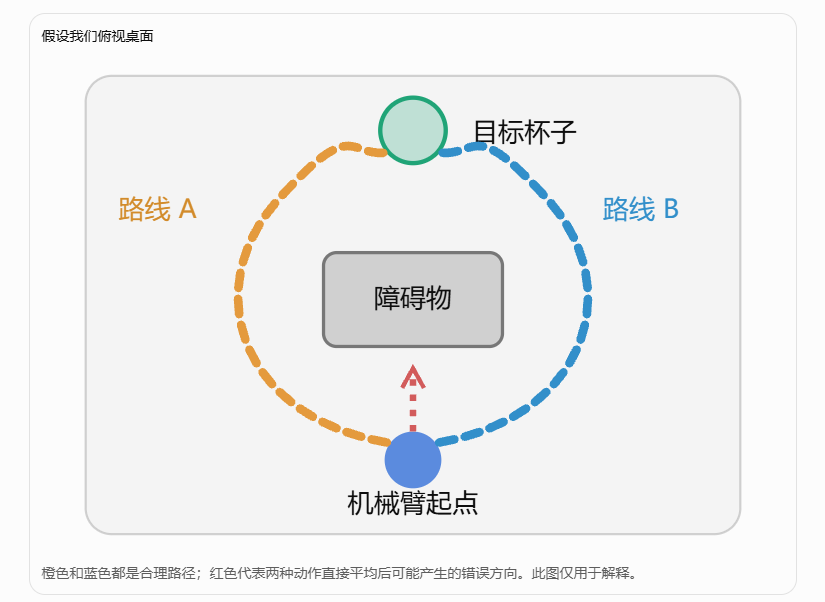
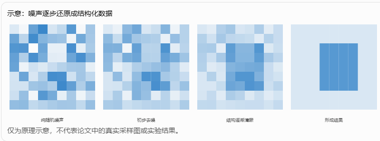
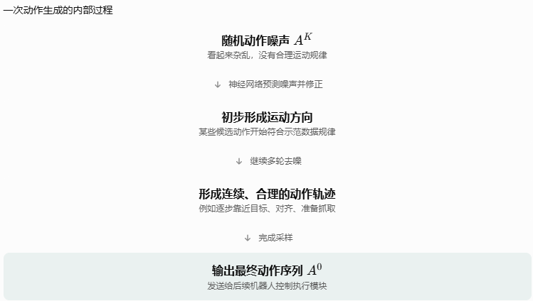
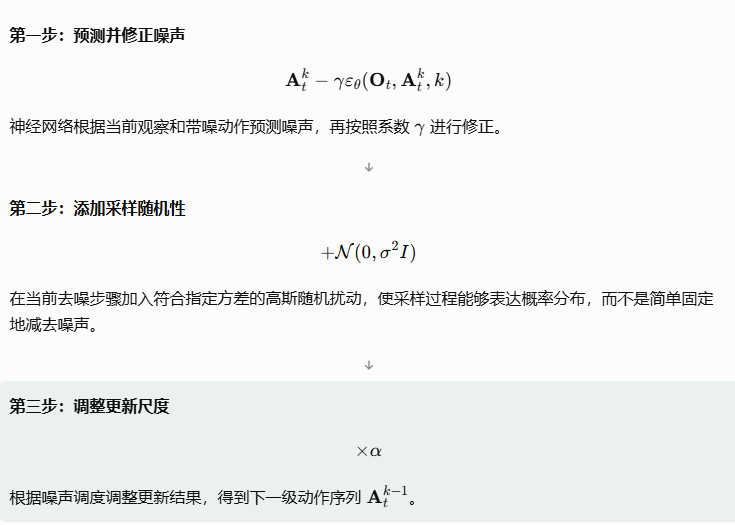
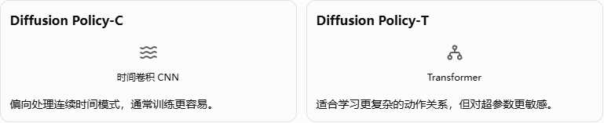

# Diffusion Policy 论文完整入门讲解

论文：Diffusion Policy: Visuomotor Policy Learning via Action Diffusion

作者：Cheng Chi 等｜2023 年 RSS 会议论文，后扩展发表于 IJRR

这篇论文是机器人模仿学习领域非常值得入门的一篇经典工作。它把原本用于生成图片的扩散模型（Diffusion Model），改造成了一个能够根据摄像头画面生成机械臂动作的模型。

我会假设你此前完全没有接触过扩散模型、行为克隆、动作序列预测，不要求你懂复杂数学。

## 一、先用一句话弄懂这篇论文

这篇论文的核心思想是：让机器人观看人类操作的示范，学会把一段随机噪声逐步变成合理的机械臂动作序列，然后执行其中一部分动作，再观察环境、重新规划。

比如，我们希望机械臂学会抓取桌子上的杯子。

机械臂通过摄像头观察杯子和自身状态，最终完成抓取。

传统方法可能是：

摄像头看到杯子 → 神经网络计算下一步动作 → 机械臂移动。

Diffusion Policy 则是：

摄像头看到杯子 → 随机生成一段动作噪声 → 神经网络反复去噪 → 得到一整段合理的未来动作 → 执行部分动作 → 重新观察。

注意两个区别：

- 它不是一次只预测一个动作，而是可以同时生成多个连续动作。
- 它不是直接输出正确动作，而是从随机噪声开始，一步步生成正确动作。

论文在 15 个任务、4 套机器人操作基准中验证了这种方法，报告相对已有方法平均提升 46.9 个百分点的任务成功率表现（原文称 average improvement of 46.9%，不是所有任务都统一提升 46.9%）。

## 二、为什么机器人要学习动作？以前的方法有什么问题？

### 2.1 第一个严重问题：同样的情况，可以有多种正确动

这是理解全文最重要的地方。

假设桌子中央有一个障碍物，后面放着杯子。你希望机械臂绕过障碍物去抓杯子。

实际上存在两种合理方案：

- 从左边绕过去。
- 从右边绕过去。

假设我们俯视桌面



假如我们的训练数据中：

- 50 次示范走左边。
- 50 次示范走右边。

传统神经网络如果采用普通均方误差（MSE）来学习单一确定性动作，就可能学出两种选择之间的折中结果。

于是出现了一个尴尬的情况：

人类每次都正确地绕过障碍物，但机器人可能直接朝障碍物走过去。

原因是：神经网络在做数值平均，而不是在两条可行路线中选择一条。

这里涉及一个重要概念：

多模态分布（Multimodal Distribution）。

名字听起来复杂，实际上就是：

> 在同一种情况下，可能存在多个彼此不同、却都正确的操作方式。

这在机器人中极其普遍，比如：

- 一个杯子可以从左侧抓，也可以从右侧抓。
- 一个抽屉可以先整理左边，也可以先整理右边。
- 移动物体时可以先旋转再平移，也可以先平移再旋转。
- 飞行机械臂面对障碍物时，也可能有不同的绕行和接近方式。

Diffusion Policy 的第一个目标，就是让机器人能够学习这些不同的正确选择，而不是简单取平均。

### 2.3 第二个问题：机械臂每一步都重新决定动作，可能左右摇摆

假设机器人已经决定从左边绕过去。

正常情况下，它应该连续地向左运动，直到绕过障碍物。

但如果每一帧都独立预测动作，可能发生：

| 时刻  | 模型预测 |
| ----- | -------- |
| t = 1 | 向左     |
| t = 2 | 向左     |
| t = 3 | 向右     |
| t = 4 | 向左     |
| t = 5 | 向右     |

每一步单独看都可能合理，但组合起来就成了左右摇晃。

所以，机器人不仅需要生成正确的单个动作，还需要保证连续动作之间具有一致性。

这叫时间一致性（Temporal Consistency）。

Diffusion Policy 因此选择一次生成一整段动作序列。

### 2.4 第三个问题：动作不仅要合理，还要足够精确

抓杯子和推积木不同于简单地判断图片中有没有猫。

机械臂夹爪偏离几厘米，就可能抓取失败。

它需要同时处理多个连续变量：

- 末端位置 \(x,y,z\)
- 末端姿态
- 夹爪开合
- 不同时刻的动作变化

当一次需要预测几十个未来动作时，输出维度可能很高。

论文希望找到一种方法，既能表达多种可能的动作，又能在高维空间中准确生成连续轨迹。

## 三、扩散模型到底是什么？为什么能拿来控制机器人？

要理解 Diffusion Policy，先忘记机器人，想象一张猫的照片。

### 3.1 扩散模型最早的直观理解：把噪声变成图片

你可能见过 AI 生成图片。

扩散模型的一种典型工作方式是：

从一张完全随机的噪声图开始，经过很多次去噪，最终得到一张像样的图片。

示意：噪声逐步还原成结构化数据

纯随机噪声

初步去噪

结构逐渐清晰



扩散模型有两个方向：

方向 A：正向加噪（Forward Diffusion）

训练时，拿一份真实、干净的数据，不断往里面添加随机噪声，直到它难以辨认。

方向 B：反向去噪（Reverse Diffusion）

训练一个神经网络，让它学习怎么从带噪数据中恢复出符合训练数据分布的样本。

真正生成数据时，利用学到的去噪能力，从随机噪声出发，逐步生成最终结果。

### 3.2 Diffusion Policy 做了什么改造？

论文作者提出：

既然扩散模型能从随机噪声中生成一张合理的图片，那为什么不能从随机噪声中生成一段合理的机械臂动作？

> 最初随机噪声来源：
>
> Diffusion Policy 中的初始随机噪声是计算机自己随机生成的，不是从摄像头、专家数据集或者机械臂传感器中获取的。
>
> 通常使用**标准高斯分布（Standard Gaussian Distribution）**生成随机数字。
>
> 1. 随机噪声具体怎么生成？
>
> 假设我们希望机械臂预测未来 4 个时刻的动作，每个动作包含 X、Y、Z 三个坐标。
>
> 那么首先需要生成一个 \(4\times3\) 的随机矩阵。
>
> 例如：
>
> \[ A^K= \begin{bmatrix} 0.82 & -0.34 & 1.25\\ -0.51 & 0.73 & -0.62\\ 1.14 & -0.28 & 0.43\\ -0.91 & 0.56 & 0.17 \end{bmatrix} \]
>
> 这些数字都是计算机随机生成的。
>
> 它们此时没有任何实际动作意义，只是生成动作的起点。
>
> 数学上写作：
>
> \[ A^K\sim\mathcal N(0,I) \]
>
> 含义是：从均值为 0、协方差矩阵为单位矩阵的高斯分布中采样。
>
> 在 Python 中，只需要一行：
>
> ```
> import torchnoise = torch.randn(4, 3)print(noise)
> ```
>
> `torch.randn()` 就会生成符合标准正态分布的随机数字。
>
> 2. 为什么一定要从随机噪声开始？
>
> 一个重要原因是：随机噪声可以帮助模型生成不同的合理动作方案。

于是进行了一个非常关键的替换：

| 普通图像扩散模型 | Diffusion Policy           |
| ---------------- | -------------------------- |
| 生成图片         | 生成动作序列               |
| 训练数据是图片   | 训练数据是专家动作         |
| 根据条件生成图像 | 根据机器人观察生成动作     |
| 输出一组图像像素 | 输出未来多个时刻的动作参数 |

例如，生成图片时，最终输出可能是包含几百万个像素值的数组。

生成动作时，最终输出可能是：

\[ A = \begin{bmatrix} 0.1 & 0.0 & 0.2\\ 0.2 & 0.0 & 0.2\\ 0.3 & 0.1 & 0.2\\ 0.4 & 0.1 & 0.1 \end{bmatrix} \]

假设每行是一个未来时刻机械臂末端的目标位置 \((x,y,z)\)。

这段动作就是机械臂接下来运动的参考。

重要的是：Diffusion Policy 扩散和去噪的对象是动作，不是摄像头拍摄的图片。

摄像头画面是生成动作时使用的条件。

这一点是论文方法的核心。

## 四、模型究竟怎样训练？完整模拟一次

现在进入论文最核心的算法部分。

我们假设，要让一台机械臂学会把桌子上的积木抓起来，先采集了 100 条人类操作示范。

### 4.1 第一步：准备专家示范数据

一条示范可能包含 100 个时刻。

每一时刻都记录：

\[ D=\{(o_1,a_1),(o_2,a_2),\ldots,(o_{100},a_{100})\} \]

这里：

- \(D\)：整个示范数据。
- \(o_t\)：第 \(t\) 时刻机器人观察到的信息。
- \(a_t\)：第 \(t\) 时刻人类专家执行的动作。

观察可以是摄像头图像、机械臂关节位置、夹爪状态等。

动作可以是机械臂末端目标位置、姿态、速度或者夹爪控制命令，取决于具体任务采用什么动作空间。

注意，我们记录的是观察和动作的对应关系，并不需要人工告诉模型每一步的正确奖励，也不需要先建立完整的物理动力学模型。

### 4.2 第二步：从示范里截取一段动作

假设某一段专家动作是：

\[ A^0=[a_t,a_{t+1},a_{t+2},a_{t+3}] \]

这里的上标 \(0\) 表示干净、没有加入扩散噪声的动作序列。

为了好理解，假设机械臂在这段时间里只沿着 X 轴运动：

\[ A^0=[0.10,0.20,0.30,0.40] \]

这代表未来四个时刻的目标位置。

真实模型一般会处理多个动作维度，不只是一个 X 坐标。

### 4.3 第三步：人为给正确动作添加噪声

我们现在故意把正确答案弄乱。

例如，向动作序列添加随机噪声：

\[ \varepsilon=[0.08,-0.12,0.15,-0.09] \]

得到：

\[ A^k=[0.18,0.08,0.45,0.31] \]

这些数值仅为教学示例；实际训练中的加噪强度由噪声调度决定。

原本规律的动作序列被扰乱了。

为什么故意这样做？

因为我们要让模型学会一件事：

给你一段受到噪声污染的动作，再告诉你机器人当前的观察状态，你能不能判断里面加入了多少噪声？

### 4.4 第四步：让神经网络预测噪声

神经网络接收三个主要输入：


神经网络最初可能预测得很差。

例如，真实噪声是：

\[ \varepsilon=[0.08,-0.12,0.15,-0.09] \]

而模型预测：

\[ \hat{\varepsilon}=[0.07,-0.10,0.13,-0.08] \]

那么我们就计算两者的差距。

这就是论文训练损失的基本思想：
$$
\mathcal {L} = M S E (\boldsymbol {\varepsilon} ^ {k}, \boldsymbol {\varepsilon} _ {\theta} (\mathbf {O} _ {t}, \mathbf {A} _ {t} ^ {0} + \boldsymbol {\varepsilon} ^ {k}, k))\tag{5}
$$
公式里：

| 符号                                       | 含义                          |
| ------------------------------------------ | ----------------------------- |
| \(\mathcal L\)                             | 训练损失                      |
| \(MSE\)                                    | 均方误差                      |
| \(\boldsymbol\varepsilon^k\)               | 第 \(k\) 个扩散等级对应的噪声 |
| \(\boldsymbol\varepsilon_\theta\)          | 噪声预测网络                  |
| \(\mathbf O_t\)                            | 机器人观察序列                |
| \(\mathbf A_t^0\)                          | 专家真实动作序列              |
| \(\mathbf A_t^0+\boldsymbol\varepsilon^k\) | 加噪后的动作序列              |
| \(k\)                                      | 去噪迭代的步数                |
| \(\theta\)                                 | 神经网络参数                  |

这里的关键是：

训练时，我们知道正确动作是什么，也知道添加的噪声是什么，所以能够直接监督模型学习预测噪声。

然后利用反向传播更新神经网络参数，让下一次预测更准确。

### 4.5 第五步：反复训练

一个简化的训练循环是：

1. 从专家示范中随机抽取一段真实动作。
2. 随机选择一个扩散噪声等级。
3. 给动作添加对应强度的随机噪声。
4. 把观察、带噪动作、噪声等级输入网络。
5. 让网络预测噪声。
6. 比较真实噪声和预测噪声，更新网络。
7. 换一批示范动作，重复。

这里有一个非常容易误解的细节。

训练时一般不需要每个样本都从完全干净的数据一步步加噪，再一步步去噪到结束。

训练中可以随机采样噪声等级，直接构造出该等级的带噪样本，让网络学会对应的噪声预测任务。

所以，训练模型和实际生成动作虽然联系紧密，但并不是同一个过程。

## 五、模型训练好了以后，机械臂怎样真正动起来？

这是训练与推理的区别。

- 训练阶段：我们有正确动作，故意添加噪声，让模型学会预测噪声。
- 推理阶段：我们没有正确动作，只能从随机噪声开始，让训练好的模型逐步生成动作。

### 5.1 推理过程：从随机数字生成动作

例如，机械臂现在看到桌子上有一个积木。

首先生成完全随机的一段动作：

\[ A^K\sim\mathcal N(0,I) \]

其中 \(\mathcal N(0,I)\) 代表标准高斯随机噪声。

此时动作序列没有直接的操作意义。

然后，训练好的网络反复预测噪声，利用采样公式更新序列：



论文中的核心采样公式可以写成：

$\mathbf {A} _ {t} ^ {k - 1} = \alpha (\mathbf {A} _ {t} ^ {k} - \gamma \varepsilon_ {\theta} (\mathbf {O} _ {t}, \mathbf {A} _ {t} ^ {k}, k) + \mathcal {N} (0, \sigma^ {2} I))\tag{4}$

| 符号                         | 数学含义                        | 通俗解释                     |
| ---------------------------- | ------------------------------- | ---------------------------- |
| \(\mathbf A_t^k\)            | 第 \(k\) 个扩散等级的动作序列   | 当前带噪声的动作             |
| \(\mathbf A_t^{k-1}\)        | 第 \(k-1\) 个扩散等级的动作序列 | 更新后、通常噪声更少的动作   |
| \(\mathbf O_t\)              | 当前观察序列                    | 摄像头图像、机械臂状态       |
| \(\varepsilon_\theta\)       | 神经网络预测的噪声              | 模型认为应该去掉的噪声成分   |
| \(k\)                        | 当前扩散等级                    | 告诉模型现在处于哪个去噪阶段 |
| \(\gamma\)                   | 噪声预测项的系数                | 控制本次去噪修正的幅度       |
| \(\alpha\)                   | 更新缩放系数                    | 调整本次更新结果的整体尺度   |
| \(\mathcal N(0,\sigma^2 I)\) | 高斯随机噪声                    | 本次采样额外加入的随机扰动   |
| \(\sigma\)                   | 随机扰动的标准差                | 控制额外随机扰动的大小       |



### 5.2 为什么能生成左绕和右绕两种动作？

回到之前障碍物的例子。

因为训练时模型看过左绕和右绕两种示范，所以学到的动作分布可能包含两个合理的高概率区域。

生成时，随机噪声的初始位置不同，最终可能生成不同的动作序列。

这有点像让 AI 画一只猫。

同一个“画一只猫”的条件，可以生成不同姿态、不同花色的猫，但不应该生成一个随机像素团。

同样，在某个观察条件下，Diffusion Policy 可以生成不同的合理动作，但并不保证每次随机采样都安全或一定成功。

## 六、论文的另一个核心：为什么不把全部动作一次执行完？

即使模型可以生成一整段动作，也不意味着机器人应该一口气全部执行。

想象你准备抓杯子。

刚开始，模型预测了接下来 16 个动作。

但是执行了几个动作之后：

- 杯子可能被人碰了一下。
- 机械臂可能没有完全到达预期位置。
- 夹爪可能发生偏移。

如果模型坚持执行原来规划的全部动作，就可能出错。

论文采用了一个非常重要的方法：

滚动时域执行（Receding Horizon）。

### 6.1 三个必须掌握的参数

| 参数    | 英文                | 含义                   |
| ------- | ------------------- | ---------------------- |
| \(T_o\) | Observation Horizon | 看过去多少步观察       |
| \(T_p\) | Prediction Horizon  | 预测未来多少步动作     |
| \(T_a\) | Action Horizon      | 真正连续执行多少步动作 |

用一个例子解释。

假设：

\[ T_o=2,\qquad T_p=16,\qquad T_a=8 \]

这意味着：

1. 读取最近 2 个时刻的观察。
2. 生成未来 16 步动作。
3. 实际执行其中 8 步。
4. 丢弃当前未执行的剩余动作（简单实现下），重新获取观察。
5. 再预测新的 16 步动作。

你可以把它类比为开车使用导航。

导航提前规划很远的路线，但你不会完全无视后续路况。如果前方出现施工，就根据新情况调整路线。

机械臂也是如此。

### 6.2 为什么不每执行一步就重新规划？

你可能会问：

既然重新规划有助于应对变化，为什么不每执行一步都重新规划？

因为重新规划也有代价。

Diffusion Policy 每次生成动作需要经过多次神经网络推理。

如果每一步都重新去噪，就需要非常多的计算。

而且，预测过于频繁也可能让动作不断变化，缺乏连续性。

因此，存在一个权衡：

| \(T_a\)       | 优点                   | 缺点                         |
| ------------- | ---------------------- | ---------------------------- |
| 很小，例如 1  | 能频繁根据观察纠正     | 计算频繁，动作一致性可能较差 |
| 中等，例如 8  | 一致性和响应速度较平衡 | 仍有短暂的开环执行           |
| 很大，例如 32 | 减少重新规划次数       | 遇到环境变化时反应较慢       |

论文在所测试的多数任务中发现，执行 8 步通常是较好的选择，但这并不是适用于所有机器人的通用最优参数。

### 6.3 它到底是闭环还是开环？

答案是：整体闭环，局部开环。

每次重新规划时，会根据新的观察更新动作，因此整个任务执行过程具有闭环反馈。

但是在连续执行 \(T_a\) 步期间，高层策略通常不会重新规划，因此这一小段是开环执行的。

此外，机械臂底层位置伺服等控制器仍可能在持续闭环工作。这和高层模仿学习策略是否重新规划是两回事。

这个区别在你未来研究飞行机械臂时非常重要。

## 七、摄像头画面怎样变成模型能理解的数字？

前面我们一直说，模型需要观察机器人状态。

但摄像头拍摄到的是像素图像。

神经网络如何知道杯子在哪里？

这就需要论文中的视觉编码器（Visual Encoder）。

### 7.1 什么是视觉编码器？

你可以把视觉编码器理解为一个信息提取器。

假设相机拍摄的画面是：

一张 240 × 320 的 RGB 图片。

它包含大量像素值，但其中很多信息对抓取任务没那么重要。

比如桌面纹理、背景墙颜色等。

视觉编码器的作用是将图像转换为更紧凑的特征表示。

论文中主要采用经过修改的 ResNet-18。

它把图像转换为一个特征向量，再把这些特征交给动作生成网络。

有一个很重要的设计：

视觉特征只需要提取一次，就可以在同一次动作生成的多个去噪步骤中反复使用。

假设你需要去噪 10 次。

当机械臂执行完当前动作块，进入下一次滚动规划时，就需要根据新的观察重新提取视觉特征。

论文则把视觉编码和动作去噪进行合理分离，避免不必要的重复视觉计算，从而降低推理成本。

## 八、为什么论文用了 CNN 和 Transformer 两种模型？

这里再介绍论文的两种主要网络结构。

前面我们说，扩散模型需要一个噪声预测网络。

但是这个网络具体长什么样？

论文给出了两个主要选择。

### 8.1 CNN 版本：Diffusion Policy-C

这个版本采用一维时间卷积网络（Temporal CNN）作为去噪网络，视觉条件通过 FiLM 等机制注入。

这里的一维卷积不是指只处理机械臂 X 轴，而是沿着动作序列的时间维度处理数据。

你可以把它理解为：

神经网络同时看一小段连续动作，分析它们在时间上的变化规律。

优点：

- 通常比较容易训练。
- 对许多操作任务效果不错。
- 不需要太复杂的超参数调整。

但它也可能产生一个问题：

过度平滑（Over-smoothing）。

例如，人类示范的速度指令突然从正方向切换到负方向。

如果模型偏向平滑的动作变化，就可能把这种突然变化学得不够准确。

### 8.2 Transformer 版本：Diffusion Policy-T

这个版本使用 Transformer 结构对动作序列进行去噪。

你可以把每个时刻的动作想象成一个 token。

Transformer 通过注意力机制学习这些动作之间的关系。

例如，它能够学习：

- 当前动作如何受到前面动作影响。
- 什么情况下应该突然改变运动方向。
- 某些动作阶段之间有什么关系。

论文中 Transformer 去噪网络还利用交叉注意力机制接收观察特征。



### 8.3 哪个更好？

论文并没有说 Transformer 一定全面优于 CNN。

相反，作者给出的实际建议是：

新任务先尝试 CNN 版本。如果任务比较复杂、需要频繁而快速地改变动作方向，可以再尝试 Transformer。

因为 Transformer 虽然在部分任务上表现很好，但训练也可能更敏感。

## 九、论文为什么强调位置控制优于速度控制？

这是一个很实用的实验发现。

首先区分两种动作表示。

位置控制（Position Control）

你告诉机器人：

> 下一步，末端要到达 X = 0.3 米的位置。

速度控制（Velocity Control）

你告诉机器人：

> 下一步，末端沿 X 方向以 0.1 米/秒的速度运动。

两者都可以控制机器人，但误差积累的方式有所不同。

假设速度预测每一步都存在一点小误差，连续执行很多步后，这些误差就可能不断积累，导致实际位置偏离目标。

而采用位置目标时，底层控制器可以持续尝试把末端移动到指定位置，某些位置误差不会以相同方式累计。

论文发现 Diffusion Policy 在所测试任务中使用位置控制时效果通常比速度控制更好。

作者提出两种可能解释：

1. Diffusion Policy 能较好地表达位置动作中存在的多模态分布。
2. 位置动作序列在部分情况下更不容易受到累积误差的影响。

但要特别注意：这是论文在具体机器人任务中的实验发现，不能直接推导出所有机器人、所有控制频率下位置控制都优于速度控制。尤其是飞行机械臂的底盘稳定、姿态调节和末端交互控制，不一定适合简单套用。

## 十、这篇论文真正的创新到底在哪里

| 创新                           | 解决什么问题                                   |
| ------------------------------ | ---------------------------------------------- |
| 条件动作扩散                   | 在同一观察下生成多种合理动作，避免简单动作平均 |
| 整段动作生成 + 滚动执行        | 改善动作一致性，同时保留根据观察重新规划的能力 |
| 高效视觉条件注入               | 减少反复去噪造成的视觉计算开销                 |
| 时间序列 Diffusion Transformer | 改善部分 CNN 模型难以表达快速动作变化的问题    |

还有两个重要的实验结论：位置控制在作者测试中表现较好；通过 DDIM 等方法可以减少推理去噪次数。

论文报告在一套 NVIDIA RTX 3080 实验配置下，以 100 个训练扩散步、10 个推理采样步达到约 0.1 秒的推理延迟。它说明扩散策略有机会部署到真实机械臂，但不能直接理解成任何设备都能稳定以 10 Hz 完成完整的感知和动作控制链路。

## 十一、这篇论文还有哪些没有解决的问题？

### 11.1 依赖特定场景专家示范数据

Diffusion Policy 并不是凭空学会抓取。

它需要大量适当的专家示范。

如果某种情况训练时从来没出现过，或者示范数据质量很差，模型仍然可能失败。

扩散模型善于拟合复杂动作分布，并不代表它自然具备广泛的环境外泛化能力。

### 11.2 它不能保证生成的动作一定正确

扩散模型产生的是从学习到的条件动作分布中采样的结果。

某个动作看起来符合专家数据的规律，并不意味着执行后一定能够完成任务。

例如：

- 机械臂可能抓空。
- 物体可能滑落。
- 预测的动作可能与新出现的障碍物发生冲突。
- 机器人可能反复执行某一局部动作，无法完成后续阶段。

论文没有提供一个独立、通用的安全约束系统，来保证每次扩散采样都满足机器人运动和接触安全要求。

### 11.3 推理仍然比直接预测动作更昂贵

传统 BC 网络可能只需要一次前向传播，就能预测动作。

Diffusion Policy 则通常需要多次去噪。

虽然 DDIM 可以加速采样，但对于高速闭环控制系统，延迟依然可能成为问题。

论文也明确承认了计算开销和推理延迟方面的局限。

### 11.4 它没有明确解决长时序任务的进度理解问题

假设机械臂正在抓杯子：

第一阶段：接近杯子。

第二阶段：闭合夹爪。

第三阶段：抬起杯子。

第四阶段：移动到目标位置。

第五阶段：放下杯子。

虽然模型可以从历史观察与当前图像中学习动作规律，但论文并没有为模型专门建立一个明确的任务阶段判断和进度跟踪机制。

如果某些阶段看起来相似，模型可能出现动作重复、错误切换或无法结束的问题。

当然，这里不能直接断言所有停滞都是“任务阶段混淆”造成的；这需要进一步做实验验证。

论文原文：[Diffusion Policy 项目主页](https://diffusion-policy.cs.columbia.edu) · [论文 PDF](https://diffusion-policy.cs.columbia.edu/diffusion_policy_ijrr.pdf) · [论文markdown](Diffusion Policy- Visuomotor Policy Learning via Action Diffusion.md)