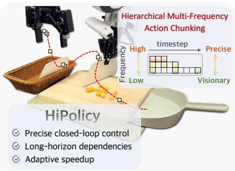
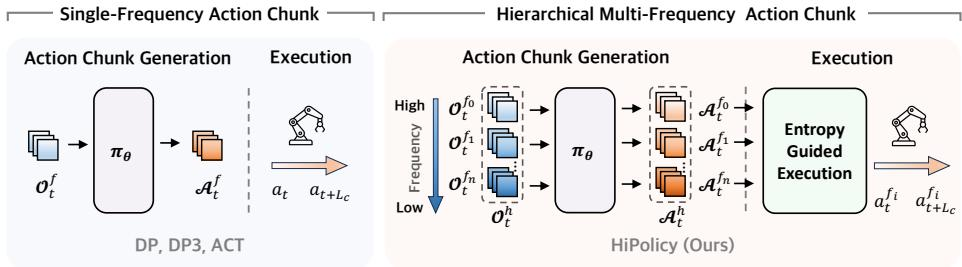
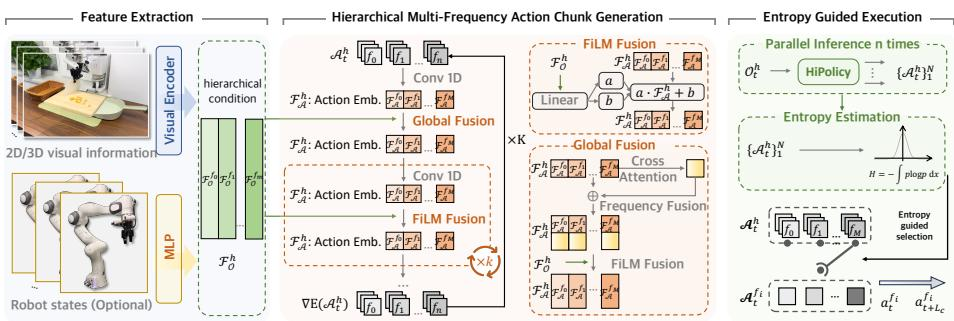
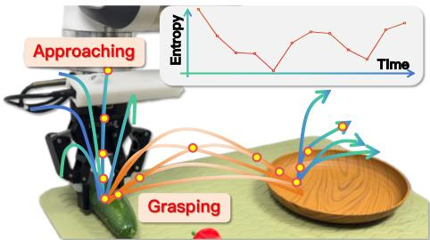
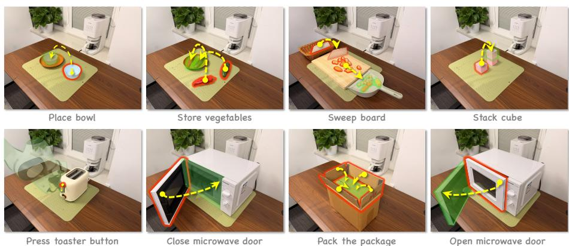
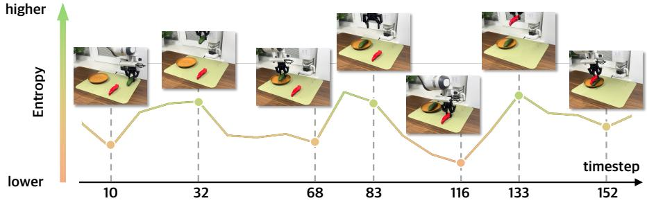
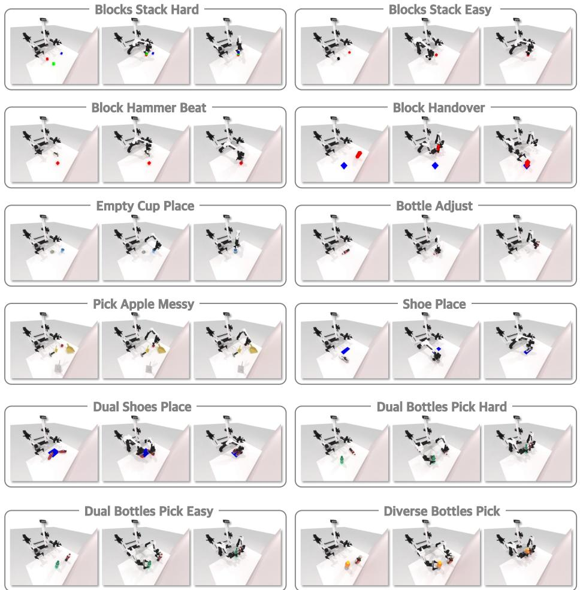
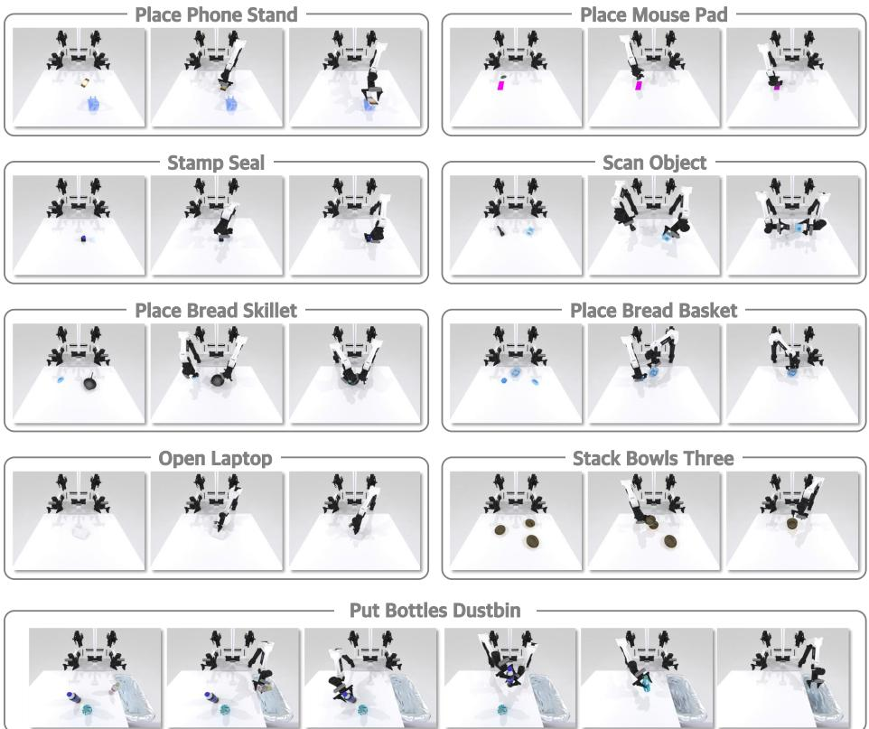
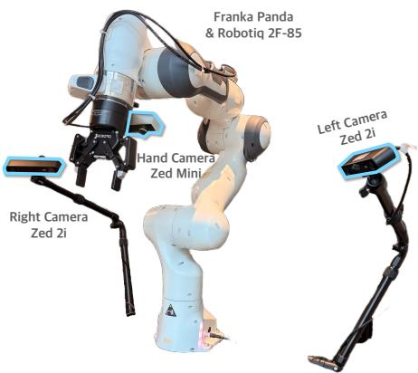

# HiPolicy: Hierarchical Multi-Frequency Action Chunking for Policy Learning

Jiyao Zhang1,2, Zimu Han3, Junhan Wang1, Xionghao Wu4, Shihong Lin5, Jinzhou Li1, Hongwei Fan1,2, Ruihai Wu1, Dongjiang Li6, and Hao Dong1,2

1 CFCS, School of CS, PKU

2 National Key Laboratory for Multimedia Information Processing, School of CS, PKU 3 XJTU THU 5 BUAA 6 Jingdong Technology Information Technology Co., Ltd jiyaozhang@stu.pku.edu.cn

https://hipolicy.github.io

Abstract. Robotic imitation learning faces a fundamental trade-of between modeling long-horizon dependencies and enabling fine-grained closed loop control. Existing fixed-frequency action chunking approaches struggle to achieve both. Building on this insight, we propose HiPolicy, a hierarchical multi-frequency action chunking framework that jointly predicts action sequences at diferent frequencies to capture both coarse high-level plans and precise reactive motions. We extract and fuse hierarchical features from history observations aligned to each frequency for multi-frequency chunk generation, and introduce an entropy-guided execution mechanism that adaptively balances long-horizon planning with fine-grained control based on action uncertainty. Experiments on diverse simulated benchmarks and real-world manipulation tasks show that HiPolicy can be seamlessly integrated into existing 2D and 3D generative policies, delivering consistent improvements in performance while significantly enhancing execution eficiency.

Keywords: Manipulation · Imitation learning · Hierarchical policy

## 1 Introduction

Learning from human demonstrations has emerged as a powerful paradigm for robotic manipulation [4, 9, 13, 31, 36–39], enabling policies to acquire complex skills without explicit reward engineering or exhaustive exploration. Imitation Learning (IL) [1, 7] has shown promise in both task-specific policy training and general-purpose vision-language-action (VLA) model [5, 12], development, providing a scalable route toward versatile robot control [2,4,17,33]. Among various IL approaches, generative policies such as

  
Fig. 1: We propose HiPolicy, a hierarchical multi-frequency action chunking for policy learning, modeling long-horizon dependency and precise closed-loop control.

  
Fig. 2: Comparison of HiPolicy with Existing Methods. Existing imitation learning methods typically predict an action chunk at a single fixed frequency, leading to a trade-of between long-horizon dependency modeling and precise closed-loop control. In contrast, HiPolicy proposes hierarchical multi-frequency action chunking, enabling the capture of both long-term intentions and precise closed-loop adjustments. Additionally, the proposed action-entropy guided adaptive execution mechanism selects action frequency based on action uncertainty, balancing robustness and eficiency during task execution.

Difusion Policy [4], ACT [40], and DP3 [38] have become dominant due to their ability to model continuous action distributions with high temporal fidelity, delivering strong performance across diverse manipulation tasks.

Despite the efectiveness of imitation learning, it still faces fundamental challenges. First, error accumulation remains a critical issue. Small discrepancies in predicted actions can compound over time, leading to substantial state deviations and eventual task failure [14,18,27]. Second, modeling long-horizon dependencies is hard, especially for non-Markovian behaviors frequently observed in human demonstrations, such as pauses or subtle oscillatory motions [19]. Recent work has sought to address this via action chunking [40], predicting multi-step sequences instead of single-step actions. While this improves temporal coherence, its efectiveness is tightly coupled to two hyperparameters: action frequency and chunk size. As shown in Figure 1, at the same chunk size, low-frequency chunks capture long-horizon dependencies but lack the temporal resolution for finegrained closed-loop control, whereas high-frequency chunks ofer fine-grained adjustments but are less efective at modeling long-horizon dependencies. This trade-of presents a significant challenge in designing efective action chunking strategies for robotic policies.

Human motor control studies reveal that complex movements naturally integrate components operating at multiple frequencies [8, 22, 32]. Long-duration, low-frequency motions encode high-level goals and stage intentions, while shortduration, high-frequency motions enable precise adjustments and reactive control. This raises a key question: Could such a hierarchical multi-frequency structure be the key to uniting robust long-horizon planning with precise fine-grained closed-loop control in robotic policies?

In this work, we present HiPolicy: a hierarchical multi-frequency action chunk ing framework for policy learning. As shown in Figure 2, our framework jointly predicts action sequences at multiple frequencies from hierarchically aligned observation histories, fusing their representations to model long-horizon and finecontrol behavior concurrently. To resolve the execution trade-of between speed and precision, we propose an action-entropy-guided adaptive execution strategy: Low-entropy frames indicate concentrated action distributions and stable predictions, prompting execution of high-frequency actions to enable precise closed-loop refinement. High-entropy frames reflect dispersed distributions and greater uncertainty, corresponding to broader phase-level decisions, where executing low-frequency actions aligns with high-level intent while increasing operational speed [10]. By dynamically selecting execution frequency based on policy uncertainty, our method speeds up the execution while balancing fine-grained control with long-horizon consistency.

Our contributions are threefold:

– We introduce HiPolicy, a novel hierarchical multi-frequency action chunking framework for policy learning that addresses the trade-of between longhorizon dependency modeling and high-frequency reactive control.

– We propose an action-entropy-guided adaptive execution mechanism that dynamically selects action frequency based on policy uncertainty, enhancing both robustness and execution eficiency.

– We validate our approach on extensive simulation benchmarks and realworld manipulation tasks, demonstrating consistent improvements in both performance and eficiency across 2D and 3D generative policies.

## 2 Related Work

## 2.1 Imitation Learning for Manipulation

Imitation learning (IL) has become a dominant learning paradigm for robots to acquire manipulation skills from human demonstrations [4, 38, 40]. Generative models such as Difusion Models [11, 29] and Conditional Variational Autoencoders (CVAE) [16,25] are the primary drivers of this progress, enabling accurate and robust action distribution modeling [20, 25, 30, 34].

Difusion Policy [4] integrates the difusion process into generating the action sequence of robots, enabling accurate action prediction. 3D Difusion Policy [38] and 3D Difuser Actor [13] incorporate point cloud representations into the diffusion policy, enhancing the spatial perception ability for manipulation. Our Hierarchical Policy proposes a hierarchical modeling method based on diferent frequencies, which can be easily integrated into Difusion Policy [4] and 3D Difusion Policy [38], compensating their weakness in modeling non-Markov processes by jointly predicting at hierarchical temporal resolutions. Furthermore, our action entropy-guided execution method chooses the suitable execution frequency adaptively, significantly improves the eficiency of manipulation, and relieves the low-speed problem of difusion-based policies.

## 2.2 Hierarchical Manipulation Policy

Hierarchical structures in the area of computer vision can efectively perceive and integrate environmental information at diferent semantic levels, thereby enabling the model to take into account both global information and local details, and improving model performance.

In the robot learning community, recent research has sought to integrate hierarchical structures into imitation learning framework. H3DP [21] proposes a visuomotor learning framework that explicitly strengthens the coupling between visual features and action generation by hierarchically conditioning on multiscale visual representations. Reactive Difusion Policy [37] introduces a hierarchical slow-fast visual-tactile imitation learning algorithm that uses a slow latent difusion policy for high-level action chunks and a fast asymmetric tokenizer for low-level control to enable quick responses in contact-rich manipulation tasks. CARP [9] applies a next-scale autoregressive structure that decouples action generation into multi-scale representation learning via an action autoencoder. Dense Policy [31] introduces a new bidirectionally expanded learning approach for autoregressive policies, employing an encoder-only architecture to hierarchically unfold the action sequence in a coarse-to-fine manner.

However, the hierarchical structure of these policies only models perceptual input information at diferent levels, and few work studies have been conducted on imitation learning algorithms with a hierarchical structure for diferent temporal resolutions. In contrast, our Hierarchical Policy features temporal hierarchical modeling, which hierarchically divides the perceptual input and action sequence simultaneously according to diferent frequencies and trains the model to predict future action sequences at diferent time scales.

## 3 Method

## 3.1 Problem Formulation

We consider an imitation learning setting where the agent learns a generative policy:

$$
\boldsymbol {\mathcal {A}} _ {t, L _ {c}} = \pi_ {\theta} (\boldsymbol {\mathcal {O}} _ {t, L _ {h}}),\tag{1}
$$

where t denotes the current time step, and $L _ { c }$ and $L _ { h }$ denote the action chunk length and observation history length, respectively. The policy π maximizes the likelihood of the actions given the observation by $P ( \mathcal { A } _ { t , L _ { c } } | \mathcal { O } _ { t , L _ { h } } )$ . θ are the learnable parameters of the policy $\pi _ { \theta }$ , and $\mathcal { O } _ { t , L _ { h } }$ denotes the observation history over $L _ { h }$ time steps:

$$
\mathcal {O} _ {t, L _ {h}} = \left\{\boldsymbol {o} _ {t - L _ {h} + 1}, \dots , \boldsymbol {o} _ {t} \right\},\tag{2}
$$

with $\mathbf { \sigma } _ { o _ { t } } = \{ v _ { t } , s _ { t } \}$ , where $v _ { t }$ denotes the visual observation (either a 2D RGB image or a 3D point cloud) and $\mathbf { } _ { s _ { t } }$ denotes proprioceptive states such as joint positions, velocities, and gripper status. The action chunk $\boldsymbol { A } _ { t , L _ { c } }$ is defined as:

$$
\boldsymbol {\mathcal {A}} _ {t, L _ {c}} = \left\{\boldsymbol {a} _ {t}, \boldsymbol {a} _ {t + 1}, \dots , \boldsymbol {a} _ {t + L _ {c} - 1} \right\},\tag{3}
$$

  
Fig. 3: Overview of HiPolicy. We propose HiPolicy, a hierarchical multi-frequency action chunk policy with an entropy-guided adaptive execution strategy. Given a hierarchical observation history, HiPolicy predicts multi-frequency action chunks simultaneously through a difusion-based model. During inference, HiPolicy estimates the action entropy through multiple samplings and adaptively chooses the execution frequency according to the estimated entropy.

where a is a low-level control action and $L _ { c }$ is the chunk size, i.e., the number of actions executed before receiving the next observation and generating the subsequent chunk.

Prior formulation (single frequency). In conventional fixed-frequency chunking, both observation histories and action chunks are sampled at a single frequency f:

$$
\mathcal {O} _ {t, L _ {h}} ^ {f} = \{\boldsymbol {o} _ {t - L _ {h} + 1} ^ {f}, \dots , \boldsymbol {o} _ {t} ^ {f} \},\tag{4}
$$

$$
\boldsymbol {\mathcal {A}} _ {t, L _ {c}} ^ {f} = \{\boldsymbol {a} _ {t} ^ {f}, \boldsymbol {a} _ {t + 1} ^ {f}, \dots , \boldsymbol {a} _ {t + L _ {c} - 1} ^ {f} \}.\tag{5}
$$

This formulation poses a challenge in selecting the appropriate frequency f: low f supports long-horizon dependency modeling, but reduces opportunities for precise and closed-loop control. High f allows for fine-grained control but limits the field of view for long-horizon tasks.

HiPolicy formulation (hierarchical multi-frequency). HiPolicy jointly encodes multi-frequency observation histories:

$$
\mathcal {O} _ {t, L _ {h}} ^ {\mathrm{h}} = \bigcup_ {m = 1} ^ {M} \mathcal {O} _ {t, L _ {h}} ^ {f _ {m}},\tag{6}
$$

and predicts a single hierarchical multi-frequency action chunk:

$$
\mathcal {A} _ {t, L _ {c}} ^ {\mathrm{h}} = \bigcup_ {m = 1} ^ {M} \mathcal {A} _ {t, L _ {c}} ^ {f _ {m}},\tag{7}
$$

where each $f _ { m }$ represents a frequency component within the same chunk, and M is the number of frequencies. Unlike single-frequency approaches, the observation and action components at diferent frequencies are jointly generated and fused within the chunk, enabling coarse high-level planning and fine-grained reactive control to communicate and synergize.

HiPolicy Overview. As shown in Figure 3, our HiPolicy is designed as a difusion-based model, predicting action chunks with hierarchical time resolutions simultaneously. First, we extract hierarchical observation features from visual and proprioception input. Then we obtain the overall action chunk by concatenating noisy action chunks at diferent frequencies and predict the noise through a 1D-CNN-based U-Net [26]. Hierarchical FiLM fusion [24] and global feature fusion are two key fusion modules designed to promote fusing observation features with action and injecting global information across diferent frequencies. After predicting action chunks at hierarchical temporal resolutions, we perform parallel inference to estimate the action entropy and select the execution frequency according to the entropy adaptively.

We follow Difusion Policy [4] to design our training process, which is detailed described in Appendix C.

## 3.2 Multi-Frequency Action Chunk Prediction

Hierarchical feature extraction. To obtain the hierarchical observation feature, we first extract the observation frames of diferent frequencies from the raw observation chunk. Then the hierarchical feature is obtained through the observation encoder. Input vision observation is selectable between 2D images and 3D point clouds. Robot state is also optional as proprioception information, and is encoded through MLP.

Hierarchical FiLM fusion. To model observation-action mappings at diferent frequencies, we use features of diferent frequencies as conditions for action chunks of diferent frequencies. As shown in Figure 3, we adopt the FiLM condition [24] method and impose the corresponding frequency of observation features to each frequency of action chunk. Then we get the hierarchical action feature $\mathcal { F } _ { A } ^ { \mathrm { h } }$ as follows:

$$
\mathcal {F} _ {\boldsymbol {\mathcal {A}}} ^ {\mathrm{h}} \leftarrow \bigoplus_ {m = 1} ^ {M} \operatorname{FiLM} (\mathcal {F} _ {\boldsymbol {\mathcal {O}}} ^ {f _ {m}}, \mathcal {F} _ {\boldsymbol {\mathcal {A}}} ^ {f _ {m}})\tag{8}
$$

where $\oplus$ represents the concatenation on the temporal dimension, $\mathcal { F } _ { A } ^ { \mathrm { h } } \in$ $\mathbb { R } ^ { B \times ( M T ) \times \bar { C } }$ denotes the hierarchical action feature, and $\mathcal { F } _ { \mathcal { O } } ^ { f _ { m } } \in \mathbb { R } ^ { B \times T \times C } , \mathcal { F } _ { \mathcal { A } } ^ { \bar { f } _ { m } } \in$ $\mathbb { R } ^ { B \times T \times C }$ are the observation and action feature at frequency $f _ { m } , B$ is the batch size, C denotes the hidden feature dimension, and $T$ refers to the temporal dimension. This hierarchical condition design aims to capture feature mapping relations at diferent temporal resolutions in a corresponding way.

Global feature fusion. As shown in Figure 3, we design a global feature fusion to facilitate information communication across diferent frequencies. We first apply frequency fusion, and a cross attention [35] module is adopted to get the global feature across diferent frequencies. Cross attention [35] module is adopted for its performance in capturing context information. Specifically, we add a CLS token [6] to obtain the global feature token. This process is written as follows.

Algorithm 1: Entropy-Guided Execution

Input : Observation  $O_{t,L_{h}}^{h}$ 

Output: Action for Execution  $A_{t,L_{c}}^{exec}$ $A_{t,L_{c}}^{h} \leftarrow \emptyset$ 

for  $i \leftarrow 1$  to N do

 $\begin{array}{l} A_{t,L_{c}}^{i} \leftarrow \pi_{\text{HiPolicy}}(\mathcal{O}_{t,L_{h}}^{\text{h}}) \\ A_{t,L_{c}}^{\text{h}} \leftarrow A_{t,L_{c}}^{\text{h}} \cup A_{t,L_{c}}^{i} \end{array}$ $\triangleright$  Independently sample for N times

 $A_{t,L_{c}}^{h_{exec}} \leftarrow A_{t,L_{c}}^{1}$ $H \leftarrow \text{CalculateEntropy}(A_{t,L_{c}}^{\text{h}})$ $A_{t,L_{c}}^{exec} \leftarrow \text{SelectFrequency}(H, A_{t,L_{c}}^{\text{h}_{exec}})$ $\triangleright$  Use the first sample output for execution

 $A_{t,L_{c}}^{exec} \leftarrow \text{SelectFrequency}(H, A_{t,L_{c}}^{\text{h}_{exec}})$ $return A_{t,L_{c}}^{exec}$

$$
\mathcal {F} _ {\boldsymbol {\mathcal {A}}} ^ {\mathrm{global}} = \operatorname{CrossAttention} (\mathcal {F} _ {\boldsymbol {\mathcal {A}}} ^ {f _ {0}}, \mathcal {F} _ {\boldsymbol {\mathcal {A}}} ^ {f _ {1}},..., \mathcal {F} _ {\boldsymbol {\mathcal {A}}} ^ {f _ {M}})\tag{9}
$$

where $\mathcal { F } _ { A } ^ { f _ { i } } \in \mathbb { R } ^ { B \times T \times C }$ is the local action feature for frequency $f _ { i } , { \mathcal { F } } _ { A } ^ { \mathrm { g l o b a l } } \in$ $\mathbb { R } ^ { B \times T \times C }$ is the global feature across diferent frequencies. Then we concatenate the global feature and the local feature to obtain hierarchical features.

$$
\mathcal {F} _ {\mathcal {A}} ^ {\mathrm{h}} \leftarrow \mathcal {F} _ {\mathcal {A}} ^ {\mathrm{h}} \oplus \mathcal {F} _ {\mathcal {A}} ^ {\mathrm{global}}\tag{10}
$$

After frequency fusion, we use a FiLM condition, which is performed as Equation 8, to promote the fusion of action feature and observation feature.

## 3.3 Entropy-Guided Adaptive Execution

To balance the fine-grained closedloop control and the capability to capture time-dependent information, while speeding up the execution speed of HiPolicy, we propose an entropyguided execution strategy to perform our policy at an adaptive frequency. As shown in Figure 4, low entropy indicates high consistency (e.g., during grasping), justifying the execution of high-frequency actions for precise, closed-loop control. Conversely, high entropy signals casual motion (e.g., during approaching); here, adaptively switching to low-frequency actions enables high-level planning and signifi-

  
Fig. 4: Entropy-Guided Execution. HiPolicy leverages action entropy, estimated through parallel stochastic inference, as a dynamic gating signal to arbitrate between predictions at multiple frequencies, ensuring a balance between long-horizon planning and reactive control.

cantly accelerates execution. The complete algorithm of entropy-guided execution is shown in Algorithm 1.

To obtain the entropy of an action chunk, we first sample in parallel for N times independently to get N predicted actions when evaluating our HiPolicy, described in the right part of Figure 3. Considering action chunks predicted at a certain frequency, we model the j-th action in the chunk as a continuous variable following a Gaussian distribution with probability distribution function:

$$
\hat {p} (\pmb {a} ^ {j} | \pmb {o}) = \frac {1}{\sqrt {2 \pi} \hat {\sigma} ^ {j}} \mathrm{exp} (- \frac {(\pmb {a} ^ {j} - \bar {\pmb {a}} ^ {j}) ^ {2}}{2 (\hat {\sigma} ^ {j}) ^ {2}})\tag{11}
$$

where the mean and variance are calculated as follows:

$$
\bar {\boldsymbol {a}} ^ {j} = \frac {1}{N} \sum_ {i = 1} ^ {N} \boldsymbol {a} _ {i} ^ {j}\tag{12}
$$

$$
\hat {\sigma} ^ {j} = \frac {1}{N - 1} \sum_ {i = 1} ^ {N} (\pmb {a} _ {i} ^ {j} - \bar {\pmb {a}} ^ {j}) ^ {2}\tag{13}
$$

We use Shannon entropy [28] to measure the entropy of the predicted action:

$$
\hat {H} ^ {j} = - \int \hat {p} (\pmb {a} ^ {j} | \pmb {o}) \mathrm{log} (\hat {p} (\pmb {a} ^ {j} | \pmb {o})) \mathrm{d} \pmb {a} ^ {j}\tag{14}
$$

The simplified formula of action entropy is as follows:

$$
\hat {H} ^ {j} = \log (\sqrt {2 \pi \mathrm{e}} \cdot \hat {\sigma} ^ {j})\tag{15}
$$

Then the overall action entropy at time t is the average entropy of all frequencies and all time steps:

$$
\hat {H} _ {t} = \frac {1}{M L _ {c}} \sum_ {m = 1} ^ {M} \sum_ {j = t} ^ {t + L _ {c} - 1} \hat {H} _ {t} ^ {f _ {m}, j}\tag{16}
$$

where $\hat { H } _ { t } ^ { f _ { m } , j }$ denotes action entropy for j-th action in the chunk at frequency $f _ { m }$ , calculated following Equation 15.

After estimating the action entropy, we choose execution frequency by comparing the estimated entropy with preset ascending thresholds $\{ \hat { H } _ { \mathrm { t h , 1 } } , . . . , \hat { H } _ { \mathrm { t h , } M + 1 } \}$ , with frequencies sorted in descending order:

$$
f _ {i} = f _ {k}, \text {   if   } H _ {t} \in (H _ {\mathrm{th}, k}, H _ {\mathrm{th}, k + 1})\tag{17}
$$

where $f _ { i }$ is the selected frequency. Finally, the execution action chunk is:

$$
\boldsymbol {\mathcal {A}} _ {t, L _ {c}} ^ {\mathrm{exec}} = \{\boldsymbol {a} _ {1} ^ {f _ {i}, t}, \dots , \boldsymbol {a} _ {1} ^ {f _ {i}, t + L _ {c} - 1} \},\tag{18}
$$

Table 1: Detailed evaluation results on RoboTwin 1.0 and RoboTwin 2.0 Benchmark. Results (success rate) are based on 100 evaluation episodes, distinguishing between precise and other tasks. Bold red highlights the relative percentage improvement over baseline methods, while color shades are used to categorize tasks by their horizon (short, long, and super long). Tasks are sorted according to demo steps.

<table><tr><td>Task name</td><td>Task Source</td><td>Precise</td><td>Demo steps</td><td>DP [4]</td><td>DP+HiPolicy</td><td>DP3 [38]</td><td>DP3+HiPolicy</td></tr><tr><td>Blocks stack hard</td><td>RoboTwin 1.0</td><td>√</td><td>665</td><td>0</td><td>10</td><td>4</td><td>7</td></tr><tr><td>Blocks stack easy</td><td>RoboTwin 1.0</td><td>√</td><td>437</td><td>0</td><td>15</td><td>27</td><td>44</td></tr><tr><td>Block handover</td><td>RoboTwin 1.0</td><td>√</td><td>415</td><td>61</td><td>100</td><td>45</td><td>99</td></tr><tr><td>Dual shoes place</td><td>RoboTwin 1.0</td><td>√</td><td>384</td><td>4</td><td>15</td><td>13</td><td>14</td></tr><tr><td>Shoe place</td><td>RoboTwin 1.0</td><td>√</td><td>251</td><td>33</td><td>48</td><td>49</td><td>66</td></tr><tr><td>Place bread basket</td><td>RoboTwin 2.0</td><td>√</td><td>231</td><td>41</td><td>64</td><td>15</td><td>47</td></tr><tr><td>Block hammer beat</td><td>RoboTwin 1.0</td><td>√</td><td>211</td><td>0</td><td>67</td><td>57</td><td>94</td></tr><tr><td>Scan object</td><td>RoboTwin 2.0</td><td>√</td><td>170</td><td>21</td><td>44</td><td>12</td><td>52</td></tr><tr><td>Place bread skillet</td><td>RoboTwin 2.0</td><td>√</td><td>162</td><td>38</td><td>55</td><td>45</td><td>58</td></tr><tr><td>Stamp seal</td><td>RoboTwin 2.0</td><td>√</td><td>151</td><td>5</td><td>19</td><td>15</td><td>74</td></tr><tr><td>Place mouse pad</td><td>RoboTwin 2.0</td><td>√</td><td>149</td><td>13</td><td>29</td><td>3</td><td>15</td></tr><tr><td>Place phone stand</td><td>RoboTwin 2.0</td><td>√</td><td>130</td><td>45</td><td>79</td><td>55</td><td>64</td></tr><tr><td colspan="4">Average</td><td>22</td><td>45 (105%↑)</td><td>28</td><td>53 (89%↑)</td></tr><tr><td>Put bottles dustbin</td><td>RoboTwin 2.0</td><td>×</td><td>637</td><td>38</td><td>81</td><td>66</td><td>80</td></tr><tr><td>Stack bowls three</td><td>RoboTwin 2.0</td><td>×</td><td>476</td><td>80</td><td>88</td><td>84</td><td>86</td></tr><tr><td>Empty cup place</td><td>RoboTwin 1.0</td><td>×</td><td>269</td><td>89</td><td>95</td><td>54</td><td>92</td></tr><tr><td>Open laptop</td><td>RoboTwin 2.0</td><td>×</td><td>258</td><td>69</td><td>86</td><td>82</td><td>86</td></tr><tr><td>Bottle adjust</td><td>RoboTwin 1.0</td><td>×</td><td>194</td><td>46</td><td>52</td><td>81</td><td>85</td></tr><tr><td>Dual bottles pick hard</td><td>RoboTwin 1.0</td><td>×</td><td>192</td><td>60</td><td>72</td><td>53</td><td>60</td></tr><tr><td>Diverse bottles pick</td><td>RoboTwin 1.0</td><td>×</td><td>182</td><td>24</td><td>65</td><td>44</td><td>50</td></tr><tr><td>Dual shoes pick easy</td><td>RoboTwin 1.0</td><td>×</td><td>179</td><td>82</td><td>94</td><td>56</td><td>89</td></tr><tr><td>Pick apple messy</td><td>RoboTwin 1.0</td><td>×</td><td>167</td><td>40</td><td>81</td><td>10</td><td>3</td></tr><tr><td colspan="4">Average</td><td>59</td><td>79 (34%↑)</td><td>59</td><td>70 (19%↑)</td></tr><tr><td colspan="4">Total average</td><td>37</td><td>60 (62%↑)</td><td>41</td><td>59 (44%↑)</td></tr></table>

## 4 Experiments

## 4.1 Experiments on Simulation Benchmarks

Benchmarks and demonstrations. We evaluate the HiPolicy on three widelyused robotic manipulation simulation benchmarks covering a diverse set of tasks ranging from fine-grained to long-horizon manipulation:

RoboTwin 1.0 [23]: RoboTwin 1.0 is a digital twin framework introduced to address the scarcity of diverse demonstration data. We remove some simple tasks that baseline policies are fully capable of, and evaluate HiPolicy on 12 challenging tasks from the RoboTwin 1.0 benchmark.

– RoboTwin 2.0 [3]: RoboTwin 2.0 is a scalable framework for the automated generation of realistic synthetic data. We removed tasks with fewer than 100 demo steps and with low precision requirements (such as simple pick-andplace) and evaluated HiPolicy on 9 selected long-horizon or precise tasks from the RoboTwin 2.0 benchmark.

To highlight HiPolicy’s ability to jointly model long-horizon dependencies and high-precision closed-loop controls shown in Table1, tasks are further categorized, and we present various temporal dependency profiles and levels of control granularity (precise tasks or non-precise tasks). Precise tasks require tight end-efector pose tolerances to succeed (e.g., cube stacking, QR-code scanning), while non-precise tasks have more lenient success criteria.

All demo data was collected according to the methods provided by the oficial. Details of the selected tasks, demo collection, and preprocessing are provided in Appendix A.

Baselines. We compare our method against two representative generative imitation learning policies, selected to cover diferent input modalities:

– Difusion Policy (DP) [4]: A conditional generative policy that operates purely on 2D image observations, predicting continuous actions via a difusion process. This baseline reflects the vision-only setting where the policy relies entirely on visual inputs.

– DP3 [38]: Extends difusion-based policies to 3D perception, capturing the multi-modal setting typical in 3D manipulation, leveraging both color texture cues and geometric shape information.

Evaluation protocols. We follow the standard evaluation protocols defined by RoboTwin 1.0 for the tasks from RoboTwin 1.0 [23] and RoboTwin 2.0 [3]. Training is conducted for a fixed number of epochs using identical data splits for all methods, ensuring fair comparison. For RoboTwin 1.0 and 2.0, we report success rate averaged over N = 100 episodes per task.

Hyperparameters. In this paper, we use the unified hyperparameter provided in Appendix D for all simulation and real-world tasks.

## 4.2 Results and Analysis in Simulation

As the simulation results shown in Table 1, HiPolicy shows significant relative improvements compared with DP and DP3 baselines. Specifically, in RoboTwin 1.0 and RoboTwin 2.0, it shows a dramatic relative advantage of 62% and 44% versus DP and DP3, respectively.

The most significant improvement appears in tasks such as block hammer beat and stamp seal, which are representatives of high-precision tasks; put bottles dustbin, which is challenging for its super-long horizon properties. These experimental results strongly demonstrate that our HiPolicy successfully reconciles the often-conflicting objectives of maintaining high control accuracy and enabling long-horizon sequential prediction within a single architecture.

Operations such as blocks stack hard and place bread basket possess both longhorizon and high-precision features. Results on these tasks validate that HiPolicy, whether based on DP or DP3, dramatically enhances the precision of manipulation and improves the modeling capability for long-horizon time-dependent tasks by simultaneously predicting action chunks at hierarchical temporal resolutions.

## 4.3 Ablation Study

We conduct ablation studies to isolate the contributions of each component:

Table 2: Ablation Experiment. In the RoboTwin 1.0 platform, we compare our complete HiPolicy with that removing the hierarchical condition, including all conditioned only with the highest frequency (High) or the lowest (Low) frequency, the fusion module, and the hierarchical frequency structure (Hier.), respectively.

<table><tr><td rowspan="2">Task name</td><td colspan="3">Condition</td><td rowspan="2" colspan="2">w/o Fusion w/o Hier.</td></tr><tr><td>Hier.</td><td>Low</td><td>High</td></tr><tr><td>Blocks stack hard</td><td>10</td><td>8</td><td>4</td><td>8</td><td>0</td></tr><tr><td>Blocks stack easy</td><td>15</td><td>12</td><td>10</td><td>8</td><td>0</td></tr><tr><td>Shoe place</td><td>48</td><td>43</td><td>14</td><td>43</td><td>33</td></tr><tr><td>Dual shoes place</td><td>15</td><td>12</td><td>8</td><td>11</td><td>4</td></tr><tr><td>Block handover</td><td>100</td><td>100</td><td>89</td><td>98</td><td>61</td></tr><tr><td>Block hammer beat</td><td>67</td><td>66</td><td>42</td><td>56</td><td>0</td></tr><tr><td>Dual bottles pick hard</td><td>72</td><td>70</td><td>62</td><td>67</td><td>60</td></tr><tr><td>Dual shoes pick easy</td><td>94</td><td>94</td><td>94</td><td>93</td><td>82</td></tr><tr><td>Pick apple messy</td><td>81</td><td>80</td><td>67</td><td>66</td><td>40</td></tr><tr><td>Empty cup place</td><td>95</td><td>96</td><td>95</td><td>92</td><td>89</td></tr><tr><td>Bottle adjust</td><td>52</td><td>52</td><td>50</td><td>46</td><td>46</td></tr><tr><td>Diverse bottles pick</td><td>65</td><td>61</td><td>54</td><td>61</td><td>24</td></tr><tr><td>Average</td><td>60</td><td>58</td><td>49</td><td>54</td><td>37</td></tr></table>

No hierarchical observation condition. The hierarchical condition is replaced by a fixed-frequency condition, where the policy is conditioned solely on high-frequency or low-frequency observations. As shown in Table 2, taking observations at a fixed frequency leads to a performance decline, with more obvious drop when taking a higher fixed frequency of observation.

No hierarchical feature fusion. Remove the attention module for fusing features across diferent frequencies. From the results in Table 2, the hierarchical feature fusion part promotes feature communication across diferent frequency chunks, contributing to performance improvement by 6%.

Single-frequency chunking. Remove multi-frequency actions, only predicting and executing actions at a fixed frequency. As the core design of our HiPolicy, removing the hierarchical frequency structure causes significant drop in success rate, as evidenced by the last column of Table 2.

Table 3: Acceleration Experiment. We measure the success rate (SR) and the execution steps for DP baseline, DP+HiPolicy without entropy-guided (EG) execution, and DP+HiPolicy across 8 tasks from the RoboTwin 2.0 platform. We use red to highlight our improvement against DP in the success rate and execution speed.

No entropy guidance execution. Entropy-guided execution provides a clear advan

<table><tr><td rowspan="2">Task name</td><td colspan="2">DP [4]</td><td colspan="2">DP+HiPolicy w/o EG</td><td colspan="2">DP+HiPolicy</td></tr><tr><td>SR↑</td><td>Steps↓</td><td>SR↑</td><td>Steps↓</td><td>SR↑</td><td>Steps↓</td></tr><tr><td>Stamp seal</td><td>5</td><td>140</td><td>19</td><td>189</td><td>25</td><td>140</td></tr><tr><td>Place mouse pad</td><td>13</td><td>164</td><td>29</td><td>150</td><td>28</td><td>90</td></tr><tr><td>Scan object</td><td>21</td><td>146</td><td>44</td><td>139</td><td>37</td><td>103</td></tr><tr><td>Place phone stand</td><td>45</td><td>103</td><td>79</td><td>102</td><td>73</td><td>82</td></tr><tr><td>Place bread skillet</td><td>38</td><td>114</td><td>55</td><td>113</td><td>42</td><td>85</td></tr><tr><td>Average</td><td>24</td><td>133</td><td>45</td><td>139</td><td> $41(71\%)\uparrow$ </td><td> $100(25\%)\uparrow$ </td></tr></table>

tage. As shown in Table 3, the strategy improves execution speed by 25% while incurring only a very small drop in success rate, relative to DP+HiPolicy without entropy-guided execution.

Sample Times. In this paper, we set N = 100 as the unified hyperparameter and inference in parallel. Since the condition features are extracted once and reused, increasing N from 1 to 100 introduces only 2.0 ms of latency and 63 MB of GPU memory overhead, as shown

Table 4: Sample times ablation.

<table><tr><td>N</td><td>Time(ms)↓</td><td>VRAM(MB)↓</td><td>SR(%)↑</td><td>Steps↓</td></tr><tr><td>1</td><td>105.5</td><td>7394</td><td>-</td><td>-</td></tr><tr><td>5</td><td>106.0</td><td>7403</td><td>35</td><td>104</td></tr><tr><td>10</td><td>106.3</td><td>7414</td><td>36</td><td>104</td></tr><tr><td>100</td><td>107.5</td><td>7457</td><td>41</td><td>100</td></tr><tr><td>500</td><td>147.9</td><td>7629</td><td>39</td><td>103</td></tr></table>

in Table 4, which is negligible. Increasing N improves the accuracy of entropy estimation and the task success rate, and saturates around N = 100. Furthermore, since we use 15Hz as the fixed control frequency for execution, the Wall-Clock time (inference & execution) is proportional to the action steps.

In general, all hierarchical designs and the entropy-guided execution strategy is essential to balance the long-horizon modeling ability and execution eficiency.

## 4.4 Real-world Experiments

  
Fig. 5: Real-world Robot Tasks. We evaluate our Hierarchical Policy on 8 realworld manipulation tasks with the Franka Panda robot arm.

Setup. We use a Franka Emika Panda robotic arm equipped with a Robotiq 2F-85 gripper for our experiments. The setup includes two Zed 2i cameras positioned to provide third-person views and one Zed Mini camera mounted on the robot’s end-efector to capture first-person perspectives of the environment, following the setup in DROID [15]. Detailed information can be found in Appendix F. Tasks. As shown in Fig. 5, we evaluate our Hierarchical Policy on eight realworld manipulation tasks:

– Place Bowl: The robot is required to grasp the edge of the light blue bowl precisely and place it on top of the plate.

– Close Microwave Door: The robot’s end efector pushes the door of the white microwave oven, closing it tightly.

– Store Vegetables: The robot needs to accurately pick up the chili peppers and cucumbers and place them on a plate. This task serves as an efective test of the policy’s viability over a long-horizon manipulation.

– Pack the Package: The robot uses its end efector to fold 4 edges of the box, and this task can also efectively test the performance of a policy in long-horizon manipulation.

– Sweep Board: The robot is required to grasp a plate and sweep the snacks into the dustpan accurately. The entire process efectively evaluates the robot’s performance in fine-grained and long-horizon manipulation tasks.

– Stack Cube: The robot needs to place one pink block on top of another pink block stably, which poses a significant challenge to the robot’s manipulation precision.

– Press Toaster Button: The robot needs to press the very small toaster button all the way down, which needs robot to perform at extremely high manipulation precision.

– Open Microwave Door: Initially, the microwave oven door has only a tiny opening, and the robot must precisely open the door within an extremely limited area to succeed.

Table 5: Detailed evaluation results on 8 real-world tasks. Our results are reported based on an average of 10 evaluation trials per task, each conducted with randomized object initializations to ensure statistical robustness. And the bold red color is used to highlight the relative percentage improvement over baseline methods. In close microwave oven, we respectively report the execution length of closing the door to nearly-closed position and closing the door tightly.

<table><tr><td></td><td colspan="2">Success Rate↑</td><td colspan="2">Avg. Execution Steps↓</td></tr><tr><td>Task name</td><td>DP [4]</td><td>DP+HiPolicy</td><td>DP [4]</td><td>DP+HiPolicy</td></tr><tr><td>Place bowl</td><td>70%</td><td>90%</td><td>98</td><td>87</td></tr><tr><td>Store vegetables</td><td>60%</td><td>90%</td><td>184</td><td>159</td></tr><tr><td>Sweep board</td><td>60%</td><td>60%</td><td>202</td><td>185</td></tr><tr><td>Stack cube</td><td>70%</td><td>80%</td><td>137</td><td>108</td></tr><tr><td>Press toaster button</td><td>70%</td><td>80%</td><td>62</td><td>58</td></tr><tr><td>Open microwave door</td><td>80%</td><td>90%</td><td>117</td><td>82</td></tr><tr><td>Close microwave door</td><td>0%</td><td>100%</td><td>60</td><td>58/67</td></tr><tr><td>Pack the package</td><td>70%</td><td>90%</td><td>173</td><td>154</td></tr><tr><td>Avg.</td><td>60%</td><td>85% (42%↑)</td><td>129</td><td>111/113</td></tr></table>

Results and analysis in real-world robot experiments. As shown in Table 5, HiPolicy shows 42% relatively higher success rate and 14% faster execution speed compared to DP baseline, strongly proving that our HiPolicy balance the execution speed and high control accuracy in challenging real-world tasks.

  
Fig. 6: Action entropy curve in store vegetables. We display 7 key frames with high or low precision requirements through the task above the entropy curve.

The most notable increase is observed in close microwave door. The significant diference lies in the fact that closing a microwave oven requires locking its internal latches, while DP only closes the door to a near-closed position without locking the latches, leaving it stuck. Our HiPolicy, however, can perform continuously until the microwave oven is fully closed. Closing the door requires relatively greater force, thus, the demonstration often pauses before closing it tightly, forming a non-Markov process. The experiment result indicates that DP, running at a fixed high frequency (15Hz) to pursue higher control accuracy, fails to keep the long-horizon modeling ability. In contrast, our HiPolicy solves the dilemma between improving manipulation precision and eficiency by modeling with a hierarchical multi-frequency structure.

Tasks such as store vegetables and pack the package, featuring long-horizon manipulation, also witness significant improvement in the success rate or execution speed of our HiPolicy. These results clearly demonstrate that our HiPolicy successfully balances the execution quality and eficiency in long-horizon tasks by modeling with hierarchical temporal resolutions.

Furthermore, the entropy curve presented in Figure 6 validates our hypothesis that a higher entropy value within a chunk is indicative of actions requiring lower precision (e.g., fetch the vegetable), while a lower entropy value implies high-precision movement (e.g., pick the vegetables).

## 5 Conclusion

We presented HiPolicy, a hierarchical multi-frequency action chunking framework that jointly generates coarse low-frequency and precise high-frequency actions within each chunk, balancing long-horizon dependency modeling and finegrained closed-loop control. Across diverse simulated and real-world manipulation tasks, HiPolicy consistently improved both performance and eficiency.

Limitations. Our evaluation is limited to relatively small models and datasets, without exploring integration with large vision-language-action frameworks or other scalable policy architectures. We believe that extending HiPolicy to largescale multimodal settings could unlock substantial new capabilities for generalpurpose embodied agents.

## References

1. Andrychowicz, M., Raichuk, A., Stanek, P., Shipley, T., Debiak, H., Chociej, S., Durkaya, M., Sherborne, R., Trzciński, B., Tabaka, M., et al.: Learning dexterous in-hand manipulation. arXiv preprint arXiv:1808.00177 (2018)

2. Black, K., Brown, N., Driess, D., Esmail, A., Equi, M., Finn, C., Fusai, N., Groom, L., Hausman, K., Ichter, B., Jakubczak, S., Jones, T., Ke, L., Levine, S., Li-Bell, A., Mothukuri, M., Nair, S., Pertsch, K., Shi, L.X., Tanner, J., Vuong, Q., Walling, A., Wang, H., Zhilinsky, U.: π0: A vision-language-action flow model for general robot control. ArXiv abs/2410.24164 (2024), https://api.semanticscholar. org/CorpusID:273811174

3. Chen, T., Chen, Z., Chen, B., Cai, Z., Liu, Y., Li, Z., Liang, Q., Lin, X., Ge, Y., Gu, Z., et al.: Robotwin 2.0: A scalable data generator and benchmark with strong domain randomization for robust bimanual robotic manipulation. arXiv preprint arXiv:2506.18088 (2025)

4. Chi, C., Feng, S., Du, Y., Xu, Z., Cousineau, E., Burchfiel, B., Song, S.: Difusion policy: Visuomotor policy learning via action difusion. The International Journal of Robotics Research 44, 1684 – 1704 (2023), https://api.semanticscholar. org/CorpusID:257378658

5. Contributors, I.M.: Internvla-m1: A spatially guided vision-language-action framework for generalist robot policy. arXiv preprint arXiv:2510.13778 (2025)

6. Devlin, J., Chang, M.W., Lee, K., Toutanova, K.: Bert: Pre-training of deep bidirectional transformers for language understanding. In: North American Chapter of the Association for Computational Linguistics (2019), https : / / api . semanticscholar.org/CorpusID:52967399

7. Finn, C., Levine, S.: Learning to see, seeing to act: Emergent visual skills for robot manipulation. In: Conference on Robot Learning (CoRL). pp. 1–13 (2017)

8. Flanagan, J.R., Bowman, M.C., Johansson, R.S.: Control strategies in object manipulation tasks. Current Opinion in Neurobiology 16, 650–659 (2006), https: //api.semanticscholar.org/CorpusID:14748404

9. Gong, Z., Ding, P., Lyu, S., Huang, S., Sun, M., Zhao, W., Fan, Z., Wang, D.: Carp: Visuomotor policy learning via coarse-to-fine autoregressive prediction. ArXiv abs/2412.06782 (2024), https://api.semanticscholar.org/CorpusID: 274610389

10. Guo, L., Xue, Z., Xu, Z., Xu, H.: Demospeedup: Accelerating visuomotor policies via entropy-guided demonstration acceleration. ArXiv abs/2506.05064 (2025), https://api.semanticscholar.org/CorpusID:279244338

11. Ho, J., Jain, A., Abbeel, P.: Denoising difusion probabilistic models. Advances in neural information processing systems 33, 6840–6851 (2020)

12. Intelligence, P., Black, K., Brown, N., Darpinian, J., Dhabalia, K., Driess, D., Esmail, A., Equi, M., Finn, C., Fusai, N., Galliker, M.Y., Ghosh, D., Groom, L., Hausman, K., Ichter, B., Jakubczak, S., Jones, T., Ke, L., LeBlanc, D., Levine, S., Li-Bell, A., Mothukuri, M., Nair, S., Pertsch, K., Ren, A.Z., Shi, L.X., Smith, L., Springenberg, J.T., Stachowicz, K., Tanner, J., Vuong, Q., Walke, H.R., Walling, A., Wang, H., Yu, L., Zhilinsky, U.: π0.5: a vision-languageaction model with open-world generalization. ArXiv abs/2504.16054 (2025), https://api.semanticscholar.org/CorpusID:277993634

13. Ke, T.W., Gkanatsios, N., Fragkiadaki, K.: 3d difuser actor: Policy difusion with 3d scene representations. In: Proceedings of Robotics: Conference on Robot Learning(CoRL) (2024)

14. Kelly, M., Sidrane, C., Driggs-Campbell, K., Kochenderfer, M.J.: Hg-dagger: Interactive imitation learning with human experts. In: 2019 International Conference on Robotics and Automation (ICRA). pp. 8077–8083. IEEE (2019)

15. Khazatsky, A., Pertsch, K., Nair, S., Balakrishna, A., Dasari, S., Karamcheti, S., Nasiriany, S., Srirama, M.K., Chen, L.Y., Ellis, K., Fagan, P.D., Hejna, J., Itkina, M., Lepert, M., Ma, Y.J., Miller, P.T., Wu, J., Belkhale, S., Dass, S., Ha, H., Jain, A., Lee, A., Lee, Y., Memmel, M., Park, S., Radosavovic, I., Wang, K., Zhan, A., Black, K., Chi, C., Hatch, K.B., Lin, S., Lu, J., Mercat, J., Rehman, A., Sanketi, P.R., Sharma, A., Simpson, C., Vuong, Q., Walke, H.R., Wulfe, B., Xiao, T., Yang, J.H., Yavary, A., Zhao, T.Z., Agia, C., Baijal, R., Castro, M.G., Chen, D., Chen, Q., Chung, T., Drake, J., Foster, E.P., Gao, J., Guizilini, V., Herrera, D.A., Heo, M., Hsu, K., Hu, J., Irshad, M.Z., Jackson, D., Le, C., Li, Y., Lin, K., Lin, R., Ma, Z., Maddukuri, A., Mirchandani, S., Morton, D., Nguyen, T., O’Neill, A., Scalise, R., Seale, D., Son, V., Tian, S., Tran, E., Wang, A.E., Wu, Y., Xie, A., Yang, J., Yin, P., Zhang, Y., Bastani, O., Berseth, G., Bohg, J., Goldberg, K., Gupta, A., Gupta, A., Jayaraman, D., Lim, J.J., Malik, J., Martín-Martín, R., Ramamoorthy, S., Sadigh, D., Song, S., Wu, J., Yip, M.C., Zhu, Y., Kollar, T., Levine, S., Finn, C.: Droid: A large-scale in-the-wild robot manipulation dataset (2024)

16. Kim, J., Kong, J., Son, J.: Conditional variational autoencoder with adversarial learning for end-to-end text-to-speech. In: International Conference on Machine Learning. pp. 5530–5540. PMLR (2021)

17. Kim, M., Pertsch, K., Karamcheti, S., Xiao, T., Balakrishna, A., Nair, S., Rafailov, R., Foster, E., Lam, G., Sanketi, P., Vuong, Q., Kollar, T., Burchfiel, B., Tedrake, R., Sadigh, D., Levine, S., Liang, P., Finn, C.: Openvla: An open-source visionlanguage-action model. arXiv preprint arXiv:2406.09246 (2024)

18. Laskey, M., Lee, J., Fox, R., Dragan, A., Goldberg, K.: Dart: Noise injection for robust imitation learning. In: Conference on robot learning. pp. 143–156. PMLR (2017)

19. Li, W., Zhang, R., Shao, R., He, J., Nie, L.: Cogvla: Cognition-aligned vision-language-action model via instruction-driven routing & sparsification. ArXiv abs/2508.21046 (2025), https://api.semanticscholar.org/CorpusID: 280949804

20. Lipman, Y., Chen, R.T., Ben-Hamu, H., Nickel, M., Le, M.: Flow matching for generative modeling. arXiv preprint arXiv:2210.02747 (2022)

21. Lu, Y., Tian, Y., Yuan, Z., Wang, X., Hua, P., Xue, Z., Xu, H.: H3dp: Triplyhierarchical difusion policy for visuomotor learning. ArXiv abs/2505.07819 (2025), https://api.semanticscholar.org/CorpusID:278534675

22. Miller, J.A., Constantinidis, C.: Timescales of learning in prefrontal cortex. Nature Reviews Neuroscience 25, 597–610 (2024). https://doi.org/10.1038/s41583- 024-00836-8

23. Mu, Y., Chen, T., Chen, Z., Peng, S., Lan, Z., Gao, Z., Liang, Z., Yu, Q., Zou, Y., Xu, M., Lin, L., Xie, Z., Ding, M., Luo, P.: Robotwin: Dual-arm robot benchmark with generative digital twins. In: Proceedings of the Computer Vision and Pattern Recognition Conference (CVPR). pp. 27649–27660 (June 2025)

24. Perez, E., Strub, F., De Vries, H., Dumoulin, V., Courville, A.: Film: Visual reasoning with a general conditioning layer. In: Proceedings of the AAAI conference on artificial intelligence. vol. 32 (2018)

25. Pu, Y., Gan, Z., Henao, R., Yuan, X., Li, C., Stevens, A., Carin, L.: Variational autoencoder for deep learning of images, labels and captions. Advances in neural information processing systems 29 (2016)

26. Ronneberger, O., Fischer, P., Brox, T.: U-net: Convolutional networks for biomedical image segmentation. In: International Conference on Medical image computing and computer-assisted intervention. pp. 234–241. Springer (2015)

27. Ross, S., Gordon, G., Bagnell, D.: A reduction of imitation learning and structured prediction to no-regret online learning. In: Proceedings of the fourteenth international conference on artificial intelligence and statistics. pp. 627–635. JMLR Workshop and Conference Proceedings (2011)

28. Shannon, C.E.: A mathematical theory of communication. The Bell System Technical Journal 27(3), 379–423 (Jul 1948). https://doi.org/10.1002/j.1538- 7305.1948.tb01338.x, part I of two parts.

29. Song, J., Meng, C., Ermon, S.: Denoising difusion implicit models. In: International Conference on Learning Representations (ICLR) (2021), https://openreview. net/forum?id=St1giarCHLP

30. Song, Y., Ermon, S.: Improved techniques for training score-based generative models. Advances in neural information processing systems 33, 12438–12448 (2020)

31. Su, Y., Zhan, X., Fang, H., Xue, H., Fang, H., Li, Y.L., Lu, C., Yang, L.: Dense policy: Bidirectional autoregressive learning of actions. ArXiv abs/2503.13217 (2025), https://api.semanticscholar.org/CorpusID:277103820

32. Taniguchi, T., Hirai, Y., Suzuki, M., Murata, S., Horii, T., Tanaka, K.: System 0/1/2/3: Quad-process theory for multi-timescale embodied collective cognitive systems. ArXiv abs/2503.06138 (2025), https://api.semanticscholar.org/ CorpusID:276903370

33. Tian, Y., Yang, S., Zeng, J., Wang, P., Lin, D., Dong, H., Pang, J.: Predictive inverse dynamics models are scalable learners for robotic manipulation. arXiv preprint arXiv:2412.15109 (2024)

34. Vahdat, A., Kreis, K., Kautz, J.: Score-based generative modeling in latent space. Advances in neural information processing systems 34, 11287–11302 (2021)

35. Vaswani, A., Shazeer, N., Parmar, N., Uszkoreit, J., Jones, L., Gomez, A.N., Kaiser, Ł., Polosukhin, I.: Attention is all you need. Advances in neural information processing systems 30 (2017)

36. Wang, C., Fang, H., Fang, H., Lu, C.: Rise: 3d perception makes real-world robot imitation simple and efective. 2024 IEEE/RSJ International Conference on Intelligent Robots and Systems (IROS) pp. 2870–2877 (2024), https://api. semanticscholar.org/CorpusID:269214333

37. Xue, H., Ren, J., Chen, W., Zhang, G., Fang, Y., Gu, G., Xu, H., Lu, C.: Reactive difusion policy: Slow-fast visual-tactile policy learning for contact-rich manipulation. In: Proceedings of Robotics: Science and Systems (RSS) (2025)

38. Ze, Y., Zhang, G., Zhang, K., Hu, C., Wang, M., Xu, H.: 3d difusion policy: Generalizable visuomotor policy learning via simple 3d representations. In: Proceedings of Robotics: Science and Systems (RSS) (2024)

39. Zhang, W., Hu, T., Qiao, Y., Zhang, H., Qin, Y., Li, Y., Liu, J., Kong, T., Liu, L., Ma, X.: Chain-of-action: Trajectory autoregressive modeling for robotic manipulation. ArXiv abs/2506.09990 (2025), https://api.semanticscholar.org/ CorpusID:279306263

40. Zhao, T., Kumar, V., Levine, S., Finn, C.: Learning fine-grained bimanual manipulation with low-cost hardware. In: Proceedings of Robotics: Science and Systems (RSS) (2023)

# Appendix to HiPolicy: Hierarchical Multi-Frequency Action Chunking for Policy Learning

Jiyao Zhang1,2, Zimu Han3, Junhan Wang1, Xionghao Wu4, Shihong Lin5, Jinzhou Li1, Hongwei Fan1,2, Ruihai Wu1, Dongjiang Li6, and Hao Dong1,2

1 CFCS, School of CS, PKU

2 National Key Laboratory for Multimedia Information Processing, School of CS, PKU 3 XJTU 4 THU 5 BUAA 6 Jingdong Technology Information Technology Co., Ltd jiyaozhang@stu.pku.edu.cn

https://hipolicy.github.io

## A Details about Simulation Tasks and Demonstrations

## A.1 Demonstration Source.

For both RoboTwin 1.0 and RoboTwin 2.0, we use the oficial script to collect 100 demonstrations per task automatically.

## A.2 Simulation Tasks.

We evaluate HiPolicy on 24 simulation manipulation tasks from two benchmarks: RoboTwin 1.0 and RoboTwin 2.0. The tasks are illustrated in Figure A.1 and Figure A.2, respectively. Below is a brief description of each task.

Tasks from RoboTwin 1.0:

– Blocks Stack Hard: The robot needs to stack 3 cubes that are randomly placed on the table and keep them balanced.

Blocks Stack Easy: The requirement for the robot is to stack 2 randomly set-up cubes successfully.

Block Handover: The task requires the robot to transfer a miniature cubic object from one gripper to the other.

Dual Shoes Place: Utilizing a dual-arm configuration, the robot must simultaneously relocate a pair of shoes to a designated operational zone in front of the robot.

– Shoe Place: The robot needs to pick up a shoe and place it precisely in a designated area.

– Block Hammer Beat: The robot is mandated to pick up a hammer and precisely strike a small cube.

– Empty Cup Place: The robot needs to pick up an empty cup and insert it into another empty cup.

– Bottle Adjust: The robot must accurately pick up the overturned cup on the table and turn it upright.

– Dual Bottle Pick Hard: The robot is mandated to grasp two bottles of different types in various positions, and move them to a specific place in front of the robot.

– Dual Bottle Pick Easy: The robot needs to simultaneously pick up two bottles of diferent types, and move them in front of it.

– Diverse Bottles Pick: The robot needs to pick up two bottles of diferent types that are laid on the table.

– Pick Apple Messy: The robot needs to precisely pick up the red apple from the cluttered table.

  
Fig. A.1: Simulation tasks in RoboTwin 1.0 benchmark. We evaluate HiPolicy on 12 manipulation tasks from the RoboTwin 1.0 benchmark.

  
Fig. A.2: Simulation tasks in RoboTwin 2.0 benchmark. We evaluate HiPolicy on 9 manipulation tasks from the RoboTwin 2.0 benchmark.

## Tasks from RoboTwin 2.0:

– Place Bread Basket: The robot needs to use both hands to grab two pieces of bread and put them into the basket.

– Scan Object: The robot needs to use one hand to grasp an object on the table and the other hand to grasp a scanner, then point the scanner at the QR code on the object.

– Pack Bread Skillet: The robot is mandated to hold the skillet with one hand and a piece of bread with the other, then place the bread into the skillet.

– Stamp Seal: The robot needs to pick up the tiny stamp on the table and stamp it on a piece of paper.

– Place Mouse Pad: The robot needs to grab the mouse placed on the desktop and put it in the designated area.

– Place Phone Stand: The robot is required to grab the phone on the table and place it on the stand.

– Put Bottles Dustbin: The robot is required to put three blankets that are scattered on the table into a storage bag next to the table.

– Stack Bowls Three: The robot must stack three bowls that are scattered on the table, keeping them balanced.

– Open Laptop: The robot needs to open a closed laptop on the table.

## B Detailed Evaluation Protocols

Our evaluation settings for each benchmark are based on the protocols proposed by the respective benchmarks. For the RoboTwin benchmark (versions 1.0 and 2.0), we evaluate DP and DP+HiPolicy at epoch 600 over 100 independent episodes, and report the average success rate. For DP3 and DP3+HiPolicy, we follow the DP3 benchmark’s protocol by evaluating at epoch 3000 over 100 episodes, also reporting the average success rate.

## C HiPolicy Details

The generative policy in HiPolicy adopts a conditional denoising difusion formulation, in which action trajectories are modeled as a sequence of progressively denoised states conditioned on sensory observations O. Beginning from an initial Gaussian sample $\mathbf { a } ^ { K }$ , the reverse process iteratively refines the action state through K steps:

$$
\mathbf {a} ^ {k - 1} = \alpha_ {k} \left(\mathbf {a} ^ {k} - \gamma_ {k} f _ {\theta} (\mathbf {a} ^ {k}, k, \mathbf {O})\right) + \sigma_ {k} \boldsymbol {\epsilon} ^ {k}, \quad \boldsymbol {\epsilon} ^ {k} \sim \mathcal {N} (\mathbf {0}, \mathbf {I}),\tag{1}
$$

where $\alpha _ { k } , \gamma _ { k }$ , and $\sigma _ { k }$ are step-dependent coeficients determined by a predefined difusion scheduler, and $f _ { \theta }$ predicts the noise component at step k conditioned on O.

Forward Noising Process. During training, a clean action $\mathbf { a } ^ { 0 }$ is perturbed to construct the noisy state $\tilde { \mathbf { a } } ^ { k }$ :

$$
\tilde {\mathbf {a}} ^ {k} = \sqrt {\bar {\alpha} _ {k}} \mathbf {a} ^ {0} + \sqrt {1 - \bar {\alpha} _ {k}} \boldsymbol {\epsilon} ^ {k},\tag{2}
$$

where $\begin{array} { r } { \bar { \alpha } _ { k } = \prod _ { i = 1 } ^ { k } \alpha _ { i } } \end{array}$ represents the cumulative product of scheduler coeficients.

Training Objective. The network parameters θ are optimized to minimize the discrepancy between the injected noise and the network’s prediction for $\tilde { \mathbf { a } } ^ { k }$ :

$$
\mathcal {L} (\theta) = \mathbb {E} _ {k \sim \mathcal {U} (1, K), \mathbf {a} ^ {0}, \boldsymbol {\epsilon} ^ {k}} \left[ \left\| \boldsymbol {\epsilon} ^ {k} - f _ {\theta} (\tilde {\mathbf {a}} ^ {k}, k, \mathbf {O}) \right\| _ {2} ^ {2} \right],\tag{3}
$$

## D Implementation Details

Hyperparameters. The hyperparameters used to train our model are provided in Table D.1. Exceptionally, the image resolution is 120 × 120 for Tool Hang in Robomimic, since this task requires super high precision.

Table D.1: Hyperparameters in simulation benchmark.

<table><tr><td>Hyperparameter</td><td>Value</td></tr><tr><td>Batch Size</td><td>128</td></tr><tr><td>Observation Horizon ( $L_h$ )</td><td>3</td></tr><tr><td>Action Horizon</td><td>8</td></tr><tr><td>Prediction Action Horizon ( $L_c$ )</td><td>8</td></tr><tr><td>Optimizer</td><td>AdamW</td></tr><tr><td>Betas ( $\beta_1$ ,  $\beta_2$ )</td><td>[0.9, 0.999]</td></tr><tr><td>Learning Rate</td><td>1.0e-4</td></tr><tr><td>Weight Decay</td><td>1.0e-6</td></tr><tr><td>Diffusion Step Embedding Dimension</td><td>128</td></tr><tr><td>Inference Step</td><td>100</td></tr><tr><td>Prediction Type</td><td> $\epsilon$ -prediction</td></tr><tr><td>Image Resolution</td><td>320 × 240</td></tr><tr><td>Input View</td><td>Head Camera</td></tr><tr><td>Frequency Number (M)</td><td>3</td></tr><tr><td>Sample Times (N)</td><td>100</td></tr></table>

## E More Ablation Experiments

Threshold Ablation. We use thresholds $H _ { \mathrm { t h } } = \{ - \infty , - 6 . 0 , - 5 . 5 , + \infty \}$ across all tasks, statistically derived from the 10th and 70th entropy percentiles of the ‘Scan object’ task, which requires placement error ≤ 2.5 cm. As shown in Table E.2, higher thresholds slightly improve SR but greatly lower speed, while lower ones speed execution at the cost of SR, confirming our balanced choice.

Table E.2: Entropy thresholds ablation.

<table><tr><td> $H_{\text{th}}$ </td><td colspan="2">SR(%) Steps</td><td>Explanation</td></tr><tr><td> $\{-\infty, -6.0, -5.5, +\infty\}$ </td><td>45</td><td>108</td><td>Thresholds used in manuscript</td></tr><tr><td> $\{-\infty, -5.0, -4.5, +\infty\}$ </td><td>47</td><td>143</td><td>Increase the probability of executing high-freq. actions</td></tr><tr><td> $\{-\infty, -6.5, -6.0, +\infty\}$ </td><td>37</td><td>75</td><td>Increase the probability of executing low-freq. actions</td></tr></table>

Hyperparameter Ablation. As shown in Table E.3, we conducted additional ablation studies, varying the observation history $\left( L _ { h } \right)$ , chunk size $\left( \boldsymbol { L _ { c } } \right)$ , and frequency levels (M) around our default settings $( L _ { h } = 3 , L _ { c } = 8 , M = 3 )$ . Moderate observation and chunk lengths yield better performance, with HiPolicy outperforming the baseline(24%) in most settings.

## F Real-world Robot Experimental Setup

Our real-world experiments follow the hardware configuration described in the DROID benchmark. We employ a Franka Emika Panda 7-DoF manipulator with a Robotiq 2F-85 parallel gripper. Visual observations are captured by three cameras from the ZED family:

Table E.3: Hyperparameter ablation.

<table><tr><td> $L_h$ </td><td> $L_c$ </td><td>M</td><td>Success Rate(%)</td></tr><tr><td>3</td><td>8</td><td>3</td><td>47</td></tr><tr><td>1</td><td>8</td><td>3</td><td>30</td></tr><tr><td>5</td><td>8</td><td>3</td><td>41</td></tr><tr><td>3</td><td>4</td><td>3</td><td>41</td></tr><tr><td>3</td><td>8</td><td>1</td><td>24</td></tr></table>

– Two ZED 2i cameras are placed at fixed third-person viewpoints on the left and right sides of the workspace, providing complementary global scene coverage of object positions, environment context, and overall task progress.

– One ZED Mini camera is mounted on the robot’s end-efector, ofering an egocentric perspective aligned with the gripper pose to capture fine-grained local interactions between the gripper and manipulated objects.

  
Fig. F.3: Real-world robot experimental setup. We use a Franka Emika Panda robot equipped with a Robotiq 2F-85 gripper. Two third-person view Zed 2i cameras are used to capture the scene from diferent angles. A Zed Mini camera is mounted on the robot end-efector to provide an egocentric view. We just use the RGB images from these cameras as the image observations.

This multi-view configuration replicates the observation space design in DROID. All real-world demonstrations in our experiments are collected using the DROID teleoperation system, which enables eficient recording of high-quality trajectories consistent with the benchmark protocol.