# Hierarchical Language Models for Semantic Navigation and Manipulation in an Aerial-Ground Robotic System

Haokun Liu, Zhaoqi Ma, Yunong Li, Junichiro Sugihara, Yicheng Chen, Jinjie Li, and Moju Zhao<sup>∗</sup>

Abstract— Heterogeneous multi-robot systems show great potential in complex tasks requiring coordinated hybrid cooperation. However, traditional approaches relying on static models often struggle with task diversity and dynamic environments. This highlights the need for generalizable intelligence that can bridge high-level reasoning with low-level execution across heterogeneous agents. To address this, we propose a hierarchical framework integrating a prompted Large Language Model (LLM) and a GridMask-enhanced fine-tuned Vision Language Model (VLM). The LLM performs task decomposition and global semantic map construction, while the VLM extracts taskspecified semantic labels and 2D spatial information from aerial images to support local planning. Within this framework, the aerial robot follows a globally optimized semantic path and continuously provides bird-view images, guiding the ground robot’s local semantic navigation and manipulation, including target-absent scenarios where implicit alignment is maintained. Experiments on real-world cubes or objects arrangement tasks demonstrate the framework’s adaptability and robustness in dynamic environments. To the best of our knowledge, this is the first demonstration of an aerial-ground heterogeneous system integrating VLM-based perception with LLM-driven task reasoning and motion planning.

## I. INTRODUCTION

Heterogeneous Multi-Robot Systems (HMRS), composed of agents with diverse capabilities—such as aerial, ground, or underwater robots—are well-suited for complex tasks that demand a combination of manipulation, navigation, and observation [1]. Compared to homogeneous systems [2], HMRS provides greater flexibility and efficiency in dynamic environments. However, unlocking their full potential remains a significant challenge due to the inherent complexity of cross-modal coordination. Traditional approaches to robot control and coordination often rely on pre-programming and explicit communication, which struggle to adapt to unforeseen situations—a limitation commonly observed in homogeneous systems [3], and further intensified in heterogeneous systems due to their cross-modal complexity and coordination requirements.

In dynamic environments, where tasks and conditions rapidly change, static models and pre-defined behaviors often lead to suboptimal decisions and poor coordination [4]. Traditional control strategies struggle to generalize beyond fixed scenarios, particularly in task allocation, motion planning, and manipulation within dynamic environments. This limitation highlights the need for adaptable intelligence capable of decomposing high-level instructions for task allocation, performing motion planning, and executing manipulation tasks, without task-specific training.

This need for adaptable intelligence has been catalyzed by recent advancements in large-scale multimodal models, such as GPT [5] and Gemini [6], which have enabled Multi Agent Language Model (MA-LLM) systems that combine high-level reasoning with visual perception. The MA-LLM frameworks utilize the semantic reasoning capabilities of LLMs and the perceptual grounding offered by VLMs, allowing robots to process both linguistic and visual information. While LLMs can decompose high-level tasks into executable motion functions [7], and VLMs provide semantic and spatial information from images [8], directly integrating reasoning and perception into a single-layer system often results in tight coupling, leading to brittleness against perception errors and difficulties in long-horizon task maintenance. To address this, we propose a hierarchical MA-LLM framework that modularly separates reasoning, perception, and execution. This hierarchical structure facilitates flexible task allocation, semantic-aware motion planning, and robust manipulation within dynamic, heterogeneous robotic systems.

In our proposed hierarchical MA-LLM framework (Figure 1), task execution is structured into three functional layers: a reasoning layer that decomposes user commands into task flows, a perceptual layer that extracts semantic information from aerial imagery, and an execution layer that performs motion through aerial-ground collaboration. The execution process is guided by a leader-follower mechanism, where the aerial robot plans a globally optimized path and provides a continuous stream of bird-view images. The ground robot uses the center of these images—corresponding to the aerial robot’s projected ground position—as a dynamic navigation anchor, allowing it to follow the aerial path even when the target object is temporarily out of view.

The main contributions of this paper are as follows:

1) A hierarchical multimodal MA-LLM framework for aerial-ground robotic systems, where the aerial robot provides global semantic guidance through bird-view images and natural language reasoning, and the ground robot performs local navigation and manipulation by implicitly following the aerial path. This system bridges high-level reasoning and low-level execution, enabling adaptive and robust task performance in dynamic environments.

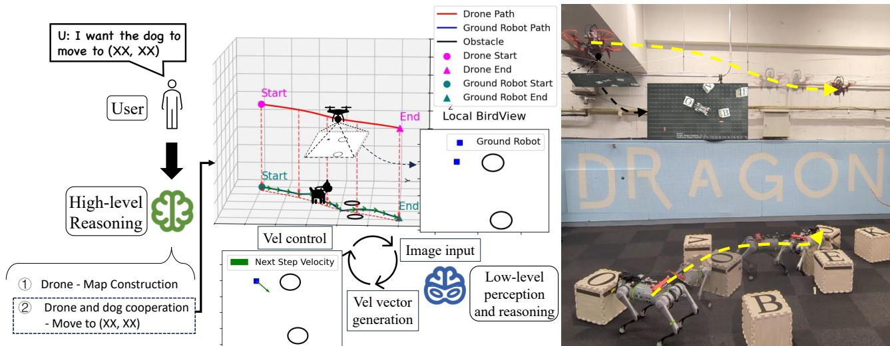  
Fig. 1. Overview of the proposed hierarchical language model framework integrated with an aerial-ground robotic system. In the sub-task “move to (XX, XX)”, the aerial robot follows a globally optimized path while continuously capturing bird-view images. These images are processed into semantic observations that guide the ground robot’s real-time local navigation by implicitly following the aerial robot’s position.

2) An LLM-guided reasoning framework that performs two critical functions: hierarchical task decomposition and global semantic map construction. The LLM decomposes high-level user commands into executable sub-tasks and constructs a comprehensive global semantic map by integrating spatial-semantic information collected from multiple viewpoints, which serves as the basis for aerial path planning.

3) A VLM-driven perception strategy enhanced by GridMask-based fine-tuning is firstly proposed, enabling accurate 2D objects localization and semantic labeling from bird-view images without depth sensing. The VLM extracts task-relevant semantic representations in real time, providing essential input for both global map construction and robots’ motion planning.

4) Comprehensive evaluation of zero-shot transferability and generalizability through extensive simulation experiments. These experiments demonstrate the system’s capability to generalize semantic reasoning, navigation, and manipulation skills to novel object categories, ambiguous semantic configurations, and spatially complex environments without additional training or parameter adjustments.

5) Extensive real-world experiments validate the effectiveness and robustness of our hierarchical MA-LLM framework in dynamic, long-horizon tasks. Using a heterogeneous aerial-ground robotic system, we demonstrate robust semantic navigation, precise manipulation, and coordinated behavior through letterblock assembly tasks, highlighting the system’s adaptability and decision-making capabilities in complex real-world scenarios.

## II. RELATED WORKS

## A. Heterogeneous Multi-Robot Systems

HMRS leverages diverse agent capabilities to address complex tasks. One of the earliest works in this area is Parker’s ALLIANCE architecture [9], which introduced fault-tolerant behavior-based coordination. Follow-up studies examined distributed task allocation and coordination [10], [11], [12]. Recent methods also integrate deep Multi-Agent Reinforcement Learning (MARL) to improve scalability and adaptability in decentralized settings [13]. Beyond these approaches, mapping frameworks in HMRS (shared-SLAM [14], [15], also MARL [16], [17]) have enabled teams of robots to maintain consistent global spatial representations. However, such systems mainly facilitate spatial alignment and navigation, while high-level semantic reasoning and flexible multi-stage task planning typically require additional manual programming [18], [19].

In contrast, our hierarchical MA-LLM framework directly bridges high-level task decomposition, semantic-aware navigation, and low-level manipulation. By leveraging LLM and VLM for reasoning and perception, our system interprets complex instructions, dynamically allocates tasks, and enables modular semantic navigation and manipulation among heterogeneous agents. This approach offers greater flexibility for multi-robot cooperation, efficiently addressing challenges that are cumbersome or impractical for previous methods, particularly in scenarios requiring complex reasoning and adaptive coordination.

## B. Task Planning with Large Language Models

LLMs have enabled robots to decompose natural language into action plans, as demonstrated in SayCan [20], Prog-Prompt [21], and Tidybot [22]. These approaches effectively translate high-level user instructions into executable skills within constrained settings. Additionally, [23], [24] further demonstrated that the generalizability of long-horizon task execution can be improved through human-robot collaboration. More recently, LLM-based frameworks such as CO-HERENT [25] have demonstrated the capability of leveraging LLMs for high-level task allocation and collaboration in heterogeneous multi-robot systems.

Building on these advances, our method integrates LLMs not only for hierarchical task decomposition but also for global semantic map construction by aggregating aerial observations. This extension enables long-horizon reasoning and multi-agent coordination in dynamic environments.

## C. Vision-Language Models for Robotic Perception

General-purpose VLMs, such as CLIP [26] and Vision Transformers [27], effectively bridge visual inputs and semantic understanding. However, these models typically lack precise spatial reasoning capabilities needed for robotic applications. On the other hand, specialized models like RT-series [28], [29] integrate action grounding directly into Vision-Language-Action (VLA), enabling end-to-end robot control, yet they still face challenges in accurate localization.

Our approach addresses these limitations by employing GridMask-based fine-tuning, enhancing the VLM’s 2D recognition and semantic labeling performance. This method supports both global semantic mapping and local navigation and manipulation tasks in aerial-ground robotic systems.

## III. METHODS

To enable reliable task execution in our aerial-ground robotic system, we adopt a hierarchical MA-LLM framework. As illustrated in Figure 2, the system is organized into three functional layers: a reasoning layer for task decomposition and allocation, and global map construction, a perceptual layer that extracts semantic understanding from aerial imagery, and an execution layer that performs robot actions through motion functions grounded in the reasoning and perception outputs.

The framework consists of the following components:

• LLM-based reasoning layer: Interprets natural language commands, decomposes them into structured sub-tasks, and selects appropriate motion functions for each robot. It also constructs and updates a global semantic map by integrating spatial-contextual information gathered during execution.

• VLM-based perceptual layer: Analyzes GridMaskenhanced aerial images to extract object-level semantics, including positions, orientations, and categories. These semantic cues provide environmental context for both initial mapping and real-time navigation support.

• Execution layer: Executes motion functions selected by the reasoning layer, each corresponding to a decomposed sub-task. These functions dynamically interact with the perceptual layer to obtain task-specific semantic information. For example, in global map construction, this layer gathers local semantic maps for global map integration by the reasoning layer; during local navigation and manipulation, local semantic information is extracted in real-time to guide ground motions. This layer acts as the bridge between high-level plans and grounded actions, coordinating aerial-ground behaviors across perception and reasoning.

## A. LLM-based Reasoning Layer Design

To enhance the reasoning capability of the LLM-based layer, we design task-specific prompts tailored to its functional responsibilities within the aerial-ground robotic system. The summarized prompts are as follows:

1) Task decomposition and allocation: To enable reasoning across heterogeneous agents, we adopt a role-specific prompt design. The LLM is instructed to act as a task decomposer and allocator, mapping high-level goals to robotspecific sub-tasks based on their capabilities.

```markdown
# Duty clarify
You are a task decomposer and allocator for a heterogeneous multi-robot system. Decompose complex tasks into sub-tasks for each robot according to their abilities.
# Robots' abilities
- Drone:
1. Construct the map. (Must be the first step before other sub-tasks)
- Robot Dog:
1. Attach/Detach to an object.
- Drone and Robot Dog Cooperation:
1. Move to a specified location.
2. Carry an object to a specified location.
```

2) Motion functions mapping: To ensure the LLM generates executable action plans, we provide the available motion functions for each robot via the prompt. This prevents invalid actions and constrains the reasoning process to grounded, system-supported functions.

```python
# Duty clarify
You are responsible for choosing the motion function to finish the task.
# Robots' motion functions
- Drone:
    1. quad_construct_map()
- Robot Dog:
    1. gol_attach_start("name_of_target_object")
    2. gol_detach_start("name_of_target_object")
- Drone and Robot Dog Cooperation:
    Thread 1: drone.quad_planning_start("task")
    Thread 2: dog.gol_following_start("task")
```

3) Global semantic map integration: These chain-ofthought prompts are used to improve the model’s ability to analyze local maps and construct a global map.

```txt
# Duty clarify
You need to construct a global map by logically integrating all provided local map data.
# Chain-of-thought
```

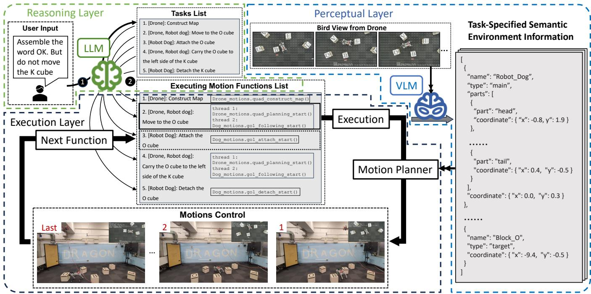  
Fig. 2. An overview of the workflow for a long-horizon task using the hierarchical MA-LLM framework. The task starts with the instruction: “Assemble the word OK, but do not move K.” 1) The LLM decomposes the command and maps sub-tasks to motion functions for the aerial and ground robots. 2) The aerial robot visits multiple viewpoints to collect local maps, which the LLM integrates into a global semantic map. 3) Once the map is ready, both robots coordinate to reach the “O” cube. 4) The aerial robot follows a task-specific global path, while the VLM processes GridMask-enhanced bird-view images. 5) The ground robot uses this semantic input from the VLM to complete its assigned sub-task via local planning.

```txt
- Cross-map Validation:
    1. Always cross-check objects across multiple local maps; do not rely on a single observation.
- Error Identification:
    1. Detect and exclude erroneous entries.
    2. If an object is only present in a single local map and absent from others, where logically it should be visible, remove it.
- Conflict Resolution:
    1. If objects appear unrealistically close, identify the mislabeled object and correct or remove it.
    2. Resolve conflicting labels by majority voting across maps or flags.
```

This layer serves as the top-level reasoning layer, translating user commands into modular functions for downstream execution. Notably, although the prompts and APIs described above are tailored for our aerial-ground robotic platform, the proposed LLM-based reasoning framework is inherently modular and extensible. The division of labor (task decomposition, ability declaration, and function mapping) is agent-agnostic and can be adapted to a wide range of heterogeneous robot teams. For new robot types or novel tasks, only the corresponding capability and action definitions need to be supplied in the prompt, while the core reasoning and allocation logic remain unchanged. This design facilitates transferability across robot platforms and supports rapid extension to unseen tasks, provided that the required actions are defined in the prompt or API library, in line with recent advances in modular prompt engineering and prompt libraries for robotic task generalization [7], [24], [30].

## B. VLM-based Perceptual Layer Design

To enhance the perceptual capabilities of the VLM-based layer, we employ prompt engineering to improve visuallanguage alignment and structured output [31], and finetune the model using a 2D recognition-specific visual dataset annotated with GridMask for precise detection.

First, we design role-specific prompts to guide the VLM in outputting structured environmental information clearly and accurately:

```txt
# Duty Clarification
You are an environment descriptor and classifier. Your task is to identify all objects in the environment, provide their names and coordinates in a structured JSON format, and classify them according to the provided task requirements.
# Detailed Instructions
- The environment is overlaid with a dense coordinate grid, with the origin at the center. The x-axis extends horizontally from left to right, and the y-axis extends vertically from bottom to top. The coordinate (0, 0) represents the central reference point.
- Depending on the given task, classify each object by labeling it into one of four categories: main, target, landmark, or obstacle.
- Important Note:
1. For local navigation tasks, do not use global coordinates directly. Instead, if the task involves moving to a specified global coordinate (XX, XX), set this target as (0, 0) to indicate that the ground robot should follow relative movements guided by the aerial robot.
2. For map construction, you do not need to make the labeling classification.
```

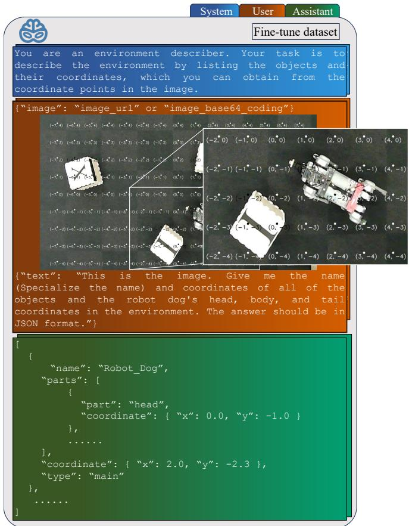  
Fig. 3. An illustration of the fine-tuning dataset, showing the system prompt, user instruction with GridMask-based image input, and the layer’s ideal output in structured JSON format.

While prompts guide the VLM’s response format and labeling logic, spatial localization remains a challenge. To address this, we introduce GridMask—a structured visual cue that overlays a dense coordinate grid on bird-view images captured by the aerial robot. Each grid cell measures $s \times s$ pixels (typically s = 80), offering a balance between spatial resolution and semantic clarity.

Formally, for an input image of resolution $w \times h ,$ we define the grid in a Cartesian coordinate system centered at the image midpoint, with the x-axis pointing rightward and the y-axis pointing upward. Each grid cell measures s×s pixels. The pixel coordinates of each grid vertex $( x _ { i } , y _ { j } )$ are given by:

$$
x _ {i} = \frac {w}{2} + i \cdot s, \qquad y _ {j} = \frac {h}{2} - j \cdot s,\tag{1}
$$

where i and $j$ are integer indices such that $0 \leq x _ { i } < w$ and $0 \leq y _ { j } < h .$

As shown in Figure 3, this principled arrangement enables the VLM to associate visual features with absolute 2D coordinates in a data-driven manner, while ensuring that the spatial cues are resolution-agnostic and readily adaptable to diverse camera settings.

Based on this structured GridMask, we fine-tune the VLM on a dataset pairing textual descriptions with corresponding object coordinates and orientations. After fine-tuning, the

VLM provides robust zero-shot identification of objects spatial positions and roles, classified as follows:

• main: The primary agent performing the task, typically the ground robot. Objects carried by the robot are also labeled main.

• target & landmark: target denotes the direct goal position; landmark serves as a spatial reference, further classified into four directional indicators (front, back, left, and right).

• obstacle: Objects obstructing motion paths. Landmarks may simultaneously serve as obstacles during task execution.

A detailed structure of the fine-tuning dataset and annotation process is also depicted in Figure 3.

Serving as the perceptual layer, it provides structured semantic observations that support and ground high-level plans.

## C. Execution Layer Design - Motion Functions Pre-Programming

Acting as the executing layer, it bridges the reasoning and perceptual layers, ensuring the execution of low-level motion functions. To realize this execution, we define a set of pre-programmed motion functions that enable task-level behaviors in the aerial-ground robotic system, as described below.

1) Aerial robot - Global semantic map construction: The quad construct map() function enables high-level spatial understanding by fusing perception, motion context, and language reasoning. It serves as the semantic foundation for downstream planning by generating a global map from aerial image observations. The process consists of the following steps and is illustrated in Figure 4:

• Local Map Generation: The aerial robot executes a predefined waypoint path to collect bird-view images. Each image is processed by the VLM to produce local semantic maps containing object classes and positions.

• Global Map Integration: The LLM receives a concatenated textual representation of all local semantic maps and infers a spatially consistent global map. This process involves cross-map validation, confidence reasoning, and label disambiguation. The global map will keep updating during task execution.

2) Aerial robot - Global path planning: As the leader in the aerial-ground robotic system, the aerial robot plans a globally optimal path that not only avoids obstacles but also dynamically guides the ground robot. The function quad planning start() enables autonomous navigation and obstacle avoidance by generating a collision-free path from a global semantic map. This path guides the ground robot by defining a dynamically updated spatial target (zero point), allowing it to follow the aerial robot through task-relevant areas with global awareness.

Given the semantic map from the LLM and object classification from the VLM (type: target, main, obstacle, landmark) with their coordinates (coordinate), the system constructs a task-specific cost function for global path optimization. This path ensures smoothness and collision avoidance through spline interpolation and constraint minimization techniques. Details of this optimization are described mathematically below.

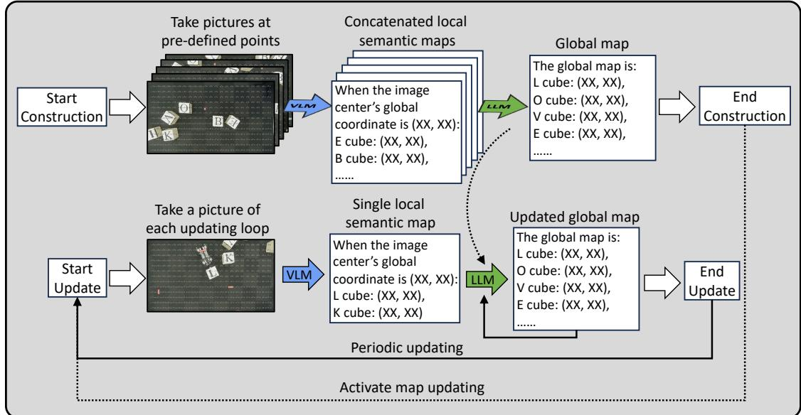  
Fig. 4. Workflow of the quad construct map() function. Local semantic maps derived from aerial images are integrated by the LLM to form a semantic map, which is subsequently updated at a fixed frequency during task execution.

Spline Path Generation: The initial path is defined by control points interpolated using B-splines to ensure smooth trajectories. Control points $\mathbf { C } = \{ \mathbf { c } _ { 0 } , \mathbf { c } _ { 1 } , \ldots , \mathbf { c } _ { n } \}$ are initially placed along a straight line connecting the main to the target or guided toward a specified landmark. This approach provides a straightforward and feasible initial path for subsequent optimization. The B-spline $\mathbf { S } ( u )$ is formulated as:

$$
\mathbf {S} (u) = \sum_ {i = 0} ^ {n} N _ {i, k} (u) \mathbf {c} _ {i}, \quad u \in [ 0, 1 ],\tag{2}
$$

where $N _ { i , k } ( u )$ are the B-spline basis functions of degree k. Cost Function Formulation: The optimization aims to minimize a cost function $J _ { \mathrm { g l o b a l } }$ that balances path length, smoothness, and obstacle avoidance. The cost function is defined and provided in Appendix.

Optimization Procedure: The optimized control points $\mathbf { C } ^ { * }$ are obtained by minimizing the cost function $J _ { \mathrm { g l o b a l } } { \mathrm { : } }$

$$
\mathbf {C} ^ {*} = \arg \min _ {\mathbf {C}} J _ {\text { global }} (\mathbf {C}).\tag{3}
$$

Resolution- and FOV-Adaptive GridMask Computation: To ensure generalization across diverse imaging configurations, the density and scaling of the GridMask are dynamically computed according to the drone’s camera resolution, field of view (FOV), and flight altitude. The number of grid divisions $N _ { \mathrm { g r i d } }$ is:

$$
N _ {\mathrm{grid}} = \frac {w}{r},\tag{4}
$$

where w is the image width in pixels, $r$ is the tunable grid interval.

The physical ground width $W _ { \mathrm { r e a l } }$ covered by the image is given by:

$$
W _ {\text { real }} = 2 h _ {\text { cam }} \cdot \tan \left(\frac {\text { FOV }}{2}\right),\tag{5}
$$

where the camera altitude is $h _ { \mathrm { { c a m } } }$ and horizontal FOV is FOV (in radians).

The real-world length corresponding to each grid cell, is therefore: UU

$$
s _ {\text { cell }} = \frac {W _ {\text { real }}}{N _ {\text { grid }}}.\tag{6}
$$

The optimized path, represented by the sequence of control points $\mathbf { C } ^ { * }$ (in image coordinates), is projected into real-world coordinates $\mathbf { C } _ { \mathrm { r e a l } } ^ { * }$ by applying the spatial scaling factor $s _ { \mathrm { c e l l } } \colon$

$$
\mathbf {C} _ {\text { real }} ^ {*} = s _ {\text { cell }} \cdot \mathbf {C} ^ {*}.\tag{7}
$$

This real-world waypoints $\mathbf { C } _ { \mathrm { r e a l } } ^ { * }$ then form the basis for semantic guidance, with the aerial robot’s ground-projected position serving as a continuously updated local navigation anchor for the ground robot.

3) Ground robot – Local semantic navigation and manipulation: Acting as the follower in the aerial-ground system, the ground robot performs iterative local navigation that is continuously coupled to the aerial robot’s projected path and semantic observations. This process is implemented through go1 following start(), which continuously and iteratively guides the robot using semantic inputs from the aerial robot.

At each iteration, the robot generates a set of candidate velocity directions θ uniformly distributed over 360<sup>◦</sup>, and evaluates them using a cost function that reflects goal alignment, obstacle avoidance, and environmental constraints.

The semantic input for this local planning is derived from the VLM, which processes bird-view images to generate a task-specified local semantic map centered at the aerial robot’s projection point. The map includes object-level annotations (type: target, main, obstacle, landmark) and part-level annotations for the ground robot (parts: head, body, tail) with their coordinates (coordinate). These annotations allow the system to estimate the robot’s current orientation and targetrelative position in the local frame.

Inspired by the classical Dynamic Window Approach (DWA) [32], we compute the cost for each candidate direction θ using a semantically-augmented weighted cost function $J _ { \mathrm { l o c a l } } ( \theta )$ . The cost function is defined and provided in Appendix.

At each iteration, the robot selects the optimal direction $\theta ^ { * }$ minimizing the combined cost:

$$
\theta^ {*} = \arg \min _ {\theta_ {i}} J _ {\mathrm{local}} (\theta_ {i}).\tag{8}
$$

After the robot adjusts its orientation to $\theta ^ { * }$ , it moves forward or backward based on the relative position of the target in its local coordinate frame, calculated using semantic annotations with the spatial scaling factor $s _ { \mathrm { c e l l } }$ in Equation (6). The iterative process terminates once both positional (distance to target below a predefined threshold) and orientation alignment (within a certain angular tolerance) criteria are met.

Through this mechanism, the ground robot adaptively navigates toward the target while remaining tightly coupled to the semantic path defined by the aerial robot.

4) Ground robot - Attach and detach: The ground robot is equipped with a servo-driven magnetic attachment device featuring a mechanical toggle switch. This device allows the robot to attach to or detach from objects located in front of it, enabling versatile interactions with its environment. By using function go1 attach start() and go1 detach start() to control the servo to actuate the switch, toggling between attachment and detachment.

5) Aerial robot and ground robot - Engineering Supplement: In addition to the core VLM-based recognition, reasoning, and path planning mechanisms, several practical engineering enhancements were implemented to ensure the robust operation of the aerial-ground robotic system.

• Aerial Robot - Adaptive Trajectory Execution: During trajectory execution, the aerial robot dynamically adjusts its movement based on real-time feedback from the VLM. Specifically, it predicts and monitors the ground robot’s position and actively waits as necessary, maintaining the ground robot’s position near the center of its camera view. This adaptive strategy ensures continuous visual coverage and stable guidance.

• Ground Robot - Rotation and Carrying Stability: 1) When the ground robot performs in-place rotations, the rotation direction (clockwise or counterclockwise) is dynamically determined based on semantic spatial information from the VLM. This adaptive decisionmaking minimizes the risk of collision with surrounding obstacles during orientation adjustments. 2) During object transportation tasks, the ground robot continuously utilizes VLM feedback to monitor whether the carried object remains properly attached. If the VLM detects that the object is no longer in the desired carrying state, the task execution initiates an immediate rollback procedure to reattempt the previous attaching sub-task and ensure successful task completion.

These practical engineering solutions complement the high-level semantic reasoning and planning layers, significantly enhancing the overall robustness and reliability of the robotic system during real-world operations.

## IV. EXPERIMENTS AND DISCUSSIONS

To comprehensively assess the proposed framework, we conduct experiments and discussions along four key axes:

• Comparison of our LLM-based reasoning and task decomposition module with representative classical methods.

• Evaluation of semantic perception improvements via GridMask-based VLM fine-tuning.

• Assessment of real-world task performance in an aerialground heterogeneous robotic system.

• Test zero-shot transferability and generalizability of the system to different environments.

## A. Discussion for the LLM-based task planning

Table I summarizes the key trade-offs among representative frameworks for multi-robot reasoning and task allocation. Traditional state machine-based approaches such as Finite State Machines (FSMs) and Behavior Trees (BT) [33] offer minimal engineering overhead and high interpretability, but their rigid structure severely limits generalization to new or complex tasks. Classical symbolic planners based on STRIPS [34] or PDDL [35] provide greater task flexibility and strong explainability, yet still require manual modeling of action schemas and domain knowledge, resulting in moderate engineering costs and limited scalability to highly dynamic or open-ended scenarios. Multi-agent reinforcement learning (MARL) methods [36], [13], while theoretically capable of learning intricate collaborative behaviors, impose substantial engineering and computational demands for environment modeling and training, and often yield policies that are difficult to interpret and transfer to novel tasks.

In contrast, the proposed LLM-based reasoning and allocation framework delivers a unique combination of high task generalization and low engineering overhead. By leveraging prompt engineering and modular API declarations, our approach supports flexible task decomposition, zeroshot adaptation to new task specifications, and seamless integration of heterogeneous robots, all while minimizing the need for manual rule definition or system reprogramming. This inherent generalizability is especially valuable for longhorizon or compositional tasks in unstructured environments, where the complexity and diversity of possible actions and goals would make traditional methods impractical or brittle.

TABLE I  
COMPARISON OF REASONING AND ALLOCATION FRAMEWORKS FOR MULTI-ROBOT TASK DECOMPOSITION.

<table><tr><td>Method</td><td>Engineering Overhead</td><td>Task Generalization</td><td>Explain-ability</td></tr><tr><td>FSM/BT</td><td>Moderate</td><td>Low</td><td>High</td></tr><tr><td>STRIPS/PDDL</td><td>Moderate</td><td>Moderate</td><td>High</td></tr><tr><td>MARL</td><td>High</td><td>Moderate</td><td>Low</td></tr><tr><td>LLM-based (Ours)</td><td>low</td><td>High</td><td>Moderate-High</td></tr></table>

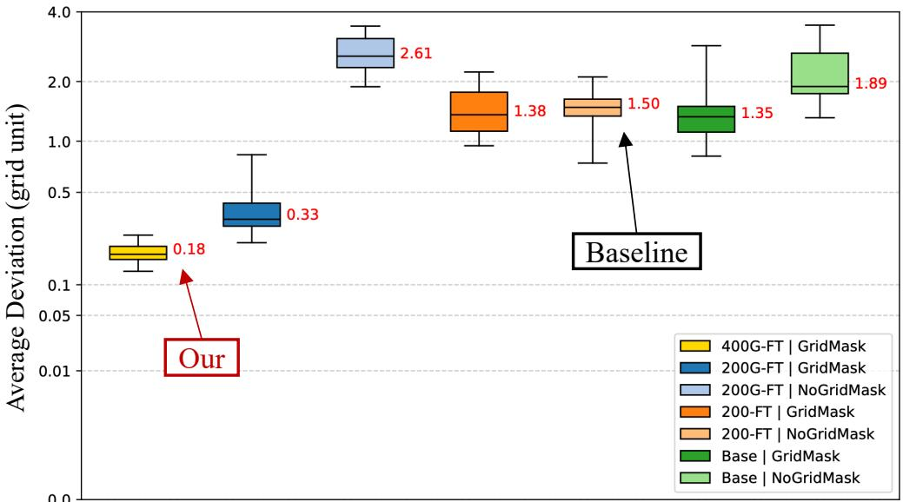  
Fig. 5. Performance comparison of different models based on objects’ average Euclidean deviation from ground-truth positions in the image (in grid units). The vertical axis employs a logarithmic scale to clearly visualize differences between smaller and larger deviations.

TABLE II  
EXPERIMENTAL GROUPS AND THEIR BASELINE CORRESPONDENCE

<table><tr><td>Model</td><td>Fine-tuning and Evaluation Setting</td><td>Type</td></tr><tr><td>400G-FT | GridMask</td><td>Fine-tune with 400 GridMask images, eval on GridMask images</td><td>GridMask-augmented (Ours)</td></tr><tr><td>200G-FT | GridMask</td><td>Fine-tune with 200 GridMask images, eval on GridMask images</td><td>Ablation</td></tr><tr><td>200G-FT | NoGridMask</td><td>Fine-tune with 200 GridMask images, eval on NoGridMask images</td><td>Ablation</td></tr><tr><td>200-FT | GridMask</td><td>Fine-tune with 200 NoGridMask images, eval on GridMask images</td><td>Ablation</td></tr><tr><td>200-FT | NoGridMask</td><td>Fine-tune with 200 NoGridMask images, eval on NoGridMask images</td><td>Standard coordinate (Baseline)</td></tr><tr><td>Base | GridMask / NoGridMask</td><td>No task-specific fine-tuning, direct eval</td><td>Reference</td></tr></table>

## B. Experiment for the GridMask-enhanced VLM-based perception

A key objective of this experiment is to benchmark our GridMask-based fine-tuning approach against mainstream baselines for VLM-driven spatial localization, specifically in the regime of low-rank and small-sample fine-tuning [37], where label efficiency and model adaptability are crucial for practical robotics applications.

We compare two principal categories of spatial grounding approaches:

• Standard VLM Fine-tuning without Explicit Spatial Cues (Coordinate Supervision Baseline): Fine-tuning the VLM to regress object positions from images and coordinate labels, as commonly done in openvocabulary localization [26], [38]. This setting is represented by our 200-FT models (fine-tuned and tested without GridMask overlays).

• GridMask-augmented Spatial Supervision (Our Method): Augmenting input images with a dense coordinate grid (GridMask) during both fine-tuning and deploying, so that the VLM is fine-tuned and deployed with explicit visual spatial cues. This is represented by the 400G-FT and 200G-FT models (trained with GridMask overlays, evaluated accordingly).

For clarity, Table II summarizes how our experimental groups correspond to these baseline categories.

Besides coordinate and GridMask-based approaches, other mainstream VLM grounding strategies include: 1) regionbased annotation (such as bounding boxes or segmentation masks) is widely used to provide explicit spatial cues and has achieved strong results in open-vocabulary detection and localization [39], [40]. However, in our tabletop scenario, mass point coordinate supervision is functionally equivalent to bounding box center regression, as also adopted in recent VLM-based robotics work [41]. 2) Alternatively, 2D positional encoding (PE) or coordinate-based input modulation [27], [42] can further enhance spatial sensitivity, but these techniques typically require architectural modifications and are not generally compatible with standard few-shot VLM fine-tuning. Therefore, our baseline comparisons focus on approaches that are both practical and directly comparable within our experimental setup.

The performance of the models was evaluated by measuring the Euclidean deviation between detected and ground truth object positions, with lower deviation values indicating better accuracy.

Figure 5 summarizes the performance across different model groups, highlighting key findings:

• Models consistently perform better on images with GridMask annotations, regardless of fine-tuning. This suggests that GridMask annotations inherently improve spatial perception.

• The best performance, with a median deviation of around 0.15 units, is achieved by models trained and tested with GridMask annotations (400G-FT | Grid-Mask). Additionally, increasing the number of training samples from 200G-FT to 400G-FT further enhances model accuracy.

• Models fine-tuned with GridMask data (200G-FT) exhibit weaker performance when tested on non-GridMask images compared to models fine-tuned without Grid-Mask data (200-FT), indicating reduced generalization capability due to dependency on GridMask annotations. To mitigate this reduced generalization, several strategies could be considered, such as deploying a hybrid inference strategy (switching between GridMaskspecific and standard models based on input conditions) or training with mixed datasets (combining GridMask and non-GridMask images). Nevertheless, it is important to emphasize that our GridMask-based fine-tuning approach is explicitly optimized for scenarios requiring accurate 2D spatial localization and precise semantic reasoning. For applications or tasks where high spatial precision is unnecessary, a standard model which even the base model without fine-tuning or GridMask annotations would be sufficient (which achieves an average deviation of 1.89 units).

Overall, these results validate that GridMask annotations enhance spatial localization at the cost of generalization. To further improve real-world performance, we additionally trained a larger model (1000G-FT | GridMask) as the VLM, which is used in the subsequent real-world experiments.

## C. Experiment for the real-world application

In this section, we evaluate the full integration and realworld performance of our hierarchical MA-LLM framework. The system is implemented on a ROS-based aerial-ground robotic platform comprising a Unitree Go1 quadruped robot and a custom-designed quadrotor equipped with SLAM capabilities [43]. Figure 6 presents the hardware setup and illustrates the interaction between the robots and the letter blocks. The reasoning layer is powered by a prompted Gemini-pro-2.0 LLM.

As established in previous sections, the LLM- and VLMbased modules have already been thoroughly compared against representative baselines in terms of planning, perception. However, it is important to note that even the latest Vision-Language Navigation (VLN) approaches [44], while effective for single-agent semantic navigation, lack the capacity for high-level reasoning, task decomposition, and multi-agent assembly operations required in our scenario.

Here, we assess the effectiveness of the integrated system in interpreting and executing complex user instructions in real-world assembly tasks. Specifically, we evaluate the system’s capabilities in task decomposition, zero-shot detection, semantic labeling, and robotic planning and control.

The system was tested on a range of assembly tasks:

• Type A: Simple tasks with direct commands, such as moving the “L” to the front side of the “O” cube.

• Type B: Simple reasoning tasks, such as assembling words like “OK” or “BE” without moving all blocks.

• Type C: Complex, long-horizon tasks that require strategic arrangement (e.g., assembling the word “LOVE”, with flexible sequence and optional fixed cube positions).

Representative examples of these tasks are shown in Figure 7.

In addition, we validate the zero-shot detection accuracy in real-world scenarios by comparing: a) the ground robot’s position error, calculated from aerial robot positions obtained via SLAM; b) The aerial robot’s yaw is fixed to zero and aligned with the world frame, allowing the ground robot’s yaw to be directly evaluated in that frame. As shown in Figure 8, the median of the position error is approximately 0.13 m, and the median of the orientation error is around 0.08 rad. Apart from model errors, the observed deviations are primarily attributed to the aerial robot’s pose instability, which introduces transformation errors. In addition, residual lens distortion and projection inaccuracies contribute to spatial estimation error. While these errors pose challenges for precise manipulation, they remain within an acceptable range, as demonstrated by the successful task completion rates in Table III.

Furthermore, the real-world applicability of the system was evaluated using six key metrics, as summarized in Table III:

• Task Decomposition Accuracy: Evaluates the correctness of translating user instructions into robot-specific sub-tasks. Generally, the system demonstrated strong decomposition capabilities. However, failures occurred once with commands involving negation or implicit spatial constraints, such as misinterpreting the spatial relation in the instruction assemble the word BE but do not move B, incorrectly placing the E cube on the left instead of the right.

• Task Completion Success: Measures the degree to which the final robot arrangement matches the intended user commands, achieving an overall success rate of 80%. Two failures were due to inaccuracies in the global semantic map that impacted aerial path planning, with one case resulting from initial decomposition errors. This indicates robust task execution overall, though sensitive to upstream perceptual inaccuracies.

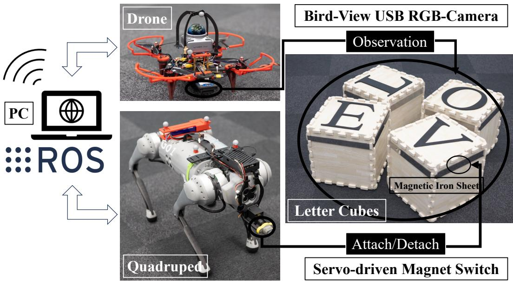  
Fig. 6. Hardware setup of the aerial-ground robotic system, illustrating how the drone and ground robot cooperate to pick, transport, and place target objects.

TABLE III  
QUANTITATIVE RESULTS: PERFORMANCE COMPARISONS WITHIN DIFFERENT TASK TYPES

<table><tr><td>Task Type</td><td>Metric</td><td>Trials per Task</td><td colspan="2">Accuracy &amp; Success Rate</td></tr><tr><td rowspan="2">Type A: Simple Task (Direct Command)</td><td>Task Decomposition</td><td>5</td><td>1.00</td><td></td></tr><tr><td>Task Completion Success</td><td>5</td><td>0.80</td><td></td></tr><tr><td rowspan="2">Type B: Simple Task (Reasoning Required)</td><td>Task Decomposition</td><td>5</td><td>0.80</td><td></td></tr><tr><td>Task Completion Success</td><td>5</td><td>0.80</td><td></td></tr><tr><td rowspan="2">Type C: Complex Task (Long-Horizon Reasoning)</td><td>Task Decomposition</td><td>5</td><td>1.00</td><td></td></tr><tr><td>Task Completion Success</td><td>5</td><td>0.80</td><td></td></tr><tr><td colspan="2">Common Metrics</td><td>Trials in Total</td><td>Accuracy &amp; Success Rate</td><td>Collisions Times</td></tr><tr><td colspan="2">Global Map Construction Accuracy</td><td>15</td><td>0.87</td><td>—</td></tr><tr><td colspan="2">Collisions Count</td><td>25</td><td>—</td><td>0.68</td></tr><tr><td colspan="2">Recognition Accuracy</td><td>378</td><td>0.74</td><td>—</td></tr><tr><td colspan="2">Semantic Labeling Accuracy</td><td>378</td><td>1.00</td><td>—</td></tr></table>

• Global Map Construction Accuracy: Assesses the accuracy (87%) in combining local semantic maps into a consistent global map. The system was effective in correcting overlapping labeling errors but struggled with errors in isolated local maps, highlighting its reliance on redundancy to maintain robustness.

• Collisions Count: Records the frequency of collisions (average of 0.68 per pick-transport-place operation). Note that this count also includes minor collisions or slight contacts. Quantitative error analysis (Figure 8) indicates that these collisions primarily arise from measurable deviations in estimated object positions and orientations, as well as inherent limitations in motion control precision. Particularly in cluttered scenarios, minor collisions are occasionally inevitable since the motion planner seeks a globally optimized path that balances collision avoidance with overall task efficiency. Nevertheless, the relatively low collision rate confirms the system’s robustness in semantic navigation and manipulation tasks.

• Recognition Accuracy: Quantifies the system’s capability to accurately identify object identities visually, achieving 74% accuracy. Recognition errors predominantly arose from visual ambiguities, particularly rotated cubes, leading to confusion between similar characters (e.g., confusing “L” and “T”).

• Semantic Labeling Accuracy: Evaluates the assignment accuracy of semantic labels (main, target, landmark, obstacle) after correct object recognition. The system achieved perfect labeling accuracy in all 378 trials, confirming reliable task-oriented labeling capability.

Overall, these experimental results demonstrate that our hierarchical MA-LLM framework effectively integrates semantic perception and reasoning, presenting robust real-

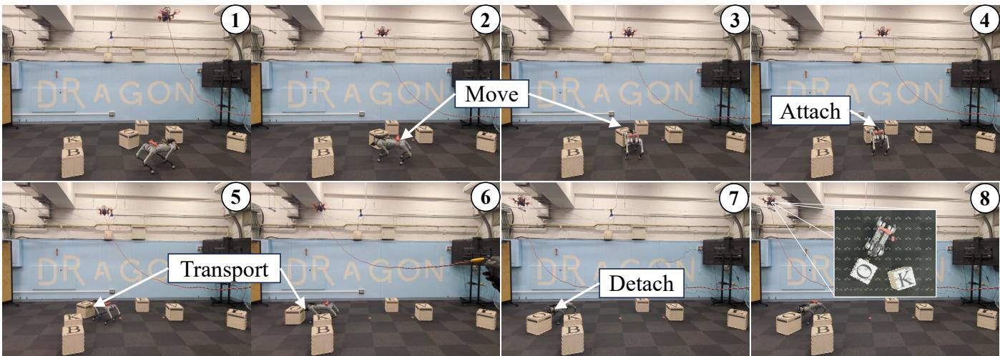  
(a) Type A & B: Simple Tasks

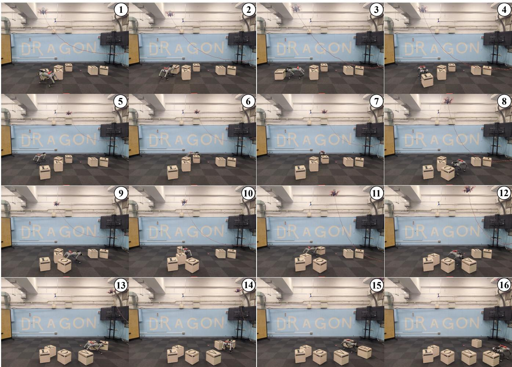  
(b) Type C: Complex Tasks

Fig. 7. Real-world experiments showing (a) execution of simple tasks (Type A & B) such as assembling “OK”, and (b) complex task (Type C) involving assembly of “LOVE”.

world performance despite isolated challenges in perception accuracy and spatial reasoning.

D. Experiment for Zero-shot Transferability and Generalizability

To evaluate the zero-shot transferability and generalizability of our system, we deploy it without any retraining, parameter tuning, or code modification, and validate it across three distinct Gazebo-based simulated environments of semantic and perceptual diversity:

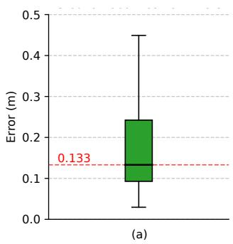

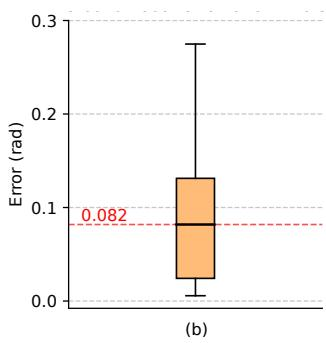  
Fig. 8. (a) Position error distribution of the ground robot. (b) Orientation error distribution of the ground robot.

• Standard Letter Block Scene: The workspace contains regularly arranged letter blocks, replicating the original pick-transport-place setting (Figure 9a). The system was tasked to “Move the I cube to the back side of the U cube,” successfully leveraging previously learned semantic and spatial knowledge.

• Color Block Scene: The environment is populated with colored blocks, presenting novel visual categories not encountered during initial fine-tuning (Figure 9b). The given instruction, “Move the blue cube to the left side of the red cube,” tested the system’s semantic generalization to new object categories and relational instructions. The system correctly identified and localized the colored blocks, demonstrating robust zero-shot perception and reasoning.

• Clustered Mixed Scene: This scenario combines letter blocks and colored blocks in a clustered, partially overlapping manner, significantly increasing spatial complexity and introducing semantic ambiguity (Figure 9c). The task “Move to the U cube” required precise semantic discrimination and spatial reasoning in a challenging visual context. The system successfully navigated the ambiguity, effectively identifying and approaching the correct target object while avoiding collisions with closely adjacent distractor objects.

For each environment, the full system stack—including perception, semantic reasoning, and execution—operates identically as in the original setup. This experiment demonstrates the framework’s ability to generalize to novel object categorizations, ambiguous semantic compositions, and spatially complex scenarios in a true zero-shot manner. The consistency of performance across these varied test conditions validates the robustness and generalizability of our proposed semantic navigation and manipulation framework.

## V. CONCLUSION

This paper firstly presents a hierarchical MA-LLM framework that integrates LLM-based task reasoning, VLMbased semantic perception, and motion-level execution for an aerial-ground heterogeneous robotic system. Through a structured three-layer design, the system interprets natural language commands, constructs semantic maps, and executes complex manipulation tasks via aerial-ground robots’ behaviors. Previous works typically face a trade-off between endto-end heterogeneous robot collaboration and advanced highlevel task planning. For example, [25] achieves multi-agent coordination among heterogeneous robots, but lacks a VLMdriven perception layer for end-to-end closed-loop control. In contrast, the RT-series [28], [29] provides impressive end-to-end learning with VLM integration, but struggles to generalize to complex, multi-stage planning and highlevel reasoning in heterogeneous systems. Our framework is the first to bridge this gap by integrating a fine-tuned VLM for structured perception with LLM-based reasoning, thereby enabling both end-to-end closed-loop multi-agent collaboration and advanced task decomposition.

Experimental results validate the effectiveness of GridMask-based fine-tuning in enhancing spatial perception accuracy and demonstrate the robustness of the hierarchical MA-LLM framework in complex manipulation scenarios. The system’s capability to perform adaptive local navigation and maintain aerial-ground alignment even in targetabsent conditions highlights its applicability in real-world environments. Furthermore, our experiments on zero-shot transferability and generalizability confirm the system’s strong ability to generalize semantic reasoning and manipulation tasks to previously unseen object categories and complex spatial configurations without additional retraining or parameter adjustments.

However, one notable limitation identified is that, in extremely cluttered environments, the optimization-based path planning approaches employed by both aerial and ground robots may struggle, potentially leading to increased collision rates or suboptimal paths.

Future work will address this by refining the optimization strategies and enhancing perception accuracy, such as incorporating segmentation masks to achieve more precise object recognition and obstacle avoidance. Additionally, future extensions will explore 3D motion planning to improve aerial robot navigation in unstructured environments and incorporate advanced multi-agent coordination strategies. Expanding the system’s adaptive reasoning capabilities will further broaden its applicability to practical tasks, including search-and-rescue operations, warehouse automation, and industrial robotics.

## APPENDIX

Mathematical Details of Global Path Optimization

$$
J _ {\text { global }} = Q _ {L} L (\mathbf {C}) + Q _ {K} K (\mathbf {C}) + Q _ {O _ {\text { global }}} O _ {\text { global }} (\mathbf {C}),\tag{9}
$$

where:

$L ( \mathbf { C } )$ : The cost of total path length, penalizes the overlength of the path

$$
L = \sum_ {i = 1} ^ {m} \| \mathbf {S} (u _ {i}) - \mathbf {S} (u _ {i - 1}) \|.\tag{10}
$$

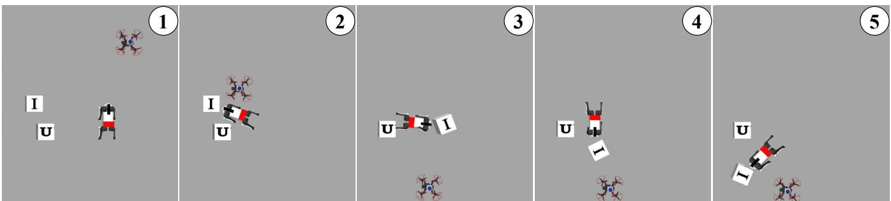  
(a) Standard Letter Block Scene

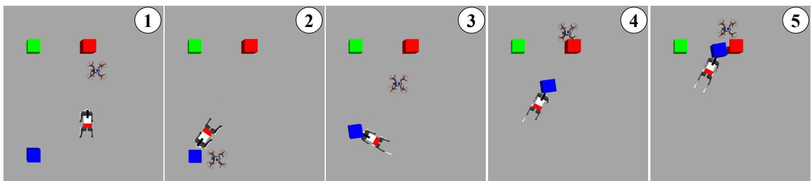  
(b) Color Block Scene

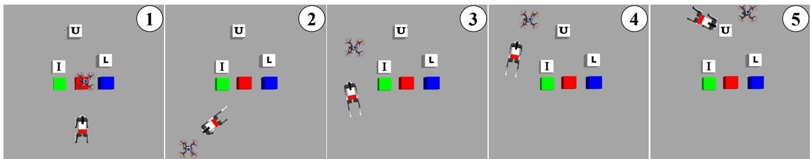  
(c) Clustered Mixed Scene  
Fig. 9. Simulation experiments demonstrating the zero-shot transferability and generalizability of the proposed system across various environments: (a) “Move the I cube to the back side of the U cube,” (b) “Move the blue cube to the left side of the red cube,” and (c) “Move to the U cube.” The system configuration and parameters remain unchanged throughout these tests.

$K ( \mathbf { C } )$ : The cost of path curvature, promoting the smoothness of the path.

$$
K = \sum_ {i = 2} ^ {m - 1} \| \mathbf {S} (u _ {i + 1}) - 2 \mathbf {S} (u _ {i}) + \mathbf {S} (u _ {i - 1}) \|.\tag{11}
$$

$O _ { \mathrm { g l o b a l } } ( \mathbf { C } ) ;$ : The cost of obstacle avoidance. For each $\mathsf { o b s t a c l e } \ \mathbf { o } _ { j }$ in N and each sampled point $\mathbf { S } ( u _ { i } )$ in m, the penalty is applied if the distance is less than $d _ { \mathrm { s a f e } }$

$$
O _ {\text { global }} (\mathbf {C}) = \sum_ {j = 1} ^ {N} \sum_ {i = 1} ^ {m} \max \left(0, d _ {\text { safe }} - \| \mathbf {S} (u _ {i}) - \mathbf {o} _ {j} \|\right) ^ {2}.\tag{12}
$$

$Q _ { L } , Q _ { K } , Q _ { O _ { \mathrm { g l o b a l } } }$ are weighting coefficients balancing the respective components.

Mathematical Details of Local Velocity Direction Optimization

$$
J _ {\text { local }} (\theta) = Q _ {A} A (\theta) + Q _ {\text { zero }} A _ {\text { zero }} (\theta) + Q _ {O _ {\text { local }}} O _ {\text { local }} (\theta) + Q _ {W} W (\theta),\tag{13}
$$

where each term is defined as follows:

$A \sim A ( \theta )$ : This term measures the deviation between the candidate direction θ and the target direction.

$$
A (\theta) = \frac {\beta}{\| \mathbf {T} - \mathbf {M} \|} \Delta \theta ,\tag{14}
$$

with $\begin{array} { r l } { \Delta \theta } & { { } = } \end{array}$ arccos $( d _ { \theta } \cdot d _ { \mathrm { g o a l } } )$ where $\begin{array} { r l } { d _ { \theta } } & { { } = } \end{array}$ $[ \cos ( \theta ) , \sin ( \theta ) ] ^ { T }$ is the unit vector in direction $\theta ,$ and $\begin{array} { r } { d _ { \mathrm { g o a l } } = \frac { \mathbf { T } } { \Vert \mathbf { T } - \mathbf { M } \Vert } } \end{array}$ is the normalized vector from the main M to the target T. The bias factor $\frac { \beta } { \| \mathbf { T } - \mathbf { M } \| }$ adjusts the sensitivity to angular deviation based on the distance to the target.

$A _ { \mathrm { z e r o } } \sim A _ { \mathrm { z e r o } } ( \theta )$ : This term encourages the result to tend to the zero point in the image.

$$
A _ {\mathrm{zero}} (\theta) = \Delta \theta_ {\mathrm{zero}},\tag{15}
$$

with $\Delta \theta _ { \mathrm { z e r o } } = \operatorname { a r c c o s } \left( d _ { \theta } \cdot d _ { \mathrm { z e r o } } \right)$ where $\begin{array} { r } { d _ { \mathrm { z e r o } } = \frac { { \bf Z } - { \bf M } } { | | { \bf Z } - { \bf M } | | } } \end{array}$ is the normalized vector from the main M to the zero point Z.

$O _ { \mathrm { l o c a l } } \sim O _ { \mathrm { l o c a l } } ( \theta )$ : For a given candidate direction θ, this term evaluates the proximity to obstacles along that path:

$$
O _ {\text { local }} (\theta) = \sum_ {O \in \mathcal {O}} \left\{ \begin{array}{l l} \frac {1}{d _ {\perp} (O , \theta) + \epsilon}, & \text { if } d _ {\perp} (O, \theta) <   d _ {\text { safe }}, \\ 0, & \text { otherwise }, \end{array} \right.\tag{16}
$$

where $d _ { \perp } ( O , \theta )$ denotes the perpendicular distance from an obstacle O to the path along $\theta ;$ only obstacles whose perpendicular projection falls within the finite path segment are considered. $d _ { \mathrm { s a f e } }$ is a safety distance threshold, and ϵ is a small constant to prevent division by zero.

$W \sim W ( \theta ) ;$ : This term enforces the boundary conditions to ensure that the projected path remains within a predefined spatial window (hypothesis the ground robot will move certain units with this direction):

$$
W (\theta) = \left\{ \begin{array}{l l} \infty , & \text { if   exceeding   boundaries }, \\ 0, & \text { otherwise }. \end{array} \right.\tag{17}
$$

$Q _ { A } , Q _ { \mathrm { z e r o } } , Q _ { l o c a l }$ , and $Q _ { W }$ are weighting coefficients balancing the respective components.

## REFERENCES

[1] Z. Yan, N. Jouandeau, and A. A. Cherif, “A survey and analysis of multi-robot coordination,” International Journal of Advanced Robotic Systems, vol. 10, no. 12, p. 399, 2013.

[2] M. Calvo-Fullana, M. Gerasimenko, D. Mox et al., “A networked multiagent system for mobile wireless infrastructure on demand,” IEEE Transactions on Robotics, vol. 40, pp. 4598–4614, 2024.

[3] M. Coppola, K. N. McGuire, C. De Wagter, and G. C. De Croon, “A survey on swarming with micro air vehicles: Fundamental challenges and constraints,” Frontiers in Robotics and AI, vol. 7, p. 18, 2020.

[4] Y. Rizk, M. Awad, and E. W. Tunstel, “Cooperative heterogeneous multi-robot systems: A survey,” ACM Computing Surveys (CSUR), vol. 52, no. 2, pp. 1–31, 2019.

[5] OpenAI, “Gpt-4 technical report,” arXiv, 2024.

[6] G. Team, “Gemini: A family of highly capable multimodal models,” arXiv, 2024.

[7] J. Liang, W. Huang, F. Xia et al., “Code as policies: Language model programs for embodied control,” arXiv, 2023.

[8] I. Kapelyukh, Y. Ren, I. Alzugaray, and E. Johns, “Dream2real: Zeroshot 3d object rearrangement with vision-language models,” in 2024 IEEE International Conference on Robotics and Automation (ICRA), 2024, pp. 4796–4803.

[9] L. Parker, “Alliance: an architecture for fault tolerant multirobot cooperation,” IEEE Transactions on Robotics and Automation, vol. 14, no. 2, pp. 220–240, 1998.

[10] L. Iocchi, D. Nardi, M. Piaggio, and A. Sgorbissa, “Distributed coordination in heterogeneous multi-robot systems,” Autonomous robots, vol. 15, pp. 155–168, 2003.

[11] B. P. Gerkey and M. J. Mataric, “A formal analysis and taxonomy of ´ task allocation in multi-robot systems,” The International journal of robotics research, vol. 23, no. 9, pp. 939–954, 2004.

[12] G. Notomista, S. Mayya, S. Hutchinson, and M. Egerstedt, “An optimal task allocation strategy for heterogeneous multi-robot systems,” in 2019 18th European control conference (ECC). IEEE, 2019, pp. 2071–2076.

[13] Y. Gao, J. Chen, X. Chen et al., “Asymmetric self-play-enabled intelligent heterogeneous multirobot catching system using deep multiagent reinforcement learning,” IEEE Transactions on Robotics, vol. 39, no. 4, pp. 2603–2622, 2023.

[14] A. Howard, M. J. Mataric, and G. S. Sukhatme, “Putting the’i’in’team’: An ego-centric approach to cooperative localization,” in IEEE International Conference on Robotics and Automation (ICRA), vol. 1, 2003, pp. 868–874.

[15] Y. Chang, K. Ebadi, C. E. Denniston et al., “Lamp 2.0: A robust multirobot slam system for operation in challenging large-scale underground environments,” IEEE Robotics and Automation Letters, vol. 7, no. 4, pp. 9175–9182, 2022.

[16] K. Zhang, Z. Yang, and T. Bas¸ar, “Multi-agent reinforcement learning: A selective overview of theories and algorithms,” Handbook of reinforcement learning and control, pp. 321–384, 2021.

[17] R. Lowe, Y. I. Wu, A. Tamar, J. Harb, O. Pieter Abbeel, and I. Mordatch, “Multi-agent actor-critic for mixed cooperative-competitive environments,” Advances in neural information processing systems, vol. 30, 2017.

[18] I. Kostavelis and A. Gasteratos, “Semantic mapping for mobile robotics tasks: A survey,” Robotics and Autonomous Systems, vol. 66, pp. 86–103, 2015.

[19] A. Achour, H. Al-Assaad, Y. Dupuis, and M. El Zaher, “Collaborative mobile robotics for semantic mapping: A survey,” Applied Sciences, vol. 12, no. 20, 2022.

[20] M. Ahn et al., “Do as i can, not as i say: Grounding language in robotic affordances,” arXiv, 2022.

[21] I. Singh, V. Blukis, A. Mousavian et al., “Progprompt: Generating situated robot task plans using large language models,” in 2023 IEEE International Conference on Robotics and Automation (ICRA), 2023, pp. 11 523–11 530.

[22] J. Wu, R. Antonova, A. Kan et al., “Tidybot: personalized robot assistance with large language models,” Autonomous Robots, vol. 47, no. 8, p. 1087–1102, Nov. 2023.

[23] H. Liu, Y. Zhu, K. Kato, I. Kondo, T. Aoyama, and Y. Hasegawa, “Llm-based human-robot collaboration framework for manipulation tasks,” arXiv, 2023.

[24] H. Liu, Y. Zhu, K. Kato et al., “Enhancing the llm-based robot manipulation through human-robot collaboration,” IEEE Robotics and Automation Letters, vol. 9, no. 8, pp. 6904–6911, 2024.

[25] K. Liu, Z. Tang, D. Wang, Z. Wang, X. Li, and B. Zhao, “Coherent: Collaboration of heterogeneous multi-robot system with large language models,” arXiv, 2025.

[26] A. Radford, J. W. Kim, C. Hallacy et al., “Learning transferable visual models from natural language supervision,” in International conference on machine learning. PMLR, 2021, pp. 8748–8763.

[27] A. Dosovitskiy, L. Beyer, A. Kolesnikov et al., “An image is worth 16x16 words: Transformers for image recognition at scale,” arXiv, 2020.

[28] A. Brohan, N. Brown, J. Carbajal et al., “Rt-2: Vision-language-action models transfer web knowledge to robotic control,” arXiv, 2023.

[29] A. O’Neill et al., “Open x-embodiment: Robotic learning datasets and rt-x models : Open x-embodiment collaboration0,” in 2024 IEEE International Conference on Robotics and Automation (ICRA), 2024, pp. 6892–6903.

[30] M. G. Arenas, T. Xiao, S. Singh et al., “How to prompt your robot: A promptbook for manipulation skills with code as policies,” in 2024 IEEE International Conference on Robotics and Automation (ICRA), 2024, pp. 4340–4348.

[31] J. Li, D. Li, C. Xiong, and S. Hoi, “Blip: Bootstrapping languageimage pre-training for unified vision-language understanding and generation,” arXiv, 2022.

[32] D. Fox, W. Burgard, and S. Thrun, “The dynamic window approach to collision avoidance,” IEEE Robotics & Automation Magazine, vol. 4, no. 1, pp. 23–33, 1997.

[33] M. Colledanchise and P. Ogren,<sup>¨</sup> Behavior trees in robotics and AI: An introduction. CRC Press, 2018.

[34] R. E. Fikes and N. J. Nilsson, “Strips: A new approach to the application of theorem proving to problem solving,” Artificial Intelligence, vol. 2, no. 3, pp. 189–208, 1971.

[35] C. Aeronautiques, A. Howe, C. Knoblock et al., “Pddl— the planning domain definition language,” Technical Report, Tech. Rep., 1998.

[36] M. L. Littman, “Markov games as a framework for multi-agent reinforcement learning,” in Machine learning proceedings 1994. Elsevier, 1994, pp. 157–163.

[37] E. J. Hu, Y. Shen, P. Wallis et al., “Lora: Low-rank adaptation of large language models,” arXiv, 2021.

[38] M. Minderer, A. Gritsenko, A. Stone et al., “Simple open-vocabulary object detection with vision transformers,” arXiv, 2022.

[39] Y. Zhong, J. Yang, P. Zhang et al., “Regionclip: Region-based language-image pretraining,” arXiv, 2021.

[40] A. Zareian, K. D. Rosa, D. H. Hu, and S.-F. Chang, “Open-vocabulary object detection using captions,” in Proceedings of the IEEE/CVF

conference on computer vision and pattern recognition, 2021, pp. 14 393–14 402.

[41] I. Kapelyukh, Y. Ren, I. Alzugaray, and E. Johns, “Dream2real: Zeroshot 3d object rearrangement with vision-language models,” in 2024 IEEE International Conference on Robotics and Automation (ICRA). IEEE, 2024, pp. 4796–4803.

[42] M. Oquab, T. Darcet, T. Moutakanni et al., “Dinov2: Learning robust visual features without supervision,” arXiv, 2024.

[43] Y. Li, M. Zhao, J. Sugihara, and T. Nishio, “Cooperative navigation system of agv and uav with autonomous and precise landing,” in 2024 IEEE International Conference on Mechatronics and Automation (ICMA). IEEE, 2024, pp. 1477–1483.

[44] P. Anderson, Q. Wu, D. Teney et al., “Vision-and-language navigation: Interpreting visually-grounded navigation instructions in real environments,” in Proceedings of the IEEE conference on computer vision and pattern recognition, 2018, pp. 3674–3683.