# Imitation Learning from Suboptimal Demonstrations via Meta-Learning An Action Ranker

Jiangdong Fan1 , Hongcai He1 , Paul Weng2 , Hui Xu1 , Jie Shao1,3

1University of Electronic Science and Technology of China, Chengdu, China

2Duke Kunshan University, Kunshan, China

3Sichuan Artificial Intelligence Research Institute, Yibin, China

{jiangdongfan,hehongcai}@std.uestc.edu.cn, paul.weng@duke.edu, {huixu.kim,shaojie}@uestc.edu.cn

## Abstract

A major bottleneck in imitation learning is the requirement of a large number of expert demonstrations, which can be expensive or inaccessible. Learning from supplementary demonstrations without strict quality requirements has emerged as a powerful paradigm to address this challenge. However, previous methods often fail to fully utilize their potential by discarding non-expert data. Our key insight is that even demonstrations that fall outside the expert distribution but outperform the learned policy can enhance policy performance. To utilize this potential, we propose a novel approach named imitation learning via meta-learning an action ranker (ILMAR). ILMAR implements weighted behavior cloning (weighted BC) on a limited set of expert demonstrations along with supplementary demonstrations. It utilizes the functional of the advantage function to selectively integrate knowledge from the supplementary demonstrations. To make more effective use of supplementary demonstrations, we introduce meta-goal in ILMAR to optimize the functional of the advantage function by explicitly minimizing the distance between the current policy and the expert policy. Comprehensive experiments using extensive tasks demonstrate that ILMAR significantly outperforms previous methods in handling suboptimal demonstrations. Code is available at https://github.com/ F-GOD6/ILMAR.

## 1 Introduction

Reinforcement learning has achieved notable success in various domains, such as robot control [Levine et al., 2016], autonomous driving [Kiran et al., 2022] and large-scale language modeling [Carta et al., 2023]. However, its application is significantly constrained by a carefully designed reward function [Hadfield-Menell et al., 2017] and the extensive interactions with the environment [Garc´ıa and Fernandez,´ 2015].

Imitation learning (IL) emerges as a promising paradigm to mitigate these constraints. It derives high-quality policies from expert demonstrations, thus circumventing the need for a predefined reward function, often in offline settings where interaction with the environment is unnecessary [Hussein et al., 2017]. However, to alleviate the compounding error issue—where errors accumulate over multiple predictions, leading to significant performance degradation—substantial quantities of expert demonstrations are required [Ross and Bagnell, 2010]. Unfortunately, acquiring additional expert demonstrations is often prohibitively expensive or impractical.

Compared with expert demonstrations, suboptimal demonstrations can often be collected in large quantities at a lower cost. However, a distributional shift exists between suboptimal and expert demonstrations [Kim et al., 2022]. Standard imitation learning algorithms [Pomerleau, 1991; Ho and Ermon, 2016], which process expert and non-expert demonstrations indiscriminately, may inadvertently learn the deficiencies inherent in suboptimal demonstrations, potentially degrading the quality of the learned policies. Current approaches to addressing this issue often require manual annotation of the demonstrations [Wu et al., 2019] or interaction with the environment [Zhang et al., 2021], both of which are expensive and time-consuming. Another category of methods, which has shown considerable promise, utilizes a smallscale expert dataset along with a large-scale supplementary dataset sampled from one or more suboptimal policies [Kim et al., 2022; Xu et al., 2022; Li et al., 2023]. This paper is focused on exploring this particular setup.

Previous studies often train a discriminator to distinguish between expert and non-expert demonstrations, performing weighted imitation learning on the supplementary dataset. However, during the training of the discriminator, labeled expert demonstrations are assigned a value of 1, while the demonstrations from the supplementary dataset are assigned a value of 0 and discarded. Given the limited scale of the labeled expert dataset, the supplementary dataset may contain a substantial amount of unlabeled expert demonstrations, leading to a positive-unlabeled classification problem [Elkan and Noto, 2008]. Furthermore, supplementary dataset often includes many high-quality demonstrations that, although not optimal, could improve policy performance when selectively leveraged, especially in cases of insufficient expert demonstrations [Xu et al., 2022]. Thus, these weighting imitation learning methods based on the expert distribution tend to discard high-quality non-expert demonstrations, failing to fully leverage suboptimal demonstrations. Our key insight is that learning from demonstrations outside the expert distribution, which still outperform the learned policy, can further enhance policy performance.

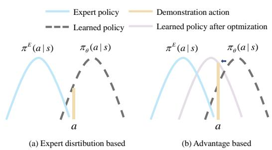  
Figure 1: Left: Weighted imitation learning based on the expert distribution. Right: Weighted imitation learning based on the advantage function. Imitation learning weighted by the expert distribution fails to update the policy when non-expert demonstrations exceed the learned policy, wasting valuable data. Conversely, weighting by the advantage function recognizes superior non-expert actions, optimizing the policy and enhancing performance.

Leveraging this insight, we introduce an offline imitation learning algorithm designed to effectively learn from suboptimal demonstrations. Built upon the task of weighted behavior cloning (BC) [Pomerleau, 1991], our approach involves training a discriminator that can assess the quality of demonstrations. By applying weights based on the advantage function relative to the learned policy, we ensure that high-quality demonstrations outside the expert distributions are retained, as depicted in Figure 1. To further enhance performance, we introduce meta-goal, a bi-level optimization meta-learning framework aimed at improving weighted imitation learning from suboptimal demonstrations. Meta-goal explicitly minimizes the distance between the learned and the expert policies, allowing the discriminator to optimally assign weights. This results in a policy that closely emulates the expert policy. Consequently, we have named our algorithm imitation learning from suboptimal demonstrations via meta-learning an action ranker (ILMAR).

Our main contributions are as follows:

• We propose ILMAR, a novel and high-performing algorithm based on weighted behavior cloning in suboptimal demonstration imitation learning.

• We introduce the meta-goal method, which significantly improves the performance of imitation learning from suboptimal demonstrations based on weighted behavior cloning.

• We conduct extensive experiments to empirically validate the effectiveness of ILMAR. The results demonstrate that ILMAR achieves performance competitive with or superior to state-of-the-art imitation learning algorithms in tasks involving both expert and additional demonstrations.

## 2 Related Work

Imitation Learning with Suboptimal Demonstrations In imitation learning, a large number of expert demonstrations are typically required to minimize the negative effects of compounding errors. However, obtaining expert demonstrations is often expensive or even impractical in most cases. Therefore, researchers have turned to using suboptimal demonstrations to enrich the dataset [Li et al., 2023; Kim et al., 2022]. Traditional imitation learning methods, such as behavioral cloning (BC) [Pomerleau, 1991] and generative adversarial imitation learning (GAIL) [Ho and Ermon, 2016], often treat all demonstrations uniformly, which can lead to suboptimal performance.

To address this issue, BCND [Sasaki and Yamashina, 2021] employs a two-step training process to weight the suboptimal demonstrations using a pre-trained policy. However, this method performs poorly when the proportion of expert demonstrations in the suboptimal dataset is low. CAIL [Zhang et al., 2021] ranks demonstrations by superiority and assigns different confidence levels to suboptimal demonstrations, but this approach requires extensive interaction with the environment. ILEED [Beliaev et al., 2022] leverages demonstrator identity information to estimate statedependent expertise, weighting different demonstrations accordingly. The most similar studies to ours are DWBC [Xu et al., 2022], DemoDICE [Kim et al., 2022] and ISW-BC [Li et al., 2023], which weight suboptimal demonstrations by leveraging a small number of expert demonstrations along with supplementary demonstrations. However, these methods discard a substantial portion of high-quality suboptimal demonstrations within the supplementary dataset by focusing solely on distinguishing expert demonstrations from nonexpert demonstrations. Our method is based on the advantage function, which assigns weights by comparing demonstrations with the learned policy. This strategy can effectively leverage these high-quality, non-expert data.

Imitation Learning with Meta-Learning Meta-imitation learning is an effective strategy to address the lack of expert demonstrations [Duan et al., 2017; Finn et al., 2017b]. It typically involves acquiring meta-knowledge from other tasks in a multi-task setting, enabling rapid adaptation to the target task [Finn et al., 2017a; Gao et al., 2022]. Although our approach utilizes a meta-learning framework, it is designed for a single-task setting and uses meta-goal to optimize the model. The study most similar to ours is meta-gradient reinforce ment learning [Xu et al., 2018], which uses meta-gradients to obtain optimal hyperparameters. In our approach, the use of meta-goal allows the model to assign appropriate weights, leading to the development of a satisfactory policy.

## 3 Problem Setting

## 3.1 Markov Decision Process

We formulate the problem of learning from suboptimal demonstrations as an episodic Markov decision process (MDP), defined by the tuple $M = \langle S , A , P , R , H , p _ { 0 } , \gamma \rangle$ where S is the state space, A is the action space, H is the episode length, $p _ { 0 }$ is the initial state distribution, P is the transition function such that $\begin{array} { r } { P _ { h } \big ( { s } _ { t + 1 } \big | { s } _ { t } , { a } _ { t } \big ) } \end{array}$ determines the transition probability of transferring to state $s _ { t + 1 }$ by executing action $a _ { t }$ in state $s _ { t } , R : S \times A \to$ R is the reward function, and $\gamma$ is the discount factor. Although we assume that the reward function is deterministic, as is typically the case with reinforcement learning, we do not utilize any reward information in our approach.

A policy π in an MDP defines a probability distribution over actions given a state. The state-action value function $Q ^ { \pi } ( s , a )$ and the state value function $V ^ { \pi } ( s )$ for a policy π are defined as $\begin{array} { r } { Q ^ { \pi } ( s , a ) = \operatorname { \mathbb { E } } \left[ \sum _ { t = 1 } ^ { H } \gamma ^ { t } R ( s _ { t } , a _ { t } ) | s _ { 1 } = s , a _ { 1 } = a \right] } \end{array}$ and $\begin{array} { r } { V ^ { \pi } ( s ) = \mathbb { E } \left[ \sum _ { t = 1 } ^ { H } \gamma ^ { t } R ( s _ { t } , a _ { t } ) | s _ { 1 } = s \right] } \end{array}$ . The advantage function $A ^ { \pi }$ is defined as ${ \cal A } ^ { \pi } ( s , a ) = { \cal Q } ^ { \bar { \pi } } ( s , a ) - V ^ { \pi } ( s )$ which measures the relative benefit of taking action a in state s compared with the average performance of the policy $\pi$ in that state.

## 3.2 IL with Supplementary Demonstrations

In imitation learning, it is typically assumed that there exists an optimal expert policy $\bar { \pi } ^ { E }$ , and the goal is to have the agent make decisions by imitating this expert policy. To mitigate the issue of compounding errors, substantial quantities of expert demonstrations are typically required. A promising solution is to supplement the dataset with suboptimal demonstrations.

We use the expert policy to collect an expert dataset $\mathcal { D } ^ { E } =$ $\{ \tau _ { 1 } , \cdots \tau _ { N _ { E } } \}$ , consisting of $N _ { E }$ trajectories. Each trajectory is a sequence of state-action pairs $\tau = \{ s _ { 1 } , a _ { 1 } . \cdot \cdot \ , s _ { H } , a _ { H } \}$ The supplementary dataset $\dot { \mathcal { D } } ^ { S } = \{ \tau _ { 1 } , \dot { \cdot } \cdot \cdot \tau _ { N _ { S } } \}$ is collected using one or more policies, where $N _ { S }$ is the number of supplementary trajectories. In general, there is no strict quality requirement for the policies used to collect the supplementary dataset. These trajectories may originate from a wide range of policies, spanning from near-expert level to those performing almost randomly. Therefore, it is crucial to develop algorithms that can effectively discern useful demonstrations from the supplementary dataset of varying quality to learn a good policy. We combine the expert dataset $\dot { \mathcal { D } } ^ { E }$ with the supplementary datasets $\mathcal { D } ^ { S }$ to form the full dataset D.

Weighted behavior cloning is a classical approach to tackle this challenge. It seeks to assign weights that reflect the expert level of the demonstrations and then perform imitation learning on the reweighted dataset. The optimization objective of weighted behavior cloning is as follows:

$$
\min _ {\pi} \underset {(s, a) \sim \mathcal {D}} {\mathbb {E}} [ - w (s, a) \log \pi (a | s) ],\tag{1}
$$

where $w ( s , a )$ is an arbitrary weight function, and s and a are the state and action in demonstrations. When $w ( s , a ) = 1$ for all $( s , a ) \in \mathcal { D }$ , weighted behavior cloning degenerates to vanilla BC. If $w ( s , a )$ is the weight assigned by a discriminator that distinguishes expert demonstrations, this objective aligns with the optimization goal of ISW-BC [Li et al., 2023]. DWBC [Xu et al., 2022] expands this by incorporating the policy into discriminator training. The primary goal of weighted BC is to filter out low-quality demonstrations and selectively learn from valuable suboptimal demonstrations in the supplementary dataset.

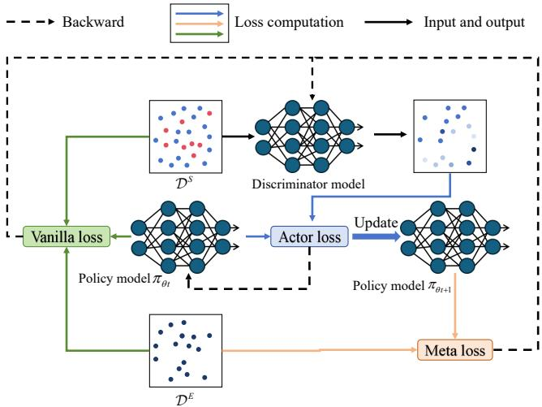  
Figure 2: Illustration of our proposed ILMAR framework. Blue dots represent demonstrations outperforming the learned policy, while red dots represent those underperforming it. The intensity of blue indicates the weight assigned by the discriminator. The discriminator reweights the supplementary dataset $\mathcal { D } ^ { S }$ , filtering out inferior demonstrations. The policy is then trained on the reweighted demonstrations via behavioral cloning. After updates, the gap between the updated policy and expert demonstrations in $\mathcal { D } ^ { E }$ is used to compute the meta loss. Additionally, the relative performance of expert demonstrations, suboptimal demonstrations, random policy, and the current policy determine the vanilla loss. The discriminator is updated based on the meta loss and the vanilla loss to improve weighting.

## 4 Method

In this section, we present a novel offline imitation learning algorithm called imitation learning from suboptimal demonstrations via meta-learning an action ranker. Our goal is to train a discriminator capable of evaluating the relative benefit of the learned policy and the demonstration policy, allowing us to fully leverage suboptimal demonstrations in the supplementary dataset to improve the learned policy. We propose a bi-level optimization framework to enhance the performance of weighted behavior cloning method, enabling the discriminator to automatically learn how to assign appropriate weights to the demonstrations in order to achieve highperformance policies. We also provide an explanation of the weights assigned by our discriminator, which offers an intuitive understanding of why our approach is effective.

## 4.1 Imitation Learning via Learning An Action Ranker

In our framework, we utilize a model parameterized by θ as the policy π and another model parameterized by ψ as the discriminator C, which evaluates the relative benefit of demonstrations compared with the learned policy.

It is evident that we can avoid learning low-quality demonstrations if we have access to an advantage function. The optimization objective of policy π can be written as:

$$
\min _ {\pi} \underset {(s, a) \sim \mathcal {D}} {\mathbb {E}} [ - A ^ {\pi} (s, a) \log \pi (a | s) ],\tag{2}
$$

which is widely employed in reinforcement learning to guide policy updates. However, directly learning an advantage function without reward information and without interacting with the environment is challenging. To implement an equivalent form of the advantage function, we introduce a weight function $w ( s , a , \pi ) = \mathbb { I } ( \bar { A } ^ { \pi } ( s , a ) > 0 )$ , where I is an indicator function that assigns a value of 1 when the condition $( A ^ { \pi } ( s , a ) > 0$ holds, and 0 otherwise.

This formulation ensures that behavior cloning is performed selectively, focusing only on demonstrations that outperform the learned policy. By doing so, the modification aligns the policy update process with the use of the advantage function, maintaining consistency in prioritizing superior demonstration actions. Importantly, this approach retains the core effect of leveraging the advantage function for guiding policy updates without altering its fundamental role in policy optimization.

In practice, we use $\mathbb { I } ( \mathbb { P } ( A ^ { \pi } ( s , a ) ) > { \frac { 1 } { 2 } } ) \cdot ( \mathbb { P } ( A ^ { \pi } ( s , a ) > 0 ) )$ to approximate $\mathbb { I } ( A ^ { \pi } ( s , a ) ~ > ~ 0 )$ The output of the discriminator corresponds to the probability that $A ^ { \pi } ( s , a ) \ >$ 0. We then define the weight function as $w ( s , a , \pi ) \ =$ $\begin{array} { r } { \mathbb { I } ( \mathbb { P } ( A ^ { \pi } ( s , a ) ) > \frac { 1 } { 2 } ) \cdot ( \mathbb { P } ( A ^ { \pi } ( \mathbf { \bar { s } } , a ) > 0 ) ) } \end{array}$ ), meaning that when the demonstration action is more likely to outperform the learned policy, we increase the probability of sampling that action.

We train the discriminator using the available information as follows: when the demonstrations come from expert demonstrations, the discriminator outputs $\mathbb { P } ( A ^ { \pi } ( s , a ) >$ $\bar { ( 0 ) } = 1$ , for all $( s , a ) \in D ^ { E }$ , indicating that the expert policy outperforms the learned policy. Furthermore, we introduce random actions into the action space, which can be viewed as actions chosen by a random policy $\pi ^ { r }$ . In this case, we have $\mathbb { P } ( A ^ { \pi ^ { r } } ( s , a ) > \bar { 0 } ) = 1$ , where $s \in D , a \in \mathcal { D } \mathrm { ~ o r ~ } \pi _ { \theta } ,$ , indicating that all the expert, suboptimal and the learned policies outperform the random policy. Since it is difficult to obtain actions from both the expert and suboptimal policies in the same state, we do not directly update the discriminator based on a direct comparison between expert and suboptimal policies. Thus, the training objective of the discriminator is given by:

$$
\min _ {C} \mathbb {E} _ {s, a _ {1}, a _ {2}} [ \log (C (s, a _ {1}, a _ {2}) ] + [ \log (1 - C (s, a _ {2}, a _ {1}) ],\tag{3}
$$

where $s \sim \mathcal { D }$ and $a _ { 1 } , a _ { 2 }$ are sampled from either $D , \pi _ { \theta } ( s )$ or $\pi ^ { r } ( s ) )$ . Here, $a _ { 1 }$ is not inferior to $a _ { 2 }$ . For simplicity, $\pi _ { \boldsymbol { \theta } } ( s )$ is written in a deterministic form. If the policy is stochastic, the action can be sampled from the policy distribution or taken as the expectation of the action distribution as input to the discriminator. In implementation, our discriminator determines the relative advantage between two actions. Therefore, we name our algorithm imitation learning via learning an action ranker.

The weight function $w ( s , a , \pi )$ is a functional of the advantage function. To clarify why weighting based on the advantage function should outperform weighting based on the expert distribution, let us consider a scenario where the supplementary dataset consists entirely of suboptimal demonstrations (high-quality but non-expert), and both the advantagebased and expert-distribution-based discriminators are welltrained. During the initial training phase, all demonstrations in the supplementary dataset outperform the learned policy. The advantage-based weighting approach would assign large weights to all these suboptimal demonstrations, effectively utilizing the entire supplementary dataset. In contrast, the expert-distribution-based weighting method assigns small weights to all demonstrations (since it lies outside the expert distribution), resulting in the policy learning primarily from a limited set of expert demonstrations and thus wasting a significant number of high-quality suboptimal demonstrations.

Algorithmic Update Procedure We now detail the update process at time step t. Let the policy $\pi _ { \theta _ { t } }$ be parameterized by $\theta _ { t }$ . We employ the weights $w _ { \psi _ { t } } ( s , a , \pi _ { \theta _ { t } } )$ = $\begin{array} { r } { \mathbb { I } ( C ( s , a , \pi _ { \theta _ { t } } ) ) > \frac { 1 } { 2 } ) \cdot C ( s , a , \pi _ { \theta _ { t } } ) } \end{array}$ obtained from the discriminator $C _ { \psi _ { t } }$ for weighted behavior cloning. Here, s and a represent the state and action in the demonstration. Using maximum likelihood estimation, we define the actor loss $L _ { a c t o r }$ as:

$$
L _ {a c t o r} = - \frac {1}{| \mathcal {D} |} \sum_ {(s, a) \in \mathcal {D}} w (s, a, \pi_ {\theta_ {t}}) \log \pi_ {\theta_ {t}} (a | s).\tag{4}
$$

Accordingly, we update $\theta _ { t }$ as follows:

$$
\theta_ {t + 1} = \theta_ {t} - \mu \nabla_ {\theta} L _ {a c t o r} (s, a; \theta_ {t}, \psi_ {t}),\tag{5}
$$

where $\mu$ is the learning rate of policy. We then update the discriminator $C$ by minimizing the objective in Eq. (3).

## 4.2 Meta-Goal for Weighted Behavior Cloning

To enhance weighted behavior cloning for learning from suboptimal datasets, we propose the meta-goal approach. In weighted behavior cloning, the discriminator should assign weights to the suboptimal dataset such that the resulting policy closely resembles the expert policy, effectively recovering the expert distribution. This goal can be instantiated using the Kullback-Leibler (KL) divergence:

$$
\min _ {\pi , C} D _ {\mathrm{KL}} \left(\pi^ {E} \| \pi\right),\tag{6}
$$

where ${ \cal D } _ { \mathrm { K L } } \left( \pi ^ { E } \| \pi \right) = \mathbb { E } _ { s \sim d ^ { \pi ^ { E } } } \left[ { \cal D } _ { \mathrm { K L } } \left( \pi ^ { E } ( \cdot \mid s ) \| \pi ( \cdot \mid s ) \right) \right]$ and $d ^ { \pi ^ { E } }$ is the stationary distribution of the expert policy. We cannot directly optimize the discriminator using this objective. Inspired by the meta-gradient methods [Xu et al., 2018], we adopt a bi-level optimization framework. Specifically, drawing on the ideas of expectation-maximization (EM), we proceed as follows: in the inner optimization loop, we perform weighted behavior cloning using the current discriminator to update the policy; in the outer optimization loop, we then adjust the discriminator parameters based on the resulting difference between the learned policy and the expert policy. Through this nested optimization process, the meta-goal method effectively guides the discriminator to assign weights that lead to a policy closely resembling the expert.

Algorithmic Update Procedure We now detail the update process at time step t. First, we optimize the policy using Eq. (4). Notably, during this update, we retain the gradient of $w _ { \psi _ { t } } ( s , a , \pi _ { \theta _ { t } } )$ with respect to $\psi _ { t }$ . This allows us to incorporate these gradients into the outer optimization loop that follows. We estimate the discrepancy between the learned policy and the expert policy using demonstrations from the expert dataset $D ^ { \dot { E } }$ . Specifically, we define the loss of metagoal (i.e., meta loss) as:

Algorithm 1 ILMAR
1: Input: Expert demonstration dataset  $D^{E}$  and the full dataset D, policy learning rate  $\mu$ , discriminator learning rate  $\varphi$ 
2: Initialize policy parameter  $\theta_{0}$  and discriminator parameter  $\psi_{0}$ 
3: for  $t = 0, 1, \cdots$  do
4: Sample  $N_{1}$  state-action pairs  $d^{E}$  from  $D^{E}$  and  $N_{2}$  state-action pairs d from D
5: Update  $\theta_{t}$  according to Eq. (5)
6: Update  $\psi_{t}$  with  $\nabla_{\psi}L_{C}$  (see Eqs. (3), (7), (10))
7: end for

$$
L _ {m e t a} = - \frac {1}{| \mathcal {D} ^ {E} |} \sum_ {(s, a) \in \mathcal {D} ^ {E}} \log \pi_ {\theta_ {t + 1}} (a | s).\tag{7}
$$

We then update $\psi _ { t }$ as follows:

$$
\psi_ {t + 1} = \psi_ {t} - \varphi \nabla_ {\psi} L _ {m e t a} (s, a; \psi_ {t}, \theta_ {t + 1}),\tag{8}
$$

where $\varphi$ is the learning rate for the discriminator parameters. By applying the chain rule, the gradient $\frac { \partial L _ { m e t a } } { \partial \psi }$ can be expressed as:

$$
\mu \frac {1}{| \mathcal {D} |} \frac {\partial L _ {m e t a}}{\partial \theta_ {t + 1}} \sum_ {(s, a) \in \mathcal {D}} \frac {\partial^ {2} w (s , a , \pi_ {\theta_ {t}}) \log \pi_ {\theta_ {t}} (a | s)}{\partial \psi \partial \theta_ {t}},\tag{9}
$$

where $\mu$ is the policy learning rate (as defined in Eq. (5)). We provide the detailed derivation of Eq. (9) in the supplementary material. In practice, we combine the meta-goal approach with the original weighted behavior cloning framework. We refer to the original discriminator update objective as the vanilla loss. Thus, the final discriminator loss function $L _ { C }$ is a composite of the meta loss $L _ { \mathrm { m e t a } }$ and the vanilla loss $L _ { \mathrm { v a n i l l a } } \mathrm { . }$

$$
L _ {C} = \alpha L _ {\text { meta }} + \beta L _ {\text { vanilla }},\tag{10}
$$

where α and $\beta$ are hyperparameters controlling the relative influence of the meta loss and the vanilla loss on the updates of the discriminator. This composite formulation enables the discriminator to leverage both the learned policy-expert discrepancy and the original objective, ultimately improving performance in handling suboptimal demonstrations.

By integrating meta-goal with imitation learning via learning an action ranker, we derive our complete method, imitation learning from suboptimal demonstrations via metalearning an action ranker (ILMAR). The complete algorithm is formally presented as Algorithm 1.

## 4.3 Theoretical Results

When updating the discriminator network with meta-goal, IL-MAR employs a bi-level optimization framework, where the policy network is updated in the inner loop and the discriminator network is updated in the outer loop. The convergence results for similar bi-level optimization problem are established in prior work [Zhang et al., 2021]. Based on these results, we analyze the convergence properties of the proposed discriminator and demonstrate why we recommend applying meta-goal to enhance the original weighted behavior cloning method, rather than using it as an independent approach.

We introduce the following assumption.

Assumption 1 (Lipschitz Smooth Function Approximators). The discriminator loss function $L _ { C }$ is Lipschitz-smooth with constant L. Specifically, for any parameters $\theta _ { 0 }$ and $\theta _ { 1 } ,$ the following condition holds:

$$
\| \nabla L _ {C} (\theta_ {1}) - \nabla L _ {C} (\theta_ {2}) \| \leq L \| \theta_ {1} - \theta_ {2} \|.
$$

Assumption 1 stipulates that $L _ { \mathrm { C } }$ possesses Lipschitz smoothness and its first and second-order gradients are bounded. This condition is satisfied when the trained policy is Lipschitz-continuous and differentiable and the discriminator output is clipped with a small constant $\epsilon > 0$ to the range $[ 0 + \epsilon , 1 - \epsilon ]$ . Such an assumption is considered mild and is commonly adopted in numerous studies [Virmaux and Scaman, 2018; Miyato et al., 2018; Liu et al., 2022; Xu et al., 2022]. Under this assumption, we have:

Theorem 1. The discriminator loss decreases monotonically (i.e., $L _ { C } ( \theta _ { t + 1 } ) ~ \le ~ L _ { C } ( \theta _ { t } ) )$ under the condition that there exists a constant $\ : \ : K \ : \ : > \ : \ : 0 \ :$ such that the following inequality holds: $\begin{array} { r l } { \nabla _ { \theta } \mathcal { L } _ { C } ( \theta _ { t + 1 } ) ^ { \top } \nabla _ { \theta } \mathcal { L } _ { a c t o r } ( \theta _ { t } , \mathbf { \bar { \psi } } _ { t } ) } & { { } \ge } \end{array}$ $K | | \nabla _ { \theta } \dot { \mathcal { L } } _ { a c t o r } ( \theta _ { t } , \psi _ { t } ) | | ^ { 2 }$ , and the learning rate satisfies $\mu \le$ $\frac { 2 \dot { K } } { L }$

Theorem 1 demonstrates that, under the given inequality, the policy updates ensure a monotonic decrease in the discriminator loss. However, this inequality assumes that the gradient directions of $L _ { C }$ and $L _ { a c t o r }$ are closely aligned [Zhang et $a l . .$ , 2021]. When the discriminator is updated solely using the meta loss, it may become trapped in local optima or fail to converge, as meta-goal, based on an EM-like approach, assigns weights tentatively and lacks the guidance of prior knowledge.

To address this issue, we incorporate prior knowledge by simultaneously updating the discriminator using a vanilla loss. The manually designed vanilla loss constrains the update direction of the discriminator, ensuring that the gradient directions of $L _ { C }$ and $L _ { a c t o r }$ remain closely aligned. This adjustment not only corrects but also stabilizes the updates of the discriminator, enhancing convergence. The experimental results strongly support this theoretical claim, as shown in the corresponding sections.

## 5 Experiments

In this section, we conduct experiments to evaluate and understand ILMAR. Specifically, we aim to address the following questions:

1. How does ILMAR perform compared with previous suboptimal demonstrations imitation learning algorithms?

2. How does the proportion of suboptimal demonstrations affect the performance of ILMAR?

3. Is meta-goal compatible with other algorithms, and does it enhance their performance?

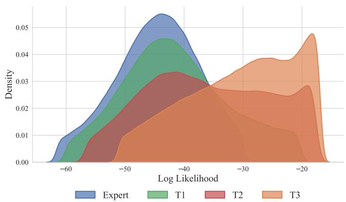  
Figure 3: The kernel density estimates (KDE) of the log-likelihood for the expert demonstrations and the suboptimal datasets on Ant-v2 of T1, T2, and T3, based on a variational autoencoder (VAE) model.

## 5.1 Comparative Evaluations

Datasets In this section, we evaluate the effectiveness of ILMAR by conducting experiments on the MuJoCo continuous control environments [Todorov et al., 2012] using the OpenAI Gymnasium framework [Towers et al., 2023]. We conduct experiments on four MuJoCo environments: Antv2, Hopper-v2, Humanoid-v2 and Walker2d-v2. We collect expert demonstrations and additional suboptimal demonstrations and conduct the evaluation as follows. For each Mu-JoCo environment, we follow prior dataset collection methods [Wu et al., 2019; Zhang et al., 2021]. Expert agents are trained using PPO [Schulman et al., 2017] for Antv2, Hopper-v2 and Walker2d-v2, and SAC [Haarnoja et al., 2018] for Humanoid-v2. We consider three tasks (T1, T2, T3) with a shared expert dataset $\mathcal { D } ^ { E }$ consisting of one expert trajectory. The supplementary datasets include expert and suboptimal trajectories at ratios of 1:0.25 (T1), 1:1 (T2), and 1:4 (T3). Each supplementary suboptimal dataset $\mathcal { D } ^ { S }$ contains 400 expert trajectories and 100, 400, or 1600 suboptimal trajectories generated by four intermediate policies sampled during training, with equal contributions from each policy. We visualized the distributional differences between the additional datasets and the expert demonstrations under three task settings on Ant-v2. The detailed methodology for the visualization is provided in the supplementary materials. As shown in Figure 3, the distributional differences between expert and supplementary datasets increase as the proportion of expert demonstrations decreases, challenging the algorithm with more suboptimal data.

Baselines We compare ILMAR with five strong baseline methods in our problem setting including BC, BCND [Sasaki and Yamashina, 2021], DemoDICE [Kim et al., 2022], DWBC [Xu et al., 2022], and ISW-BC [Li et al., 2023]. For these methods, we use the hyperparameter settings specified in their publications or in their codes. The training process is carried out for 1 million optimization steps. We evaluate the performance every 10,000 steps with 10 episodes. More experimental details are provided in the supplementary material.

<table><tr><td>Task setting</td><td>Environment</td><td>Ant</td><td>Hopper</td><td>Humanoid</td><td>Walker2d</td><td>Score</td></tr><tr><td></td><td>Random</td><td>-75</td><td>15</td><td>122</td><td>1</td><td>0</td></tr><tr><td></td><td>Expert</td><td>4761</td><td>3635</td><td>7025</td><td>4021</td><td>100</td></tr><tr><td rowspan="6">T1</td><td>BC</td><td> $4649_{±69}$ </td><td> $3650±3$ </td><td> $6959±72$ </td><td> $3882±92$ </td><td>98.42</td></tr><tr><td>BCND</td><td> $4694_{±27}$ </td><td> $3651±2$ </td><td> $6957±47$ </td><td> $3961_{±107}$ </td><td>99.15</td></tr><tr><td>DemoDICE</td><td> $4672±61$ </td><td> $3651±1$ </td><td> $6917±83$ </td><td> $3952±116$ </td><td>98.83</td></tr><tr><td>DWBC</td><td> $4718±39$ </td><td> $3650±1$ </td><td> $1337±662$ </td><td> $1818±467$ </td><td>65.58</td></tr><tr><td>ISW-BC</td><td> $4712±20$ </td><td> $3652±1$ </td><td> $6958±82$ </td><td> $3672±104$ </td><td>97.45</td></tr><tr><td>ILMAR (ours)</td><td> $4689±74$ </td><td> $3652±2$ </td><td> $6964±81$ </td><td> $3934±97$ </td><td>98.98</td></tr><tr><td rowspan="6">T2</td><td>BC</td><td> $4222±82$ </td><td> $3461±335$ </td><td> $6266±345$ </td><td> $3378±108$ </td><td>89.26</td></tr><tr><td>BCND</td><td> $4099±60$ </td><td> $3606±46$ </td><td> $6670±382$ </td><td> $3061±108$ </td><td>89.12</td></tr><tr><td>DemoDICE</td><td> $4192±92$ </td><td> $3527±183$ </td><td> $5719±791$ </td><td> $2880±462$ </td><td>84.49</td></tr><tr><td>DWBC</td><td> $4725±52$ </td><td> $3643±7$ </td><td> $2273±1096$ </td><td> $1574±156$ </td><td>67.45</td></tr><tr><td>ISW-BC</td><td> $4425±54$ </td><td> $3583±114$ </td><td> $6977±63$ </td><td> $3802±78$ </td><td>96.37</td></tr><tr><td>ILMAR (ours)</td><td> $4654±67$ </td><td> $3651±0$ </td><td> $6958±38$ </td><td> $3728±162$ </td><td>97.49</td></tr><tr><td rowspan="6">T3</td><td>BC</td><td> $3411±166$ </td><td> $2704±388$ </td><td> $5420±205$ </td><td> $2454±267$ </td><td>71.04</td></tr><tr><td>BCND</td><td> $3149±56$ </td><td> $2336±599$ </td><td> $5683±296$ </td><td> $2529±215$ </td><td>68.56</td></tr><tr><td>DemoDICE</td><td> $3462±117$ </td><td> $2736±189$ </td><td> $4808±890$ </td><td> $2564±259$ </td><td>69.99</td></tr><tr><td>DWBC</td><td> $4674±59$ </td><td> $3649±2$ </td><td> $3671±622$ </td><td> $2120±329$ </td><td>75.68</td></tr><tr><td>ISW-BC</td><td> $3770±57$ </td><td> $3236±422$ </td><td> $6534±586$ </td><td> $1926±522$ </td><td>77.32</td></tr><tr><td>ILMAR (ours)</td><td> $4419±67$ </td><td> $3551±106$ </td><td> $6909±46$ </td><td> $3259±226$ </td><td>93.16</td></tr></table>

Table 1: Performance of ILMAR and baseline algorithms on Ant-v2, Hopper-v2, Walker2d-v2 and Humanoid-v2 over the final 5 evaluations and 5 seeds. The best two results are highlighted. ILMAR significantly outperforms existing imitation learning methods from suboptimal datasets.

Results Table 1 and Figure 4 present the performance of different methods on the four environments under three task settings. In Table 1, the values are the mean reward over the final 5 evaluations and 5 seeds, with subscripts indicating standard deviations. Score in the table is the average normalized score across environments. The normalized score in one environment is computed as follows:

$$
\text { score } = 1 0 0 \times \frac {\text { mean   reward   -   random   reward }}{\text { expert   reward   -   random   reward }}.
$$

The results demonstrate that ILMAR achieves performance that is competitive with or superior to state-of-the-art IL algorithms in tasks involving expert and additional suboptimal demonstrations across three task-setting. Additionally, we can observe that when the proportion of suboptimal demonstrations in the additional dataset is low, the distributional dif ferences between the supplementary and expert datasets are minimal. Under such conditions, all algorithms, even BC, that do not differentiate between the supplementary and expert datasets, can achieve performance close to that of the expert. However, as the proportion of suboptimal demonstrations increases, it becomes essential to design sophisticated algorithms to address the challenges posed by suboptimal demonstrations. With an increasing proportion of suboptimal demonstrations, the advantages of ILMAR over other methods become increasingly pronounced.

## 5.2 Ablation Studies

In this section, we conduct ablation studies to analyze the effects of the different components of the loss function.

Table 2 presents the results for ILMAR when evaluated using only the naive loss or only the meta loss across the Mu-JoCo experiments. First, ILMAR outperforms the best baseline even without using meta-goal. This validates that weighting suboptimal demonstrations based on advantage function can enhance performance. When ILMAR is updated solely using meta-goal, its performance is slightly worse than that of BC. This phenomenon occurs because training the discriminator with only the meta-goal optimization leads to instability, making it difficult for the model to converge correctly. Further analyses and experiments have been conducted to understand this issue in greater depth, as detailed in the supplementary materials.

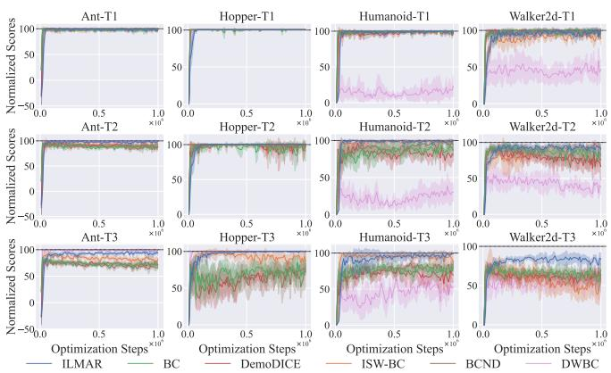  
Figure 4: Training curves of ILMAR and baseline algorithms on tasks T1, T2, T3. The y-axis represents the normalized scores of the algorithm during training. The solid line corresponds to the average performance under five random seeds, and the shaded area corresponds to the 95% confidence interval.

<table><tr><td>Environment</td><td>Ant</td><td>Hopper</td><td>Humanoid</td><td>Walker2d</td><td>Score</td></tr><tr><td>ILMAR (vanilla loss)</td><td> $4232_{\pm90}$ </td><td> $3045_{\pm451}$ </td><td> $6872_{\pm114}$ </td><td> $3236_{\pm268}$ </td><td>87.75</td></tr><tr><td>ILMAR (meta loss)</td><td> $3260_{\pm443}$ </td><td> $2662_{\pm1140}$ </td><td> $2443_{\pm1959}$ </td><td> $2357_{\pm998}$ </td><td>58.58</td></tr><tr><td>ILMAR</td><td> $4419_{\pm67}$ </td><td> $3551_{\pm106}$ </td><td> $6909_{\pm46}$ </td><td> $3259_{\pm226}$ </td><td>93.16</td></tr></table>

Table 2: Performance results of ILMAR using only naive loss and meta loss for updates on the MuJoCo environments. The best results are in bold.

When ILMAR optimizes with both the vanilla loss and the meta loss, its performance improves further. This confirms that meta-goal effectively enhances performance of weighted behavior cloning. As indicated in our theoretical analysis, the vanilla loss provides prior knowledge that constrains the parameter update direction, facilitating the convergence of the meta loss and enhancing the performance of model.

## 5.3 Meta-goal Used in Other Algorithms

In this section, we apply meta-goal to ISW-BC and DemoDICE to evaluate its compatibility with other algorithms. Specifically, we update the discriminator of ISW-BC and DemoDICE using both the meta loss and the discriminator loss of original algorithm, as shown in Eq. (10). Table 3 presents the results of employing meta-goal in ISW-BC and DemoDICE across the MuJoCo experiments. We observe that incorporating meta-goal leads to significant performance improvements for both DemoDICE and ISW-BC in nearly all environments. This further validates the effectiveness and robustness of meta-goal, demonstrating its compatibility with other algorithms.

<table><tr><td colspan="2">Environment</td><td>Ant</td><td>Hopper</td><td>Humanoid</td><td>Walker2d</td></tr><tr><td rowspan="2">DemoDICE</td><td rowspan="2">+Meta-goal</td><td> $3462_{\pm 117}$ </td><td> $2736_{\pm 189}$ </td><td> $4808_{\pm 890}$ </td><td> $2564_{\pm 259}$ </td></tr><tr><td> $3654_{\pm 71}$ </td><td> $2907_{\pm 140}$ </td><td> $5252_{\pm 448}$ </td><td> $2811_{\pm 145}$ </td></tr><tr><td rowspan="2">ISW-BC</td><td rowspan="2">+Meta-goal</td><td> $3770_{\pm 57}$ </td><td> $3236_{\pm 422}$ </td><td> $6534_{\pm 586}$ </td><td> $1926_{\pm 522}$ </td></tr><tr><td> $3974_{\pm 151}$ </td><td> $3294_{\pm 143}$ </td><td> $6907_{\pm 87}$ </td><td> $3186_{\pm 185}$ </td></tr></table>

Table 3: Performance of other algorithms using meta-goal on the MuJoCo environments. The best results are in bold.

## 5.4 Additional Analysis of Results

To further understand ILMAR, we explore the relationship between the weights learned by ILMAR and the actual reward values. The results indicate a clear monotonic positive correlation between the weights assigned by ILMAR and the true rewards. Specifically, we calculate the Spearman rank correlation coefficient, which measures the strength and direction of the monotonic relationship between two variables, between the weights and true rewards in the task setting T3 for Ant-v2 and Humanoid-v2. The formula is given by:

$$
\rho = 1 - \frac {6 \sum d _ {i} ^ {2}}{n (n ^ {2} - 1)}
$$

where:

$d _ { i } = \mathrm { r a n k } ( x _ { i } ) - \mathrm { r a n k } ( y _ { i } )$ is the difference between the ranks of corresponding values $x _ { i }$ and $y _ { i }$ from the two variables.

• n is the number of observations.

This coefficient provides a robust measure of the monotonic relationship, making it suitable for evaluating non-linear dependencies in the data. The Spearman rank correlation coefficients between the weights and true rewards for Ant-v2 and Humanoid-v2 are 0.7862 and 0.7220, respectively. These results strongly validate that the weights assigned by ILMAR effectively represent the superiority of demonstration actions, enabling the model to learn from suboptimal demonstrations. More results and visualizations of the weights assigned to suboptimal demonstrations are provided in the supplementary material.

## 6 Conclusion

We propose ILMAR, an imitation learning method designed for datasets with a limited number of expert demonstrations and supplementary suboptimal demonstrations. By utilizing a functional of the advantage function, ILMAR avoids directly discarding high-quality non-expert demonstrations in the supplementary suboptimal dataset, thereby improving the utilization of the supplementary demonstrations. To further enhance the updating of our discriminator, we introduce the meta-goal method, leading to performance improvements. Experimental results show that ILMAR achieves performance that is competitive with or superior to state-of-the-art IL algorithms. One potential direction for future exploration is to investigate the use of a functional of the advantage function weighting for processing suboptimal demonstrations with reward information. Another direction is to apply the meta-goal method to semi-supervised learning scenarios.

## References

[Beliaev et al., 2022] Mark Beliaev, Andy Shih, Stefano Ermon, Dorsa Sadigh, and Ramtin Pedarsani. Imitation learning by estimating expertise of demonstrators. In ICML, pages 1732–1748, 2022.

[Carta et al., 2023] Thomas Carta, Clement Romac, Thomas´ Wolf, Sylvain Lamprier, Olivier Sigaud, and Pierre-Yves Oudeyer. Grounding large language models in interactive environments with online reinforcement learning. In ICML, pages 3676–3713, 2023.

[Duan et al., 2017] Yan Duan, Marcin Andrychowicz, Bradly C. Stadie, Jonathan Ho, Jonas Schneider, Ilya Sutskever, Pieter Abbeel, and Wojciech Zaremba. Oneshot imitation learning. In NIPS, pages 1087–1098, 2017.

[Elkan and Noto, 2008] Charles Elkan and Keith Noto. Learning classifiers from only positive and unlabeled data. In KDD, pages 213–220, 2008.

[Finn et al., 2017a] Chelsea Finn, Pieter Abbeel, and Sergey Levine. Model-agnostic meta-learning for fast adaptation of deep networks. In ICML, pages 1126–1135, 2017.

[Finn et al., 2017b] Chelsea Finn, Tianhe Yu, Tianhao Zhang, Pieter Abbeel, and Sergey Levine. One-shot visual imitation learning via meta-learning. In CoRL, pages 357–368, 2017.

[Gao et al., 2022] Chongkai Gao, Yizhou Jiang, and Feng Chen. Transferring hierarchical structures with dual meta imitation learning. In CoRL, pages 762–773, 2022.

[Garc´ıa and Fernandez, 2015´ ] Javier Garc´ıa and Fernando Fernandez. A comprehensive survey on safe reinforcement´ learning. J. Mach. Learn. Res., 16:1437–1480, 2015.

[Gulrajani et al., 2017] Ishaan Gulrajani, Faruk Ahmed, Mart´ın Arjovsky, Vincent Dumoulin, and Aaron C. Courville. Improved training of wasserstein gans. In NIPS, pages 5767–5777, 2017.

[Haarnoja et al., 2018] Tuomas Haarnoja, Aurick Zhou, Kristian Hartikainen, George Tucker, Sehoon Ha, Jie Tan, Vikash Kumar, Henry Zhu, Abhishek Gupta, Pieter Abbeel, and Sergey Levine. Soft actor-critic algorithms and applications. CoRR, abs/1812.05905, 2018.

[Hadfield-Menell et al., 2017] Dylan Hadfield-Menell, Smitha Milli, Pieter Abbeel, Stuart J. Russell, and Anca D. Dragan. Inverse reward design. In NIPS, pages 6765–6774, 2017.

[Ho and Ermon, 2016] Jonathan Ho and Stefano Ermon. Generative adversarial imitation learning. In NIPS, pages 4565–4573, 2016.

[Hussein et al., 2017] Ahmed Hussein, Mohamed Medhat Gaber, Eyad Elyan, and Chrisina Jayne. Imitation learning: A survey of learning methods. ACM Comput. Surv., 50(2):21:1–21:35, 2017.

[Kim et al., 2022] Geon-Hyeong Kim, Seokin Seo, Jongmin Lee, Wonseok Jeon, HyeongJoo Hwang, Hongseok Yang, and Kee-Eung Kim. Demodice: Offline imitation learning

with supplementary imperfect demonstrations. In ICLR, 2022.

[Kingma and Welling, 2014] Diederik P. Kingma and Max Welling. Auto-encoding variational bayes. In ICLR, 2014.

[Kiran et al., 2022] B. Ravi Kiran, Ibrahim Sobh, Victor Talpaert, Patrick Mannion, Ahmad A. Al Sallab, Senthil Kumar Yogamani, and Patrick Perez. Deep reinforcement´ learning for autonomous driving: A survey. IEEE Trans. Intell. Transp. Syst., 23(6):4909–4926, 2022.

[Levine et al., 2016] Sergey Levine, Chelsea Finn, Trevor Darrell, and Pieter Abbeel. End-to-end training of deep visuomotor policies. J. Mach. Learn. Res., 17:39:1–39:40, 2016.

[Li et al., 2023] Ziniu Li, Tian Xu, Zeyu Qin, Yang Yu, and Zhi-Quan Luo. Imitation learning from imperfection: Theoretical justifications and algorithms. In NeurIPS, 2023.

[Liu et al., 2022] Hsueh-Ti Derek Liu, Francis Williams, Alec Jacobson, Sanja Fidler, and Or Litany. Learning smooth neural functions via lipschitz regularization. In SIGGRAPH (Conference Paper Track), pages 31:1–31:13, 2022.

[Miyato et al., 2018] Takeru Miyato, Toshiki Kataoka, Masanori Koyama, and Yuichi Yoshida. Spectral normalization for generative adversarial networks. In ICLR, 2018.

[Pomerleau, 1991] Dean Pomerleau. Efficient training of artificial neural networks for autonomous navigation. Neural Comput., 3(1):88–97, 1991.

[Ross and Bagnell, 2010] Stephane Ross and Drew Bagnell.´ Efficient reductions for imitation learning. In AISTATS, pages 661–668, 2010.

[Sasaki and Yamashina, 2021] Fumihiro Sasaki and Ryota Yamashina. Behavioral cloning from noisy demonstrations. In ICLR, 2021.

[Schulman et al., 2017] John Schulman, Filip Wolski, Prafulla Dhariwal, Alec Radford, and Oleg Klimov. Proximal policy optimization algorithms. CoRR, abs/1707.06347, 2017.

[Todorov et al., 2012] Emanuel Todorov, Tom Erez, and Yuval Tassa. Mujoco: A physics engine for model-based control. In IROS, pages 5026–5033, 2012.

[Towers et al., 2023] Mark Towers, Jordan K. Terry, Ariel Kwiatkowski, John U. Balis, Gianluca de Cola, Tristan Deleu, Manuel Goulao, Andreas Kallinteris, Arjun KG,˜ Markus Krimmel, Rodrigo Perez-Vicente, Andrea Pierro, Sander Schulhoff, Jun Jet Tai, Andrew Tan Jin Shen, and Omar G. Younis. Gymnasium. 2023.

[Virmaux and Scaman, 2018] Aladin Virmaux and Kevin Scaman. Lipschitz regularity of deep neural networks: analysis and efficient estimation. In NeurIPS, pages 3839– 3848, 2018.

[Wu et al., 2019] Yueh-Hua Wu, Nontawat Charoenphakdee, Han Bao, Voot Tangkaratt, and Masashi Sugiyama. Imitation learning from imperfect demonstration. In ICML, pages 6818–6827, 2019.

[Xu et al., 2018] Zhongwen Xu, Hado van Hasselt, and David Silver. Meta-gradient reinforcement learning. In NeurIPS, pages 2402–2413, 2018.

[Xu et al., 2022] Haoran Xu, Xianyuan Zhan, Honglei Yin, and Huiling Qin. Discriminator-weighted offline imitation learning from suboptimal demonstrations. In ICML, pages 24725–24742, 2022.

[Zhang et al., 2021] Songyuan Zhang, Zhangjie Cao, Dorsa Sadigh, and Yanan Sui. Confidence-aware imitation learning from demonstrations with varying optimality. In NeurIPS, pages 12340–12350, 2021.

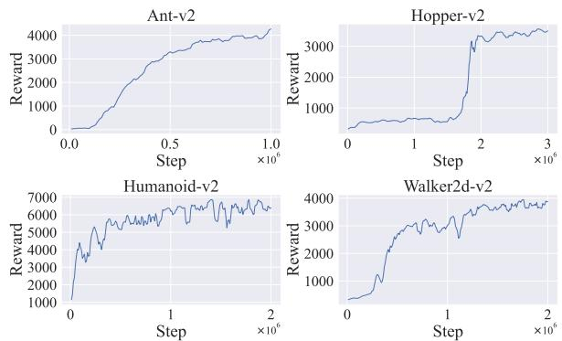

Figure 5: Training curves of expert agents on 4 locomotion control environments.

<table><tr><td>Environment</td><td>Ant</td><td>Hopper</td><td>Humanoid</td><td>Walker2d</td></tr><tr><td>Expert</td><td>4761</td><td>3635</td><td>7025</td><td>4021</td></tr><tr><td>Police 1</td><td>3762</td><td>3329</td><td>5741</td><td>3218</td></tr><tr><td>Police 2</td><td>2879</td><td>3301</td><td>5084</td><td>2897</td></tr><tr><td>Police 3</td><td>2161</td><td>2593</td><td>4334</td><td>1305</td></tr><tr><td>Police 4</td><td>796</td><td>637</td><td>2683</td><td>744</td></tr></table>

Table 4: The performance of policies used in our experimental results.

## A Experimental Details

## A.1 Implementation Detail

In this section, we provide detailed descriptions of our experimental setup to ensure the reproducibility of our results. We evaluate the performance of various imitation learning algorithms across four motion control tasks in the MuJoCo suite [Todorov et al., 2012]: Ant-v2, Humanoid-v2, Hopper-v2, and Walker2d-v2.

To train the expert policies, we use the proximal policy optimization (PPO) [Schulman et al., 2017] and soft actor-critic (SAC) [Haarnoja et al., 2018] algorithms. After comparing the results, we select the best-performing models as the expert policies: Ant-v2 is trained with PPO for one million steps, Humanoid-v2 with SAC for two million steps, Hopperv2 with PPO for three million steps, and Walker2d-v2 with PPO for two million steps. We select four intermediate policies with varying levels of optimality by evaluating the policies every 100,000 steps, using the best-performing policy as the expert policy. All algorithmic dependencies in our code are based on the implementation provided by CAIL [Zhang et al., 2021], available at https://github.com/Stanford-ILIAD/ Confidence-Aware-Imitation-Learning. The training curves of the expert agents are presented in Figure 5.

We select four suboptimal policies, each with performance rewards evaluated every 10,000 steps with 5 episodes, approximating 80%, 60%, 40%, and 20% of the optimal policy, respectively. Table 4 illustrates the average performance of the collected trajectories.

All three task settings share the same expert dataset $D ^ { E }$ which consists of only one expert trajectory. The supplementary dataset for each task is composed of a mixture of expert and suboptimal trajectories at different ratios: 1:0.25 (T1), 1:1 (T2), and 1:4 (T3). Specifically, the supplementary suboptimal dataset $D ^ { S }$ includes 400 expert trajectories combined with 100, 400, and 1600 suboptimal trajectories generated by the four intermediate policies, where the number of trajectories contributed by each suboptimal policy is equal.

<table><tr><td>Hyperparameters</td><td>BC</td><td>ISW-BC</td><td>DemoDICE</td><td>ILMAR</td><td>BCND</td><td>DWBC</td></tr><tr><td>Learning rate (actor)</td><td> $3 \times 10^{-4}$ </td><td> $3 \times 10^{-4}$ </td><td> $3 \times 10^{-4}$ </td><td> $3 \times 10^{-4}$ </td><td> $3 \times 10^{-4}$ </td><td> $1 \times 10^{-4}$ </td></tr><tr><td>Network size (actor)</td><td>[256, 256]</td><td>[256, 256]</td><td>[256, 256]</td><td>[256, 256]</td><td>[256, 256]</td><td>[256, 256]</td></tr><tr><td>Learning rate (critic)</td><td>-</td><td>-</td><td> $3 \times 10^{-4}$ </td><td>-</td><td>-</td><td>-</td></tr><tr><td>Network size (critic)</td><td>-</td><td>-</td><td>[256, 256]</td><td>-</td><td>-</td><td>-</td></tr><tr><td>Learning rate (discriminator)</td><td>-</td><td> $3 \times 10^{-4}$ </td><td> $3 \times 10^{-4}$ </td><td> $3 \times 10^{-4}$ </td><td>-</td><td> $1 \times 10^{-4}$ </td></tr><tr><td>Network size (discriminator)</td><td>-</td><td>[256, 256]</td><td>[256, 256]</td><td>[256, 256]</td><td>-</td><td>[256, 256]</td></tr><tr><td>Batch size</td><td>256</td><td>256</td><td>256</td><td>256</td><td>256</td><td>256</td></tr><tr><td>Training iterations</td><td> $1 \times 10^{6}$ </td><td> $1 \times 10^{6}$ </td><td> $1 \times 10^{6}$ </td><td> $1 \times 10^{6}$ </td><td> $1 \times 10^{6}$ </td><td> $1 \times 10^{6}$ </td></tr></table>

Table 5: Configurations of hyperparameters used in our experiments.

We visualize the distributional differences between the additional datasets and the expert demonstrations under three task settings on Ant-v2. Specifically, we train a variational autoencoder (VAE) [Kingma and Welling, 2014] to reconstruct state-action pairs. To highlight the differences in their underlying distributions, we visualize the log-likelihoods of the additional datasets under various task settings using kernel density estimation (KDE) plots. As shown in Figure 3, when the proportion of expert demonstrations in the supplementary dataset is high, the distributional differences between the expert and supplementary datasets are relatively small. However, as the proportion of expert demonstrations decreases, the distributional differences gradually increase, posing greater challenges to the algorithm in handling suboptimal demonstrations.

We report the mean and standard error of performance across five different random seeds (2023, 2024, 2025, 2026, 2027). The experiments were conducted using GTX 3090 GPUs, Intel Xeon Silver 4214R CPUs, and Ubuntu 20.04 as the operating system. The DemoDICE codebase is based on the original work by the authors, available at https:// github.com/KAIST-AILab/imitation-dice, the DWBC codebase can be accessed at https://github.com/ryanxhr/DWBC and the ISW-BC codebase can be accessed at https://github. com/liziniu/ISWBC. Since the official implementation of BCND is not publicly available, we reproduce its method based on the description in its paper. We set its hyperparameters to M=10 and K=1 To ensure stable discriminator learning, and gradient penalty regularization is applied during training as proposed in [Gulrajani et al., 2017], to enforce the 1-Lipschitz constraint. Detailed hyperparameter configurations used in our main experiments are provided in Table 5. In our approach, fully connected neural (FC) networks with ReLU activations are used for all function approximators. For the policy networks, we adopt a stochastic policy (Gaussian), where the model outputs the mean and variance of the action using the Tanh function. The Adam optimizer is selected for the optimization process across all models. It is worth noting that the discriminators for DWBC and ILMAR do not take (s, a) directly as input. The specific architecture of DWBC is described in its original paper, while the architecture of our model is illustrated in Figure 6. For the ILMAR-specific hyperparameters α and $\beta ,$ they both are set to 1 for tasks T1 and T2. In T3, a grid search is performed over α and β to better understand the roles of the vanilla loss and meta loss. The optimal hyperparameter settings are determined through this

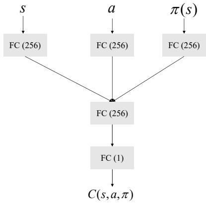  
Figure 6: Structure of the discriminator network C. Action a and π(s) are independently input into the same fully connected (FC) neural network (action encoder).

<table><tr><td>Hyperparameters</td><td>Ant</td><td>Hopper</td><td>Humanoid</td><td>Walker2d</td></tr><tr><td>α</td><td>0.3</td><td>0.05</td><td>0.05</td><td>0.7</td></tr><tr><td>β</td><td>0.01</td><td>0.01</td><td>0.15</td><td>0.01</td></tr></table>

Table 6: Specific hyperparameters used in ILMAR.

search, as detailed in Table 6.

## A.2 Additional Experimental Results

## Ablation Test on Hyperparameters α and β

As we can notice in Eq. (10), ILMAR introduces hyperparmeters α and β, which control the relative influence of the meta loss and the vanilla loss on the updates of the discriminator. In this section, we aim to study how does the choice of α and β affect the training processes and performance of our algorithm. We conduct a grid search over $\alpha \in \{ 0 , 0 . 1 , 0 . 3 , 0 . 7 , 1 . 0 \}$ and $\beta \in \{ 0 , 0 . 0 1 , 0 . 0 5 , 0 . 5 , 1 . 0 \}$ in the task setting T3.

Figure 7 demonstrates that meta-goal significantly enhances policy performance. We observe that when using the meta-goal method alone, ILMAR performs suboptimally. However, when combined with the vanilla loss, the performance of ILMAR is often significantly improved. Notably, in scenarios where only meta-goal is used, the performance exhibits higher sensitivity to random seeds. To illustrate this, we present the performance curves under the setting $\alpha = 1 , \beta = 0$ across five random seeds, as shown in Figure 8. Meanwhile, we observe that when both the vanilla loss and the meta loss are used to update the discriminator, ILMAR demonstrates robustness to the choice of α and β, maintaining stable performance across nearly all hyperparameter configurations.

This observation supports our previous theoretical analysis, which suggests that the explicitly designed vanilla loss provides prior knowledge by regularizing the output of the discriminator. This prior knowledge assists the model in learning how to effectively weight the demonstrations using meta-goal, ultimately yielding a policy that closely resembles the expert policy.

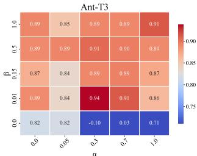

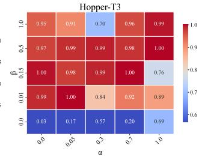

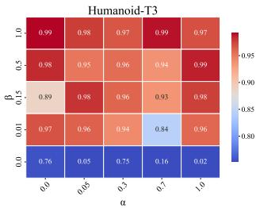

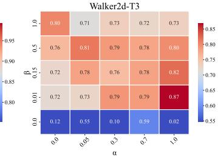  
Figure 7: The normalized scores in the task setting T3 with seed 2025, obtained by sweeping through combinations of meta loss strength α and vanilla loss strength β.

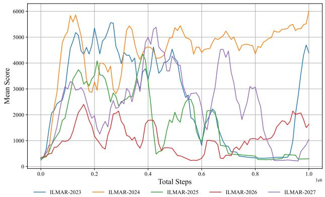  
Figure 8: Training curves of ILMAR without the vanilla loss with five seeds on Humanoid-v2 in the task setting T3.

## Additional Analysis of Results

Figure 9 illustrates the relationship between min-max normalized weights and rewards in the Ant-v2 task setting T3. From the figure, it is evident that the weights assigned by ILMAR exhibit a clear monotonic positive correlation with the true rewards.

Additional Experiments of More Expert Demonstrations Furthermore, to investigate the performance of ILMAR with a larger amount of expert data, we conduct experiments by increasing the number of expert demonstrations in expert dataset to 5. We set both α and β to 1 to minimize the impact of hyperparameters selection on the results. The results, as shown in Figure 10 and Table 7, demonstrate that ILMAR continues to exhibit a significant advantage over other algorithms even with an increased number of expert demonstrations.

We apply meta-goal to DemoDICE and ISW-BC when the expert dataset includes five expert trajectories. The results are presented in Table 8.

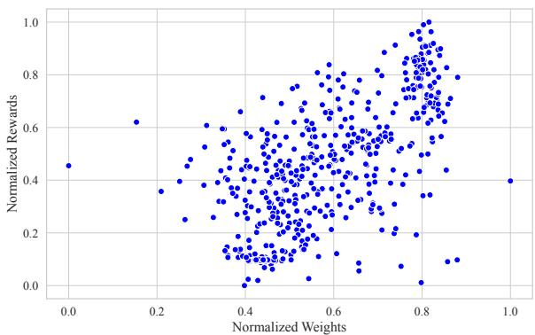  
Figure 9: The actual reward and the weights assigned by ILMAR for suboptimal demonstrations in Ant-v2.

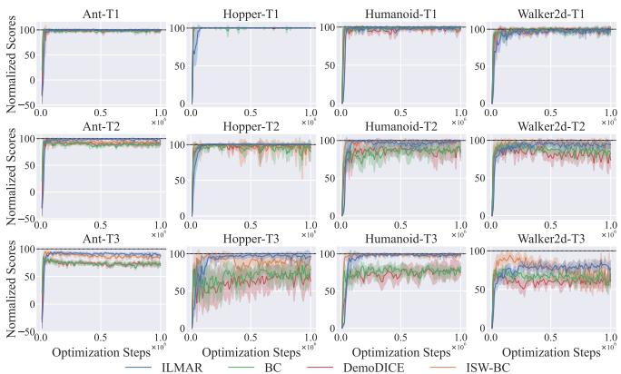  
Figure 10: Training curves of ILMAR and baseline algorithms on tasks T1, T2, T3. The y-axis represents the normalized scores of the algorithm during training. The solid line corresponds to the average performance under five random seeds, and the shaded area corresponds to the 95% confidence interval.

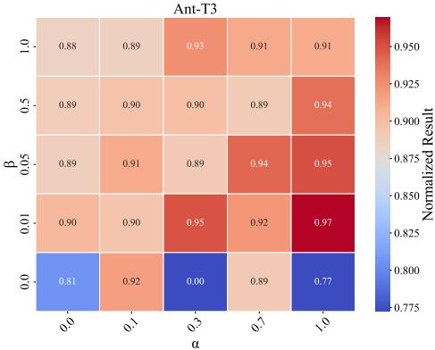  
Figure 11: The normalized scores on Ant-v2 in the task setting T3 with seed 2025, obtained by sweeping through combinations of meta loss strength α and vanilla loss strength $\beta$ when the expert dataset includes five expert trajectories.

We conduct a grid search over $\alpha \in \{ 0 , 0 . 1 , 0 . 3 , 0 . 7 , 1 . 0 \}$ and $\beta \in \{ 0 , 0 . 0 1 , 0 . 0 5 , 0 . 5 , 1 . 0 \}$ on Ant-v2 in the task setting T3. The results are presented in Figure 11.

<table><tr><td>Task setting</td><td>Environment</td><td>Ant</td><td>Hopper</td><td>Humanoid</td><td>Walker2d</td><td>Score</td></tr><tr><td rowspan="2"></td><td>Random</td><td>-75</td><td>15</td><td>122</td><td>1</td><td>0</td></tr><tr><td>Expert</td><td>4761</td><td>3635</td><td>7025</td><td>4021</td><td>100</td></tr><tr><td rowspan="4">T1</td><td>BC</td><td> $4649_{±69}$ </td><td> $3650_{±3}$ </td><td> $6959_{±72}$ </td><td> $3882_{±92}$ </td><td>98.42</td></tr><tr><td>DemoDICE</td><td> $4658_{±56}$ </td><td> $3651_{±1}$ </td><td> $6761_{±237}$ </td><td> $3988_{±39}$ </td><td>98.42</td></tr><tr><td>ISW-BC</td><td> $4649_{±83}$ </td><td> $3652_{±2}$ </td><td> $6977_{±83}$ </td><td> $4007_{±63}$ </td><td>99.29</td></tr><tr><td>ILMAR (ours)</td><td> $4728_{±27}$ </td><td> $3653_{±1}$ </td><td> $6997_{±53}$ </td><td> $3937_{±83}$ </td><td>99.33</td></tr><tr><td rowspan="4">T2</td><td>BC</td><td> $4222_{±82}$ </td><td> $3461_{±335}$ </td><td> $6266_{±345}$ </td><td> $3378_{±108}$ </td><td>89.26</td></tr><tr><td>DemoDICE</td><td> $4294_{±76}$ </td><td> $3533_{±116}$ </td><td> $6127_{±583}$ </td><td> $3145_{±474}$ </td><td>88.18</td></tr><tr><td>ISW-BC</td><td> $4459_{±69}$ </td><td> $3467_{±282}$ </td><td> $6916_{±124}$ </td><td> $3145_{±474}$ </td><td>95.90</td></tr><tr><td>ILMAR (ours)</td><td> $4643_{±54}$ </td><td> $3648_{±6}$ </td><td> $6980_{±48}$ </td><td> $3806_{±95}$ </td><td>97.98</td></tr><tr><td rowspan="4">T3</td><td>BC</td><td> $3411_{±166}$ </td><td> $2704_{±388}$ </td><td> $5420_{±205}$ </td><td> $2454_{±267}$ </td><td>71.04</td></tr><tr><td>DemoDICE</td><td> $3457_{±50}$ </td><td> $2442_{±566}$ </td><td> $5521_{±715}$ </td><td> $2417_{±257}$ </td><td>69.60</td></tr><tr><td>ISW-BC</td><td> $4046_{±139}$ </td><td> $3192_{±369}$ </td><td> $6860_{±129}$ </td><td> $2775_{±376}$ </td><td>84.90</td></tr><tr><td>ILMAR (ours)</td><td> $4272_{±139}$ </td><td> $3472_{±303}$ </td><td> $6945_{±32}$ </td><td> $3196_{±239}$ </td><td>90.93</td></tr></table>

Table 7: Performance of ILMAR and baseline algorithms on Ant- $\cdot \mathbf { v } 2 ,$ Hopper-v2, Walker2d-v2 and Humanoid-v2 over the final 5 evaluations and 5 seeds. The best results are in bold. ILMAR significantly outperforms existing imitation learning methods from suboptimal datasets.

<table><tr><td colspan="2">Environment</td><td>Ant</td><td>Hopper</td><td>Humanoid</td><td>Walker2d</td><td>Score</td></tr><tr><td rowspan="2">DemoDICE</td><td rowspan="2">+Meta-goal</td><td> $3457_{\pm 50}$ </td><td> $2442_{\pm 566}$ </td><td> $5521_{\pm 715}$ </td><td> $2417_{\pm 257}$ </td><td>69.60</td></tr><tr><td> $3815_{\pm 61}$ </td><td> $2655_{\pm 603}$ </td><td> $5755_{\pm 373}$ </td><td> $2699_{\pm 188}$ </td><td>75.52</td></tr><tr><td rowspan="2">ISW-BC</td><td rowspan="2">+Meta-goal</td><td> $4046_{\pm 139}$ </td><td> $3192_{\pm 369}$ </td><td> $6860_{\pm 129}$ </td><td> $2775_{\pm 376}$ </td><td>84.90</td></tr><tr><td> $4216_{\pm 124}$ </td><td> $3078_{\pm 221}$ </td><td> $6955_{\pm 52}$ </td><td> $3531_{\pm 267}$ </td><td>90.03</td></tr></table>

Table 8: Performance of other algorithms using meta-goal on the MuJoCo environments when the expert dataset includes five expert trajectories. The best results are in bold.

## Convergence Analysis

To better understand why we recommend combining metagoal with the original weighted behavior cloning instead of using it as a standalone algorithm, we analyze the loss under different scenarios. In this section, we set both α and $\beta$ to 1 to minimize the impact of hyperparameter selection on the results. Figure 12 illustrates the variation in the discriminator loss during training on T3. As shown in Figure 12, vanilla loss converges rapidly in the early stages of training, after which the updates to the discriminator are primarily influenced by the meta loss. As training progresses, the meta loss gradually decreases and converges. We also compare the loss dynamics when the discriminator is updated using only meta-goal. Figure 13 illustrates the variation in the meta loss of ILMAR when trained without the vanilla loss discriminator on task T3, i.e., with $\alpha = 1 , \beta = 0$ From the figure, we observe that incorporating the vanilla loss not only does not hinder the convergence of the meta-loss but actually helps it converge to a lower value. This aligns with our theoretical analysis, which suggests that the vanilla loss provides the discriminator with prior knowledge, aiding the convergence of the meta-loss and thereby improving the overall performance of the policy.

These observations validate the theoretical insights: the design of the vanilla loss provides prior knowledge that constrains the direction of updates of discriminator, facilitating the convergence of the meta loss and ultimately enhancing the performance of model.

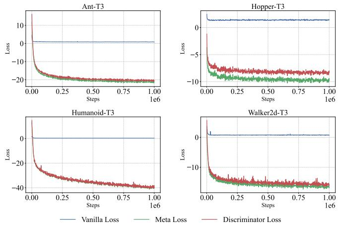  
Figure 12: Loss curves of ILMAR on the MuJoCo environments in the task setting T3.

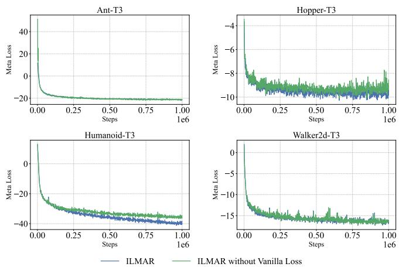  
Figure 13: Meta loss curves of ILMAR on the MuJoCo environments in the task setting T3. The green line represents updating the discriminator using only the meta-goal, while the blue line represents updating the discriminator with both the vanilla loss and metaloss.

## B Theoretical Derivation

## B.1 Derivation of The Gradient $\frac { \partial L _ { m e t a } } { \partial \psi }$

Eq. 9 establishes that the gradient $\frac { \partial L _ { m e t a } } { \partial \psi }$ can be expressed as:

$$
\mu \frac {1}{| \mathcal {D} |} \frac {\partial L _ {m e t a}}{\partial \theta_ {t + 1}} \sum_ {(s, a) \in \mathcal {D}} \frac {\partial^ {2} w (s , a , \pi_ {\theta_ {t}}) \log \pi_ {\theta_ {t}} (a | s)}{\partial \psi \partial \theta_ {t}}.
$$

Here, we provide the detailed derivation process for this result.

$$
\begin{array}{l} \frac {\partial L _ {m e t a}}{\partial \psi} = \frac {\partial L _ {m e t a}}{\partial \theta_ {t + 1}} \frac {\partial \theta_ {t + 1}}{\partial \psi} \\ = \frac {\partial L _ {m e t a}}{\partial \theta_ {t + 1}} \frac {\partial \theta_ {t} - \mu \nabla_ {\theta} L _ {a c t o r} (s , a ; \theta_ {t} , \psi_ {t})}{\partial \psi} \\ = - \mu \frac {\partial L _ {m e t a}}{\partial \theta_ {t + 1}} \frac {\partial \frac {\partial L _ {a c t o r}}{\partial \theta_ {t}} (s , a ; \theta_ {t} , \psi_ {t})}{\partial \psi} \\ = - \mu \frac {\partial L _ {m e t a}}{\partial \theta_ {t + 1}} \frac {\partial^ {2} L _ {a c t o r}}{\partial \psi \partial \theta_ {t}} \\ = - \mu \frac {\partial L _ {m e t a}}{\partial \theta_ {t + 1}} \frac {\partial^ {2} - \frac {1}{| \mathcal {D} |} \sum_ {(s , a) \in \mathcal {D}} w (s , a , \pi_ {\theta_ {t}}) \log \pi_ {\theta_ {t}} (a | s)}{\partial \psi \partial \theta_ {t}} \\ = \mu \frac {1}{| \mathcal {D} |} \frac {\partial L _ {m e t a}}{\partial \theta_ {t + 1}} \sum_ {(s, a) \in \mathcal {D}} \frac {\partial^ {2} w (s , a , \pi_ {\theta_ {t}}) \log \pi_ {\theta_ {t}} (a | s)}{\partial \psi \partial \theta_ {t}} \end{array}
$$

## B.2 Proof of Theorem 1

Proof. By Lemma 2 in Zhang et al. [2021] (with proof on Page 12), the function $f ( x )$ is Lipschitz-smooth with constant $L ,$ , then the following inequality holds:

$$
f (y) \leq f (x) + \nabla f (x) ^ {T} (y - x) + \frac {L}{2} \| y - x \| ^ {2}, \quad \forall x, y.
$$

Thus, we have:

Proof.

$$
\begin{array}{l} \mathcal {L} _ {C} (\theta_ {t + 1}) - \mathcal {L} _ {C} (\theta_ {t}) \\ \leq \nabla_ {\theta} \mathcal {L} _ {C} (\theta_ {t}) ^ {T} (\theta_ {t + 1} - \theta_ {t}) + \frac {L}{2} \| (\theta_ {t + 1} - \theta_ {t}) \| ^ {2} \\ = - \mu \nabla_ {\theta} \mathcal {L} _ {C} (\theta_ {t + 1}) ^ {T} \nabla_ {\theta} \mathcal {L} _ {\text {actor}} (\theta_ {t}, \psi_ {t}) \\ + \frac {L}{2} \mu^ {2} \| \nabla_ {\theta} \mathcal {L} _ {\text {actor}} (\theta_ {t}, \psi_ {t}) \| ^ {2} \\ \leq - \left(\mu K - \frac {L}{2} \mu^ {2}\right) \| \nabla_ {\theta} \mathcal {L} _ {\text {actor}} (\theta_ {t}, \psi_ {t}) \| ^ {2} \end{array}\tag{11}
$$

(12)

(13)

The first inequality comes from Lemma 2 in Zhang et al. [2021], and the second inequality comes from that only when $\nabla _ { \theta } \mathcal { L } _ { C } ( \theta _ { t + 1 } ) ^ { \top } \nabla _ { \theta } \mathcal { L } _ { a c t o r } ( \theta _ { t } ^ { \star } , \psi _ { t } ) ^ { \star } \geq K | | \nabla _ { \theta } \mathcal { L } _ { a c t o r } ( \theta _ { t } ^ { \star } , \psi _ { t } ) | | ^ { 2 }$ holds, we update the policy and the learning rate satisfies $\textstyle \mu \leq { \frac { 2 K } { L } }$ □