# Learning-Based Methods for Aerial Manipulation: A Focused Review

Chao Zeng , Member, IEEE, Zhan Li , Member, IEEE, Yipeng Yang , Member, IEEE, Cunjia Liu , Member, IEEE, and Chenguang Yang , Fellow, IEEE

Abstract—Learning techniques are increasingly empowering aerial robots with manipulation capabilities and have, as a result, attracted growing attention over the past decade. This work provides a focused review of recent advancements in learning-based methods for aerial manipulation (AM). Four categories of learning-based methods, i.e., imitation learning, reinforcement learning, deep learning, and learning-based control, are identified and analyzed in detail. The AM tasks enabled by these methods are also summarized and analyzed, resulting in six categories: Grasping, pick-and-place, load transportation, contact-rich operations, contact impact, and human–UAV interaction. In addition, we provide further discussions and perspectives on the current achievements and future directions of learning-based AM.

Index Terms—Aerial manipulation (AM), deep learning, imitation learning, learning-based control, reinforcement learning, unmanned aerial vehicles (UAV).

## I. INTRODUCTION

T HE field of aerial robotics has received large attentionand experienced rapid development over the past decade, and experienced rapid development over the past decade, spanning areas from mechanical design and hardware systems to algorithms and software development [1], [2], [3], [4], [5]. The driving force behind this progress is the significant potential of aerial robots across diverse applications, such as surveillance, rescue, navigation, and manipulation, making them one of the key contributors to the emerging low-altitude economy.

Aerial manipulation (AM) has emerged as one of the primary research directions in aerial robotics [6], [7], [8], [9]. It typically involves an unmanned aerial vehicle (UAV) equipped with one or more robotic manipulators, either rigid or soft, that enable physical interaction with the environment. This capability allows aerial robots to go beyond passive sensing and perform contactbased tasks such as inspection, maintenance, repair, and additive manufacturing in hard-to-reach or hazardous environments [10], [11], [12], thereby reducing costs and risks for human operators. However, AM presents significant challenges in both the modeling and control of UAV systems, as it must handle highly nonlinear, time-varying system dynamics and/or interaction dynamics in complex environments, which are typically difficult even for ground-based robotic systems.

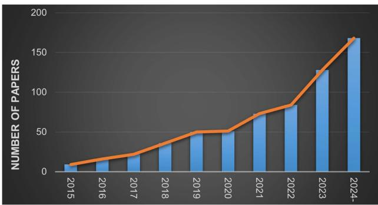  
Fig. 1. Number of publications indexed by Google Scholar using the keywords “learn” and “aerial manipulation” since 2015.

Learning techniques, especially Deep Learning (DL) and Reinforcement Learning (RL), have demonstrated remarkable performance in high-level task planning, accurate perception, and agent–environment (including human) interaction, thanks to their strong ability to solve nonlinear problems. As a result, they have been extensively employed to advance the development of robotics including aerial robots [13], [14], [15], [16]. Naturally, learning techniques have been introduced in AM to address challenges that are typically difficult to overcome with traditional methods, thanks to their data-driven advantages, such as adaptability to complex systems, generalization from experience, and reduced reliance on explicit modeling. According to our search result on Google Scholar, the number of publications related to learning-based methods for AM has increased significantly, particularly over the past five years, as shown in Fig. 1.

This work aims to provide a focused review of learning-based AM, with the goal of helping readers especially beginners to understand the state of the art in this research direction. Approximately 80 papers were selected as the core materials for this review, based on searches in mainstream databases such as Google Scholar, IEEE Xplore, and Web of Science. After a thorough literature review and classification, we identify four main categories of learning methods: 1) Imitation Learning (IL); 2) DL; 3) RL; and 4) Learning-based Control (LC). The main learning algorithms used in these methods, along with their application scenarios, are illustrated in Fig. 2.

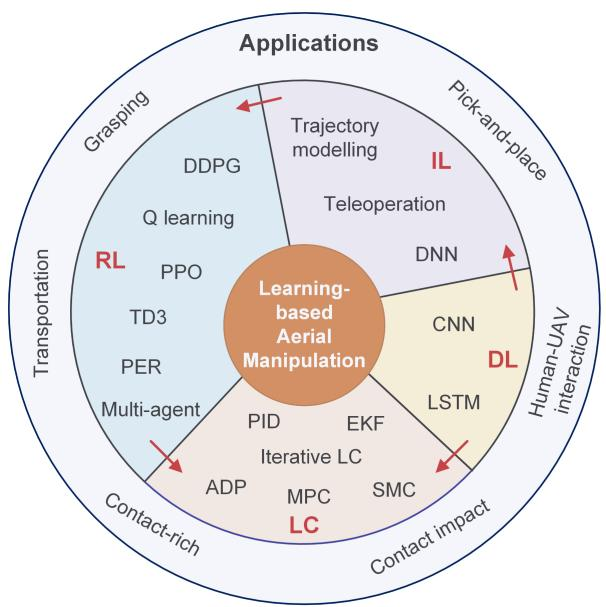  
Fig. 2. Graphical illustration of the main algorithms used in learningbased aerial manipulation and their applications, which will be detailed in Sections III and IV. The red arrows indicate that one learning approach can serve as a foundation for another. IL: Imitation Learning; RL: Reinforcement Learning; DL: Deep Learning; LC: Learning-based Control.

This review will elaborate on how these four categories of learning methods empower UAVs with advanced manipulation capabilities. In short, IL enables a UAV to replicate human manipulation skills either by learning a model offline from demonstration data or through direct online teleoperation using a device such as a VR headset. DL enhances a UAV’s perception capabilities by enabling robust and accurate target recognition, object detection, and localization in dynamic environments, which are critical for the success of subsequent AM tasks. RL, including deep RL, enables the autonomous learning of skill or task models for AM through trial-and-error interactions with the environment. This process often takes place in a simulated environment, where the UAV can explore various strategies and refine its manipulation capabilities before transferring these skills to reality. LC ensures safe, adaptive, and robust UAVenvironment (physical) interactions by seamlessly integrating learning techniques into traditional control strategies to handle environmental uncertainties and enhance overall performance.

In addition, one learning paradigm can serve as the foundation for other learning-based methods, including: 1) Deep Neural Networks (DNNs), as typical models ofDL, are used to learn task representations in IL; 2) IL can be used to initialize RL policies in UAV tasks; and 3) DL and RL have been utilized to adapt key parameters in controllers such as Proportional-Integral-Derivative (PID) and Sliding Mode Control (SMC).

In this review, we also specifically analyze the AM tasks enabled by these learning techniques. In particular, we have identified six categories of learning-based AM tasks as follows.

1) Grasping: An aerial robot, typically a multirotor UAV equipped with a gripper or other end-effector, physically grasps and holds an object.

2) Pick-and-place: An aerial robot grasps an object, transports it, and places it at a specified target location.

3) Load transportation: Two or more aerial robots cooperatively transport a payload from one location to another, often requiring coordinated motion and force planning.

4) Contact-rich tasks: A UAV maintains continuous contact with the environment (e.g., inspection, polishing, or surface interaction) to accomplish the desired task.

5) Contact-impact tasks: A UAV makes intermittent or forceful physical contact with the environment, such as striking, pushing, or landing maneuvers.

6) Human–UAV interaction: One or more UAVs physically interact with a human operator to jointly perform a task in a cooperative manner.

These AM tasks will be presented and discussed in detail alongside the introduction of the relevant learning methods later in this review. In summary, the applications of learning-based methods span nearly all AM tasks, ranging from grasping and contact-rich operations to human–UAV interaction, demonstrating increasing potential in both indoor and outdoor industries, such as logistics [17], agriculture [18], infrastructure inspection [19], and beyond. It can be concluded that learning-based methods are opening new avenues for enhancing the versatility and effectiveness of UAVs across a wide range of applications.

The rest of this article is organized as follows. Section II highlights the differences between our work and existing review papers in the literature. Section III provides a detailed review and analysis of learning-based methods for AM. Section IV summarizes the application tasks of learning techniques in AM. In Section V, we present discussions and perspectives on learning-based AM. Finally, Section VI concludes this article.

## II. DIFFERENCES BETWEEN OUR REVIEW AND EXISTING REVIEW PAPERS ON AERIAL ROBOTS

We find several review and survey papers on aerial robots that have been published in the literature in the past several years. Specifically, [7] provided a concise review of aerial manipulation, focusing primarily on the technological and control aspects of the field. The authors in [20] examined the advancements in small-scale rotorcraft unmanned robotic systems (SRURSs), focusing on two key aspects: 1) mechanical structure design and 2) modeling and control. The authors in [8] provided a comprehensive review of single and multi-UAV aerial manipulation, emphasizing platforms equipped with aerial manipulation capabilities. The survey also explored strategies for interacting with the environment, such as implementing force/torque control and visual servoing techniques. The authors in [21] reviewed the advancements in aerial robotic manipulators, beginning with a summary of various aerial robotic platforms, including helicopters, conventional underactuated multirotors, and multidirectional thrust platforms equipped with robotic manipulators.

The paper then highlighted recent progress in perception and planning techniques for aerial robotics. The authors in [22] provided a brief survey of recent advancements in utilizing single or multiple aerial robots for tracking and grasping moving objects. The authors in [23] focused on cooperative aerial manipulation, highlighting prototype systems implemented in real-time across various application scenarios, as well as the underlying modeling and control approaches. The authors in [24] presented a comprehensive and detailed survey on AI-based methods for UAVs, with a particular focus on nonmanipulation applications such as path planning and surveillance. The authors in [25] surveyed machine learning-based approaches for intrusion detection in UAV systems. The authors in [26] provided a comprehensive review of aerial robots designed for physical interaction tasks. The paper begins by presenting various prototypes of aerial robots developed for physical manipulation. It then offers a detailed analysis of dynamic modeling and interaction strategies for aerial robots operating in environments where physical contact with surroundings is required. The authors in [27] reviewed recent advancements in novel aerial robot designs, emphasizing materials and manufacturing technologies, actuation mechanisms, and perception and control systems. They also highlighted cutting-edge developments and applications of various innovative aerial robots, including flapping-wing microair vehicles, perching aerial robots, amphibious robots, and operational aerial robots.

The aforementioned review papers have thoroughly addressed most aspects of aerial robots. However, one crucial aspect, i.e., learning-based methods, has yet to be systematically summarized. This work aims to fill that gap by providing a focused review on aerial manipulation using advanced learning techniques, including deep learning and reinforcement learning. Furthermore, we place particular emphasis on aerial manipulation, as opposed to other tasks such as navigation or surveillance. To summarize, this work provides a detailed review of state-of-theart learning-based methods tailored for aerial robots to perform manipulation tasks.

## III. LEARNING-BASED METHODS FOR AERIAL MANIPULATION

In this section, we review learning algorithms, including imitation learning, reinforcement learning, deep learning, mainly developed for motion/task planning in AM tasks. We also review learning-based control algorithms for AM. For each learning technique, we first introduce the relevant literature and then provide a summary highlighting its key characteristics and challenges.

## A. Imitation Learning

Robotic imitation learning (IL) refers to the process by which a robot acquires manipulation skills by observing and imitating the behaviors of humans or other agents. Imitation learning has been extensively studied in various types of robots, such as industrial robots [28], humanoid robots [29], and dexterous robotic hands [30]. While it has also been largely used for aerial robots in navigation and searching tasks [31], [32], its application to aerial robots for learning more challenging manipulation skills is a more recent development. Thus far, only a few papers in the literature have addressed imitation learning-based methods for aerial manipulation. These methods can be categorized into the following three aspects.

Trajectory-level imitation methods have been developed to learn and adapt UAV movements based on human demonstrations. These methods involve learning a task-specific model from a limited number of demonstrations, typically employing one-shot or supervised learning techniques. During runtime, the learned model generates reference trajectories or low-level control policies, enabling aerial robots to execute the given tasks. This work [33] explored the use of a quadrotor to play table tennis through a learning-from-demonstration approach. To achieve this, the researchers first create a skill library of “hitting motions,” encoded using the Dynamic Movement Primitives (DMPs) model [34]. These motions are derived from demonstration data provided by a human expert. During runtime, the quadrotor imitates the expert’s motion to hit the ball based on its location, determined via vision-based perception. It does so by selecting and blending appropriate movement primitives from the established skill library. In [35], [36], the authors introduced a robust motion-planning method called RRT\*-PDMPs, which integrated the Rapidly-exploring Random Tree Star (RRT\*) algorithm [37] with the parametric dynamic movement primitives (PDMPs) model [38]. This approach generates obstacleavoiding trajectories that ensure safe manipulation poses while adhering to dynamic and kinematic constraints. PDMPs, a commonly used imitation learning technique for motion representation, can efficiently learn from demonstrations in a supervised manner, such as using Gaussian process regression (GPR). By combining RRT\* and PDMPs, the method achieves efficient motion planning, with PDMPs enabling rapid computation and RRT\* providing optimized trajectories for learning. The proposed method is validated in a real-world load-carrying task involving two multirotor-based aerial manipulators navigating environments with unknown obstacles, as shown in Fig. 3(a). Results indicate that RRT\*-PDMPs successfully generate effective trajectories for aerial manipulators in novel scenarios, ensuring safe obstacle avoidance while minimizing energy consumption. The authors in [39] presented a one-shot learning framework for aerial manipulation that combined local features with taskdependent knowledge to identify optimal contact points for UAV interactions. Unlike traditional methods that depend exclusively on handcrafted features or local geometric data, the proposed approach incorporates intrinsic task-specific information, enhancing robustness and adaptability. The framework relies on prior knowledge extracted directly from a single demonstration, eliminating the need for extensive datasets. While this method marks progress toward reliable aerial manipulation by integrating local geometric characteristics with task-aware strategies, it also acknowledges the limitation: the necessity of developing new models for each unique scenario.

Researchers have employed deep neural networks (DNN) to enable UAVs to learn manipulation tasks through imitation learning. These approaches involve constructing a DNN to learn the mapping between observation data (typically images and videos) and the robot control commands necessary to perform a task [43], [44]. Consequently, it requires collecting a substantial dataset to train the DNN model effectively before deploying it to an aerial robot. As shown in Fig. 3(b), Baraban et al. [40] proposed an imitation learning network architecture tailored for UAVs engaged in fruit grasping tasks, see Fig. 3(b). Their network is trained based on the dataset collected from successful executions of a baseline controller. Thus, it can imitate the successes of the baseline while preventing its flaws. Compared with the baseline, they add a prediction neural network to predict the currently active task phase and the corresponding desired 3-D poses of the robot, according to the input data which consists of i) RGBD images of the tree, ii) segmented images containing the information of the target fruit, and the estimated fruit pose. In [44], a lightweight DNN-based imitation learning algorithm was proposed for error recovery during human-provided directional corrections in UAV tasks.

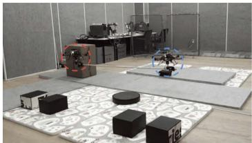  
(a)

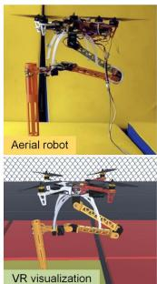

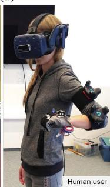  
(c)

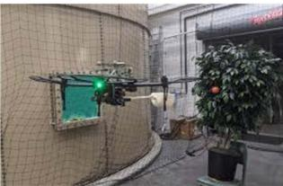  
(b)

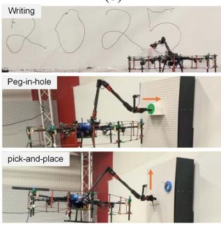  
(d)  
Fig. 3. Typical examples of UAV manipulation based on imitation learning. (a) Two UAVs co-transport an object using the motion planning algorithm RRT\*-PDMPs [36] © [2018] IEEE. (b) The UAV robot performs fruit-grasping tasks based on DNN model [40] © [2021] IEEE. (c) A VR-based teleoperation system for aerial manipulation [41] © [2019] IEEE. (d) The UAV performs multiple tasks using the IL framework developed in [42].

Teleoperation is also an feasible approach for enabling UAVs to imitate human behaviors, allowing them to perform specific tasks through direct human control and demonstration [45]. As the name implies, this approach, which can be viewed as a special case of imitation learning, involves a human-in-the-loop setup, where a human operator uses specialized teleoperation devices to control an aerial robot and perform a specific manipulation task. In [46], a bilateral teleoperation system was developed for aerial manipulation in outdoor industrial inspection and maintenance tasks. The Time-Domain Passivity Approach (TDPA) (e.g., [47]) was integrated into the system to ensure stability under nominal communication time delays. Virtual reality (VR)-based teleoperation systems for UAV manipulation have been recently developed [48]. For example, as shown in Fig. 3(c), [41] developed a VR-based UAV teleoperation setup based on the HTC VIVE device and the VICON motion capture system, where the VR trackers worn on the user’s arm and a tracking glove provide vibrotactile feedback to the user, enabling more stable and robust teleoperation. [49] built a virtual VR simulation environment in Unity to increase the teleoperation experience of the user and also created a simulation environment in Gazebo in which they performed a pick-and-place task on the PX4 autopilot aerial robot with their proposed teleoperation system. Mixed Reality (MR)-based interfaces [50], [51] have recently been developed to enhance the user experience during the teleoperation of aerial robots by providing real-world scene feedback through MR technology.

In [42], an end-effector-centric framework was developed to enable versatile UAV manipulation, integrating two high-level motion policy modules: 1) a teleoperation interface; and 2) a DNN-based imitation learning module. The teleoperation interface allows users to directly control the end-effector’s pose, while the imitation learning module learns UAV autonomous manipulation policies from demonstration data using the Action Chunk with Transformer (ACT) model [52]. Their framework represents a seamless integration of DNN-based and teleoperation-based methods, effectively combining the advantages of both sides. As shown in Fig. 3(d), their framework enables the UAV to perform a variety of physical interaction tasks.

Summary ofIL-basedAM: Trajectory-level imitation learning methods allow an aerial robot to efficiently acquire manipulation skills by training a lightweight model using a limited amount of data. However, due to their reliance on supervised learning techniques, these methods typically produce time-sequential reference trajectories with constrained adaptability. Consequently, they often face challenges in achieving robust generalization to new scenarios. DNN-based methods offer relatively better generalization capabilities due to the enhanced information encoding provided by DL models. In addition, these methods can leverage multiple modalities to enhance the robot’s manipulation performance. However, they typically need a time consuming process to gather a large amount of data and train an effective DNN model to yield reliable motion control policies. Teleoperation-based methods represent a low-autonomy control paradigm in which an aerial robot’s actions are directly guided by a human operator. This approach offers an intuitive and flexible means of performing tasks and enables real-time correction of motion errors. However, it inherently restricts the system’s autonomy. In addition, it is challenging to offer adequate feedback to the user, which may increase their workload. These methods may also suffer from the time delay and communication issues.

## B. Reinforcement Learning (RL)

RL has been a foundational approach in robotics for quite some time [53], [54]. Robot manipulation performance has significantly improved with the integration of RL, particularly with the advancement of deep reinforcement learning (DRL).1

(e)  
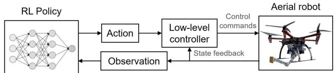  
Fig. 4. General diagram of using RL-based methods for AM.

This progress has led to numerous impressive achievements within the robotics community. RL is also playing a pivotal role in advancing aerial manipulation.

Fig. 4 illustrates the general framework of RL-based control for aerial manipulation. The RL policy is initially trained in a simulated environment and subsequently deployed for realworld scenarios. In practice, at each control loop, the RL policy outputs an action, such as the robot’s pose, based on environmental observations. This action is then passed through a low-level controller to generate control commands for the aerial robot, using state feedback from the robot.

Early Applications of RL in AM: Looking back ten years, researchers had already begun using RL to address path planning problems in aerial manipulation. [55] investigates the use of RL for trajectory tracking in an aerial robot tasked with manipulating suspended loads, as shown in Fig. 5(a). Specifically, the authors propose a model-free method based on least-square policy iteration [56] to solve the problem of tracking and controlling the position of a suspended load that is critical to mission success. The method enables quick learning of a policy function to minimize the tracking error of the load with respect to the given reference trajectory. The experiments show that their learned policy allows the system to different types of trajectories including simple straight lines and complex Lissajeou curves. In [57], the authors presented a RL-based approach for manipulating and transporting parts and assembling 3-D structures in a moderately constrained and dynamic environment using an aerial robot. The method involves learning the sequence ofvehicle maneuvers, the assembly order of parts, and selecting the appropriate structural elements for each assembly point. A heuristic search algorithm is integrated into the learning process to optimize the aerial robot’s navigation path through the dynamic environment. The approach is validated through real-world tests involving the construction of a 3-D structure. Experimental results show that the method enables the aerial robot to effectively learn optimal sequences for both maneuvers and assembly, successfully overcoming the structural and environmental constraints.

The authors in [58] introduced a self-reflective learning framework for aerial manipulators, designed to safely adapt and discover optimal policies in novel situations. The framework operates in three stages: 1) detecting the presence of a new situation; 2) reoptimizing the policy using RL; and 3) determining when self-reflection should conclude. When a new situation arises, the approach employs the Approximate Value Iteration (AVI) RL algorithm [59] to adjust the aerial manipulator’s policy to better suit the new conditions. The method is tested in a simulated object-transportation task, where results demonstrate its effectiveness in reducing task failure rates.

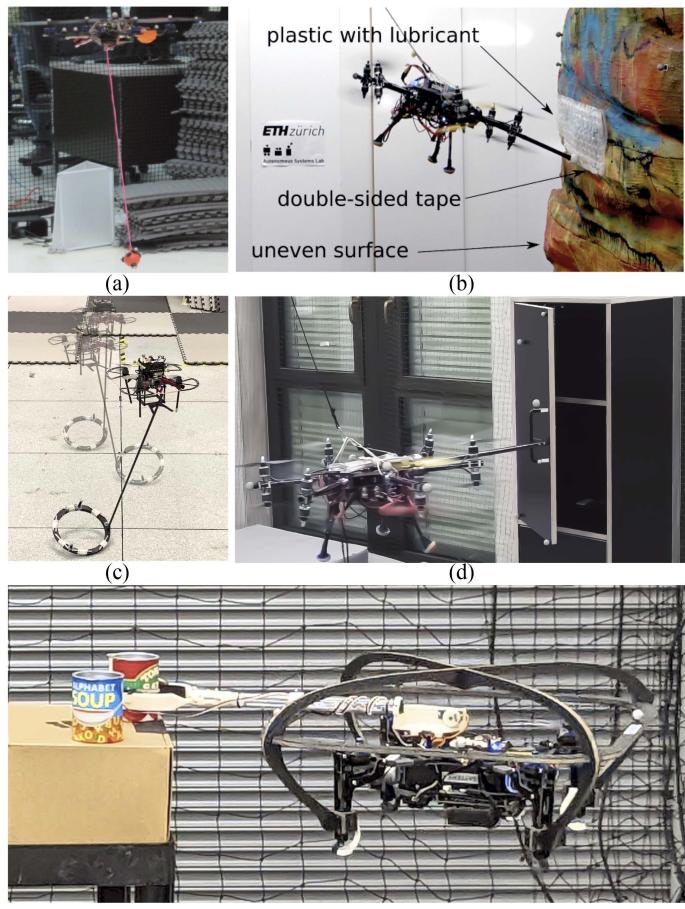  
Fig. 5. Examples of RL-based UAV manipulation in real-world scenarios. (a) Suspended load carrying [55]©[2013] IEEE. (b) Sliding along surface [65]©[2022] IEEE. (c) Rock-and-walk [66]©[2022] IEEE. (d) Opening a cabinet door [67]©[2023] IEEE. (e) Nonprehensile aeria grasping [68]©[2024] IEEE.

Recent Advancements in RL for AM: Very recently, many more RL-based methods for AM have been reported in the literature. In [60], authors focuses on developing a robust tracking control strategy for aerial manipulators using Deep Deterministic Policy Gradient (DDPG) [61], to address the complexities of aerial manipulators, such as dynamic coupling between the aerial platform and the manipulator arm. Their method simplifies the control of complex aerial manipulator systems with robust tracking capabilities to handle disturbances and uncertainties during operation. Additionally, by taking advantage of both RL and robust controllers, the residue of interactive force/torque after using DDPG is compensated to ensure stability and tracking performance. The authors in [62] proposed a trajectory planning method based on a value function approximation-based RL algorithm [63] to address the challenge of cable-suspended load transportation using three quadrotors. The goal of trajectory planning is to minimize load swinging while reaching the target position as quickly as possible. In the RL framework, the value function is approximated using a parameter vector and a problem-specific feature vector. The parameter vector is updated using a batch method, and a greedy strategy is then employed to generate the desired trajectory. Simulation results demonstrate that the proposed method enables smooth transportation of the suspended load from the starting location to various target positions. The authors in [64] tackled the complex problem of coordinating robotic systems, such as multiple UAVs, to perform joint perception-action tasks. Their proposed framework consists of two hierarchical modules. The high-level decisionmaking module develops a RL algorithm called multiagent state-action-reward-time-state-action (MA-SARTSA) within a multiagent partially observable semi-Markov decision process. The low-level module integrates coordinated control and planning to provide probabilistic guarantees for action agents during manipulation tasks.

In [65], the authors introduced an RL-based adaptive control approach for aerial surface-sliding tasks, as illustrated in Fig. 5(b), based on the Proximal Policy Optimization (PPO) al gorithm [69]. Specifically, the gains ofa conventional impedance controller are dynamically tuned by a neural network policy informed with proprioceptive data and tactile signals. The policy is trained in a simulation environment with simplified actuator dynamics using a student-teacher learning framework. To validate its effectiveness, the proposed method is tested on a tilt-arm omnidirectional aerial vehicle. By integrating data-driven techniques with model-based control, the proposed method achieves seamless transfer from simulation to real-world deployment without an additional fine-tuning process. The success of this sim-to-real transfer is attributed to incorporating feedback control during both the training phase and implementation. The authors in [70] presented a RL-based method for trajectory generation in quadrotor aggressive perching tasks. The trained RL trajectory planner efficiently identifies a feasible path after undergoing training in a simulation environment. A trajectorytracking controller is then employed to follow the RL-generated path while ensuring the quadrotor’s stability. The proposed approach is validated through real-world experiments, demonstrating that the learned policy network responds effectively to step changes and maintains stability during omnidirectional autonomous aggressive perching, even under challenging initial conditions. The authors in [66] employed RL to enable a robot to perform rocking-and-walking tasks [Fig. 5(c)] by utilizing the interaction between the object and its supporting surface, as well as the natural influence of gravity. The authors present a framework designed to develop a control policy for transporting objects in a dynamic simulation environment that accounts for both the object and the support surface. The effectiveness of the approach is demonstrated through a series of simulated and real-world experiments, where an aerial robot manipulates the object using a nonprehensile way. The results reveal that the robot, guided by the learned policy, can propel the object forward with a consistent gait by managing its mechanical energy and posture. Furthermore, the robot successfully navigates the object through challenges such as terrain irregularities and external disturbances.

Cuniato et al. [71] introduced an RL-driven approach to train an end-to-end pose controller for an overactuated tiltrotor platform, designed to handle significant external disturbances and model discrepancies. During training, the agent is exposed to various actuator model parameters and external perturbations, enabling it to develop a robust control policy. This policy effectively leverages the diverse motor dynamics of the platform and maintains stable performance in flight scenarios involving shifts in inertia or aerodynamic disturbances. Notably, the method achieves this without relying on complex modeling efforts or additional disturbance observation mechanisms. The authors in [67] proposed to use RL to learn optimal reactive motion behaviors for an omnidirectional micro aerial vehicle (OMAV) to perform door-opening tasks, [see Fig. 5(d)]. Their policy is first trained by PPO [69] in a simulation environment and then transferred to a real-world OMAV setup. The RL model takes a 19-D vector containing information about robot velocity, hook-to-door distance, body-to-door orientation, and door angle as input, and outputs the desired position and rotation commands. The experiment indicates that the learned policy is more robust than the optimization-based Model Predictive Path Integral (MPPI) controller, which was also developed for the UAV door-opening task [72]. This robustness can be attributed to domain randomization during RL training, which exposes the policy to variations in initial conditions, sensor noise, and environmental parameters, thereby improving tolerance to modeling errors.

In [73], the authors presented a Q-learning approach for controlling the trajectory of the end-effector of a 2-DoF robotic arm mounted on a UAV. Specifically, the authors developed a motion planning model based on Time to Collision (TTC) [74], allowing a quadrotor UAV to navigate around obstacles while maintaining the manipulator’s reachability. They further implemented a model-based Q-learning algorithm (see e.g., [75]) to learn the optimal joint torque sequence to independently track the manipulator’s end-effector trajectory, given an arbitrary baseline trajectory for the UAV platform. They verify their proposed method in a trajectory-tracking task in simulation.

Lin et al. [76] introduced a method based on the Twin Delayed Deep Deterministic Policy Gradient (TD3) algorithm [77] for position control in a nonlinear two-quadrotor payload transportation system. The primary objective is to achieve precise cable-suspended payload delivery and system stabilization. The approach begins with the development of a dynamic model for the two-quadrotor-payload system. Using this model, a TD3- based controller is designed by appropriately defining the reward function, observation states, and action space. The effectiveness of the proposed method is validated through simulation experiments on a payload transportation task.

Focusing on scenarios where multiple UAVs must collaborate to complete a shared task, this work [78] models each UAV and its manipulator as an independent agent. It utilizes the Multiagent Deep Deterministic Policy Gradient (MADDPG) algorithm [79], an extension of DDPG, to achieve coordinated navigation and load manipulation. The study tackles the problem of navigating to grasping points in both targeted and flexible settings, emphasizing the development of model-free policies that do not depend on trajectory planners. To address the challenges posed by scenarios with a growing number of grasping points, the framework incorporates demonstrations from the Optimal Reciprocal Collision Avoidance (ORCA) algorithm [80] to guide policy training and introduces two innovative enhancements to the MADDPG structure. In addition, curriculum learning integrated with an attention mechanism is employed to transfer knowledge from simpler tasks with fewer grasping points to more complex scenarios. Experimental results demonstrate that the proposed method outperforms baseline approaches such as swarm optimization algorithms, achieving higher success rates, particularly in scenarios with numerous grasping points. The learned policies effectively enable UAVs to navigate to and hover over all designated grasping points without collisions before initiating manipulation tasks.

The authors in [81] focused on developing path-planning techniques for space AM operating in microgravity. Using the DDPG-based RL framework, the authors address challenges unique to space robotics, such as dynamic coupling between the manipulator and its base spacecraft, collision avoidance, and noise in state observations. The study introduces a novel reward function tailored to these requirements, utilizing quaternions for orientation control instead of Euler angles to reduce pose misalignment and dynamic singularities. The results demonstrate the effectiveness of the method, showing improved convergence rates, precision, and resilience under dynamic coupling and observation noise. The authors in [82] developed a maneuvering decision-making algorithm for UAVs utilizing the DDPG framework combined with the Prioritized Experience Replay (PER) algorithm [83]. The integration of PER enhances learning efficiency and accelerates convergence by prioritizing the sampling of more informative experiences during training. The proposed algorithm was applied to an air-delivery task; however, its evaluation was conducted solely in simulation, without validation in real-world scenarios. The authors in [68] presented a method for achieving robust control and nonprehensile aerial manipulation in unstructured environments using model-based DRL, as shown in Fig. 5(e). Specifically, the approach leveraged the DreamerV3 algorithm [84] to simultaneously construct a world model of the environment and optimize a policy for effective interaction. The method is validated through an autonomous push task in simulation, where a UAV engages in nonprehensile manipulation of a target object, maintaining continuous contact with the environment to accomplish the task. Experimental results show that this approach exhibits greater robustness in environmental interactions, such as manipulation through foliage and handling occlusions, compared to previous methods.

Specialized RL Applications in AM: Some RL-based methods have been developed to address specialized challenges in AM. In particular, [85] investigated the problem of identifying weaknesses and safety vulnerabilities in deep control policies for various robots, including AM systems. To address this, they proposed an automated black-box testing framework based on adversarial RL. Their experiments showed that the proposed framework was able to uncover weaknesses in DNN-based UAV control policies that were not apparent during standard online testing. The authors in [86] introduced ARES, a novel variablelevel vulnerability assessment framework designed to uncover deeper bugs by integrating cyber and physical perspectives. ARES employs a RL-based approach to illustrate how attackers can exploit memory vulnerabilities and parameter flaws within legitimate memory views. It strategically crafts adversarial variable values to compromise the safe operation of a UAV. Feng et al. [87] presented an admittance-based framework that leverages RL algorithms to develop an optimal policy for balancing energy efficiency with trajectory tracking under external forces. As a result, the UAV is capable ofmaintaining stable operation in dynamic and uncertain environments involving external forces. Their method was tested in a simulated environment with three distinct external force scenarios, and further evaluations on various UAV platforms and configurations of low-level control parameters confirmed the superior performance.

Summary of RL-based AM: RL has shown remarkable promise in enabling aerial robots to achieve dexterous manipulation capabilities, a key advancement in robotic autonomy. Traditional motion planning methods often struggle to address complex aerial manipulation tasks such as (e.g., object grasping and moving [66], load transportation [62], or nonprehensile manipulation [68]), where precise and adaptive control is essential. However, RL offers a flexible approach by allowing the agent to learn directly from interaction with the environment. Through the trial-and-error mechanism, RL can enable aerial robots to optimize their actions and strategies, overcoming the limitations of predefined motion strategies.

More importantly, RL provides the unique advantage of enabling an agent to thoroughly explore a diverse task environment, adjusting to various task conditions and environmental disturbances. By leveraging multiple modalities, such as vision, force feedback, and proprioception, RL allows aerial robots to learn more robust and adaptive manipulation skills that are less reliant on static models or predefined rules. As a result, aerial robots can acquire generalizable manipulation skills, empowering them to perform a wide range of tasks across different scenarios with minimal human intervention, thus significantly enhancing their task autonomy.

Recent studies have explored the integration of imitation learning and RL to accelerate the learning process (e.g., [82]). Imitation learning, by leveraging expert demonstrations, can provide a rich source of prior knowledge, helping the robot bootstrap its learning and converge to effective policies more quickly. When combined with demonstrated policies, this hybrid approach allows for more efficient exploration and exploitation of the task space, further improving the robot’s ability to perform dexterous manipulation tasks in real-world environments.

Nevertheless, several complex challenges continue to impede the progress of RL-based aerial manipulation. Although various simulation platforms have been successfully developed for different types of robots, there remains a significant gap in the availability of robust and effective simulation platforms tailored specifically for aerial manipulation, which require to adequately account for the unique and intricate characteristics of aerial robots, such as their complex aerodynamics and the interaction between rotor forces and external disturbances. We note that several RL-based methods mentioned above have only been evaluated in simulated scenarios (see, e.g., [62], [73], and [82]), without further implementation in the real world. This is due to the fact that sim-to-real transfer presents a significant challenge for RL-based methods, particularly in the context of AM. The dynamic environment in which aerial robots operate, characterized by factors such as wind and varying payloads, introduces an additional layer of complexity that current simulation platforms struggle to replicate accurately. This gap between simulation and the real world further limits the development and practical application of RL-based algorithms for AM. Moreover, large-scale open-source benchmark tasks and baseline models could greatly accelerate the advancement of RL in aerial robotics; however, they are still lacking in the community. This will be further discussed in more depth in Section V.

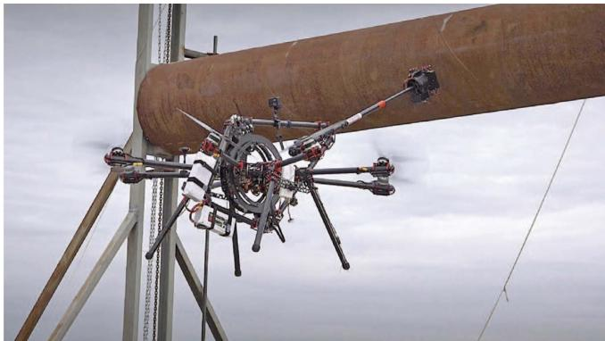

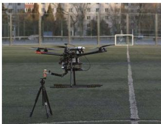  
(b)

(a)  
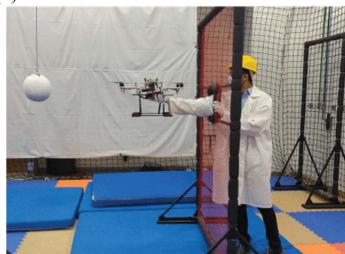  
(c)  
Fig. 6. Examples of DL-based UAV manipulation: (a) Contact inspection [46]© [2018] IEEE. (b) Grasping an object [91]© [2018] IEEE. (c) UAV-human handover [102]© [2022] IEEE.

## C. Deep Learning

Researchers began exploring the application of neural network models to UAVs as early as twenty years ago [88]. Given the limited capacity of NN models in the early stages, studies primarily focused on basic tasks, such as maintaining hover. With the advancement of deep learning (DL) technologies, more complex UAV manipulation tasks have been explored in recent years [16], [89], [90]. Typically, image-based object detection is a prerequisite for UAV manipulation tasks. In [46], two DL architectures were developed to enable UAVs to perform industrial inspection and maintenance tasks [see Fig. 6(a)]: one for UAV localization and another for crawler localization, allowing the UAV to pick up and release the crawler as needed. In [91], the well-known Single Shot Detection (SSD) algorithm [92] was used as the object detection solution for a hexacopter equipped with a 2-DoF robotic arm to perform grasping tasks, as shown in Fig. 6(b). In their study, a stereo camera installed on the hexacopter was employed to estimate the 3-D coordinates of the target object relative to the UAV system using the SSD-based detection method, then a sliding mode controller was implemented to guide the UAV toward the target for grasping. The authors in [93] open-sourced a soft robotic platform for autonomous aerial manipulation in both indoor and outdoor environments, which ingrates a DL-based pipeline for target object localization and grasping.

In [94], the authors employed a MobileNet-based detector [95], which is a modified version of the SSD architecture, to estimate the target’s location and distance, which are further used to help the UAV to perform stable landing. The authors in [96] reported a DL-based approach to enable UAVs to autonomously perform object pick-and-place tasks in GPS-denied environments. In this work, the authors developed a computationally efficient CNN-based DL model capable of unified multitask visual perception, including instance-level detection, segmentation, and tracking. Moreover, they developed a CNN model to continuously monitor grasp state feedback, ensuring robust operations by formulating UAV grasp state feedback as an image classification problem.

In [40], a CNN was employed to encode both image data and UAV state information, which is subsequently passed to a classifier to predict the current sub-phase of the fruit-picking task. [97] presented an interesting system for the cooperation between a mobile manipulator and Micro Aerial Vehicle (MAV) scouts, where the author utilized a monocular depth estimation model [98] to generate dense depth map estimates from visual imagery relayed by the MAVs, enabling visual-servoed exploration for the guidance of mobile manipulation. The authors in [99] developed a vision-based end-to-end landmark detection system for MAVs, in which a Convolutional Neural Network (CNN) model was designed to detect landmarks from images, drawing on the principles of YOLO [100] and SqueezeNet [101] architectures. Their experiments demonstrated that the proposed CNN model exhibits strong robustness across various types of landmarks and under different lighting conditions, both in indoor and outdoor environments.

The authors in[103] proposed a learning-based extended Kalman filter (EKF) to address the state estimation problem for dual-arm tendon-driven aerial continuum manipulation systems (ACMSs). They trained a DNN to learn the highly nonlinear Jacobian of the system, which typically imposes a heavy computational burden for real-time implementation. During runtime, the Jacobian estimated by the DNN is subsequently integrated into an EKF to obtain the ACMS states. [104] proposed an autonomous control strategy for a UAV, enabling it to track horizontal pipe structures while maintaining continuous contact. In their approach, a custom-designed CNN model is developed for pipe detection and feature extraction from image data. The CNN’s output is then integrated into an EKF to fuse the visual information with LIDAR sensor data, enhancing the system’s perception performance for robust control. Based on the modified relay feedback test (MRFT) algorithm [105] and the DNN-MRFT algorithm [106], [107] proposed a DNN-based noisetolerant approach, termed DNN with Noise-Protected MRFT (DNN-NP-MRFT), for real-time system identification and parametric tuning in the visual servoing control of UAVs. [108] proposed using a DNN to model the feedforward term of a nonlinear adaptive controller, enabling effective compensation for both internal and external uncertainties in the UAVs system.

Human–UAV interaction and collaboration based on deep learning techniques has also been explored in recent studies [109]. Typically, [110] developed an intuitive human–UAV interaction interface, in which the UAV’s movements are controlled based on the operator’s body pose, estimated by a NN model using RGB-D camera data. Focusing on human-UAV payload handover tasks, [102] developed a real-time human– UAV interaction detection method based on a Long Short-Term Memory (LSTM) neural network. Specifically, the LSTM model is employed to recognize state patterns arising from human interaction dynamics, using proprioceptive inputs such as IMU and position sensor measurements. Furthermore, by leveraging the DNN-MRFT algorithm [106], they enable the trained model to generalize across various UAV platforms without the need for fine-tuning. Their method was verified through multiple real-world human–UAV interaction scenarios, as shown in Fig. 6(c). The authors in [111] investigated the problem of adversarial attacks on DNN-enabled UAV systems. They proposed an approach that simultaneously optimizes multiple adversarial patches and their positions within input images. Experimental results demonstrated that the proposed method was able to successfully kidnap a UAV, misleading it away from its intended task of following a human user, by exploiting vulnerabilities in the DL-based model PULPFrontnet [112].

Summary of DL-based AM: DL-based methods for UAV manipulation can be broadly categorized into two groups. The first category involves using DL models for target detection, localization, or feature extraction from sensory data (see. e.g., [91], [94], [97]), particularly images and videos. In this context, DL models typically serve as the perception module of the systems, providing essential environmental awareness that enables subsequent high-level decision-making or low-level control. Many computer vision (CV) algorithms have been adapted and applied to UAV platforms for this purpose. However, due to the limited payload and onboard computational capacity of UAVs, especially Micro Aerial Vehicles (MAVs) [97], [99], lightweight models are often required, as conventional CV models tend to demand large computational resources. In addition, DL has also been applied to recognize human motion based on sensory data collected from the user [102], [110]. This information is then used to adapt the UAV’s motion policies accordingly, thereby facilitating effective and intuitive human–UAV interactions.

The second category involves using DL models to estimate highly nonlinear terms in the modeling or control ofUAVs [103], [104], [107]. These nonlinear components are often difficult to accurately represent using traditional analytical techniques, especially in complex and dynamic environments. DL models, however, offer a powerful alternative due to their strong capability to capture and approximate nonlinear relationships from data. The learned models are typically integrated into state estimation frameworks or control architectures, enabling more robust and adaptive control performance for UAVs, even in the presence of uncertainties and external disturbances.

## D. Learning-Based Control for Aerial Manipulation

Learning control is a crucial area in the field of aerial robots. Numerous learning-based controllers have been developed and applied primarily for trajectory-tracking [113], fault-tolerant control [107], [114], attitude control [115], and disturbance observer [116]. For instance, [117] presented a hierarchical learning control framework that tackles the challenges of structural complexity and dynamic interactions by employing separate controllers for the flight platform and the manipulator. Specifically, this work first focused on the design of a model-based parametrized attitude controller for the flight platform, where the torque exerted by the manipulator on the aerial platform is regarded as a disturbance. Then, a radial basis functions neural network (RBFNN) is utilized for estimation of the unknown parameters in the controller. [118] developed an adaptive dynamic programming-based learning control approach for tracking control of a quadrotor UAV system under the presence of time-varying and coupling uncertainties. NN was applied to approximate the optimal control laws within this controller, and the authors only evaluated their controller in simulations. The authors in [119] proposed a type-2 fuzzy-neural networks (FNN) based controller for UAVs to resist disturbances caused by the robotic arm motion and wind gust. Their controller eliminates the need for parameter tuning by continuously learning system dynamics and disturbances online. Both simulation and realworld experiments demonstrate improved tracking performance compared to conventional PD and PID controllers. The authors in [120] proposed the LAMDA (Learning Algorithm for Multivariable Data Analysis) control strategy for trajectory tracking tasks and demonstrated that it achieves performance comparable to other control methods, such as Inverse Dynamics and Sliding Mode Control (SMC).

In [91] and [94], DL-based algorithms were employed for target detection, and the detection results were subsequently integrated into a SMC or a fuzzy logic controller to enable UAVs to perform grasping or landing operations. In [104], a CNN model was employed for feature extraction from image data, followed by information fusion through an EKF. The fused information is then fed into a SMC to enable autonomous tracking control of the UAV. Similarly, [103] proposed using a DNN model to learn the Jacobian matrix of a dual-arm tendon-driven ACMS. The learned Jacobian is then used for state estimation with EKF, which is followed by a SMC for control execution.

The authors in[40] employed Model-Predictive Control (MPC) for UAVs to perform picking tasks, using waypoints generated by a learning architecture based on RGBD data. The authors in [121] proposed a learning-based variable whole-body MPC framework for agile aerial manipulation under strong wind conditions. In their approach, the problem of estimating unknown variables in MPC is formulated as a probabilistic policy search, which is solved using the widely adopted the weighted maximum likelihood and Expectation-Maximization (EM) algorithm. In addition, online Gaussian Process Regression (GPR) is employed to estimate disturbances caused by external environmental factors. Experimental results demonstrated good stability and robustness when operating in strong winds or under sudden wind disturbances. The authors in [122] proposed a DNN-based controller, which was pre-trained using data generated from both MPC and PID control strategies, to enable a UAV to dynamically track a moving target.

Targeting pregrasp planning tasks for dual-arm aerial continuum manipulation systems, [123] developed a learning-based control scheme using neural networks to address the high computational demands of processing system dynamics. In addition, they proposed a NN-based high-level planner for trajectory optimization. The proposed methods were evaluated in simulation for pre-grasping both fixed and moving objects. In [124], an integrated antidisturbance backstepping control framework was proposed for aerial manipulators, leveraging adaptive NN to enhance system performance in complex and dynamic environments. By combining a NN-based feedforward compensation for coupling disturbances with real-time adaptive feedback, the method effectively mitigates a wide range of internal and external disturbances commonly encountered during aerial manipulation tasks. They verified the proposed controller in both simulation and real-word dynamic tracking tasks, showing superior performance compared with other three control methods. The authors in [125] proposed embedding NN into baseline Lyapunov-stable controllers, such as the Linear Active Disturbance Rejection Controller (LADRC), for fully-actuated flying platforms of aerial manipulation systems. In their formulation, the control performance can be enhanced by updating the controller parameters under Lyapunov stability conditions. The effectiveness of the proposed method was validated through a virtual grasping task. In [108], a learning-based RISE (Robust Integral of the Sign of the Error) controller was proposed for dual-arm UAV systems. Within their control framework, a DNN model was trained to estimate the feedforward term of the RISE controller by leveraging the universal approximation property [126], thereby enhancing the system’s robustness against parameter uncertainties and external disturbances. In addition, the stability of the DNN-based RISE controller was rigorously analyzed. The effectiveness of the proposed approach was validated through various real-world tasks, including dual-arm collaborative grasping and object delivery, as demonstrated in Fig. 7(a). Very recently, [127] employed the SO-BFBEL (Self-Organised Bidirectional Brain Emotional Learning) controller, developed in [128] and based on fuzzy neural networks, to enable UAVs to transport long objects.

Researchers have been advancing learning-based adaptive control methods for UAVs to handle physical interaction tasks. Notably, learning-based adaptive stiffness/impedance control is one of the most commonly used techniques for enabling compliant interactions between UAVs and their environments. For example, [131] proposed an impedance control scheme for UAVs performing contact-based surface inspection, where the stiffness is learned (estimated) online to regulate the contact force, thereby enhancing the robustness of the UAVs system. The authors in [129] introduced an energy tank-based control algorithm to enable UAVs to perform physical interaction tasks in uncertain dynamic environments, e.g., pushing a cart as shown in Fig. 7(b). The impedance/force profiles in their controller are learned and adapted online with passivity guarantee based on the energy tank concept, which has been widely applied in robotic manipulators. The authors in [65] used RL to adapt the impedance control gains for optimal and compliant UAV–environment interaction, by properly constructing a cost function based on the distance between the end effector and the surface.

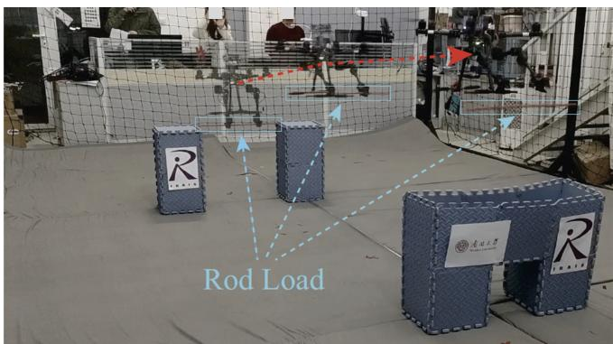  
(a)

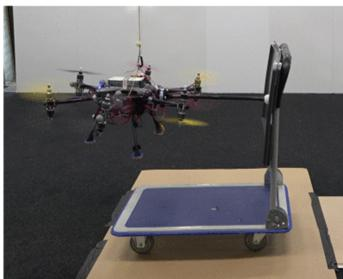  
(b)

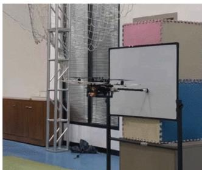  
(c)  
Fig. 7. Examples of learning-based control for UAV manipulation: (c) Dual-arm collaborative grasping and delivery [108]. (b) Pushing a cart [129]© [2022] IEEE. (c) Physical interaction with a whiteboard [130]© [2023] IEEE.

Force control has been demonstrated to be crucial for enabling UAVs to interact with the environment. [132], [133]. Adaptive force control based on learning methods has also been explored recently in this context. The authors in [134] proposed a force control strategy based on iterative learning and applied it to a UAV knot-tying task. In [130], an adaptive impedance control strategy was developed for UAVs to maintain stable contact forces with the environment, where environmental parameters, including stiffness, are learned online and used to generate a reference position trajectory for the subsequent position controller. Their method was validated in both simulation and real-world scenarios, including physical interaction with a whiteboard shown in Fig. 7(c).

Summary oflearning-based controlfor AM: Learning-based UAV control methods can generally be classified into the following three groups, as illustrated in Fig. 8.

1) The first group adopts a linear combination of a learning module and a controller, where the output of the learning module is used directly as the input to the controller. Examples can be found in [40], [91], [94].

2) In the second group, the learning module is typically employed to adapt or tune the key parameters of the controller [135], and this strategy is often implemented in learning-based adaptive impedance control for compliant UAV manipulation [129], [131].

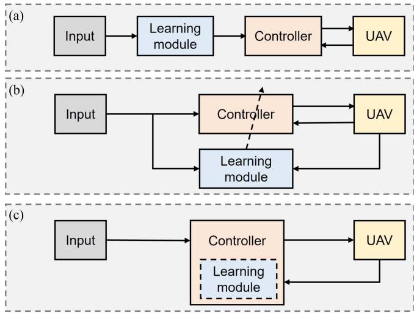  
Fig. 8. Graphical illustration of the three categories of learning-based control methods: (a) the learning module and the controller are integrated in a sequential (linear) manner; (b) the learning module is used to adapt key variables within the control system; and (c) the learning module is embedded as an integral part of the controller.

3) The third group integrates the learning module directly into the controller itself [119], [125]. In this approach, the learning module is used to estimate modeling errors or unknown system dynamics, and the learned outputs are leveraged to compensate for these uncertainties, enhancing the controller’s robustness and adaptability.

Learning-based control is an effective technique for enabling UAVs to acquire robust manipulation capabilities. It offers unique advantages in handling highly dynamic, nonlinear, and uncertain environments compared to traditional control methods [118], [120], [124]. By leveraging learning techniques, the system and interaction dynamics can be effectively modeled, a task that is often difficult or even infeasible for conventional approaches, thereby significantly enhancing control performance. Furthermore, it allows control policies to adapt to the environment or to overcome external disturbances by learning key parameters of the controllers and/or the UAV systems [121], [129], [130]. Nevertheless, learning-based control methods, especially those based on DL and RL, often suffer from higher computational and real-world implementation costs, as noted in [136].

## IV. SUMMARY OF LEARNING-BASED AERIAL MANIPULATION TASKS

Table I provides a summary of typical UAV manipulation tasks enabled by the aforementioned learning methods. As mentioned above, these tasks can be generally grouped into six main categories: 1) Grasping; 2) Pick-and-place; 3) Load transportation; 4) Contact-rich tasks; 5) Contact-impact tasks; and 6) Human–UAV interaction tasks.

We observe that DL has been widely used in UAV grasping tasks. This is primarily because it is advantageous to localize grasping targets using image data, leveraging well established

DNN models in the field of computer vision (CV). Pickingand-placing tasks are generally more challenging than grasping tasks, as they require not only accurate target localization but also trajectory generalization to ensure successful object delivery, often involving obstacle avoidance. In this context, IL and RL have been effectively used to generate appropriate UAV trajectories. Most load transportation tasks are addressed using RL-based methods, likely because RL is particularly well suited for handling environmental uncertainties, such as variable wind conditions, shifting payload dynamics and unstructured environments. Furthermore, multiple UAVs are often employed to cooperatively transport a single object. In contact-rich scenarios, learning-based control methods play a vital role due to their ability to ensure compliant interaction with the environment. In comparison, contact-impact and human–UAV interaction tasks have received relatively limited attention in the field, which may be due to the complexity of the interactions and safety concerns. Again, thanks to the advantages of DL-based methods in environmental monitoring, they have been applied for contact point localization and human state estimation, respectively, in these two types of UAV tasks.

In summary, DL and IL/RL represent two complementary approaches to AM. DL-based methods are typically employed for perception and prediction tasks, such as object detection or learning mappings from sensor inputs to control commands. In contrast, IL and RL are primarily used for planning (including both task planning and trajectory planning) and control (often flight control). In particular, RL learns control policies (often in an end-to-end manner) through interaction with the environment, making it especially well suited for AM tasks that require sequential decision-making. Furthermore, LC is employed to address the challenges of interaction control during AM.

In some studies, two or more learning techniques are combined to enhance performance. For example, DL is first employed to identify the target’s position, followed by the use of IL or DL to generate motion commands that guide the UAV to the target and complete a specific task, as demonstrated in [40] and [68]. Furthermore, both learning and control methods are necessary to address contact-rich tasks, as discussed in Section III-D.

The application of learning-based methods to UAV manipulation has primarily emerged over the past five years, with most current tasks involving a single UAV equipped with a single manipulator. Researchers have begun addressing more challenging UAV manipulation problems, such as those involving multiagent UAV systems, using learning techniques, which will be further discussed in the following section.

## V. DISCUSSIONS AND PERSPECTIVES ON LEARNING-BASED AERIAL MANIPULATION

## A. Learning With Multimodal Data

Learning from multimodal data has proven to be an effective approach for training robust models by leveraging the advantages of various modalities [137]. Most existing works on UAV manipulation heavily rely on using images as input for location recognition and feature extraction based on DL techniques.

TABLE I  
SUMMARY OF TYPICAL LEARNING-BASED AERIAL MANIPULATION TASKS

<table><tr><td rowspan="2">Tasks</td><td rowspan="2">Papers</td><td rowspan="2">Years</td><td colspan="4">Learning Methods</td><td colspan="2">Validation Scenarios</td><td rowspan="2">NoU</td><td rowspan="2">NoM</td></tr><tr><td>IL</td><td>RL</td><td>DL</td><td>LC</td><td>Simulation</td><td>Real-world</td></tr><tr><td rowspan="7">Grasping</td><td>Jiao [91]</td><td>2018</td><td></td><td></td><td>√</td><td></td><td></td><td>√</td><td>1</td><td>1</td></tr><tr><td>Lee [48]</td><td>2020</td><td>√</td><td></td><td></td><td></td><td></td><td>√</td><td>1</td><td>1</td></tr><tr><td>Baraban [40]</td><td>2021</td><td>√</td><td></td><td>√</td><td></td><td></td><td>√</td><td>1</td><td>1</td></tr><tr><td>Zito [39]</td><td>2022</td><td>√</td><td></td><td></td><td></td><td>√</td><td></td><td>3</td><td>1</td></tr><tr><td>Ma [125]</td><td>2022</td><td></td><td></td><td>√</td><td>√</td><td>√</td><td></td><td>1</td><td>1</td></tr><tr><td>Ghorbani [123]</td><td>2023</td><td></td><td></td><td>√</td><td>√</td><td></td><td>√</td><td>1</td><td>2</td></tr><tr><td>Bauer [93]</td><td>2024</td><td></td><td></td><td>√</td><td></td><td></td><td>√</td><td>1</td><td>1</td></tr><tr><td rowspan="5">Pick-and-place</td><td>Verdin [49]</td><td>2021</td><td>√</td><td></td><td></td><td></td><td>√</td><td></td><td>1</td><td>1</td></tr><tr><td>Kumar [96]</td><td>2022</td><td></td><td></td><td>√</td><td></td><td></td><td>√</td><td>1</td><td>1</td></tr><tr><td>Chen [78]</td><td>2023</td><td></td><td>√</td><td></td><td></td><td>√</td><td>√</td><td>3</td><td>1</td></tr><tr><td>Dimmig [68]</td><td>2024</td><td></td><td>√</td><td></td><td></td><td>√</td><td>√</td><td>1</td><td>1</td></tr><tr><td>Wang [108]</td><td>2025</td><td></td><td></td><td>√</td><td>√</td><td></td><td>√</td><td>1</td><td>2</td></tr><tr><td rowspan="8">Transportation</td><td>Palunko [55]</td><td>2013</td><td></td><td>√</td><td></td><td></td><td></td><td>√</td><td>1</td><td>1</td></tr><tr><td>Dos [57]</td><td>2013</td><td></td><td>√</td><td></td><td></td><td></td><td>√</td><td>1</td><td>1</td></tr><tr><td>Kim [36]</td><td>2018</td><td>√</td><td></td><td></td><td></td><td></td><td>√</td><td>2</td><td>1</td></tr><tr><td>Zhou [58]</td><td>2019</td><td></td><td>√</td><td></td><td></td><td>√</td><td></td><td>1</td><td>1</td></tr><tr><td>Li [62]</td><td>2021</td><td></td><td>√</td><td></td><td></td><td>√</td><td></td><td>3</td><td>1</td></tr><tr><td>Nazir [66]</td><td>2022</td><td></td><td>√</td><td></td><td></td><td>√</td><td>√</td><td>1</td><td>1</td></tr><tr><td>Lin [76]</td><td>2023</td><td></td><td>√</td><td></td><td></td><td>√</td><td></td><td>2</td><td>1</td></tr><tr><td>Muthusamy [127]</td><td>2025</td><td></td><td></td><td></td><td>√</td><td>√</td><td>√</td><td>1</td><td>1</td></tr><tr><td rowspan="10">Contact-rich</td><td>Ollero [46]</td><td>2018</td><td>√</td><td></td><td>√</td><td></td><td></td><td>√</td><td>1</td><td>1</td></tr><tr><td>Lee [48]</td><td>2020</td><td>√</td><td></td><td></td><td></td><td></td><td>√</td><td>1</td><td>1</td></tr><tr><td>Markovic [131]</td><td>2021</td><td></td><td></td><td></td><td>√</td><td></td><td>√</td><td>1</td><td>1</td></tr><tr><td>Benzi [129]</td><td>2022</td><td></td><td></td><td></td><td>√</td><td></td><td>√</td><td>1</td><td>1</td></tr><tr><td>Zhang [65]</td><td>2022</td><td></td><td>√</td><td></td><td>√</td><td>√</td><td>√</td><td>1</td><td>1</td></tr><tr><td>Cuniato [67]</td><td>2023</td><td></td><td>√</td><td></td><td>√</td><td>√</td><td></td><td>1</td><td>1</td></tr><tr><td>Feng [87]</td><td>2023</td><td></td><td>√</td><td></td><td>√</td><td>√</td><td></td><td>1</td><td>1</td></tr><tr><td>Liang [130]</td><td>2023</td><td></td><td></td><td></td><td>√</td><td>√</td><td>√</td><td>1</td><td>1</td></tr><tr><td>Pandya [104]</td><td>2024</td><td></td><td></td><td>√</td><td></td><td></td><td>√</td><td>1</td><td>1</td></tr><tr><td>He [42]</td><td>2025</td><td>√</td><td></td><td>√</td><td></td><td></td><td>√</td><td>1</td><td>1</td></tr><tr><td rowspan="4">Contact impact</td><td>Silva [33]</td><td>2015</td><td>√</td><td></td><td></td><td>√</td><td></td><td></td><td>1</td><td>1</td></tr><tr><td>Yu [99]</td><td>2018</td><td></td><td></td><td>√</td><td></td><td></td><td>√</td><td>1</td><td>1</td></tr><tr><td>Huang [70]</td><td>2022</td><td></td><td>√</td><td></td><td></td><td>√</td><td>√</td><td>1</td><td>1</td></tr><tr><td>Rabah [94]</td><td>2022</td><td></td><td></td><td>√</td><td></td><td></td><td>√</td><td>1</td><td>1</td></tr><tr><td rowspan="2">Human-UAV Interaction</td><td>Peringal [102]</td><td>2022</td><td></td><td></td><td>√</td><td></td><td></td><td>√</td><td>1</td><td>1</td></tr><tr><td>Zoric [110]</td><td>2023</td><td></td><td></td><td>√</td><td></td><td>√</td><td></td><td>1</td><td>1</td></tr></table>

NoU: Number of UAVs involved in a task; NoM: Number of manipulators equipped on the UAV used in the task

Learning from multimodal information to build reliable robotic skill and task models has been extensively studied in other areas of robotics [138]; however, it has been less explored in aerial manipulation. Therefore, an important open question is how to effectively leverage multimodal sensory data to enhance AM performance.

Force and tactile signals play a crucial role in physical interaction tasks [139], providing complementary information that vision alone often cannot sufficiently capture, such as contact conditions, surface properties, and slip detection. Effectively fusing these modalities with vision data through learning modules, such as DL and RL, can enable a better understanding of the interaction dynamics, offering a promising solution to enhance the adaptability, dexterity, and robustness of UAV manipulation. This fusion allows the UAV to perform more complex and delicate tasks in unstructured environments, such as grasping, assembling, interacting with fragile objects or soft manipulators [66], [93], [140], where purely vision-based learning strategies often fall short.

Certain sensory data play a particularly critical role in specific UAV tasks [141], [142]. For example, ultrasound sensing has been employed to enable UAVs to perform contact-based inspection of structural assets, allowing for measurements and evaluations that require physical interaction with surfaces [143], [144], [145], [146]. Inertial Measurement Units (IMUs) are critical for stabilizing the UAV systems during manipulation and ensuring fine control of manipulators and tools by continuously monitoring the UAV’s motion states and dynamics [147], [148]. Therefore, leveraging these modalities through learning-based frameworks opens new possibilities for developing more robust and reliable UAV manipulation skills.

Advanced multimodal learning techniques developed in the field of computer science and widely applied in various robotic manipulation scenarios, such as attention-based models (e.g., Transformers [149], [150]), Generative Adversarial Networks (GANs) [151], and Multimodal Variational Autoencoders (MVAEs) [152], can offer powerful tools for enhancing UAV manipulation capabilities by effectively fusing heterogeneous sensory inputs.

## B. Learning Control-Aware Policies

Learning models typically focus on generating high-level motion policies that guide robotic task execution, while control modules are responsible for handling low-level, hardwarespecific, and task-specific details, ensuring reliable interaction with the environment. However, without adequately incorporating control knowledge, such as system dynamics, compliance mechanisms, and stability constraints, the learned policies often suffer from reduced robustness and stability. To address these challenges, integrating control priors and domain-specific rules into learning frameworks has emerged as a promising direction [87], [153]. The “learning-meets-control” approach seamlessly integrates the adaptability and generalization of learning systems with the reliability and precision of traditional control methods, offering significant potential to enhance UAV manipulation performance, particularly in complex physical contact tasks where stability, safety, and trustworthiness are critical.

For example, learning control-structured output actions using RL, rather than black-box end-to-end policies, can improve the robustness and explainability of the robotic system while providing safety guarantees, which has been validated in various robotic manipulation scenarios including AM [87], [154], [155]. Another typical example is the integration of DNN-based offline learning with model-based control for robotic online adaptation to dynamic environments, as illustrated in Fig. 8(c). In this approach, an offline learning process is first employed to model highly nonlinear dynamics, including interaction [156], environmental, or internal system dynamics [108]. A controller is then applied using the learned models to enable the robot to stably adapt to given tasks.

## C. Generalizable Aerial Manipulation

Generalizing learned policies across diverse task conditions is pivotal for advancing the manipulation capabilities of UAVs. For the aforementioned manipulation tasks, such as grasping, transportation, inspection, and assembly, UAVs often operate under diverse and dynamic conditions. These include variations in object properties (e.g., shape, size, weight, and hardness), task requirements (e.g., positioning accuracy and target locations), and environmental factors (e.g., wind and lighting). This capability could largely enhance the efficiency and scalability of task execution in real-world applications. The challenge lies in developing generalizable AM skills that allow UAVs to adapt efficiently to new task scenarios without requiring timeconsuming and resource-intensive retraining for each specific case.

RL has played a pivotal role in enhancing the generalization capabilities of robotic systems by enabling them to learn adaptable motion policies through trial-and-error interactions across diverse environments, resulting in robust models capable of handling environmental uncertainties. Techniques such as Domain Randomization [157] and Digital Twins [158], [159] are often employed in RL to bridge the sim-to-real gap, enabling the effective transfer of models trained in simulation to real-world scenarios by thoroughly interacting with diverse and realistic variations during training. As discussed in Section III-B, one of the main challenges facing RL-based UAV manipulation is the absence of high-fidelity simulators tailored to UAV systems, as well as a lack of well-defined benchmark tasks to evaluate and compare performance. Multiple UAV simulators have been developed by the research community, including RotorS [160],

AirSim [161], Flightmare [162], RotorTM [163], and Fast-Sim [164], and the simulator for Integrated Aerial Platforms (IAPs) [165]. For a comprehensive overview of UAV simulators, we refer readers to the survey in [166]. Despite these advancements, there is still a notable absence of simulators that are both highly compatible with RL (particularly DRL) and capable of accurately modeling contact-rich AM tasks. The recently developed Aerial Gym simulator [167], built on the NVIDIA Isaac Gym [168], represents a promising solution to this challenge by offering high-performance simulation capabilities that are well-suited for DRL.

In addition to RL-based methods, alternative learning paradigms such as Action Chunk with Transformer (ACT) model [42], [52], Diffusion Policy [169], and large pre-trained models including Vision Language Models (VLM) [170] and Large Language Models (LLM) [171], present promising avenues for UAV manipulation. These approaches have already demonstrated impressive generalization capabilities in a range of robotic manipulation tasks and offer strong potential to enhance adaptability in aerial robotic applications. This emerging direction is expected to receive increased attention and exploration in the near future.

## D. Learning for Multiagent Cooperative Manipulation

Multiagent UAV cooperative manipulation usually offers several advantages over single-UAV systems in some specific scenarios, including increased payload capacity and stability during transportation, greater flexibility in task allocation, and improved robustness through redundancy control and task coordination. Several types of UAV cooperative systems have been developed, including: 1) single UAVs equipped with multiple manipulators to increase manipulation dexterity and task coverage [103], [108], [123], [145], [175]; 2) multiple UAVs working in a coordinated manner to share tasks or handle larger payloads [11], [36], [78], [172], [176], [177]; 3) heterogeneous systems involving UAVs collaborating with other types of robots, such as mobile robots [97], [178], [179], unmanned surface vehicles (USV) [173], or unmanned ground vehicles (UGVs) [180], to leverage complementary capabilities; and 4) human–UAV cooperation systems [102], [110], [174], where UAVs assist or collaborate directly with human operators in complex tasks. Several examples of the four multiagent UAV manipulation systems are shown in Fig. 9.

Learning cooperative motion policies for multiagent UAV systems is inherently challenging due to factors such as dynamic coordination requirements, communication constraints, and the heterogeneous nature ofthe agents involved. The complexity further increases when human users are incorporated into the loop. Nevertheless, methods based on multiagent learning [78], [177], multitask learning [181], and distributed learning and optimization paradigms [182], [183] have been explored. These studies have demonstrated feasible solutions to this challenge; however, significant research efforts are still needed to achieve more advanced performance in multiagent co-manipulation tasks. In human–UAV cooperation systems, it is crucial to account for the human user’s state and motion intent to ensure effective interaction and collaboration. This involves accurately interpreting cues such as body posture, gestures, and physiological signals using, for example, DL techniques [184], and integrating the information into the UAV’s decision-making and control processes.

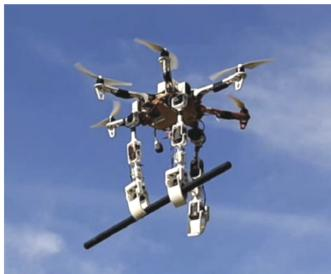  
(a)

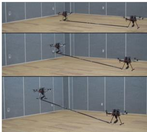

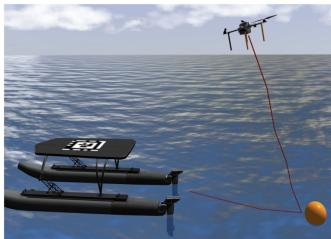  
(c)

(b)  
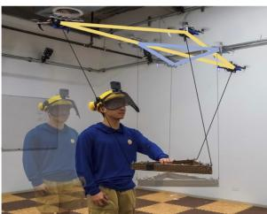  
(d)  
Fig. 9. Examples of multiagent UAV cooperative manipulation. (a) A UAV equipped with multiple manipulators [145]. (b) Two UAV robots co-carry an object [172]© [2018] IEEE. (c) USV-UAV cooperation [173]© [2024] IEEE. (d) Human–UAV cooperative transportation [174]© [2024] IEEE.

## VI. CONCLUSION

This article provides a focused review of recent advancements in AM using learning-based approaches, along with the corresponding AM tasks enabled by these methods, which are built upon four main types of learning techniques: IL, RL, DL, and LC. Despite these achievements, learning-based methods often face challenges that stem from general limitations of learning models or arise from the unique demands of aerial robotic applications. For example, training highly robust RL models and generalizing them to diverse real-world environments remains challenging, largely due to the limited availability of simulators specifically tailored for AM.

Looking ahead, several key aspects require attention to advance learning-based AM. In particular, the representation of AM skills and tasks should be learned from multimodal sensory data; control-aware manipulation policies must be developed, especially for scenarios involving physical contact; task autonomy should be improved by learning generalizable AM policies; and the ability to learn multiagent cooperative behaviors is essential for tackling more complex scenarios. To summarize, learning-based methods are accelerating the application of aerial robotics in the real world.

## ACKNOWLEDGMENT

The authors would like to thank Dr. Mario Gianni from the University of Liverpool for the initial discussions that helped shape this review. They also extend their gratitude to the editors

## IEEE/ASME TRANSACTIONS ON MECHATRONICS

and anonymous reviewers for their insightful comments and suggestions. Additionally, the authors used ChatGPT to assist in proofreading and enhancing the readability of the manuscript.

## REFERENCES

[1] S. A. H. Mohsan, M. A. Khan, F. Noor, I. Ullah, and M. H. Alsharif, “Towards the unmanned aerial vehicles (UAVs): A comprehensive review,” Drones, vol. 6, no. 6, 2022, Art. no. 147.

[2] C. Ding and L. Lu, “A tilting-rotor unmanned aerial vehicle for enhanced aerial locomotion and manipulation capabilities: Design, control, and applications,” IEEE/ASME Trans. Mechatron., vol. 26, no. 4, pp. 2237–2248, Aug. 2021.

[3] H. Huang, W. He, J. Wang, L. Zhang, and Q. Fu, “An all servodriven bird-like flapping-wing aerial robot capable of autonomous flight,” IEEE/ASME Trans. Mechatron., vol. 27, no. 6, pp. 5484–5494, Dec. 2022.

[4] Z. Li, H. Li, Q. Xu, X. Yu, and M. V. Basin, “Coupling disturbance modeling and compensation for aerial manipulator in highly dynamic motion,” IEEE Trans. Cybern., vol. 55, no. 1, pp. 124–135, Jan. 2025.

[5] Z. Zhang et al., “An end-effector-oriented coupled motion planning method for aerial manipulators in constrained environments,” IEEE/ASME Trans. Mechatron., early access, Mar. 28, 2025, doi: 10.1109/TMECH.2025.3550562.

[6] M. Orsag, C. Korpela, S. Bogdan, and P. Oh, “Dexterous aerial robots— mobile manipulation using unmanned aerial systems,” IEEE Trans. Robot., vol. 33, no. 6, pp. 1453–1466, Dec. 2017.

[7] F. Ruggiero, V. Lippiello, and A. Ollero, “Aerial manipulation: A literature review,” IEEE Robot. Automat. Lett., vol. 3, no. 3, pp. 1957–1964, Jul. 2018.

[8] A. Mohiuddin, T. Tarek, Y. Zweiri, and D. Gan, “A survey of single and multi-UAV aerial manipulation,” Unmanned Syst., vol. 8, no. 02, pp. 119–147, 2020.

[9] H. Cao, J. Shen, C. Liu, B. Zhu, and S. Zhao, “Motion planning for aerial pick-and-place with geometric feasibility constraints,” IEEE Trans. Automat. Sci. Eng., vol. 22, pp. 2577–2594, 2025.

[10] R. Ladig, H. Paul, R. Miyazaki, and K. Shimonomura, “Aerial manipulation using multirotor UAV: A review from the aspect of operating space and force,” J. Robot. Mechatron., vol. 33, no. 2, pp. 196–204, 2021.

[11] K. Zhang et al., “Aerial additive manufacturing with multiple autonomous robots,” Nature, vol. 609, no. 7928, pp. 709–717, 2022.

[12] Y. F. Kaya, L. Orr, B. B. Kocer, V. Pawar, R. Stuart-Smith, and M. Kovaˇc, “Aerial additive manufacturing: Toward on-site building construction with aerial robots,” Sci. Robot., vol. 10, no. 101, 2025, Art. no. eado6251.

[13] Í. Elguea-Aguinaco, A. Serrano-Muñoz, D. Chrysostomou, I. Inziarte-Hidalgo, S. Bøgh, and N. Arana-Arexolaleiba, “A review on reinforcement learning for contact-rich robotic manipulation tasks,” Robot. Comput.- Integr. Manuf., vol. 81, 2023, Art. no. 102517.

[14] R. Newbury et al., “Deep learning approaches to grasp synthesis: A review,” IEEE Trans. Robot., vol. 39, no. 5, pp. 3994–4015, Oct. 2023.

[15] S. K. C. Tulli, “Artificial intelligence, machine learning and deep learning in advanced robotics, a review,” Int. J. Acta Informatica, vol. 3, no. 1, pp. 35–58, 2024.

[16] Y. Zheng, C. Zheng, J. Shen, P. Liu, and S. Zhao, “Keypoint-guided efficient pose estimation and domain adaptation for micro aerial vehicles,” IEEE Trans. Robot., vol. 40, pp. 2967–2983, 2024.

[17] J. Saunders, S. Saeedi, and W. Li, “Autonomous aerial robotics for package delivery: A technical review,” J. Field Robot., vol. 41, no. 1, pp. 3–49, 2024.

[18] J. Zhang, N. Kang, Q. Qu, L. Zhou, and H. Zhang, “Automatic fruit picking technology: A comprehensive review of research advances,” Artif. Intell. Rev., vol. 57, no. 3, p. 54, 2024.

[19] M. O. Macaulay and M. Shafiee, “Machine learning techniques for robotic and autonomous inspection of mechanical systems and civi infrastructure,” Auton. Intell. Syst., vol. 2, no. 1, p. 8, 2022.

[20] D. Xilun, G. Pin, X. Kun, and Y. Yushu, “A review of aerial manipulation of small-scale rotorcraft unmanned robotic systems,” Chin. J. Aeronaut., vol. 32, no. 1, pp. 200–214, 2019.

[21] A. Ollero, M. Tognon, A. Suarez, D. Lee, and A. Franchi, “Past, present, and future of aerial robotic manipulators,” IEEE Trans. Robot., vol. 38, no. 1, pp. 626–645, Feb. 2022.

[22] Y. A. Becerra-Mora and S. Soto-Gaona, “Tracking and grasping of moving objects using aerial robotic manipulators: A brief survey,” Revista UIS Ingenierıás, vol. 22, no. 4, pp. 115–128, 2023.

[23] S. C. Barakou, C. S. Tzafestas, and K. P. Valavanis, “A review of real-time implementable cooperative aerial manipulation systems,” Drones, vol. 8, no. 5, 2024, Art. no. 196.

[24] S. Sai, A. Garg, K. Jhawar, V. Chamola, and B. Sikdar, “A comprehensive survey on artificial intelligence for unmanned aerial vehicles,” IEEE Open J. Veh. Technol., vol. 4, pp. 713–738, 2023.

[25] R. A. AL-Syouf, R. M. Bani-Hani, and O. Y. AL-Jarrah, “Machine learning approaches to intrusion detection in unmanned aerial vehicles (UAVs),” Neural Comput. Appl., vol. 36, no. 29, pp. 18009–18041, 2024.

[26] H. Zhong, J. Liang, Y. Chen, H. Zhang, J. Mao, and Y. Wang, “Prototype, modeling, and control of aerial robots with physical interaction: A review,” IEEE Trans. Automat. Sci. Eng., vol. 22, pp. 3528–3542, 2025.

[27] X. Zhou, H. Zhong, H. Zhang, W. He, H. Hua, and Y. Wang, “Current status, challenges, and prospects for new types of aerial robots,” Engineering, vol. 41, pp. 19–34, 2024.

[28] W. Wang, C. Zeng, Z. Lu, and C. Yang, “A novel robust imitation learning framework for dual-arm object-moving tasks,” IEEE Trans. Ind. Electron., vol. 71, no. 12, pp. 16068–16076, Dec. 2024.

[29] J. Ding, T. L. Lam, L. Ge, J. Pang, and Y. Huang, “Safe and adaptive 3-D locomotion via constrained task-space imitation learning,” IEEE/ASME Trans. Mechatron., vol. 28, no. 6, pp. 3029–3040, Dec. 2023.

[30] C. Zeng, S. Li, Z. Chen, C. Yang, F. Sun, and J. Zhang, “Multifingered robot hand compliant manipulation based on vision-based demonstration and adaptive force control,” IEEE Trans. Neural Netw. Learn. Syst., vol. 34, no. 9, pp. 5452–5463, Sep. 2023.

[31] N. D. Ratliff, D. Silver, and J. A. Bagnell, “Learning to search: Functional gradient techniques for imitation learning,” Auton. Robots, vol. 27, pp. 25–53, 2009.

[32] Y. Fan, S. Chu, W. Zhang, R. Song, and Y. Li, “Learn by observation: Imitation learning for drone patrolling from videos of a human navigator,” in Proc. 2020 IEEE/RSJ Int. Conf. Intell. Robots Syst., 2020, pp. 5209–5216.

[33] R. Silva, F. S. Melo, and M. Veloso, “Towards table tennis with a quadrotor autonomous learning robot and onboard vision,” in Proc. 2015 IEEE/RSJ Int. Conf. Intell. Robots Syst., 2015, pp. 649–655.

[34] K. Mülling, J. Kober, O. Kroemer, and J. Peters, “Learning to select and generalize striking movements in robot table tennis,” Int. J. Robot. Res., vol. 32, no. 3, pp. 263–279, 2013.

[35] H. Kim, H. Lee, S. Choi, Y.-K. Noh, and H. J. Kim, “Motion planning with movement primitives for cooperative aerial transportation in obstacle environment,” in Proc. 2017 IEEE Int. Conf. Robot. Automat., 2017, pp. 2328–2334.

[36] H. Kim, H. Seo, C. Y. Son, H. Lee, S. Kim, and H. J. Kim, “Cooperation in the air: A learning-based approach for the efficient motion planning of aerial manipulators,” IEEE Robot. Automat. Mag., vol. 25, no. 4, pp. 76–85, Dec. 2018.

[37] H. Lee, H. Kim, and H. J. Kim, “Planning and control for collisionfree cooperative aerial transportation,” IEEE Trans. Automat. Sci. Eng., vol. 15, no. 1, pp. 189–201, Jan. 2018.

[38] T. Matsubara, S.-H. Hyon, and J. Morimoto, “Learning parametric dynamic movement primitives from multiple demonstrations,” Neural Netw., vol. 24, no. 5, pp. 493–500, 2011.

[39] C. Zito and E. Ferrante, “One-shot learning for autonomous aerial manipulation,” Front. Robot. AI, vol. 9, 2022, Art. no. 960571.

[40] G. Baraban, S. Kothiyal, and M. Kobilarov, “Perception-based uav fruit grasping using sub-task imitation learning,” in Proc. 2021 Aerial Robot. Syst. Phys. Interacting With Enviro., 2021, pp. 1–8.

[41] G. A. Yashin, D. Trinitatova, R. T. Agishev, R. Ibrahimov, and D. Tsetserukou, “AeroVR: Virtual reality-based teleoperation with tactile feedback for aerial manipulation,” in Proc. 19th Int. Conf. Adv. Robot., 2019, pp. 767–772.

[42] G. He et al., “Flying hand: End-effector-centric framework for versatile aerial manipulation teleoperation and policy learning,” 2025, arXiv:2504.10334.

[43] C. Huang, Y. Dang, P. Chen, X. Yang, and K.-T. Cheng, “One-shot imitation drone filming of human motion videos,” IEEE Trans. Pattern Anal. Mach. Intell., vol. 44, no. 9, pp. 5335–5348, Sep. 2022.

[44] M. Zhu, H. She, W. Si, and C. Li, “Lightweight imitation learning algorithm with error recovery for human direction correction,” in Proc. 29th Int. Conf. Automat. Comput., 2024, pp. 1–6.

[45] F. Kong, G. Zambella, S. Monteleone, G. Grioli, M. G. Catalano, and A. Bicchi, “A suspended aerial manipulation avatar for physical interaction in unstructured environments,” IEEE Access, vol. 12, pp. 48108–48125, 2024.

[46] A. Ollero et al., “The aeroarms project: Aerial robots with advanced manipulation capabilities for inspection and maintenance,” IEEE Robot. Automat. Mag., vol. 25, no. 4, pp. 12–23, Dec. 2018.

[47] R. Balachandran, J. Artigas, U. Mehmood, and J.-H. Ryu, “Performance comparison of wave variable transformation and time domain passivity approaches for time-delayed teleoperation: Preliminary results,” in Proc. 2016 IEEE/RSJ Int. Conf. Intell. Robots Syst., 2016, pp. 410–417.

[48] J. Lee et al., “Visual-inertial telepresence for aerial manipulation,” in Proc. 2020 IEEE Int. Conf. Robot. Automat., 2020, pp. 1222–1229.

[49] R. Verdı´n, G. Ramı´rez, C. Rivera, and G. Flores, “Teleoperated aerial manipulator and its avatar. communication, system’s interconnection, and virtual world,” in Proc. 2021 Int. Conf. Unmanned Aircr. Syst., 2021, pp. 1488–1493.

[50] J. Mellet, M. Allenspach, E. Cuniato, C. Pacchierotti, R. Siegwart, and M. Tognon, “Evaluation of human-robot interfaces based on 2D/3D visual and haptic feedback for aerial manipulation,” J. Intell. Robot. Syst., vol. 111, no. 3, 2025, Art. no. 104.

[51] M. Allenspach, T. Kötter, R. Bähnemann, M. Tognon, and R. Siegwart, “Design and evaluation of a mixed reality-based human-robot interface for teleoperation of omnidirectional aerial vehicles,” in Proc. 2023 Int. Conf. Unmanned Aircr. Syst., 2023, pp. 1168–1174.

[52] T. Z. Zhao, V. Kumar, S. Levine, and C. Finn, “Learning fine-grained bimanual manipulation with low-cost hardware,” 2023, arXiv:2304.13705.

[53] J. Ibarz, J. Tan, C. Finn, M. Kalakrishnan, P. Pastor, and S. Levine, “How to train your robot with deep reinforcement learning: Lessons we have learned,” Int. J. Robot. Res., vol. 40, no. 4-5, pp. 698–721, 2021.

[54] B. Singh, R. Kumar, and V. P. Singh, “Reinforcement learning in robotic applications: A comprehensive survey,” Artif. Intell. Rev., vol. 55, no. 2, pp. 945–990, 2022.

[55] I. Palunko, A. Faust, P. Cruz, L. Tapia, and R. Fierro, “A reinforcement learning approach towards autonomous suspended load manipulation using aerial robots,” in Proc. IEEE Int. Conf. Robot. Autom., 2013, pp. 4896–4901.

[56] L. Bu¸soniu, D. Ernst, B. De Schutter, and R. Babuška, “Online leastsquares policy iteration for reinforcement learning control,” in Proc. 2010 Amer. Control Conf., 2010, pp. 486–491.

[57] S. R. B. dos Santos, S. N. Givigi, and C. L. Nascimento, “Autonomous construction of structures in a dynamic environment using reinforcement learning,” in Proc. 2013 IEEE Int. Syst. Conf., 2013, pp. 452–459.

[58] X. Zhou, J. Zhang, and X. Zhang, “Self-reflective learning strategy for persistent autonomy of aerial manipulators,” in Proc. Dyn. Syst. Control Conf., American Society of Mechanical Engineers, 2019, vol. 59162, Art. no. V003T21A005.

[59] L. Busoniu, R. Babuska, B. De Schutter, and D. Ernst, Reinforcement Learning and Dynamic Programming Using Function Approximators. Boca Raton, FL, USA: CRC Press, 2017.

[60] Y.-C. Liu and C.-Y. Huang, “DDPG-based adaptive robust tracking control for aerial manipulators with decoupling approach,” IEEE Trans. Cybern., vol. 52, no. 8, pp. 8258–8271, Aug. 2022.

[61] T. P. Lillicrap et al., “Continuous control with deep reinforcement learning,” 2015, arXiv:1509.02971.

[62] X. Li, J. Zhang, and J. Han, “Trajectory planning of load transportation with multi-quadrotors based on reinforcement learning algorithm,” Aerosp. Sci. Technol., vol. 116, 2021, Art. no. 106887.

[63] S. Zou, T. Xu, and Y. Liang, “Finite-sample analysis for SARSA with linear function approximation,” Adv. Neural Inf. Process. Syst., vol. 32, 2019.

[64] E. Seraj, L. Chen, and M. C. Gombolay, “A hierarchical coordination framework for joint perception-action tasks in composite robot teams,” IEEE Trans. Robot., vol. 38, no. 1, pp. 139–158, Feb. 2022.

[65] W. Zhang, L. Ott, M. Tognon, and R. Siegwart, “Learning variable impedance control for aerial sliding on uneven heterogeneous surfaces by proprioceptive and tactile sensing,” IEEE Robot. Automat. Lett., vol. 7, no. 4, pp. 11275–11282, Oct. 2022.

[66] A. Nazir, X. Pu, J. Rojas, and J. Seo, “Learning to rock-and-walk: Dynamic, non-prehensile, and underactuated object locomotion through reinforcement learning,” in Proc. 2022 Int. Conf. Robot. Automat., 2022, pp. 4487–4493.

[67] E. Cuniato, I. Geles, W. Zhang, O. Andersson, M. Tognon, and R. Siegwart, “Learning to open doors with an aerial manipulator,” in Proc. 2023 IEEE/RSJ Int. Conf. Intell. Robots Syst., 2023, pp. 6942–6948.

[68] C. A. Dimmig and M. Kobilarov, “Non-prehensile aerial manipulation using model-based deep reinforcement learning,” in Proc. IEEE 20th Int. Conf. Automat. Sci. Eng., 2024, pp. 2194–2200.

[69] J. Schulman, F. Wolski, P. Dhariwal, A. Radford, and O. Klimov, “Proximal policy optimization algorithms,” 2017, arXiv:1707.06347.

[70] Y.-T. Huang, C.-H. Pi, and S. Cheng, “Omnidirectional autonomous aggressive perching of unmanned aerial vehicle using reinforcement learning trajectory generation and control,” in Proc. Joint 12th Int. Conf. Soft Comput. Intell. Syst. 23rd Int. Symp. Adv. Intell. Syst., 2022, pp. 1–6.

[71] E. Cuniato, O. Andersson, H. Oleynikova, R. Siegwart, and M. Pantic, “Learning to fly omnidirectional micro aerial vehicles with an end-toend control network,” in Proc. Int. Symp. Exp. Robot., Springer, 2023, pp. 375–383.

[72] M. Brunner, G. Rizzi, M. Studiger, R. Siegwart, and M. Tognon, “A planning-and-control framework for aerial manipulation of articulated objects,” IEEE Robot. Automat. Lett., vol. 7, no. 4, pp. 10689–10696, Oct. 2022.

[73] H. Alzorgan, A. Razi, and A. J. Moshayedi, “Actuator trajectory planning for UAVs with overhead manipulator using reinforcement learning,” in Proc. IEEE 34th Annu. Int. Symp. Pers., Indoor Mobile Radio Commun., 2023, pp. 1–6.

[74] S. B. Sabikan, S. Nawawi, and N. Aziz, “Modelling of time-to collision for unmanned aerial vehicle using particles swarm optimization,” IAES Int. J. Artif. Intell., vol. 9, no. 3, 2020, Art. no. 488.

[75] B. Andrew and S. Richard S, “Reinforcement learning: An introduction,” 2018.

[76] D. Lin, J. Han, K. Li, J. Zhang, and C. Zhang, “Payload transporting with two quadrotors by centralized reinforcement learning method,” IEEE Trans. Aerosp. Electron. Syst., vol. 60, no. 1, pp. 239–251, Feb. 2024.

[77] S. Fujimoto, H. Hoof, and D. Meger, “Addressing function approximation error in actor-critic methods,” in Proc. Int. Conf. Mach. Learn., PMLR, 2018, pp. 1587–1596.

[78] J. Chen, R. Ma, and J. Oyekan, “A deep multi-agent reinforcement learning framework for autonomous aerial navigation to grasping points on loads,” Robot. Auton. Syst., vol. 167, 2023, Art. no. 104489.

[79] R. Lowe, Y. I. Wu, A. Tamar, J. Harb, O. Pieter Abbeel, and I. Mordatch, “Multi-agent actor-critic for mixed cooperative-competitive environments,” in Proc. Adv. Neural Inf. Process. Syst., vol. 30, 2017.

[80] J. Van Den Berg, S. J. Guy, M. Lin, and D. Manocha, “Reciprocal n-body collision avoidance,” in Proc. Robot. Res.: 14th Int. Symp. ISRR, Springer, 2011, pp. 3–19.

[81] A. Al Ali, J.-F. Shi, and Z. H. Zhu, “Path planning of 6-DOF free-floating space robotic manipulators using reinforcement learning,” Acta Astronautica, vol. 224, pp. 367–378, 2024.

[82] Z. Guang, Z. Kun, L. Ke, and P. Haiyin, “UAV maneuvering decisionmaking algorithm based on deep reinforcement learning under the guidance of expert experience,” J. Syst. Eng. Electron., vol. 35, no. 3, pp. 644–665, Jun. 2024.

[83] T. Schaul, J. Quan, I. Antonoglou, and D. Silver, “Prioritized experience replay,” 2015, arXiv:1511.05952.

[84] D. Hafner, J. Pasukonis, J. Ba, and T. Lillicrap, “Mastering diverse domains through world models,” 2023, arXiv:2301.04104.

[85] S. Kuutti, S. Fallah, and R. Bowden, “Training adversarial agents to exploit weaknesses in deep control policies,” in Proc. 2020 IEEE Int. Conf. Robot. Automat., 2020, pp. 108–114.

[86] A. Ding, M. Chan, A. Hass, N. O. Tippenhauer, S. Ma, and S. Zonouz, “Get your cyber-physical tests done! data-driven vulnerability assessment of robotic aerial vehicles,” in Proc. 53rd Annu. IEEE/IFIP Int. Conf. Dependable Syst. Netw., 2023, pp. 67–80.

[87] Y. Feng, C. Shi, J. Du, Y. Yu, F. Sun, and Y. Song, “Variable admittance interaction control of UAVs via deep reinforcement learning,” in Proc. 2023 IEEE Int. Conf. Robot. Automat., 2023, pp. 1291–1297.

[88] G. Buskey, G. Wyeth, and J. Roberts, “Autonomous helicopter hover using an artificial neural network,” in Proc. IEEE Int. Conf. Robot. Automat. (Cat. No 01CH37164), 2001, vol. 2, pp. 1635–1640.

[89] A. Carrio, C. Sampedro, A. Rodriguez-Ramos, and P. Campoy, “A review of deep learning methods and applications for unmanned aerial vehicles,” J. Sensors, vol. 2017, no. 1, 2017, Art. no. 3296874.

[90] P. J. Singh, “Applications of deep learning in aerial robotics,” in Artificial Intelligence. Chapman and Hall/CRC, 2022, pp. 185–209.

[91] R. Jiao, M. Dong, W. Chou, H. Yu, and H. Yu, “Autonomous aerial manipulation using a hexacopter equipped with a robotic arm,” in Proc. 2018 IEEE Int. Conf. Robot. Biomimetics, 2018, pp. 1502–1507.

[92] W. Liu et al., “SSD: Single shot multibox detector,” in Proc. Comput. Vis.–ECCV 14th Eur. Conf., Amsterdam, The Netherlands: Springer, 2016, pp. 21–37.

[93] E. Bauer, M. Blöchlinger, P. Strauch, A. Raayatsanati, C. Curdin, and R. K. Katzschmann, “An open-source soft robotic platform for autonomous aerial manipulation in the wild,” in Proc. 8th Annu. Conf. Robot Learn., 2024. [Online]. Available: https://openreview.net/forum?id=SfaB20rjVo

[94] M. Rabah, H. Haghbayan, E. Immonen, and J. Plosila, “An AI-in-loop fuzzy-control technique for UAV’s stabilization and landing,” IEEE Access, vol. 10, pp. 101109–101123, 2022.

[95] S. Ghoury, C. Sungur, and A. Durdu, “Real-time diseases detection of grape and grape leaves using faster R-CNN and SSD mobilenet architectures,” in Proc. Int. Conf. Adv. Technol., Comput. Eng. Sci., 2019, pp. 39–44.

[96] A. Kumar, M. Vohra, R. Prakash, and L. Behera, “Towards deep learning assisted autonomous uavs for manipulation tasks in gps-denied environments,” in Proc. 2020 IEEE/RSJ Int. Conf. Intell. Robots Syst., 2020, pp. 1613–1620.

[97] P. Arora and C. Papachristos, “Mobile manipulation–based deploymen of micro aerial robot scouts through constricted aperture-like ingress points,” in Proc. 2021 IEEE/RSJ Int. Conf. Intell. Robots Syst., 2021, pp. 6716–6723.

[98] C. Godard, O. Mac Aodha, M. Firman, and G. J. Brostow, “Digging into self-supervised monocular depth estimation,” in Proc. IEEE/CVF Int. Conf. Comput. Vis., 2019, pp. 3828–3838.

[99] L. Yu et al., “Deep learning for vision-based micro aerial vehicle autonomous landing,” Int. J. Micro Air Veh., vol. 10, no. 2, pp. 171–185, 2018.

[100] J. Redmon, S. Divvala, R. Girshick, and A. Farhadi, “You only look once: Unified, real-time object detection,” in Proc. IEEE Conf. Comput. Vis. Pattern Recognit., 2016, pp. 779–788.

[101] F. N. Iandola, S. Han, M. W. Moskewicz, K. Ashraf, W. J. Dally, and K. Keutzer, “Squeezenet: Alexnet-level accuracy with 50x fewer parameters and< 0.5 MB model size,” 2016, arXiv:1602.07360.

[102] A. Peringal, M. Chehadeh, R. Azzam, M. Hamandi, I. Boiko, and Y. Zweiri, “Design of dynamics invariant LSTM for touch based human– uav interaction detection,” IEEE Access, vol. 10, pp. 116045–116058, 2022.

[103] S. Ghorbani and F. Janabi-Sharifi, “Extended Kalman filter state estimation for aerial continuum manipulation systems,” IEEE Sens. Lett., vol. 6, no. 8, Aug. 2022, Art. no. 7002704.

[104] N. Pandya, A. Shukla, P. Kumar, and A. Mehra, “Autonomous sensorbased control of aerial manipulator for horizontal pipe structure tracking with continuous contact,” in Proc. 8th Int. Conf. Robot. Automat. Sci., 2024, pp. 106–113.

[105] M. S. Chehadeh and I. Boiko, “Design of rules for in-flight nonparametric tuning of pid controllers for unmanned aerial vehicles,” J. Franklin Inst., vol. 356, no. 1, pp. 474–491, 2019.

[106] A. Ayyad et al., “Multirotors from takeoff to real-time full identification using the modified relay feedback test and deep neural networks,” IEEE Trans. Control Syst. Technol., vol. 30, no. 4, pp. 1561–1577, Jul. 2022.

[107] O. A. Hay et al., “Noise-tolerant identification and tuning approach using deep neural networks for visual servoing applications,” IEEE Trans. Robot., vol. 39, no. 3, pp. 2276–2288, Jun. 2023.

[108] Y. Wang et al., “Adaptive rise control for dual-arm unmanned aerial manipulator systems with deep neural networks,” 2025, arXiv:2504.05985.

[109] F. Zori´c, G. Vasiljevi´c, M. Orsag, and Z. Kovaˇci´c, “Towards intuitive HMI for UAV control,” in Proc. 2022 Int. Conf. Smart Syst. Technol., 2022, pp. 325–332.

[110] F. Zori´c and M. Orsag, “H2ami: Intuitive human to aerial manipulator interface,” in Proc. 2023 Int. Conf. Unmanned Aircr. Syst., 2023, pp. 1226–1232.

[111] P. Hanfeld, K. Wahba, M. M.-C. Höhne, M. Bussmann, and W. Hönig, “Kidnapping deep learning-based multirotors using optimized flying adversarial patches,” in Proc. 2023 Int. Symp. Multi-Robot Multi-Agent Syst., 2023, pp. 78–84.

[112] D. Palossi et al., “Fully onboard ai-powered human-drone pose estimation on ultralow-power autonomous flying NANO-UAVs,” IEEE Internet Things J., vol. 9, no. 3, pp. 1913–1929, Feb. 2022.

[113] G.-B. Wang, “Adaptive sliding mode robust control based on multidimensional taylor network for trajectory tracking of quadrotor UAV,” IET Control Theory Appl., vol. 14, no. 14, pp. 1855–1866, 2020.

[114] Y. Song, L. He, D. Zhang, J. Qian, and J. Fu, “Neuroadaptive fault-tolerant control of quadrotor UAVs: A more affordable solution,” IEEE Trans. Neural Netw. Learn. Syst., vol. 30, no. 7, pp. 1975–1983, Jul. 2019.

[115] H. He, Y. Qiu, and J. Geng, “Imperative MPC: An end-to-end selfsupervised learning with differentiable MPC for UAV attitude control,” 2025, arXiv:2504.13088.

[116] Z. Huang, M. Chen, P. Shi, and H. Shen, “Adaptive neural network control for fixed-wing UAV with disturbance observer under switching disturbance,” IEEE Trans. Neural Netw. Learn. Syst., vol. 36, no. 6, pp. 11520–11533, Jun. 2025.

[117] L. Ma et al., “A hierarchical learning control framework for an aerial manipulation system,” in Proc. IOP Conf. Ser.: Mater. Sci. Eng., IOP Publishing, 2017, vol. 224, no. 1, Art. no. 012030.

[118] C. Mu and Y. Zhang, “Learning-based robust tracking control of quadrotor with time-varying and coupling uncertainties,” IEEE Trans. Neural Netw. Learn. Syst., vol. 31, no. 1, pp. 259–273, Jan. 2020.

[119] N. Imanberdiyev and E. Kayacan, “A fast learning control strategy for unmanned aerial manipulators,” J. Intell. Robot. Syst., vol. 94, pp. 805–824, 2019.

[120] G. M. Andaluz, L. Morales, P. Leica, V. H. Andaluz, and G. Palacios-Navarro, “Lamda controller applied to the trajectory tracking of an aerial manipulator,” Appl. Sci., vol. 11, 2021, Art. no. 5885.

[121] Y. Wu, Z. Zhou, M. Wei, L. Xie, R. Liu, and H. Cheng, “Learning variable whole-body control for agile aerial manipulation in strong winds,” IEEE Robot. Automat. Lett., vol. 10, no. 5, pp. 4794–4801, May 2025.

[122] E. Francisco-Agustı ´n, G. Rodriguez-Gomez, and J. Martinez-Carranza, “Tracking of mobile objects with an UAV and a DNN controller,” in Proc. Int. Conf. Interactive Collaborative Robot., Springer, 2024, pp. 320–333.

[123] S. Ghorbani, Z. Samadikhoshkho, and F. Janabi-Sharifi, “Dual-arm aerial continuum manipulation systems: Modeling, pre-grasp planning, and control,” Nonlinear Dyn., vol. 111, no. 8, pp. 7339–7355, 2023.

[124] H. Li, Z. Li, J. Liu, X. Zheng, X. Yu, and O. Kaynak, “Adaptive neural network backstepping control method for aerial manipulator based on coupling disturbance compensation,” J. Franklin Inst., vol. 361, no. 7, 2024, Art. no. 106733.

[125] L. Ma, Y. Yan, Z. Li, and J. Liu, “Neural-embedded learning control for fully-actuated flying platform of aerial manipulation system,” Neurocomputing, vol. 482, pp. 212–223, 2022.

[126] P. Kidger and T. Lyons, “Universal approximation with deep narrow networks,” in Proc. Conf. Learn. Theory, PMLR, 2020, pp. 2306–2327.

[127] P. K. Muthusamy et al., “Aerial manipulation of long objects using adaptive neuro-fuzzy controller under battery variability,” Sci. Rep., vol. 15, no. 1, pp. 1–20, 2025.

[128] P. K. Muthusamy et al., “Self-organizing bfbel control system for a uav under wind disturbance,” IEEE Trans. Ind. Electron., vol. 71, no. 5, pp. 5021–5033, May 2024.

[129] F. Benzi, M. Brunner, M. Tognon, C. Secchi, and R. Siegwart, “Adaptive tank-based control for aerial physical interaction with uncertain dynamic environments using energy-task estimation,” IEEE Robot. Automat. Lett., vol. 7, no. 4, pp. 9129–9136, Oct. 2022.

[130] J. Liang, H. Zhong, Y. Wang, Y. Chen, J. Zeng, and J. Mao, “Adaptive force tracking impedance control for aerial interaction in uncertain contact environment using barrier function,” IEEE Trans. Automat. Sci. Eng., vol. 21, no. 3, pp. 4720–4731, Jul. 2024.

[131] L. Markovi´c, M. Car, M. Orsag, and S. Bogdan, “Adaptive stiffness estimation impedance control for achieving sustained contact in aerial manipulation,” in Proc. 2021 IEEE Int. Conf. Robot. Automat., 2021, pp. 117–123.

[132] S. Hamaza, I. Georgilas, and T. Richardson, “An adaptive-compliance manipulator for contact-based aerial applications,” in Proc. 2018 IEEE/ASME Int. Conf. Adv. Intell. Mechatron., 2018, pp. 730–735.

[133] S. Hamaza, I. Georgilas, G. Heredia, A. Ollero, and T. Richardson, “Design, modeling, and control of an aerial manipulator for placement and retrieval of sensors in the environment,” J. Field Robot., vol. 37, no. 7, pp. 1224–1245, 2020.

[134] F. Augugliaro, E. Zarfati, A. Mirjan, and R. D’Andrea, “Knot-tying with flying machines for aerial construction,” in Proc. 2015 IEEE/RSJ Int. Conf. Intell. Robots Syst., 2015, pp. 5917–5922.

[135] H. Hua, Y. Fang, X. Zhang, and C. Qian, “A new nonlinear control strategy embedded with reinforcement learning for a multirotor transporting a suspended payload,” IEEE/ASME Trans. Mechatron., vol. 27, no. 2, pp. 1174–1184, Apr. 2022.

[136] N. Mailhot, M. Abouheaf, and D. Spinello, “Model-free force control of cable-driven parallel manipulators for weight-shift aircraft actuation,” IEEE Trans. Instrum. Meas., vol. 73, 2024, Art. no. 2505108.

[137] K. Noda, H. Arie, Y. Suga, and T. Ogata, “Multimodal integration learning of robot behavior using deep neural networks,” Robot. Auton. Syst., vol. 62, no. 6, pp. 721–736, 2014.

[138] M. A. Lee et al., “Making sense of vision and touch: Learning multimodal representations for contact-rich tasks,” IEEE Trans. Robot., vol. 36, no. 3, pp. 582–596, Jun. 2020.

[139] M. Kaboli, D. Feng, K. Yao, P. Lanillos, and G. Cheng, “A tactile-based framework for active object learning and discrimination using multimodal robotic skin,” IEEE Robot. Automat. Lett., vol. 2, no. 4, pp. 2143–2150, Oct. 2017.

[140] L. Y. Lee, O. A. Syadiqeen, Z. H. Chin, and S. G. Nurzaman, “Customizable power grasps from uncrewed aerial vehicles via a soft “wrapping” gripper,” IEEE/ASME Trans. Mechatron., vol. 29, no. 2, pp. 972–983, Apr. 2024.

[141] J. Wang, W. Ouyang, S. Fang, Y. Zhang, X. Wu, and Z. Yi, “Temptransmil: A general approach to enhancing multimodal tactile-driven robotic manipulation classification tasks,” IEEE/ASME Trans. Mechatron., vol. 30, no. 5, pp. 3915–3926, Oct. 2025.

[142] W. Zheng, D. Guo, W. Yang, and H. Liu, “A large-area robotic skin for intelligent tactile interaction of collaborative robots,” IEEE/ASME Trans. Mechatron., early access, Jan. 10, 2025, doi: 10.1109/TMECH.2024.3520953.

[143] D. Zhang, R. Watson, G. Dobie, C. MacLeod, A. Khan, and G. Pierce, “Quantifying impacts on remote photogrammetric inspection using unmanned aerial vehicles,” Eng. Struct., vol. 209, 2020, Art. no. 109940.

[144] R. Watson et al., “Dry coupled ultrasonic non-destructive evaluation using an over-actuated unmanned aerial vehicle,” IEEE Trans. Automat. Sci. Eng., vol. 19, no. 4, pp. 2874–2889, Oct. 2022.

[145] H. Paul, R. Miyazaki, R. Ladig, and K. Shimonomura, “Tams: Development of a multipurpose three-arm aerial manipulator system,” Adv. Robot., vol. 35, no. 1, pp. 31–47, 2021.

[146] D. Zhang, R. Watson, C. MacLeod, G. Dobie, W. Galbraith, and G. Pierce, “Implementation and evaluation of an autonomous airborne ultrasound inspection system,” Nondestruct. Testing Eval., vol. 37, no. 1, pp. 1–21, 2022.

[147] Y. S. Sarkisov, M. J. Kim, A. Coelho, D. Tsetserukou, C. Ott, and K. Kondak, “Optimal oscillation damping control of cable-suspended aerial manipulator with a single IMU sensor,” in Proc. 2020 IEEE Int. Conf. Robot. Automat., 2020, pp. 5349–5355.

[148] D. Pushp, S. Kalhapure, K. Das, and L. Liu, “UAV-miniUGV hybrid system for hidden area exploration and manipulation,” in Proc. 2022 IEEE/RSJ Int. Conf. Intell. Robots Syst., 2022, pp. 1297–1304.

[149] P. Xu, X. Zhu, and D. A. Clifton, “Multimodal learning with transformers: A survey,” IEEE Trans. Pattern Anal. Mach. Intell., vol. 45, no. 10, pp. 12113–12132, Oct. 2023.

[150] Y. Han et al., “Learning generalizable vision-tactile robotic grasping strategy for deformable objects via transformer,” IEEE/ASME Trans. Mechatron., vol. 30, no. 1, pp. 554–566, Feb. 2025.

[151] S. Cai, K. Zhu, Y. Ban, and T. Narumi, “Visual-tactile cross-modal data generation using residue-fusion GAN with feature-matching and perceptual losses,” IEEE Robot. Automat. Lett., vol. 6, no. 4, pp. 7525–7532, Oct. 2021.

[152] G. Sejnova, M. Vavrecka, and K. Stepanova, “Bridging language, vision and action: Multimodal vaes in robotic manipulation tasks,” in Proc. 2024 IEEE/RSJ Int. Conf. Intell. Robots Syst., 2024, pp. 12522–12 528.

[153] M. O’Connell et al., “Neural-fly enables rapid learning for agile flight in strong winds,” Sci. Robot., vol. 7, no. 66, 2022, Art. no. eabm6597.

[154] M. Bogdanovic, M. Khadiv, and L. Righetti, “Learning variable impedance control for contact sensitive tasks,” IEEE Robot. Automat. Lett., vol. 5, no. 4, pp. 6129–6136, Oct. 2020.

[155] Z. Li, C. Zeng, Z. Deng, Q. Xu, B. He, and J. Zhang, “Learning variable impedance control for robotic massage with deep reinforcement learning: A novel learning framework,” IEEE Syst., Man, Cybern. Mag., vol. 10, no. 1, pp. 17–27, Jan. 2024.

[156] G. Shi, W. Hönig, X. Shi, Y. Yue, and S.-J. Chung, “Neural-swarm2: Planning and control of heterogeneous multirotor swarms using learned interactions,” IEEE Trans. Robot., vol. 38, no. 2, pp. 1063–1079, Apr. 2022.

[157] S. Chen, G. Liu, Z. Zhou, K. Zhang, and J. Wang, “Robust multi-agent reinforcement learning method based on adversarial domain randomization for real-world dual-UAV cooperation,” IEEE Trans. Intell. Veh., vol. 9, no. 1, pp. 1615–1627, Jan. 2024.

[158] G. Shen, L. Lei, X. Zhang, Z. Li, S. Cai, and L. Zhang, “Multi-UAV cooperative search based on reinforcement learning with a digital twin driven training framework,” IEEE Trans. Veh. Technol., vol. 72, no. 7, pp. 8354–8368, Jul. 2023.

[159] P. Cao et al., “UAV swarm cooperative search based on scalable multiagent deep reinforcement learning with digital twin-enabled sim-to-real transfer,” IEEE Trans. Mobile Comput., vol. 24, no. 6, pp. 5173–5188, Jun. 2025.

[160] F. Furrer, M. Burri, M. Achtelik, and R. Siegwart, “Rotors—a modular gazebo MAV simulator framework,” Robot Operating Syst. Complete Ref. (Volume 1), pp. 595–625, 2016.

[161] S. Shah, D. Dey, C. Lovett, and A. Kapoor, “Airsim: High-fidelity visual and physical simulation for autonomous vehicles,” in Proc. Field Serv. Robot.: Results 11th Int. Conf., Springer, 2018, pp. 621–635.

[162] Y. Song, S. Naji, E. Kaufmann, A. Loquercio, and D. Scaramuzza, “Flightmare: A flexible quadrotor simulator,” in Proc. Conf. Robot Learn., PMLR, 2021, pp. 1147–1157.

[163] G. Li, X. Liu, and G. Loianno, “Rotortm: A flexible simulator for aerial transportation and manipulation,” IEEE Trans. Robot., vol. 40, pp. 831–850, 2024.

[164] C. Cui, X. Zhou, M. Wang, F. Gao, and C. Xu, “Fastsim: A modular and plug-and-play simulator for aerial robots,” IEEE Robot. Automat. Lett., vol. 9, no. 6, pp. 5823–5830, Jun. 2024.

[165] J. Du, K. Wang, Y. Fan, G. Lai, and Y. Yu, “High-fidelity integrated aeria platform simulation for control, perception, and learning,” IEEE Trans. Automat. Sci. Eng., vol. 22, pp. 13662–13683, 2025.

[166] C. A. Dimmig et al., “Survey of simulators for aerial robots: An overview and in-depth systematic comparisons,” IEEE Robot. Automat. Mag., vol. 32, no. 2, pp. 153–166, Jun. 2025.

[167] M. Kulkarni, W. Rehberg, and K. Alexis, “Aerial gym simulator: A framework for highly parallelized simulation of aerial robots,” IEEE Robot. Automat. Lett., vol. 10, no. 4, pp. 4093–4100, Apr. 2025.

[168] V. Makoviychuk et al., “Isaac gym: High performance GPU-based physics simulation for robot learning,” 2021, arXiv:2108.10470.

[169] Y. Zhong, A. Zhao, T. Wu, T. Zhang, and F. Gao, “Automatic generation of aerobatic flight in complex environments via diffusion models,” 2025, arXiv:2504.15138.

[170] F. Batool et al., “ImpedanceGPT: VLM-driven impedance control of swarm of mini-drones for intelligent navigation in dynamic environment,” 2025, arXiv:2503.02723.

[171] Y. Tian et al., “UAVs meet LLMs: Overviews and perspectives toward agentic low-altitude mobility,” Inf. Fusion, vol. 122, 2025, Art. no. 103158.

[172] S. Kim, H. Seo, J. Shin, and H. J. Kim, “Cooperative aerial manipulation using multirotors with multi-DOF robotic arms,” IEEE/ASME Trans. Mechatron., vol. 23, no. 2, pp. 702–713, Apr. 2018.

[173] F. Novák, T. Báˇca, and M. Saska, “Collaborative object manipulation on the water surface by a UAV-USV team using tethers,” in Proc. 2024 IEEE/RSJ Int. Conf. Intell. Robots Syst., 2024, pp. 3425–3432.

[174] G. Li, X. Liu, and G. Loianno, “Human-aware physical human-robot collaborative transportation and manipulation with multiple aerial robots,” IEEE Trans. Robot., vol. 41, pp. 762–781, 2025.

[175] X. Guo et al., “Powerful UAV manipulation via bioinspired self-adaptive soft self-contained gripper,” Sci. Adv., vol. 10, no. 19, 2024, Art. no. eadn6642.

[176] K. Wang et al., “Versatile tasks on integrated aerial platforms using only onboard sensors: Control, estimation, and validation,” IEEE Trans. Robot., vol. 41, pp. 3518–3538, 2025.

[177] J. Zeng, A. M. Gimenez, E. Vinitsky, J. Alonso-Mora, and S. Sun, “Decentralized aerial manipulation of a cable-suspended load using multi-agent reinforcement learning,” 2025, arXiv:2508.01522.

[178] G. Zhang, Y. He, L. Yang, C. Huang, Y. Chang, and S. Li, “An aerial manipulator for robot-to-robot torch-relay task: System design and control scheme,” IEEE Robot. Automat. Mag., vol. 31, no. 2, pp. 54–65, Jun. 2024.

[179] Tevel, “Tevel’s flying autonomous robots,” 2025, Accessed: Jul. 5, 2025. [Online]. Available: https://www.tevel-tech.com

[180] C. Huang, B. Du, and M. Chen, “Air–ground cooperative multi-target searching under an unknown urban environment,” Trans. Inst. Meas. Control, vol. 47, no. 2, pp. 369–380, 2025.

[181] G. Wang, J. Peng, C. Guan, J. Chen, and B. Guo, “Multi-drone collaborative shepherding through multi-task reinforcement learning,” IEEE Robot. Automat. Lett., vol. 9, no. 11, pp. 10311–10318, Nov. 2024.

[182] Y. Ding, Z. Yang, Q.-V. Pham, Y. Hu, Z. Zhang, and M. Shikh-Bahaei, “Distributed machine learning for UAV swarms: Computing, sensing, and semantics,” IEEE Internet Things J., vol. 11, no. 5, pp. 7447–7473, Mar. 2024.

[183] O. Shorinwa, T. Halsted, J. Yu, and M. Schwager, “Distributed optimization methods for multi-robot systems: Part 1—a tutorial [tutorial],” IEEE Robot. Automat. Mag., vol. 31, no. 3, pp. 121–138, Sep. 2024.

[184] B. S. Ravandi, I. Khan, P. Gander, and R. Lowe, “Deep learning approaches for user engagement detection in human-robot interaction: A scoping review,” in Proc. Int. J. Hum.–Comput. Interact., 2025, pp. 1–19.

  
Chao Zeng (Member, IEEE) received the Ph.D. degree in pattern recognition and intelligent systems from the South China University of Technology, Guangzhou, China, in 2019.

He visited the Department of Informatics, University of Hamburg (UHH), Hamburg, Germany, from 2018 to 2019. He worked as a Postdoctoral Research Fellow in UHH from 2020 to 2023. He is currently working as a Research Fellow with the University of Liverpool, U.K. His research interests include robot learning and control, and physical human–robot interaction.

Zhan Li (Member, IEEE) received the Ph.D. degree in control science and engineering from the Harbin Institute of Technology, Harbin, China, in 2015.

He is currently a Professor with the Research Institute of Intelligent Control and Systems, School of Astronautics, Harbin Institute of Technology. His research interests include aerial manipulation system, intelligent robot system, and intelligent flight control of small UAVs.

Yipeng Yang (Member, IEEE) received the B.E. degree in detection guidance and control technology, in 2018, from the Harbin Institute of Technology, Harbin, China, where he received the Ph.D. degree in control theory and control engineering in 2024.

He is currently a Postdoctoral Associate Researcher with the Harbin Institute of Technology. His research interests include aerial manipulators, vector-rotor UAVs, optimal control, and intelligent control.

Cunjia Liu (Member, IEEE) received the Ph.D. degree in autonomous vehicle control from the Department of Aeronautical and Automotive Engineering at Loughborough University, England, U.K., in 2011.

He is currently a Professor of robotics and autonomous systems with Loughborough University. His research cuts across the boundary between information fusion and control engineering with a focus on robotics and autonomous systems and their applications in defence, secu-

rity, environment monitoring, and precision agriculture. He has authored or coauthored more than 100 peer reviewed papers.

Dr. Liu currently serves as an Associate Editor for IEEE Robotics and Automation Letters and IEEE Robotics & Automation Magazine.

Chenguang Yang (Fellow IEEE) received the B.Eng. degree in measurement and control from Northwestern Polytechnical University, Xian, China, in 2005, and the Ph.D. degree in control engineering from the National University of Singapore, Singapore, in 2010.

He performed postdoctoral studies in human robotics at the Imperial College London, London, U.K., from 2009 to 2010. Professor Yang holds the Chair in Robotics with Department of Computer Science, University of Liverpool, U.K., where he is leading the Robotics and Autonomous Systems Group. He was leading Robot Teleoperation Group at Bristol Robotics Laboratory. His research interests include robot control and learning, human–robot interaction, and intelligent system design.

Dr. Yang is a Member of European Academy of Sciences and Arts (EASA). He was awarded U.K. EPSRC UKRI Innovation Fellowship and individual EU Marie Curie International Incoming Fellowship. He was President of Chinese Automation and Computing Society in the U.K. He is the Corresponding Co-Chair of IEEE Technical Committee on Collaborative Automation for Flexible Manufacturing. As the lead author, he won IEEE Transactions on Robotics Best Paper Award (2012) and IEEE Transactions on Neural Networks and Learning Systems Outstanding Paper Award (2022).