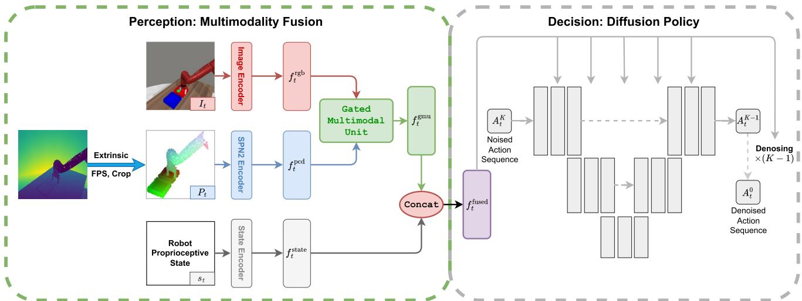
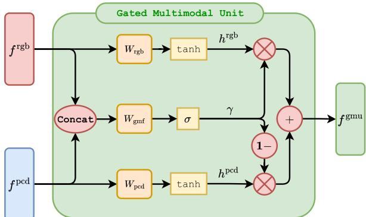
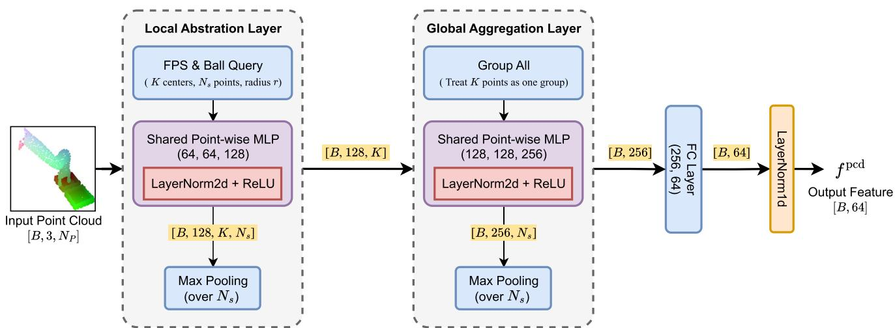
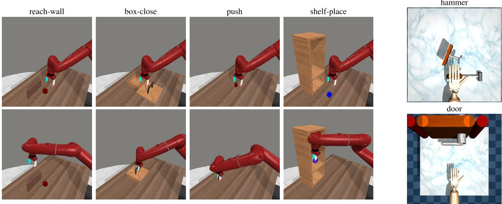
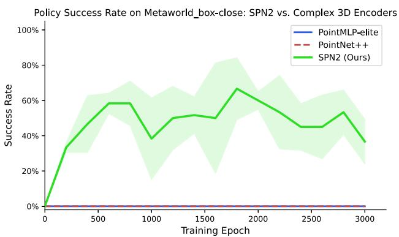
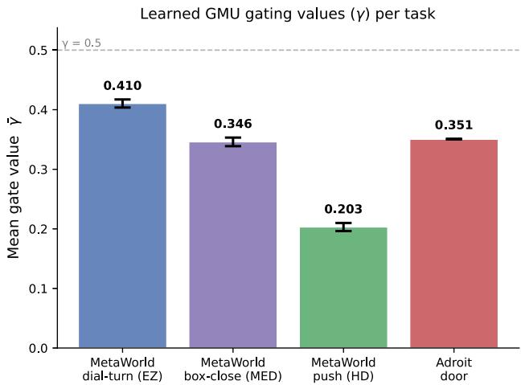
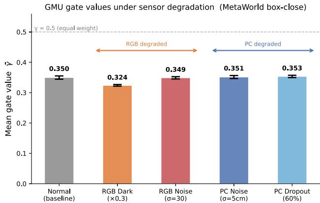
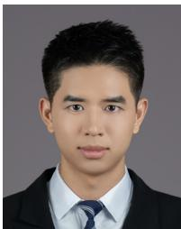

Received 4 April 2026, accepted 7 May 2026, date of publication 13 May 2026, date of current version 10 June 2026. Digital Object Identifier 10.1109/ACCESS.2026.3693095

RESEARCH ARTICLE

# MDP3: A Multimodal 3-D Diffusion Policy for Visuomotor Control

DAIFENG LI , JUNWEI LIU , AND WEI ZHANG , (Senior Member, IEEE) School of Automation and Intelligent Manufacturing (AiM), Southern University of Science and Technology, Shenzhen 518055, China

Corresponding authors: Junwei Liu (liujw@sustech.edu.cn) and Wei Zhang (zhangw3@sustech.edu.cn)

This work was supported in part by the National Natural Science Foundation of China under Grant 62303208; in part by the Science, Technology, and Innovation Commission of Shenzhen Municipality under Grant JCYJ20220530115010023; and in part by Guangdong Science and Technology Program under Grant 2024B1212010002.

ABSTRACT Diffusion-based imitation learning has emerged as a dominant paradigm for robotic manipulation, offering stable training and multimodal action modeling. However, state-of-the-art diffusion policies predominantly rely on isolated sensory modalities—either 2D RGB images or 3D point clouds— limiting their robustness in unstructured environments where visual semantics and spatial geometry are jointly required. To bridge this gap, we propose a Multimodal 3D Diffusion Policy (MDP3), a unified framework that actively synthesizes heterogeneous sensory inputs for robust visuomotor control. MDP3 introduces two core architectural innovations: 1) a Gated Multimodal Unit (GMU) that acts as a context-aware arbitrator, dynamically modulating the fusion of RGB and point cloud features based on their real-time reliability; and 2) a Simplified PointNet++ (SPN2) encoder designed to inject local geometric inductive biases while maintaining the optimization stability required for diffusion training. Extensive experiments demonstrate that MDP3 significantly outperforms existing single-modality baselines. Specifically, it improves the average success rate by 10.9% over the leading 3D diffusion policy, exhibiting superior generalization under diverse lighting and geometric variations.

INDEX TERMS Imitation learning, multimodal fusion, point cloud encoder, robotic manipulation.

## I. INTRODUCTION

Visuomotor imitation learning has emerged as a dominant paradigm for equipping robots with general-purpose manipulation skills, enabling them to acquire complex behaviors directly from expert demonstrations. This data-driven approach holds immense promise for automating tasks across diverse unstructured environments, ranging from precision industrial assembly to household services and logistics [1], [2]. However, the efficacy of such policies hinges on their ability to navigate a heterogeneous set of environmental constraints, where success is jointly determined by visual semantics and spatial geometry [3], [4], [5]. These dual challenges necessitate the development of policy architectures capable of effectively mapping raw, multimodal sensory observations to precise continuous actions.

To tackle the complexity of continuous control, diffusion models [6], [7] have recently been adapted for imitation learning, demonstrating exceptional capability in modeling multimodal action distributions. Pioneering works like Diffusion Policy (DP) [8] formulate action generation as a conditional denoising process, achieving stable training and precise behavior synthesis. This paradigm has been further extended to the 3D domain by 3D Diffusion Policy (DP3) [9] and other works [10], [11], [12], [13], [14], which leverage point clouds to enhance spatial generalization. However, a critical limitation remains: these methods typically operate within isolated perceptual modalities. DP relies primarily on 2D RGB images, leaving it vulnerable to geometric ambiguities, while DP3 depends exclusively on 3D point clouds, making it susceptible to semantic ambiguities in texture-rich or noisy environments.

While multimodal integration has matured in Transformerbased architectures [15], [16], [17], adaptive fusion within the diffusion paradigm remains a significant open problem. Prevailing diffusion-based approaches typically rely on naive strategies, such as static feature concatenation, which inherently assumes equal reliability across heterogeneous modalities. Moreover, simply integrating standard 3D backbones into diffusion models introduces distinct optimization challenges, often leading to training instability or collapse due to the iterative nature of the denoising objective [9], [10], [18], [19]. Consequently, there is a pressing need for a framework that not only adaptively arbitrates between sensor streams but also incorporates 3D geometry in a stabilityoriented manner.

In this work, we propose a Multimodal 3D Diffusion Policy (MDP3), a unified framework that actively synthesizes RGB, point cloud, and proprioceptive inputs for robust imitation learning. To achieve this, our approach incorporates two architectural innovations designed to address the challenges of sensor reliability and optimization stability. First, we introduce a Gated Multimodal Unit (GMU) integrated into the diffusion backbone. This module acts as a learnable soft-switch, adaptively fusing heterogeneous features by selectively amplifying the most informative modality based on the current context. Second, we design the Simplified PointNet++ (SPN2) encoder, a streamlined backbone that injects essential local inductive biases to capture fine-grained geometry while maintaining the shallow gradient paths necessary for stable diffusion training. We evaluate MDP3 on 14 diverse manipulation tasks across the Meta-World [20] and Adroit [21] benchmarks.

## Our contributions are summarized as follows:

• We propose MDP3, a unified diffusion-policy framework that effectively integrates RGB, point cloud, and proprioceptive modalities. Central to this framework is the introduction of the GMU, which provides a principled mechanism for context-aware arbitration, allowing the policy to dynamically weigh heterogeneous sensory streams based on their real-time reliability. Crucially, the core novelty lies not in feature combination itself, but in Adaptive Arbitration: a learned, context-conditioned soft switch that resolves moment-to-moment sensor reliability discrepancies—a capability absent in both single-modality policies and static fusion strategies.

• We design the SPN2, a streamlined point cloud backbone tailored for diffusion-based control. By reintroducing local inductive biases while minimizing gradient path depth, SPN2 successfully resolves the optimization instability often encountered with heavy 3D encoders, balancing geometric precision with training robustness.

• We conduct extensive evaluations on 14 manipulation tasks, where MDP3 outperforms the strongest single-modality baseline (DP3) by an average of 10.9% success rate and demonstrates superior generalization across diverse environmental conditions.

## II. RELATED WORK

## A. DIFFUSION-BASED VISUOMOTOR POLICIES

Diffusion-based methods have established themselves as a dominant paradigm for imitation learning and continuous control, owing to their exceptional ability to model multimodal action distributions and ensure training stability [8], [9], [22], [23]. Representative approaches include the image-conditioned DP [8] and the point cloud-conditioned DP3 [9]. However, a critical limitation in current literature is the reliance on isolated perceptual modalities. Most existing pipelines prioritize a single stream—either 2D RGB or 3D point clouds—often neglecting the complementary synergies available from joint perception. Consequently, principled mechanisms for fusing RGB semantics with 3D geometry remain largely underexplored. Crucially, recent studies [3], [10], [11], [12], [13], [14] highlight that geometry-only policies struggle with fine-grained semantic distinctions, underscoring the necessity of integrating visual textures with spatial structures. These gaps motivate the design of a unified fusion strategy that preserves the generative strengths of diffusion policies while robustly integrating 2D and 3D modalities.

## B. MULTIMODAL FUSION IN IMITATION LEARNING

While multimodal fusion has matured in Transformerbased architectures [15], [16], [17], explicit fusion within diffusion policies remains underexplored. Existing diffusion approaches often rely on decoupled pipelines [22] or implicit conditioning [10], [12] rather than specialized crossmodal reasoning. Alternative approaches like SGR [18], [19] employ explicit semantic-geometric lifting (e.g., backprojection), but typically incur high computational overhead and calibration dependency, making them less suitable for efficient end-to-end control. Consequently, fusion strategies in diffusion policies tend to bifurcate into two extremes: (1) Naive Concatenation [9], which is efficient but lacks adaptivity to sensor noise or failure; and (2) Dense Cross-Attention, which is expressive but computationally demanding. In this work, we adopt the GMU [24] as a strategic ‘‘middle ground.’’ Compared to lightweight alternatives like adaptive normalization (AdaLN) [25], [26], GMU provides explicit, learnable, and element-wise arbitration, balancing the adaptive capability of attention with the efficiency of simple concatenation.

## C. POINT CLOUD ENCODERS FOR IMITATION LEARNING

The choice of point cloud encoder in diffusion policies presents a distinct trade-off between geometric fidelity and optimization stability. On one hand, non-diffusion works (e.g., SGR [18], [19]) demonstrate that explicit locality (e.g., hierarchical grouping) is crucial for pinpointing manipulation affordances. On the other hand, empirical evidence from diffusion policies (e.g., DP3 [9]) suggests a paradox: deep, complex encoders often yield diminishing returns or training instability compared to lightweight global encoders, likely due to the sensitive dynamics of the iterative denoising objective. Consequently, recent approaches tend to bifurcate into prioritizing simplified encoders for stability (G3Flow [3]) versus adopting heavy backbones at high computational cost (GenDP [12]). Our approach targets a strategic balance: we selectively inject local inductive biases via a shallow architecture, capturing essential geometry without incurring the gradient instability of deep hierarchical backbones.

## III. PRELIMINARIES

## A. IMITATION LEARNING

We formulate the robotic manipulation task as a discrete-time imitation learning problem. Let $\mathcal { D } ~ = ~ \{ \tau ^ { ( i ) } \} _ { i = 1 } ^ { N }$ denote a dataset of N expert demonstrations, where each trajectory $\begin{array} { r l r } { \tau ^ { ( i ) } } & { { } = } & { ( o _ { 1 } , a _ { 1 } , \dots , o _ { T } , a _ { T } ) } \end{array}$ consists of a sequence of observations $\begin{array} { r l r } { o _ { t } } & { { } \in } & { \mathcal { O } } \end{array}$ and actions $a _ { t } \in \mathcal { A } \subseteq \mathbb { R } ^ { d _ { a } }$ Here, O represents the observation space and $d _ { a }$ denotes the dimensionality of the action space. The goal of imitation learning is to mimic the expert’s decision-making process by approximating the conditional distribution $p ( a _ { t } | o _ { t } )$ . This is typically achieved by minimizing the expected negative log-likelihood of the expert actions given the observations:

$$
\min _ {\phi} \mathbb {E} _ {(o, a) \sim \mathcal {D}} \Big [ - \log p _ {\phi} (a | o) \Big ]\tag{1}
$$

where φ denotes the learnable parameters.

Expert demonstrations in manipulation tasks inherently exhibit non-Markovian dependencies and temporal correlations. To capture these properties and ensure smooth execution, we adopt the Receding Horizon Control (RHC) framework [27]. We define an observation sequence $O _ { t } \ =$ $[ o _ { t - T _ { o } + 1 } , \dots , o _ { t } ] \in \tilde { \mathcal { O } }$ spanning an observation horizon $T _ { o }$ to capture historical context, where $\tilde { \mathcal { O } } = \mathcal { O } ^ { T _ { o } }$ denotes the stacked observation space. Correspondingly, the policy predicts a sequence of future actions $A _ { t } = [ a _ { t } , \dotsc , a _ { t + T _ { p } - 1 } ] \in$ $\mathbb { R } ^ { T _ { p } \times d _ { a } }$ over a prediction horizon $T _ { p }$ . At each time step t, the policy generates $A _ { t }$ , but only the first $T _ { a }$ steps are executed before replanning. Within this RHC framework, the original objective (1) is reformulated to model the distribution of action sequences:

$$
\min _ {\phi} \mathbb {E} _ {(O, A) \sim \tilde {\mathcal {D}}} \Big [ - \log p _ {\phi} (A | O) \Big ]\tag{2}
$$

where $\tilde { \mathcal { D } }$ represents the sequence-based dataset constructed from D using a sliding window.

## B. OBSERVATION AND ACTION SPACES

We consider a visuomotor control setting where the robot must integrate heterogeneous sensory inputs to make decisions. The observation space O is multimodal, defined at each time step t as a tuple $o _ { t } = ( I _ { t } , P _ { t } , s _ { t } )$ , comprising:

• Visual Semantics (I ): An RGB image $I _ { t } \in \mathbb { R } ^ { H \times W \times 3 }$ capturing high-level semantic information and texture features, where H and W represent the height and width of the image.

• Geometric Structure $( P _ { t } ) \colon \mathrm { A }$ 3D point cloud $\mathrm { ~  ~ { ~ \cal ~ P ~ } ~ } _ { t } \in  { \mathcal { C } }$ $\mathbb { R } ^ { N _ { p } \times 3 }$ containing $N _ { p }$ points derived from depth sensors. This modality provides precise spatial geometry often lost in 2D projections.

• Proprioceptive State (s ): A low-dimensional vector $s _ { t } ~ \in ~ \mathbb { R } ^ { d _ { s } }$ encoding task-relevant robot proprioception (e.g., end-effector/fingertip Cartesian positions or hand joint configuration).

The action at time step t is a continuous control command $a _ { t } \in \mathcal { A } \subseteq \mathbb { R } ^ { d _ { a } }$ . Both the semantics and dimensionalities of proprioceptive states $( d _ { s } )$ and actions $( d _ { a } )$ are benchmark-dependent but remain fixed within each benchmark and task suite.

The core challenge in this setting is effectively fusing the dense semantic data from I with the sparse geometric data from $P _ { t }$ to condition the policy for precise manipulation.

## C. DIFFUSION POLICY

To model the complex, multi-modal distribution of expert action sequences, we employ the Diffusion Policy framework [8]. This method formulates the policy as a conditional denoising process, leveraging a Denoising Diffusion Probabilistic Model (DDPM) [6] to iteratively refine a sequence of actions starting from Gaussian noise. The framework consists of two key processes:

## 1) FORWARD PROCESS

The forward diffusion process systematically injects Gaussian noise into the clean expert action sequence A (denoted as $A _ { t } ^ { 0 } )$ over K diffusion steps. The noisy action at step k, denoted as $A _ { t } ^ { k }$ , is sampled via:

$$
A _ {t} ^ {k} = \sqrt {\bar {\alpha} _ {k}} A _ {t} ^ {0} + \sqrt {1 - \bar {\alpha} _ {k}} \epsilon , \quad \epsilon \sim \mathcal {N} (\mathbf {0}, \mathbf {I})\tag{3}
$$

where $\begin{array} { r } { \bar { \alpha } _ { k } = \prod _ { s = 1 } ^ { k } \alpha _ { s } } \end{array}$ represents the cumulative product of the noise schedule up to step k, with $\alpha _ { k } \in ( 0 , 1 )$ controlling the noise variance.

## 2) REVERSE PROCESS

Following standard diffusion-based policies, the conditional distribution $p _ { \phi } ( A _ { t } | O _ { t } )$ is implicitly parameterized via a noise prediction network $\epsilon _ { \phi }$ . The goal of policy learning is to reverse this process to generate clean actions. To condition the generation on the environment state, a perception encoder is employed to map the multimodal observation sequence $O _ { t }$ into a latent feature representation. The policy learning is then formulated as training a conditional noise prediction network $\epsilon _ { \phi } ( O _ { t } , A _ { t } ^ { k } , k )$ , which predicts the noise added to the action sequence given the current observation $O _ { t }$ and diffusion step k. The training objective is to minimize the Mean Squared Error (MSE) between the predicted noise and the actual noise:

$$
\mathcal {L} = \mathbb {E} \Big [ \| \epsilon_ {\phi} (O _ {t}, A _ {t} ^ {k}, k) - \epsilon \| ^ {2} \Big ]\tag{4}
$$

where the expectation is taken over data samples $( O _ { t } , A _ { t } ^ { 0 } ) \sim$ $\tilde { \mathcal { D } } _ { : }$ , diffusion steps $k \sim \mathcal { U } ( \mathcal { K } )$ with U denoting the uniform distribution over the set ${ \cal K } = \{ 1 , \dots , K \}$ , and noise $\epsilon \sim$ $\mathcal { N } ( \mathbf { 0 } , \mathbf { I } )$ . During inference, the policy generates an action sequence by recursively denoising a random noise sample $\tilde { A _ { t } ^ { K } } \sim \mathcal { N } ( \mathbf { 0 } , \mathbf { \bar { I } } )$ using the learned network $\epsilon _ { \phi }$ , conditioned on the observation sequence $O _ { t }$ . Specifically, for $k = K , \ldots , 1$

$$
A _ {t} ^ {k - 1} = \alpha_ {k} \left(A _ {t} ^ {k} - \gamma_ {k} \epsilon_ {\phi} (O _ {t}, A _ {t} ^ {k}, k)\right) + \sigma_ {k} z, \quad z \sim \mathcal {N} (\mathbf {0}, \mathbf {I}),\tag{5}
$$

where $\alpha _ { k } .$ $\gamma _ { k }$ , and $\sigma _ { k }$ are step-dependent coefficients determined by the diffusion scheduler. The final denoised sample $A _ { t } ^ { 0 }$ is used as the predicted action sequence.

  
FIGURE 1. Overview of our MDP3 framework. The system processes three observation streams: RGB images, point clouds, and proprioceptive states. We employ a SPN2 to extract stable geometric features from point clouds. A GMU then adaptively fuses the visual $( f _ { \pmb { t } } ^ { r g b } )$ and geometric $( \dot { \pmb { t } } _ { t } ^ { p c d } )$ embeddings based on their reliability. The resulting fused representation is concatenated with the state embedding $\dot { ( f _ { t } ^ { s t a t e } ) }$ to condition the diffusion backbone, which synthesizes action sequences via iterative denoising.

## D. PROBLEM FORMULATION

While Diffusion Policy provides a powerful generative backbone, existing methods typically rely on a single dominant modality—either 2D images [8] or 3D point clouds [9]— thereby neglecting the complementary nature of these data streams. In this work, we aim to develop a multimodal diffusion policy that robustly integrates the semantic richness of 2D vision with the geometric precision of 3D sensing. Formally, we seek to learn a conditional noise prediction network $\epsilon _ { \phi } .$ , which parameterizes the policy $p _ { \phi } ( A _ { t } | O _ { t } )$ to minimize the denoising error defined in (4). Unlike prior works [8], [9], our formulation explicitly conditions the denoising process on the fused representation of visual and geometric features spanning the observation horizon $T _ { o } .$ . The objective is to generate expert-like action sequences through iterative denoising, such that they are both semantically consistent and geometrically precise.

## IV. METHOD

In this paper, we propose Multimodal 3D Diffusion Policy (MDP3), a policy architecture tailored for robust visuomotor control under varying sensory conditions, as illustrated in Fig. 1. Central to our approach is a dynamic arbitration mechanism designed to resolve the reliability discrepancy between RGB cameras and depth sensors. Rather than relying on static concatenation, we achieve adaptive fusion via a Gated Multimodal Unit (GMU) (Sec. IV-A), which weights input modalities based on their relevance to the current state. To ensure this arbitration operates on informative and stable representations, we propose a Simplified PointNet++ Encoder (SPN2) to process 3D data (Sec. IV-B), explicitly designed to capture essential local geometry while preventing the gradient instability common in deep hierarchies. The resulting fused representation conditions a diffusion backbone, which synthesizes temporally coherent action sequences. By jointly optimizing these components, our system learns to autonomously prioritize the most trustworthy sensors directly from imitation objectives.

  
FIGURE 2. Mechanism of GMU. The module adaptively fuses RGB features $f ^ { \mathbf { r g b } }$ and point cloud features $f ^ { \mathsf { P } ^ { \mathsf { c } \mathsf { d } } }$ via a learnable gate . The gating signal dynamically weighs the input modalities based on their relevance, producing a robust fused representationfgmu.

## A. ADAPTIVE FUSION WITH GATED MULTIMODAL UNIT

A fundamental challenge in visuomotor control is the effective integration of heterogeneous observations. Visual semantics (RGB) and spatial geometry (Point Cloud) offer complementary information, yet their reliability varies dynamically due to factors such as sensor noise, occlusion, or lighting changes. Naive approaches like static feature concatenation treat these modalities with equal priority, which often leads to suboptimal performance when one modality becomes unreliable. To mitigate this, we draw inspiration from the GMU [24], adapting it as a learnable soft-switch for visuomotor control, as illustrated in Fig. 2. Conceptually, the GMU operates on a ‘‘transform-andgate’’ principle: it first projects the heterogeneous inputs into a shared latent alignment space, while simultaneously learning a context-aware gating signal to measure the relative information density of each stream. This mechanism allows the policy to selectively amplify informative features and suppress noise before the modalities are merged.

Formally, let $f ^ { \mathrm { r g b } }$ and $f ^ { \mathrm { p c d } }$ denote the feature vectors encoded from the image and point cloud, respectively (time subscript t is omitted for brevity). The GMU computes the fused representation through the following process:

$$
\boldsymbol {h} ^ {\mathrm{rgb}} = \tanh (\boldsymbol {W} _ {\mathrm{rgb}} \boldsymbol {f} ^ {\mathrm{rgb}}),\tag{6}
$$

$$
\boldsymbol {h} ^ {\mathrm{pcd}} = \tanh (\boldsymbol {W} _ {\mathrm{pcd}} \boldsymbol {f} ^ {\mathrm{pcd}}),\tag{7}
$$

$$
\gamma = \sigma \left(W _ {\mathrm{gmu}} [ f ^ {\mathrm{rgb}}, f ^ {\mathrm{pcd}} ]\right),\tag{8}
$$

$$
\pmb {f} ^ {\mathrm{gmu}} = \gamma \odot \pmb {h} ^ {\mathrm{rgb}} + (\mathbf {1} - \gamma) \odot \pmb {h} ^ {\mathrm{pcd}},\tag{9}
$$

where $W _ { \mathrm { \{ r g b , p c d , g m u \} } }$ are learnable projection matrices mapping inputs to a shared hidden dimension $d _ { h } , [ \cdot , \cdot ]$ denotes concatenation, and ⊙ represents element-wise multiplication. Here, the hyperbolic tangent function tanh projects features into a common alignment space, while the sigmoid function $\sigma$ generates the gating vector $\gamma ~ \in ~ ( 0 , 1 ) ^ { d _ { h } }$ . Crucially, the gating vector $\gamma$ is conditioned on the joint input $[ f ^ { \mathrm { r g b } } , f ^ { \mathrm { p c d } } ]$ enabling the network to assess the global context before arbitrating the fusion weights. We clarify that the two projection equations provide representational compatibility, not explicit semantic alignment. The weight matrices $W _ { \mathrm { r g b } }$ and $W _ { \mathrm { p c d } }$ map both feature vectors into the same dimension $d _ { h }$ (required for element-wise gating), and tanh bounds both streams to $( - 1 , + 1 ) ^ { d _ { h } }$ to prevent scale-induced dominance. Semantic alignment—whether corresponding dimensions encode related concepts across modalities—is not enforced explicitly. Instead, end-to-end optimization with the imitation learning objective provides an implicit alignment gradient: the task loss rewards fused representations that lead to correct action predictions, pushing both projection matrices toward task-useful configurations. For manipulation via behavior cloning, this implicit signal is sufficient.

The proposed mechanism offers a principled unification of existing paradigms. Prior works typically rely on a single dominant modality: DP [8] operates in the pure visual domain, while DP3 [9] relies primarily on point clouds. These can be viewed as special cases of our framework where the gating vector is hard-coded to $\gamma \approx 1$ (RGB-only) or $\gamma \approx \mathbf { 0 }$ (Geometry-only). By relaxing this constraint to a learnable parameter, our approach dynamically interpolates between these extremes on a per-instance basis. This flexibility ensures that the policy not only retains the capabilities of both DP and DP3 but also robustly handles scenarios where neither modality is sufficient on its own. Notably, the proprioceptive state $f ^ { \mathrm { s t a t e } }$ is concatenated directly with $f ^ { \mathrm { g m u } }$ rather than passed through the gate, since proprioception encodes the robot’s own internal kinematic state—a deterministic, always-reliable signal that is not subject to the external sensor degradations (occlusion, lighting variation, depth noise) that motivate the gating mechanism.

## B. SIMPLIFIED POINTNET++ ENCODER

Designing a 3D encoder for diffusion-based control necessitates a critical trade-off between geometric granularity and training stability. Standard perception backbones typically employ deep hierarchical stacking to extract multi-scale features. While effective for discriminative tasks, we empirically observe that such depth introduces optimization instability in the diffusion setting, where the objective is iterative noise prediction rather than categorical labeling. Conversely, global-only encoders often discard the local geometric context—such as object edges and contact points—required for precise manipulation.

To reconcile these requirements, we propose the SPN2, a streamlined encoder that reintroduces essential local inductive biases while maintaining a shallow, stable architecture. As illustrated in Fig. 3, SPN2 processes the point cloud through two functional stages:

## 1) LOCAL SET ABSTRACTION

To capture fine-grained local geometry without overabstraction, we employ a single local processing stage. Given N input points, we utilize Farthest Point Sampling (FPS) to select $K = 1 2 8$ centroids and group neighbors using a ball query $( r = 0 . 6 , N _ { s } = 9 6 )$ . Unlike deep hierarchies, we use an MLP block [64, 64, 128] followed by max-pooling. This explicitly preserves local geometric features (e.g., ridges and gripper-object alignments) essential for contact-rich tasks.

## 2) GLOBAL AGGREGATION

The output of the local layer is a set of K feature vectors. To form a task-relevant global representation, we apply a global aggregation layer that treats all K features as a single group. A second MLP block [128, 128, 256] aggregates these features into a robust global descriptor, which is projected to a compact 64-dimensional latent vector. By intentionally adopting this shallow ‘‘one-local, one-global’’ design and bypassing intermediate downsampling stages, SPN2 reduces the gradient path depth, thereby improving optimization stability in diffusion-policy training.

A pivotal implementation choice in SPN2 is the substitution of Batch Normalization (BN) with Layer Normalization (LN) after each point-wise MLP. Standard BN introduces dependencies on batch statistics, which can be detrimental during diffusion training where input distributions shift iteratively and effective batch sizes are often constrained. By normalizing across the feature dimension, LN significantly improves convergence robustness in our closed-loop control setting.

## C. TRAINING AND INFERENCE

We train MDP3 within the conditional diffusion framework for action-sequence generation [8], [9]. At each time step t, the perception module processes the observation history $O _ { t }$ (spanning $T _ { o }$ steps) to encode the spatiotemporal context into the compact fused vector $\begin{array} { r l } { \bar { f } _ { t } ^ { \mathrm { f u s e d } } } & { { } = } \end{array}$ $g _ { \theta } ( O _ { t } )$ . Here, θ denotes the learnable parameters of the perception module, including the RGB encoder, SPN2 encoder, proprioceptive encoder, and the GMU fusion module. Since $\boldsymbol { f } _ { t } ^ { \mathrm { f u s e d } }$ is a deterministic function of $O _ { t }$ conditioning on $f _ { t } ^ { \mathrm { f u s e d } }$ is equivalent to conditioning on $O _ { t }$ through $g _ { \theta }$ . The diffusion policy then models the conditional distribution $p _ { \phi } ( A _ { t } | \ f _ { t } ^ { \mathrm { f u s e d } } )$ and synthesizes the action horizon $A _ { t }$ via iterative denoising, where $\phi$ denotes the parameters of the denoising network.

  
FIGURE 3. Architecture of SPN2. Designed to balance local geometric precision with training stability for diffusion policies, SPN2 employs a streamlined structure consisting of one local abstraction layer and one global aggregation layer. Notably, we replace Batch Normalization with Layer Normalization to mitigate feature variance during the iterative denoising process.

  
FIGURE 4. Representative simulation tasks. Left: Meta-World tasks across four difficulty groups (top: initial states; bottom: successful completions). Right: Adroit dexterous manipulation tasks visualized with initial-state snapshots (hammer and door).

We employ a 1D Temporal U-Net as the noise prediction network $\epsilon _ { \phi } .$ To effectively utilize the multimodal context, we inject $f _ { t } ^ { \mathrm { f u s e d } }$ into the U-Net residual blocks using Feature-wise Linear Modulation (FiLM) layers. This mechanism applies affine transformations (scaling and shifting) to the intermediate feature maps, ensuring that the denoising process is globally conditioned on the fused visual-geometric embedding.

The network is trained by minimizing the noise prediction error in (4). Critically, gradients from the denoising loss flow through the FiLM layers back to the GMU and the encoders. This joint optimization allows the gating parameter $\gamma$ to be learned directly from the imitation signal, effectively achieving task-driven modality arbitration without explicit supervision on sensor reliability.

At inference time, we adopt the RHC strategy. We start from Gaussian noise $A _ { t } ^ { K } \sim \mathcal { N } ( \mathbf { 0 } , \mathbf { I } )$ and iteratively refine the action sequence using the DDIM scheduler [7]. To balance generation quality and real-time responsiveness, we set the diffusion steps to $K \ = \ 1 0 0$ during training but accelerate inference to 10 steps. The policy predicts a trajectory of length $T _ { p }$ , but only the next $T _ { a }$ actions are executed before replanning.

## D. IMPLEMENTATION DETAILS

For completeness, we briefly describe the remaining components of our architecture. For proprioceptive states, we utilize an MLP encoder following DP3 [9]. For RGB images, we employ a ResNet-18 backbone consistent with DP [8]. Both visual and proprioceptive encoders operate in a time-distributed fashion, sharing weights across the observation horizon $T _ { o }$ to extract a sequence of feature embeddings. These embeddings are subsequently processed by our fusion and policy modules as described in Sec. IV. We train the entire framework end-to-end for 3000 epochs. We use the AdamW optimizer with a learning rate of $1 0 ^ { - 4 }$ weight decay of $1 0 ^ { - 6 }$ , and betas $( \beta _ { 1 } , \beta _ { 2 } ) \ : = \ : ( 0 . 9 5 , 0 . 9 9 9 )$ To stabilize the learning dynamics, we employ Exponential Moving Average (EMA) on the model parameters. Standard data augmentations (e.g., random cropping) are applied to RGB inputs during training.

## V. EXPERIMENTS

We empirically evaluate MDP3 to demonstrate the advantages of robustly integrating visual semantics and spatial geometry. Our analysis is organized into three parts: Sec. V-A establishes the evaluation protocols across diverse task difficulties; Sec. V-B benchmarks MDP3 against state-of-theart baselines to highlight performance improvements; and Sec. V-C isolates the specific contributions of the SPN2 encoder and GMU fusion mechanism through controlled ablations.

## A. EXPERIMENT SETUP

## 1) BENCHMARKS

We conduct a comprehensive evaluation on 14 tasks across two distinct simulation suites, chosen to test robustness against varying manipulation difficulties and robot morphologies, as visualized in Fig. 4:

• Meta-World [20] (11 tasks): To evaluate generalization across difficulty levels, we select tasks spanning four groups: Easy (EZ): reach-wall, dial-turn, handlepull, peg-unplug-side; Medium (MED): box-close, binpicking, peg-insert-side; Hard (HD): push, hand-insert; Very Hard (VHD): disassemble, shelf-place.

• Adroit [21] (3 tasks): To assess capability in high-dimensional dexterous control, we include hammer, pen, and door.

## 2) OBSERVATIONS AND ACTIONS

We adopt a unified single-view RGB-D sensing protocol for all methods. At each time step, observations consist of an RGB image, a depth-projected point cloud, and a low-dimensional proprioceptive state. For Meta-World [20], the action is a 4D end-effector command $a _ { t } =$ $[ \Delta x , \Delta y , \Delta z , g ]$ , consisting of Cartesian displacement and a gripper signal, and the proprioceptive state is a 9D vector $( d _ { s } = 9 )$ formed by concatenating the Cartesian positions of the end-effector and two fingertips. For Adroit [21], actions are higher-dimensional dexterous-hand control commands with $d _ { a } \ = \ 2 8$ , and the proprioceptive state is a 24D hand state (d = 24) derived from joint configuration variables.

## 3) BASELINES

We benchmark MDP3 against two state-of-the-art diffusion policies: (1) DP [8], which conditions primarily on 2D RGB features; and (2) DP3 [9], a 3D policy conditioning on point cloud features. Our method (MDP3) integrates both modalities via the proposed GMU fusion and SPN2 encoder. To ensure a controlled comparison, all methods utilize identical sensor resolutions, prediction horizons, and diffusion backbones.

## 4) EVALUATION METRIC

We report the success rate as mean ± standard deviation across three random seeds. Following standard practice [8], [9], we perform periodic evaluation (20 episodes every 200 epochs) during training. To reduce variance, we select the top-5 checkpoints based on success rate for each seed and report their averaged performance.

TABLE 1. Quantitative comparison on simulation benchmarks. Top-5 success rate (%, mean ± std over three seeds); bold indicates best performance.

<table><tr><td>Method</td><td>EZ (4)</td><td>MED (3)</td><td>HD (2)</td><td>VHD (2)</td><td>Adroit (3)</td><td>All (14)</td></tr><tr><td>DP [8]</td><td> $55.3 \pm 4.6$ </td><td> $39.7 \pm 7.0$ </td><td> $49.3 \pm 2.3$ </td><td> $38.0 \pm 6.2$ </td><td> $34.2 \pm 3.3$ </td><td> $45.7 \pm 4.5$ </td></tr><tr><td>DP3 [9]</td><td> $66.7 \pm 6.4$ </td><td> $60.2 \pm 11.4$ </td><td> $50.2 \pm 2.8$ </td><td> $68.3 \pm 3.8$ </td><td> $41.7 \pm 4.1$ </td><td> $57.8 \pm 6.1$ </td></tr><tr><td>Ours (GMU+SPN2) $^{\dagger}$ </td><td> $85.4 \pm 6.0$ </td><td> $70.9 \pm 4.6$ </td><td> $68.8 \pm 2.8$ </td><td> $71.2 \pm 3.9$ </td><td> $42.6 \pm 3.9$ </td><td> $68.7 \pm 4.5$ </td></tr></table>

TABLE 2. Ablation study of core components. Results report Top-5 success rates (%, mean ± std) over three seeds. Bold indicates the best performance.

<table><tr><td>Method</td><td>reach-wall</td><td>dial-turn</td><td>box-close</td><td>bin-picking</td><td>push</td><td>Avg</td></tr><tr><td>SPN2 (ours)</td><td>62.3±2.8</td><td>95.0±4.2</td><td>65.0±6.4</td><td>63.3±5.5</td><td>89.7±4.9</td><td>75.1±4.8</td></tr><tr><td>DP3 Encoder</td><td>51.7±8.9</td><td>86.3±1.6</td><td>59.0±2.6</td><td>55.0±8.7</td><td>85.3±1.6</td><td>67.5±4.7</td></tr><tr><td>PointNet++</td><td>38.3±2.1</td><td>30.3±13.9</td><td>0.0±0.0</td><td>2.7±0.8</td><td>11.0±1.5</td><td>16.5±3.7</td></tr><tr><td>PointMLP-elite</td><td>43.3±3.2</td><td>44.0±6.5</td><td>0.0±0.0</td><td>17.0±11.8</td><td>12.3±3.0</td><td>23.3±4.9</td></tr><tr><td>PointNN</td><td>34.3±2.4</td><td>21.3±6.7</td><td>1.0±1.0</td><td>33.7±3.0</td><td>12.3±1.4</td><td>20.5±2.9</td></tr><tr><td>GMU (ours)</td><td>68.3±3.7</td><td>97.3±0.8</td><td>76.0±2.5</td><td>80.7±1.5</td><td>98.3±0.7</td><td>84.1±2.5</td></tr><tr><td>Concatenation</td><td>68.3±7.1</td><td>98.3±1.6</td><td>67.7±4.6</td><td>78.3±0.5</td><td>93.3±2.4</td><td>81.2±3.2</td></tr><tr><td>AdaLN</td><td>61.0±4.0</td><td>96.3±1.7</td><td>75.7±4.6</td><td>74.0±1.5</td><td>93.3±0.8</td><td>80.1±2.0</td></tr><tr><td>Self-Attention</td><td>65.7±1.2</td><td>99.0±0.6</td><td>74.0±4.6</td><td>78.3±7.0</td><td>90.0±2.9</td><td>81.4±3.3</td></tr><tr><td>Cross-Attention</td><td>67.3±1.6</td><td>95.3±4.0</td><td>79.0±3.5</td><td>76.3±3.6</td><td>93.0±3.1</td><td>82.2±3.2</td></tr></table>

## B. MAIN RESULTS

Table 1 presents the comprehensive evaluation results across 14 tasks. Overall, MDP3 achieves a new state-of-theart performance, with an average success rate of 68.7%, surpassing the 3D baseline (DP3) by +10.9% and the 2D baseline (DP) by +23.0%. The results highlight two critical advantages of our framework:

## 1) SYNERGY ON HYBRID TASKS

On Meta-World tasks requiring both semantic understanding and geometric precision (EZ, MED, HD), MDP3 delivers substantial gains. Specifically, MDP3 outperforms DP3 by +18.7% on EZ tasks (85.4% vs. 66.7%) and +18.6% on HD tasks (68.8% vs. 50.2%). This empirical evidence suggests that simple geometric encoders (DP3) struggle to disambiguate semantic cues, while pure vision methods (DP) lack spatial fidelity. MDP3 effectively bridges this gap, leveraging GMU to fuse complementary features for superior manipulation capabilities. These gains are statistically significant, as confirmed by Welch’s two-sample t-test (n=3 seeds): EZ $p \approx 0 . 0 2 1$ , HD p < 0.001.

## 2) ROBUSTNESS ON GEOMETRY-DOMINANT TASKS

On tasks where geometry is the primary bottleneck, such as the VHD group in Meta-World and the Adroit suite, MDP3 remains highly competitive with the point cloud expert (DP3). Notably, on Adroit, where RGB-based DP fails significantly (34.2%), MDP3 matches DP3 (42.6% vs. 41.7%). This indicates that our gated fusion mechanism successfully acts as a soft switch: in scenarios where visual textures are less informative or distracting, GMU adaptively down-weights the RGB stream, preventing the negative transfer often seen in naive fusion approaches.

## C. ABLATION STUDIES

We conduct controlled ablations on 5 representative tasks to isolate the contributions of the SPN2 encoder and the GMU fusion mechanism.

  
FIGURE 5. Policy success rate during training for different 3D encoders. SPN2 achieves consistently rising success rates and converges to strong performance, while PointNet++ and PointMLP-elite remain near zero throughout training despite similar training loss trajectories. This demonstrates that complex 3D encoders fail to learn effective policies under the iterative diffusion objective—a form of optimization collapse manifesting at the policy level. Shaded regions denote ±1 std across three seeds.

## 1) EFFICACY OF THE SPN2 ENCODER

As shown in Table 2 (Top Block), SPN2 achieves the best trade-off between geometric precision and training stability.

• Comparison with lightweight baselines: SPN2 outperforms the DP3 encoder [9] by +7.6% (75.1% vs. 67.5%). Notably, on geometry-sensitive tasks like boxclose and bin-picking, SPN2 yields gains of +6.0% and +8.3%, respectively. This confirms that introducing local inductive biases via the Local Set Abstraction effectively captures fine-grained contact geometry that global-only encoders miss.

• Comparison with heavy backbones: Crucially, complex encoders like PointNet++ [28], PointMLP-elite [29] and PointNN [30] suffer from optimization collapse, yielding success rates below 25%. This empirically supports our hypothesis that deep hierarchies introduce severe gradient instability in diffusion training, whereas SPN2’s shallow ‘‘one-local, one-global’’ design ensures robust convergence. To directly substantiate this claim, Fig. 5 plots the policy success rate during training for SPN2, PointNet++, and PointMLP-elite under identical conditions. While all three encoders achieve similarly low training loss, only SPN2 yields a policy that actually solves the task: its success rate rises steadily throughout training. PointNet++ and PointMLP-elite remain near zero success for the entire 3000-epoch run, demonstrating that their gradient dynamics—despite reducing the diffusion loss—fail to produce meaningful policy conditioning. This policy-level collapse directly explains the near-zero success rates in Table 2.

  
FIGURE 6. Mean GMU gate values γ¯ per task, measured at inference time. All four measured values fall below 0.5, suggesting GMU weights point clouds more heavily than RGB. Gate values differ across tasks—dial-turn (0.41), box-close (0.35), push (0.20), Adroit door (0.35)—showing the GMU is not a static mixer. Error bars denote std across inference steps.

## 2) EFFICACY OF GMU FUSION

Next, we fix the point encoder to SPN2 and evaluate the impact of different fusion strategies. Table 2 (Bottom Block) compares our gating mechanism against static concatenation and attention-based mixing [25]. GMU achieves the highest average success rate (84.1%), outperforming Concatenation (81.2%) and Cross-Attention (82.2%). Specifically, on the push task, GMU surpasses Concatenation by +5.0% (98.3% vs. 93.3%). While attention mechanisms allow for soft feature interaction, they underperform GMU in this regime. This suggests that for heterogeneous modalities (RGB vs. Point Cloud), explicit element-wise gating serves as a more effective inductive bias than soft attention mixing, allowing the policy to cleanly suppress unreliable modalities (e.g., occlusion) rather than blending them. To provide direct quantitative evidence of the gating behavior, Fig. 6 visualizes the mean gate values γ¯ collected during inference across representative tasks. Across these four tasks, all measured values fall below 0.5. suggesting that GMU assigns greater weight to the point cloud stream—consistent with the empirical advantage of 3D representations shown in prior work [9], but here emerging autonomously from the imitation learning objective without any explicit supervision on modality reliability. Furthermore, γ¯ varies across tasks— dial-turn (0.41), box-close (0.35), push (0.20)—indicating that the gate is not static but adapts to the specific demands of each task.

  
FIGURE 7. GMU gate values γ¯ under controlled sensor degradation (MetaWorld box-close task, 20 episodes per condition). RGB darkening (×0.3 intensity) causes a significant decrease in γ¯ (increased reliance on point cloud; Welch’s t-test, p < 0.001), while point cloud noise (5 cm Gaussian) and 60% point dropout produce consistent directional increases (increased reliance on RGB). Perturbations are applied directly to observation tensors at inference time to simulate sensor degradation conditions. Error bars denote ±1 std across episodes.

To further validate that the gate responds to instantaneous sensor quality rather than task-level priors alone, Fig. 7 reports $\bar { \gamma }$ under five controlled perturbation conditions on the box-close task (MetaWorld, 20 episodes per condition), where perturbations are applied directly to the observation tensors at inference time. Under severe RGB darkening (×0.3 intensity reduction), γ¯ decreases significantly from 0.350 to 0.324 (Welch’s t-test, p < 0.001, $n ~ = ~ 2 0 )$ ), confirming the gate correctly increases reliance on the point cloud when RGB quality degrades. Point cloud perturbations (5 cm Gaussian noise; 60% point dropout) produce consistent directional shifts in the opposite direction—gate values increase slightly toward 0.353—with smaller magnitude attributable to the inherent robustness of the SPN2 encoder to point density variation. The directional consistency across all five conditions provides direct evidence that the GMU performs adaptive reliability arbitration conditioned on instantaneous sensor quality.

## VI. CONCLUSION

In this work, we presented MDP3, a unified Multimodal 3D Diffusion Policy designed to bridge the gap between visual semantics and spatial geometry in robotic imitation learning. Addressing the limitations of isolated sensory modalities, our framework introduces two core architectural innovations. First, by integrating the GMU, we provide a principled mechanism for adaptive context-aware arbitration, allowing the policy to dynamically modulate the fusion of RGB and point cloud features based on their realtime reliability. Second, our design of the SPN2 encoder effectively resolves the trade-off between geometric fidelity and optimization stability, enabling the utilization of local 3D features without the training collapse often associated with heavy point cloud backbones. Extensive evaluations across 14 manipulation tasks on the Meta-World and Adroit benchmarks demonstrate the efficacy of this framework. MDP3 outperforms strong single-modality baselines (DP and DP3), improving the average success rate by 10.9%, with ablation studies confirming that the synergy between adaptive gating and stability-oriented encoding is the primary driver of these gains.

In future work, we plan to extend MDP3 to multi-view and temporal settings by incorporating spatio-temporal attention across frames and viewpoints, and to explore real-robot deployment under noisy depth and challenging lighting. We believe that learnable multimodal fusion will serve as a prerequisite for scaling diffusion-based visuomotor policies toward general-purpose, real-world robotic manipulation.

## REFERENCES

[1] A. Goyal, V. Blukis, J. Xu, Y. Guo, Y.-W. Chao, and D. Fox, ‘‘RVT 2: Learning precise manipulation from few demonstrations,’’ 2024, arXiv:2406.08545.

[2] O. Mees, L. Hermann, E. Rosete-Beas, and W. Burgard, ‘‘CALVIN: A benchmark for language-conditioned policy learning for long-horizon robot manipulation tasks,’’ IEEE Robot. Autom. Lett., vol. 7, no. 3, pp. 7327–7334, Jul. 2022.

[3] T. Chen, Y. Mu, Z. Liang, Z. Chen, S. Peng, Q. Chen, M. Xu, R. Hu, H. Zhang, X. Li, and P. Luo, ‘‘G3Flow: Generative 3D semantic flow for pose-aware and generalizable object manipulation,’’ in Proc. IEEE/CVF Conf. Comput. Vis. Pattern Recognit. (CVPR), Jun. 2025, pp. 1735–1744.

[4] T. He, D. Huang, W. Ouyang, Y. Wang, W. Ye, and H. Zhu, ‘‘Point cloud matters: Rethinking the impact of different observation spaces on robot learning,’’ in Proc. Adv. Neural Inf. Process. Syst., 2024, pp. 77799–77830.

[5] T. Z. Zhao, V. Kumar, S. Levine, and C. Finn, ‘‘Learning fine-grained bimanual manipulation with low-cost hardware." 2023, arXiv:2304. 13705

[6] J. Ho, A. Jain, and P. Abbeel, ‘‘Denoising diffusion probabilistic mod els,’’in Proc. Adv. Neural Inf. Process. Syst., vol. 33, 2020, pp. 6840–6851.

[7] J. Song, C. Meng, and S. Ermon, ‘‘Denoising diffusion implicit models,’ 2020, arXiv:2010.02502.

[8] C. Chi, Z. Xu, S. Feng, E. Cousineau, Y. Du, B. Burchfiel, R. Tedrake, and S. Song, ‘‘Diffusion policy: Visuomotor policy learning via action diffusion,’’ Int. J. Robot. Res., vol. 44, no. 10, pp. 1684–1704, 2023.

[9] Y. Ze, G. Zhang, K. Zhang, C. Hu, M. Wang, and H. Xu, ‘‘3D diffusion policy: Generalizable visuomotor policy learning via simple 3D representations,’’ in Proc. Robotics, Sci. Syst., Jul. 2024.

[10] T.-W. Ke, N. Gkanatsios, and K. Fragkiadaki, ‘‘3D diffuser actor: Policy diff i i h i 2402 1088

[11] J. Cao, Q. Zhang, J. Sun, J. Wang, H. Cheng, Y. Li, J. Ma, K. Wu, Z. Xu, Y. Shao, W. Zhao, G. Han, Y. Guo, and R. Xu, ‘‘Mamba policy: Towards efficient 3D diffusion policy with hybrid selective state models,’’ 2024, arXiv:2409.07163

[12] Y. Wang, G. Yin, B. Huang, T. Kelestemur, J. Wang, and Y. Li, ‘‘GenDP: 3D semantic fields for category-level generalizable diffusion policy,’’ in Proc. 8th Conf. Robot Learn. (CoRL), vol. 270, 2025, pp. 4866–4878.

[13] S. Noh, D. Nam, K. Kim, G. Lee, Y. Yu, R. Kang, and K. Lee, ‘‘3D flow diffusion policy: Visuomotor policy learning via generating flow in 3D space,’’ 2025, arXiv:2509.18676.

[14] G. Yan, Y.-H. Wu, and X. Wang, ‘‘DNAct: Diffusion-guided multi-task 3D policy learning,’’ in Proc. IEEE/RSJ Int. Conf. Intell. Robots Syst. (IROS), Oct. 2025, pp. 9464–9471.

[15] M. H. Shridhar, L. Manuelli, and D. Fox, ‘‘Perceiver-actor: A multi-task transformer for robotic manipulation,’’ in Proc. Conf. Robot Learn., 2022, pp. 785–799.

[16] T. Gervet, Z. Xian, N. Gkanatsios, and K. Fragkiadaki, ‘‘Act3D: 3D feature field transformers for multi-task robotic manipulation,’’ 2023, arXiv:2306 17817

[17] A. Goyal, J. Xu, Y. Guo, V. Blukis, Y.-W. Chao, and D. Fox, ‘‘RVT: Robotic view transformer for 3D object manipulation,’’ in Proc. Conf. Robot Learn., 2023, pp. 694–710.

[18] T. Zhang, Y. Hu, H. Cui, H. Zhao, and Y. Gao, ‘‘A universal semantic-geometric representation for robotic manipulation,’’ 2023, arXiv:2306.10474.

[19] T. Zhang, Y. Hu, J. You, and Y. Gao, ‘‘Leveraging locality to boost sample efficiency in robotic manipulation,’’ 2024, arXiv:2406.10615.

[20] T. Yu, D. Quillen, Z. He, R. Julian, K. Hausman, C. Finn, and S. Levine, ‘‘Meta-World: A benchmark and evaluation for multi-task and meta reinforcement learning,’’ in Proc. Conf. Robot Learn., 2020, pp. 1094–1100.

[21] A. Rajeswaran, V. Kumar, A. Gupta, G. Vezzani, J. Schulman, E. Todorov, and S. Levine, ‘‘Learning complex dexterous manipulation with deep reinforcement learning and demonstrations,’’ 2017, arXiv:1709.10087.

[22] Z. Xian, N. Gkanatsios, T. Gervet, T.-W. Ke, and K. Fragkiadaki, ‘‘ChainedDiffuser: Unifying trajectory diffusion and keypose prediction for robotic manipulation,’’ in Proc. 7th Conf. Robot Learn. (CoRL), vol. 229, 2023, pp. 2323–2339.

[23] X. Ma, S. Patidar, I. Haughton, and S. James, ‘‘Hierarchical diffusion policy for kinematics-aware multi-task robotic manipulation,’’ in Proc. IEEE/CVF Conf. Comput. Vis. Pattern Recognit. (CVPR), Jun. 2024, pp. 18081–18090.

[24] J. Arevalo, T. Solorio, M. Montes-y Gómez, and F. A. González, ‘‘Gated multimodal units for information fusion,’’ 2017, arXiv:1702.01992.

[25] W. Peebles and S. Xie, ‘‘Scalable diffusion models with transformers,’’ in Proc. IEEE/CVF Int. Conf. Comput. Vis. (ICCV), Oct. 2023, pp. 4172–4182.

[26] A. Donat, X. Jia, X. Huang, A. Taranovic, D. Blessing, G. Li, H. Zhou, H. Zhang, R. Lioutikov, and G. Neumann, ‘‘Towards fusing point cloud and visual representations for imitation learning,’’ 2025, arXiv:2502.12320.

[27] D. Q. Mayne and H. Michalska, ‘‘Receding horizon control of nonlinear systems,’’ in Proc. 27th IEEE Conf. Decis. Control, 1988, pp. 464–465.

[28] C. R. Qi, L. Yi, H. Su, and L. J. Guibas, ‘‘PointNet++: Deep hierarchical feature learning on point sets in a metric space,’’ in Proc. Adv. Neural Inf. Process. Syst., vol. 30, 2017, pp. 5099–5108.

[29] X. Ma, C. Qin, H. You, H. Ran, and Y. Fu, ‘‘Rethinking network design and local geometry in point cloud: A simple residual MLP framework,’’ 2022, arXiv:2202.07123.

[30] R. Zhang, L. Wang, Z. Guo, Y. Wang, P. Gao, H. Li, and J. Shi, ‘‘Parameter is not all you need: Starting from non-parametric networks for 3D point cloud analysis,’’ 2023, arXiv:2303.08134.

  
DAIFENG LI received the B.S. degree in robotics engineering from the Southern University of Science and Technology, Shenzhen, China, in 2021, where he is currently pursuing the M.S. degree in intelligent manufacturing and robotics. His research interest includes robot learning and control.

JUNWEI LIU received the B.S. and M.S. degrees in mathematics from Sun Yat-sen University, in 2011 and 2013, respectively, and the Ph.D. degree from the Department of Mechanical and Automation Engineering, The Chinese University of Hong Kong, in 2018. He was a Postdoctoral Researcher with the Southern University of Science and Technology, Shenzhen, China, where he is currently a Research Assistant Professor. His research interests include control theory, machine learning, and robotics.

WEI ZHANG (Senior Member, IEEE) received the B.S. degree in automatic control from the University of Science and Technology of China, in 2003, the M.S. degree in electrical and computer engineering from the University of Kentucky, in 2005, and the M.S. degree in statistics and the Ph.D. degree in electrical engineering from Purdue University, in 2009. From January 2010 to August 2011, he was a Postdoctoral Researcher with the EECS Department, University of Califor-

nia, Berkeley. From 2011 to 2017, he was an Assistant Professor and then an Associate Professor (with tenure) of electrical and computer engineering with Ohio State University. In May 2019, he joined the Southern University of Science and Technology, Shenzhen, China, where he is currently a Professor with the School of System Design and Intelligent Manufacturing. His research interests include control and optimization theory, machine learning, motion planning, and their applications in robotics and autonomous systems. He was a recipient of the NSF CAREER Award and the Lumley Research Award at Ohio State University. He is an Associate Editor of IEEE TRANSACTIONS ON CONTROL SYSTEMS TECHNOLOGY.