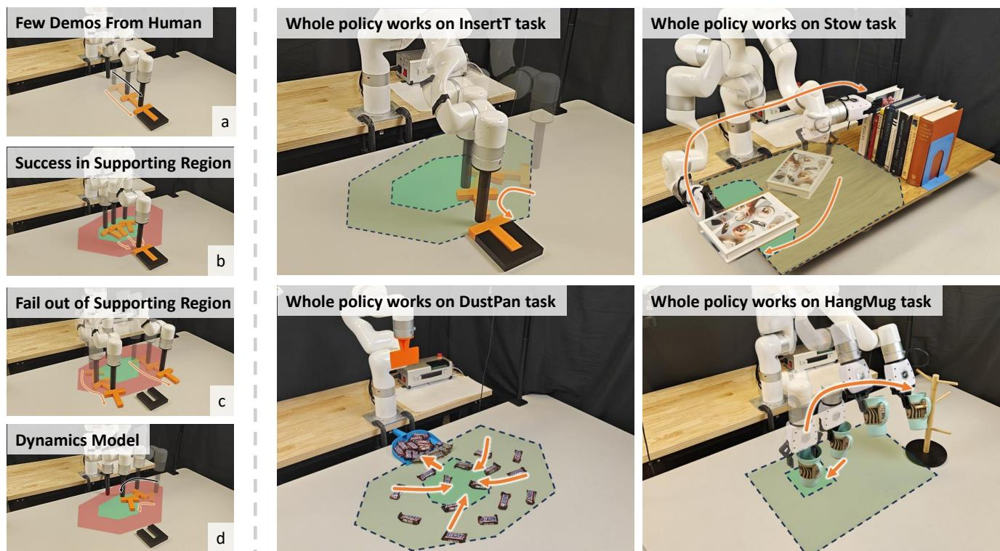
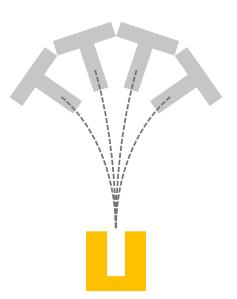
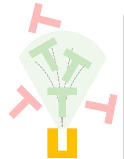
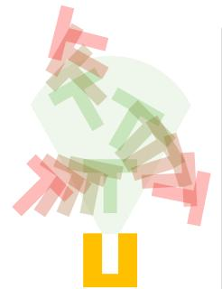
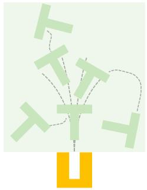
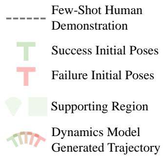
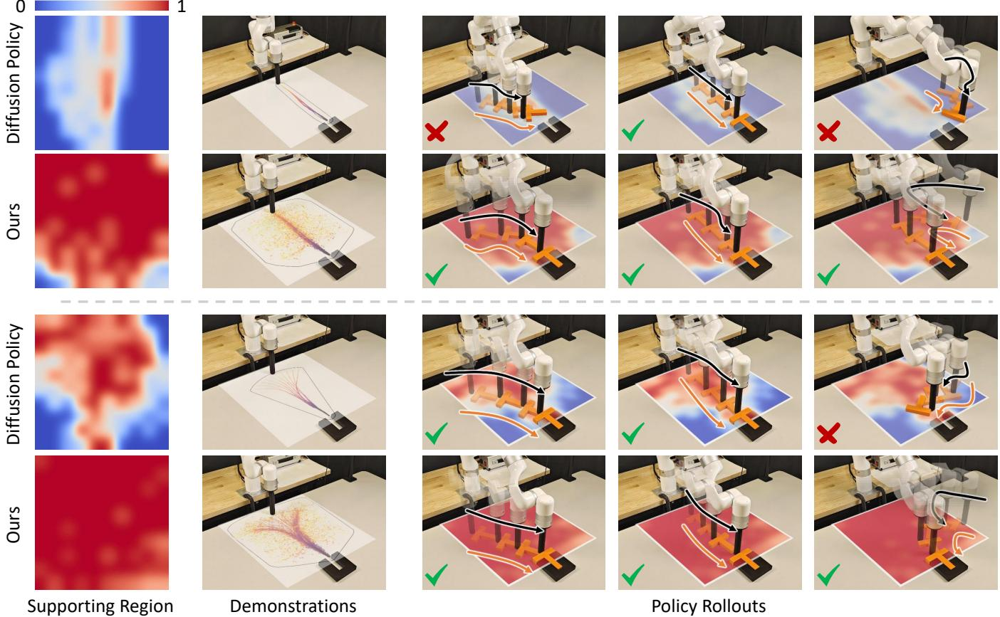
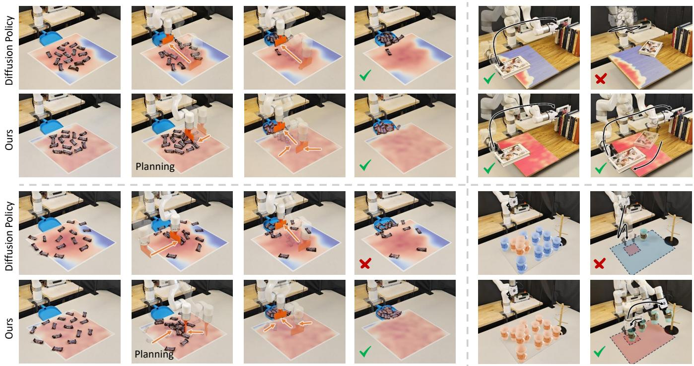
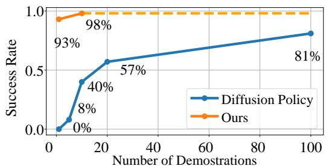

# Neural Dynamics Augmented Diffusion Policy

Ruihai Wu1∗, Haozhe Chen2∗, Mingtong Zhang2∗, Haoran Lu1, Yitong Li1, Yunzhu Li3

  
Fig. 1: (Left) We propose a neural dynamics-augmented diffusion policy, where a few-shot diffusion policy is enhanced with model-based planning to generalize to broader scene configurations. The green region represents the supporting region covered by the few-shot diffusion policy, while the red region denotes the space outside this region, which can be covered through model-based planning using the learned dynamics models. (Right) The proposed method demonstrates strong performance across various tasks. The deep green region represent the area covered by the few-shot diffusion policy, while the light green region shows the expanded coverage after augmentation.

Abstract— Imitation learning has been proven effective in mimicking demonstrations across various robotic manipulation tasks. However, to develop robust policies, current imitation methods, such as diffusion policy, require training on extensive demonstrations, making data collection labor-intensive. In contrast, model-based planning with dynamics models can effectively cover a sufficient range of configurations using only offpolicy data. Yet, without the guidance of expert demonstrations, many tasks are difficult and time-consuming to plan using the dynamics models. Therefore, we take the best of both model learning and imitation learning, and propose neural dynamics augmented imitation learning that covers a large scene configurations with few-shot demonstrations. This method trains a robust diffusion policy in a local support region using fewshot demonstrations and rearranges objects outside this region into it using offline-trained neural dynamics models. Extensive experiments across various tasks in both simulations and realworld scenarios, including granular manipulation, contact-rich task and multi-object interaction task, have demonstrated that trained with only 1 to 30 demonstrations, our proposed method can robustly cover a significantly larger area than the policy trained purely from the demonstrations. Our project page is available at: https://dynamics-dp.github.io.

## I. INTRODUCTION

Imitation learning [1–4] has been a powerful paradigm for teaching robots to perform complex tasks by mimicking expert demonstrations. However, the efficacy of imitation learning is often contingent on the availability of a substantial number of demonstrations. For instance, current methods like Diffusion Policy [5–7] and Action Chunking with Transformers [8–10], typically require over 200 demonstrations in tasks such as inserting T (Figure 1 left). When the number of demonstrations is limited, shown in Figure 1 (a, b, c), the performance becomes restricted to small regions.

On the other hand, model-based planning can effectively generalize across diverse configurations [11–13]. Learned models offer a number of advantages. First, training data for dynamics models is easy to obtain, from offline sources, selfplay or simulations, enabling offline training of dynamics models. Second, it only requires task-agnostic data, eliminating the need for task-specific demonstrations. However, even with the model, planning for complex long-horizon tasks can remain challenging, as sampling precise trajectories is often difficult and time-consuming. In such cases, expert demonstrations can be particularly helpful in guiding manipulation.

  
(a) Few-shot Demos

  
(b) Diffusion Policy

  
(c) Dynamics Model

  
(d) Whole Policy

  
Fig. 2: Our Proposed Framework. (a) Collecting few-shot human demonstrations that could cover a small region in the task space. (b) Diffusion policy trained on the few-shot human demonstrations is robust in the local supporting region, but lacks robustness in outside configurations. (c) Model-based planning, guided by learned dynamics models, generates actions to rearrange objects from diverse initial poses to the supporting region. (d) The whole policy, using trajectories from (c), enables robust manipulation across a much larger space.

We propose neural dynamics augmented diffusion policy, taking the best of both model learning and imitation learning to complement each other. Our framework trains neural dynamics models that apply to different object categories to explore the entire task space, and a diffusion policy on a few demonstrations to ensure robustness in a local supporting region, with detailed visualization and analysis in Figure 3 and 4. For any object in an arbitrary initial configuration, the dynamics model guides the object into this region, where the few-shot diffusion policy can robustly complete the rest of the task. Shown in Figure 1 (Left), to accomplish a complex task such as the contact-rich InsertT, we imitate few-shot demonstrations to robustly cover a small local region. Then, the neural dynamics model trained by offline interactions between the robot and the T-shape, manipulates the object from random initial configurations into the local region, allowing the robust imitation policy to handle the rest of the task. This manipulation strategy significantly expands the coverage area by augmenting the policy space with neural dynamics models.

## II. METHOD

## A. Problem Formulation and Preliminary Background

At each timestep t, policy takes the current observation $o _ { t }$ (e.g., robot state, object point cloud, image and pose), optionally with k previous observations $\left( o _ { t - k } , \ o _ { t - k + 1 } , \ . . . , \ o _ { t - 1 } \right)$ and proposes the robot action $a _ { t }$ to execute. The policy is successful when the robot manipulates the object to achieve the goal after a sequence of actions.

With a set Q of m demonstrations composed of observation o and action a pairs, $\begin{array} { r l } { i . e . , \ Q } & { { } = } \end{array}$ $\{ ( o _ { 1 } , ~ a _ { 1 } ) , ~ ( o _ { 2 } , ~ a _ { 2 } ) , ~ . . . , ( o _ { m } , ~ a _ { m } ) \}$ , diffusion policy [5] aims to model the conditional distribution $P ( A _ { t } | \ O _ { t } , \ \hat { A } _ { t } )$ using diffusion-based models (Denoising Diffusion Probabilistic Models, DDPM). Here, $A _ { t }$ refers to the predicted action sequence $A _ { t } = ( a _ { t } , . . . , a _ { t + T _ { a } } )$ , where $T _ { a }$ is the predicted action horizon. $O _ { t }$ refers to the observation history, including object states (e.g., poses, 3D point cloud or its downsampled particles) and proprioception states, $O _ { t } = \left( o _ { t - T _ { o } } , . . . , o _ { t } \right)$ , where $T _ { o }$ is the history horizon. ${ \hat { A } } _ { t }$ refers to action history, $\hat { A } _ { t } = ( a _ { t - T _ { o } - 1 } , ~ . . . , ~ a _ { t - 1 } )$

## B. Robust Few-Shot Imitation in a Local Supporting Region

The robustness of imitation methods requires extensive demonstrations. For example, for InsertT shown in Figure 2, the T shape can be placed in any positions and orientations, and thus extensive demonstrations with T shapes densely covering the large configuration space are required.

However, collecting extensive demonstrations is expensive. When the demonstration budget is limited, their distribution significantly impacts the policy robustness. We leverage the observation that even a small number of demonstrations can ensure policy robustness if they are concentrated within a small local supporting region with high local density. Specifically, given a set Q of m $( m \leq 3 0 )$ demonstrations, with densely distributed object initial configurations (including positions and poses) to be $\left\{ x _ { 1 } , \ x _ { 2 } , \ . . . , \ x _ { K } \right\}$ , the local supporting region R that diffusion policy $D _ { R }$ trained on Q maintains high robustness can be represented as the convex region of these demonstrations:

$$
R = \{\sum_ {k = 1} ^ {K} \alpha_ {k} x _ {k} | \sum_ {k = 1} ^ {K} \alpha_ {k} = 1, \alpha_ {k} \geq 0 \forall k \}.
$$

Shown in Figure 2 (a, b), trained on a small number of densely distributed demonstrations (each demonstration includes a trajectory from the initial configuration to the target), diffusion policy $D _ { R }$ works robustly on different object configurations (T colored in green) in the local supporting region. More visualizations and analysis on the robustness of the few-shot $D _ { R }$ in R are demonstrated in Figure 3.

## C. Neural Dynamics Model with Better Spatial Coverage

While $D _ { R }$ demonstrates great robustness in the convex region R, it could not work well to configurations outside R (T colored in red as shown in Figure 2 (b)). To enhance robustness, we first introduce an offline learned task-agnostic dynamics model that captures object dynamics and interactions within the scene. We then demonstrate how this model extends the space coverage of few-shot diffusion policy.

To be more specific, a perfect dynamics model f predicts the next state $s ^ { \prime }$ given the current state s and action a:

$$
s ^ {\prime} = f (s, a).
$$

  
Fig. 3: Qualitative Analysis on InsertT. With few-shot demonstrations, while the original diffusion policy demonstrates robustness only in a certain local region, our proposed method enables generalization to a much wider space. Demonstrations in Diffusion Policy show the few-shot (10) demonstrations, and those in Ours show dynamics augmented demonstrations cover the large space.

In various robotic scenarios where the ground truth object state is difficult to acquire, we use the observed object pose $\xi \in S E ( 3 )$ , keypoints $( p _ { 1 } , \ p _ { 2 } , \ . . . , p _ { k } )$ (k is the number of keypoints), or particles $p t \in R ^ { N \times 3 }$ (N is the number of particles) sampled the scanned point cloud using Farthest Point Sampling (FPS) [14] as the object state representation sˆ (in the following paragraphs, we use s to denote the estimated object state for simplicity), and capture the dynamics of the object in the scene using neural networks M. We train M with MLPs or GNNS as as backbones [11, 15]. We randomly initialize the object in the scene, with the estimated state $s ,$ execute a random action $^ { a , }$ and estimate the new state $s ^ { \prime }$ of the object. With the new state predicted by M denoted as $\tilde { s } ^ { \prime } ,$ we use the Mean Squared Error (MSE) distance between $\widetilde { s } ^ { \prime }$ and $s ^ { \prime }$ as the loss function for training M (d denotes the state dimension):

$$
\begin{array}{c} \tilde {s} ^ {\prime} = M (s, a), \\ \mathcal {L} _ {M} = \frac {1}{d} \sum_ {i = 1} ^ {d} | | \tilde {s} _ {i} ^ {\prime} - s _ {i} ^ {\prime} | | _ {2} ^ {2}. \end{array}
$$

## D. Model-Based Planning with Neural Dynamics Models

Equipped with Model Predictive Path Integral (MPPI) [16] planning algorithm, the robot can manipulate the objects from any initial configuration s to target configuration $s _ { T }$ in the large space $U ,$ , by optimizing the sampled action trajectories using the distance between $s _ { T }$ and M-predicted object state $\tilde { s } _ { P }$ after $\left\{ \mathbf { a } _ { t } \right\}$ as the loss function $\mathcal { L } ( s _ { T } , ~ \tilde { s } _ { P } )$

$$
\begin{array}{c} \{\mathbf {a} _ {t} \} = \operatorname * {a r g m i n} _ {\{\mathbf {a} _ {t} \}} \mathcal {L} (s _ {T}, \tilde {s} _ {P}), \\ \tilde {s} _ {P} = M (s, \{\mathbf {a} _ {t} \}), \\ \mathcal {L} (s _ {T}, \tilde {s} _ {P}) = \| s _ {T} - \tilde {s} _ {P} \| _ {2} ^ {2}. \end{array}
$$

## E. Neural Dynamics Augmented Few-Shot Diffusion Policy

To achieve a policy π with robustness in the large space, instead of directly planning the object to the direct target sT, we change the target of the planner to the center state $s _ { R }$ of the local supporting region R and first plan the object to $s _ { R } \colon$

$$
\begin{array}{c} s _ {R} = \frac {1}{K} \sum_ {i = 1} ^ {K} x _ {i}, \\ \{\mathbf {a} _ {t} \} = \operatorname * {a r g m i n} _ {\{\mathbf {a} _ {t} \}} \mathcal {L} (s _ {R}, \tilde {s} _ {P}), \\ \tilde {s} _ {P} = M (s, \{\mathbf {a} _ {t} \}), \\ \mathcal {L} (s _ {R}, \tilde {s} _ {P}) = \| s _ {R} - \tilde {s} _ {P} \| _ {2} ^ {2}. \end{array}
$$

Although the actual object state $s _ { R } ^ { \prime }$ after planning can deviate from the target $s _ { R }$ by a margin $\delta _ { s _ { R } }$ due to modeling and execution errors, this error $\delta _ { s _ { R } }$ is limited, and thus the local supporting region R can easily cover the planned $s _ { R } ^ { \prime } ,$ as shown in Figure 2 (c). Therefore, followed by $D _ { R }$ robust in R, the object manipulated from the initial s to $s _ { R } ^ { \prime }$ can further be robustly manipulated from $s _ { R } ^ { \prime }$ to the target $s _ { T }$

Rollouts

Initial State  
End State  
Stow  
  
DustPan  
HangMug

Fig. 4: Qualitative Analyses. While diffusion policy only covers specific regions, our method covers a significantly larger space with model-based planning to manipulate diverse objects into the local supporting region, followed by the few-shot diffusion policy. For DustPan, “Planning” denotes this step is fulfilled by model-based planning. For HangMug, red denotes success and blue denotes failure.

## III. EXPERIMENTS

## A. Tasks and Baselines

We conduct evaluation over 4 long-horizon complex tasks:

• InsertT that requires inserting a T-Shape into a slot.

• DustPan that sweeps sparse granular into the dustpan.

• Stow that stows a book onto the bookshelf with books.

• HangMug that hangs a randomly located mug on rack. Figure 1 (right) shows example trajectories of these tasks. We compare with 2 representative manipulation methods:

• Model-Based Planning that generates robot actions to achieve the final target using planning methods.

• Diffusion Policy trained on few-shot demonstrations.

  
Fig. 5: Data Efficiency.

## B. Quantitative and Qualitative Results and Analysis

Shown in Table I and II, our method outperforms baselines by a large margin. For Diffusion Policy trained on only a few demonstrations, it could only work in the local region. For Model-Based Planning, it is difficult and time-consuming to sample precise trajectories that satisfy these complex tasks.

TABLE I: Quantitative Evaluation in Simulation.

<table><tr><td>Method</td><td>InsertT</td><td>DustPan</td><td>Stow</td></tr><tr><td>Diffusion Policy</td><td>0.1472</td><td>0.4144</td><td>0.1563</td></tr><tr><td>Model-Based Planning</td><td>0.1087</td><td>0.4307</td><td>0.5172</td></tr><tr><td>Ours</td><td>0.9827</td><td>0.8986</td><td>0.9655</td></tr></table>

TABLE II: Quantitative Evaluation in the Real World.

<table><tr><td>Method</td><td>InsertT</td><td>HangMug</td><td>DustPan</td><td>Stow</td></tr><tr><td>Diffusion Policy</td><td>2 / 40</td><td>4 / 20</td><td>3 / 20</td><td>8 / 50</td></tr><tr><td>Model-Based Planning</td><td>1 / 40</td><td>9 / 20</td><td>5 / 20</td><td>22 / 50</td></tr><tr><td>Ours</td><td>32 / 40</td><td>15 / 20</td><td>17 / 20</td><td>42 / 50</td></tr></table>

We demonstrate qualitative results and analysis in Figure 3 and Figure 4. It is clear that, diffusion policy trained on few-shot demonstrations can only cover a specific small region with robustness, and will easily fail in manipulating objects initialized outside the region. With the augmentation of neural dynamics models, the whole policy will effectively cover a larger space by guiding the arbitrarily initialized object to the supporting region through model-based planning, followed by the few-shot diffusion policy in this region.

Furthermore, to analyze the data efficiency of our method, i.e., how our policy maintains robustness when the demonstration number is continuously decreasing, we compare the original diffusion policy with our method by conducting experiments respectively using 1 to 100 human demonstrations in InsertT. As shown in Figure 5, the original diffusion policy continuously faces performance decrease when the number of demonstrations decreases, while our dynamics augmented method empowers diffusion policy with the robustness even when there exist only a few demonstrations.

## REFERENCES

[1] A. Hussein, M. M. Gaber, E. Elyan, and C. Jayne, “Imitation learning: A survey of learning methods,” ACM Computing Surveys (CSUR), vol. 50, no. 2, pp. 1–35, 2017.

[2] P. Bakker, Y. Kuniyoshi et al., “Robot see, robot do: An overview of robot imitation,” in AISB96 Workshop on Learning in Robots and Animals, vol. 5, 1996.

[3] S. Schaal, “Learning from demonstration,” NeurIPS, 1996.

[4] S. Stefan, “Is imitation learning the route to humanoid robots?” Trends in cognitive sciences, vol. 3, no. 6, pp. 233–242, 1999.

[5] C. Chi, S. Feng, Y. Du, Z. Xu, E. Cousineau, B. Burchfiel, and S. Song, “Diffusion policy: Visuomotor policy learning via action diffusion,” in Proceedings of Robotics: Science and Systems (RSS), 2023.

[6] H. Ha, P. Florence, and S. Song, “Scaling up and distilling down: Language-guided robot skill acquisition,” in CoRL, 2023.

[7] Y. Ze, G. Zhang, K. Zhang, C. Hu, M. Wang, and H. Xu, “3d diffusion policy: Generalizable visuomotor policy learning via simple 3d representations,” arXiv preprint arXiv:2403.03954, 2024.

[8] T. Z. Zhao, V. Kumar, S. Levine, and C. Finn, “Learning fine-grained bimanual manipulation with low-cost hardware,” RSS, 2023.

[9] Z. Fu, T. Z. Zhao, and C. Finn, “Mobile aloha: Learning bimanual mobile manipulation with low-cost wholebody teleoperation,” CoRL, 2024.

[10] L. X. Shi, A. Sharma, T. Z. Zhao, and C. Finn, “Waypoint-based imitation learning for robotic manipulation,” in CoRL, 2023.

[11] Y. Wang, Y. Li, K. Driggs-Campbell, L. Fei-Fei, and J. Wu, “Dynamic-resolution model learning for object pile manipulation,” RSS, 2023.

[12] H. Shi, H. Xu, Z. Huang, Y. Li, and J. Wu, “Robocraft: Learning to see, simulate, and shape elastoplastic objects with graph networks,” arXiv preprint arXiv:2205.02909, 2022.

[13] H. Shi, H. Xu, S. Clarke, Y. Li, and J. Wu, “Robocook: Long-horizon elasto-plastic object manipulation with diverse tools,” arXiv preprint arXiv:2306.14447, 2023.

[14] Y. Eldar, M. Lindenbaum, M. Porat, and Y. Y. Zeevi, “The farthest point strategy for progressive image sampling,” TIP, 1997.

[15] H. Chen, Y. Niu, K. Hong, S. Liu, Y. Wang, Y. Li, and K. R. Driggs-Campbell, “Predicting object interactions with behavior primitives: An application in stowing tasks,” in CoRL. PMLR, 2023, pp. 358–373.

[16] G. Williams, A. Aldrich, and E. A. Theodorou, “Model predictive path integral control: From theory to parallel computation,” Journal of Guidance, Control, and Dynamics, vol. 40, no. 2, 2017.