# Past, Present, and Future of Aerial Robotic Manipulators

Anibal Ollero , Fellow, IEEE, Marco Tognon , Member, IEEE, Alejandro Suarez , Member, IEEE, Dongjun Lee , Member, IEEE, and Antonio Franchi , Senior Member, IEEE

Abstract—This article analyzes the evolution and current trends in aerial robotic manipulation, comprising helicopters, conventional underactuated multirotors, and multidirectional thrust platforms equipped with a wide variety ofrobotic manipulators capable of physically interacting with the environment. It also covers cooperative aerial manipulation and interconnected actuated multibody designs. The review is completed with developments in teleoperation, perception, and planning. Finally, a new generation of aerial robotic manipulators is presented with our vision of the future.

Index Terms—Aerial manipulation, aerial robots physically interacting with the environment, unmanned aerial vehicles.

## I. INTRODUCTION

environment, and particularly aerial robotic manipulators (AEROMs), has experienced ten years of sustained growth. Diverse prototypes, functionalities and capabilities have been developed and evaluated in representative indoor and outdoor scenarios, demonstrating the possibility to successfully perform manipulation tasks while flying. The ability of aerial manipulators to quickly reach and operate in high altitude workspaces, along with the level of maturity reached in recent years, led to the application of this technology in areas like inspection and maintenance, reducing time, cost, and risk for the human workers. In this sense, this article aims at providing a broad perspective and analysis of the work done in aerial manipulation,

TABLE I  
GENERATIONS OF AERIAL ROBOTIC MANIPULATORS

<table><tr><td></td><td> $1^{st}$  Gen.</td><td> $2^{nd}$  Gen.</td><td> $3^{rd}$  Gen.</td></tr><tr><td>Platforms</td><td>Helicopters Quadrotors</td><td>Helicopters Multi-rotors</td><td>Multi-rotors: fully actuated, multibody</td></tr><tr><td>Arms</td><td>Few DoFs</td><td>6/7 DoFs Compliance</td><td>Dual arms Hyper-redundant</td></tr><tr><td>Navigation</td><td>Motion tracking system</td><td>Indoor beacons GPS</td><td>SLAM</td></tr><tr><td>Perception</td><td>No onboard motion tracking</td><td>Onboard with markers</td><td>Onboard without markers</td></tr><tr><td>Planning</td><td>No planning</td><td>Ground station Basic reaction</td><td>On-board Reactivity</td></tr></table>

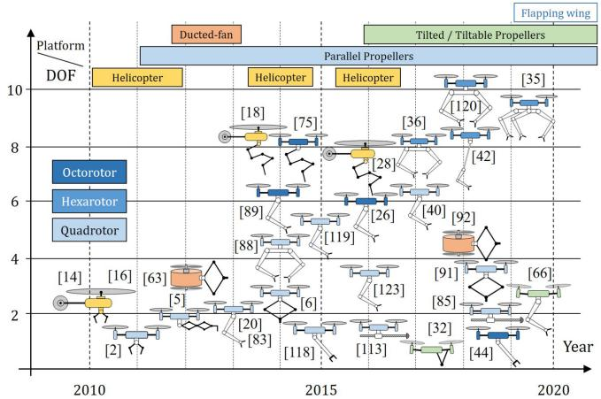  
Fig. 1. Evolution in the development of aerial manipulation prototypes, comprising different platforms, and morphologies.

possibly helping engineers interested in designing an aerial manipulation robot for a specific task.

Reviewing the main achievements in this field, it is possible to identify common features that allow defining the classification proposed in Table I. Fig. 1 shows the evolution of aerial manipulator designs in the last decade, although early achievements can be also found in the 90 s with the disc lifting mission at the International Aerial Robotics Competition.1 The first generation of aerial manipulators consisted of conventional quadrotors capable of applying forces to a wall while keeping flight stability [1], grasping objects [2], and constructing cubic structures [3] with an embedded arm with few degrees of freedom (DoFs). Less conventional designs started to appear: Marconi et al. [4] presented the modeling and control of a ducted-fan miniature UAV interacting with the environment; a six-DoFs gantry crane equipped with two four-DoFs manipulators was also proposed in [5]; and a three-active-DoFs delta-like manipulator with a three-passive-DoFs end-effector installed on a quadrotor was developed in [6]. These prototypes employed motion tracking systems for positioning in indoors [7]–[10], without relevant perception and planning.

Helicopters played an important role in the development ofthe aerial manipulation with early works in outdoors applied to load transportation [11]–[13], interaction with the environment [14], [15], and manipulation [16]–[18], showing better performance than multirotors in terms of payload capacity and operation time. However, the use of multirotors spread in following years because the control, mechanical construction, and handling of these platforms are significantly simpler, and allow to mitigate safety problems associated to the blades of the helicopters main rotor.

The second generation includes adapted aerial platforms for both indoor and outdoor operations, equipped with rigid and compliant arms (up to six/seven DoFs) for precise end-effector positioning and compensation of perturbations. They also integrate outdoor navigation sensors based on Global Navigation Satellite System (GNSS), indoor navigation features based on beacons, on-board perception with markers, and off-board planning features. Outdoor experiments involving grasping with seven-DoFs arms with both helicopters [19] and multirotors [20] were presented. Different arm designs have been introduced as well, including parallel manipulators with a large singularityfree workspace [21] for precise end-effector positioning relative to a target [22], or a hyper-redundant manipulator for mobile manipulating UAVs [23]. Attention was also paid to control techniques validated in simulation [24]. In [25], a framework for outdoor aerial manipulation is presented. Regarding visionbased controllers, a hybrid visual servoing with a hierarchical task-composition control is presented in [26]. An integrated vision-based guiding system for aerial manipulation with a stereo camera is shown in [27].

The current third generation of aerial manipulators includes several advanced features: operations in both outdoor/indoor environments [28], fully actuated platforms [29]–[32], multiple arms [33]–[36], GNSS free navigation capabilities, on-board SLAM [37], [38], on-board perception without markers [39], [40], off-board real-time planning with control awareness [41], [42], and on-board reactivity and planning. Applications include structure assembly, contact-based inspection in refineries (pipes and tanks), and bridges [43], [44].

The kinematics, dynamics, and control of AEROMs with conventional multirotor platforms is shown in [33]. Significant similarities can be established with space [45] and underwater [46], [47] manipulation in the formulation and derivation of the kinematic and dynamic models. The use of dual arm systems in aerial and space manipulation was motivated by the convenience of partially compensating reaction wrenches induced over the floating base due to the motion of the operating arm. We notice that the gravity effect is probably the most limiting factor in an aerial manipulation robot in terms of payload capacity and operation time [11], [48]. An analogy can be also drawn between the aerodynamic [49] and hydrodynamic [46] modeling in aerial and underwater manipulators. Previous surveys on modeling and control of multirotor vehicles [50] and aerial manipulators [51], [52], provide a very good baseline for this paper. Here, we extend them considering novel and more complex aerial platforms like flapping wing [53], [54], focusing not only on modeling and control methods, but also on teleoperation, perception, and motion planning techniques.

## II. PLATFORMS FOR AERIAL MANIPULATION

Here, we introduce the spectrum of different platform designs that can be used for aerial manipulation. It includes helicopter, ducted-fan, and the most popular multirotor platforms. In our review, we group platforms by types, i.e., clusters defined according to major design characteristics. The platforms will be additionally clustered according to the actuation property, type of interaction tool, and performed tasks. We also review the popular control algorithms used to stabilize and steer these systems during physical interaction.

## A. Modeling and Actuation Properties

Here, we consider a rather general definition of multirotor platforms with a main body equipped with $n \in  { \mathbb { N } } _ { > 0 }$ actuators consisting of a motor-propeller pair that produces a thrust and a drag moment on the main body. Their intensities are proportional to the square of the propeller spinning velocity, $u _ { \lambda _ { i } } = | w _ { i } | w _ { i } \in$ R [50]. We gather all control inputs relative to the thrust intensity in $\mathbf { \boldsymbol { u } } _ { \lambda } \in \mathbb { R } ^ { n }$ . With respect to (w.r.t.) the body frame B attached to the main body, each propeller can be shown as follows:

1) rigidly fixed;

2) tiltable by $m \leq 2 n$ servomotors where $\boldsymbol { u } _ { V } \in \mathbb { R } ^ { m }$ gathers their angular positions controlling the orientation of the propeller spinning axes;

3) movable by $r \leq 3 n$ servomotors where $\boldsymbol { u } _ { P } \in \mathbb { R } ^ { r }$ gathers their angular positions controlling the position of the propellers.

The dynamics of a generic multirotor is computed in [50]. One important element is the full allocation matrix, $F \big ( \boldsymbol { u } _ { \lambda } , \boldsymbol { u } _ { V } , \boldsymbol { u } _ { P } \big ) \big ( \mathrm { \mathbb { R } } ^ { 6 \times ( n + m + r ) }$ . It defines how an input variation affects the total wrench generated by the platform. In [50], the analysis of F brought to the definition of actuation properties that characterize the set of feasible wrenches.

1) Uni-Directionnal Thrust (UDT): Platforms with this property can vary the total thrust along one direction only (like in coplanar/parallel designs, helicopters, and ducted-fans). We say that a platform is UDT if rank $\left\{ F \right\} = 4 .$ . For helicopters and ducted-fan vehicles, the previous model does not apply directly. In general, the total thrust and torque are considered as inputs [16], [18]. Since the direction of thrust is constant w.r.t. body frame, the corresponding allocation matrix has rank $^ { 4 , }$ which makes such vehicles UDT.

2) Multidirectionnal Thrust (MDT): Platforms with this property can vary the total thrust along more than one direction independently from the total moment. We say that a platform is MDT if $5 \le \mathrm { r a n k } \{ F \} \le 6$

3) Fully Actuated (FA): This describes a subclass of MDT platforms. Platforms with this property can vary the total thrust along all directions independently from the total moment. We say that a platform is FA if rank $\left\{ F \right\} = 6$

4) Over Actuated (OA): With this property, we describe multirotor platforms that are FA and have more actuation inputs, $n _ { u } = n + m + r$ , than DoF. A multirotor is OA if it is FA and for each desired wrench there is more than one input combination that realizes it, i.e., $n _ { u } > 6$

5) Omni Directional (OD): This describes another subclass of FA designs, not exclusive from OA, where the total thrust can assume any value in a spherical shell independently from the total moment. A more detailed study on the theoretical characterization of OD multirotors with unidirectional propellers is provided in [31].

## B. Control Methodsfor Contactless Tasks

If the platform is FA, the design of the controller is rather straightforward because the full allocation matrix F is invertible. This allows applying simple static (for fixed propellers) or dynamic (for tiltable and movable propellers) feedback linearization that allows the independent control of the position and orientation [55]. If the platform is OA, the null space of F can be used to optimize the control inputs [56].

If the platform is not FA, feedback linearization cannot be directly applied. A specific controller should be designed to face the underactuation. For quadrotors and helicopters, to apply dynamic feedback linearization a first input transformation is required considering the total thrust and moment as input.

Feedback linearizable systems are also differentially-flat [57]. It follows that any FA vehicles is differentially-flat w.r.t. position and orientation. Additionally, it has been proven that UDT vehicles, like quadrotors, ducted-fan, and helicopters, are also differentially-flat w.r.t. center-of-mass position and yaw angle. Therefore, every UDT and FA (as well as OA and OD) aerial platforms are differentially-flat, although with different flat outputs. Differential-flatness-based controllers can be used to control the robot position in contactless tasks.

The dynamics of the position of the center of mass of the full AEROM is decoupled from the orientational and postural dynamics, and it resembles the one of a UDT vehicle [58]. Therefore, AEROMs are differentially-flat systems with the global-center-of-mass position as flat output [59]. However, the end-effector position—the most relevant output for contactbased operations—is part of a flat output only for specific design of AEROMs [60], [61].

Other general methods that can be applied independently to FA and non-FA platforms are based on model predictive control (MPC). In [62], a nonlinear MPC-based controller, which considers the full nonlinear dynamics of the system and inputs constraints is proposed for any multirotor. However, a precise model of the system is required, as well as a fine tuning of the cost function. In practice, according to the complexity of the system, both requirements could be difficult to be obtained. In such cases, feedback linearization can be simpler to implement, especially in the static case.

## C. Control Methodsfor Aerial Physical Interaction

When aerial vehicles are in interaction with the environment, they need to be able to control at the same time the position at the contact, and the interaction force, preserving the stability of the entire system. In the following, we review the most common control techniques designed for this scope.

1) Impedance/Admittance Control: This is probably the most common approach based on the reshaping of the impedance/admittance mechanical properties of the system at the interaction point. Impedance/admittance controllers establish a desired dynamical relationship between the end-effector position and the interaction force.

The impedance control, treats the system as a mechanical admittance. The input of the system is the force actuated by the robot and the output is the displacement of the end-effector. In practice, to perform contact-based tasks, the desired position of the end-effector is chosen “inside” the surface of interaction. The robot, trying to reach this point will generate a force that is related to the impedance properties of the controller. Such strategy has been proposed for both underactuated and fully-actuated aerial manipulators [63]–[68]. Notice that the compliance of the robot can be designed both software or hardware, by the controller or a suitable mechanical design [66], [69].

The admittance control is the dual of the impedance control. It treats the system as a mechanical impedance. The input of the system is the displacement of the end-effector and the output is the interaction force. Such strategy has been proposed for both underactuated and fully-actuated aerial manipulators [32], [70]–[75].

Passivity-based and Port–Hamiltonian methods have been also employed to design similar approaches, which aim at the reshaping of the apparent impedance/admittance properties of the system [76], [77].

2) Hybrid Position/Force Control: Previous schemes implement an indirect force control where the interaction force is indirectly controlled by designing a suitable end-effector trajectory. On the other hand, the hybrid position/force control method aims at precisely controlling the interaction force in a direct way. The robot is controlled by two complementary feedback loops, one for the position, the other for the interaction force, along the unconstrained and constrained axes, respectively. Such a control strategy has been implemented for UDT [60], [78]–[80], and FA [81] vehicles. In [82], a direct force-controller based on optimization is presented.

In order to implement the previously presented controllers, the estimation of the state (addressed in Section VII-B) and interaction forces are needed. For the latter, model-based wrench observers like the ones in [32] and [76], can be employed. A more direct solution is the use of a force sensor attached to the end-effector [70], [82]. This allows to implement a direct feedback in the interaction control loop.

We note that impedance/admittance controllers are very easy and intuitive to implement. Furthermore, the transition from contactless and contact-based flight can be easily handled with a smooth variation of the gains. However, precise interaction control is not guaranteed. On the other hand, hybrid position/force controllers can provide accurate position and force tracking but contact constraints have to be carefully addressed.

## D. Physical Interaction Tasks

Here, we classify the physical interaction tasks addressed by the aerial robotic community. In particular, we consider only tasks that involve an exchange of forces (or moments) between the environment and the aerial robot.

1) Pick and Place (P&P): The objective is to grasp or release an object not constrained to the environment [36], [75], [83], [84]. The interaction forces play a role only during the P&P operations, which are normally very short in time and can be considered negligible in most of the cases.

2) Point Contact (PC): The objective is to preserve the contact between the environment and the robot end-effector in a single static point. If the end-effector position is constrained, the challenge is to control the intensity and direction of the interaction force [80]. On the other hand, if the end-effector is free to move, the challenges are multiple.

1) Manage the transition from contact-free to contact flight, namely from zero to nonzero interaction forces. Bouncing effects or strong impacts could destabilize or damage the robot.

2) Ensure a sufficient force normal to the interacting surface to guarantee the contact.

3) Keep the interaction force in the friction cone. If this is not ensured, the end-effector might slip causing the crash of the robot. Applications falling into this category are the installation of sensor devices [85], the inspection by contact of tanks [44], pipes [66], and other surfaces [6], [86].

3) Pulling/Pushing (PP): This task is similar to the contact point, but the point of interaction is nonstatic. The interacting surface is not fully constrained and can move in the space along certain directions. When the robot is asked to pull an object, the end-effector position (and perhaps orientation) is in general constrained to the point of interaction. On the other hand, when the robot is asked to push an object, the mechanical constraint between the end-effector and the object is not required as long as the interaction force lays in the friction cone. For PP tasks, the extra challenge w.r.t. point contact is the dynamics of the object that now needs to be considered, together with its kinematic constraints. Classical benchmarks consist of opening/closing a drawer or a door and PP a cart.

4) Sliding (S): The objective is to keep the contact between the end-effector and a static surface, while the end-effector moves on it. The static and dynamic frictions must be considered in the control problem to avoid slippage, ensure the contact, and move the end-effector along the desired trajectory. The most popular application is the continuous contact-based inspection of tanks [44], pipes [66], and other surfaces [87].

5) Peg-in-Hole (PH): the objective is to insert an object (attached to the end-effector) in a hole. If the difference in size between the object and the hole is small, this operation can become very difficult. During the insertion, many of the DoF of the end-effector are constrained. This requires both a precise knowledge of the environment and a suitable impedance shaping to cope with errors and uncertainties that are present in real applications. If impedance shaping is not carefully addressed, high-frequency vibration and resonant effects could lead to instability or damages of the robot.

6) Manipulation (M): Under this last category, we gather all such operations that require the application of specific forces and torques. Examples are the bending of a pipe or a bar, the opening/closing of a valve [88], assembly of structures [89], tree cavity inspection [90], or corrosion repair [91].

TABLE II  
MULTIROTOR PLATFORMS FOR PHYSICAL INTERACTION TASKS

<table><tr><td>Platform</td><td>Actuation property</td><td>Interac. tool</td><td>Task</td><td>Reference</td><td>Maturity</td></tr><tr><td>HL</td><td>UDT</td><td>GR AA</td><td>P&amp;P M</td><td>[16], [17] [18]</td><td>Exp. Exp.</td></tr><tr><td>DF</td><td>UDT</td><td>RL AA</td><td>PC PC</td><td>[64] [92]</td><td>Sim. Exp.</td></tr><tr><td rowspan="4">ParP</td><td rowspan="4">UDT</td><td>RL</td><td>PC S</td><td>[93] [76], [94]</td><td>Exp. Exp.</td></tr><tr><td>GR</td><td>P&amp;P</td><td>[2]</td><td>Exp.</td></tr><tr><td>PL</td><td>Transp. P&amp;P PC M</td><td>[13], [95]-[97] [98] [79] [99]</td><td>Exp. Exp. Exp. Exp.</td></tr><tr><td>AA</td><td colspan="3">see Section III</td></tr><tr><td rowspan="6">TedP</td><td rowspan="3">FA</td><td>RL</td><td>PC S PH</td><td>[32], [77] [32]</td><td>Exp.</td></tr><tr><td>PL and GR</td><td>P&amp;P M</td><td>[100], [101]</td><td>Exp.</td></tr><tr><td>AA</td><td>PC S</td><td>[66], [82]</td><td>Exp.</td></tr><tr><td>OA</td><td>RL AA</td><td>PC S</td><td>[102] [44]</td><td>Sim. Exp.</td></tr><tr><td rowspan="2">OD</td><td>RL</td><td>push S PH</td><td>[81]</td><td>Exp.</td></tr><tr><td>GR</td><td>P&amp;P</td><td>[29]</td><td>Exp.</td></tr><tr><td rowspan="2">TableP</td><td>MDT</td><td>PL</td><td>PC</td><td>[103]</td><td>Exp.</td></tr><tr><td>OD and OA</td><td>RL</td><td>S</td><td>[86], [87]</td><td>Exp.</td></tr><tr><td rowspan="2">M</td><td>-</td><td>-</td><td rowspan="2">P&amp;P PP</td><td rowspan="2">[104], [105] [106]</td><td rowspan="2">Exp. Exp.</td></tr><tr><td>-</td><td>-</td></tr><tr><td>MP (DF) MP (ParP) MP (TedP)</td><td>-</td><td>RL PL PL</td><td>PC M M</td><td>[107] [108] [109]</td><td>Exp. Exp. Exp.</td></tr></table>

According to the specific physical interaction task, aerial platforms are equipped with different tools. The most common are: rigid link (RL), a link rigidly attached to the robot; gripper (GR); passive links (PL), similar to rigid links, but attached to the vehicle by a passive joint (e.g., cables); Articulated arm (AA) (see Section III). Some times, the end-effector is made of a soft material, or includes a spring mechanism [6], [44], [66]. This makes the end-effector naturally compliant with the environment from a mechanical point of view.

## E. Types ofMultirotor Platforms

We finally review all the multirotor platforms that have been employed for physical interaction. We gathered them into clusters sharing similar design characteristics related to the actuation (see Table II). For completeness, we also include helicopters and ducted-fan platforms, which have been investigated in the early state of aerial manipulation. Fig. 2 shows an example for every type of platforms. Exploiting the previous discussion, we also mention the actuation properties, the employed actuation tools, and the targeted tasks.

1) Helicopter (HL): Consists of a main horizontal rotor, providing vertical lift, and a tail rotor mounted vertically to counteract the torque from the main rotor. This type of actuation makes HLs UDT. Despite this, HLs were one of the first platforms employed for aerial manipulation. The high payload allowed to equip them with cables for transportation [12], [13], with a gripper for P&P [16], and with industrial robotic arms for manipulation [18], [110]. However, HLs do not seem a really viable option in many applications due to their high complexity and danger during flight close to surfaces. Likely this is the reason why recent works are rather focused on multirotor platforms. In [111], an HL is considered but for the sole objective of holding a cable suspended multirotor aerial manipulator.

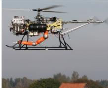  
(a)

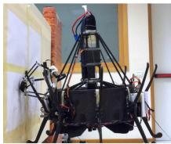  
(b)

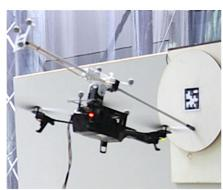

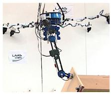  
(d)

(c)  
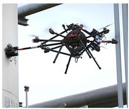

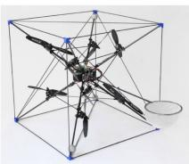

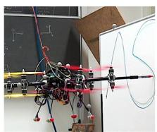  
(g)

(e)  
(f)  
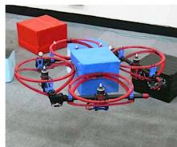  
(h)

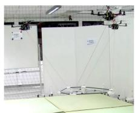  
(i)  
Fig. 2. Representative example for each type of multirotor platforms employed for physical interaction. (a) Helicopter [18]. (b) Ducted-fan [92]. (c) parallelprop. [93]. (d) Tilted-prop. FA [82]. (e) Tilted-prop. OA [44]. (f) Tilted-prop. OD [29]. (g) Tiltable-prop. OD [86]. (h) Morphing UDT [105]. (i) Multi-platformsys. [108].

2) Ducted Fan (DF): Consists of a main propeller mounted within a cylindrical duct together with some control surfaces. The first creates the total thrust, while the seconds generate moments to control the vehicle attitude. In view of this, it is easy to verify that standard DF platforms are UDT. In [63] a DF equipped with a simple rigid tool has been considered for contact point tasks in a simulation environment. Later, in [92], a real platform equipped with a parallel Delta arm has been experimentally validated for contact point tasks.

3) Parallel Propellers (ParP): Consists of a main rigid frame equipped with multiple propellers fixed to the main frame. Every propeller is directed toward the same direction and typically arranged on the same plane. In the most common cases, they are characterized by four, six, or eight propellers, thus, commonly called quadrotor, hexarotor, octorotor.

In the market, as well as in the state of the art related to aerial physical interaction, this type of platform is the most common. To perform physical interaction tasks, ParP platforms have been equipped with the following:

1) rigid links, for point contact [93] and sliding tasks [76], [94];

2) grippers, for P&P operations [2];

3) passive links, and in particular cables for transportation [13], [95]–[97], P&P [98], point contact [78], [79], and manipulation (assembly) [99];

4) articulated arms, for a wide range of tasks, e.g., P&P [112], point contact [113], PP [114], sliding, and manipulation [88]. A complete review is given in Section III.

4) Tilted Propellers (TedP): Consists of a main rigid frame equipped with multiple propellers fixed to it. The propellers are directed toward multiple directions. According to the number, orientation, and type (unidirectional/bidirectional) of propellers, such platforms can be FA, OA, or even OD.

Among the FA platforms, we find the “TiltHex” [55], which has six unidirectional-propellers rigidly attached to the main body, and oriented in different directions. Such a platform has been equipped with the following:

1) a rigid tool for point contact [77], slide, and peg-in hole tasks [32];

2) a passive link together with a gripper for P&P and manipulation tasks [100], [101];

3) an articulated arm for point contact and slide tasks [66], [82].

Among the OA platforms (non OD) we find the “AEROX” [44], which has eight unidirectional-propellers rigidly attached to the main body, and oriented in different directions. This platform has been equipped with an articulated arm for point contact and slide tasks and has been applied for contact inspection of both oil and gas plants and bridges [43]. Among the OD platformss we can find “ODAR” [81], which has eight bidirectional-propellers rigidly attached to the main body, and oriented in different directions. Such a platform has been equipped with a simple rigid tool for tasks like push and slide and peg-in-hole. A platform with a similar propellers configuration is the one in [29]. The platform has been equipped with a pouch for P&P operations and it has been used for the dynamic catching of a thrown ball.

5) Tiltable Propellers (TableP): Consists of a main rigid frame and multiple propellers fixed to movable actuated elements (servo motors). Thanks to the extra actuation, the propellers can be directed toward multiple directions in an independent or coordinated way according to the specific actuation configuration. Several designs have been presented with a different number of tiltable propellers going from 2 to 8, except for 5 and 7. Some of these platform have been proposed in , [30], [56], and [103]. For a detailed survey on platform with TableP, we refer the interested reader to [50]. Although most of the tiltable-propellers platforms are at least FA, there are only few cases in which they are used for physical interaction. In fact, the servo motors are in general not very precise and have a slow dynamics, as well as additional mechanical issues as backlashes.

Papachristos et al. [103] proposed a tri-rotor platform in a “T”- like configuration, where the two frontal principal propellers can tilt radially by the same angle, while the tail rotor can tilt independently. Such actuation configuration makes the platform MDT. The platform has been equipped with a passive one-DoF revolute end-effector to accomplish point-contact tasks. Bodie et al. [86] and Bodie et al. [87] proposed a twelve-rotor platform in a double motor configuration, where each pair of propellers can tilt radially. Such actuation configuration makes the platform

OD and OA. The platform, equipped with a rigid tool has been used for point contact and sliding tasks.

6) Multirotor Morphing (M): Consists of a main body composed by actuated links. Each link, or part of them, is then equipped with one (or multiple) titled- or tiltable-propellers. Thanks to the actuation of the main body links, the robot can not only change the propeller directions, but also their relative positions. Although the mechanical design is even more complex than TableP platforms, morphing ones allow for a very high adaptability to the environment and task needs.

In [115], a quadrotor-like platform with foldable arms has been proposed for simple contactless navigation purposes. For similar tasks, e.g., passing through narrows gaps, a transformable multilinked aerial robot has been presented in [116].

Again, likely due to the mechanical and control complexity of such platforms, M-type aerial systems physically interacting with the environment have been rarely presented. One example of the M-type that has been used for physical interaction is the “HYDRUS” [105]. It consist of a two-dimensional (2-D) multilink structure, where each link is equipped with a propeller. The robot exploits its morphing capability for P&P operations. It can grasp objects of different shapes properly adapting its configuration [104]. An evolution of such a vehicle used for manipulation tasks has been presented in [117] and [106].

7) Multiplatform Systems (MP): consists of multiple multirotor platform (belonging to the previously described types) physically connected forming a new articulated flying platform. Examples of such multirotor based platforms are actuated by: 1) ducted-fans [107] for point contact tasks, 2) parallel-propellers platforms [108] for manipulation tasks, 3) tilted-propellers platforms [109] for manipulation tasks. This particular case of multirobot cooperation for aerial physical interaction is addressed in detail in Section IV.

## III. AERIAL PLATFORMS WITH ROBOTIC ARMS

## A. Morphologies ofAerial Manipulation Robots

The literature review in aerial robotic manipulation reveals a wide diversity of morphologies mainly differing from the designs and implementations of the manipulator, using autonomous HLs [17], [18] and multirotors [20], [83] as aerial platforms. The analysis and comparison of the prototypes according to their kinematic configuration, functionalities, and mechanical construction allows the classification reported in Fig. 3 and Table III.

Possibly because of the widespread use of industrial robotic arms, a significant number of aerial manipulation prototypes employ an upper arm-forearm configuration including shoulder, elbow, and wrist joints, both in the single arm [83], [89], [119], and dual arm [120] case. The number ofjoints and the kinematic configuration of the arms are determined in principle by the level of dexterity required in the manipulation task, minimizing the number of actuators to reduce the total weight. Redundant and hyper-redundant manipulators [19], [23], [66] are intended to perform tasks requiring the appropriate positioning and orientation of the end-effector when interacting with the objects or the environment. In order to reduce the reaction wrenches induced by the motion of the manipulator, some prototypes employ transmission mechanisms like timing pulleys [118], [119], or rigid bars [120], placing the actuators as close as possible to the base of the aerial platform. The use of parallel mechanisms, as in delta manipulators [6], [21], [91], is useful to reduce the inertia, however, the workspace range is typically much lower compared to a serial manipulator arm. Aerial manipulators with single link [44], [87], [118] and linear actuators [85], [113] have been proposed for tasks involving force interactions with surfaces [93].

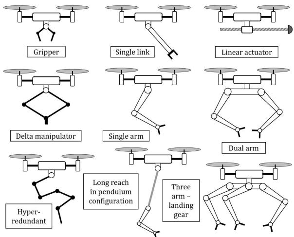  
Fig. 3. Different morphologies of aerial manipulation robots.  
TABLE III

DIFFERENT PROTOTYPES OF MANIPULATORS, SORTED BY NUMBER OF DOFS. TYPES OF PLATFORMS ARE MULTIROTOR (M) AND HELICOPTER (H). MANIPULATORS ARE: STIFF (S), COMPLIANT (C), AND INDUSTRIAL (I)

<table><tr><td>Morpho.</td><td>Ref</td><td>Type</td><td>DoF</td><td>Reach</td><td>Weight</td><td>Payload</td></tr><tr><td rowspan="2">Gripper</td><td>[2]</td><td>M-C</td><td>1</td><td>-</td><td>-</td><td>-</td></tr><tr><td>[16]</td><td>H-C</td><td> $2 \times 4$ </td><td>0.39</td><td>-</td><td>1.5</td></tr><tr><td rowspan="3">Single link</td><td>[118]</td><td>M-C</td><td>1</td><td>-</td><td>-</td><td>-</td></tr><tr><td>[87]</td><td>M-S</td><td>0</td><td>-</td><td>-</td><td>-</td></tr><tr><td>[44]</td><td>M-C</td><td>1</td><td>-</td><td>-</td><td>-</td></tr><tr><td rowspan="2">Linear actuator</td><td>[113]</td><td>M-C</td><td>1</td><td>-</td><td>-</td><td>-</td></tr><tr><td>[85]</td><td>M-S</td><td>1</td><td>0.4</td><td>0.48</td><td>4.5</td></tr><tr><td rowspan="3">Delta manip.</td><td>[6]</td><td>M-C</td><td>3</td><td>0.2</td><td>0.22</td><td>-</td></tr><tr><td>[21]</td><td>M-S</td><td>3</td><td>0.36</td><td>0.5</td><td>-</td></tr><tr><td>[91]</td><td>M-S</td><td>3</td><td>0.25</td><td>0.22</td><td>-</td></tr><tr><td rowspan="5">Single arm</td><td>[83]</td><td>M-S</td><td>2</td><td>0.32</td><td>0.37</td><td>-</td></tr><tr><td>[20]</td><td>M-S</td><td>2</td><td>-</td><td>0.4</td><td>0.2</td></tr><tr><td>[66]</td><td>M-S</td><td>2</td><td>-</td><td>-</td><td>-</td></tr><tr><td>[119]</td><td>M-S</td><td>5</td><td>0.3</td><td>0.25</td><td>0.2</td></tr><tr><td>[89]</td><td>M-S</td><td>6</td><td>0.45</td><td>1.4</td><td>-</td></tr><tr><td rowspan="4">Multi arm</td><td>[88]</td><td>M-S</td><td> $2 \times 2$ </td><td>-</td><td>-</td><td>-</td></tr><tr><td>[36]</td><td>M-C</td><td> $2 \times 4$ </td><td>0.5</td><td>1.3</td><td>0.3</td></tr><tr><td>[120]</td><td>M-S</td><td> $2 \times 5$ </td><td>0.5</td><td>1.8</td><td>0.7</td></tr><tr><td>[35]</td><td>M-C</td><td> $3 \times 3$ </td><td>0.37</td><td>1.0</td><td>-</td></tr><tr><td rowspan="2">Hyper-Redundant</td><td>[19]</td><td>H-I</td><td>7</td><td>0.88</td><td>22</td><td>7</td></tr><tr><td>[75]</td><td>M-S</td><td>7</td><td>-</td><td>-</td><td>-</td></tr><tr><td rowspan="2">Long reach</td><td>[121]</td><td>M-C</td><td> $2 + 1$ </td><td>1.5</td><td>0.8</td><td>0.2</td></tr><tr><td>[34]</td><td>M-C</td><td> $8 + 1$ </td><td>1.5</td><td>1.6</td><td>0.3</td></tr></table>

The technological limitations of the servo actuators typically employed for building lightweight robotic arms [75], [89], [119], [120], [122], whose capabilities are usually limited to position/velocity control, impede the realization of manipulation tasks involving significant interaction forces. To overcome this problem, the works in [70] and [82] employ a F/T sensor attached at the wrist of a stiff-joint manipulator. Alternatively, in [36], [69], [76], and [123], the estimation and control of the torques acting over the servos is done by measuring the deflection of an elastic element introduced between the actuator and the output link. The works in [85] and [113] exploit the kinetic energy of the aerial platform to apply higher forces, using a linear actuator to regulate the impact force interaction in a passive [113] or active [85] way.

Motivated by the convenience to increase the separation distance between the manipulator and the propellers, the concept of long reach aerial manipulator with dual arm is introduced in [124]. Later, this morphology evolved to the concept of aerial manipulator in pendulum configuration with passive joint at the base [121], [42], increasing safety in the realization of manipulation tasks close to environmental obstacles [34].

## B. Compliance

The term compliance in robotic manipulation can be defined as the manipulator ability of accommodating for the forces generated during the physical interactions with the environment or with an agent (human or robot). Intuitively, this concept is associated to an elastic behavior in the joints or links. More formally, the compliance can be formulated as the mechanical impedance (or, analogously, the admittance) that relates the position deviation of the manipulator with the external force, characterized by the inertia, damping, and stiffness. Two forms of compliance can be identified depending on its physical realizations: mechanical [15], [113], [118], [123], [125], or at control/software level [69], [70], [85]. In the first case, an elastic element is introduced in the joints or links of the manipulator, such that a significant deformation is produced when a force within the nominal range of the actuators is exerted. On the other hand, most industrial robotic arms like KUKA, Universal Robots, or ABB, integrate accurate force/torque sensors to control the apparent impedance.

The compliance is a highly desirable feature for an AEROM physically interacting with the environment since the stability of the floating base may be compromised by the forces caused by the dynamic coupling with the manipulator. The ability of accommodating for the motion of the aerial platform [64], [71], [77] and/or the manipulator [69], [76], [113] results very convenient when considering the uncertainties associated to the in-flight operations, especially in outdoor scenarios.

The first works that introduced compliance in aerial manipulation [16], [113], [118], [123], [125] proposed different compliant mechanisms designed for their integration in HLs and multirotors, like grippers [16], lightweight robotic arms [36], [123], linear actuators [113], or flexible joints [118]. Several functionalities were demonstrated, including collision detection and reaction with active-passive compliance [123], [125], generation of high impact forces [113], deflection based torque/force control [69], and safe interaction in contact with the environment [76]. The anthropomorphic, compliant, and lightweight dual arm presented in [36] combines the mechanical compliance with servo protection to improve the robustness, preventing that the actuators are damaged due to impacts or overloads. The modeling and control of compliant joint/arms was extended in [69], proposing a force controller based on Cartesian deflection. The passive joint in the long-reach (pendulum) configurations [34], [42], [121] provides an enhanced capability of accommodation thanks to the fact that no torque is transmitted to the aerial platform about the joint axis, while the force is still exerted along the link direction. In case of impact, the energy absorbed is stored as potential energy in the pendulum, and released later as kinetic energy.

## C. Design and Mechatronic Aspects

Although the manipulator should provide a sufficient level of dexterity to accomplish the task, increasing the number of joints of the manipulator introduces some problems. The most evident is the reduction in the payload capacity and flight time of the aerial platform. This can be clearly identified expressing the mass distribution of the AEROM as $m _ { \mathrm { A P } } + m _ { M } + P L _ { M } < =$ ηMTOW, where $m _ { \mathrm { A P } }$ is the weight ofthe aerial platform (including all its components except the manipulator), $m _ { M }$ and $P L _ { M }$ are the weight and payload capacity of the manipulator, MTOW is the maximum take-off weight, and η is the load index of the platform. Different approaches can be adopted in the design of the robot depending on how this equation is interpreted.

1) Design determined by the weight of the payload $( P L _ { M } ) \colon$ some works propose the use of aerial robots in tasks involving the grasping [36], [83], [84], installation [85], or interaction [44], [66] with devices whose weight is predefined.

2) Design determined by the level of dexterity $( m _ { M } ) \mathrm { : }$ the number of joints is designed to obtain the manipulation dexterity required to accomplish the task. It is possible to distinguish between manipulators that use the joints for end-effector positioning [20], [35], [66], [83] or orientation [19], [119]. Insertion [110] and assembly operations [89] are examples wherejoints for orienting the wrist are required.

3) Design determined by the available payload (MTOW): if the user or application demand the use of a particular aerial platform, then the weight of the on-board systems $( m _ { \mathrm { A P } }$ and $m _ { M } )$ and the payload capacity $( P L _ { M } )$ are constrained by ηMTOW. For example, safety reasons may impose a maximum total weight or maximum size of the AEROM.

Metrics like the lift load capacity or the payload-to-weight ratio are useful for evaluation and comparison purposes [48]. The so called smart servos like Dynamixel [35], [83], [88], [89], [91] or Herkulex [36], [120] are currently the best option for building lightweight robotic arms for aerial manipulation. These devices integrate the motor, gearbox, electronics, and communications in a compact device with a relatively high torque-to-weight ratio. These features significantly simplify the design and development tasks, although their performance is limited to position control at low update rates, usually below 100 [Hz]. Some models allow the open-loop torque control, acting directly over the current signal. However, the friction of the gearbox makes impossible to estimate or control accurately the torque at the output link.

## D. Single Arm Versus Dual Arm

Most of the aerial manipulation prototypes developed in the last decade consider a single manipulator attached to the aerial platform, and only a few of them explore the use of two [36], [68], [88], [120] or three [35] arms. By using identical arms, the integration on the platform is simplified and shoulder-like mechanical interfaces can be used to interconnect the arms with the platform, as in [36] and [120].

The dexterity and manipulation capabilities of a dual arm system allow the realization oftasks that cannot be accomplished with a single manipulator. The grasping and manipulation of long objects like bars or tubes [42] is a clear example where a dual arm manipulator results more convenient than a single arm. Other examples are: valve turning [88], cooperative bimanual grasping, and some assembly operations [89]. A multiarm system increases the payload capacity, extends the effective workspace of the aerial manipulator [120], [121], and allows the partial cancellation of the reaction wrenches induced by one arm over the aerial platform using the other arm as reaction [120]. The development ofhuman-size [120] and human-like [36] dual arms is also motivated by the convenience to replicate the abilities of human operators.

One capability of a dual arm aerial manipulator that results especially interesting is the use of one arm as position sensor relative to a grabbing point while the other arm conducts the manipulation task. The idea is to estimate the position of the aerial platform relative to the grabbing point from the information provided by the joint servos. It is necessary to remark that the positioning accuracy of the aerial platform should be below the 10% of the reach of the manipulator to ensure that the aerial manipulation task can be accomplished in a reliable way [48]. This problem is very relevant in outdoors applications, as the accuracy of position estimation systems like RTK-GPS may not be good enough.

## E. Control

The functionalities and potential applications of an AEROM are determined by the control capabilities of the aerial platform and the manipulator, considered as a whole. In the following, we revise specific motion controllers for aerial manipulators based on the dynamic model [43].

1) Decoupled: These methods consider the aerial vehicle and the robotic arm as two subsystems that are controlled independently [65], [70], [122]. The decoupled approach relies on the assumption that the influence of the manipulator over the attitude and position dynamics of the aerial platform is relatively small. The dynamic coupling is neglected or at best treated as a disturbance to compensate [19]. This motivates the design of low weight and low inertia manipulators [119], [120]. Decoupled control methods best perform only in quasi-static motions. As soon as the motion is more demanding in terms of accelerations, these methods fail, or in the best case show large tracking errors.

2) Coupled: These methods consider the system as a unique entity. The design of a coupled control scheme relies on the full dynamic model, which explicitly takes into account the dynamic coupling through the inertia matrix [120]. Therefore, this approach is more suited for dynamic cases and allow better performance in terms of position accuracy and stability. Coupled controllers proposed in the state of the art are strongly model-based and consider the full dynamics of the system [58], [61], [126]. A complete overview of such control methods is available in [52]. Furthermore, it requires the real-time computation of the dynamic model of a system with 6 + NM DoFs, being N the number of arms and M the number of joints per arm. They often require torque controlled motors that are in general unfeasible for aerial manipulators built with conventional servo actuators.

3) Partially coupled: The control of the aerial platform and the manipulator are independent, but the controllers exploit the information provided by each of the systems to estimate the interaction wrenches and improve the performance of the compound, typically in terms of positioning accuracy [75], [83]. To this category belongs the multi-layer architecture presented in [122], where a momentum-based observer [71] is employed to compensate the dynamic couplings, and the variable parameter integral backstepping controller in [20].

4) Decoupled flatness based: This approach is in between decoupled and coupled approaches. Each DoFs is controlled independently, as in a decoupled controller, but the full system dynamics is considered via a feed-forward term computed thanks to the differential flatness property of some aerial manipulators [127].

## F. Design and Application Guidelines

Given the wide variety of prototypes that can be found in the literature, it is convenient to formulate a design methodology to facilitate the development of specific solutions to particular applications. Autonomous HLs are in general more suited for the manipulation of heavy loads and high operation times. Fully actuated multirotors equipped with few DOF’s manipulators are suitable for exerting contact forces on surfaces like walls or tanks, whereas dexterous robotic arms are more appropriate when the application requires the adequate full-pose control of the end-effector. Delta manipulators have been employed due to their compact design and low inertia, that favors the accurate position control. Dual arm and three-arm systems have been proposed to conduct bimanual manipulation tasks where a single arm may not be appropriate, introducing the long reach configuration to improve safety by reducing the probability of collision.

The design and development of an aerial manipulation robot requires the choice of the specific components or modules required to accomplish the task in the most effective and reliable way, rather than developing a general purpose aerial robot. Some features like accurate position estimation and control or compliant interaction control are usual requirements in a wide variety of applications. The positioning accuracy is probably one of the most challenging requirements in outdoor scenarios. Nevertheless, the operation time and payload capacity of the aerial platform, which are directly related to its size and weight, are currently the two main limiting factors in practice. The use of big platforms (> 25 [kg] weight) should be avoided due to the inconveniences associated to its deployment and operation, safety, regulation, maintenance, and repair.

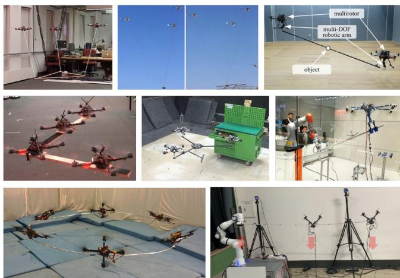  
Fig. 4. Examples of aerial cooperative manipulation systems (from top, from left): 1) multiquadrotor cable-suspended transport [7]; 2) multihelicopter cablesuspended transport [12]; 3) cooperative aerial manipulators [128]; 4) rigidlyattached quadrotors [129]; 5) SmQ platform [130]; 6) MAGMaS platform [101]; 7) flexible ring cooperative manipulation [131]; and 8) distributed vibration suppression with RVMs [132].

## IV. COOPERATIVE AERIAL MANIPULATION

To handle an object too heavy or too large for a single aerial robot, the concept of cooperative manipulation has been investigated. A team of multiple aerial robots is deployed to transport and manipulate a common object while increasing the total payload or the moment arm length via their cooperation. In this section, we survey some representative works in the area of cooperative aerial manipulation.

One of the earliest successful demonstrations for this aerial cooperative manipulation is the cable-suspended transportation and manipulation by multiple quadrotors or HLs (e.g., [7]–[10], [12], [13], [108]). Michael et al. [7], [9] considered the problem of cooperative transportation of a triangular plate-like payload by three quadrotors with a cable connected between each of their center-of-mass and a point on the payload (see Fig. 4). The key idea of [7] was to convert the problem as a quasi-static motion planning problem, i.e., given each waypoint of the desired payload pose in SE(3), compute the position of each quadrotor, which optimizes certain measures (e.g., Hessian of the payload pose) while satisfying certain feasibility conditions (e.g., positive cable tension, collision avoidance). However, the results of [7] suffer from the multiple solutions of the forward kinematics, i.e., given the quadrotors’ position, the payload can subsume 3-DoFs motion relative to the quadrotors. This issue was then resolved in [9] by enforcing so called “cone-constraint” of each quadrotor’s position relative to the payload pose and other quadrotors’ positions.

All the works in [7], [9], and [108] are yet kinematic results, thus, not able to realize high-speed dynamic payload transport with the quadrotor-payload dynamic coupling. This limitation was then addressed in [133] by formulating the quadrotorpayload system as a differentially-flat hybrid system (with the system of positive tension defining a differentially-flat subsystem and switching to other subsystem with the cable slack) and planning a dynamically-feasible trajectory for that. This dynamic cable-suspended transportation was also demonstrated using three small-size HLs in [12] and [13], where a 2-DoFs cable angle sensor and a cable-tension sensor were installed to measure and compensate for the cable tension on the HL dynamics, an approach more suitable for large-size aerial robots with enough load-carrying capacity (see Fig. 4). In total, twoquadrotor distributed cable-suspended manipulation of a rod payload with only on-board sensors (i.e., monocular camera and IMU) was demonstrated in [134] with some simplifying assumptions (i.e., two decoupled slung-load systems, no cable slack, straight trajectory, etc.) and also in [72], [73], and [135] based on the leader-follower setting with the use ofan admittance control together with a wrench observer.

Aiming for more precise pose control of the payload, the idea of deploying multiple aerial manipulators (i.e., quadrotor with a multi-DoFs arm - see Section III) has been explored [128], [136]–[139]. One of the key challenges for this is the complicated and high-dimensional dynamics of the total system, which is further exacerbated by the interaction with the environments/objects (e.g., unilateral grasping). Yang et al. [136] solved this dynamics and presented a hierarchical control law when the multiple aerial manipulators grasp and manipulate a common rigid object via friction-cone contact constraint. Whereas, Yang and Lee [137] circumvented this dynamics complexity by utilizing two impedance control-loops (i.e., object-level control and internal force regulation) with the rigid object grip assumption. Both of these works [136], [137] were validated only with simulations though.

Kim et al. [128], Lee et al. [138], and Kim et al. [139] presented frameworks for the cooperative manipulation of a rod-like object by using two aerial manipulators and their experimental demonstrations (see Fig. 4). In [138], an adaptive sliding-mode control was presented to estimate and reject disturbances including the object’s dynamics with the rigid-grip and equal object weight distribution assumptions. A RRT--based path planning method was also devised to drive the object. The results of [138] were extended in [139] to incorporate obstacle avoidance, and the technique of rapidly-exploring random tree (RRT)--parametric dynamic movement primitives (PDMPs) was proposed, where the RRT- was used for learning the motion parameters given the obstacle information in the form of dynamic movements primitives for fast and robust path planning. A null-space-based (NSB) control scheme was proposed in [128], where an inner-loop control was designed to robustly control each hexarotor while estimating and rejecting disturbances including their own arm dynamics, whereas the outer-loop control computed reference velocity for the system while incorporating internal force regulation and collision avoidance in an NSB hierarchy.

Another line of research for cooperative manipulation is to directly or rigidly attach multiple quadrotors on an object and use them as distributed actuators to transport and manipulate that object, thereby, overcoming the limitations of a single aerial robot while retaining mechanical simplicity. This idea was first demonstrated in [129], where four quadrotors were rigidly attached on a planar rigid payload of various shapes (e.g., L-shape, T-shape) with their thrust directions all normal to the payload surface. A two-norm optimal control was also derived and partially decentralized in [129] for scalability along with a special microspine mechanism to quickly grip the payload. The result of[129] was extended in [140], where two quadrotors were used to transport a rigid rod only with on-board sensing (i.e., monocular camera and IMU) based on a nonlinear controller capable of more agile maneuvers.

The results of [129], [140] are more for transportation than for manipulation, as it is not possible to control the position and orientation of the object independently due to the well-known underactuation property of the multirotors (with all the rotors parallel with each other). To overcome this issue of underactuation, the spherically-connected multiquadrotor (SmQ) system was proposed in [130] and [141], where multiple quadrotors were attached to a platform via spherical joints to render the platform fully-actuated (e.g., can maintain attitude during side-way motion) - see Fig. 4. A dynamics-based control law, which also addressed the rotating limit of the spherical joints via constrained optimization, was designed and validated with various experimental demonstrations for the SmQ platform in [130]. This spherical joint connection, which allows for omni-direciontal thrust generation, was adopted in [135] as well. Similarly in [142] (see Section VI).

In addition to purely aerial cooperative manipulation systems as discussed so far, there are recently emerging results on the mixed deployment of aerial and ground robots to exploit their complementary capabilities, that are: the ground robots often possess high load carrying ability, yet, with limited workspace, whereas the aerial robots possess unlimited workspace (and ability to easily increase moment-arm length), yet, with limited payload. Mohammadi et al. [142] presented a cooperative manipulation system consisting of a ground mobile robot and a quadrotor, where the position of a rigid object was controlled by the mobile robot while its tilting angle by the (spherically connected) quadrotor. However, the result of [143] is limited only for the sagittal plane similar to the case of a two-DoFs pendulum-cart system. On the other hand, the multiple aerial ground manipulator system (MAGMaS) was proposed in [144], where a seven-DoFs KUKA LBR iiwa industrial manipulator and a (spherically connected) quadrotor were controlled to cooperatively manipulate a long rigid object, which was too heavy and too long to be individually handled by either robots (see Fig. 4). This MAGMaS system was then extended in [101] with the spherical joint replaced by the OTHEX system [100] for higher and wider-angle thrust capacity with the bilateral teleoperation ability also added; and further expanded in [145], where the flexibility of the object, likely arising for long-slender or large-size/thin objects, was incorporated. The authors designed a control law for the cooperative manipulation of the flexible object while suppressing its vibration, proving its controllability as well.

The area of aerial cooperative manipulation of flexible or soft objects has not been investigated much so far. Nguyen et al. [130] considered the problem ofcooperative handling a flexible ring by six quadrotors, each rigidly attached to the ring with some tilted angle to directly provide horizontal-direction control force (see Fig. 4). The dynamics model of the ring with each quadrotor as wrench generator was linearized about the hovering configuration and Kalman estimation and linear quadratic regulator were applied to regulate the ring pose while suppressing its vibration modes. Vibration control of a long flexible beam of skewed rectangular cross section with distributed rotor-based vibration suppression modules (RVMs) was investigated recently in [132], where the two-rotor modules, whose design was optimized to maximize thrust force generation in the longitudinal-vertical plane with minimal torsional torque, were distributed along the beam. Furthermore, optimal placement problem was solved by maximizing controllability Gramian and the vibration suppression was experimentally demonstrated (see Fig. 4).

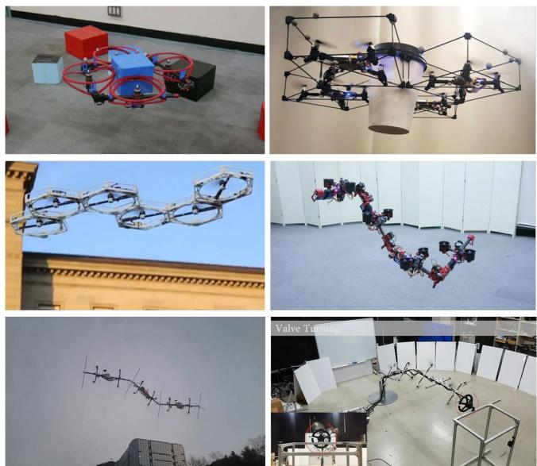  
Fig. 5. Examples of interconnected actuated multibody designs (from top, from left): 1) HYDRUS [105]; 2) flying-gripper [146]; 3) DFA [147]; 4) DRAGON [148]; 5) flying LASDRA [149]; and 6) operation LASDRA [109].

## V. INTERCONNECTED ACTUATED MULTIBODY DESIGNS

This section surveys a recently emerging class ofaerial robotic platforms, which consist of multiple articulated links or bodies, that are mechanically connected with each other via passive or actuatedjoints and fly with tilted or tilting rotors distributed over them. This kind of platforms can fly while changing their shape, thereby, can realize novel scenarios as follows:

1) aerial grasping of objects by directly using their bodies;

2) aerial operation in cluttered environment via serpentine motion;

3) very large-size robots, that can do aerial manipulation free from classical issues as short operation time, low payload, difficulty in control and sensing;

4) articulated flying characters in amusement parks.

Anzai et al. [104], Park et al. [149], and Shi et al. [150] presented the horizontally deformable aerial robot with twodimensional mUltilinkS (HYDRUS) (transformable multirotor with 2-D multilinks) platform. Each link module consists of one rotor with enclosing cage and one servo-motor with its rotation axis parallel to the one of the rotor. Thereby, the robot can change its shape in the horizontal plane while retaining the hovering efficiency of typical multirotors. The platform also demonstrated whole-body aerial gripping and transport of a box-like object considering friction cone constraints, and the rotor and servo-motor actuation limitations (see Fig. 5). This HYDRUS platform was also used in [152] to transport multiple objects at the same time by hanging them via cables. For this problem, the platform configuration, namelly the shape in the horizontal plane, is optimized to minimize the required thrust of each rotor while balancing the loading among the rotors. This HYDRUS was further extended in [104], where the horizontal plane transformable aerial robot with closed-loop multilinks structure (HALO) platform was presented. HALO is based on HYDRUS, yet, making a closed-loop link to increase the platform rigidity while also using 20◦-tilted rotors to improve the horizontal motion performance. HALO was used to transport a planar payload attached parallel to the platform through short cables to mitigate uncontrollable payload oscillations [9]. Again the platform configuration is optimized to minimize the masscenter offset between the platform and the payload reducing steady-state hovering torque. An evolution of such a vehicle that is fully-actuated has been presented in [117].

Similar to HYDRUS and HALO platforms, one can find the flying gripper system proposed in [146]. It is designed as a modular closed-chain system, each module consisting of an off-the-shelf Crazyflie 2.0 quadrotor with a carbon fiber cuboid cage around it. An axially magnetized cylindrical Neodymium Iron Boron magnet was attached on the vertical hinge of each cuboid to allow them to rotate about the thrust direction of the quadrotors. A four-cuboid flying gripper system was then constructed and experimented to grasp a paper cup by squeezing the aperture angle ofthe four-bar linkage closed-chain among the four cuboids (see Fig. 5). Related to the previous platforms there is also the distributed flight array (DFA) of [147] (see Fig. 5). It is also constructed as a modular system, each module consisting of a rotor and driving wheels, so that, only when they form an array (using the wheels), they can fly together. However, in this case, the array structure is fixed and not actuated.

On the other hand, Oung et al. [147] proposed the dual-rotor embedded multilink robot with the ability of multi-DoFs aerial transformation (DRAGON) platform, consisting of multiple carbon fiber pipe modules, on each of which two parallel rotors were attached via a two-DoFs thrust vectoring mechanism (i.e., dual-rotor gimbal module). The pipe module itself was then connected with other modules via a two-DoFs orthogonal-axes joint with a pulley transmission with high reduction ratio. This reduces the back-drivability of the joint, thereby, mitigating possible vibration propagation through these joints. In contrast to the HYDRUS and HALO platforms, the DRAGON platform is fully-actuated, capable of assuming any pose and shape in SE(3) (up to the joint and rotor limits). Flying with fixed and changing shapes was experimentally demonstrated in [148] (see Fig. 5), also performing PP operations [106].

Another research along the same line is based on the large-size aerial skeleton with distributed rotor actuation (LASDRA) platform [109], [149]. Each link is based on the ODAR robot [81] and connected via string to maximize the dexterity ofthe motion. The LASDRA system aims at overcoming the well-known challenges in aerial manipulation (e.g., limited battery and payload, difficulty of on-board sensing and control, etc.) by making the robot large enough so that it can perform aerial manipulation tasks while tethered to the ground (or other vehicles). The “base” could provide abundant power and, consequently, the possibility of using powerful rotors. The mechanical structure of the LASDRA platform also provides the inherent stabilizing inertial/dissipative effects, while making the state estimation problem easier by enforcing the kinematic relations (measurable by, e.g., IMUs) from the (known) base to the end-effector.

TABLE IV  
TELEOPERATION FEATURES FOR AERIAL PHYSICAL INTERACTION

<table><tr><td colspan="2">Aerial platform</td><td>Reference</td><td>Human interface</td><td>Task</td><td>Level of maturity</td></tr><tr><td rowspan="2">Single</td><td>UDT</td><td>[154]</td><td>haptic</td><td>point contact and push</td><td>simulation</td></tr><tr><td>MDT</td><td>[155]</td><td>haptic and 3D view</td><td>pick &amp; place</td><td>experiment</td></tr><tr><td rowspan="2">Multiple</td><td>UDT</td><td>[142], [156]</td><td>haptic</td><td>manip.</td><td>simulation</td></tr><tr><td>MDT</td><td>[101]</td><td>haptic</td><td>manip.</td><td>experiment</td></tr></table>

Outdoor autonomous flights of a 3 m-long 3-link 15-DoFs untethered LASDRA system was demonstrated in [149], where the estimation accuracy was substantially improved (i.e., interlink position RMSE less than 5 cm) by fusing the kinematic constraints and the distributed IMU and GNSS sensors in the form of semidistributed extended Kalman filtering. The method provides stable autonomous flight while avoiding excessive internal forces within the system (see Fig. 5). Various manipulation tasks with a 3m-long 2-link 6-DoFs operational LASDRA system were also demonstrated in [109], where compliant turning of an industrial valve was achieved based on the back-drivability of the BLDC rotors (see Fig. 5). This LASDRA system is scalable, i.e., with each link addressing its own weight, arbitrary number of links can be added indefinitely. To support this scalability, a distributed impedance control law was designed and applied to each individual link of the LASDRA systems [109], [149].

## VI. TELEOPERATION

Because of the increasing number and complexity of applications in which aerial robots could be applied, methods that allow human intervention and supervision are required. It is indeed of fundamental importance, for safety and regulatory reasons, to let a human operator remain in the loop while the robotic system acts on the environment in an autonomous or semiautonomous way [28]. The majority of the presented works on aerial teleoperation at date focused on the contact-free motion control of the vehicles (see, e.g., [126], [153] and references therein). Bilateral (e.g., with haptic feedback) teleoperation methods have been presented to help humans controlling single [153] and multiple aerial vehicles navigating in cluttered environments. In the following, we present the most important recent works on the teleoperation of aerial systems with particular regard to aerial physical interaction and manipulation. Table IV gathers the main features of the state of the art on teleoperation for aerial physical interaction.

Considering uni-directional thrust platforms, teleoperation solutions focused on the case in which the platform is equipped with a simple rigid tool. In [154], a bilateral haptic feedback method has been proposed to address tasks like point contact, and pull/push. To increase the payload and the manipulation capabilities, a similar solution for a multirobot scenario is proposed in [142] and [156]. In these works, the fleet of robots is employed as a flying hand to remotely manipulate objects. However, likely due to its complexity, such solution has been validated only in simulation.

To develop hardware-in-the-loop simulators for physical interaction tasks, De Stefano et al. [157] used an industrial arm equipped with an additional smaller manipulator to simulate an aerial manipulator interacting with the environment. The problem of rendering the robot dynamics and the interaction forces is addressed. The latter can be then used in a haptic-feedback scenario to test specific teleoperation methods.

Considering multidirectional thrust and fully-actuated platforms, the literature focused on designing teleoperation solutions for P&P tasks. The teleoperation of the cable-suspended aerial manipulator SAM equipped with an articulated arm is shown in [155]. The authors proposed the use of a 3-D visual plus haptic feedback helping the user to drive the end-effector toward the grasp of a object. Staub et al. [101] addressed the teleoperation problem of a heterogeneous multirobot system composed of aerial and ground manipulators that cooperatively manipulate long objects.

From the human point of view, the common feedback used to help the telemanipulation are as follows.

1) Visual: from robot to human, cameras mounted on the aerial platform or on the end-effector are employed to provide 2-D or even 3-D images [155] to the operator. These information can also be integrated with head mounted displays in a virtual reality framework [158], [159] helping the operator performing the task. On the other hand, in [156], a red-green-blue-depth (RGBD) camera is used to extract human commands from the motion of his/her hand, which are then translated into robotic actions.

2) Haptic: haptic devices provide a sense of touch to the human. Using delta type haptic devices, one can apply 3-D forces to the human to augment his/her situational awareness. In [101], the haptic device is used to send the desired pose of the manipulated object from the human to the robotic system. In the other sense, it is used to apply on the human hand forces that are related to the inertia of the system and the presence of obstacles. In [154], the delta device is used to control the interaction forces of a quadrotor platform equipped with a rigid tool. The operator, moving the end-effector of the device, sends desired forces at the end-effector of the robot. On the other hand, the haptic device is used to apply to the user forces that give the perception of the contact force applied by the robot to the environment. These forces are also used to give the feeling of the distance from zero-commanded force.

## VII. PERCEPTION AND PLANNING

## A. Motivation and Requirements

Three phases can be distinguished in aerial manipulation operations as follows:

1) navigation from the take-off position to the proximity of the workspace ensuring collision avoidance and reactivity in case of unexpected obstacles;

2) approaching to the desired operation position with higher accuracy;

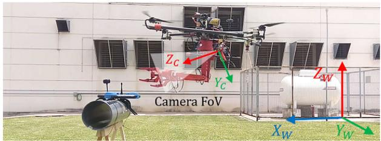  
Fig. 6. Aerial manipulator grasping a crawler.

3) manipulation with accurate position and interaction control.

Phases 1) and 2) should consider perception to avoid collisions of a load being transported, also involving perception-based localization and accurate SLAM in GNSS denied environments. Object detection, tracking and localization are required for grasping and manipulation in phase 3), being distinctive of aerial manipulators when compared to other aerial robots. Motion planning also requires particular care in aerial manipulation. The dynamic coupling between the manipulator and the aerial platform should be considered at the motion planning level to prevent undesired position deviations that may result in collisions with the environment. Therefore, the planner should consider the full body dynamics and compute an optimal trajectory for every DoF.

## B. Perception

Perception functionalities are needed for localization and mapping as well as for object detection and manipulation.

1) Localization and Mapping: UAV navigation is usually based on GNSS. The position provided by GNSS is used to close position control loops and to track desired trajectories. However, in many cases, the relative low frequency and the accuracy degradation due to the satellite visibility and communication problems, precludes its fully autonomous application. There are also many AEROM’s applications in GNSS denied environments that require alternative approaches based on environment perception. In the following, we review localization methods and technologies for contact-free and manipulation operations, e.g., while transporting a load with the arms, or while performing contact-based inspection.

Odometry based on the combination of IMU and vision, with no absolute localization [160], is a well-known approach that has been applied in aerial manipulation. In [39], visual-inertial fusion with event cameras is presented. The use of event cameras offers significant advantages over standard cameras providing a very high dynamic range, very small latency, and no motion blur, which are relevant characteristics for AEROMs in noncontrolled outdoor environments.

Visual localization and SLAM methods were also applied. Absolute 3-D localization in the world frame W (see Fig. 6) and mapping can be performed from measurements obtained by multimodal sensorial approaches using 3-D LIDAR, stereo cameras, and radio range measurements w.r.t. beacons (see [43, Chapter IV.2]). Ultra wide band time-of-flight sensors are applied to compute the position of a receiver on-board the aerial robot, by means of triangulation and range only estimation, based on a decentralized Extended Information filter combined with a particle filter for initialization. This can be applied at relatively long distances but the emitters should be well distributed; the method is affected by reflections, and the orientation cannot be obtained. Moreover, they provide position estimation with only about 0.5 m accuracy. When the robot is tens of meters from objects, a 3-D LIDAR provides a better accuracy and reliability. Finally, at small distances, stereo cameras can be applied and fuse the point clouds resulting from the camera with those provided by the 3-D LIDAR. In [38], a multisensor six-DoFs localization method is applied. An iterative closest point (ICP) algorithm extended to consider 3-D–3-D matchings between LIDAR (3-D distances) or cameras (distances in the SURF space) is used in the prediction stage. Also, the ICP can be easily combined with the IMU, optimizing the joint (laser and camera) error. The method can be implemented in real time with moderate computational cost on-board the robot. These methods have been implemented without any marker and by using measurements obtained at tens of meters with rms errors between 0.11 and 0.21 m. Greater accuracy in relative localization can be obtained by means of markers. In particular, with visual markers it is possible to obtain the position with an accuracy better than 5 mm at a distance of 0.7 m by means of image processing. The method, presented in [43, Chapter IV.4], is based on optimizing the alignment of deformable contours from textureless images.

2) Object Detection: Object detection is strongly dependent on the used sensors. The payload of the aerial robot is a very important constraint. Then, visual cameras with light optics are the most used sensors. In aerial manipulation two different problems exist: the detection of objects to be manipulated at a certain distance (usually meters) in order to perform the approach, and the detection for grasping and manipulation. The first is a rough detection based on the following:

1) features, related for example to shape and color;

2) templates of the target object, which could be fixed or deformable to adapt to changes of the viewing angle due to the motion of the aerial robot;

3) classifiers, which could be also based on particular features.

Moreover, there are methods based on motion analysis that also use features or templates. The deep learning classifiers extracting image features are being applied more and more.

On the other hand, the detectors for grasping and manipulation should provide high accuracy. Methods based on markers, i.e., fiducial markers, have been proposed. In [43, Chapter IV.6] markers detection libraries and deep learning are applied. It is also possible to avoid the use of markers and apply modeling techniques of the objects to be manipulated. Particularly, Gaussian process implicit surfaces (GPIS) [161] takes into account the environment uncertainties involved in computer vision. This probabilistic information has been used in the H2020 AEROARMS project to generate grasp configurations. Moreover, the model is used to compute the relative 3-D pose. Fig. 6 shows an outdoor crawler detection and grasping with a dual arm. The GPIS models the crawler surface computing a covariance term for each point of the approximated surface. Alternatively, RGB-D cameras and convolutional neural networks can be used to obtain in real-time a suitable model for grasping. The state variables in the estimation of points of the object in the camera reference frame of Fig. 6 is given by $[ ^ { C } \pmb { p } _ { [ t ] } , ^ { C } \pmb { \eta } _ { [ t ] } , ^ { C } \pmb { \dot { p } } _ { [ t ] } , ^ { C } \pmb { \omega } _ { [ t ] } ] ^ { \top }$ , where $^ C { \pmb p } _ { [ t ] } , ^ { C } { \pmb \eta } _ { [ t ] } , ^ { C } \dot { \pmb p } _ { [ t ] }$ , and $c _ { \omega _ { [ t ] } }$ are, respectively, the position, orientation, linear velocity, and angular velocity in the camera frame C shown in Fig. 6 at the time instant t. These variables can be estimated by means of an extended Kalman filter. The resulting estimations of the centroid of the object to be grasped $c _ { p } , c _ { \eta }$ are used to compute the grasping points ofthe bar handle by means ofthe model ofthe object. Then, the references for the grasping point of each arm can be obtained as $\begin{array} { r } { [ ^ { E } { \pmb p } ^ { i } , ^ { E } { \pmb \eta } ^ { i } ] ^ { \top } = ^ { \top } { \pmb T } _ { C } ^ { i ^ { \bot } } [ ^ { C } { \pmb p } _ { [ t ] } ^ { \bot } , ^ { C } { \pmb \eta } _ { [ t ] } ] ^ { \top } } \end{array}$ , where $^ E p ^ { i }$ and $^ E \eta ^ { i }$ for $i = 1 , 2$ are the position and orientation of the grasping points for the arms in the end-effector frame, $\mathcal { E } ,$ and ${ \bar { \mathbf { \Pi } } } _ { E } { \bar { \mathbf { T } } } _ { C } ^ { i }$ is the transformation from C to E for the arm i. These references can be passed to control methods described in Section III. Position based [27], [162] or image-based visual servoing [40], [163] can be used, expressing the error and control inputs directly in the image space, minimizing the error w.r.t. desired image feature coordinates.

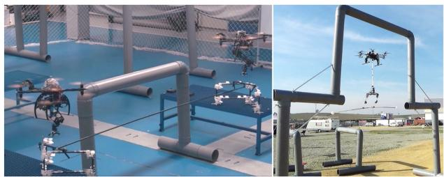  
Fig. 7. Two aerial manipulators assembling a structure (left). Long reach aeria manipulator with dual arm transporting a bar (right).

## C. Planning

1) Planning Levels: The higher level in planning of aerial manipulators is mission planning, e.g., the plan to assemble a structure from separate parts by taking into account the constraints related to the final desired state, the location of the parts, the connectors and the tools (see Fig. 7 left). The second level is the planning of the individual tasks to achieve the previously obtained assembly plan. In case there are several aerial robots, the task planner should allocate tasks to the different robots. The lower level is the motion planner, which is in charge of computing the trajectories of the robots, in such a way that the end-effectors of the aerial manipulators perform the previously specified tasks.

The abovementioned decomposition simplifies the inherent complexity of the aerial manipulation planning. Assembly and task planning are symbolic and consist of sequences of actions. These actions involve the motion of the aerial robots whose feasibility should be checked taking into account constraints, including the geometric ones. In [164], task and motion planning are interleaved in such a way that geometric constraints involved in the symbolic actions are checked and the plans are modified until the geometric constraints are satisfied. This requires to build and maintain a geometric counterpart of the symbolic plan to ensure that the current geometric state matches the current symbolic state.

2) Assembly and Task Planning Levels: The assembly planning (AP) uses a 3-D CAD model of the structure and generates the tuple $P R = \langle S , D \rangle$ , where $S = \{ s _ { 1 } , . . . , s _ { n } \}$ is the ordered sequence of operations to assemble the structure and $D = \{ d _ { 1 } , . . . , d _ { m } \}$ is a set of dependencies between assembly operations. The dependency $d _ { j }$ is a tuple made of the target operation and the set of all other operations that should necessarily be performed before that one, with $d _ { j } = \langle t _ { l } , p _ { k } \rangle$ which is the set of operations $p _ { k }$ that should be achieved before the operation $t _ { l } .$ where $t _ { l }$ is just the identifier of an operation $s _ { l }$ The set $p _ { k }$ contains the list of identifiers for operations from S. The AP should take into account the connections between parts and the involved forces. Considering truss structure built with connectors and links (see Fig. 7 on the left), interaction and gravity forces should be considered for their assembly. There are tools, such as the bullet physics library, that can be used to check if a subset of assembled parts is self-sustaining and can remain indefinitely to the given configuration without external support (statically stable).

AP is an NP-hard problem [165], which can be represented using directed graphs where each vertex and edge represents an assembly component and the corresponding relationship, respectively. Each candidate sequence can be evaluated by an objective cost function to be optimized or by a penalty value if the candidate sequence leads to an unstable configuration. In [165], a discrete particle swarm optimization algorithm is applied. In [166], reverse disassembly sequences are used to determine the assembly, providing faster eliminations thanks to the increased number of constraints at the beginning. The assembly plan can be implemented using several aerial robots. Thus, the planner tries to combine successive actions into parallel operations to be executed at the same time by separate robots. The work in [43, Chapter V.1] implements interleaved task and motion planning of aerial robots by means of a Geometric task planner to perform the assembly of a truss structure. It includes actions devoted to the monitoring of the assembly actions by means of visual tracking of the robots. The resulting symbolic task plan has associated motions that should be also planned as follows.

3) Motion Planning: Many practical approaches for motion planning of aerial manipulators decouples the problem of the planning of the aerial platform and the manipulator. First, the algorithm plans a trajectory of the center of gravity (CoG) of the aerial platform that ends in a suitable position for manipulation, then the algorithm plans the motion of the end-effector, assuming that the aerial platform maintains the same position and orientation during the manipulation. These approaches have the following drawbacks.

1) The geometric approach is not able to deal with the orientation, which plays an important role in aerial manipulation.

2) The decoupling between the aerial platform and the manipulator could be inefficient from the energy point of view and execution time.

3) The abovementioned decoupling could be unfeasible when the motion of the robotic manipulator is needed to avoid obstacles (see Fig. 7).

4) The decoupling is also unfeasible when the motion of the manipulator has significant impact on the motion of the platform.

Kinodynamic planning allows the consideration of the kinematic and dynamic constraints in the motion of the aerial manipulator. A simple decoupling approach consists of a first step of geometric planning for a sphere bounding the aerial platform, by using, for example, RRT to compute segments with zero velocity and acceleration at end-points. Then, the path is transformed in a trajectory satisfying the kinematic and dynamic constraints. Finally, velocity and accelerations are modified along the local paths without modifying its geometry and ensuring collision avoidance [167]. In [168], control aware planning is proposed to maintain contact with a surface. There are also methods that consider jointly motion planning and control to maintain this contact [94]. In the AEROARMS project an RRT\* algorithm was used for planning the simultaneous motion of the aerial platform and the joints of the arms transporting a bar in an environment with high density ofobstacles, as shown in Fig. 7. A planar model with eight configuration variables for the aerial manipulator was used. The motion of the arms of the long reach aerial manipulator in Fig. 7 right when holding the bar, modifies the position of the CoG ofthe aerial robot and then the motion ofthe aerial platform. If this coupling is not considered, collisions may occur. In order to avoid these collisions an RRT\* with dynamic awareness has been developed and implemented [169].

4) Reactivity: Aerial robots are often subject to disturbances, including nonmodeled aerodynamic effects, positioning inaccuracy, and others. This is particularly true for small outdoor aerial robots where the wind plays a significant role. Moreover, it is also difficult to consider all the unexpected objects and forces that could be involved in aerial manipulation. Then, reactivity is needed to increase the safety of AEROMs. Autonomous reactivity should be based on the perception capabilities of the AEROM, by including mainly range sensors, computer vision, and force/torque sensors. The abovementioned perception, planning, and reactivity functionalities were integrated for real-time execution in the AEROARMS project [28]. The system was implemented with an on-board 3-D laser and a computer to perform mapping and motion planning in real time (see Fig. 7 right).

## VIII. NEW GENERATION OF AEROMS

## A. Challenges

1) Time of Flight and Range: The current time of flight of most AEROMs are minutes or tens of minutes, which is too short for many practical applications. The increasing of the flight time involves new configurations of aerial platforms, new sources of energy and even new control and motion planning methods. Some applications also require increased range, involving flights beyond the visual line of sight, which also implies the respect of regulations and safety norms.

2) Safety in the Interactions With Persons and Objects: AEROMs are based on multirotors and HLs. The energy of the propellers is a threat for people and valuable objects close the aerial manipulator. This is particularly true for applications such as aerial coworkers for physical interactions (see Fig. 8). Thus, it is necessary to develop safer platforms and new technologies to enhance safety.

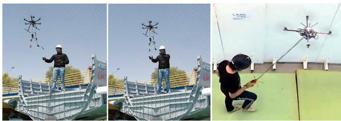  
Fig. 8. AEROM providing a tool (left) and guiding a human (right).

3) Accuracy: The accuracy of AEROMs depends on the accuracy of the positioning sensors, and is limited by unavoidable perturbations, such as wind gust and aerodynamic effects due to nearby surfaces. Some of these effects can be modeled and controlled, but others are difficult to manage, especially with the limited on-board capabilities of light AEROMs.

4) Reliable Decisional Autonomy: Current AEROMs usually require human supervision. The increasing of decisional autonomy should involve high reliability by considering all the sources of faults and contingency measures.

Crossed effects between challenges are also present, e.g., the increase of decisional autonomy requires high on-board computational capabilities that are constrained by the minimization of payload to increase flight time and range.

## B. Approaches

1) Energy: There are different approaches to save energy and, thus, increase the time of flight or the range.

1) Perching: Most research works in aerial manipulation assume that the operation is carried out in flight. However, in some cases, the robot could perch on support structures like poles or cables to avoid the waste of energy and extend the operation time. Some mechanisms for quadrotor perching have been proposed, including bioinspired passive mechanisms [170], grippers [171], or vacuum cups [172].

2) Hybrid aerial-ground platforms: Aerial locomotion requires significantly more energy than ground locomotion. Vehicles with hybrid locomotion can fly to sites that cannot be accessed by ground, land, perform the final approach by means of ground locomotion, and finally perform the task from the ground or attached to a static surface. This saves energy and increases the operation time [173].

3) Hybrid fixed/rotary-wing platforms: This includes aerial platforms integrating the beneficial features of fixed-wing (long flight time and range) and rotary-wing (vertical take-off and landing and hovering). In [174], these platforms are categorized into two types: convertiplanes and tail sitters. The former maintains the airframe orientation and switch between flight modes. It includes the tilt-wing platform [175], where the wing is partially or totally tilted together with the rotors during the flight-mode transition, and also dual systems, which have two sets of propulsion units: upward and forward mounted rotors for vertical motion and cruise flight, respectively. On the other hand, the tail sitter performs take-off and landing vertically on its tail while the entire airframe tilts to achieve cruise flight [176]. None of these platforms have been used up to now for aerial manipulation.

4) Morphing and bioinspired approaches: These include configurations inspired by birds and insects. Particularly, morphing technologies can be applied to change between a low drag configuration, typical in fixed wings, and high lift configuration to avoid stall at low speeds or even to hover [177]. It has also been shown that flappingwing flight, so abundant in nature, is more efficient than rotary-wing flight [178], [179]. It is well known that birds are able to fly long distances minimizing the energy consumption. Several flapping unmanned aerial vehicles, called ornithopters, have been designed. The key aspect to save energy is the optimal combination of gliding and flapping. It has been also shown that the drag of the flapping wing is greater than fixed wing. Thus, the flap-gliding flight yields a performance advantage when comparing with only flapping. Furthermore, the maximum range performance achievable with flap-gliding flight and the associated optimal travelling speed have been determined [180]. In order to perform the optimal switching between flapping and fixed wing phases, it is necessary to obtain the velocity and height from which to start descending at a very low angle, maximizing the lift to drag ratio. Also the transitions from gliding to flapping to increase altitude or to perform perching is very important. Suitable models and new control and planning methods should be obtained. However, up to now, flapping-wing platforms have not been used for aerial manipulation. The ERC Advanced Grant GRIFFIN proposes the development of new bioinspired aerial manipulation systems with the capability to glide, saving energy, flap the wings, perch, fold the wing and manipulate. Martín-Al´cantara et al. [53] introduced the concept of winged aerial manipulation robot, combining the manipulation with gliding to reduce the total weight of the aerial robot.

2) Safety: It involves both information processing and physical interactions. The former is related to situational awareness including environment perception for collision detection and avoidance. The second is related to AEROMs physically interacting with humans [181] (see Fig. 8), e.g., to provide tools at height [34] or to help in manipulation tasks.

3) Accuracy: The modeling and control of the aerodynamic effects can be considered to increase the accuracy of aerial manipulators in free flight. The sensing of airflow [182], the increasing of the control frequency, and implementations with new light servomotors, can be also used to cancel perturbations and increase the accuracy. Since the cancellation of all perturbations is difficult, an alternative strategy consists in manipulating the environment while perching or holding a fixed support with another arm.

4) Decisional Autonomy and Reliability: The complexity of the implementation of autonomous functionalities is related to the conditioning of the environment. The use of markers facilitates autonomous perception, as mentioned in Section VII-B. However, the variability of lighting conditions, as it is usually the case outdoors, plays an important role. On the other hand, perturbations are unavoidable and the aerial manipulator will deviate from the planned trajectory due, e.g., to wind gusts or to uncontrolled aerodynamic effects. It is then necessary to apply methods from Section VII-C to provide reactivity based on the perception of the environment. It is quite possible that, during manipulation operation, external perturbations will generate collisions. The effect of these collisions can be greatly reduced by having compliance, as shown in Section III. However, compliance worsens the accuracy. Thus, adaptive compliance should be a characteristic of future aerial manipulators.

The decisional autonomy is related to the on-board sensing, actuation, and computational capabilities. However, the hardware to implement these capabilities is constrained by the weight and energy consumption. Future processors will favor the implementation.

## IX. CONCLUSION

In this article, we revised aerial robotic manipulation. This is a constantly growing domain in which we analyzed every aspect characterizing autonomous robots, ranging from the design and control of aerial manipulators to the perception and motion planning problems for physical interaction tasks.

Our analysis evinces that the research on aerial manipulation already provided aerial robots with great physical interaction capabilities. However, most of the experimental works done so far were conducted in structured indoor environments. Nevertheless, with the aim of increasing the precision and robustness of aerial manipulators for their application in real environments, the number of outdoor experimental investigations is increasing. These studies address all the challenges related to disturbances and uncertainty in outdoor conditions (e.g., wind gust, illumination, etc.) that dramatically impact robot performance.

Still, the great potential impact of aerial manipulation already pushed its use for industrial applications. Contact-based inspection is one of the first applications addressed but others will follow in domains like construction and maintenance. The challenges for the future and new approaches are related to the energy, safety, accuracy, and reliable decisional autonomy.

## REFERENCES

[1] A. Albers, S. Trautmann, T. Howard, T. Anh Nguyen, M. Frietsch, and C. Sauter, “Semi-autonomous flying robot for physical interaction with environment,” in Proc. IEEE Conf. Robot.,Automat. Mechatronics, 2010, pp. 441–446.

[2] D. Mellinger, Q. Lindsey, M. Shomin, and V. Kumar, “Design, modeling, estimation and control for aerial grasping and manipulation,” in Proc. IEEE/RSJ Int. Conf. Intell. Robots Syst., San Francisco, CA, USA, 2011, pp. 2668–2673.

[3] Q. Lindsey, D. Mellinger, and V. Kumar, “Construction with quadrotor teams,” Auton. Robots, vol. 33, no. 3, pp. 323–336, 2012.

[4] L. Marconi, R. Naldi, and L. Gentili, “Modelling and control of a flying robot interacting with the environment,” Automatica, vol. 47, no. 12, pp. 2571–2583, 2011.

[5] T. DankoC. Korpela and P. Oh, “MM-UAV: Mobile manipulating unmanned aerial vehicle,” J. Intell. Robotic Syst., vol. 65, no. 1–4, pp. 93–101, 2012.

[6] M. Fumagalli et al., “Developing an aerial manipulator prototype: Physical interaction with the environment,” IEEE Robot. Automat. Mag., vol. 21, no. 3, pp. 41–50, Sep. 2014.

[7] N. Michael, J. Fink, and V. Kumar, “Cooperative manipulation and transportation with aerial robots,” Auton. Robots, vol. 30, pp. 73–86, 2011.

[8] N. Michael, S. Kim, J. Fink, and V. Kumar, “Kinematics and statics of cooperative multi-robot aerial manipulation with cables,” in Proc. Int. Design Eng. Tech. Conf. Comput. Informat. Eng. Conf., vol. 49040, 2009, pp. 83–91.

[9] J. Fink, N. Michael, S. Kim, and V. Kumar, “Planning and control for cooperative manipulation and transportation with aerial robots,” Int. J. Robot. Res., vol. 30, no. 3, pp. 324–334, 2011.

[10] Q. Jiang and V. Kumar, “The inverse kinematics of cooperative transport with multiple aerial robots,” IEEE Trans. Robot., vol. 29, no. 1, pp. 136–145, Feb. 2013.

[11] P. E. I. Pounds, D. R. Bersak, and A. M. Dollar, “Stability of small-scale UAV helicopters and quadrotors with added payload mass under PID control,” Auton. Robots, vol. 33, no. 1/2, pp. 129–142, 2012.

[12] M. Bernard, K. Kondak, and G. Hommel, “Load transportation system based on autonomous small size helicopters,” Aeronaut. J., vol. 114, no. 1153, pp. 191–198, 2010.

[13] M. Bernard, K. Kondak, I. Maza, and A. Ollero, “Autonomous transportation and deployment with aerial robots for search and rescue missions,” J. Field Robot., vol. 28, no. 6, pp. 914–931, 2011.

[14] P. E. Pounds and A. Dollar, “Hovering stability of helicopters with elastic constraints,” in Proc. Dyn. Syst. Control Conf., 2010, pp. 781–788.

[15] P. E. I. Pounds and A. M. Dollar, “Stability of helicopters in compliant contact under PD-PID control,” IEEE Trans. Robot., vol. 30, no. 6, pp. 1472–1486, Dec. 2014.

[16] P. Pounds, D. Bersak, and A. Dollar, “Grasping from the air: Hovering capture and load stability,” in Proc. IEEE Int. Conf. Robot. Automat., 2011, pp. 2491–2498.

[17] P. E. Pounds and A. M Dollar, “Aerial grasping from a helicopter UAV platform,” in Experimental Robotics. Berlin, Germany: Springer, 2014, pp. 269–283.

[18] K. Kondak et al., “Aerial manipulation robot composed of an autonomous helicopter and a 7 degrees of freedom industrial manipulator,” in Proc. IEEE Int. Conf. Robot. Automat., 2014, pp. 2107–2112.

[19] F. Huber et al., “First analysis and experiments in aerial manipulation using fully actuated redundant robot arm,” in Proc. IEEE/RSJ Int. Conf. Intell. Robots Syst., 2013, pp. 3452–3457.

[20] A. E. Jimenez-Cano, J. Martin, G. Heredia, A. Ollero, and R. Cano, “Control of an aerial robot with multi-link arm for assembly tasks,” in Proc. IEEE Int. Conf. Robot. Automat., 2013, pp. 4916–4921.

[21] M. Kamel, K. Alexis, and R. Siegwart, “Design and modeling of dexterous aerial manipulator,” in Proc. IEEE/RSJ Int. Conf. Intell. Robots Syst., 2016, pp. 4870–4876.

[22] T. W. Danko, K. P. Chaney, and P. Y. Oh, “A parallel manipulator for mobile manipulating UAVs,” in Proc. IEEE Int. Conf. Technol. Practical Robot Appl., 2015, pp. 1–6.

[23] T. W. Danko and P. Y. Oh, “A hyper-redundant manipulator for mobile manipulating unmanned aerial vehicles,” in Proc. Int. Conf. Unmanned Aircr. Syst., 2013, pp. 974–981.

[24] M. Kobilarov, “Nonlinear trajectory control of multi-body aerial manipulators,” J. Intell. Robot. Syst., vol. 73, no. 1, pp. 679–692, 2014.

[25] K. Morton and L. F. G. Toro, “Development of a robust framework for an outdoor mobile manipulation UAV,” in Proc. IEEE Aerosp. Conf., Mar. 2016, pp. 1–8.

[26] V. Lippiello et al., “Hybrid visual servoing with hierarchical task composition for aerial manipulation,” IEEE Robot. Automat. Lett., vol. 1, no. 1, pp. 259–266, Jan. 2016.

[27] C. Kanellakis, M. Terreran, D. Kominiak, and G. Nikolakopoulos, “On vision enabled aerial manipulation for multirotors,” in Proc. 22nd IEEE Int. Conf. Emerg. Technol. Factory Automat., 2017, pp. 1–7.

[28] A. Ollero et al., “The aeroarms project: Aerial robots with advanced manipulation capabilities for inspection and maintenance,” IEEE Robot. Automat. Mag., vol. 25, no. 4, pp. 12–23, Dec. 2018.

[29] D. Brescianini and R. D’Andrea, “Computationally efficient trajectory generation for fully actuated multirotor vehicles,” IEEE Trans. Robot., vol. 34, no. 3, pp. 555–571, Jun. 2018.

[30] M. Kamel et al., “The voliro omniorientational hexacopter: An agile and maneuverable tiltable-rotor aerial vehicle,” IEEE Robot. Automat. Mag., vol. 25, no. 4, pp. 34–44, Dec. 2018.

[31] M. Tognon and A. Franchi, “Omnidirectional aerial vehicles with unidirectional thrusters: Theory, optimal design, and control,” IEEE Robot. Automat. Lett., vol. 3, no. 3, pp. 2277–2282, Jul. 2018.

[32] M. Ryll et al., “6D interaction control with aerial robots: The flying end-effector paradigm,” Int. J. Robot. Res., vol. 38, no. 9, pp. 1045–1062, 2019.

[33] M. Orsag, C. Korpela, P. Oh, and S. Bogdan, Aerial Manipulation. Berlin, Germany: Springer, 2018.

[34] A. Suarez, F. Real, V. M. Vega, G. Heredia, A. Rodriguez-Castaño, and A. Ollero, “Compliant bimanual aerial manipulation: Standard and long reach configurations,” IEEE Access, vol. 8, pp. 88844–88865, May 2020.

[35] H. Paul, R. Miyazaki, R. Ladig, and K. Shimonomura, “Landing of a multirotor aerial vehicle on an uneven surface using multiple on-board manipulators,” in Proc. IEEE/RSJ Int. Conf. Intell. Robots Syst., 2019, pp. 1926–1933.

[36] A. Suarez, G. Heredia, and A. Ollero, “Design of an anthropomorphic, compliant, and lightweight dual arm for aerial manipulation,” IEEE Access, vol. 6, pp. 29173–29189, May 2018.

[37] A. Pumarola, A. Vakhitov, A. Agudo, F. Moreno-Noguer, and A. Sanfeliu, “Relative localization for aerial manipulation with PL-SLAM,” in Proc. Aerial Robot. Manipulation, 2019, pp. 239–248.

[38] J. Paneque, J. R. Martinez-de Dios, and A. Ollero, “Multi-sensor 6-DoF localization for aerial robots in complex GNSS-denied environments,” in Proc. IEEE/RSJ Int. Conf. Intell. Robots Syst., 2019, pp. 1978–1984.

[39] E. Mueggler, G. Gallego, H. Rebecq, and D. Scaramuzza, “Continuoustime visual-inertial odometry for event cameras,” IEEE Trans. Robot., vol. 34, no. 6, pp. 1425–1440, Dec. 2018.

[40] A. Santamaria-Navarro, P. Grosch, V. Lippiello, J. Solà, and J. Andrade-Cetto, “Uncalibrated visual servo for unmanned aerial manipulation,” IEEE/ASME Trans. Mechatronics, vol. 22, no. 4, pp. 1610–1621, Aug. 2017.

[41] A. Caballero, M. Bejar, and A. Ollero, “On the use of velocity adaptation to outperform the motion planning with dynamics awareness in aerial long-reach manipulators with two arms,” in Proc. Int. Conf. Unmanned Aircr. Syst., Jun. 2018, pp. 1125–1133.

[42] A. Caballero et al., “First experimental results on motion planning for transportation in aerial long-reach manipulators with two arms,” in Proc. IEEE/RSJ Int. Conf. Intell. Robots Syst., 2018, pp. 8471–8477.

[43] A. Ollero and B. Siciliano, Eds. Aerial Robotic Manipulation, (STAR Springer Tracts Adv. Robot. Series). Cham, Switzerland: Springer, Jul. 2019.

[44] M. A. Trujillo, J. R. Martinez-de Dios, C. Martin, A. Viguria, and A. Ollero, “Novel aerial manipulator for accurate and robust industrial NDT contact inspection: A new tool for the oil and gas inspection industry,” Sensors, vol. 19, pp. 1–24, 2019.

[45] A. Flores-Abad, O. Ma, K. Pham, and S. Ulrich, “A review of space robotics technologies for on-orbit servicing,” Prog. Aerosp. Sci., vol. 68, pp. 1–26, 2014.

[46] I. Schjølberg and T. I Fossen, “Modelling and control of underwater vehicle-manipulator systems,” in Proc. rd Conf. Mar. Craft Maneuvering Control. Citeseer, 1994, pp. 45–57.

[47] J. Yuh, “Design and control of autonomous underwater robots: A survey,” Auton. Robots, vol. 8, no. 1, pp. 7–24, 2000.

[48] A. Suarez, V. M. Vega, M. Fernandez, G. Heredia, and A. Ollero, “Benchmarks for aerial manipulation,” IEEE Robot. Automat. Lett., vol. 5, no. 2, pp. 2650–2657, Apr. 2020.

[49] A. E. Jimenez-Cano, P. J. Sanchez-Cuevas, P. Grau, A. Ollero, and G. Heredia, “Contact-based bridge inspection multirotors: Design, modeling, and control considering the ceiling effect,” IEEE Robot. Automat. Lett., vol. 4, no. 4, pp. 3561–3568, Oct. 2019.

[50] M. Hamandi, F. Usai, Q. Sablé, N. Staub, M. Tognon, and A. Franchi, “Design of multirotor aerial vehicles: A taxonomy based on input allocation,” 2021. [Online]. Available: https://hal.archives-ouvertes.fr/hal-02433405

[51] X. Meng, Y. He, and J. Han, “Survey on aerial manipulator: System, modeling, and control,” Robotica, vol. 38, no. 7, pp. 1288–1317, 2020.

[52] F. Ruggiero, V. Lippiello, and A. Ollero, “Aerial manipulation: A literature review,” IEEE Robot. Automat. Lett., vol. 3, no. 3, pp. 1957–1964, Jul. 2018.

[53] A. Martín-Alcántara, P. Grau, R. Fernandez-Feria, and A. Ollero, “A simple model for gliding and low-amplitude flapping flight of a bio-inspired UAV,” in Proc. Int. Conf. Unmanned Aircr. Syst., 2019, pp. 729–737.

[54] A. Suarez , P. Grau, G. Heredia, and A. Ollero, “Winged aerial manipulation robot with dual arm and tail,” Appl. Sci., vol. 10, no. 14, pp. pp. 1–19, 2020.

[55] A. Franchi, R. Carli, D. Bicego, and M. Ryll, “Full-pose tracking contro for aerial robotic systems with laterally-bounded input force,” IEEE Trans. Robot., vol. 34, no. 2, pp. 534–541, Apr. 2018.

[56] M. Ryll, H. H. Bülthoff, and P. R. Giordano, “A novel overactuated quadrotor unmanned aerial vehicle: Modeling, control, and experimental validation,” IEEE Trans. Control Syst. Technol., vol. 23, no. 2, pp. 540–556, Mar. 2015.

[57] A. De Luca and G. Oriolo, “Trajectory planning and control for planar robots with passive last joint,” Int. J. Robot. Res., vol. 21, no. 5/6, pp. 575–590, 2002.

[58] H. Yang and D. J. Lee, “Dynamics and control of quadrotor with robotic manipulator,” in Proc. IEEE Int. Conf. Robot. Automat., Hong Kong, 2014, pp. 5544–5549.

[59] J. Welde, J. Paulos, and V. Kumar, “Dynamically feasible task space planning for underactuated aerial manipulators,” IEEE Robot. Automat. Lett., vol. 6, no. 2, pp. 3232–3239, Apr. 2021.

[60] H. Nguyen and D. Lee, “Hybrid force/motion control and internal dynamics of quadrotors for tool operation,” in Proc. IEEE/RSJ Int. Conf. Intell. Robots Syst., Tokyo, Japan, 2013, pp. 3458–3464.

[61] B. Yüksel, G. Buondonno, and A. Franchi, “Differential flatness and control of protocentric aerial manipulators with any number of arms and mixed rigid-/elastic-joints,” in Proc. IEEE/RSJ Int. Conf. Intell. Robots Syst., Daejeon, South Korea, 2016, pp. 561–566.

[62] D. Bicego, J. Mazzetto, M. Farina, R. Carli, and A. Franchi, “Nonlinear model predictive control with actuator constraints for multi-rotor aerial vehicles,” J. Intell. Robot. Syst., vol. 3, no. 100, pp. 1213–1247, 2020.

[63] M. Fumagalli, R. Naldi, A. Macchelli, R. Carloni, S. Stramigioli, and L. Marconi, “Modeling and control of a flying robot for contact inspection,” in Proc. IEEE/RSJ Int. Conf. Intell. Robots Syst., 2012, pp. 3532–3537.

[64] F. Forte, R. Naldi, A. Macchelli, and L. Marconi, “Impedance control of an aerial manipulator,” in Proc. Amer. Control Conf., 2012, pp. 3839–3844.

[65] V. Lippiello and F. Ruggiero, “Exploiting redundancy in Cartesian impedance control of UAVs equipped with a robotic arm,” in Proc. IEEE/RSJ Int. Conf. Intell. Robots Syst., Vilamoura, Portugal, 2012, pp. 3768–3773.

[66] M. Tognon et al., “A truly redundant aerial manipulator system with application to push-and-slide inspection in industrial plants,” IEEE Robot. Automat. Lett., vol. 4, no. 2, pp. 1846–1851, Apr. 2019.

[67] J. L. J. Scholten, M. Fumagalli, S. Stramigioli, and R. Carloni, “Interaction control of an uav endowed with a manipulator,” in Proc. IEEE Int. Conf. Robot. Automat., 2013, pp. 4910–4915.

[68] V. Lippiello, G. A. Fontanelli, and F. Ruggiero, “Image-based visualimpedance control of a dual-arm aerial manipulator,” IEEE Robot. Automat. Lett., vol. 3, no. 3, pp. 1856–1863, Jul. 2018.

[69] A. Suarez, G. Heredia, and A. Ollero, “Physical-virtual impedance control in ultralightweight and compliant dual-arm aerial manipulators,” IEEE Robot. Automat. Lett., vol. 3, no. 3, pp. 2553–2560, Jul. 2018.

[70] G. Antonelli et al., “Impedance control of an aerial-manipulator: Preliminary results,” in Proc. IEEE/RSJ Int. Conf. Intell. Robots Syst., Daejeon, South Korea, 2016, pp. 3848–3853.

[71] F. Ruggiero, J. Cacace, H. Sadeghian, and V. Lippiello, “Impedance control of VToL UAVs with a momentum-based external generalized forces estimator,” in Proc. IEEE Int. Conf. Robot. Automat., Hong Kong, 2014, pp. 2093–2099.

[72] M. Tognon, C. Gabellieri, L. Pallottino, and A. Franchi, “Aerial comanipulation with cables: The role of internal force for equilibria, stability, and passivity,” IEEE Robot. Automat. Lett., Special Issue Aerial Manipulation, vol. 3, no. 3, pp. 2577–2583, Jul. 2018.

[73] C. Gabellieri, M. Tognon, D. Sanalitro, L. Palottino, and A. Franchi, “A. study on force-based collaboration in swarms,” Swarm Intell., vol. 14, pp. 57–82, 2020.

[74] F. Augugliaro and R. D’Andrea, “Admittance control for physical humanquadrocopter interaction,” in Proc. 12th Eur. Control Conf., Zürich, Switzerland, 2013, pp. 1805–1810.

[75] G. Heredia et al., “Control of a multirotor outdoor aerial manipulator,” in Proc. IEEE/RSJ Int. Conf. Intell. Robots Syst., 2014, pp. 3417–3422.

[76] B. Yüksel, C. Secchi, H. H. Bülthoff, and A. Franchi, “Aerial physical interaction via IDA-PBC,” Int. J. Robot. Res., vol. 38, no. 4, 2019, Art. no. 403421.

[77] R. Rashad, J. B. C. Engelen, and S. Stramigioli, “Energy tank-based wrench/impedance control of a fully-actuated hexarotor: A geometric port-Hamiltonian approach,” in Proc. Int. Conf. Robot. Automat., 2019, pp. 6418–6424.

[78] M. Tognon, S. S. Dash, and A. Franchi, “Observer-based control of position and tension for an aerial robot tethered to a moving platform,” IEEE Robot. Automat. Lett., vol. 1, no. 2, pp. 732–737, Jul. 2016.

[79] M. Tognon and A. Franchi, “Dynamics, control, and estimation for aeria robots tethered by cables or bars,” IEEE Trans. Robot., vol. 33, no. 4, pp. 834–845, Aug. 2017.

[80] M. Tognon and A. Franchi, Theory and Applications for Control of Aerial Robots in Physical Interaction Through Tethers, Springer Tracts Adv. Robot., Cham, Switzerland: Springer, 2020.

[81] S. Park et al., “ODAR: Aerial manipulation platform enabling omnidirectional wrench generation,” IEEE/ASME Trans. Mechatronics, vol. 23, no. 4, pp. 1907–1918, Aug. 2018.

[82] G. Nava, Q. Sablé, M. Tognon, D. Pucci, and A. Franchi, “Direct force feedback control and online multi-task optimization for aerial manipulators,” IEEE Robot. Automat. Lett., vol. 5, no. 2, pp. 331–338, Apr. 2020.

[83] S. Kim, S. Choi, and H. J. Kim, “Aerial manipulation using a quadrotor with a two DOF robotic arm,” in Proc. IEEE/RSJ Int. Conf. Intell. Robots Syst., 2013, pp. 4990–4995.

[84] H. Seo, S. Kim, and H. J. Kim, “Aerial grasping of cylindrical object using visual servoing based on stochastic model predictive control,” in Proc. IEEE Int. Conf. Robot. Automat., 2017, pp. 6362–6368.

[85] S. Hamaza et al., “Sensor installation and retrieval operations using an unmanned aerial manipulator,” IEEE Robot. Automat. Lett., vol. 4, no. 3, pp. 2793–2800, Jul. 2019.

[86] K. Bodie et al., “Active interaction force control for contact-based inspection with a fully actuated aerial vehicle,” IEEE Trans. Robot., early access, Dec. 15, 2020, doi: 10.1109/TRO.2020.3036623.

[87] K. Bodie et al., “An omnidirectional aerial manipulation platform for contact-based inspection,” in Proc. Robotics: Sci. Syst., 2019, pp. 1–9.

[88] M. Orsag, C. Korpela, S. Bogdan, and P. Oh, “Valve turning using a dual-arm aerial manipulator,” in Proc. Int. Conf. Unmanned Aircr. Syst., 2014, pp. 836–841.

[89] R. Cano, C. Pérez, F. O. Pruaño, A. Ollero, and G. Heredia, “Mechanical design of a 6-DOF aerial manipulator for assembling bar structures using UAVs,” in Proc. 2nd RED-UAS, 2014.

[90] K. Steich, M. Kamel, P. Beardsley, M. K. Obrist, R. Siegwart, and T. Lachat, “Tree cavity inspection using aerial robots,” in Proc. IEEE/RSJ Int. Conf. Intell. Robots Syst., 2016, pp. 4856–4862.

[91] P. Chermprayong, K. Zhang, F. Xiao, and M. Kovac, “An integrated delta manipulator for aerial repair: A new aerial robotic system,” IEEE Robot. Automat. Mag., vol. 26, no. 1, pp. 54–66, Mar. 2019.

[92] R. Naldi, A. Macchelli, N. Mimmo, and L. Marconi, “Robust control of an aerial manipulator interacting with the environment,” IFAC-PapersOnLine, vol. 51, no. 13, pp. 537–542, 2018.

[93] H. W. Wopereis, J. J. Hoekstra, T. H. Post, G. A Folkertsma, S. Stramigioli, and M. Fumagalli, “Application of substantial and sustained force to vertical surfaces using a quadrotor,” in Proc. IEEE Int. Conf. Robot. Automat., 2017, pp. 2704–2709.

[94] K. Alexis, G. Darivianakis, M. Burri, and R. Siegwart, “Aerial robotic contact-based inspection: Planning and control,” Auton. Robots, vol. 40, no. 4, pp. 631–655, 2016.

[95] I. Palunko, P. Cruz, and R. Fierro, “Agile load transportation: Safe and efficient load manipulation with aerial robots,” IEEE Robot. Automat. Mag., vol. 19, no. 3, pp. 69–79, Sep. 2012.

[96] I. Palunko, A. Faust, P. Cruz, L. Tapia, and R. Fierro, “A. reinforcement learning approach towards autonomous suspended load manipulation using aerial robots,” in Proc. IEEE Int. Conf. Robot. Automat., 2013, pp. 4896–4901.

[97] K. Sreenath, N. Michael, and V. Kumar, “Trajectory generation and control ofa quadrotor with a cable-suspended load-a differentially-flat hybrid system,” in Proc. IEEE Int. Conf. Robot. Automat., 2013, pp. 4888–4895.

[98] P. Foehn, D. Falanga, N. Kuppuswamy, R. Tedrake, and D. Scaramuzza, “Fast trajectory optimization for agile quadrotor maneuvers with a cablesuspended payload,” in Proc. Robotics: Sci. Syst., 2017, pp. 1–10.

[99] F. Augugliaro, A. Mirjan, F. Gramazio, M. Kohler, and R. D’Andrea, “Building tensile structures with flying machines,” in Proc. IEEE/RSJ Int. Conf. Intell. Robots Syst., 2013, pp. 3487–3492.

[100] N. Staub, D. Bicego, Q. Sablé, V. Arellano-Quintana, S. Mishra, and A. Franchi, “Towards a flying assistant paradigm: The OTHex,” in Proc. IEEE Int. Conf. Robot. Automat., Brisbane, QL, Australia, 2018, pp. 6997–7002.

[101] N. Staub et al., “The tele-MAGMaS: An aerial-ground comanipulator system,” IEEE Robot. Automat. Mag., vol. 25, no. 4, pp. 66–75, Dec. 2018.

[102] A. Nikou, G. C. Gavridis, and K. J. Kyriakopoulos, “Mechanical design, modelling and control of a novel aerial manipulator,” in Proc. IEEE Int. Conf. Robot. Automat., Seattle, WA, USA, 2015, pp. 4698–4703.

[103] C. Papachristos, K. Alexis, and A. Tzes, “Dual-authority thrust-vectoring of a tri-tiltrotor employing model predictive control,” J. Intell. Robot. Syst., vol. 81, no. 3/4, pp. 471–504, 2016.

[104] T. Anzai, M. Zhao, S. Nozawa, F. Shi, K. Okada, and M. Inaba, “Aerial grasping based on shape adaptive transformation by halo: Horizontal plane transformable aerial robot with closed-loop multilinks structure,” in Proc. IEEE Int. Conf. Robot. Automat., 2018, pp. 6990–6996.

[105] M. Zhao, K. Kawasaki, X. Chen, S. Noda, K. Okada, and M. Inaba, “Whole-body aerial manipulation by transformable multirotor with twodimensional multilinks,” in Proc. IEEE Int. Conf. Robot. Automat., 2017, pp. 5175–5182.

[106] M. Zhao, F. Shi, T. Anzai, K. Okada, and M. Inaba, “Online motion planning for deforming maneuvering and manipulation by multilinked aerial robot based on differential kinematics,” IEEE Robot. Automat. Lett., vol. 5, no. 2, pp. 1602–1609, Apr. 2020.

[107] R. Naldi, A. Ricco, A. Serrani, and L. Marconi, “A modular aerial vehicle with redundant actuation,” in Proc. Int. Conf. Intell. Robots Syst., 2013, pp. 1393–1398.

[108] D. Sanalitro, H. J. Savino, M. Tognon, J. Cortés, and A. Franchi, “Full-pose manipulation control of a cable-suspended load with multiple UAVs under uncertainties,” IEEE Robot. Automat. Lett., vol. 5, no. 2, pp. 2185–2191, Apr. 2020.

[109] H. Yang, S. Park, J. Lee, J. Ahn, D. Son, and D. Lee, “LASDRA: Largesize aerial skeleton system with distributed rotor actuation,” in Proc. IEEE Int. Conf. Robot. Automat., 2018, pp. 7017–7023.

[110] C. Korpela, P. Brahmbhatt, M. Orsag, and P. Oh, “Towards the realization of mobile manipulating unmanned aerial vehicles (MM-UAV): Peg-inhole insertion tasks,” in Proc. IEEE Conf. Technol. Practical RobotAppl., Apr. 2013, pp. 1–6.

[111] Y. Sarkisov et al., “Development ofSAM: Cable-suspended aerial manipulator,” in Proc. IEEE Int. Conf. Robot. Automat., Montreal, QC, Canada, 2019, pp. 5323–5329.

[112] G. Garimella and M. Kobilarov, “Towards model-predictive control for aerial pick-and-place,” in Proc. IEEE Int. Conf. Robot. Automat., 2015, pp. 4692–4697.

[113] T. Bartelds, A. Capra, S. Hamaza, S. Stramigioli, and M. Fumagalli, “Compliant aerial manipulators: Toward a new generation of aerial robotic workers,” IEEE Robot. Automat. Lett., vol. 1, no. 1, pp. 477–483, Jan. 2016.

[114] S. Kim, H. Seo, and H. J. Kim, “Operating an unknown drawer using an aerial manipulator,” in Proc. IEEE Int. Conf. Robot. Automat., 2015, pp. 5503–5508.

[115] D. Falanga, K. Kleber, S. Mintchev, D. Floreano, and D. Scaramuzza, “The foldable drone: A morphing quadrotor that can squeeze and fly,” IEEE Robot. Automat. Lett., vol. 4, no. 2, pp. 209–216, Apr. 2019.

[116] M. Zhao et al., “Flight motion of passing through small opening by dragon: Transformable multilinked aerial robot,” in Proc. Int. Conf. Intell. Robots Syst., 2018, pp. 4735–4742.

[117] T. Anzai, M. Zhao, M. Murooka, F. Shi, K. Okada, and M. Inaba, “Design, modeling and control of fully actuated 2D transformable aerial robot with 1 DoF thrust vectorable link module,” in Proc. IEEE/RSJ Int. Conf. Intell. Robots Syst., 2019, pp. 2820–2826.

[118] B. Yüksel, S. Mahboubi, C. Secchi, H. H. Bülthoff, and A. Franchi, “Design, identification and experimental testing of a light-weight flexiblejoint arm for aerial physical interaction,” in Proc. IEEE Int. Conf. Robot. Automat., 2015, pp. 870–876.

[119] C. D. Bellicoso, L. R. Buonocore, V. Lippiello, and B. Siciliano, “Design, modeling and control of a 5-DoF light-weight robot arm for aerial manipulation,” in Proc. 23rd Mediterranean Conf. Control Automat., 2015, pp. 853–858.

[120] A. Suarez, A. E. Jimenez-Cano, V. M. Vega, G. Heredia, A. Rodriguez-Castaño, and A. Ollero, “Design of a lightweight dual arm system for aerial manipulation,” Mechatronics, vol. 50, pp. 30–44, 2018.

[121] A. Suarez, P. Sanchez-Cuevas, M. Fernandez, M. Perez, G. Heredia, and A. Ollero, “Lightweight and compliant long reach aerial manipulator for inspection operations,” in Proc. IEEE/RSJ Int. Conf. Intell. Robots Syst., 2018, pp. 6746–6752.

[122] F. Ruggiero et al., “A multilayer control for multirotor UAVs equipped with a servo robot arm,” in Proc. IEEE Int. Conf. Robot. Automat., Seattle, WA, USA, 2015, pp. 4014–4020.

[123] A. Suarez, G. Heredia, and A. Ollero, “Lightweight compliant arm with compliant finger for aerial manipulation and inspection,” in Proc. IEEE/RSJ Int. Conf. Intell. Robots Syst., 2016, pp. 4449–4454.

[124] A Suarez, A. M. Giordano, K. Kondak, G. Heredia, and A. Ollero, “Flexible link long reach manipulator with lightweight dual arm: Soft-collision detection, reaction, and obstacle localization,” in Proc. IEEE Int. Conf. Soft Robot., 2018, pp. 406–411.

[125] A. Suarez, G. Heredia, and A. Ollero, “Lightweight compliant arm for aerial manipulation,” in Proc. IEEE/RSJ Int. Conf. Intell. Robots Syst., 2015, pp. 1627–1632.

[126] A. Y. Mersha, S. Stramigioli, and R. Carloni, “On bilateral teleoperation of aerial robots,” IEEE Trans. Robot., vol. 30, no. 1, pp. 258–274, Feb. 2014.

[127] M. Tognon, B. Yüksel, G. Buondonno, and A. Franchi, “Dynamic decentralized control for protocentric aerial manipulators,” in Proc. IEEE Int. Conf. Robot. Automat., Singapore, 2017, pp. 6375–6380.

[128] S. Kim, H. Seo, J. Shin, and H. J. Kim, “Cooperative aerial manipulation using multirotors with multi-DoF robotic arms,” IEEE/ASME Trans. Mechatronics, vol. 23, no. 2, pp. 702–713, Apr. 2018.

[129] D. Melinger, M. Shomin, and V. Kumar, “Cooperative grasping and transport using multiple quadrotors,” in Proc. Int. Symp. Distrib. Auton. Robots, 2010, pp. 545–558.

[130] H. Nguyen, S. Park, J. Park, and D. Lee, “A novel robotic platform for aerial manipulation using quadrotors as rotating thrust generators,” IEEE Trans. Robot., vol. 34, no. 2, pp. 353–369, Apr. 2018.

[131] R. Ritz and R. D’Andrea, “Carrying a flexible payload with multiple flying vehicles,” in Proc. IEEE/RSJ Int. Conf. Intell. Robots Syst., 2013, pp. 3465–3471.

[132] H. Yang, M. S. Kim, and D. J. Lee, “Distributed rotor-based vibration suppression for flexible object transport and manipulation,” in Proc. IEEE Int. Conf. Robot. Automat., 2020, pp. 1230–1236.

[133] K. Sreenath and V. Kumar, “Dynamics, control and planning for cooperative manipulation of payloads suspended by cables from multiple quadrotor robots,” in Proc. Robotics: Sci. Syst., 2013.

[134] M. Gassner, T. Cieslewski, and D. Scaramuzza, “Dynamic collaboration without communication: Vision-based cable-suspended load transport with two quadrotors,” in Proc. IEEE Int. Conf. Robot. Automat., 2017, pp. 5196–5202.

[135] A. Tagliabue, M. Kamel, R. Siegwart, and J. Nieto, “Robust collaborative object transportation using multiple MAVs,” Int. J. Robot. Res., vol. 38, no. 9, pp. 1020–1044, 2019.

[136] H. Yang and D. J. Lee, “Hierarchical cooperative control framework of multiple quadrotor-manipulator systems,” in Proc. IEEE Int. Conf. Robot. Automat., 2015, pp. 4656–4662.

[137] F. Caccavale, G. Giglio, G. Muscio, and F. Pierri, “Cooperative impedance control for multiple UAVs with a robotic arm,” in Proc. IEEE/RSJ Int. Conf. Intell. Robots Syst., 2015, pp. 2366–2371.

[138] H. Lee, H. Kim, and H. J. Kim, “Path planning and control of multiple aerial manipulators for a cooperative transportation,” in Proc. IEEE/RSJ Int. Conf. Intell. Robots Syst., 2015, pp. 2386–2391.

[139] S. Kim, H. Seo, J. Shin, andH. J. Kim, “Cooperative in the air: A learningbased approach for the efficient motion planning of aerial manipulators,” IEEE Robot. Automat. Mag., vol. 25, no. 4, pp. 76–85, Dec. 2018.

[140] G. Loianno and V. Kumar, “Cooperative transportation using small quadrotors using monocular vision and inertial sensing,” IEEE Robot. Automat. Lett., vol. 3, no. 2, pp. 680–687, Apr. 2018.

[141] H-N. Nguyen, S. Park, and D. J. Lee, “Aerial tool operation system using quadrotors as rotating thrust generators,” in Proc. IEEE/RSJ Int. Conf. Intell. Robots Syst., 2015, pp. 1285–1291.

[142] M. Mohammadi, A. Franchi, D. Barcelli, and D. Prattichizzo, “Cooperative aerial tele-manipulation with haptic feedback,” in Proc. IEEE/RSJ Int. Conf. Intell. Robots Syst., 2016, pp. 5092–5098

[143] T. W. Nguyen, L. Catoire, and E. Garone, “Control of a quadrotor and a groud vehicle manipulating an object,” Automatica, vol. 105, pp. 384–390, 2019.

[144] N. Staub, M. Mohammadi, D. Bicego, D. Prattichizzo, and A. Franchi, “Towards robotic MAGMaS: Multiple aerial-ground manipulator systems,” in Proc. IEEE Int. Conf. Robot. Automat., Singapore, 2017, pp. 1307–1312.

[145] H. Yang, N. Staub, A. Franchi, and D. J. Lee, “Modeling and control of multiple aerial-ground manipulator system (magmas) with load flexibility,” in Proc. IEEE/RSJ Int. Conf. Intell. Robots Syst., 2018, pp. 1–8.

[146] B. Gabrich, D. Saldana, V. Kumar, and M. Yim, “A flying gripper based on cuboid modular robots,” in Proc. IEEE Int. Conf. Robot. Automat., 2018, pp. 7024–7030.

[147] R. Oung, F. Bourgault, M. Donovan, and R. D’Andrea, “The distributed flight array,” in Proc. IEEE Int. Conf. Robot. Automat., 2010, pp. 601–607.

[148] M. Zhao, T. Anzai, F. Shi, X. Chen, K. Okada, and M. Inaba, “Design, modeling, and control of an aerial robot dragon: A dual-rotor-embedded multilink robot with the ability of multi-degree-of-freedom aerial transformation,” IEEE Robot. Automat. Lett., vol. 3, no. 2, pp. 1176–1183, Apr. 2018.

[149] S. Park, Y. Lee, J. Heo, and D. Lee, “Pose and posture estimation of aerial skeleton systems for outdoor flying,” in Proc. Int. Conf. Robot. Automat., 2019, pp. 704–710.

[150] F. Shi, M. Zhao, M. Murooka, K. Okada, and M. Inaba, “Aerial regrasping: Pivoting with transformable multilink aerial robot,” in Proc. IEEE Int. Conf. Robot. Automat., 2020, pp. 200–207.

[151] M. Zhao et al., “Transformable multirotor with two-dimensional multilinks: Modeling, control, and whole-body aerial manipulation,” Int. J. Robot. Res., vol. 37, no. 9, pp. 1085–1112, 2018.

[152] T. Anzai et al., “Multilinked multirotor with internal communication system for multiple objects transportation based on form optimization method,” in Proc. IEEE/RSJ Int. Conf. Intell. Robots Syst., 2017, pp. 5977–5984.

[153] C. Masone, M. Mohammadi, P. R. Giordano, and A. Franchi, “Shared planning and control for mobile robots with integral haptic feedback,” Int. J. Robot. Res., vol. 37, no. 11, pp. 1395–1420, 2018.

[154] G. Gioioso, M. Mohammadi, A. Franchi, and D. Prattichizzo, “A. forcebased bilateral teleoperation framework for aerial robots in contact with the environment,” in Proc. IEEE Int. Conf. Robot. Automat., Seattle, WA, May 2015, pp. 318–324.

[155] J. Lee et al., “Visual-inertial telepresence for aerial manipulation,” 2020, arXiv:2003.11509.

[156] G. Gioioso, A. Franchi, G. Salvietti, S. Scheggi, and D. Prattichizzo, “The flying hand: A formation of UAVs for cooperative aerial telemanipulation,” in Proc. IEEE Int. Conf. Robot. Automat., Hong Kong, May 2014, pp. 4335–4341.

[157] M. De Stefano, R. Balachandran, J. Artigas, and C. Secchi, “Reproducing physical dynamics with hardware-in-the-loop simulators: A passive and explicit discrete integrator,” in Proc. IEEE Int. Conf. Robot. Automat., 2017, pp. 5899–5906.

[158] G. A. Yashin, D. Trinitatova, R. T. Agishev, R. Ibrahimov, and D. Tsetserukou, “AeroVR: Virtual reality-based teleoperation with tactile feedback for aerial manipulation,” in Proc. 19th Int. Conf. Adv. Robot., 2019, pp. 767–772.

[159] Y. Wu, J. Song, J. Sun, F. Zhu, and H. Chen, “Aerial grasping based on VR perception and haptic control,” in Proc. IEEE Int. Conf. Real-time Comput. Robot., 2018, pp. 556–562.

[160] A. Santamaria-Navarro, G. Loianno, J. Solà, V. Kumar, and J. A. Cetto, “Autonomous navigation of micro aerial vehicles using high-rate and low-cost sensors,” Auton. Robots, vol. 42, no. 6, pp. 1263–1280, 2017.

[161] W. Martens, Y. Poffet, P. R. Soria, R. Fitch, and S. Sukkarieh, “Geometric priors for Gaussian process implicit surfaces,” IEEE Robot. Automat. Lett., vol. 2, no. 2, pp. 373–380, Apr. 2017.

[162] C. Kanellakis and G. Nikolakopoulos, “Guidance for autonomous aerial manipulator using stereo vision,” J. Intell. Robotic Syst., vol. 8, pp. 1–13, 2019.

[163] S. Kim, H. Seo, S. Choi, and H. J. Kim, “Vision-guided aerial manipulation using a multirotor with a robotic arm,” IEEE/ASME Trans. Mechatronics, vol. 21, no. 4, pp. 1912–1923, Aug. 2016.

[164] L. de Silva, M. Gharbi, A. K. Pandey, and R. Alami, “A new approach to combined symbolic-geometric backtracking in the context of humanrobot interaction,” in Proc. IEEE Int. Conf. Robot. Automat., 2014, pp. 3757–3763.

[165] H. Lv and C. Lu, “An assembly sequence planning approach with a discrete particle swarm optimization algorithm,” Int. J. Adv. Manuf. Technol., vol. 50, no. 5, pp. 761–770, Sep. 2010.

[166] G. Tian, M. Zhou, and J. Chu, “A. chance constrained programming approach to determine the optimal disassembly sequence,” IEEE Trans. Automat. Sci. Eng., vol. 10, no. 4, pp. 1004–1013, Oct. 2013.

[167] A. Boeuf, J. Cortés, R. Alami, and T. Siméon, “Enhancing samplingbased kinodynamic motion planning for quadrotors,” in Proc. IEEE/RSJ Int. Conf. Intell. Robots Syst., 2015, pp. 2447–2452.

[168] M. Tognon, E. Cataldi, H. A. T. Chavez, G. Antonelli, J. Cortés, and A. Franchi, “Control-aware motion planning for task-constrained aerial manipulation,” IEEE Robot. Automat. Lett., vol. 3, no. 3, pp. 2478–2484, Jul. 2018.

[169] A. Caballero, M. Bejar, A. Rodriguez-Castaño, and A. Ollero, “Motion planning with dynamics awareness for long reach manipulation in aerial robotic systems with two arms,” Int. J. Adv. Robotic Syst., vol. 15, no. 3, 2018, Art. no. 1729881418770525.

[170] J. Thomas, J. Polin, K. Sreenath, and V. Kumar, “Avian-inspired grasping for quadrotor micro UAVs,” in Proc. ASME Int. Des. Eng. Tech. Conf. Comput. Inf. Eng. Conf., 2013.

[171] P. Hannibal, O. Koji, L. Robert, and S. Kazuhiro, “A multirotor platform employing a three-axis vertical articulated robotic arm for aerial manipulation tasks,” in Proc. IEEE/ASME Int. Conf. Adv. Intell. Mechatronics, 2018, pp. 478–485.

[172] H. W. Wopereis, T. D. van der Molen, T. H. Post, S. Stramigioli, and M. Fumagalli, “Mechanism for perching on smooth surfaces using aerial impacts,” in Proc. IEEE Int. Symp. Safety, Security, Rescue Robot., 2016, pp. 154–159.

[173] A. López-Lora, P. J. Sánchez-Cuevas, A. Garofano, A. Suárez, A. Ollero, and G. Heredia, “MHYRO: Modular hybrid robot for contact inspection and maintenance in oil and gas plants,” in Proc. IEEE/RSJ Int. Conf. Intell. Robots Syst., 2020, pp. 1268–1275.

[174] A. S. Saeed, A. B. Younes, C. Cai, and G. Cai, “A survey of hybrid unmanned aerial vehicles,” Prog. Aerosp. Sci., vol. 98, pp. 91–105, 2018.

[175] C. Papachristos, K. Alexis, and A. Tzes, “Design and experimental attitude control of an unmanned tilt-rotor aerial vehicle,” in Proc. Int. Conf. Adv. Robot., 2011, pp. 465–470.

[176] S. Verling, T. Stastny, G. Bättig, K. Alexis, and R. Siegwart, “Modelbased transition optimization for a VTOL tailsitter,” in Proc. IEEE Int. Conf. Robot. Automat., 2017, pp. 3939–3944.

[177] S. Mintchev and D. Floreano, “Adaptive morphology: A design principle for multimodal and multifunctional robots,” IEEE Robot. Automat. Mag., vol. 23, no. 3, pp. 42–54, Sep. 2016.

[178] S. A. Ansari, R. Zbikowski, and K. Knowles, “Aerodynamic modelling ˙ of insect-like flapping flight for micro air vehicles,” Prog. Aerosp. Sci., vol. 42, no. 2, pp. 129–172, 2006.

[179] M. I. Woods, J. F. Henderson, and G. D. Lock, “Energy requirements for the flight of micro air vehicles,” Aeronaut. J., vol. 105, no. 1045, pp. 135–149, 2001.

[180] G. Sachs, “New model of flap-gliding flight,” J. Theor. Biol., vol. 377, pp. 110–116, 2015.

[181] M. Tognon, R. Alami, and B. Siciliano, “Physical human-robot interaction with a tethered aerial vehicle: Application to a force-based human guiding problem,” IEEE Trans. Robot., early access, Feb. 11, 2021, doi: 10.1109/TRO.2020.3038700

[182] A. Tagliabue, A. Paris, S. Kim, R. Kubicek, S. Bergbreiter, and J. P. How, “Touch the wind: Simultaneous airflow, drag and interaction sensing on a multirotor,” in Proc. IEEE/RSJ Int. Conf. Intell. Robots Syst., 2020, pp. 1645–1652.

Anibal Ollero (Fellow, IEEE) received the Industrial Engineering and Ph.D. degrees from the Higher Technical School of Engineering (ESTI), Seville, Spain, in 1977 and 1980, respectively.

He is currently a Professor and the Head of the GRVC Robotics Laboratory, ESTI. He has authored more than 750 papers including about 200 papers in peer-reviewed journals. His research interest focuses on aerial robotics.

Dr. Ollero is the recipient of 25 research awards. He is the Co-Chair of the IEEE RAS Technical Com-

mittee on Aerial Robotics and Unmanned Aerial Vehicles.

Marco Tognon (Member, IEEE) received the M.Sc. degree in automation engineering from the University of Padua, Padua, Italy, in 2014, and the Ph.D. degree in robotics from the National Institute for Applied Sciences, Toulouse, France, in 2018.

He is developing his thesis with the Laboratory for Analysis and Architecture of Systems, French National Centre for Scientific Research, Toulouse. He is currently a Postdoctoral Researcher with ETH Zurich, Switzerland, in the ASL group.

His research interests include robotics, aerial physical interaction, multirobot systems, and human-robot physical interaction. DR. Tognon thesis has been awarded with three prizes.

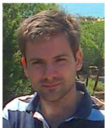

Alejandro Suarez (Member, IEEE) received the B.S. degree in telecommunications, the M.Sc. degree in automation engineering, and the Ph.D. degree in robotics from the University of Seville, Seville, Spain, in 2012, 2013, and 2019, respectively.

He is currently a Postdoctoral Researcher with the GRVC Robotics Labs, The Higher Technical School of Engineering (ESTI), Seville. He has been developing his research work with the University of Seville since 2012.

His research interests include robotics, aerial robotic manipulation, robotic arm design, and compliance.

Dr. Suarez thesis has been awarded with two prizes.

Dongjun Lee (Member, IEEE) received the B.S. and M.S. degrees from the Korea Advanced Institute of Science and Technology, Daejeon, South Korea, and the Ph.D. degree in mechanical engineering from the University of Minnesota, Minneapolis, MN, USA, in 1995, 1997, and 2004, respectively.

He is currently a Professor with the Department of Mechanical Engineering, Seoul National University, Seoul, South Korea. His research interests include the dynamics and control of robotic and mechatronic systems with emphasis on aerial/mobile robots, tele-

operation/haptics, multirobot systems, and industrial control applications.

  
Systems.

Antonio Franchi (Senior Member, IEEE) is currently a Professor of Robotics with the Faculty of Electrical Engineering, Mathematics and Computer Science, University of Twente, Enschede, The Netherlands. He has coauthored more than 140 papers/chapters in peer-reviewed international journals, conferences, and books. His research interest includes design and control of robotic systems with applications to multirobot systems and aerial robots.

Dr. Franchi is the Co-Founder and Co-Chair of the IEEE RAS Technical Committee on Multiple Robot