# REACH: Explicit Recovery Behavior for Diffusion Policies

Zundong Ke Junlin Chen Jiayi Zhu Kuanhao Xia Boyi Zhao Jiayuan Gu ShanghaiTech University

{kezd2024, chenjl2022, zhujy2023, xiakh2024, zhaoby2025, gujy1}@shanghaitech.edu.cn

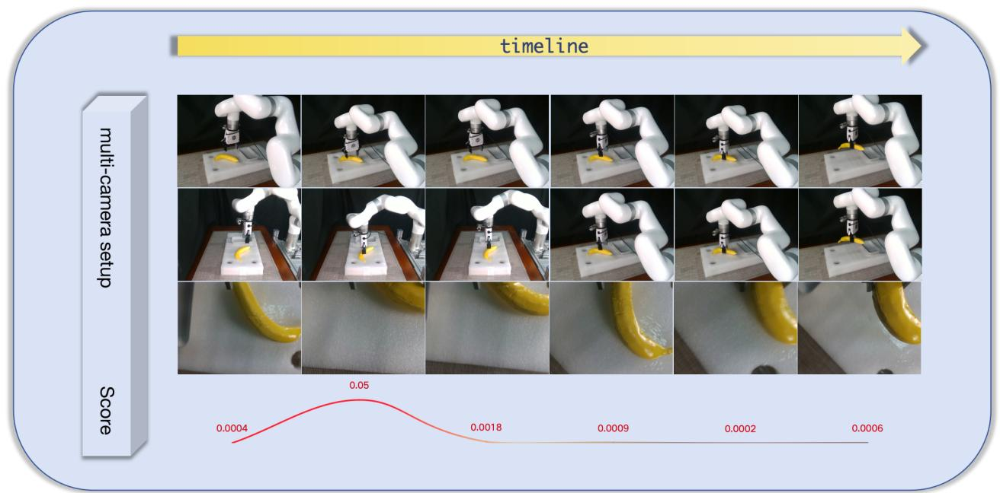  
Figure 1. REACH is an error-aware framework with prompt-guided diffusion policy for Robot manipulation. A multi-camera setup observes the task execution along the timeline, while an error-detector monitors an anomaly score (bottom). When the score indicates an error, the robot rolls back to a previous safe action and the diffusion model regenerates a corrected prompt, allowing the robotic arm to continue the task and eventually succeed.

## Abstract

Diffusion policies have emerged as a powerful paradigm for robot learning, but their inherent multi-modality can lead to a diverse set ofplausible—though not always opti mal—actionsfrom a single observation. We posit thatfor a given task, an optimal action exists within this distribution. Inspired by negative prompting in generative models, we introduce a novel method that leverages an error detector to identify out-of-distribution (OOD) execution histories and uses them to construct negative action prompts. This allows our policy to steer away from suboptimal behaviors and converge towards higher-performance actions. We present a comprehensive ablation study demonstrating the effectiveness ofpositive, and negative prompts, and validate our approach on a suite of simulated benchmarks and real-world robotic tasks. Our results show that the proposed Promptguided Diffusion Policy achieves significant improvement in task performance by effectively filtering undesirable action modes.

## 1. Introduction

Learning robust visuomotor policies remains a central challenge in robotic manipulation. A key obstacle is the brittleness of learned visuomotor policies when encountering even minor deviations from their training data [20, 49, 60]. During execution, small, unexpected perturbations can cascade, leading the agent into novel states where the policy’s behavior is undefined and task failure becomes imminent.

Recent advances in diffusion-based policies [1, 7, 26, 47,

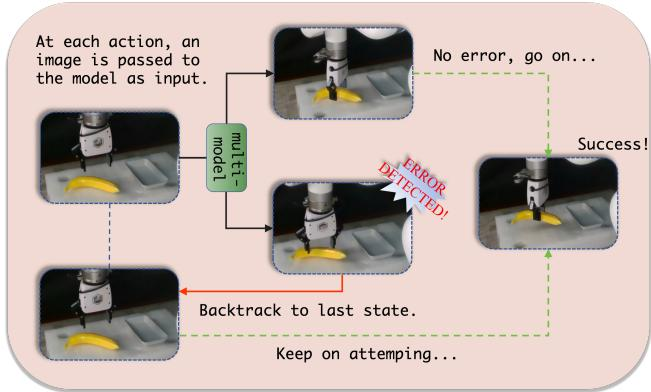  
Figure 2. Illustration of our prompt-guided diffusion policy. At each step, the current camera image is passed to the multi-model controller, which proposes an action and is monitored by the error detector. If no error is detected, the robot proceeds along the upper green path toward task completion; otherwise, the system backtracks to the last safe state and resamples actions under negativeprompt guidance, repeatedly attempting the task until a successful execution is achieved.

57] have shown remarkable capability in modeling complex and multi-modal action distributions from demonstrations. This allows the policy to generate diverse, plausible actions for a given observation, potentially discovering multiple solutions to a task. However, this action diversity presents a hidden challenge: not all plausible actions are equally robust. An action may lead to a “robustness blind spot”—a subsequent state from which the policy is likely to fail—a flaw that is only revealed after the action has been taken.

To address this critical challenge, our work investigates three fundamental research questions. First, how can we identify actions that lead to these robustness blind spots? Second, how can the agent recover from a resulting nonrobust state? Finally, if the agent returns to the original decision point, how can we guide the policy to avoid repeating the same mistake and instead sample a more robust action?

To this end, we introduce Recovery through Error-Aware Corrective Hindsight (REACH), a novel framework designed to endow diffusion policies with self-correction capabilities. It employs an out-of-distribution (OOD) detector to identify states that are likely to cause policy failure, as shown in Fig 2. Inspired by Random Network Distillation [5], we implement this detector as a Autoencoder (AE) trained on in-distribution robot observations; the reconstruction error for a given observation serves as its OOD score.

During inference, when the agent enter a state flagged as OOD, a retreat mechanism is triggered. It reverses the most recent actions from an execution buffer, returning the agent to its last known in-distribution state. Finally, to prevent repeating the mistake, REACH leverages the buffered failure trajectory as a negative prompt, inspired by text-to-image models [40, 48]. This technique conditions the diffusion sampler to generate a new action that is explicitly dissimilar to the one that previously led to failure, thereby guiding exploration towards a more robust solution.

We validate our approach in both simulated and realrobot environments. In simulation, we evaluate across multiple manipulation benchmarks Robomimic [35] and Mimicgen [36]. On real hardware, we deploy the trained policy to tasks including pick-and-place, drawer pulling, and cabinet opening. Extensive ablation studies demonstrate that integrating negative prompts and distribution-aware feedback significantly enhances policy stability and task success rates.

Our main contributions are summarized as follows:

• We propose an REACH that integrates in/out-ofdistribution estimation with negative prompting to refine policy inference.

• We identify the problem of action quality estimation in multi-modal diffusion policies and highlight its importance for robust decision making.

• We conduct comprehensive simulation and real-world experiments, showing that our approach robustness compared to standard diffusion policies.

## 2. Related Work

## 2.1. Diffusion-based Policy

Diffusion-based policies have demonstrated considerable success in robotics and decision-making by leveraging supervised training on human demonstrations, which provides both stable learning dynamics and strong performance in capturing complex, multi-modal action distributions [7, 13, 26, 55, 57, 58, 64]. To overcome limitations of scarce or suboptimal demonstration data, researchers have developed key enhancements including guided diffusion processes that employ reward signals or goal conditioning during inference [1, 11, 23, 26, 47], as well as hybrid approaches that integrate reinforcement learning techniques such as Q-learning and weighted regression through either fully offline training or online fine-tuning strategies [12, 28, 29, 41, 56, 57]. In contrast to the above, our method augments any diffusion policy with an negativeprompt guidance in action space, improving safety and reliability under covariate shift without task-specific retraining.

## 2.2. Failure Detection and Recovery

A prevalent methodology for ensuring robotic safety involves detecting out-of-distribution (OOD) inputs to prevent agents from entering hazardous operational states [6, 10, 21, 31, 32, 34, 52, 61, 62]. Contemporary research has developed multiple deep learning architectures for OOD state identification, including trained error prediction models [21, 45], policy uncertainty quantification [8, 17, 27, 30], and input reconstruction error analysis [18, 33, 66, 67]. Our implementation adopts the reconstruction-based paradigm, wherein we train a conditional autoencoder to project future goal states from current observations, utilizing reconstruction fidelity as a safety metric [33, 44, 66].

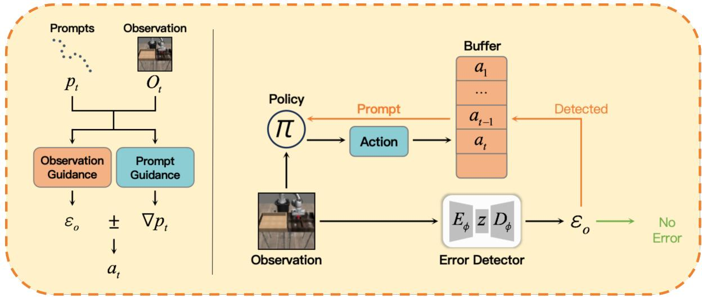  
Figure 3. Architecture of our prompt-guided diffusion policy with an autoencoder-based error detector. At each timestep (t), the diffusion policy (π) receives the current observation $( O _ { t } )$ and prompt $( p _ { t } ) .$ , and generates an action (at) that is refined by both observation guidance and prompt guidance. The executed actions are stored in a buffer, while the observation is passed through the encoder–decoder $( E _ { \phi } , D _ { \phi } )$ to compute the reconstruction error $( \varepsilon _ { o } ) ;$ if no error falls within the confidence interval, control proceeds, otherwise the buffered actions are used to trigger recovery under negative-prompt guidance.

Recovery from unexpected states has been studied extensively in fault-tolerant control. Classical approaches include contingency planning and execution monitoring [2, 14, 25, 42]. In learning-based systems, [19, 31] demonstrated that recovery policies can be learned from demonstration, while [15, 63] proposed automated reset policies for reinforcement learning agents. Model predictive control (MPC) has been widely employed for recovery, with [4, 9, 46, 51] showing how learned dynamics models and runtime monitors can enhance MPC-based recovery in OOD situations.

## 3. Method

Our approach aims to enhance the robustness of diffusion policies by integrating three key components: a policy π, an Error Detector, and a buffer storing the action-prompt. Given the state that the robot reached, the error-detector recognize it in-distribution or out-of distribution(OOD) to determine whether retreat. If the robot retreats to previousstate (reverse the executed-action stored in the buffer), the policy will treat the executed-action as negative-prompt to steer away from the unsafe-area. An overview of this framework is illustrated in Fig 3.

## 3.1. Conditional Diffusion Policies

Diffusion-model generation Diffusion models are a class of latent variable generative models that learn a data distribution by reversing a gradual noising process [7]. The core framework consists of a forward diffusion process and a reverse denoising process.

The model takes a real data sample (e.g., an image, x0) and gradually adds Gaussian noise over a series of $T$ steps. This process slowly destroys the data until it becomes pure noise, x . This is a fixed process that does not involve learning.

Mathematically, each step is defined as:

$$
q (\mathbf {x} _ {t} | \mathbf {x} _ {t - 1}) = \mathcal {N} (\mathbf {x} _ {t}; \sqrt {1 - \beta_ {t}} \cdot \mathbf {x} _ {t - 1}, \beta_ {t} \mathbf {I})\tag{1}
$$

where $\beta _ { t }$ is a small noise schedule.

The generative(reverse) process starts from noise $\mathbf { x } _ { T }$ $p ( \mathbf { x } _ { T } ) \ = \ { \mathcal { N } } ( \mathbf { 0 } , \mathbf { I } )$ and iteratively denoises it through a learned reverse Markov chain:

$$
p _ {\theta} (\mathbf {x} _ {0: T}) = p (\mathbf {x} _ {T}) \prod_ {t = 1} ^ {T} p _ {\theta} (\mathbf {x} _ {t - 1} | \mathbf {x} _ {t})\tag{2}
$$

The reverse transition $p _ { \theta } ( \mathbf { x } _ { t - 1 } | \mathbf { x } _ { t } )$ is typically parameterized as a Gaussian distribution: $\mathcal { N } ( \mathbf { x } _ { t - 1 } ; \mu _ { \theta } ( \mathbf { x } _ { t } , t ) , \Sigma _ { \theta } ( \mathbf { x } _ { t } , t ) )$ The model is trained to predict the noise component $\epsilon _ { \theta } ( \mathbf { x } _ { t } , t )$ using a simplified, reweighted evidence lower bound (ELBO) objective:

$$
\mathcal {L} _ {s i m p l e} = \mathbb {E} _ {t, \mathbf {x} _ {0}, \epsilon} \left[ \left\| \boldsymbol {\epsilon} - \boldsymbol {\epsilon} _ {\theta} (\mathbf {x} _ {t}, t) \right\| ^ {2} \right]\tag{3}
$$

During sampling, an update step from $\mathbf { x } _ { t }$ to $\mathbf { x } _ { t - 1 }$ is computed using a discretization scheme such as DDPM or DDIM [24, 53]:

$$
\mathbf {x} _ {t - 1} = \frac {1}{\sqrt {\alpha_ {t}}} \left(\mathbf {x} _ {t} - \frac {1 - \alpha_ {t}}{\sqrt {1 - \bar {\alpha} _ {t}}} \pmb {\epsilon} _ {\theta} (\mathbf {x} _ {t}, t)\right) + \sigma_ {t} \mathbf {z}\tag{4}
$$

where $\mathbf { z } \sim \mathcal { N } ( \mathbf { 0 } , \mathbf { I } )$ , and $\sigma _ { t }$ is the noise variance.

Condition generation and negative-guidance For conditional generation, the goal is to model the distribution $p ( \mathbf { x } | c )$ , where c is a conditioning signal (e.g., a text prompt). This is achieved by training a conditional noise predictor $\epsilon _ { \theta } ( \mathbf { x } _ { t } , t , c )$

Classifier-Free Guidance (CFG) [23]is a more widely adopted technique that jointly learns conditional and unconditional denoising distributions by randomly dropping the condition c during training (replacing it with a null token \emptyset ). At sampling time, the guided noise prediction is an interpolation:

$$
\tilde {\epsilon} _ {\theta} (\mathbf {x} _ {t}, t, c) = \epsilon_ {\theta} (\mathbf {x} _ {t}, t, \emptyset) + w \cdot (\epsilon_ {\theta} (\mathbf {x} _ {t}, t, c) - \epsilon_ {\theta} (\mathbf {x} _ {t}, t, \emptyset))\tag{5}
$$

Here, w is the guidance scale that controls the trade-off between sample quality and fidelity to the condition c .

Negative guidance is a natural extension of the CFG framework [3]. Given a desired condition c and an undesirable condition $c _ { n e g }$ (the negative prompt), the guided prediction is defined as:

$$
\begin{array}{r} \tilde {\epsilon} _ {\theta} (\mathbf {x} _ {t}, t, c, c _ {n e g}) = \epsilon_ {\theta} (\mathbf {x} _ {t}, t, c) + w \cdot (\epsilon_ {\theta} (\mathbf {x} _ {t}, t, c) \\ - \epsilon_ {\theta} (\mathbf {x} _ {t}, t, c _ {n e g})) \end{array}\tag{6}
$$

Intuitively, this formulation pushes the generative process towards the direction aligned with the positive condition c and awayfrom the direction aligned with the negative condition $c _ { n e g } .$ . A visual comparison of diffusion policies with different prompting strategies is shown in Fig 5. By adjusting the scale w , one can precisely control the strength of suppressing unwanted features.

Conditional diffusion policies The Conditional Diffusion Policy conditions the denoising process on both the current observation and the evolving action at each timestep. This dual conditioning maintains a coherent awareness of the action-observation state, enabling precise control during inference. Consequently, the policy can be guided to generate a specific, proposed action or to steer away from undesired behaviors. The architecture that enables this capability is illustrated in Fig 3.

## 3.2. Error Detector

For novelty detection, we implement an autoencoder architecture, specifically designed to process camera imagery as our primary modality. This constitutes a one-class classification scenario, as our training data exclusively comprises images captured within our operational environment, with no representative samples of anomalous or unfamiliar visual inputs. The overall structure of the autoencoder-based error detector is illustrated in Fig 4.

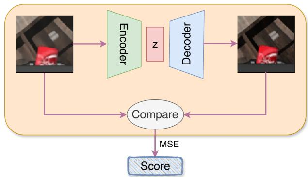  
Figure 4. Autoencoder-based error detector. Given an observation image, an encoder–decoder reconstructs it, and the mean squared error (MSE) between input and reconstruction is compared with a confidence interval estimated from training data to detect out-of-distribution states.

Our implementation employs a feedforward autoencoder and trains it via mini-batch stochastic gradient descent, optimizing reconstruction fidelity through minimization of the sum of squared pixel-wise differences. Formally, let $i ^ { k } \in [ 0 , 1 ]$ represent the normalized intensity value of the k-th pixel in image i, the objective function minimizes $\begin{array} { r } { \sum _ { k } ( \dot { i } ^ { k } - \hat { i } ^ { k } ) ^ { 2 } } \end{array}$ where $\hat { i } ^ { k }$ denotes the reconstructed pixel value. The autoencoder loss function is:

$$
L _ {n} (i, \hat {i}) = \frac {1}{K} \sum_ {k = 1} ^ {K} (i ^ {k} - \hat {i} ^ {k}) ^ {2},\tag{7}
$$

where $\hat { i }$ refers to the output of the autoencoder, i.e., the reconstructed image. The number of pixels in i and ˆi is K.

The underlying premise of this novelty detection framework posits that the autoencoder will learn compressed representations encoding the fundamental features of the training distribution [22, 43]. Consequently, inputs resembling the training data should yield minimal reconstruction errors, while novel patterns—deviating significantly from learned representations—should produce substantial reconstruction discrepancies [37, 38, 50, 65]. This behavioral dichotomy enables a straightforward classification mechanism: establishing a predetermined threshold on reconstruction error, whereby instances exceeding this boundary are classified as novel [37, 43].

During robot operation, we save the error at each time step and model the distribution of these historical errors as

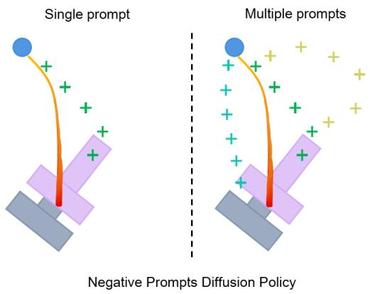

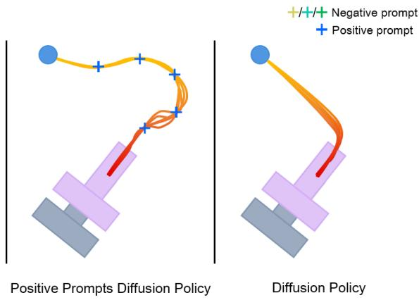  
Figure 5. Comparison of diffusion policies with different prompting strategies. Our negative-prompts diffusion policy (left) uses single or multiple negative prompts to repel trajectories away from undesirable regions while still reaching the target. In contrast, a positiveprompts diffusion policy (middle) attracts trajectories toward specified key poses, and diffusion policy (right) generates trajectories without any explicit prompt guidance.

a Gaussian distribution:

$$
s (\mathbf {x}) \sim \mathcal {N} (\mu , \sigma^ {2}),\tag{8}
$$

and declare an error whenever $s ( { \bf x } _ { t } ) > \tau$ with a κ-sigma threshold

$$
\tau = \mu + \kappa \sigma\tag{9}
$$

If $s ( \mathbf { x } _ { t } ) \leq \tau ,$ the observation is treated as nominal (no error); otherwise the system flags an error and triggers a safety fallback that rolls back one action step to the previous state and replan the executed-action. This procedure provides a simple, calibrated rule for error gating while remaining lightweight at inference time. We train the autoencoder only on images from nominal executions (no OOD examples), following standard one-class practice.

## 3.3. Safe Retreat Maneuver

We consider the problem of generating a reverse action sequence for a given forward motion trajectory in robotic control. Let a forward action sequence be defined as $\begin{array} { r } { \boldsymbol { \mathcal { A } _ { f } } \ : = } \end{array}$ $\{ a _ { f } ^ { 1 } , a _ { f } ^ { 2 } , \ldots , a _ { f } ^ { T } \}$ , where $a _ { f } ^ { t } \in \mathcal A$ represents the robotic action at timestep t, and A denotes the specific action space. Our object is to get the reverse-action sequence that makes the robot back to the previous-state.

To tackle this problem, we categorize the action space into the absolute-action space and the relative-action space. Here, an absolute action specifies a target state in a fixed, global coordinate system, whereas a relative action specifies a change or delta from the current state. We define the forward and reverse action sequences as $W _ { f }$ and $W _ { r }$ , respectively.

Absolute-action-space The reverse action sequence is generated by simply reversing the temporal order of the for-

ward sequence:

$$
\mathcal {W} _ {r} = \{\mathbf {w} _ {f} ^ {T}, \mathbf {w} _ {f} ^ {T - 1}, \dots , \mathbf {w} _ {f} ^ {1} \},\tag{10}
$$

where $\mathbf { w } _ { f }$ is the forward action.

Relative-action-space Let the initial SE(3) pose is $A ^ { 0 }$ and the terminal SE(3) pose is $A ^ { T }$ . The forward actionsequence is $a _ { f } ^ { 1 } , a _ { f } ^ { 2 } , . . . , a _ { f } ^ { T }$ , and the reverse-action sequence for action $a _ { f } ^ { t }$ is $a _ { r } ^ { t }$

Formally, for each time-step $t \in [ 0 , T ]$ , the current-SE(3) pose $\mathbf { A } ^ { t }$ is

$$
\mathbf {A} ^ {t} = A ^ {0} a _ {f} ^ {1} a _ {f} ^ {2} a _ {f} ^ {3}... a _ {f} ^ {t},\tag{11}
$$

The reverse-action-sequce $\mathbf { A } _ { r } ^ { t }$ is

$$
\mathbf {A} ^ {t} \mathbf {A} _ {r} ^ {t} = \mathbf {A} ^ {0}\tag{12}
$$

According to the equation (3.3) and equation (3.3)

$$
\mathbf {A} _ {r} ^ {t} = a _ {r} ^ {t} a _ {r} ^ {t - 1} a _ {r} ^ {t - 2} \dots a _ {r} ^ {1}\tag{13}
$$

## 4. Experiments

The paper validates the proposed Prompt-Guided Diffusion Policy through a comprehensive set of experiments in both simulation and the real world designed to test three key claims:

Claim1 The prompt mechanism effectively steers the policy’s actions.

Claim2 The error detector reliably identifies sub-optimal or OOD behaviors.

Claim3 The full integrated system improves task performance over a standard diffusion policy.

## 4.1. Action Steering Analysis

To understand the features, limitaions and benefits of the proposed prompt of the diffusion policy, in this section, we conduct extensive experiments to evaluate the effectiveness of it on the PushT environment. The baseline is the original diffusion policy repo.

Experimental setting In order to make the policy could make a sense of proposed prompt, we embed the prompt using the Fourier feature [39, 54] for the shape of proposed prompt is the same as the policy output-action. The proposed prompt can be divided into negative prompt, positive prompt, base prompt in the inference time. For the training stage, the proposed prompt could be seperated as baseprompt and specific prompt, we randomly select them in one batch to embed them into the feature-space. To make the policy understand the proposed prompt well, we overtrain the policy than the original repo.

Implementation Details. Push-T adapted from IBC Florence et al. (2021) [16], requires pushing a T-shaped block (gray) to a fixed target (red) with a circular end-effector (blue)s. Variation is added by random initial conditions for T block and end-effector. Them task requires exploiting complex and contact-rich object dynamics to push the T block precisely, using point contacts. There are two variants: one with RGB image observations and another with 9 2D keypoints obtained from the ground truth pose of the T block, both with proprioception for end effector location [7]. We overtrain the policy with 1000 epoches to make it understand the proposed prompt and train the original policy 1000 epoches to compare it.

Evaluation To evaluate the proposed diffusion policy prompt (as shown in Fig 6), we compare three distinct action outputs under different conditions:Green Action: The policy’s initial output given an observation. Blue Action: The policy’s second output for the same observation (without a prompt). Yellow Action: The policy’s output for the same observation but with the prompt applied. We then analyze two key angles.

This approach quantifies both the policy’s stochastic variability (green vs. blue) and the prompt’s steering effect (green vs. yellow). Quantitative results under different policy seeds and guidance scales are summarized in Tab 1.

## 4.2. Validation of the Error Detector

To validate the error detector, we split a dataset into two disjoint subsets. One subset is used to train the error-detector model, while the other remains unseen during training. After training, we observe that images reconstructed from the training subset are nearly identical to their originals, whereas reconstructions of unseen images exhibit significant visual discrepancies as shown in Fig 7.

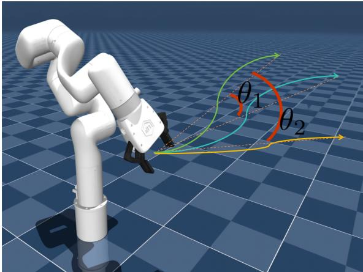

Figure 6. Action Variability Analysis of Diffusion Policy: Comparison of three action outputs—initial (green), repeated (blue), and prompted (yellow)—given the same observation. Angles between terminal points quantify inherent policy stochasticity (green vs. blue) and the prompt’s steering effect (green vs. yellow).

<table><tr><td>Policy-seed</td><td>guidance-scale</td><td>score</td><td> $\theta_1$ </td><td> $\theta_2$ </td></tr><tr><td rowspan="3">10000</td><td>0.1</td><td>0.94</td><td>32.3</td><td>41.59</td></tr><tr><td>0.2</td><td>0.91</td><td>32.3</td><td>47.87</td></tr><tr><td>0.3</td><td>0.87</td><td>32.3</td><td>52.27</td></tr><tr><td rowspan="3">10001</td><td>0.1</td><td>0.87</td><td>30.51</td><td>41.29</td></tr><tr><td>0.2</td><td>0.84</td><td>30.51</td><td>45.03</td></tr><tr><td>0.3</td><td>0.88</td><td>30.51</td><td>51.94</td></tr><tr><td rowspan="3">10002</td><td>0.1</td><td>0.89</td><td>37.39</td><td>43.62</td></tr><tr><td>0.2</td><td>0.88</td><td>37.39</td><td>47.58</td></tr><tr><td>0.3</td><td>0.86</td><td>37.39</td><td>53.31</td></tr></table>

Table 1. When inferencing on the same dataset repeatedly, the new trajectories deviate from the trajectory generated during the first inference, with the deviation angle denoted as $\theta _ { 1 }$ . After incorporating negative guidance, the new deviation angle is denoted as $\theta _ { 2 } .$ In the simulation experiments, we observed that $\theta _ { 2 }$ is consistently larger than $\theta _ { 1 }$ , and $\theta _ { 2 }$ exhibit an increase as the guidance scale is augmented.

Leveraging this property, we posit that, once trained on a dataset of successful executions, the error detector can recognize images that are similar to those in the training distribution, while observations that have not been observed during training yield large reconstruction errors and are thus flagged as errors. Consequently, for each task we collect a large task-specific dataset and train a separate error detector, enabling the system to progressively approach the task goal by ruling out erroneous actions.

## 4.3. Simulation-experiments

We evaluate our Conditional Diffusion Policy on 7 manipulation tasks from Robomimic and MimicGen compared with the original diffusion-policy [7]. The task examples used in simulation are shown in Fig 8.

<table><tr><td>Policy</td><td></td><td colspan="2">Can(Paired)</td><td colspan="2">Can(MH)</td><td colspan="2">Square(MH)</td><td>PushT</td></tr><tr><td>LSTM-GMM /BC-RNN</td><td>62.0+-5.7</td><td>62.0+-5.7</td><td>62.0+-5.7</td><td>0.98/0.90</td><td>0.98/0.90</td><td>0.44/0.24</td><td>0.44/0.24</td><td>0.69/0.54</td></tr><tr><td>IBC/BC</td><td>56.7+-0.9</td><td>56.7+-0.9</td><td>56.7+-0.9</td><td>0</td><td>0</td><td>0</td><td>0</td><td>0.75/0.54</td></tr><tr><td>Diffusion Policy</td><td>60.8+-1.4</td><td>60.8+-1.4</td><td>60.8+-1.4</td><td>1.00/0.96</td><td>1.00/0.96</td><td>0.98/0.84</td><td>0.98/0.84</td><td>0.91/0.84</td></tr><tr><td>Conditional DP</td><td>64.2+-3.8</td><td>64.2+-3.8</td><td>64.2+-3.8</td><td>1.00/0.95</td><td>1.00/0.95</td><td>0.96/0.86</td><td>0.96/0.86</td><td>0.93/0.88</td></tr><tr><td>Error Detector</td><td>PH</td><td>MH</td><td>Paired</td><td>MH</td><td>PH</td><td>PH</td><td>MH</td><td></td></tr><tr><td>Policy(OOD-detect)(S=0)</td><td>74.1+-2.8</td><td>62.3+-1.8</td><td>64.1+-2.8</td><td>1.00/0.97</td><td>1.00/0.97</td><td>0.96/0.88</td><td>0.96/0.85</td><td>0.92/0.90</td></tr><tr><td>Policy(OOD-detect)(S=0.2)</td><td>74.1+-2.5</td><td>65.0+-2.5</td><td>67.5+-2.5</td><td>1.00/0.97</td><td>1.00/0.98</td><td>0.95/0.89</td><td>0.97/0.87</td><td>0.93/0.89</td></tr><tr><td>Policy(OOD-detect)(S=2.5)</td><td>84.1+-1.4</td><td>64.1+-1.4</td><td>65.8+-2.8</td><td>1.00/0.98</td><td>1.00/0.98</td><td>0.95/0.90</td><td>0.95/0.89</td><td>0.90/0.87</td></tr><tr><td>Policy(OOD-detect)(S=4.5)</td><td>85.0+-0</td><td>67.5+-0</td><td>65.8+-1.7</td><td>1.00/0.98</td><td>1.00/0.98</td><td>0.96/0.89</td><td>0.97/0.88</td><td>0.89/0.87</td></tr></table>

Table 2. Comparison on Simulation Tasks (Part 1) The baseline data for the Can(Paired) task is from [35], while data for the other three tasks is from [7]. We report the average of the highest success rates across three seeds. Our method clearly demonstrates a significant improvement in success rates.

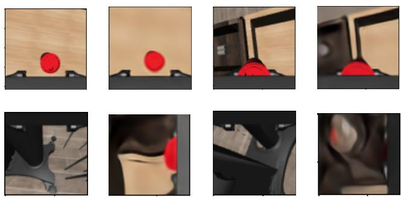  
Figure 7. For each pair of images, the first is the original image and the second is the reconstructed image. The top row shows cases where no error occurs, and the bottom row shows cases where an error is detected.  
Table 3. Comparison on Simulation Tasks (Part 2). Performance are reported in the same format as in Tab 2. Baseline data is from [55].

<table><tr><td rowspan="2"></td><td colspan="2">Coffee D2</td><td colspan="2">Hammer D1</td><td colspan="2">Three Pc. Assembly D2</td><td colspan="2">Threading D2</td></tr><tr><td>100</td><td>200</td><td>100</td><td>200</td><td>100</td><td>200</td><td>100</td><td>200</td></tr><tr><td>BC-RNN</td><td>37</td><td>52</td><td>32</td><td>43</td><td>0</td><td>5</td><td>7</td><td>13</td></tr><tr><td>Diffusion Policy</td><td>43</td><td>51</td><td>43</td><td>54</td><td>2</td><td>2</td><td>13</td><td>26</td></tr><tr><td>Conditional DP</td><td>39</td><td>62</td><td>44</td><td>59</td><td>3</td><td>6</td><td>11</td><td>22</td></tr><tr><td>Policy(OOD-detect)(s=0)</td><td>40</td><td>63</td><td>46</td><td>58</td><td>3</td><td>4</td><td>16</td><td>28</td></tr><tr><td>Policy(OOD-detect)(s=0.2)</td><td>42</td><td>65</td><td>48</td><td>64</td><td>2</td><td>5</td><td>13</td><td>25</td></tr><tr><td>Policy(OOD-detect)(s=2.5)</td><td>44</td><td>64</td><td>43</td><td>60</td><td>5</td><td>7</td><td>15</td><td>31</td></tr></table>

Robomimic Robomimic is a large-scale robotic manipulation benchmark designed to study imitation learning and offline RL [35]. We choose task Can, Square in the benchmark with a proficient human (PH) teleoperated demonstration dataset and mixed proficient/non-proficient human (MH) demonstration datasets for each (4 variants in total). The input observations include image and robot proprioceptive (end-effector pose and finger positions).

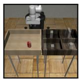  
(a) Can

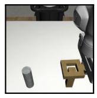  
(b) Square

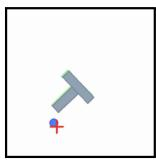

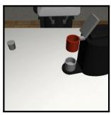

(c) Push T  
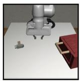  
(e)Coffee D2

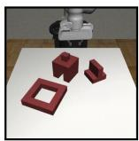

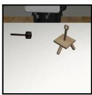  
(f) Hammer D1  
(g) Three Pc. Assembly D2  
(h) Threading D2  
Figure 8. Task examples in simulation.

MimicGen MimicGen is a data generation framework designed to significantly reduce the cost and effort of collecting large-scale robotic demonstration datasets for imitation learning [36], addressing one of the biggest bottlenecks in robotics: the cost of data collection. It was developed by the same team behind RoboMimic and serves as a powerful companion to it.

Evaluation-Methdology We first evaluate our framework and diffusion policy with the same-setting in the robomimic [35] with task Can(paired) and report the maximum success-rate among three-seed. And then we treat our frame-work as the same setting with the task Can(MH), Square(MH) and PushT in the diffusion-policy [7]. And finally we treat our setting as the setting of mimicgen in the [55] and report the maxmuium success-rate among three seeds. The quantitative results are reported in Tab 2 and Tab 3.

Key-findings REACH generaly outperforms the diffusion policy, making the inference more robust. Following paragraphs summarize the key takeaways.

Error-detector is essential to the pipeline. The performance of the error-detector varies significantly depending on the dataset used for training, as clearly demonstrated in Can task. Employing an error-detector trained on PH data leads to a substantial improvement in the policy trained with paired data.

Guidance-scale can effect the performance. Generally, a higher guidance strength leads to a higher final success rate. However, beyond a certain saturation point, excessively strong guidance can paradoxically degrade performance.

## 4.4. Real robot experiment

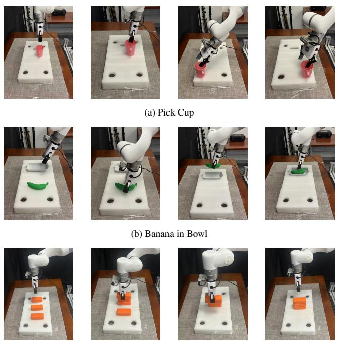  
(c) Stack Bricks  
Figure 9. Task examples in reality.

Experimental-setting In this section, we evaluate our method on a real robot system containing a xArm robot arm equipped with a pair of fin-ray fingers and three Intel Realsense D435 cameras. Demonstrations were gathered by an operator using a Gello [59]. Observations and demonstration actions were recorded at 30Hz. Fig 9 shows the three tasks in this experiment. We compare our promptguided Diffusion Policy with image input against a baseline

Diffusion Policy, which uses the same image as the vision input.

Result Tab 4 reports the performance of the three policies across real-world manipulation tasks. The baseline Diffusion Policy achieves moderate success, but its performance drops notably on the more challenging Stack Bricks task. Introducing prompt-conditioned guidance (REACH without error detector), which corresponds to our conditional diffusion policy under a default base prompt, leads to consistent improvements on Pick Cup and Banana in Bowl. However, on Stack Bricks, this conditional variant slightly underperforms the baseline, suggesting that a fixed base prompt may introduce insufficient or even suboptimal guidance for longhorizon, precision-demanding tasks.

In contrast, augmenting our method with the proposed error detector substantially boosts performance across all three tasks. REACH with error detection improves success rates by 16%, 20%, and 10% on the three tasks respectively, demonstrating its effectiveness in identifying and correcting execution deviations before they accumulate. These results indicate that while prompt-conditioned diffusion can enhance policy generalization in typical short-horizon tasks, the error detector plays a crucial role in stabilizing behavior and enabling reliable performance in more complex realworld scenarios.

<table><tr><td></td><td>Pick Cup</td><td>Banana in Bowl</td><td>Stack Bricks</td></tr><tr><td>Diffusion-policy</td><td>58%</td><td>48%</td><td>32%</td></tr><tr><td>REACH(without error detector)</td><td>66%</td><td>57%</td><td>30%</td></tr><tr><td>REACH(with error detector)</td><td>74%</td><td>68%</td><td>42%</td></tr></table>

Table 4. Performance of Policy in Real-World Robot Experiments.

## 5. Conclusion

We proposed Recovery through Error-Aware Corrective Hindsight (REACH), a framework that endows diffusion policies with self-correction by integrating error detection and corrective feedback into the decision-making process. This enables the policy to dynamically adjust its actions based on observed errors, improving robustness and task success rates, especially in complex environments.

A key limitation of this work is the absence of a real-world RGB dataset for complex tasks, which constrains the validation of REACH to simulated settings and limits its demonstrated generalizability. In addition, the current error detector has limited representational capacity and may fail under highly complex visual conditions. In future work, we plan to evaluate REACH on real-robot datasets and more challenging tasks, and to couple the error detector with stronger vision models to better capture rich visual cues in diverse environments.

## References

[1] Anurag Ajay, Yilun Du, Abhi Gupta, Joshua B. Tenenbaum, Tommi Jaakkola, and Pulkit Agrawal. Is conditional generative modeling all you need for decision-making? In International Conference on Learning Representations (ICLR), 2023. 1, 2

[2] John P. Alsterda, Matthew Brown, and J. Christian Gerdes. Contingency model predictive control for automated vehicles. In American Control Conference (ACC), pages 717– 722, 2019. 3

[3] Yuanhao Ban, Ruochen Wang, Tianyi Zhou, Minhao Cheng, Boqing Gong, and Cho-Jui Hsieh. Understanding the impact of negative prompts: When and how do they take effect?, 2024. 4

[4] Osbert Bastani, Shuo Li, and Anton Xue. Safe reinforcement learning via statistical model predictive shielding. In Robotics: Science and Systems (RSS), 2021. 3

[5] Yuri Burda, Harrison Edwards, Deepak Pathak, Amos Storkey, Trevor Darrell, and Alexei A. Efros. Exploration by random network distillation. In International Conference on Learning Representations (ICLR), 2019. 2

[6] Hongyi Chen, Yunchao Yao, Ruixuan Liu, Changliu Liu, and Jeffrey Ichnowski. Robot failure recovery using visionlanguage models with optimized prompts. In 2025 American Control Conference (ACC), pages 1983–1988, 2025. 2

[7] Cheng Chi, Zhenjia Xu, Siyuan Feng, Eric Cousineau, Yilun Du, Benjamin Burchfiel, Russ Tedrake, and Shuran Song. Diffusion policy: Visuomotor policy learning via action diffusion. In Robotics: Science and Systems (RSS), 2023. 1, 2, 3, 6, 7

[8] Kurtland Chua, Roberto Calandra, Rowan McAllister, and Sergey Levine. Deep reinforcement learning in a handful of trials using probabilistic dynamics models. In Advances in Neural Information Processing Systems (NeurIPS), 2018. 3

[9] Jose Leopoldo Contreras, Ola Shorinwa, and Mac Schwager. Safe out-of-distribution adaptive model predictive con trol. arXiv preprint arXiv:2406.02436, 2024. 3

[10] Yinpei Dai, Jayjun Lee, Nima Fazeli, and Joyce Chai. Racer: Rich language-guided failure recovery policies for imitation learning. In 2025 IEEE International Conference on Robotics and Automation (ICRA), pages 15657–15664, 2025. 2

[11] Prafulla Dhariwal and Alex Nichol. Diffusion models beat gans on image synthesis. In Advances in Neural Information Processing Systems (NeurIPS), 2021. 2

[12] Shutong Ding, Ke Hu, Zhenhao Zhang, Kan Ren, Weinan Zhang, Jingyi Yu, Jingya Wang, and Ye Shi. Diffusion-based reinforcement learning via q-weighted variational policy optimization. In Advances in Neural Information Processing Systems (NeurIPS), 2024. 2

[13] Zibin Dong, Jianye Hao, Yifu Yuan, Fei Ni, Yitian Wang, Pengyi Li, and Yan Zheng. Diffuserlite: Towards real-time diffusion planning. In Advances in Neural Information Processing Systems (NeurIPS), 2024. 2

[14] Tara Estlin, Forest Fisher, Daniel Gaines, Caroline Chouinard, Steve Schaffer, and Issa Nesnas. Continuous planning and execution for an autonomous rover. In NASA

Workshop on Planning and Schedulingfor Space (PlanSys), Pasadena, CA, 2002. Jet Propulsion Laboratory Technical Report. 3

[15] Benjamin Eysenbach, Shixiang Gu, Sergey Levine, and Russ R. Salakhutdinov. Leave no trace: Learning to reset for safe and autonomous reinforcement learning. In International Conference on Learning Representations (ICLR), 2018. 3

[16] Pete Florence, Corey Lynch, Andy Zeng, Oscar Ramirez, Ayzaan Wahid, Laura Downs, Adrian Wong, Johnny Lee, Igor Mordatch, and Jonathan Tompson. Implicit behavioral cloning. In Proceedings of the 5th Conference on Robot Learning (CoRL), 2022. 6

[17] Yarin Gal and Zoubin Ghahramani. Dropout as a bayesian approximation: Representing model uncertainty in deep learning. In Proceedings of the 33rd International Conference on Machine Learning (ICML), pages 1050–1059, 2016. 3

[18] Dong Gong, Lingqiao Liu, Vuong Le, Budhaditya Saha, Moussa Reda Mansour, Svetha Venkatesh, and Anton van den Hengel. Memorizing normality to detect anomaly: Memory-augmented deep autoencoder for unsupervised anomaly detection. In IEEE/CVF International Conference on Computer Vision (ICCV), pages 1705–1714, 2019. 3

[19] Yusuke Hayami, Weiwei Wan, Keisuke Koyama, Peihao Shi, Juan Rojas, and Kensuke Harada. Error identification and recovery in robotic snap assembly. In 2021 IEEE/SICE International Symposium on System Integration (SII), pages 46– 53, 2021. 3

[20] Simon Hecker, Dengxin Dai, and Luc Van Gool. Failure prediction for autonomous driving. In 2018 IEEE Intelligent Vehicles Symposium (IV), pages 1792–1799, 2018. 1

[21] Dan Hendrycks and Kevin Gimpel. A baseline for detecting misclassified and out-of-distribution examples in neural networks. In International Conference on Learning Representations (ICLR), 2017. 2, 3

[22] Geoffrey E. Hinton and Ruslan R. Salakhutdinov. Reducing the dimensionality of data with neural networks. Science, 313(5786):504–507, 2006. 4

[23] Jonathan Ho and Tim Salimans. Classifier-free diffusion guidance. arXiv preprint arXiv:2207.12598, 2022. 2, 4

[24] Jonathan Ho, Ajay Jain, and Pieter Abbeel. Denoising diffu sion probabilistic models. In Proceedings of the 34th International Conference on Neural Information Processing Systems, 2020. 4

[25] Felix Ingrand and Malik Ghallab. Deliberation for au-´ tonomous robots: A survey. Artificial Intelligence, 247:10– 44, 2017. 3

[26] Michael Janner, Yilun Du, Joshua B. Tenenbaum, and Sergey Levine. Planning with diffusion for flexible behavior synthesis. In Proceedings of the 39th International Conference on Machine Learning (ICML), pages 9902–9915. PMLR, 2022. 1, 2

[27] Alex Kendall and Yarin Gal. What uncertainties do we need in bayesian deep learning for computer vision? In Advances in Neural Information Processing Systems (NeurIPS), 2017. 3

[28] Ilya Kostrikov, Ashvin Nair, and Sergey Levine. Offline reinforcement learning with implicit q-learning. In International Conference on Learning Representations (ICLR), 2022. 2

[29] Aviral Kumar, Aurick Zhou, George Tucker, and Sergey Levine. Conservative q-learning for offline reinforcement learning. In Advances in Neural Information Processing Systems (NeurIPS), 2020. 2

[30] Balaji Lakshminarayanan, Alexander Pritzel, and Charles Blundell. Simple and scalable predictive uncertainty estimation using deep ensembles. In Advances in Neural Information Processing Systems (NeurIPS), 2017. 3

[31] Kimin Lee, Kibok Lee, Honglak Lee, and Jinwoo Shin. A simple unified framework for detecting out-of-distribution samples and adversarial attacks. In Advances in Neural Information Processing Systems (NeurIPS), 2018. 2, 3

[32] Shiyu Liang, Yixuan Li, and R. Srikant. Enhancing the reliability of out-of-distribution image detection in neural networks. In International Conference on Learning Representations (ICLR), 2018. 2

[33] Wen Liu, Weixin Luo, Dongze Lian, and Shenghua Gao. Future frame prediction for anomaly detection – a new baseline. In IEEE/CVF Conference on Computer Vision and Pattern Recognition (CVPR), pages 6536–6545, 2018. 3

[34] Weitang Liu, Xiaoyun Wang, John D. Owens, and Yixuan Li. Energy-based out-of-distribution detection. In Advances in Neural Information Processing Systems (NeurIPS), 2020. 2

[35] Ajay Mandlekar, Danfei Xu, Josiah Wong, Soroush Nasiriany, Chen Wang, Rohun Kulkarni, Li Fei-Fei, Silvio Savarese, Yuke Zhu, and Roberto Mart´ın-Mart´ın. What matters in learning from offline human demonstrations for robot manipulation. In Proceedings ofthe 5th Conference on Robot Learning (CoRL), pages 1678–1690. PMLR, 2022. 2, 7

[36] Ajay Mandlekar, Soroush Nasiriany, Bowen Wen, Iretiayo Akinola, Yashraj Narang, Linxi Fan, Yuke Zhu, and Dieter Fox. Mimicgen: A data generation system for scalable robot learning using human demonstrations. In Proceedings ofthe 7th Conference on Robot Learning (CoRL). PMLR, 2023. 2, 7

[37] Markos Markou and Sameer Singh. Novelty detection: a review—part 1: statistical approaches. Signal Processing, 83(12):2481–2497, 2003. 4

[38] Markos Markou and Sameer Singh. Novelty detection: a review—part 2: neural network based approaches. Signal Processing, 83(12):2499–2521, 2003. 4

[39] Ben Mildenhall, Pratul P. Srinivasan, Matthew Tancik, Jonathan T. Barron, Ravi Ramamoorthi, and Ren Ng. Nerf: Representing scenes as neural radiance fields for view synthesis. In European Conference on Computer Vision (ECCV), pages 405–421. Springer, 2020. 6

[40] Alexander Quinn Nichol, Prafulla Dhariwal, Aditya Ramesh, Pranav Shyam, Pamela Mishkin, Bob Mcgrew, Ilya Sutskever, and Mark Chen. Glide: Towards photorealistic image generation and editing with text-guided diffusion models. In Proceedings ofthe 39th International Conference on Machine Learning, pages 16784–16804, 2022. 2

[41] Xue Bin Peng, Aviral Kumar, Grace Zhang, and Sergey Levine. Advantage-weighted regression: Simple and scalable off-policy reinforcement learning. arXiv preprint arXiv:1910.00177, 2019. 2

[42] Ola Pettersson. Execution monitoring in robotics: A survey. Robotics and Autonomous Systems, 53(2):73–88, 2005. 3

[43] Marco A. F. Pimentel, David A. Clifton, Lei Clifton, and Lionel Tarassenko. A review of novelty detection. Signal Processing, 99:215–249, 2014. 4

[44] Adrian Alan Pol, Victor Berger, Cecile Germain, Gianluca Cerminara, and Maurizio Pierini. Anomaly detection with conditional variational autoencoders. In 2019 18th IEEE International Conference On Machine Learning And Applications (ICMLA), pages 1651–1657, 2019. 3

[45] Xin Qiu and Risto Miikkulainen. Detecting misclassification errors in neural networks with a gaussian process model. In International Conference on Learning Representations (ICLR), 2021. 3

[46] Ahmad Rastegarpanah, Mehrdad Mujtaba, Michael Fairbank, Etienne Roesch, Mirco Musolesi, and Chris Baber. Vision-guided mpc for robotic path following using learned memory-augmented dynamics. Frontiers in Robotics and AI, 8:688275, 2021. 3

[47] Moritz Reuss, Maximilian Li, Xiaogang Jia, and Rudolf Lioutikov. Goal-conditioned imitation learning using scorebased diffusion policies. In Proceedings of Robotics: Science and Systems (RSS), Daegu, Republic of Korea, 2023. 1, 2

[48] Robin Rombach, Andreas Blattmann, Dominik Lorenz, Patrick Esser, and Bjorn Ommer. High-resolution image¨ synthesis with latent diffusion models. In Proceedings of the IEEE/CVF Conference on Computer Vision and Pattern Recognition (CVPR), 2022. 2

[49] Stephane Ross, Geoffrey Gordon, and Drew Bagnell. A reduction of imitation learning and structured prediction to no-regret online learning. In Proceedings of the 14th International Conference on Artificial Intelligence and Statistics (AISTATS), pages 627–635. PMLR, 2011. 1

[50] Mayu Sakurada and Takehisa Yairi. Anomaly detection using autoencoders with nonlinear dimensionality reduction. In Proceedings of the 2nd Workshop on Machine Learning for Sensory Data Analysis (MLSDA), pages 4:1–4:8. ACM, 2014. 4

[51] Ravishankar Sinha and Marco Pavone. Closing the loop on runtime monitors with fallback-safe model predictive control. In IEEE Conference on Decision and Control (CDC), pages 7022–7029, 2023. 3

[52] Rohan Sinha, Anirudha Sharma, Claire J. Tomlin, Mac Schwager, and Marco Pavone. A system-level view on outof-distribution data in robotics. In International Symposium on Robotics Research (ISRR), 2022. 2

[53] Jiaming Song, Chenlin Meng, and Stefano Ermon. Denoising diffusion implicit models. In International Conference on Learning Representations, 2021. 4

[54] Matthew Tancik, Pratul P. Srinivasan, Ben Mildenhall, Sara Fridovich-Keil, Nithin Raghavan, Utkarsh Singhal, Ravi Ramamoorthi, Jonathan T. Barron, and Ren Ng. Fourier fea-

tures let networks learn high frequency functions in low dimensional domains. In Advances in Neural Information Processing Systems (NeurIPS), 2020. 6

[55] Dian Wang, Stephen Hart, David Surovik, Tarik Kelestemur, Haojie Huang, Haibo Zhao, Mark Yeatman, Jiuguang Wang, Robin Walters, and Robert Platt. Equivariant diffusion policy. In Conference on Robot Learning (CoRL), 2024. 2, 7

[56] Ziyu Wang, Alexander Novikov, Konrad Zolna, Jost Tobias Springenberg, Scott Reed, Bobak Shahriari, Noah Siegel, Josh Merel, Caglar Gulcehre, Nicolas Heess, and Nando de Freitas. Critic regularized regression. In Advances in Neural Information Processing Systems (NeurIPS), 2020. 2

[57] Zhendong Wang, Jonathan J. Hunt, and Mingyuan Zhou. Diffusion policies as an expressive policy class for offline reinforcement learning. In International Conference on Learning Representations (ICLR), 2023. 2

[58] Zhendong Wang, Max Li, Ajay Mandlekar, Zhenjia Xu, Jiaojiao Fan, Yashraj Narang, Linxi Fan, Yuke Zhu, Yogesh Balaji, Mingyuan Zhou, Ming-Yu Liu, and Yu Zeng. One-step diffusion policy: Fast visuomotor policies via diffusion distillation. In Forty-second International Conference on Machine Learning, 2025. 2

[59] Philipp Wu, Yide Shentu, Zhongke Yi, Xingyu Lin, and Pieter Abbeel. Gello: A general, low-cost, and intuitive teleoperation framework for robot manipulators. In 2024 IEEE/RSJ International Conference on Intelligent Robots and Systems (IROS), pages 12156–12163, 2024. 8

[60] Annie Xie, Lisa Lee, Ted Xiao, and Chelsea Finn. Decomposing the generalization gap in imitation learning for visual robotic manipulation. In Proceedings of the IEEE International Conference on Robotics and Automation (ICRA), pages 3153–3160, 2024. 1

[61] Chen Xu, Tony Khuong Nguyen, Patrick Miller, Robert Lee, Paarth Shah, Rares Andrei Ambrus, Haruki Nishimura, and Masha Itkina. Uncertainty-aware failure detection for imitation learning robot policies. In CoRL Workshop on Safe and Robust Robot Learningfor Operation in the Real World, 2024. 2

[62] Jingkang Yang, Kaiyang Zhou, Yixuan Li, and Ziwei Liu. Generalized out-of-distribution detection: A survey. arXiv preprint arXiv:2110.11334, 2024. 2

[63] Zhao Yang, Thomas M. Moerland, Mike Preuss, Aske Plaat, and Edward S. Hu. Reset-free reinforcement learning with world models. Transactions on Machine Learning Research, 2025. 3

[64] Yanjie Ze, Gu Zhang, Kangning Zhang, Chenyuan Hu, Muhan Wang, and Huazhe Xu. 3d diffusion policy: Generalizable visuomotor policy learning via simple 3d representations. In Proceedings of Robotics: Science and Systems (RSS), Delft, Netherlands, 2024. 2

[65] Chong Zhou and Randy C. Paffenroth. Anomaly detection with robust deep autoencoders. In Proceedings of the 23rd ACM SIGKDD International Conference on Knowledge Discovery and Data Mining (KDD), pages 665–674, 2017. 4

[66] David Zimmerer, Simon A. A. Kohl, Jens Petersen, Fabian Isensee, and Klaus H. Maier-Hein. Context-encoding variational autoencoder for unsupervised anomaly detection. arXiv preprint arXiv:1812.05941, 2018. 3

[67] Bo Zong, Qi Song, Martin Renqiang Min, Wei Cheng, Cristian Lumezanu, Daeki Cho, and Haifeng Chen. Deep autoencoding gaussian mixture model for unsupervised anomaly detection. In International Conference on Learning Representations (ICLR), 2018. 3