# RT-1: ROBOTICS TRANSFORMER FOR REAL-WORLD CONTROL AT SCALE

<sup>1</sup> Anthony Brohan<sup>∗</sup>, Noah Brown<sup>∗</sup>, Justice Carbajal<sup>∗</sup>, Yevgen Chebotar<sup>∗</sup>, Joseph Dabis<sup>∗</sup>, Chelsea Finn<sup>∗</sup>, Keerthana Gopalakrishnan<sup>∗</sup>, Karol Hausman<sup>∗</sup>, Alex Herzog<sup>†</sup>, Jasmine Hsu<sup>∗</sup>, Julian Ibarz<sup>∗</sup>, Brian Ichter<sup>∗</sup>, Alex Irpan<sup>∗</sup>, Tomas Jackson<sup>∗</sup>, Sally Jesmonth<sup>∗</sup>, Nikhil J Joshi<sup>∗</sup>, Ryan Julian<sup>∗</sup>, Dmitry Kalashnikov<sup>∗</sup>, Yuheng Kuang<sup>∗</sup>, Isabel Leal<sup>∗</sup>, Kuang-Huei Lee<sup>‡</sup>, Sergey Levine<sup>∗</sup>, Yao Lu<sup>∗</sup>, Utsav Malla<sup>∗</sup>, Deeksha Manjunath<sup>∗</sup>, Igor Mordatch<sup>‡</sup>, Ofir Nachum<sup>‡</sup>, Carolina Parada<sup>∗</sup>, Jodilyn Peralta<sup>∗</sup>, Emily Perez<sup>∗</sup>, Karl Pertsch<sup>∗</sup>, Jornell Quiambao<sup>∗</sup>, Kanishka Rao<sup>∗</sup>, Michael Ryoo<sup>∗</sup>, Grecia Salazar<sup>∗</sup>, Pannag Sanketi<sup>∗</sup>, Kevin Sayed<sup>∗</sup>, Jaspiar Singh<sup>∗</sup>, Sumedh Sontakke<sup>‡</sup>, Austin Stone<sup>∗</sup>, Clayton Tan<sup>∗</sup>, Huong Tran<sup>∗</sup>, Vincent Vanhoucke<sup>∗</sup>, Steve Vega<sup>∗</sup>, Quan Vuong<sup>∗</sup>, Fei Xia<sup>∗</sup>, Ted Xiao<sup>∗</sup>, Peng Xu<sup>∗</sup>, Sichun Xu<sup>∗</sup>, Tianhe Yu<sup>∗</sup>, Brianna Zitkovich<sup>∗</sup>

<sup>∗</sup>Robotics at Google, <sup>†</sup>Everyday Robots, <sup>‡</sup>Google Research, Brain Team

## ABSTRACT

By transferring knowledge from large, diverse, task-agnostic datasets, modern machine learning models can solve specific downstream tasks either zero-shot or with small task-specific datasets to a high level of performance. While this capability has been demonstrated in other fields such as computer vision, natural language processing or speech recognition, it remains to be shown in robotics, where the generalization capabilities of the models are particularly critical due to the difficulty of collecting real-world robotic data. We argue that one of the keys to the success of such general robotic models lies with open-ended task-agnostic training, combined with high-capacity architectures that can absorb all of the diverse, robotic data. In this paper, we present a model class, dubbed Robotics Transformer, that exhibits promising scalable model properties. We verify our conclusions in a study of different model classes and their ability to generalize as a function of the data size, model size, and data diversity based on a large-scale data collection on real robots performing real-world tasks. The project’s website and videos can be found at robotics-transformer1.github.io

## 1 INTRODUCTION

End-to-end robotic learning, with either imitation or reinforcement, typically involves collecting task-specific data in either single-task (Kalashnikov et al., 2018; Zhang et al., 2018) or multitask (Kalashnikov et al., 2021b; Jang et al., 2021) settings that are narrowly tailored to the tasks that the robot should perform. This workflow mirrors the classic approach to supervised learning in other domains, such as computer vision and NLP, where task-specific datasets would be collected, labeled, and deployed to solve individual tasks, with little interplay between the tasks themselves. Recent years have seen a transformation in vision, NLP, and other domains, away from siloed, smallscale datasets and models and towards large, general models pre-trained on broad, large datasets. The keys to the success of such models lie with open-ended task-agnostic training, combined with high-capacity architectures that can absorb all of the knowledge present in large-scale datasets. If a model can “sponge up” experience to learn general patterns in language or perception, then it can bring them to bear on individual tasks more efficiently. While removing the need for large taskspecific datasets is appealing generally in supervised learning, it is even more critical in robotics, where datasets might require engineering-heavy autonomous operation or expensive human demonstrations. We therefore ask: can we train a single, capable, large multi-task backbone model on data consisting of a wide variety of robotic tasks? And does such a model enjoy the benefits observed in other domains, exhibiting zero-shot generalization to new tasks, environments, and objects?

Building such models in robotics is not easy. Although recent years have seen several large multitask robot policies proposed in the literature (Reed et al., 2022; Jang et al., 2021), such models often have limited breadth of real-world tasks, as with Gato (Reed et al., 2022), or focus on training tasks rather than generalization to new tasks, as with recent instruction following methods (Shridhar et al., 2021; 2022), or attain comparatively lower performance on new tasks (Jang et al., 2021).

# RT‑1：面向大规模真实世界控制的 RoboticsTransformer

1 Anthony Brohan∗, Noah Brown∗, Justice Carbajal∗, Yevgen Chebotar∗, Joseph Dabis∗, Chelsea Finn∗, Keerthana Gopalakrishnan∗, Karol Hausman∗, Alex Herzog†, Jasmine Hsu∗, Julian Ibarz∗, Brian Ichter∗, Alex Irpan∗, Tomas Jackson∗, Sally Jesmonth∗, Nikhil J Joshi∗, Ryan Julian∗, Dmitry Kalashnikov∗, YuhengKuang∗, Isabel Leal∗, Kuang‑Huei Lee‡, Sergey Levine∗, Yao Lu∗, Utsav Malla∗, Deeksha Manjunath∗, Igor Mordatch‡, Ofir Nachum‡, Carolina Parada∗, Jodilyn Peralta∗, Emily Perez∗, Karl Pertsch∗, Jornell Quiambao∗, Kanishka Rao∗, Michael Ryoo∗, Grecia Salazar∗, Pannag Sanketi∗, Kevin Sayed∗, Jaspiar Singh∗, Sumedh Sontakke‡, Austin Stone∗, Clayton Tan∗, Huong Tran∗, Vincent Vanhoucke∗, Steve Vega∗, Quan Vuong∗, Fei Xia∗, Ted Xiao∗, Peng Xu∗, Sichun Xu∗, Tianhe Yu∗, Brianna Zitkovich

∗Robotics at Google, †Everyday Robots, ‡Google Research, Brain 团队

## 摘要

通过从大规模、多样化且任务无关的数据集中迁移知识，现代机器学习模型能够以零样本或仅依赖少量特定任务数据集的方式，高水平地解决特定的下游任务。虽然这种能力已在计算机视觉、自然语言处理或语音识别等其他领域得到证实，但在机器人学领域仍有待验证；而在机器人学中，由于收集真实世界机器人数据的难度，模型的泛化能力显得尤为关键。我们认为，此类通用机器人模型取得成功的关键之一在于开放式的任务无关训练，并结合能够吸收所有多样化机器人数据的高容量架构。在本文中，我们提出了一种名为 Robotics Transformer 的模型类别，它展现出了极具前景的可扩展模型特性。基于在执行现实世界任务的真实机器人上进行的大规模数据收集，我们针对不同模型类别及其泛化能力随数据规模、模型大小和数据多样性的变化关系进行了研究，从而验证了我们的结论。项目网站与视频可在robotics‑transformer1.github.io 查看。

## 1 引言

端到端机器人学习（无论是通过模仿还是强化）通常涉及在单任务（Kalashnikov et al., 2018;Zhang et al., 2018）或多任务（Kalashnikov et al., 2021b; Jang et al., 2021）设置下收集任务特定数据，这些数据专门针对机器人应执行的任务进行了量身定制。这种工作流程与计算机视觉和NLP 等其他领域中监督学习的经典方法如出一辙，即收集并标注任务特定数据集，并将其部署用于解决单个任务，而任务本身之间几乎没有相互作用。近年来，视觉、NLP 及其他领域经历了一场变革，摆脱了孤立的小规模数据集和模型，转向在广泛的大规模数据集上预训练的大型通用模型。此类模型成功的关键在于开放式的任务无关训练，并结合了能够吸收大规模数据集中所有知识的高容量架构。如果一个模型能够像“海绵”一样吸收经验以学习语言或感知中的通用模式，那么它就能更高效地将这些模式运用到各个具体任务中。虽然消除对大型任务特定数据集的需求在监督学习中普遍具有吸引力，但在机器人学中则更为关键，因为其数据集可能需要工程繁重的自主操作或昂贵的人工演示。因此，我们提出疑问：我们能否在包含各种各样机器人任务的数据上，训练一个单一且功能强大的大型多任务骨干模型？这样的模型是否也能享受到在其他领域所观察到的优势，展现出对新任务、新环境和新物体的零样本泛化能力？

在机器人学中构建此类模型并不容易。尽管近年来文献中提出了几种大型多任务机器人策略(Reed et al., 2022; Jang et al., 2021)，但此类模型往往现实世界任务的广度有限（如 Gato(Reed et al., 2022)），或者侧重于训练任务而非向新任务泛化（如近期的指令遵循方法(Shridhar et al., 2021; 2022)），抑或在新任务上的性能相对较低 (Jang et al., 2021)。

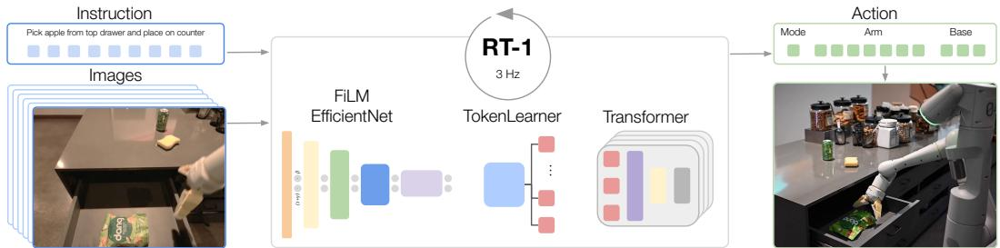

(a) RT-1 takes images and natural language instructions and outputs discretized base and arm actions. Despite its size (35M parameters), it does this at 3 Hz, due to its efficient yet high-capacity architecture: a FiLM (Perez et al., 2018) conditioned EfficientNet (Tan & Le, 2019), a TokenLearner (Ryoo et al., 2021), and a Transformer (Vaswani et al., 2017).  
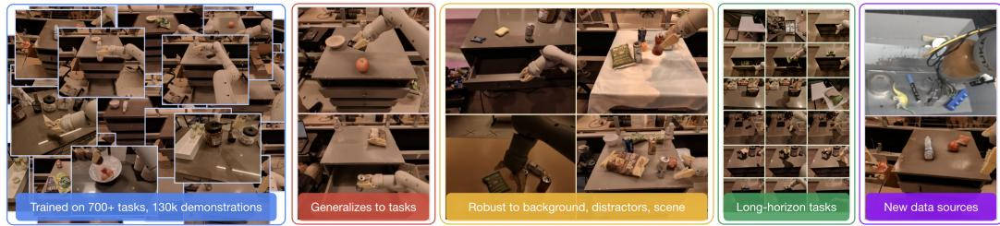  
(b) RT-1’s large-scale, real-world training (130k demonstrations) and evaluation (3000 real-world trials) show impressive generalization, robustness, and ability to learn from diverse data.  
Figure 1: A high-level overview of RT-1’s architecture, dataset, and evaluation.

The two main challenges lie in assembling the right dataset and designing the right model. While data collection and curation is often the “unsung hero” of many large-scale machine learning projects (Radford et al., 2021; Ramesh et al., 2021), this is especially true in robotics, where datasets are often robot-specific and gathered manually (Dasari et al., 2019; Ebert et al., 2021). As we will show in our evaluations, good generalization requires datasets that combine both scale and breadth, covering a variety of tasks and settings. At the same time, the tasks in the dataset should be sufficiently well-connected to enable generalization, such that the model can discover the patterns between structural similar tasks and perform new tasks that combine those patterns in novel ways. We utilize a dataset that we gathered over the course of 17 months with a fleet of 13 robots, containing ∼130k episodes and over 700 tasks, and we ablate various aspects of this dataset in our evaluation.

The second challenge lies in the design of the model itself. Effective robotic multi-task learning requires a high capacity model, and Transformer (Vaswani et al., 2017) models excel in this regard, particularly when it is necessary to learn many tasks conditioned, as in our case, on language instructions. However, robotic controllers must also be efficient enough to run in real time, which presents a major challenge for Transformers in particular. We propose a novel architecture that we call RT-1 (Robotics Transformer 1), which by encoding high-dimensional inputs and outputs, including camera images, instructions and motor commands into compact token representations to be used by the Transformer, allows for efficient inference at runtime to make real-time control feasible.

Our contribution is the RT-1 model and experiments with this model on a large and broad dataset of real-world robotic tasks. Our experiments not only demonstrate that RT-1 can exhibit significantly improved generalization and robustness compared to prior techniques, but also evaluate and ablate many design choices in both the model and in the composition of the training set. Our results show that RT-1 can perform over 700 training instructions at 97% success rate, and can generalize to new tasks, distractors, and backgrounds 25%, 36% and 18% better than the next best baseline, respectively. This level of performance allows us to execute very long-horizon tasks in the SayCan (Ahn et al., 2022) framework, with as many as 50 stages. We further show that RT-1 can incorporate data from simulation or even other robot types, retaining performance on the original tasks and improving generalization to new scenarios. A short overview of RT-1 capabilities is presented in Fig. 1b<sup>2</sup>.

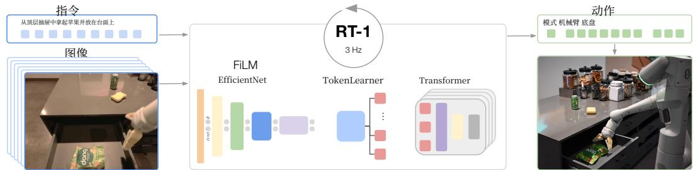

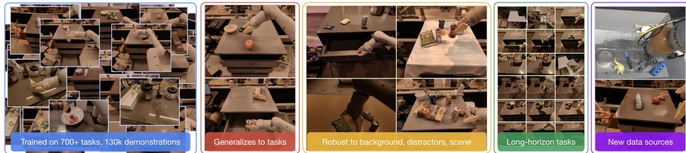  
(a) RT‑1 接收图像和自然语言指令，并输出离散化的底盘和机械臂动作。尽管其模型规模达到 35M 参数，但得益于其高效且高容量的架构：基于 FiLM (Perez et al., 2018) 条件化的 EfficientNet (Tan & Le, 2019)、TokenLearner (Ryoo et al., 2021) 以及 Transformer (Vaswani et al., 2017)，它仍能以 3 Hz 的频率运行。  
(b) RT‑1 的大规模真实世界训练（13 万次演示）与评估（3000 次真实世界试验）展示了令人瞩目的泛化能力、鲁棒性以及从多样化数据中学习的能力。  
图 1：RT‑1 的架构、数据集和评估的高层概览。

两大主要挑战在于构建合适的数据集和设计合适的模型。虽然数据收集与整理往往是许多大规模机器学习项目的“幕后英雄” (Radford et al., 2021; Ramesh et al., 2021)，但在机器人学中更是如此——其数据集通常特定于机器人且由人工收集 (Dasari et al., 2019; Ebert et al.,2021)。正如我们在评估中所展示的，良好的泛化需要兼具规模和广度的数据集，以涵盖各种任务与设置。同时，数据集中的任务应具有充分的关联性以实现泛化，从而使模型能够发现结构相似任务之间的规律，并以创新的方式组合这些规律来执行新任务。我们使用了一个由 13 台机器人组成的机队历时 17 个月收集的数据集，其中包含∼130k 个回合和 700 多个任务，并且我们在评估中对该数据集的各个方面进行了消融实验。

第二个挑战在于模型本身的设计。有效的机器人多任务学习需要高容量模型，而 Transformer（Vaswani et al., 2017）模型在这方面表现优异，特别是在像我们这样需要以语言指令为条件来学习多种任务的情况下。然而，机器人控制器还必须足够高效以实现实时运行，这对 Transformer 来说尤其是一个重大挑战。我们提出了一种名为 RT‑1（Robotics Transformer 1）的新型架构，它通过将包括相机图像、指令和电机指令在内的高维输入与输出编码为供 Transformer 使用的紧凑Token 表示，从而在运行时实现高效推理，使实时控制成为可能。

我们的贡献在于 RT‑1 模型，以及在包含真实世界机器人任务的大型广泛数据集上对该模型进行的实验。我们的实验不仅证明了与以往技术相比，RT‑1 能够展现出显著提升的泛化能力和鲁棒性，还评估并消融了模型本身及训练集构成中的诸多设计选择。我们的结果表明，RT‑1 能够以97% 的成功率执行超过 700 条训练指令，并且在泛化到新任务、干扰物和背景方面，分别比次优基线高出 25%、36% 和 18%。这种水平的性能使我们能够在 SayCan (Ahn et al., 2022) 框架中执行包含多达 50 个阶段的长程任务。我们还进一步表明，RT‑1 能够融合来自仿真甚至其他机器人类型的数据，在保持原始任务性能的同时，提高对新场景的泛化能力。图 1b2 简要概述了 RT‑1 的各项能力。

## 2 RELATED WORK

A number of recent works have proposed Transformer-based policies for robotic control. As in RT-1, several works use language commands processed with Transformers as a robust framework for specifying and generalizing to new tasks (Zhang & Chai, 2021; Pashevich et al., 2021; Silva et al., 2021; Jang et al., 2021; Ahn et al., 2022; Nair et al., 2022). Our work takes the application of Transformers a step further and treats the mapping of language and vision observations to robot actions as a sequence modelling problem, using a Transformer to learn this mapping. This idea is directly inspired by successes in game-playing (Chen et al., 2021; Lee et al., 2022a) as well as simulated robot navigation (Fang et al., 2019), locomotion (Janner et al., 2021; Gupta et al., 2022), and manipulation (Jiang et al., 2022) environments. We note that several of these works go beyond only text conditioning and use Transformers to also generalize across robot morphologies (e.g., Gupta et al. (2022)) and other modalities for task specifications (e.g., Jang et al. (2021); Jiang et al. (2022)). These extensions are promising future directions for RT-1.

Beyond Transformer-based policies, the focus of our work is on generalizable and robust real-world robotic manipulation at scale. Existing works on real-world Transformer-based robotic manipulation focus on efficiently learning tasks from a set of demonstrations per task (Shridhar et al., 2022). Behavior Transformer (Shafiullah et al., 2022) and Gato (Reed et al., 2022) advocate for training a single model on large-scale robotic and non-robotic datasets. However, these works are limited in their real-world robotic tasks; $\mathrm { e . g . , }$ Gato learns effectively a single task (colored block stacking) without evaluating generalization to new tasks or a variety of real-world settings. On the technical side, our work examines how Transformer-based policies can be built so as to combine high capacity and generalization with the computational efficiency necessary for real-time control.

While the use of high-capacity Transformer models to learn robotic control policies is a fairly recent innovation, robotics has a long history of multi-task and language-conditioned learning, and RT-1 builds on these foundations. A significant body of work deals with learning policies and predictive models for robotic grasping (Saxena et al., 2006; Lenz et al., 2015; Pinto & Gupta, 2016; Gupta et al., 2018; Viereck et al., 2017), with the aim of generalizing to new objects. Prior works have sought to address robotic language understanding through pipelined approaches that combine language parsing, vision, and robotic control (MacMahon et al., 2006; Kollar et al., 2010; Tellex et al., 2011) and with end-to-end approaches (Mei et al., 2016; Stepputtis et al., 2020; Lynch & Sermanet, 2020; Ahn et al., 2022). Multi-task robotic learning has also been approached from the perspective of learning to reach goals (Chung et al., 2015; Raffin et al., 2019; Jurgenson et al., 2020; Huang et al., 2020), as well as learning policies that can perform tasks in a discrete set or some other parameterized form (Deisenroth et al., 2014; Devin et al., 2017; Fox et al., 2019; Kalashnikov et al., 2021a). A number of prior works in robotics have also focused on collecting datasets containing demonstrations or trials that illustrate a variety of different tasks (Sharma et al., 2018; Dasari et al., 2019; Yu et al., 2020; Singh et al., 2020; James et al., 2020). Our work adds further evidence in support of the power of multi-task, language-conditioned robotic learning, presenting experimental results at a larger scale and with a greater variety of behaviors, objects, and scenes and proposing new architectures and design choices that enable robotic learning at a significantly larger scale.

## 3 PRELIMINARIES

Robot learning. We aim to learn robot policies to solve language-conditioned tasks from vision. Formally, we consider a sequential decision-making environment. At timestep t = 0, the policy π is presented with a language instruction i and an initial image observation $x _ { 0 } .$ The policy produces an action distribution π(· | i, x<sub>0</sub>) from which an action $a _ { 0 }$ is sampled and applied to the robot. This process continues, with the policy iteratively producing actions a by sampling from a learned distribution $\pi ( \cdot \mid i , \{ x _ { j } \} _ { j = 0 } ^ { t } )$ and applying those actions to the robot. The interaction ends when a termination condition is achieved. The full interaction i, $\{ ( x _ { j } , a _ { j } ) \} _ { j = } ^ { T }$ <sub>=0</sub> from from the starting step t = 0 to terminating step T is referred to as an episode. At the end of an episode, the agent will be given a binary reward r $\mathit { \Pi } \cdot \in \{ 0 , 1 \}$ } indicating whether the robot performed the instruction i. The goal is to learn a policy π that maximizes the average reward, in expectation over a distribution of instructions, starting states $x _ { 0 } ,$ and transition dynamics.

## 2 相关工作

近期的许多工作提出了用于机器人控制的基于 Transformer 的策略。与 RT‑1 类似，一些工作使用经由 Transformer 处理的语言指令，作为指定新任务并泛化到新任务的鲁棒框架 (Zhang & Chai,2021; Pashevich et al., 2021; Silva et al., 2021; Jang et al., 2021; Ahn et al., 2022; Nair et al.,2022)。我们的工作使 Transformer 的应用更进一步，将语言和视觉观测到机器人动作的映射视为一个序列建模问题，并使用 Transformer 来学习这种映射。这一想法直接受到电子游戏 (Chen etal., 2021; Lee et al., 2022a) 以及仿真机器人导航 (Fang et al., 2019)、运动 (Janner et al., 2021;Gupta et al., 2022) 和操作 (Jiang et al., 2022) 环境中成功案例的启发。我们注意到，其中一些工作不仅限于以文本为条件，还使用 Transformer 跨机器人形态 (例如 Gupta et al. (2022)) 以及用于任务指定的其他模态 (例如 Jang et al. (2021); Jiang et al. (2022)) 进行泛化。这些扩展是 RT‑1 很有前景的未来方向。

除了基于 Transformer 的策略之外，我们工作的重点在于大规模下具有泛化性且稳健的真实世界机器人操作。现有的关于真实世界基于 Transformer 的机器人操作的研究主要侧重于从每个任务的一组演示中高效地学习任务 (Shridhar et al., 2022)。Behavior Transformer (Shafiullah et al.,2022) 和 Gato (Reed et al., 2022) 主张在大规模机器人及非机器人数据集上训练单个模型。然而，这些工作在真实世界机器人任务方面存在局限性；例如，Gato 实际上只学习了单个任务（彩色积木堆叠），而没有评估对新任务或各种真实世界环境的泛化能力。在技术层面上，我们的工作探讨了如何构建基于 Transformer 的策略，以便将高容量和泛化能力与实时控制所需的计算效率相结合。

虽然使用高容量 Transformer 模型来学习机器人控制策略是一项相当近期的创新，但机器人学在多任务和语言条件化学习方面有着悠久的历史，而 RT‑1 正是建立在这些基础之上的。大量研究致力于学习机器人抓取的策略和预测模型 (Saxena et al., 2006; Lenz et al., 2015; Pinto & Gupta, 2016;Gupta et al., 2018; Viereck et al., 2017)，旨在泛化到新物体。先前的研究试图通过结合语言解析、视觉和机器人控制的流水线方法 (MacMahon et al., 2006; Kollar et al., 2010; Tellex et al.,2011) 以及端到端方法 (Mei et al., 2016; Stepputtis et al., 2020; Lynch & Sermanet, 2020;Ahn et al., 2022) 来解决机器人语言理解问题。多任务机器人学习也从学习达成目标 (Chung etal., 2015; Raffin et al., 2019; Jurgenson et al., 2020; Huang et al., 2020) 的角度，以及学习能够在离散集合或其他参数化形式中执行任务的策略 (Deisenroth et al., 2014; Devin et al., 2017;Fox et al., 2019; Kalashnikov et al., 2021a) 的角度得到了探索。机器人学领域的许多先前工作还专注于收集包含展示各种不同任务的演示或试验的数据集 (Sharma et al., 2018; Dasari et al.,2019; Yu et al., 2020; Singh et al., 2020; James et al., 2020)。我们的工作为多任务、语言条件化机器人学习的强大能力提供了进一步的证据，在更大规模以及更多样化的行为、物体和场景下展示了实验结果，并提出了新的架构和设计选择，从而使机器人学习能够在显著更大的规模上进行。

## 3 预备知识

机器人学习。我们的目标是学习机器人策略，以根据视觉解决语言条件任务。形式上，我们考虑一个序贯决策环境。在时间步 $t = 0 ,$ 策略 π接收一个语言指令 i 和初始图像观测$x _ { 0 \mathrm { { o } } }$ 该策略生成一个动作分布 π(· | i,x )，并从中采样一个动作 $a _ { 0 }$ 应用到机器人上。这一过程持续进行，策略通过从学得的分布 π(· | i, {x<sub>j</sub>}t ) 中采样来迭代生成动作 $\boldsymbol { a } _ { t } \mathrm { ~ , ~ }$ ，并将这些动作应用到机器人上。当达到终止条件时，交互结束。从起始步t = 0到终止步 T的完整交互 i, {(x<sub>j</sub>, $, a _ { j } ) \} _ { j = 0 } ^ { T }$ 被称为一个回合。在回合结束时，智能体将获得一个二值奖励r ∈ {0,1} ，指示机器人是否执行了指令 i。其目标是在指令、初始状态 $x _ { 0 }$ 和转移动态的分布期望下，学习一个能够最大化平均奖励的策略 π 。

Transformers. RT-1 uses a Transformer (Vaswani et al., 2017) to parameterize the policy π. Generally speaking, a Transformer is a sequence model mapping an input sequence $\{ \xi _ { h } \} _ { h = 1 } ^ { H }$ to an output sequence $\{ y _ { k } \} _ { k = 0 } ^ { K }$ using combinations of self-attention layers and fully-connected neural networks. While Transformers were originally designed for text sequences, where each input ξ<sub>j</sub> and output y<sub>k</sub> represents a text token, they have been extended to images (Parmar et al., 2018) as well as other modalities (Lee et al., 2022a; Reed et al., 2022). As detailed in the next section, we parameterize π by first mapping inputs $i , \{ x _ { j } \} _ { j = 0 } ^ { t }$ to a sequence $\{ \xi _ { h } \} _ { h = ( } ^ { H }$ and action outputs a to a sequence $\{ y _ { k } \} _ { k = 1 } ^ { K }$ before using a Transformer to learn the mapping {ξ $\stackrel { , } { \mathop { h } } \stackrel { H } { \mathop { h } } = 0 \stackrel { } { \mathop { h } } \stackrel { K } { \mathop { h } } = 0$ <sub>0</sub>.

Imitation learning. Imitation learning methods train the policy π on a dataset D of demonstrations (Pomerleau, 1988; Zhang et al., 2018; Jang et al., 2021). Specifically, we assume access to a dataset $\begin{array} { r } { \boldsymbol { D } = \{ ( { i } ^ { ( n ) } , \{ ( { x } _ { t } ^ { ( n ) } , { a } _ { t } ^ { ( n ) } ) \} _ { t = 0 } ^ { T ^ { ( n ) } } ) \} _ { n = 0 } ^ { N } } \end{array}$ of episodes, all of which are successful (i.e., have a final reward of 1). We learn π using behavioral cloning (Pomerleau, 1988), which optimizes π by minimizing the negative log-likelihood of actions a<sub>t</sub> given the images and language instructions.

## 4 SYSTEM OVERVIEW

The goal of this work is to build and demonstrate a general robot learning system that can absorb large amounts of data and generalize effectively. We use mobile manipulators from Everyday Robots<sup>3</sup>, which have a 7 degree-of-freedom arm, a two-fingered gripper, and a mobile base (see Fig. 2 (d)). To collect data and evaluate our method, we use three kitchen-based environments: two real office kitchens and a training environment modelled off these real kitchens. The training environment, shown in Fig. 2 (a), consists of partial counters and is constructed for large scale data collection. The two real environments, shown in Fig. 2 (b, c), have similar counter tops to the training environment, but vary in lighting, background, and full kitchen geometry (e.g., there may be a cabinet instead of a drawer or a sink may be visible). We evaluate the performance of our policies across these different environments, measuring the policy’s performance and ability to generalize.

Our training data consists of human-provided demonstrations, and we annotate each episode with a textual description of the instruction that the robot just performed. The instructions usually contain a verb and one or more nouns describing the target objects. To group these instructions together, we split them into a number of skills (e.g., verbs such as “pick”, “open” or “place upright”) and objects (e.g., nouns such as “coke can”, “apple”, or “drawer”). We describe the details of our data collection strategy at scale in Sec. 5.2. Our largest dataset contains over 130k individual demonstrations constituting over 700 distinct task instructions using a large variety of objects (see Fig. 2 (f)). We describe the details of the data collected in Sec. 5.2.

One of the main contributions of our system is the network architecture, Robotics Transformer 1 (RT-1), an efficient model that can absorb large amounts of data, effectively generalize, and output actions at real-time rates for practical robotic control. RT-1 takes a short sequence of images and a natural language instruction as input and outputs an action for the robot at each time step. To this end, the architecture (shown in Figure 1a) leverages several elements: first the images and text are processed via an ImageNet pretrained convolutional network (Tan & Le, 2019) conditioned on a pretrained embedding of the instruction via FiLM (Perez et al., 2018), followed by a Token Learner (Ryoo et al., 2021) to compute a compact set of tokens, and finally a Transformer (Vaswani et al., 2017) to attend over these tokens and produce discretized action tokens. The actions consist of seven dimensions for the arm movement (x, y, z, roll, pitch, yaw, opening of the gripper), three dimensions for base movement (x, y, yaw) and a discrete dimension to switch between three modes: controlling the arm, the base, or terminating the episode. RT-1 performs closed-loop control and commands actions at 3 Hz until it either yields a “terminate” action or hits a pre-set time step limit.

## 5 RT-1: ROBOTICS TRANSFORMER

In this section, we describe how we tokenize the images, text, and actions, and then discuss the RT-1 model architecture. We then describe how we attain the runtime speed required for real-time control. Lastly, we describe the data collection procedure and the skills and instructions in our dataset.

Transformer。RT‑1 使用 Transformer（Vaswani et al., 2017）来参数化策略 π。一般来说，Transformer 是一种序列模型，它结合自注意力层和全连接神经网络，将输入序列 $\{ \xi _ { h } \} _ { h = } ^ { H }$ 映射到输出序列 $\{ y _ { k } \} _ { k = 0 } ^ { K } \circ$ 。尽管 Transformer 最初是针对文本序列设计的（其中每个输入 ξ 和输出 $y _ { k } \mathcal { H }$ 表一个文本 token），但它们已被扩展到图像（Parmar et al., 2018）以及其他模态（Lee et al.,2022a; Reed et al., 2022）。正如在下一节中详细介绍的，在利用 Transformer 学习该映射$\{ \xi _ { h } \} _ { h = 0 } ^ { H } \to \{ y _ { k } \} _ { k = } ^ { K }$ 之前，我们首先将输入 $\ : i , \{ x _ { j } \} _ { j = } ^ { t } \ :$ <sub>0</sub> 映射为一个序列 {ξ<sub>h</sub>}H<sub>h=0</sub> ，并将动作输出 a<sub>t</sub>映射为一个序列{y $\therefore \} _ { k = 0 } ^ { K } \ ;$ ，以此来参数化π 。

模仿学习。模仿学习方法在演示数据集 D 上训练策略 π （Pomerleau, 1988; Zhang et al.,2018;Jang et al., 2021）。具体而言，我们假设可以访问一个由全部成功（即最终奖励为 1）的回合组成的数据集 D = {(i(n), {(x<sup>(n)</sup> , a<sup>(n)</sup> )}T<sup>(n)</sup> )}N 。我们使用行为克隆 （Pomerleau, 1988）进行学习 π ，该方法通过在给定图像和语言指令的情况下最小化动作a 的负对数似然来优化 π 。

## 4 系统概述

本工作的目标是构建并演示一个能够吸收大量数据并有效泛化的通用机器人学习系统。我们使用来自 Everyday Robots3, 的移动操作机，其拥有一个 7 自由度机械臂、一个双指夹爪和一个移动底座（参见图 2 (d)）。为了收集数据并评估我们的方法，我们使用了三个基于厨房的环境：两个真实的办公室厨房，以及一个参照这些真实厨房建模的训练环境。如图 2 (a) 所示，训练环境由部分台面组成，专为大规模数据收集而构建。如图 2 (b, c) 所示，两个真实环境具有与训练环境相似的台面，但在光照、背景和完整厨房几何结构上有所不同（例如，可能用橱柜代替了抽屉，或者水槽是可见的）。我们在这些不同的环境中评估我们策略的性能，测量策略的性能和泛化能力。

我们的训练数据由人工提供的演示组成，并且我们使用机器人刚刚执行的指令的文本描述对每个回合进行标注。这些指令通常包含一个动词以及一个或多个描述目标物体的名词。为了将这些指令归类，我们将其拆分为若干技能（例如“拾取”、“打开”或“竖直放置”等动词）和物体（例如“可乐罐”、“苹果”或“抽屉”等名词）。我们在第 5.2 节中详细描述了我们的大规模数据收集策略。我们最大的数据集包含超过 13 万个单独的演示，涵盖了使用多种物体的700 多个不同任务指令（参见图 2 (f)）。我们在第 5.2 节中详细描述了收集到的数据细节。

我们系统的主要贡献之一是网络架构 Robotics Transformer 1 (RT‑1)，这是一个高效的模型，能够吸收大量数据、有效泛化，并以实时速率输出动作以用于实际的机器人控制。RT‑1 将一小段图像序列和一条自然语言指令作为输入，并在每个时间步为机器人输出一个动作。为此，该架构（如图 1a所示）利用了几个要素：首先，图像和文本通过经 ImageNet 预训练的卷积网络（Tan & Le, 2019）进行处理，该网络通过 FiLM（Perez et al., 2018）以指令的预训练嵌入为条件；随后通过 TokenLearner（Ryoo et al., 2021）计算一组紧凑的词元；最后由 Transformer（Vaswani et al.,2017）关注这些词元并生成离散化动作词元。这些动作包括机械臂运动的七个维度 $( \mathrm { x } , \ \mathrm { y } , \ z ,$ 横滚、俯仰、偏航、夹爪的开合度）、底座移动的三个维度（x、y、偏航），以及一个用于在三种模式之间切换的离散维度：控制机械臂、控制底座或终止回合。RT‑1 执行闭环控制并以 3 Hz 的频率发出动作指令，直到生成“终止”动作或达到预设的时间步限制。

## 5 RT‑1：机器人学 Transformer

在本节中，我们介绍了如何对图像、文本和动作进行词元化，随后讨论了 RT‑1 模型架构。接着，我们描述了如何达到实时控制所需的运行速度。最后，我们介绍了数据收集流程以及数据集中的技能与指令。

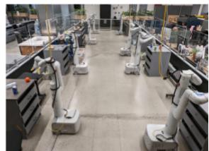  
(a)


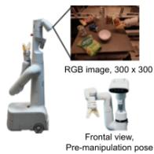

(b)  
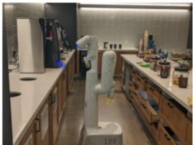  
(c)

(d)  
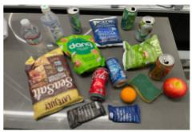  
(e)

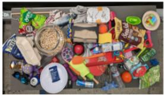  
(f)  
Figure 2: (a) Robot classroom where we collect data at scale; (b) a real office kitchen, one of the two realistic environments used for evaluation (named Kitchen1 in the rest of the paper); (c) a different office kitchen used for evaluation (named Kitchen2 in the rest of the paper); (d) mobile manipulator used throughout the paper; (e) a set of objects used for most of the skills to expand skill diversity; (f) a more diverse set of objects used mostly to expand object diversity of the picking skill.

## 5.1 MODEL

Our model is built on a Transformer architecture (Vaswani et al., 2017) and takes a history of images and task description as input and directly outputs tokenized actions, as shown in Fig. 1a and in detail in Fig. 3. In the following we describe the components of the model, following the top-to-bottom order in Fig. 3. More detail on model selection at scale are provided in Appendix C.3.

Instruction and image tokenization. The RT-1 architecture relies on a data-efficient and compact tokenization of images and language instruction. RT-1 tokenizes a history of 6 images by passing images through an ImageNet pretrained EfficientNet-B3 (Tan & Le, 2019) model, which takes 6 images of resolution 300 × 300 as input and outputs a spatial feature map of shape 9 × 9 × 512 from the final convolutional layer. Unlike Reed et al. (2022), we do not patchify the images into visual tokens prior to feeding them to our Transformer backbone. We instead flatten the output feature map from the EfficientNet into 81 visual tokens which are passed on to the later layers of the network.

To include the language instruction, we condition the image tokenizer on the natural language instruction in the form of a pretrained language embedding, allowing extraction of task-relevant image features early on and improving performance of RT-1. The instruction is first embedded via Universal Sentence Encoder (Cer et al., 2018). This embedding is then used as input to identity-initialized FiLM layers (Perez et al., 2018) added to the pretrained EfficientNet to condition the image encoder. Normally, inserting a FiLM layer into the interior of a pretrained network would disrupt the intermediate activations and negate the benefit of using pretrained weights. To overcome this, we initialize the weights of the dense layers (f and h ) which produce the FiLM affine transformation to zero, allowing the FiLM layer to initially act as an identity and preserve the function of the pretrained weights. We find that identity-initialized FiLM also produces better results when training with an EfficientNet initialized from scratch, without ImageNet pretraining, but it does not surpass the initialization described above. The architecture of the image tokenizer is presented in Fig. 3.

RT-1’s image and instruction tokenization via FiLM EfficientNet-B3 is a total of 16M parameters, with 26 layers of MBConv blocks and FiLM layers, which output 81 vision-language tokens.

TokenLearner. To further compress the number of tokens that RT-1 needs to attend over and thus speed up inference, RT-1 uses TokenLearner (Ryoo et al., 2021). TokenLearner is an elementwise attention module that learns to map a large number of tokens into a much smaller number of tokens. This allows us to soft-select image tokens based on their information, passing only the important token combinations to the subsequent Transformer layers. The inclusion of TokenLearner subsamples the 81 visual tokens that come out of the pre-trained FiLM-EfficientNet layers to just 8 final tokens that are then passed on to our Transformer layers.

  
(a)

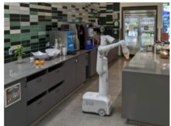  
(b)


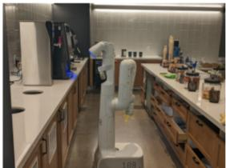  
(c)

(d)  
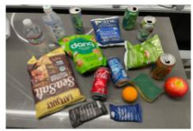  
(e)

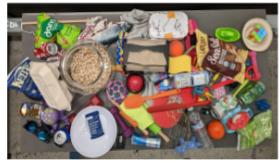  
(f)  
图 2：(a) 我们在此大规模收集数据的机器人教室；(b) 真实的办公室厨房，用于评估的两个真实环境之一（在本文其余部分称为 Kitchen1）；(c) 用于评估的另一个办公室厨房（在本文其余部分称为 Kitchen2）；(d) 本文全程使用的移动操作机；(e) 用于大多数技能以扩展技能多样性的一组物体；(f) 主要用于扩展拾取技能物体多样性的一组更多样化的物体。

## 5.1 模型

我们的模型建立在 Transformer 架构（Vaswani et al., 2017）之上，以历史图像和任务描述作为输入，并直接输出词元化动作，如图 1a 所示，详见图 3。接下来，我们将按照图3 中自上而下的顺序介绍模型的各个组件。有关大规模模型选择的更多细节见附录 C.3。

指令与图像词元化。RT‑1 架构依赖于对图像和语言指令进行数据高效且紧凑的词元化。RT‑1 通过将图像输入在 ImageNet 上预训练的 EfficientNet‑B3 (Tan & Le, 2019) 模型来对 6 张历史图像进行词元化，该模型接收分辨率为 300×300的 6 张图像作为输入，并从最终卷积层输出形状为9×9×512的空间特征图。与 Reed 等人 (2022) 不同，在将图像输入我们的 Transformer 骨干网络之前，我们并未将图像切分成视觉词元。相反，我们将来自 EfficientNet 的输出特征图展平为81 个视觉词元，并传递给网络的后续层。

为了引入语言指令，我们以预训练语言嵌入的形式，根据自然语言指令对图像词元生成器进行条件化调节，从而尽早提取与任务相关的图像特征，并提升 RT‑1 的性能。该指令首先通过 UniversalSentence Encoder (Cer et al., 2018) 进行嵌入。然后，该嵌入被用作添加到预训练 EfficientNet中的恒等初始化 FiLM 层 (Perez et al., 2018) 的输入，以对图像编码器进行条件化调节。通常情况下，在预训练网络的内部插入 FiLM 层会破坏中间激活，并抵消使用预训练权重的优势。为了解决这一问题，我们将生成 FiLM 仿射变换的全连接层（f 和 h ）的权重初始化为零，从而使 FiLM 层在初始时充当恒等变换，并保留预训练权重的功能。我们发现，在使用从头初始化的 EfficientNet（没有 ImageNet 预训练）进行训练时，恒等初始化的 FiLM 也能产生更好的结果，但并未超越上述的初始化方法。图像词元生成器的架构如图 3 所示。

RT‑1 通过 FiLM EfficientNet‑B3 进行的图像与指令标记化共有 16M 参数，包含 26 层 MBConv 块和 FiLM 层，输出 81 个视觉‑语言标记。

TokenLearner。为了进一步压缩 RT‑1 需要关注的 token 数量从而加快推理速度，RT‑1 采用了TokenLearner (Ryoo et al., 2021)。TokenLearner 是一个逐元素注意力模块，能够学习将大量token 映射为数量少得多的 token。这使我们能够根据图像 token 的信息对其进行软选择，仅将重要的 token 组合传递给后续的 Transformer 层。引入 TokenLearner 将预训练FiLM‑EfficientNet 层输出的 81 个视觉词元下采样为仅 8 个最终 token，然后传递给我们的Transformer 层。

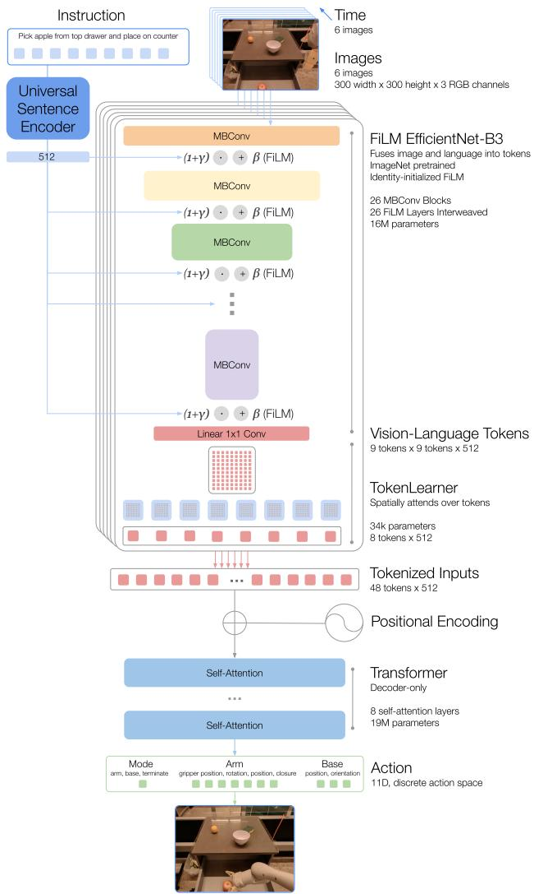  
Figure 3: The architecture diagram of RT-1. The instruction is transformed into a USE embedding and used to condition a pre-trained EfficientNet via FiLM layers. The resulting vision-language tokens are reduced by the TokenLearner and fed into a decoder-only Transformer, which outputs tokenized actions.

Transformer. These 8 tokens per-image are then concatenated with the other images in the history, forming 48 total tokens (with added position encoding) to be fed into the Transformer backbone of RT-1. The Transformer is a decoder-only sequence model with 8 self-attention layers and 19M total parameters that outputs action tokens.

· +� �Action tokenization. To tokenize actions, each action dimension in RT-1 is discretized into 256 bins. As mentioned previously, the action dimensions we consider include seven variables for the arm movement (x, y, z, roll, pitch, yaw, opening of the gripper), three variables for base movement (x, y, yaw) and a discrete variable to switch between three modes: controlling arm, base or terminating the episode. For each variable, we map the target to one of the 256 bins, where the bins are uniformly distributed within the bounds of each variable.

Loss. We use a standard categorical cross-entropy entropy objective and causal masking that was utilized in prior Transformer-based controllers (Reed et al., 2022; Lee et al., 2022a).

Inference speed. In contrast to many applications of large models, such as natural language or image generation, one of the unique requirements for a model that needs to run on real robots in real time is fast and consistent inference speed. Given the human speeds of executing the instructions

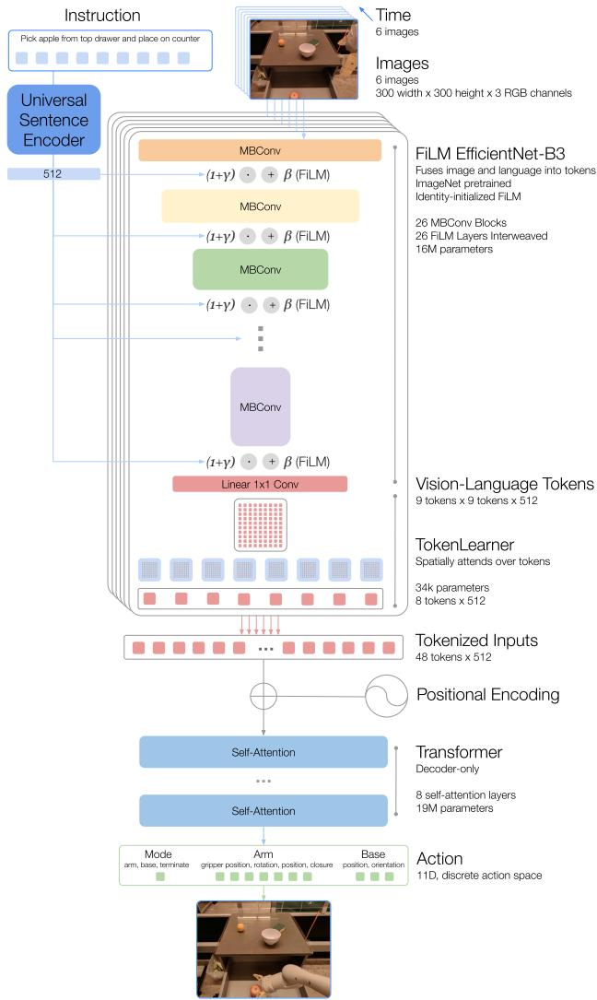  
图 3：RT‑1 的架构图。指令被转换为 USE嵌入，并通过 FiLM 层用于对预训练的EfficientNet 进行条件调节。生成的视觉‑语言词元经由 TokenLearner 压缩并输入至仅解码器Transformer，该模型输出词元化动作。

Transformer。每张图像生成的这 8 个词元随后与历史中的其他图像拼接，形成总共 48 个词元（并添加了位置编码），输入至 RT‑1 的 Transformer 骨干网络中。该 Transformer 是一个包含 8 个自注意力层和 1900 万总参数量的仅解码器序列模型，用于输出动作词元。

· + <sup>…</sup><sub>��</sub>动作词元化。为了对动作进行词元化，RT‑1 中的每个动作维度被离散化为 256 个分箱。如前所述，我们考虑的动作维度包括用于机械臂运动的 7 个变量（x、 y、 z、横滚、俯仰、偏航、夹爪开度），用于底座移动的 3 个变量（x、 y、偏航），以及用于在三种模式（控制机械臂、控制底座或终止回合）之间切换的一个离散变量。对于每个变量，我们将目标映射到 256 个分箱之一，其中分箱在每个变量的边界内均匀分布。

损失函数。我们采用了此前基于 Transformer 的控制器（Reed et al., 2022; Leeet al., 2022a）中所使用的标准类别交叉熵目标以及因果掩码。

推理速度。与大模型的许多应用（如自然语言或图像生成）相比，需要在真实机器人上实 时运行的模型所具备的独特要求之一是快速且一致的推理速度。鉴于人类执行指令的速度 considered in this work (which we measured to be in the 2 − 4 secs range), we want the model to be not significantly slower than that. Based on our experiments this requirement corresponds to at least 3Hz control frequency and the resulting inference time budget for the model, given other latencies in the system, to be less than 100ms.

This requirement limits the size of the model that we can use. We further explore the impact of model size on inference speed in the experiments. We employ two techniques to speed up inference: (i) reduce the number of tokens generated by a pre-trained EfficientNet model by using Token-Learner (Ryoo et al., 2021), (ii) compute these tokens only once and reuse them for the following windows that overlap for the future inferences. Both of these allow us to speed up the model inference by 2.4 and 1.7 times, respectively. Additional details on model inference are in Appendix C.1.

## 5.2 DATA

<table><tr><td>Skill</td><td>Count</td><td>Description</td><td>Example Instruction</td></tr><tr><td>Pick Object</td><td>130</td><td>Lift the object off the surface</td><td>pick iced tea can</td></tr><tr><td>Move Object Near Object</td><td>337</td><td>Move the first object near the second</td><td>move pepsi can near rxbar blueberry</td></tr><tr><td>Place Object Upright</td><td>8</td><td>Place an elongated object upright</td><td>place water bottle upright</td></tr><tr><td>Knock Object Over</td><td>8</td><td>Knock an elongated object over</td><td>knock redbull can over</td></tr><tr><td>Open Drawer</td><td>3</td><td>Open any of the cabinet drawers</td><td>open the top drawer</td></tr><tr><td>Close Drawer</td><td>3</td><td>Close any of the cabinet drawers</td><td>close the middle drawer</td></tr><tr><td>Place Object into Receptacle</td><td>84</td><td>Place an object into a receptacle</td><td>place brown chip bag into white bowl</td></tr><tr><td>Pick Object from Receptacle and Place on the Counter</td><td>162</td><td>Pick an object up from a location and then place it on the counter</td><td>pick green jalapeno chip bag from paper bowl and place on counter</td></tr><tr><td>Section 6.3 and 6.4 tasks</td><td>9</td><td>Skills trained for realistic, long instructions</td><td>open the large glass jar of pistachios pull napkin out of dispenser grab scooper</td></tr><tr><td>Total</td><td>744</td><td></td><td></td></tr></table>

Table 1: The list of skills collected for RT-1 together with their descriptions and example instructions.

Our goal is to build a system that exhibits high performance, generalization to new tasks, and robustness to distractors and backgrounds. We therefore aim to collect a large, diverse dataset of robot trajectories that includes multiple tasks, objects and environments. Our primary dataset consists of ∼130k robot demonstrations, collected with a fleet of 13 robots over the course of 17 months. We conducted this large-scale data collection in a series of office kitchen segments, which we refer to as robot classrooms, shown in Fig. 2. More details on data collection are in Appendix C.2.

Skills and instructions. While the definition of a task remains inconsistent in the literature, in this work we count the number of language instructions that the system can perform, where an instruction corresponds to a verb surrounded by one or multiple nouns, such as “place water bottle upright”, “move the coke can to the green chip bag” or “open the drawer”. RT-1 is able to perform over 700 language instructions in multiple realistic office kitchen environments that we evaluate and describe in detail in the experiments. In order to group the evaluations and draw conclusions on the performance of the system, we group the instructions by the verbs used in them, which we refer to as skills. A more detailed list of instructions is shown in Table 1, with examples and the number of instructions per skill.

The current set of skills includes picking, placing, opening and closing drawers, getting items in and out drawers, placing elongated items up-right, knocking them over, pulling napkins and opening jars. The skills were chosen to demonstrate multiple behaviors with many objects (seen in Fig. 2(e)) to test aspects of RT-1 such as generalization to new instructions and ability to perform many tasks. We then greatly expanded the object diversity for the “pick” skill to make sure that the skills generalize to varied objects (see the expanded set of objects in Fig. 2(f)). The skills were further expanded while we conducted the ablations to include instructions added in the last row of Table 1, which were used for the experiments described in Sec. 6.4 and 6.3. These additional skills focused on realistic, long-horizon instructions in an office kitchen. The entire process of adding tasks and data is described in the Appendix C.4. Since we do not make any assumptions about particular skills when adding new instructions, the system is easily extendable, and we can continuously provide more diverse data to improve its capabilities.

（即本文所考虑的指令，我们测得其耗时在 2−4 秒范围内），我们希望模型不会显著慢于该速度。根据我们的实验，这一要求对应于至少 3Hz 的控制频率，并且考虑到系统中的其他延迟，模型由此产生的推理时间预算需小于 100ms。

这一要求限制了我们能够使用的模型大小。我们在实验中进一步探讨了模型大小对推理速度的影响。我们采用了两种技术来加速推理：(i) 使用 Token‑Learner (Ryoo et al., 2021) 减少预训练 EfficientNet 模型生成的 token 数量；(ii) 仅计算一次这些 token，并将其复用于未来推理中有重叠的后续窗口。这两项技术分别使我们的模型推理速度提升了 2.4 倍和 1.7 倍。有关模型推理的更多详细信息见附录 C.1。

## 5.2 数据

<table><tr><td>技能</td><td>数量</td><td>描述</td><td>示例指令</td></tr><tr><td>拾取物体</td><td>130</td><td>将物体从表面提起</td><td>拾取冰茶罐</td></tr><tr><td>将物体移动到物体附近</td><td>337</td><td>将第一个物体移动到第二个物体附近</td><td>将百事可乐罐移动到蓝莓味 RXBAR 附近</td></tr><tr><td>将物体竖直放置</td><td>8</td><td>将细长物体竖直放置</td><td>将水瓶竖直放置</td></tr><tr><td>将物体推倒</td><td>8</td><td>将细长物体推倒</td><td>推倒红牛罐</td></tr><tr><td>打开抽屉</td><td>3</td><td>打开任意一个橱柜抽屉</td><td>打开顶层抽屉</td></tr><tr><td>关闭抽屉</td><td>3</td><td>关闭任意一个橱柜抽屉</td><td>关闭中间抽屉</td></tr><tr><td>将物体放入容器 84</td><td></td><td>将物体放入容器</td><td>将棕色薯片袋放入白碗</td></tr><tr><td>从容器中拾取物体并放置在台面上</td><td>162</td><td>从某个位置拿起一个物体,然后将其放在台面上</td><td>从纸中拿起绿色墨西哥辣椒薯片袋碗并放在台面上</td></tr><tr><td>第 6.3 节和第 6.4 节任务</td><td>9</td><td>针对真实、长指令训练的技能</td><td>打开大号开心果玻璃罐从分发器中抽出餐巾纸抓取勺子</td></tr><tr><td>总计</td><td>744</td><td></td><td></td></tr></table>

Tab表 1：为 RT‑1 收集的技能列表及其描述和示例指令tions.

我们的目标是构建一个具有高性能、对新任务具有泛化能力，且对干扰物和背景具有鲁棒性的系统。因此，我们旨在收集一个包含多个任务、物体和环境的大规模、多样化的机器人轨迹数据集。我们的主要数据集包含由 13 台机器人在 17 个月内收集的∼130k 次机器人演示。我们在如图 2 所示的一系列办公室厨房区域（我们称之为机器人教室）中进行了这项大规模数据收集。有关数据收集的更多细节见附录 C.2。

技能与指令。尽管文献中对任务的定义尚不一致，但在本工作中，我们统计了系统能够执行的语言指令数量，其中一条指令对应一个由一个或多个名词环绕的动词，例如“放置水瓶直立”、“移动可乐罐至绿色薯片袋”或“打开抽屉”。RT‑1 能够在多个真实的办公室厨房环境中执行 700 多条语言指令，我们在实验中对此进行了评估并进行了详细描述。为了对评估进行分组并得出关于系统性能的结论，我们根据指令中使用的动词对指令进行了分组，并将其称为技能。表 1 展示了更详细的指令列表，其中包含示例以及每种技能的指令数量。

当前的技能集包括抓取、放置、开关抽屉、将物品放入及取出抽屉、将细长物品直立放置、将其推倒、抽取餐巾纸以及打开罐子。选取这些技能是为了展示针对多种物体的多样化行为（见图 2(e)），以测试 RT‑1 在泛化到新指令以及执行多任务能力等方面的表现。随后，我们大幅扩展了“抓取”技能的物体多样性，以确保这些技能能够泛化到不同的物体（参见图 2(f) 中扩展后的物体集）。在进行消融实验时，我们进一步扩展了技能，纳入了表 1最后一行新增的指令，这些指令用于第 6.4 节和第 6.3 节所述的实验。这些额外的技能侧重于办公厨房环境中的真实、长程指令。添加任务和数据的完整过程见附录 C.4。由于我们在添加新指令时不对特定技能做任何假设，该系统易于扩展，我们可以持续提供更多样化的数据来提升其能力。

## 6 EXPERIMENTS

Our experiments seek to answer the following questions:

1. Can an RT-1 learn to perform a large number of instructions, as well as to generalize in zero shot to new tasks, objects and environments? (Section 6.2)

2. Can we push the resulting model even further by incorporating heterogeneous data sources, such as simulated data or data from different robots? (Section 6.3)

3. How do various methods generalize to long-horizon robotic scenarios? (Section 6.4)

4. How do generalization metrics change with varying amounts of data quantity and data diversity? (Section 6.5)

5. What are the important and practical decisions in the design of the model and how do they affect performance and generalization? (Appendix Section D.4)

Throughout this section we will compare to two baseline state of the art architectures, Gato (Reed et al., 2022) and BC-Z (Jang et al., 2021). Importantly both of these are trained on our data described in detail in Sec. 5.2 (which is an important part of our system) since the original models in these publications would not exhibit generalization properties required for our evaluation tasks. Gato is, similarly to RT-1, based on a Transformer architecture, but varies from RT-1 in multiple aspects. First, it computes image tokens without the notion of language and each image token embedding is computed separately for each image patch, as opposed to early language fusion and global image embedding in our model. Second, it does not use a pre-trained text embedding to encode the language string. It also does not include inference time considerations that are necessary for real robots as discussed in Sec. 5.1 such as TokenLearner and the removal of auto-regressive actions. In order to run Gato on real robots at a high enough frequency, we also limit the size of the model compared to the original publication, which was 1.2B parameters (resulting in on robot inference time of 1.9s), to be of similar size to RT-1 (37M parameters for Gato vs. 35M for RT-1). BC-Z is based on a ResNet architecture, and was used in SayCan (Ahn et al., 2022). BC-Z differs from RT-1 in that it is a feedforward model that does not use previous timesteps, and it uses continuous actions rather than discrete action tokens. In addition to the original BC-Z model size, we also compare our method to a larger version of BC-Z that has a similar number of parameters to RT-1 and refer to it as BC-Z XL. We study and analyze how each of these design decisions changes performance in Appendix Sections D.4 and D.5.

We evaluate the success rate in experiments to measure performance on training instructions, generalization to unseen instructions, robustness to backgrounds and distractors, and performance in long-horizon scenarios, as detailed below. Throughout this section, we evaluate our approach and baselines with over 3000 real-world trials, making one of the largest scale evaluation of a robot learning system to-date.

## 6.1 EXPERIMENTAL SETUP

As mentioned in Section 4, we evaluate RT-1 with a set of mobile manipulators from Everyday Robots in three environments: two real office kitchens and a training environment modelled off these real kitchens. The training environment, shown in Fig. 2 (a), consists of partial counters while the two real environments, shown in Fig. 2 (b, c), have similar counter tops to the training environment, but vary in lighting, background, and full kitchen geometry (e.g., there may be a cabinet instead of a drawer or a sink may be visible). The policies are evaluated for performance on training tasks as well as generalization to new tasks, robustness to unseen environments, and performance when chained together for long-horizon tasks, as detailed below.

Seen task performance. To evaluate performance on seen instructions, we evaluate performance on instructions sampled from the training set. Note, however, that this evaluation still involves varying the placement of objects and other factors of the setup (e.g., time of day, robot position), requiring the skills to generalize to realistic variability in the environment. In all, we test over 200 tasks in this evaluation: 36 for picking objects, 35 for knocking objects, 35 for placing things upright, 48 for moving objects, 18 for opening and closing various drawers, and 36 for picking out of and placing objects into drawers.

Unseen tasks generalization. To evaluate generalization to unseen tasks, we test 21 novel, unseen instructions. These instructions are distributed across skills and objects. This ensures that at least

## 6 实验

## 我们的实验旨在回答以下问题：

1. RT‑1 是否能够学会执行大量指令，并在零样本情况下泛化到新任务、新物体和新环境中？（第 6.2 节） 2. 我们能否通过整合异构数据源（例如仿真数据或来自不同机器人的数据）来进一步提升所得到的模型？（第 6.3 节） 3. 各种方法如何泛化到长时程机器人场景？（第 6.4 节） 4. 泛化指标如何随着不同程度的数据量和数据多样性而变化？（第 6.5 节） 5. 在模型设计中有哪些重要且实用的决策，它们又是如何影响性能和泛化的？（附录第 D.4 节）

在本节中，我们将与两种基线最先进架构 Gato (Reed et al., 2022) 和 BC‑Z (Jang et al., 2021) 进行对比。重要的是，这两者都是在我们于第 5.2 节中详述的数据（我们系统的重要组成部分）上训练的，因为这些出版物中的原始模型无法展现我们评估任务所需的泛化特性。与 RT‑1 类似，Gato 基于Transformer 架构，但在多个方面与 RT‑1 有所不同。首先，它在不结合语言概念的情况下计算图像 token，并且每个图像 token 嵌入都是针对每个图像块单独计算的，而我们的模型则采用了早期语言融合和全局图像嵌入。其次，它没有使用预训练文本嵌入来对语言字符串进行编码。它也没有包含如第 5.1 节所讨论的对真实机器人而言必不可少的推理时间考量，例如 TokenLearner 和移除自回归动作。为了在真实机器人上以足够高的频率运行 Gato，与原始出版物中的 1.2B 参数（导致机器人上的推理时间为 1.9s）相比，我们还将模型大小限制为与 RT‑1 相似的大小（Gato 为 37M 参数，而 RT‑1 为 35M 参数）。BC‑Z 基于 ResNet 架构，并应用于 SayCan (Ahn et al., 2022)。BC‑Z 与RT‑1 的不同之处在于它是一个不使用先前时间步的前馈模型，并且它使用连续动作而非离散动作token。除了原始的 BC‑Z 模型大小外，我们还将我们的方法与具有与 RT‑1 相似参数量的更大版本BC‑Z 进行对比，并称之为 BC‑Z XL。我们在附录第 D.4 节和第 D.5 节中研究并分析了这些设计决策中的每一项是如何改变性能的。

我们在实验中评估成功率，以衡量在训练指令上的表现、对未见指令的泛化、对背景和干扰物的鲁棒性以及在长时程场景中的性能，具体如下文所述。在整个本节中，我们通过3000 多次真实世界试验对我们的方法和基线进行了评估，成为迄今为止对机器人学习系统进行的最大规模评估之一。

## 6.1 实验设置

正如第 4 节中所述，我们在三种环境中使用来自 Everyday Robots 的一组移动操作机对RT‑1 进行评估：两个真实的办公室厨房，以及一个仿照这些真实厨房建模的训练环境。如图 2 (a) 所示，训练环境由部分台面组成；而如图 2 (b, c) 所示，两个真实环境具有与训练环境类似的台面，但在光照、背景和整体厨房结构（例如，可能是橱柜而不是抽屉，或者水槽可能可见）上有所不同。我们对策略在训练任务上的表现、对新任务的泛化、对未见环境的鲁棒性以及串联执行长程任务时的表现进行了评估，具体如下文所述。

已见任务表现。 为了评估在已见指令上的表现，我们评估了对从训练集中采样的指令的执行表现。然而需要注意的是，该评估仍涉及改变物体的放置以及环境设置的其他因素（例如一天中的时间、机器人位置），这就要求技能能够泛化到真实环境中的可变性。总共，我们在此次评估中测试了200多个任务：36个用于抓取物体，35个用于碰倒物体，35个用于直立放置物品，48个用于移动物体，18个用于开关各种抽屉，以及36个用于从抽屉中取出和向抽屉中放入物体。

未见任务泛化。为了评估对未见任务的泛化能力，我们测试了 21 条新颖的未见指令。这些指令分布在各个技能和物体中。这确保了至少

some instances of each object and skill were present in the training set but they will be combined in novel ways. For example, if “pick up the apple” is held out, then there are other training instructions that include the apple. The list of all unseen instructions can be found in the Appendix D.1.

Robustness. To evaluate robustness, we perform 30 real-world tasks for distractor robustness and 22 tasks for background robustness. The background robustness was tested by evaluating in new kitchens (which have different lighting and background visuals) and with different counter surfaces (e.g., a patterned table cloth). Example configurations of the robustness evaluation scenarios are depicted in Fig. 4.

Long-horizon scenarios. We also evaluate generalization to more realistic long-horizon scenarios, which each require executing a sequence of skills. The goal of this evaluation is to combine multiple generalization axes such as new tasks, objects, environments and test the overall generalization capabilities in realistic settings. These evaluations consist of 15 long-horizon instructions in two real kitchens, which require executing sequences of skills consisting of ∼ 10 distinct steps, with each step of roughly comparable scope as the training instructions. These steps are obtained automatically from higher level instructions, such as “how would you throw away all the items on the table?” by using the SayCan system (Ahn et al., 2022), as described in detail in Section 6.4 and Appendix D.3.

  
Figure 4: Evaluation scenarios for distractors (first row), from left to right: easy (0-5 distractors), medium (9 distractors), hard (9 distractors and occluded object); background (second row), from left to right: original environment, patterned table cloth, new kitchen; and realistic scenarios in the real kitchen (third row), generalization levels from left to right: L1, L2 and L3.

## 6.2 CAN RT-1 LEARN TO PERFORM A LARGE NUMBER OF INSTRUCTIONS, AND TO GENERALIZE TO NEW TASKS, OBJECTS AND ENVIRONMENTS?

To answer our first question, we analyze the overall performance, generalization, and robustness capabilities of RT-1 compared to previously proposed models. Specifically, we compare to the model architectures used by Gato (Reed et al., 2022) and BC-Z (Jang et al., 2021), as well as a larger version of BC-Z, which we refer to as BC-Z XL. Note, however, that all models are trained on the same data as RT-1, and the evaluation only compares the model architectures, not the task sets, datasets, or overall robotic systems. The capabilities of RT-1 are determined to a large extent by the dataset and task set, which we believe improves significantly over prior works (e.g. BC-Z uses 100 tasks and the original Gato model trains a stacking task with various shapes), and thus this comparison should be viewed as rather favorable to the prior models, which also benefit from the large and diverse dataset and task set that we collected.

The results are shown in Table 2. Across each category, we find that RT-1 outperforms the priormodels significantly. On seen tasks, RT-1 is able to perform 97% of the more than 200 instruc-每个物体和技能的一些实例曾出现在训练集中，但它们将以新颖的方式进行组合。例如，如果“拿起苹果”被留出不参与训练，那么还会有其他包含苹果的训练指令。所有未见指令的列表可在附录 D.1 中找到。

鲁棒性。为了评估鲁棒性，我们针对干扰物鲁棒性执行了 30 项现实世界任务，针对背景鲁棒性执行了 22 项任务。背景鲁棒性是通过在新的厨房（具有不同的照明和背景视觉效果）以及不同的台面表面（例如带图案的桌布）中进行评估来测试的。图 4 展示了鲁棒性评估场景的示例配置。

长时程场景。我们还评估了对更逼真的长时程场景的泛化能力，每个场景都需要执行一系列技能。此评估的目标是结合新任务、物体、环境等多个泛化维度，并在逼真环境中测试整体泛化能力。这些评估包含在两个真实厨房中的 15 条长程指令，需要执行由 ∼ 10 个不同步骤组成的技能序列，每个步骤的范围与训练指令大致相当。如第 6.4 节和附录 D.3中所详细描述的，这些步骤是通过使用 SayCan 系统 (Ahn et al., 2022) 从更高级别的指令（例如“你会如何扔掉桌子上的所有物品？”）中自动获取的。

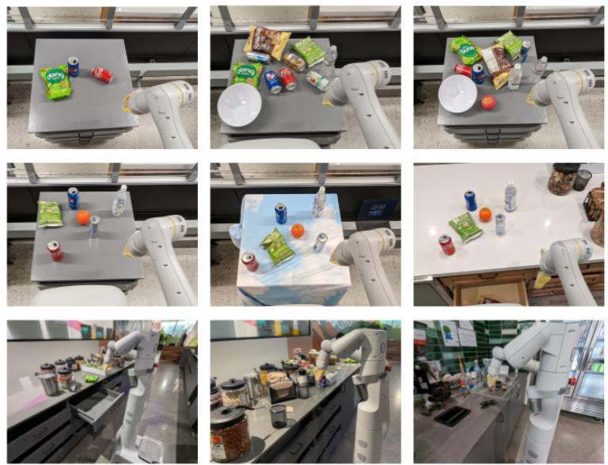  
图 4：干扰物的评估场景（第一行），从左至右依次为：简单（0‑5 个干扰物）、中等（9 个干扰物）、困难（9 个干扰物且物体被遮挡）；背景评估场景（第二行），从左至右依次为：原始环境、带图案的桌布、新厨房；以及真实厨房中的现实场景（第三行），泛化级别从左至右依次为： L1、L2和 L3。

## 6.2 RT‑1 能否学会执行大量指令，并泛化到新任务、新物体和新环境中？

为了回答我们的第一个问题，我们将 RT‑1 的整体性能、泛化和鲁棒性能力与先前提出的模型进行了对比分析。具体而言，我们对比了 Gato（Reed et al., 2022）和 BC‑Z（Jang et al.,2021）所使用的模型架构，以及 BC‑Z 的更大版本（我们称之为 BC‑Z XL）。但需要注意的是，所有模型均在与 RT‑1 相同的数据上进行训练，该评估仅对比模型架构，而非任务集、数据集或整体机器人系统。RT‑1 的能力在很大程度上取决于数据集和任务集，我们认为这相比先前的研究工作有了显著提升（例如 BC‑Z 使用了 100 个任务，而原始 Gato 模型训练的是包含各种形状的堆叠任务），因此这一对比应被视为对先前模型相当有利，因为它们同样受益于我们收集的大规模且多样化的数据集和任务集。

结果如表 2 所示。在各个类别中，我们发现 RT‑1 的表现均显著优于先前的模型。在已见任务上，RT‑1 能够成功执行 200 多条指

<table><tr><td>Model</td><td>Seen Tasks</td><td>Unseen Tasks</td><td>Distractors</td><td>Backgrounds</td></tr><tr><td>Gato (Reed et al., 2022)</td><td>65</td><td>52</td><td>43</td><td>35</td></tr><tr><td>BC-Z (Jang et al., 2021)</td><td>72</td><td>19</td><td>47</td><td>41</td></tr><tr><td>BC-Z XL</td><td>56</td><td>43</td><td>23</td><td>35</td></tr><tr><td>RT-1 (ours)</td><td>97</td><td>76</td><td>83</td><td>59</td></tr></table>

  
Table 2: Overall performance of RT-1 and baselines across seen tasks, generalization to unseen tasks, and robustness to distractors and backgrounds.

tions successfully, which is 25% more than BC-Z and 32% more than Gato. On unseen tasks, RT-1 shows it is capable of generalizing to novel instructions, performing 76% of the never-before-seen instructions, 24% more than the next best baseline. While such generalization to novel instructions is made possible due to natural language conditioning of the policy, as the policy is able to understand new combinations of previously seen concepts, all of the baselines are also conditioned on natural language and in principle enjoy the same benefits. We further ablate different components of RT-1 in the next section to better understand what aspects of our method contribute the most to this difference. On distractors and backgrounds, we find that RT-1 is quite robust, successfully executing 83% of the distractor robustness tasks and 59% of the background robustness tasks (36% and 18% higher than the next best alternative, respectively). Overall, we find that RT-1 has high general performance, while exhibiting impressive degrees of generalization and robustness. We show example trajectories of the RT-1 agent including instructions that cover different skills, environments and objects in Fig. 5. We also present additional trajectory examples for different generalization tests in the Appendix, which include backgrounds (Fig. 10), and distractors (Fig. 12).

Generalization to realistic instructions. Next, we test whether our method generalizes enough across all the different axes that we evaluated previously to be deployed in a real kitchen, which poses multiple distribution shifts all at once such as new tasks combinations, object distractors as well as a novel environment.

To evaluate our algorithm in realistic scenarios in a real kitchen, we construct task sequences to accomplish a number of realistic goals. The robot restocks several snacks in drawers, tidies up knocked over condiment bottles and closes drawers left open by humans, prepares a snack with an orange and a napkin and fetches lost sunglasses and an octopus toy from several places in the kitchen. The detailed instructions used in these scenarios are listed in the Appendix D.1. The office kitchen involves a dramatic shift from the training environment and we categorize tasks across these scenarios with varying levels of generalization: L1 for generalization to the new counter-top layout and lighting conditions, L2 for additionally generalization to unseen distractor objects, L3 for additional generalization to drastically new task settings, new task objects or objects in unseen locations such as near a sink. The three levels that correspond to the three tasks of restocking, preparing a snack and fetching a lost object in the real kitchen are depicted in the last row of Fig. 4. Example trajectories for different levels are presented in the Appendix in Fig. 11.

We report the per-task success rate in these realistic scenarios along with the varying generalization levels in Table 3 and find RT-1 to be the most robust on all levels. Gato generalizes fairly well at the first level but it performs significantly drops for the more difficult generalization scenarios. BC-Z and its XL equivalent perform fairly well at L2 level and better than Gato at L3 but they are still not at the generalization level of RT-1.

## 6.3 CAN WE PUSH THE RESULTING MODEL FURTHER BY INCORPORATING HETEROGENEOUS DATA SOURCES SUCH AS SIMULATION OR DATA FROM DIFFERENT ROBOTS?

Next, we explore the limits of RT-1 for utilizing highly heterogeneous data. We demonstrate how RT-1 can incorporate and learn from vastly different data sources and improve from such data without sacrificing its original-tasks performance across the varied tasks inherent in this data. To this end, we conduct two experiments: (1) RT-1 trained and tested on both real data and simulation data and (2)

<table><tr><td>模型</td><td>已见任务</td><td>未见任务</td><td>干扰物</td><td>背景</td><td></td></tr><tr><td>Gato (Reed et al., 2022)</td><td>65</td><td>52</td><td>43</td><td>35</td><td></td></tr><tr><td>BC-Z (Jang et al., 2021)</td><td>72</td><td>19</td><td>47</td><td>41</td><td></td></tr><tr><td>BC-Z XL</td><td>56</td><td>43</td><td>23</td><td>35</td><td></td></tr><tr><td>RT-I(我们的方法)</td><td>97</td><td>76</td><td>83</td><td>59</td><td></td></tr></table>

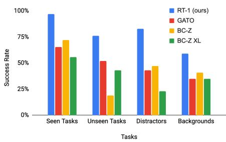  
表 2：RT‑1 与各基线在已见任务上的总体性能，对未见任务的泛化能力，以及对干扰物和背景的鲁棒性。

令中的 97%，比 BC‑Z 高出 25%，比 Gato 高出 32%。在未见任务上，RT‑1 表明其能够泛化到新指令，成功执行了 76% 前所未见的指令，比次优基线高出 24%。尽管这种对新指令的泛化得益于策略的自然语言条件化（因为策略能够理解先前已见概念的新组合），但所有基线同样采用了自然语言条件化，原则上享有相同的好处。我们在下一节中进一步对 RT‑1 的不同组件进行消融实验，以更好地理解我们方法的哪些方面对这一差异贡献最大。在干扰物和背景方面，我们发现 RT‑1 相当具有鲁棒性，成功执行了 83% 的干扰物鲁棒性任务和 59% 的背景鲁棒性任务（分别比次优方案高出 36% 和 18%）。总体而言，我们发现 RT‑1 具有出色的综合性能，同时展现出令人瞩目的泛化和鲁棒性水平。我们在图 5 中展示了 RT‑1 智能体的轨迹示例，包含涵盖不同技能、环境和物体的指令。我们还在附录中提供了针对不同泛化测试的额外轨迹示例，其中包括背景（图 10）和干扰物（图 12）。

对真实指令的泛化。接下来，我们测试我们的方法是否能在先前评估的所有不同维度上实现充分的泛化，从而能够部署在真实的厨房环境中。该环境同时带来了多重分布偏移，例如新的任务组合、干扰物体以及全新的环境。

为了在真实厨房的实际场景中评估我们的算法，我们构建了任务序列以实现若干实际目标。机器人将多种零食重新放回抽屉中，收拾被碰倒的调味瓶并关上人类敞开的抽屉，用一个橙子和一张餐巾纸准备点心，并从厨房的多个位置找回遗失的太阳镜和章鱼玩具。这些场景中使用的详细指令列于附录 D.1 中。办公室厨房相比训练环境存在巨大的偏移，我们将这些场景下的任务按不同的泛化层级进行分类： L1 用于对新台面布局和光照条件的泛化，L2 用于额外对未见干扰物体的泛化， L3用于额外对截然不同的新任务设置、新任务物体或未见位置（如水槽附近）物体的泛化。对应于真实厨房中补货、准备点心和取回遗失物体这三项任务的三个层级展示在图 4 的最后一行中。不同层级的示例轨迹展示在附录图11 中。

我们在表 3 中报告了这些现实场景下的单任务成功率以及不同的泛化级别，并发现 RT‑1在所有级别上都是最稳健的。Gato 在第一级别上泛化得相当好，但在更具难度的泛化场景中，其性能显著下降。BC‑Z 及其 XL 等效模型在L2级别表现相当不错，且在L3优于Gato，但它们仍未达到 RT‑1 的泛化级别。

## 6.3 我们能否通过整合诸如仿真或来自不同机器人的数据等异构数据源，进一步提升所得模型的性能？

接下来，我们探索 RT‑1 在利用高度异构数据方面的极限。我们展示了 RT‑1 如何整合并从截然不同的数据源中学习，并通过此类数据获得提升，同时不会在这些数据所固有的各种任务中牺牲其原始任务的性能。为此，我们进行了两项实验：(1) 在真实数据和仿真数据上训练并测试 RT‑1，以及 (2)

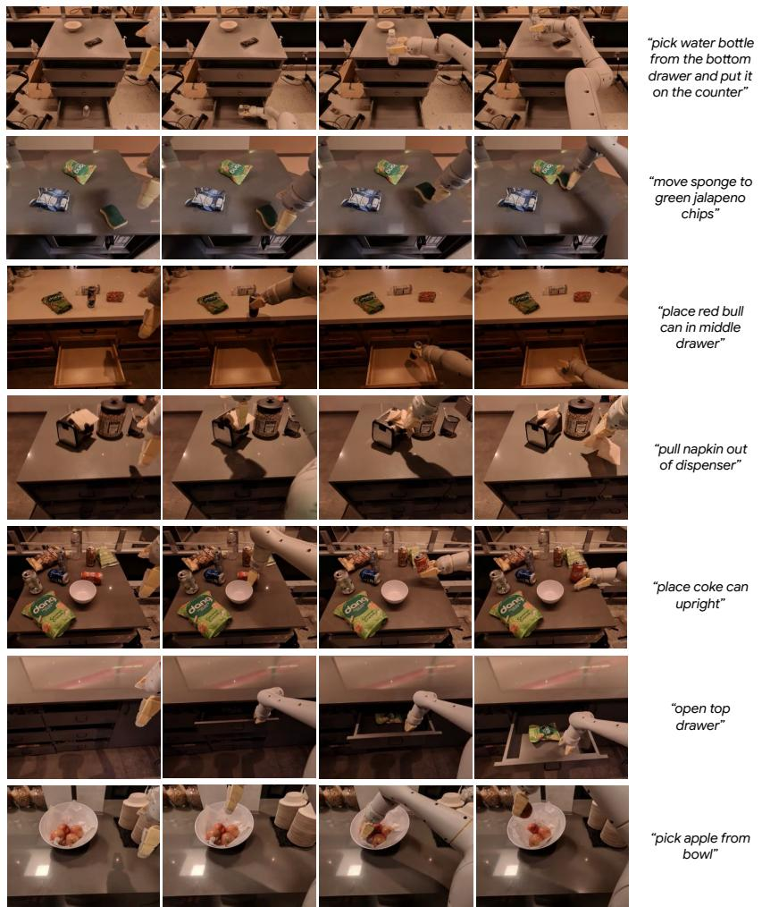  
Figure 5: Example evaluation trajectories for RT-1 across various instructions.

<table><tr><td rowspan="2">Models</td><td rowspan="2">All</td><td colspan="3">Generalization Scenario Levels</td></tr><tr><td>L1</td><td>L2</td><td>L3</td></tr><tr><td>Gato Reed et al. (2022)</td><td>30</td><td>63</td><td>25</td><td>0</td></tr><tr><td>BC-Z Jang et al. (2021)</td><td>45</td><td>38</td><td>50</td><td>50</td></tr><tr><td>BC-Z XL</td><td>55</td><td>63</td><td>75</td><td>38</td></tr><tr><td>RT-1 (ours)</td><td>70</td><td>88</td><td>75</td><td>50</td></tr></table>

  
Table 3: Realistic generalization scenarios: we compare model success rate in a realistic Google kitchen scenarios across three levels of generalization: L1 for generalization to the new counter-top layout and lighting conditions, L2 for additionally generalization to unseen distractor objects, L3 for additionally generalization to drastically new task settings, new task objects or in unseen locations like near a sink.

RT-1 trained across large datasets of different tasks, originally collected by different robots. More information on each is provided in Appendix D.2.

Absorbing simulation data. Table 4 shows the ability of RT-1, and baselines, to absorb both realand simulation data. To test this, we take all of the real demonstration data but we also provide ad-吸收仿真数据。表 4 展示了 RT‑1 以及基线吸收真实数据与仿真数据的能力。为了对此进行测试，我们采用了全部真实演示数据，但我们也提供了额

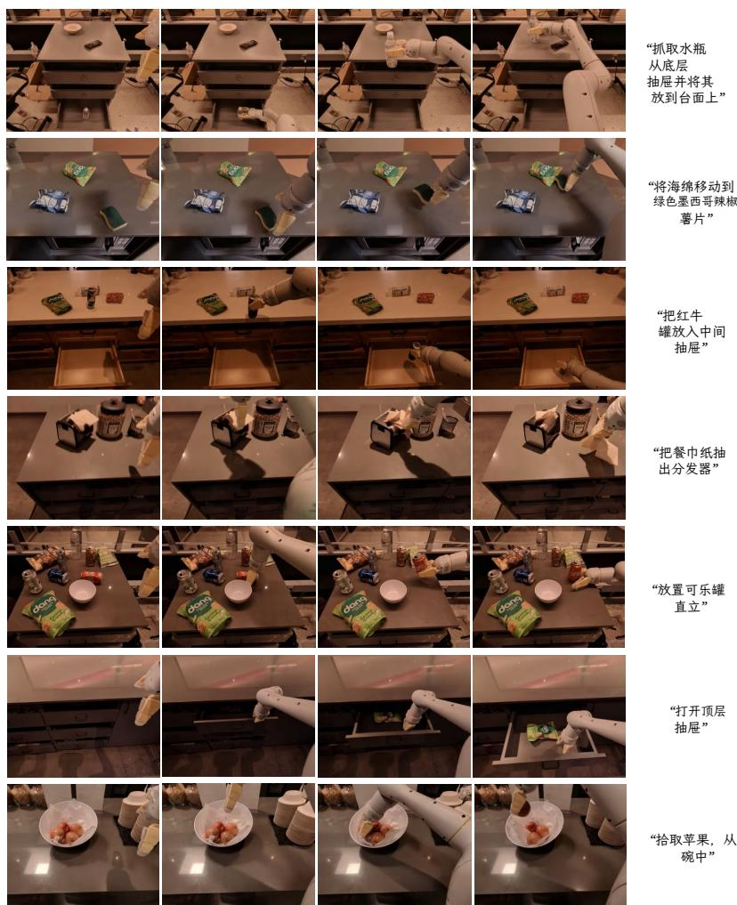  
图 5：RT‑1 在各种指令下的示例评估轨迹。

<table><tr><td rowspan="2">模型</td><td rowspan="2">All</td><td colspan="3">泛化场景级别</td></tr><tr><td>L1</td><td>L2</td><td>L3</td></tr><tr><td>Gato Reed 等人 (2022) 30</td><td></td><td>63</td><td>25</td><td>0</td></tr><tr><td>BC-Z Jang 等人 (2021) 45</td><td></td><td>38</td><td>50</td><td>50</td></tr><tr><td>BC-Z XL</td><td>55</td><td>63</td><td>75</td><td>38</td></tr><tr><td>RT-1(我们的)</td><td>70</td><td>88</td><td>75</td><td>50</td></tr></table>

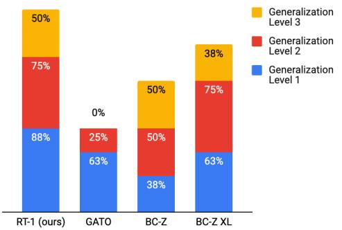  
表 3：真实泛化场景：我们在真实的Google厨房场景中比较了三个泛化级别的模型成功率： L1泛化到新的台面布局和光照条件， L2额外泛化到未见过的干扰物体， L3额外泛化到全新任务设置、新任务物体或水槽附近等未见过的位置。  
RT-1 在最初由不同机器人收集的不同任务的大型数据集上进行训练。更 einfo有关各项的详细信息在附录 D.2 中提供。

<table><tr><td rowspan="2">Models</td><td rowspan="2">Training Data</td><td>Real Objects</td><td colspan="2">Sim Objects (not seen in real)</td></tr><tr><td>Seen Skill w/ Objects</td><td>Seen Skill w/ Objects</td><td>Unseen Skill w/ Objects</td></tr><tr><td>RT-1</td><td>Real Only</td><td>92</td><td>23</td><td>7</td></tr><tr><td>RT-1</td><td>Real + Sim</td><td>90(-2)</td><td>87(+64)</td><td>33(+26)</td></tr></table>

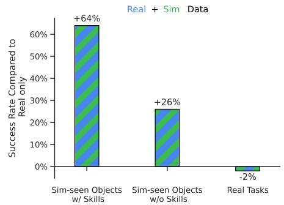  
Table 4: Experimental results for incorporating simulation data in RT-1. Adding simulation data does not impact the performance on real objects, while significantly improving real performance on objects that were only introduced in simulation (+64%). It also improves real-world generalization on simulated objects used with skills seen only in the real world (+26%), e.g. “move X to Y” where X only appeared in simulated “pick X” task.

ditional simulation data that includes objects that the robot has never seen in the real world. Specifically, we specify different generalization scenarios: for seen skills with real objects the training data has real data of that instruction (i.e., performance on seen tasks), for seen skills with sim objects the training data has sim data of that instruction (e.g. “pick up a sim object”, which was present in sim), and for unseen skills with sim objects the training data has sim data of that object but there are no examples of the instruction describing the skill with that object either in sim or in real (e.g., “move a sim object to apple”, even though the robot has only practiced in picking that sim object and not moving it near other objects). All evaluations are done in the real world but to limit the number of instructions evaluated, we focus on pick and move-to skills.

We find in Table 4 that for RT-1, we do not lose performance adding simulation data compared to the Real Only dataset. We do however, see a significant increase in performance (from 23% to 87%) on objects and tasks seen only in simulation, to approximately the performance of the those in real, demonstrating an impressive degree of domain transfer. We also see a significant increase in performance on unseen instructions from 7% to 33%; impressive given the object in question has never been seen in real and the instruction never seen at all. Overall, we find that RT-1 is able to efficiently absorb new data, even from a very different domain.

Absorbing data from different robots. To push the data absorption limits of RT-1, we conduct an additional set of experiments where we combine two data sources that originate from different robots: Kuka IIWA as well as the Everyday Robots mobile manipulators used in the experiments so far. The Kuka data contains all the successful examples collected in QT-Opt (Kalashnikov et al., 2018), which corresponds to 209k episodes, where the robot was indiscriminately grasping objects in a bin (see an example of a Kuka episode in Table. 5). To test whether RT-1 can effectively absorb these two very different datasets, which we refer to as the standard “Classroom eval”, as well as the performance on the newly constructed tasks that reflect the bin-picking setup present in the Kuka data, which we refer to as the “Bin-picking eval” (see Fig. 6).

We would like to emphasize the difficulty of this setting by noting the major differences between the datasets. Not only are the robots that collected the data different in appearance and action space, but also the environment they were deployed in has different appearance and dynamics. In addition the QT-Opt data presents a completely different action distribution – it was collected by an RL agent as opposed to human demonstrations present in our dataset.

The results are presented in Table 5. We observe that the model that mixes the RT-1 data and the Kuka data has only a minimal decrease in the original tasks’ performance (i.e. Classroom eval), i.e. 2%. Even more importantly, in the Bin-picking eval, we observe that the model trained on multirobot data performs at 39% compared to the 22% of the model that was trained only on the RT-1 data. This is a 17% performance difference (almost 2x). Additionally, RT-1 trained on Kuka bin-picking data and evaluated on the bin-picking tasks with the Everyday Robots (EDR) robot achieves 0% performance, confirming that it is difficult to transfer a behavior from another robot morphology. However, mixing the data from both robots allows RT-1 to infer the correct actions of the EDR 表 4：在 RT‑1 中结合仿真数据的实验结果。添加仿真数据不会影响在真实物体上的性能， 同时显著提升了仅在仿真中引入的物体上的真实性能（+64%）。它还提高了将仿真物体与 仅在真实世界中见过的技能结合使用时的真实世界泛化（+26%），例如“将 X 移到 Y”， 其中 X 仅出现在仿真的“抓取 X”任务中。

<table><tr><td rowspan="2" colspan="2">模型训练数据</td><td>真实物体</td><td colspan="2">仿真物体(真实环境中未见)</td></tr><tr><td>已见技能含物体</td><td>已见技能含物体</td><td>未见技能含物体</td></tr><tr><td>RT-1</td><td>仅真实</td><td>92</td><td>23</td><td>7</td></tr><tr><td>RT-1</td><td>真实+仿真</td><td> $^{90(-2)}$ </td><td>87(+64)</td><td>33(+26)</td></tr></table>

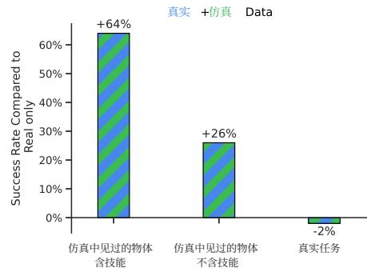

外的仿真数据，其中包括机器人在真实世界中从未见过的物体。具体而言，我们指定了不同的泛化场景：对于真实物体的已见技能 ，训练数据包含该指令的真实数据（即在已见任务上的表现）；对于仿真物体的已见技能 ，训练数据包含该指令的仿真数据（例如“抓取仿真物体”，这曾出现在仿真中）；而对于仿真物体的未见技能 ，训练数据包含该物体的仿真数据，但在仿真或真实环境中均没有描述针对该物体的技能指令示例（例如“将仿真物体移动到苹果”，尽管机器人仅练习过抓取该仿真物体，而没有将其移动到其他物体附近）。所有评估均在真实世界中进行，但为了限制所评估的指令数量，我们重点关注抓取和移近技能。

我们在表 4 中发现，与 Real Only 数据集相比，RT‑1 在添加仿真数据后性能并未下降。然而，我们确实看到在仅于仿真中见过的物体和任务上，性能显著提高（从 23% 提升至 87%），大致达到真实环境中的性能水平，展现出了令人瞩目的领域迁移能力。我们还看到未见指令上的性能从 7% 显著提升至 33%；鉴于所涉及的物体从未在真实环境中见过，且该指令也从未见过，这一结果令人印象深刻。总体而言，我们发现 RT‑1 能够高效吸收新数据，即便这些数据来自截然不同的领域。

吸收来自不同机器人的数据。为了探索 RT‑1 的数据吸收极限，我们进行了一组额外的实验，结合了来自不同机器人的两个数据源：Kuka IIWA 以及迄今为止在实验中使用的Everyday Robots 移动操作机。Kuka 数据包含在 QT‑Opt（Kalashnikov 等人，2018 年）中收集的所有成功示例，对应 209k 个回合，其中机器人不加区分地抓取料箱中的物体（Kuka 回合示例见表 5）。为了测试 RT‑1 是否可以有效吸收这两个截然不同的数据集，我们测试了其在我们称之为标准“Classroom 评估”上的表现，以及在反映 Kuka 数据中料箱抓取设置的新构建任务（我们称之为“Bin‑picking 评估”，见图 6）上的表现。我们希望通过指出数据集之间的主要差异来强调这种设置的难度。不仅收集数据的机器人在外观和动作空间上有所不同，而且它们所部署的环境在外观和动力学特性上也存在差异。此外，QT‑Opt 数据呈现出完全不同的动作分布——它是由强化学习智能体收集的，而不是我们数据集中呈现的人类示范。

结果如表 5 所示。我们观察到，混合了 RT‑1 数据和 Kuka 数据的模型在原始任务的性能（即Classroom 评估）上仅有极小的下降，即 2%。更重要的是，在 Bin‑picking 评估中，我们观察到在多机器人数据上训练的模型性能达到 39%，相比之下，仅在 RT‑1 数据上训练的模型为 22%。这是 17% 的性能差异（接近 2 倍）。此外，在 Kuka 料箱抓取数据上训练并在 Everyday Robots(EDR) 机器人上进行料箱抓取任务评估的 RT‑1 达到了 0% 的性能，这证实了很难从另一种机器人形态迁移行为。然而，混合来自这两种机器人的数据使得 RT‑1 能够推断 EDR

  
Figure 6: In Table 5, RT-1 is trained with data from two robotics platforms and learns to generalize across them.

<table><tr><td>Models</td><td>Training Data</td><td>Classroom eval</td><td>Bin-picking eval</td></tr><tr><td>RT-1</td><td>Kuka bin-picking data + EDR data</td><td>90(-2)</td><td>39(+17)</td></tr><tr><td>RT-1</td><td>EDR only data</td><td>92</td><td>22</td></tr><tr><td>RT-1</td><td>Kuka bin-picking only data</td><td>0</td><td>0</td></tr></table>

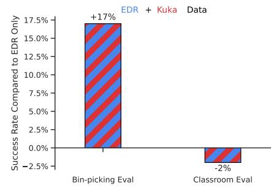  
Table 5: Experimental results for mixing data from two different robots. Incorporating Kuka binpicking data from QT-Opt (Kalashnikov et al., 2018) in RT-1 minimally impacts the standard classroom evaluation performance and results in almost a 2x improvement in generalization to the Binpicking evaluation (that is similar to the setup in the Kuka data) on the Everyday Robots manipulator. This demonstrates an effective transfer across two different robot morphologies.

robot even when faced with the states observed by Kuka robots. This is achieved without explicit demonstrations of bin-picking on EDR robot and by taking advantage of past experiences collected by Kuka robots. These results indicate that RT-1’s absorption properties also include the ability to acquire new skills through observing other robots’ experiences and present an exciting avenue of future work where we combine many more multi-robot datasets to enhance the robot capabilities.

## 6.4 HOW DO VARIOUS METHODS GENERALIZE LONG-HORIZON ROBOTIC SCENARIOS?

In the next set of experiments we evaluate whether our method generalizes enough to be used in long-horizon realistic kitchen settings. To answer this question, we execute RT-1 and various baselines within the SayCan (Ahn et al., 2022) framework in two different real kitchens. Since SayCan combines many low-level instructions to perform high-level instructions, the number of possible high-level instructions increases combinatorially with skills, so the skill-breadth of RT-1 can be fully seen (for more details on the SayCan algorithm please refer to Ahn et al. (2022)). The success rate of long-horizon tasks also decreases exponentially with the length of the task, so high success rates in manipulation skills are particularly important. Furthermore, as mobile manipulation tasks require both navigation and manipulation, the policies ability to be robust to base position is crucial. More detail is provided in Appendix D.3.

Table 6 shows our results (on instructions in Appendix Table 12). Except for original SayCan, all methods get 87% as planning success rate, and RT-1 performs the best, with 67% execution success rate in Kitchen1. Kitchen2 constitutes a much more challenging generalization scene, since the Robot Classroom training scenes are modeled after Kitchen1 (see the pictures of the kitchens in Fig. 2). Due to this generalization difficulty, SayCan with Gato is not able to finish any long horizon task, and SayCan with BC-Z is able to achieve a success rate of 13%. The original SayCan paper did not evaluate performance in a new kitchen. Surprisingly, the manipulation performance does not (Kalashnikov et al., 2018) 的 Kuka 料箱抓取数据，对标准教室评估性能的影响极小，并 使 Everyday Robots机械臂在料箱抓取评估（类似于 Kuka 数据中的设置）中的泛化表现 提升了近 2 倍。这证明了跨两种不同机器人形态的有效迁移。

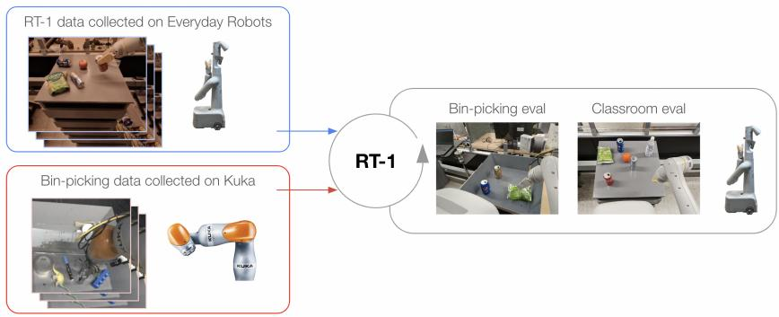  
图 6：在表 5 中，RT‑1 使用来自两个机器人平台的数据进行训练，并学会跨平台泛化。

<table><tr><td>模型</td><td>训练数据</td><td colspan="2">Classroom 评估 Bin-picking 评估</td></tr><tr><td>RT-1</td><td>Kuka 料箱抓取数据 +EDR 数据</td><td>90(-2)</td><td>39(+17)</td></tr><tr><td>RT-1</td><td>仅 EDR 数据</td><td>92</td><td>22</td></tr><tr><td>RT-1</td><td>仅 Kuka 料箱抓取数据</td><td>0</td><td>0</td></tr></table>

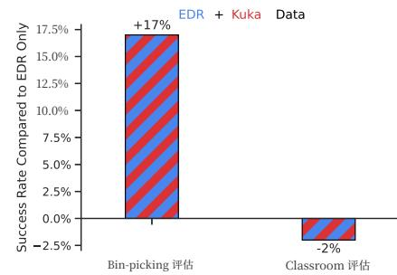  
表 5：混合来自两种不同机器人的数据的实验结果。在 RT‑1 中引入来自 QT‑Opt

机器人的正确动作，即使面对 Kuka 机器人观测到的状态时也是如此。这是在无需对 EDR机器人 进行显式料箱抓取演示的情况下，通过利用 Kuka 机器人收集的过往经验实现的。这些结果表明，RT‑1 的吸收特性还包括通过观察其他机器人的经验来获取新技能的能力，并为未来工作指明了一个令人兴奋的方向，即结合更多的多机器人数据集来增强机器人的能力。

## 6.4 各种方法在长时程机器人场景中的泛化表现如何？

在下一组实验中，我们评估了我们的方法是否具有足够的泛化能力以用于长程真实厨房环境。为了回答这个问题，我们在两个不同的真实厨房中，在 SayCan（Ahn 等人，2022）框架下运行了 RT‑1 和各种基线方法。由于 SayCan 结合了多个底层指令来执行高层指令，可能的高层指令数量会随技能呈组合式增长，从而可以充分展现 RT‑1 的技能广度（有关SayCan 算法的更多细节，请参阅 Ahn 等人（2022））。长程任务的成功率还会随着任务长度呈指数级下降，因此操作技能的高成功率尤为重要。此外，由于移动操作任务同时需要导航和操作，策略对底座位置的鲁棒性至关重要。更多细节请参见附录 D.3。

表 6 显示了我们的结果（针对附录表 12 中的指令）。除原始 SayCan 外，所有方法的规划成功率均达到 87%，且 RT‑1 表现最佳，在 Kitchen1 中的执行成功率为 67%。Kitchen2 构成了一个更具挑战性的泛化场景，因为机器人教室的训练场景是仿照 Kitchen1 建模的（参见图 2 中的厨房图片）。由于这种泛化难度，结合 Gato 的 SayCan 无法完成任何长程任务，而结合 BC‑Z 的 SayCan 能够达到 13% 的成功率。原始 SayCan 论文并未在新厨房中评估性能。令人惊讶的是，操作性能并没有

see a visible drop from Kitchen1 to Kitchen2 for our method. In the supplementary video, we show that this enables us to operate unseen drawers in Kitchen2, and that we can use SayCan-RT1 to plan and execute ultra-long horizon tasks, with as many as 50 steps.

<table><tr><td rowspan="2"></td><td colspan="2">SayCan tasks in Kitchen1</td><td colspan="2">SayCan tasks in Kitchen2</td></tr><tr><td>Planning</td><td>Execution</td><td>Planning</td><td>Execution</td></tr><tr><td>Original SayCan (Ahn et al., 2022)*</td><td>73</td><td>47</td><td>-</td><td>-</td></tr><tr><td>SayCan w/ Gato (Reed et al., 2022)</td><td>87</td><td>33</td><td>87</td><td>0</td></tr><tr><td>SayCan w/ BC-Z (Jang et al., 2021)</td><td>87</td><td>53</td><td>87</td><td>13</td></tr><tr><td>SayCan w/ RT-1 (ours)</td><td>87</td><td>67</td><td>87</td><td>67</td></tr></table>

Table 6: SayCan style long horizon tasks in Kitchen1 and Kitchen2. (\*Original SayCan eval uses a slightly different prompt so the planning success rate is lower.)

## 6.5 HOW DO GENERALIZATION METRICS CHANGE WITH VARYING AMOUNTS OF DATA QUANTITY AND DATA DIVERSITY?

While previous works have shown the scaling abilities of Transformer-based models (Lee et al., 2022a; Reed et al., 2022; Jiang et al., 2022) with the number of model parameters, in many robotics works the model size is often not the primary bottleneck, and the maximum size is limited by the latency requirement for running such models on real robots. Instead, in this study we focus on ablating the influence of dataset size and diversity, as they play an important role in the traditionally data-limited robot learning field. Since data collection is particularly expensive for real robots, it is important to quantify what kind of data our models need to achieve a certain performance and generalization. Thus, our last question focuses on the scaling properties of RT-1 with different data properties.

<table><tr><td rowspan="2">Models</td><td rowspan="2">% Tasks</td><td rowspan="2">% Data</td><td rowspan="2">Seen Tasks</td><td colspan="4">Generalization</td></tr><tr><td>All</td><td>Unseen Tasks</td><td>Distractors</td><td>Backgrounds</td></tr><tr><td colspan="8">Smaller Data</td></tr><tr><td>RT-1 (ours)</td><td>100</td><td>100</td><td>97</td><td>73</td><td>76</td><td>83</td><td>59</td></tr><tr><td>RT-1</td><td>100</td><td>51</td><td>71</td><td>50</td><td>52</td><td>39</td><td>59</td></tr><tr><td>RT-1</td><td>100</td><td>37</td><td>55</td><td>46</td><td>57</td><td>35</td><td>47</td></tr><tr><td>RT-1</td><td>100</td><td>22</td><td>59</td><td>29</td><td>14</td><td>31</td><td>41</td></tr><tr><td colspan="8">Narrower Data</td></tr><tr><td>RT-1 (ours)</td><td>100</td><td>100</td><td>97</td><td>73</td><td>76</td><td>83</td><td>59</td></tr><tr><td>RT-1</td><td>75</td><td>97</td><td>86</td><td>54</td><td>67</td><td>42</td><td>53</td></tr></table>

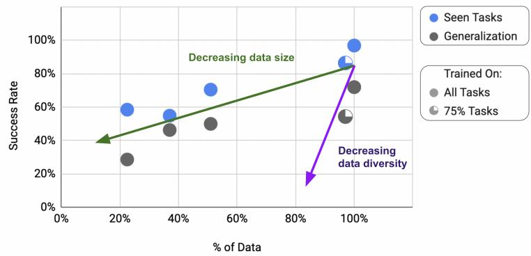  
Table 7: Various data ablations of RT-1 across seen tasks, generalization to unseen tasks, and robustness to distractors and backgrounds. Data diversity has a higher impact on the performance and generalization than data quantity.

In Table 7 we show the performance, generalization, and robustness of RT-1 as we decrease the dataset size (% data) and the dataset diversity (% tasks). To separate the axes of dataset size and diversity, we create smaller datasets with the same task diversity by removing data from the tasks with the largest data, capping the number of examples per task at 200 (resulting in 51% of the data), 可以看到我们的方法从 Kitchen1 到 Kitchen2 出现了明显的下降。在补充视频中，我们展示了这使我们 能够在 Kitchen2 中操作未见过的抽屉，并且我们可以使用 SayCan‑RT1 来规划并执行多达 50 步的超长 时程任务。

<table><tr><td rowspan="2"></td><td colspan="2">Kitchen1 中的 SayCan 任务</td><td colspan="2">Kitchen2 中的 SayCan 任务</td></tr><tr><td>规划</td><td>执行</td><td>规划</td><td>执行</td></tr><tr><td>原始 SayCan (Ahn et al., 2022)*</td><td>73</td><td>47</td><td>-</td><td>-</td></tr><tr><td>SayCan 结合 Gato (Reed et al., 2022)</td><td>87</td><td>33</td><td>87</td><td>0</td></tr><tr><td>SayCan 结合 BC-Z (Jang et al., 2021)</td><td>87</td><td>53</td><td>87</td><td>13</td></tr><tr><td>SayCan 结合 RT-1(本文方法)</td><td>87</td><td>67</td><td>87</td><td>67</td></tr></table>

表 6：Kitchen1 和 Kitchen2 中的 SayCan 风格长程任务。（\*原始 SayCan 评估使用了略有不同的提示词，因此规划成功率更低。）

## 6.5 泛化指标如何随着数据量和数据多样性的变化而变化？

虽然先前的研究展示了基于Transformer的模型（Lee et al., 2022a; Reed et al., 2022;Jiang et al., 2022）随模型参数量的扩展能力，但在许多机器人学工作中，模型大小往往不是主要瓶颈，其最大尺寸受到在真实机器人上运行此类模型的延迟要求的限制。相反，在本研究中，我们专注于消融数据集规模和多样性的影响，因为它们在传统上数据受限的机器人学习领域中发挥着重要作用。由于真实机器人的数据收集尤为昂贵，因此量化我们的模型需要何种数据以达到一定的性能和泛化能力至关重要。因此，我们的最后一个问题聚焦于 RT‑1 在不同数据特性下的扩展特性。

<table><tr><td rowspan="2">模型</td><td rowspan="2" colspan="2">%任务 %数据</td><td rowspan="2">已见任务</td><td colspan="4">泛化</td></tr><tr><td>全部</td><td>未见任务</td><td>干扰物</td><td>背景</td></tr><tr><td>较小数据量RT-1(本方法)</td><td>100</td><td>100</td><td>97</td><td>73</td><td>76</td><td>83</td><td>59</td></tr><tr><td>RT-1</td><td>100</td><td>51</td><td>71</td><td>50</td><td>52</td><td>39</td><td>59</td></tr><tr><td>RT-1</td><td>100</td><td>37</td><td>55</td><td>46</td><td>57</td><td>35</td><td>47</td></tr><tr><td>RT-1</td><td>100</td><td>22</td><td>59</td><td>29</td><td>14</td><td>31</td><td>41</td></tr><tr><td>较窄数据RT-1(本方法)</td><td>100</td><td>100</td><td>97</td><td>73</td><td>76</td><td>83</td><td>59</td></tr><tr><td>RT-1</td><td>75</td><td>97</td><td>86</td><td>54</td><td>67</td><td>42</td><td>53</td></tr></table>

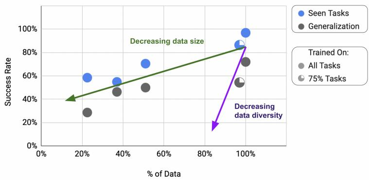  
表 7：RT‑1 在已见任务、对未见任务的泛化以及对干扰物和背景的鲁棒性方面的各种数据消融实验。数据多样性对性能和泛化的影响大于数据量。

在表 7 中，我们展示了随着我们缩减数据集规模（数据占比 %）和数据集多样性（任务占比 %），RT‑1 的性能、泛化和鲁棒性。为了区分数据集规模和多样性这两个维度，我们通过从数据量最大的任务中移除数据，创建了具有相同任务多样性的更小数据集，并将每个任务的样本数量上限限制为 200（产生 51% 的数据），

100 (37% of the data), and 50 (22.5% of the data). To create a narrow dataset, we remove the tasks with the least data, thus keeping 97% of the overall data but only 75% of the tasks. As we decrease dataset size, we see a general trend of decreasing performance and a steeper trend of decreasing generalization. As we make the dataset more narrow, we see much steeper performance reductions, particularly in terms of generalization. In fact, removing 25% of the tasks while keeping 97% of the data achieves an equivalent generalization performance to reducing the dataset size by as much as 49%. Our key takeaway is thus that data diversity is more essential than data quantity.

## 7 CONCLUSIONS, LIMITATIONS AND FUTURE WORK

We presented Robotics Transformer 1, RT-1, a robot learning method that can effectively absorb large amounts of data and scales with data quantity and diversity. We trained RT-1 on a large dataset of demonstrations containing over 130k episodes collected over the course of 17 months with 13 robots. In our broad set of experiments, we demonstrated that our method that can perform over 700 instructions at 97% success rate and effectively generalize to new tasks, objects and environments better than previously published baselines. We also demonstrated that RT-1 can successfully absorb heterogeneous data from simulation and other robot morphologies without sacrificing original-tasks performance and while improving generalization to new scenarios. Lastly, we showed how this level of performance and generalization allowed us to execute very long-horizon tasks in the SayCan (Ahn et al., 2022) framework, with as many as 50 steps.

While RT-1 presents a promising step towards large-scale robot learning with an data-absorbent model, it comes with a number of limitations. First, it is an imitation learning method, which inherits the challenges of that class of approaches such as the fact that it may not be able to surpass the performance of the demonstrators. Second, the generalization to new instructions is limited to the combinations of previously seen concepts and RT-1 is not yet able to generalize to a completely new motion that has not been seen before. Lastly, our method is presented on a large but not very dexterous set of manipulation tasks. We plan to continue extending the set of instructions that RT-1 enables and generalizes to to address this challenge.

As we explore future directions for this work, we hope to scale the number of robot skills faster by developing methods that allow non-experts to train the robot via directed data collection and model prompting. While the current version of RT-1 is fairly robust especially to distractor objects, its robustness to backgrounds and environments could be further improved by greatly increasing the environment diversity. We also hope to improve the reaction speeds and context retention of RT-1 through scalable attention and memory.

To allow the research community to build on top of this work, we have open-sourced the code for RT-1<sup>4</sup>, which we hope will provide researchers with a valuable resource for future research for scaling up robot learning.

## ACKNOWLEDGMENTS

We would like to acknowledge Aleksandra Faust, Andy Christiansen, Chuyuan Fu, Daniel Kappler, David Rendleman, Eric Jang, Jessica Gomez, Jessica Lin, Jie Tan, Josh Weaver, Justin Boyd, Krzysztof Choromanski, Matthew Bennice, Mengyuan Yan, Mrinal Kalakrishnan, Nik Stewart, Paul Wohlhart, Peter Pastor, Pierre Sermanet, Wenlong Lu, Zhen Yu Song, Zhuo Xu, and the greater teams at Robotics at Google and Everyday Robots for their feedback and contributions.

## REFERENCES

Michael Ahn, Anthony Brohan, Noah Brown, Yevgen Chebotar, Omar Cortes, Byron David, Chelsea Finn, Keerthana Gopalakrishnan, Karol Hausman, Alex Herzog, et al. Do as I can, not as I say: Grounding language in robotic affordances. arXiv preprint arXiv:2204.01691, 2022.

Daniel Cer, Yinfei Yang, Sheng-yi Kong, Nan Hua, Nicole Limtiaco, Rhomni St John, Noah Constant, Mario Guajardo-Cespedes, Steve Yuan, Chris Tar, et al. Universal sentence encoder. arXiv preprint arXiv:1803.11175, 2018.

100（占数据的 37%）以及 50（占数据的 22.5%）。为了构建一个窄数据集，我们移除了数据量最少的任务，从而保留了 97% 的总体数据，但仅保留了 75% 的任务。随着我们缩减数据集规模，我们观察到性能整体呈下降趋势，而泛化下降的趋势则更为陡峭。随着我们让数据集变得更窄，我们观察到性能下降更为急剧，尤其是在泛化方面。事实上，在保留 97% 数据的同时移除 25% 的任务，所达到的泛化性能与将数据集规模缩减高达 49% 相当。因此，我们的核心结论是数据多样性比数据量更为关键。

## 7 结论、局限性与未来工作

我们提出了 Robotics Transformer 1（即 RT‑1），这是一种能够有效吸收海量数据并随着数据量和多样性扩展的机器人学习方法。我们在一个庞大的演示数据集上训练了 RT‑1，该数据集包含由 13 台机器人历时 17 个月收集的超过 13 万个回合。在广泛的实验中，我们证明了我们的方法能以 97% 的成功率执行 700 多条指令，并且能比先前发表的基线更有效地泛化到新任务、新物体和新环境中。我们还展示了 RT‑1 可以成功吸收来自仿真和其他机器人形态的异构数据，且在不牺牲原始任务性能的同时提升对新场景的泛化能力。最后，我们展示了这种水平的性能和泛化能力如何让我们能够在 SayCan (Ahn et al., 2022) 框架中执行长达 50 个步骤的超长时程任务。

尽管 RT‑1 展现了利用吸收模型迈向大规模机器人学习的有前景的一步，但它也存在一些局限性。首先，它是一种模仿学习方法，继承了此类方法的固有挑战，例如可能无法超越演示者的表现。其次，对新指令的泛化局限于之前见过的概念组合，RT‑1 尚无法泛化到之前从未见过的全新动作。最后，我们的方法是在一个庞大但灵巧度不高的操作任务集上展示的。我们计划继续扩展 RT‑1 所支持并能泛化到的指令集，以应对这一挑战。

在探索这项工作的未来方向时，我们希望通过开发使非专业人员能够通过定向数据收集和模型提示来训练机器人的方法，更快地扩展机器人技能的数量。虽然当前版本的 RT‑1 具有相当好的鲁棒性（尤其是对干扰物体），但通过大幅增加环境多样性，其对背景和环境的鲁棒性还可以进一步提高。我们还希望通过可扩展注意力机制和记忆来提升 RT‑1 的反应速度和上下文保留能力。

为了让研究界能够在此工作的基础上开展研究，我们开源了 RT‑14, 的代码，我们希望这能为研究人员今后开展扩展机器人学习规模的研究提供宝贵的资源。

## 致谢

我们要感谢 Aleksandra Faust、Andy Christiansen、Chuyuan Fu、Daniel Kap‑ pler、DavidRendleman、Eric Jang、Jessica Gomez、Jessica Lin、Jie Tan、Josh Weaver、Justin Boyd、KrzysztofChoromanski、MatthewBennice、Mengyuan Yan、MrinalKalakrishnan、NikStewart、Paul Wohlhart、Peter Pastor、Pierre Sermanet、Wenlong Lu、Zhen Yu Song、Zhuo Xu，以及Robotics at Google 和 Everyday Robots 的广大团队所提供的反馈和贡献。

## 参考文献

Michael Ahn, Anthony Brohan, Noah Brown, Yevgen Chebotar, Omar Cortes, Byron David,Chelsea Finn, Keerthana Gopalakrishnan, Karol Hausman, Alex Herzog 等。按我能做的做，而非按我说的做：将语言植根于机器人可供性。arXiv 预印本 arXiv:2204.01691，2022。

Daniel Cer, Yinfei Yang, Sheng‑yi Kong, Nan Hua, Nicole Limtiaco, Rhomni St John, Noah Con‑ stant, Mario Guajardo‑Cespedes, Steve Yuan, Chris Tar, et al. Universal Sentence Encoder. arXiv预印本 arXiv:1803.11175, 2018.

Lili Chen, Kevin Lu, Aravind Rajeswaran, Kimin Lee, Aditya Grover, Misha Laskin, Pieter Abbeel, Aravind Srinivas, and Igor Mordatch. Decision transformer: Reinforcement learning via sequence modeling. Advances in neural information processing systems, 34:15084–15097, 2021.

Michael Jae-Yoon Chung, Abram L Friesen, Dieter Fox, Andrew N Meltzoff, and Rajesh PN Rao. A bayesian developmental approach to robotic goal-based imitation learning. PloS one, 10(11): e0141965, 2015.

Sudeep Dasari, Frederik Ebert, Stephen Tian, Suraj Nair, Bernadette Bucher, Karl Schmeckpeper, Siddharth Singh, Sergey Levine, and Chelsea Finn. Robonet: Large-scale multi-robot learning. In Conference on Robot Learning, 2019.

Marc Peter Deisenroth, Peter Englert, Jan Peters, and Dieter Fox. Multi-task policy search for robotics. In 2014 IEEE international conference on robotics and automation (ICRA), pp. 3876– 3881. IEEE, 2014.

Coline Devin, Abhishek Gupta, Trevor Darrell, Pieter Abbeel, and Sergey Levine. Learning modular neural network policies for multi-task and multi-robot transfer. In 2017 IEEE international conference on robotics and automation (ICRA), pp. 2169–2176. IEEE, 2017.

Miroslav Dud´ık, John Langford, and Lihong Li. Doubly robust policy evaluation and learning. arXiv preprint arXiv:1103.4601, 2011.

Frederik Ebert, Yanlai Yang, Karl Schmeckpeper, Bernadette Bucher, Georgios Georgakis, Kostas Daniilidis, Chelsea Finn, and Sergey Levine. Bridge data: Boosting generalization of robotic skills with cross-domain datasets. arXiv preprint arXiv:2109.13396, 2021.

Kuan Fang, Alexander Toshev, Li Fei-Fei, and Silvio Savarese. Scene memory transformer for embodied agents in long-horizon tasks. In Proceedings ofthe IEEE/CVF Conference on Computer Vision and Pattern Recognition, pp. 538–547, 2019.

Roy Fox, Ron Berenstein, Ion Stoica, and Ken Goldberg. Multi-task hierarchical imitation learning for home automation. In 2019 IEEE 15th International Conference on Automation Science and Engineering (CASE), pp. 1–8. IEEE, 2019.

Abhinav Gupta, Adithyavairavan Murali, Dhiraj Prakashchand Gandhi, and Lerrel Pinto. Robot learning in homes: Improving generalization and reducing dataset bias. Advances in neural information processing systems, 31, 2018.

Agrim Gupta, Linxi Fan, Surya Ganguli, and Li Fei-Fei. Metamorph: Learning universal controllers with transformers. arXiv preprint arXiv:2203.11931, 2022.

Josiah P Hanna, Peter Stone, and Scott Niekum. Bootstrapping with models: Confidence intervals for off-policy evaluation. In Thirty-First AAAI Conference on Artificial Intelligence, 2017.

Daniel Ho, Kanishka Rao, Zhuo Xu, Eric Jang, Mohi Khansari, and Yunfei Bai. RetinaGAN: An object-aware approach to sim-to-real transfer, 2020. URL https://arxiv.org/abs/ 2011.03148.

De-An Huang, Yu-Wei Chao, Chris Paxton, Xinke Deng, Li Fei-Fei, Juan Carlos Niebles, Animesh Garg, and Dieter Fox. Motion reasoning for goal-based imitation learning. In 2020 IEEE International Conference on Robotics and Automation (ICRA), pp. 4878–4884. IEEE, 2020.

Alexander Irpan, Kanishka Rao, Konstantinos Bousmalis, Chris Harris, Julian Ibarz, and Sergey Levine. Off-policy evaluation via off-policy classification. Advances in Neural Information Processing Systems, 32, 2019.

Stephen James, Zicong Ma, David Rovick Arrojo, and Andrew J Davison. RLBench: The robot learning benchmark & learning environment. IEEE Robotics and Automation Letters, 5(2):3019– 3026, 2020.

Eric Jang, Alex Irpan, Mohi Khansari, Daniel Kappler, Frederik Ebert, Corey Lynch, Sergey Levine, and Chelsea Finn. Bc-z: Zero-shot task generalization with robotic imitation learning. In Conference on Robot Learning, pp. 991–1002. PMLR, 2021.

Lili Chen, Kevin Lu, Aravind Rajeswaran, Kimin Lee, Aditya Grover, MishaLaskin, Pieter Abbeel, Aravind Srinivas, and Igor Mordatch. 决策Transformer：通过序列建模进行强化学习。神经信息处理系统大会, 34:15084–15097, 2021. MichaelJae‑Yoon Chung, Abram L Friesen, Dieter Fox, Andrew N Meltzoff, and RajeshPN Rao. 基于目标的机器人模仿学习的贝叶斯发育方法。PloS one, 10(11): e0141965,2015. Sudeep Dasari, Frederik Ebert, Stephen Tian, Suraj Nair, BernadetteBucher, Karl Schmeckpeper, Siddharth Singh, Sergey Levine, and Chelsea Finn.RoboNet：大规模多机器人学习。发表于机器人学习会议, 2019. Marc PeterDeisenroth, Peter Englert, Jan Peters, and Dieter Fox. 机器人学的多任务策略搜索。发表于 2014 IEEE国际机器人与自动化会议 (ICRA), pp. 3876– 3881. IEEE, 2014.Coline Devin, Abhishek Gupta, Trevor Darrell, Pieter Abbeel, and SergeyLevine. 学习用于多任务和多机器人迁移的模块化神经网络策略。发表于2017IEEE国际机器人与自动化会议 (ICRA), pp. 2169–2176. IEEE, 2017. Miroslav Dud´ık, JohnLangford, and Lihong Li. 双重稳健策略评估与学习。arXiv预印本 arXiv:1103.4601,2011. Frederik Ebert, Yanlai Yang, Karl Schmeckpeper, Bernadette Bucher,Georgios Georgakis, Kostas Daniilidis, Chelsea Finn, and Sergey Levine. BridgeData：通过跨域数据集提升机器人技能的泛化能力。arXiv预印本 arXiv:2109.13396,2021. Kuan Fang, Alexander Toshev, 李飞飞, and Silvio Savarese. 用于长程任务中具身智能体的场景记忆Transformer。发表于 Proceedings ofthe IEEE/CVFConferenceonComputerVisionandPatternRecognition, pp. 538–547, 2019. Roy Fox, RonBerenstein, Ion Stoica, and Ken Goldberg. 用于家庭自动化的多任务分层模仿学习。发表于 2019 IEEE 15thInternationalConferenceon AutomationScienceandEngineering (CASE),pp. 1–8. IEEE, 2019. Abhinav Gupta, Adithyavairavan Murali, DhirajPrakashchand Gandhi, and Lerrel Pinto. 家庭中的机器人学习：提高泛化能力并减少数据集偏差。神经信息处理系统大会, 31, 2018. Agrim Gupta, Linxi Fan, SuryaGanguli, and 李飞飞. Metamorph：使用Transformer学习通用控制器。arXiv预印本arXiv:2203.11931, 2022. Josiah P Hanna, Peter Stone, and Scott Niekum. 基于模型的自举：离策略评估的置信区间。发表于第31届AAAI人工智能会议, 2017. Daniel Ho,Kanishka Rao, Zhuo Xu, Eric Jang, Mohi Khansari, and Yunfei Bai. RetinaGAN：一种用于Sim‑to‑Real迁移的目标感知方法, 2020. URL https://arxiv.org/abs/2011.03148. De‑An Huang, Yu‑Wei Chao, Chris Paxton, Xinke Deng, 李飞飞, JuanCarlos Niebles, Ani‑ mesh Garg, and Dieter Fox. 用于基于目标的模仿学习的动作推理。发表于 2020 IEEE国际机器人与自动化会议 (ICRA), pp. 4878–4884. IEEE, 2020.Alexander Irpan, Kanishka Rao, Konstantinos Bousmalis, Chris Harris, JulianIbarz, and Sergey Levine. 通过离策略分类进行离策略评估。神经信息处理系统大会,32, 2019. Stephen James, Zicong Ma, David Rovick Arrojo, and Andrew JDavison. RLBench：机器人学习基准与学习环境。IEEE机器人与自动化快报, 5(2):3019–3026, 2020. Eric Jang, Alex Irpan, Mohi Khansari, Daniel Kappler, FrederikEbert, Corey Lynch, Sergey Levine, and Chelsea Finn. BC‑Z：基于机器人模仿学习的零样本任务泛化。发表于 机器人学习会议, pp. 991–1002. PMLR, 2021.

Michael Janner, Qiyang Li, and Sergey Levine. Reinforcement learning as one big sequence modeling problem. In ICML 2021 Workshop on Unsupervised Reinforcement Learning, 2021.

Yunfan Jiang, Agrim Gupta, Zichen Zhang, Guanzhi Wang, Yongqiang Dou, Yanjun Chen, Li Fei-Fei, Anima Anandkumar, Yuke Zhu, and Linxi Fan. Vima: General robot manipulation with multimodal prompts. arXiv preprint arXiv:2210.03094, 2022.

Tom Jurgenson, Or Avner, Edward Groshev, and Aviv Tamar. Sub-goal trees a framework for goalbased reinforcement learning. In International Conference on Machine Learning, pp. 5020–5030. PMLR, 2020.

Dmitry Kalashnikov, Alex Irpan, Peter Pastor, Julian Ibarz, Alexander Herzog, Eric Jang, Deirdre Quillen, Ethan Holly, Mrinal Kalakrishnan, Vincent Vanhoucke, et al. Scalable deep reinforcement learning for vision-based robotic manipulation. In Conference on Robot Learning, pp. 651– 673. PMLR, 2018.

Dmitry Kalashnikov, Jacob Varley, Yevgen Chebotar, Benjamin Swanson, Rico Jonschkowski, Chelsea Finn, Sergey Levine, and Karol Hausman. Mt-opt: Continuous multi-task robotic reinforcement learning at scale. arXiv preprint arXiv:2104.08212, 2021a.

Dmitry Kalashnikov, Jake Varley, Yevgen Chebotar, Ben Swanson, Rico Jonschkowski, Chelsea Finn, Sergey Levine, and Karol Hausman. MT-opt: Continuous multi-task robotic reinforcement learning at scale. arXiv, 2021b.

Thomas Kollar, Stefanie Tellex, Deb Roy, and Nicholas Roy. Toward understanding natural language directions. In 2010 5th ACM/IEEE International Conference on Human-Robot Interaction (HRI), pp. 259–266. IEEE, 2010.

Kuang-Huei Lee, Ofir Nachum, Mengjiao Yang, Lisa Lee, Daniel Freeman, Winnie Xu, Sergio Guadarrama, Ian Fischer, Eric Jang, Henryk Michalewski, et al. Multi-game decision transformers. arXiv preprint arXiv:2205.15241, 2022a.

Kuang-Huei Lee, Ted Xiao, Adrian Li, Paul Wohlhart, Ian Fischer, and Yao Lu. PI-QT-Opt: Predictive information improves multi-task robotic reinforcement learning at scale. arXiv preprint arXiv:2210.08217, 2022b.

Ian Lenz, Honglak Lee, and Ashutosh Saxena. Deep learning for detecting robotic grasps. The International Journal ofRobotics Research, 34(4-5):705–724, 2015.

Corey Lynch and Pierre Sermanet. Language conditioned imitation learning over unstructured data. arXiv preprint arXiv:2005.07648, 2020.

Matt MacMahon, Brian Stankiewicz, and Benjamin Kuipers. Walk the talk: Connecting language, knowledge, and action in route instructions. Def, 2(6):4, 2006.

Hongyuan Mei, Mohit Bansal, and Matthew R Walter. Listen, attend, and walk: Neural mapping of navigational instructions to action sequences. In Thirtieth AAAI Conference on Artificial Intelligence, 2016.

Suraj Nair, Eric Mitchell, Kevin Chen, Silvio Savarese, Chelsea Finn, et al. Learning languageconditioned robot behavior from offline data and crowd-sourced annotation. In Conference on Robot Learning, pp. 1303–1315. PMLR, 2022.

Niki Parmar, Ashish Vaswani, Jakob Uszkoreit, Lukasz Kaiser, Noam Shazeer, Alexander Ku, and Dustin Tran. Image transformer. In International conference on machine learning, pp. 4055– 4064. PMLR, 2018.

Alexander Pashevich, Cordelia Schmid, and Chen Sun. Episodic transformer for vision-andlanguage navigation. In Proceedings of the IEEE/CVF International Conference on Computer Vision, pp. 15942–15952, 2021.

Ethan Perez, Florian Strub, Harm de Vries, Vincent Dumoulin, and Aaron Courville. Film: Visual reasoning with a general conditioning layer. Proceedings of the AAAI Conference on Artificial Intelligence, 32(1), Apr. 2018. doi: 10.1609/aaai.v32i1.11671. URL https://ojs.aaai. org/index.php/AAAI/article/view/11671.

Michael Janner, Qiyang Li, and Sergey Levine. 将强化学习视为一个大型序列建模问题。载于ICML 2021无监督强化学习研讨会，2021年。Yunfan Jiang, Agrim Gupta,Zichen Zhang, Guanzhi Wang, Yongqiang Dou, Yanjun Chen, Li Fei‑ Fei, AnimaAnandkumar, Yuke Zhu, and Linxi Fan. Vima：基于多模态提示的通用机器人操作。arXiv预印本 arXiv:2210.03094，2022年。Tom Jurgenson, Or Avner, EdwardGroshev, and Aviv Tamar. 子目标树：一种基于目标的强化学习框架。载于国际机器学习会议，第5020–5030页。PMLR，2020年。Dmitry Kalashnikov, Alex Irpan, PeterPastor, Julian Ibarz, Alexander Herzog, Eric Jang, Deirdre Quillen, Ethan Holly,Mrinal Kalakrishnan, Vincent Vanhoucke, et al. 用于基于视觉的机器人操作的可扩展深度强化学习。载于机器人学习会议，第651–673页。PMLR，2018年。DmitryKalashnikov, Jacob Varley, Yevgen Chebotar, Benjamin Swanson, RicoJonschkowski, Chelsea Finn, Sergey Levine, and Karol Hausman. Mt‑opt：大规模连续多任务机器人强化学习。arXiv预印本 arXiv:2104.08212，2021a。DmitryKalashnikov, Jake Varley, Yevgen Chebotar, Ben Swanson, Rico Jonschkowski,Chelsea Finn, Sergey Levine, and Karol Hausman. MT‑opt：大规模连续多任务机器人强化学习。arXiv，2021b。Thomas Kollar, Stefanie Tellex, Deb Roy, andNicholas Roy. 走向理解自然语言方向指引。载于2010年第五届ACM/IEEE国际人机交互会议（HRI），第259–266页。IEEE，2010年。Kuang‑Huei Lee, Ofir Nachum,Mengjiao Yang, Lisa Lee, Daniel Freeman, Winnie Xu, Sergio Guadarrama, IanFischer, Eric Jang, Henryk Michalewski, et al. 多游戏决策Transformer。arXiv预印本 arXiv:2205.15241，2022a。Kuang‑Huei Lee, Ted Xiao, Adrian Li, PaulWohlhart, Ian Fischer, and Yao Lu. PI‑QT‑Opt：预测性信息提升大规模多任务机器人强化学习。arXiv预印本 arXiv:2210.08217，2022b。Ian Lenz, Honglak Lee, andAshutosh Saxena. 用于检测机器人抓取的深度学习。国际机器人研究期刊，34(4‑5):705–724，2015年。Corey Lynch and Pierre Sermanet. 基于非结构化数据的语言条件化模仿学习。arXiv预印本 arXiv:2005.07648，2020年。Matt MacMahon, BrianStankiewicz, and Benjamin Kuipers. 言行一致：在路线指示中连接语言、知识与动作。Def，2(6):4，2006年。Hongyuan Mei, Mohit Bansal, and Matthew R Walter. 倾听、关注与行走：将导航指令神经映射到动作序列。载于第三十届AAAI人工智能会议，2016年。Suraj Nair, Eric Mitchell, Kevin Chen, Silvio Savarese, Chelsea Finn, et al. 从离线数据和众包标注中学习以语言为条件的机器人行为。载于机器人学习会议，第1303–1315页。PMLR，2022年。Niki Parmar, Ashish Vaswani, Jakob Uszkoreit, Lukasz Kaiser,Noam Shazeer, Alexander Ku, and Dustin Tran. 图像Transformer。载于国际机器学习会议，第4055–4064页。PMLR，2018年。Alexander Pashevich, CordeliaSchmid, and Chen Sun. 用于视觉与语言导航的情节Transformer。载于IEEE/CVF国际计算机视觉会议论文集，第15942–15952页，2021年。Ethan Perez, Florian Strub,Harm de Vries, Vincent Dumoulin, and Aaron Courville. FiLM：基于通用条件调制层的视觉推理。AAAI人工智能会议论文集，32(1)，2018年4月。doi:10.1609/aaai.v32i1.11671。URL https://ojs.aaai.org/index.php/AAAI/article/view/11671。

Lerrel Pinto and Abhinav Gupta. Supersizing self-supervision: Learning to grasp from 50k tries and 700 robot hours. In 2016 IEEE international conference on robotics and automation (ICRA), pp. 3406–3413. IEEE, 2016.

Dean A Pomerleau. Alvinn: An autonomous land vehicle in a neural network. Advances in neural information processing systems, 1, 1988.

Alec Radford, Jong Wook Kim, Chris Hallacy, Aditya Ramesh, Gabriel Goh, Sandhini Agarwal, Girish Sastry, Amanda Askell, Pamela Mishkin, Jack Clark, et al. Learning transferable visual models from natural language supervision. In International Conference on Machine Learning, pp. 8748–8763. PMLR, 2021.

Antonin Raffin, Ashley Hill, Rene Traor ´ e, Timoth ´ ee Lesort, Natalia D ´ ´ıaz-Rodr´ıguez, and David Filliat. Decoupling feature extraction from policy learning: assessing benefits of state representation learning in goal based robotics. arXiv preprint arXiv:1901.08651, 2019.

Aditya Ramesh, Mikhail Pavlov, Gabriel Goh, Scott Gray, Chelsea Voss, Alec Radford, Mark Chen, and Ilya Sutskever. Zero-shot text-to-image generation. In International Conference on Machine Learning, pp. 8821–8831. PMLR, 2021.

Scott Reed, Konrad Zolna, Emilio Parisotto, Sergio Gomez Colmenarejo, Alexander Novikov, Gabriel Barth-Maron, Mai Gimenez, Yury Sulsky, Jackie Kay, Jost Tobias Springenberg, et al. A generalist agent. arXiv preprint arXiv:2205.06175, 2022.

Michael Ryoo, AJ Piergiovanni, Anurag Arnab, Mostafa Dehghani, and Anelia Angelova. Tokenlearner: Adaptive space-time tokenization for videos. Advances in Neural Information Processing Systems, 34:12786–12797, 2021.

Ashutosh Saxena, Justin Driemeyer, Justin Kearns, and Andrew Ng. Robotic grasping of novel objects. Advances in neural information processing systems, 19, 2006.

Nur Muhammad Mahi Shafiullah, Zichen Jeff Cui, Ariuntuya Altanzaya, and Lerrel Pinto. Behavior transformers: Cloning k modes with one stone. arXiv preprint arXiv:2206.11251, 2022.

Pratyusha Sharma, Lekha Mohan, Lerrel Pinto, and Abhinav Gupta. Multiple interactions made easy (mime): Large scale demonstrations data for imitation. In Conference on robot learning, pp. 906–915. PMLR, 2018.

Mohit Shridhar, Lucas Manuelli, and Dieter Fox. Cliport: What and where pathways for robotic manipulation. In Proceedings of the 5th Conference on Robot Learning (CoRL), 2021.

Mohit Shridhar, Lucas Manuelli, and Dieter Fox. Perceiver-actor: A multi-task transformer for robotic manipulation. arXiv preprint arXiv:2209.05451, 2022.

Andrew Silva, Nina Moorman, William Silva, Zulfiqar Zaidi, Nakul Gopalan, and Matthew Gombolay. Lancon-learn: Learning with language to enable generalization in multi-task manipulation. IEEE Robotics and Automation Letters, 7(2):1635–1642, 2021.

Avi Singh, Eric Jang, Alexander Irpan, Daniel Kappler, Murtaza Dalal, Sergey Levinev, Mohi Khansari, and Chelsea Finn. Scalable multi-task imitation learning with autonomous improvement. In 2020 IEEE International Conference on Robotics and Automation (ICRA), pp. 2167– 2173. IEEE, 2020.

Simon Stepputtis, Joseph Campbell, Mariano Phielipp, Stefan Lee, Chitta Baral, and Heni Ben Amor. Language-conditioned imitation learning for robot manipulation tasks. Advances in Neural Information Processing Systems, 33:13139–13150, 2020.

Mingxing Tan and Quoc Le. EfficientNet: Rethinking model scaling for convolutional neural networks. In Kamalika Chaudhuri and Ruslan Salakhutdinov (eds.), Proceedings of the 36th International Conference on Machine Learning, volume 97 of Proceedings of Machine Learning Research, pp. 6105–6114. PMLR, 09–15 Jun 2019. URL https://proceedings.mlr. press/v97/tan19a.html.

Lerrel Pinto and Abhinav Gupta. 扩大自监督规模：从5万次尝试和700个机器人小时中学习抓取。载于2016年IEEE国际机器人与自动化会议（ICRA），第3406–3413页。IEEE，2016年。Dean A Pomerleau. ALVINN：神经网络中的自主地面车辆。神经信息处理系统大会，1，1988年。Alec Radford, Jong Wook Kim, Chris Hallacy, AdityaRamesh, Gabriel Goh, Sandhini Agarwal, Girish Sastry, Amanda Askell, PamelaMishkin,Jack Clark, et al. 从自然语言监督中学习可迁移视觉模型。载于国际机器学习会议，第8748–8763页。PMLR，2021年。Antonin Raffin, Ashley Hill, Ren´e Traore, Timoth´ee Lesort, Natalia D´ıaz‑Rodr´ıguez, and David Fil‑ liat. 将特征提取与策略学习解耦：评估状态表征学习在基于目标的机器人学中的效益。arXiv预印本arXiv:1901.08651，2019年。Aditya Ramesh, Mikhail Pavlov, Gabriel Goh, ScottGray, Chelsea Voss, Alec Radford, Mark Chen, and Ilya Sutskever. 零样本文本到图像生成。载于国际机器学习会议，第8821–8831页。PMLR，2021年。Scott Reed,Konrad Zolna, Emilio Parisotto, Sergio Gomez Colmenarejo, AlexanderNovikov, Gabriel Barth‑Maron, Mai Gimenez, Yury Sulsky, Jackie Kay, JostTobias Springenberg, et al. 通用智能体。arXiv预印本 arXiv:2205.06175，2022年。Michael Ryoo, AJ Piergiovanni, Anurag Arnab, Mostafa Dehghani, and AneliaAngelova. Token‑learner：用于视频的自适应时空标记化。神经信息处理系统大会，34:12786–12797，2021年。

Ashutosh Saxena、Justin Driemeyer、Justin Kearns 和吴恩达。新物体的机器人抓取。神经信息处理系统大会，19，2006。

Nur Muhammad Mahi Shafiullah、Zichen Jeff Cui、Ariuntuya Altanzaya 和 Lerrel Pinto。行为Transformer：一石克隆 k 模态。arXiv 预印本 arXiv:2206.11251，2022。

Pratyusha Sharma, Lekha Mohan, Lerrel Pinto, and Abhinav Gupta. Multipleinteractions made easy (mime): Large scale demonstrations data for imitation. 载于 机器人学习会议，第906–915页。PMLR，2018年。Mohit Shridhar, Lucas Manuelli, andDieter Fox. Cliport: What and where pathways for robotic manipulation. 载于第5届机器人学习会议（CoRL）论文集，2021年。Mohit Shridhar, Lucas Manuelli, and DieterFox. Perceiver‑actor: A multi‑task transformer for robotic manipulation. arXiv预印本arXiv:2209.05451，2022年。Andrew Silva, Nina Moorman, William Silva, ZulfiqarZaidi, Nakul Gopalan, and Matthew Gombolay. Lancon‑learn: Learning withlanguage to enable generalization in multi‑task manipulation.IEEE机器人与自动化快报，7(2):1635–1642，2021年。Avi Singh, Eric Jang, Alexander Irpan, Daniel Kappler,Murtaza Dalal, Sergey Levinev, Mohi Khansari, and Chelsea Finn. Scalablemulti‑task imitation learning with autonomous improvement. 载于 2020年IEEE国际机器人与自动化会议（ICRA），第2167–2173页。IEEE，2020年。Simon Stepputtis, JosephCampbell, Mariano Phielipp, Stefan Lee, Chitta Baral, and Heni Ben Amor.Language‑conditioned imitation learning for robot manipulation tasks. 神经信息处理系统大会，33:13139–13150，2020年。Mingxing Tan and Quoc Le. EfficientNet:Rethinking model scaling for convolutional neural networks. 载于 KamalikaChaudhuri 和 Ruslan Salakhutdinov（编），第36届国际机器学习会议论文集，机器学习研究论文集第97卷，第6105–6114页。PMLR，2019年6月9–15日。URLhttps://proceedings.mlr.press/v97/tan19a.html。

Stefanie Tellex, Thomas Kollar, Steven Dickerson, Matthew Walter, Ashis Banerjee, Seth Teller, and Nicholas Roy. Understanding natural language commands for robotic navigation and mobile manipulation. In Proceedings of the AAAI Conference on Artificial Intelligence, volume 25, pp. 1507–1514, 2011.

Ashish Vaswani, Noam Shazeer, Niki Parmar, Jakob Uszkoreit, Llion Jones, Aidan N Gomez, Łukasz Kaiser, and Illia Polosukhin. Attention is all you need. Advances in neural information processing systems, 30, 2017.

Ulrich Viereck, Andreas Pas, Kate Saenko, and Robert Platt. Learning a visuomotor controller for real world robotic grasping using simulated depth images. In Conference on robot learning, pp. 291–300. PMLR, 2017.

Ted Xiao, Eric Jang, Dmitry Kalashnikov, Sergey Levine, Julian Ibarz, Karol Hausman, and Alexander Herzog. Thinking while moving: Deep reinforcement learning with concurrent control. arXiv preprint arXiv:2004.06089, 2020.

Tianhe Yu, Deirdre Quillen, Zhanpeng He, Ryan Julian, Karol Hausman, Chelsea Finn, and Sergey Levine. Meta-world: A benchmark and evaluation for multi-task and meta reinforcement learning. In Conference on robot learning, pp. 1094–1100. PMLR, 2020.

Tianhao Zhang, Zoe McCarthy, Owen Jow, Dennis Lee, Xi Chen, Ken Goldberg, and Pieter Abbeel. Deep imitation learning for complex manipulation tasks from virtual reality teleoperation. In 2018 IEEE International Conference on Robotics and Automation (ICRA), pp. 5628–5635. IEEE, 2018.

Yichi Zhang and Joyce Chai. Hierarchical task learning from language instructions with unified transformers and self-monitoring. arXiv preprint arXiv:2106.03427, 2021.

Stefanie Tellex, Thomas Kollar, Steven Dickerson, Matthew Walter, Ashis Banerjee, SethTeller, and Nicholas Roy. Understanding natural language commands for robotic navigationand mobile manipulation. 载于AAAI人工智能会议论文集，第25卷，第1507–1514页，2011年。

Ashish Vaswani, Noam Shazeer, Niki Parmar, Jakob Uszkoreit, Llion Jones, Aidan N Gomez, Łukasz Kaiser, and Illia Polosukhin. Attention is all you need. 神经信息处理系统进展, 30, 2017.

Ulrich Viereck, Andreas Pas, Kate Saenko, and Robert Platt. 利用模拟深度图像学习用于真实世界机器人抓取的视觉运动控制器。载于机器人学习会议，第 291–300 页。PMLR，2017。

TedXiao, EricJang, Dmitry Kalashnikov, SergeyLevine, JulianIbarz, KarolHausman,andAlexan‑ der Herzog. 边移动边思考：采用并发控制的深度强化学习。arXiv 预印本arXiv:2004.06089，2020。

Tianhe Yu, Deirdre Quillen, Zhanpeng He, Ryan Julian, Karol Hausman, Chelsea Finn, andSergey Levine. Meta‑World：用于多任务与元强化学习的基准和评估。载于机器人学习会议，第 1094–1100 页。PMLR，2020。

Tianhao Zhang, Zoe McCarthy, Owen Jow, DennisLee, Xi Chen, Ken Goldberg 与Pieter Abbeel。基于虚拟现实遥操作的复杂操作任务深度模仿学习。收录于2018IEEE国际机器人学与自动化会议 (ICRA)，第 5628–5635 页。IEEE，2018年。

Yichi Zhang 与 Joyce Chai。基于统一 Transformer 和自我监控的语言指令分层任务学习。arXiv 预印本 arXiv:2106.03427，2021。

• 论文（图表、可视化、撰写）：Keerthana Gopalakrishnan、Karol Hausman、Brian Ichter、Sergey Levine、Ofir Nachum、Karl Pertsch、Kanishka Rao、Austin Stone、Fei Xia 和 TedXiao。

## APPENDIX

## A AUTHOR CONTRIBUTIONS

• Evaluations (ablations, designing procedures, implementations, and running ablations): Yevgen Chebotar, Keerthana Gopalakrishnan, Karol Hausman, Julian Ibarz, Brian Ichter, Alex Irpan, Isabel Leal, Kuang-Huei Lee, Yao Lu, Ofir Nachum, Kanishka Rao, Sumedh Sontakke, Austin Stone, Quan Vuong, Fei Xia, Ted Xiao, and Tianhe Yu.

• Network Architecture (tokenizer, training, inference): Yevgen Chebotar, Keerthana Gopalakrishnan, Julian Ibarz, Alex Irpan, Kuang-Huei Lee, Yao Lu, Karl Pertsch, Kanishka Rao, Michael Ryoo, Sumedh Sontakke, Austin Stone, and Quan Vuong.

• Developed Infrastructure (data, training, collect, simulation, evaluations, storage, and operations): Anthony Brohan, Keerthana Gopalakrishnan, Karol Hausman, Alex Herzog, Jasmine Hsu, Alex Irpan, Nikhil Joshi, Ryan Julian, Dmitry Kalashnikov, Yuheng Kuang, Isabel Leal, Yao Lu, Fei Xia, Ted Xiao, Peng Xu, Sichun Xu, and Tianhe Yu.

• Leadership (managed or advised on the project): Chelsea Finn, Karol Hausman, Julian Ibarz, Sally Jesmonth, Sergey Levine, Yao Lu, Igor Mordatch, Carolina Parada, Kanishka Rao, Pannag Sanketi, Vincent Vanhoucke.

• Paper (figures, vizualizations, writing): Keerthana Gopalakrishnan, Karol Hausman, Brian Ichter, Sergey Levine, Ofir Nachum, Karl Pertsch, Kanishka Rao, Austin Stone, Fei Xia, and Ted Xiao.

• Data collection and evaluations: Noah Brown, Justice Carbajal, Joseph Dabis, Tomas Jackson, Utsav Malla, Deeksha Manjunath, Jodily Peralta, Emily Perez, Jornell Quiambao, Grecia Salazar, Kevin Sayed, Jaspiar Singh, Clayton Tan, Huong Tran, Steve Vega, and Brianna Zitkovich.

## B MODEL CARD

We present the Model Card for RT-1 in Fig. 7.

## C MODEL AND DATA

C.1 MODEL INFERENCE

In addition to the inference speed requirement, we need to ensure that our system outputs actions at a consistent frequency, avoiding jitter. To accomplish this, we introduce a fixed-time waiting mechanism that waits a certain amount of time (280ms, the max observed latency of all components) after the state, that was used to compute the next action, has been captured, but before applying the action, similarly to the procedure described by Xiao et al. (2020).

## C.2 DATA COLLECTION AT SCALE.

Each of the robots autonomously approaches its station at the beginning of the episode and communicates to the operator the instruction that they should demonstrate to the robot. To ensure a balanced dataset as well as randomization of the scene, we created a software module responsible for sampling the instructions to be demonstrated as well as the randomization of the background configuration. Each of the robots tells the demonstrator how to randomize the scene and which instruction to demonstrate.

Demonstrations are collected with direct line-of-sight between operator and robot using 2 virtual reality remotes. We map remote controls onto our policy action space to preserve consistency of the transition-dynamics. 3D position and rotational displacements of the remote are mapped to 6d displacements of the robot tool. The x, y position of the joystick is mapped to a turning angle and driving distance of the mobile base. We compute and track trajectories to the target poses that we obtain from the joystick commands.

## 附录

## A 作者贡献

• 评估（消融实验、流程设计、实现以及运行消融实验）：Yevgen Chebotar、KeerthanaGopalakrishnan、Karol Hausman、Julian Ibarz、Brian Ichter、Alex Irpan、Isabel Leal、Kuang‑Huei Lee、Yao Lu、Ofir Nachum、Kanishka Rao、Sumedh Sontakke、Austin Stone、Quan Vuong、Fei Xia、Ted Xiao 和 Tianhe Yu。

• 网络架构（分词器、训练、推理）：Yevgen Chebotar, Keerthana Gopalakrishnan, Julian Ibarz, Alex Irpan, Kuang‑Huei Lee, Yao Lu, Karl Pertsch, Kan‑ ishka Rao, Michael Ryoo, Sumedh Sontakke, Austin Stone, and Quan Vuong.

•基础设施开发（数据、训练、采集、仿真、评估、存储和运维）：Anthony Brohan, KeerthanaGopalakrishnan, Karol Hausman, Alex Herzog, Jasmine Hsu, Alex Irpan, Nikhil Joshi, RyanJulian, Dmitry Kalashnikov, Yuheng Kuang, Isabel Leal, Yao Lu, Fei Xia, Ted Xiao, Peng Xu,Sichun Xu, and Tianhe Yu.

• 领导团队（管理或指导该项目）：Chelsea Finn, Karol Hausman, Julian Ibarz, SallyJesmonth, Sergey Levine, Yao Lu, Igor Mordatch, Carolina Parada, KanishkaRao,PannagSanketi, Vincent Vanhoucke.

• 数据收集与评估：Noah Brown、Justice Carbajal、Joseph Dabis、Tomas Jackson、UtsavMalla、Deeksha Manjunath、Jodily Peralta、Emily Perez、Jornell Quiambao、Grecia Salazar、Kevin Sayed、Jaspiar Singh、Clayton Tan、Huong Tran、Steve Vega 和 Brianna Zitkovich。

B 模型卡片

我们在图 7 中展示了 RT‑1 的模型卡片。

## C 模型与数据

C.1 模型推理

除了推理速度要求之外，我们还需要确保系统以一致的频率输出动作，以避免抖动。为了实现这一点，我们引入了一种固定时间等待机制，在捕获用于计算下一动作的状态之后、但在执行该动作之前等待一段特定时间（280毫秒，即所有组件中观察到的最大延迟），这类似于 Xiao et al. (2020) 所描述的流程。

C.2 大规模数据采集。

在回合开始时，每台机器人都会自主走向其工作台，并向操作员传达应该向机器人演示的指令。为了确保均衡数据集以及场景的随机性，我们构建了一个软件模块，负责对待演示的指令进行采样以及对背景配置进行随机化。每台机器人都会告知演示者如何对场景进行随机化以及要演示哪项指令。

演示数据是在操作员与机器人保持直线视线的情况下，使用 2 个虚拟现实遥控器采集的。我们将遥控操作映射到策略动作空间，以保持转移动态的一致性。遥控器的 3D 位置和旋转位移被映射为机器人工具的 6D位移。操纵杆的 x、y 位置被映射为移动底座的转弯角度和行驶距离。我们计算并跟踪由操纵杆指令获取的目标位姿的轨迹。

## Model Card for RT-1 (Robotics Transformer)

## Model Details

• Developed by researchers at Robotics at Google and Everyday Robots, 2022, v1.

• Transformer-based model, built upon a FiLM-conditioned EfficientNet (Tan & Le, 2019), a TokenLearner (Ryoo et al., 2021), and a Transformer (Vaswani et al., 2017).

• Trained with imitation learning with inputs of natural language tasks and images and output robot actions.

## Intended Use

• Intended to be used for controlling an Everyday Robot for manipulation tasks.

• Unclear suitability as a learned representation for different robotic embodiments, environments, or significantly varied downstream tasks.

• Not suitable for interaction with humans.

## Factors

• Factors include varying backgrounds, lighting, scenes, base position, and novel natural language tasks. Hardware factors include camera and robot embodiment.

## Metrics

• Evaluation metrics include seen task performance, unseen task performance, robustness to backgrounds and distractors, and performance in long-horizon scenarios. Each measures the success rate of the model performing natural language specified tasks with randomized objects and object locations and varying scenes.

## Training Data

• Trained on 130k tele-operation demonstrations over 13 robots and 744 tasks.

<table><tr><td>Skill</td><td>Count</td><td>Description</td><td>Example Instruction</td></tr><tr><td>Pick Object</td><td>130</td><td>Lift the object off the surface</td><td>pick iced tea can</td></tr><tr><td>Move Object Near Object</td><td>337</td><td>Move the first object near the second</td><td>move pepsi can near rxbar blueberry</td></tr><tr><td>Place Object Upright</td><td>8</td><td>Place an elongated object upright</td><td>place water bottle upright</td></tr><tr><td>Knock Object Over</td><td>8</td><td>Knock an elongated object over</td><td>knock redbull can over</td></tr><tr><td>Open / Close Drawer</td><td>6</td><td>Open or close any of the cabinet drawers</td><td>open the top drawer</td></tr><tr><td>Place Object into Receptacle</td><td>84</td><td>Place an object into a receptacle</td><td>place brown chip bag into white bowl</td></tr><tr><td>Pick Object from Receptacle and Place on the Counter</td><td>162</td><td>Pick an object up from a location and then place it on the counter</td><td>pick green jalapeno chip bag from paper bowl and place on counter</td></tr><tr><td>Additional tasks</td><td>9</td><td>Skills trained for realistic, long instructions</td><td>pull napkin out of dispenser</td></tr><tr><td>Total</td><td>744</td><td></td><td></td></tr></table>

## Evaluation Data

• Evaluated on real-world randomized scenes and over 3000 total rollouts in the environment it was trained on as well as two new office kitchen environments.

## Quantitative Analyses

• RT-1 shows high-performance and robustness and can learn from heterogenous data.

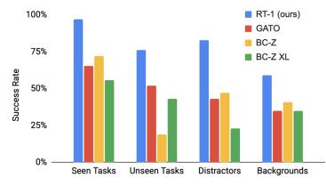

## Ethical Considerations

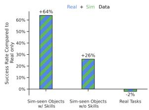

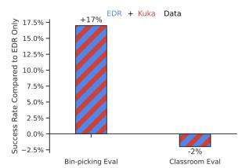

• Early research, model has not yet been evaluated for suitability to use outside of its current research setting.

## Caveats and Recommendations

• While the current model covers only a small portion of possible robotic manipulation tasks, it presents a recipe for scalable robotic learning and an architecture that shows favorable generalization and data absorption properties.

## RT‑1 (Robotics Transformer) 模型卡片

## 模型详情

• 由 Robotics at Google 和 Everyday Robots 的研究人员开发，2022，v1。

• 基于 Transformer 的模型，构建于 FiLM 条件化 EfficientNet (Tan & Le, 2019)、

TokenLearner (Ryoo et al., 2021) 和 Transformer (Vaswani et al., 2017) 之上。

• 使用模仿学习进行训练，输入为自然语言任务和图像，输出为机器人动作。

## 预期用途

• 旨在用于控制 Everyday Robot 执行操作任务。

• 作为不同机器人形态、环境或差异显著的下游任务的学习表征，其适用性尚不明确。

• 不适合与人类交互。

## 因素

•因素包括变化的背景、光照、场景、底座位置以及新颖的自然语言任务。硬件因素包括相机和机器人形态。

## 指标

•评估指标包括已见任务表现、未见任务表现、对背景和干扰物的鲁棒性，以及在长时程场景下的表现。各项指标均测量模型在随机物体、随机物体位置以及不同场景下执行自然语言指定任务的成功率。

## 训练数据

• 在涵盖 13 台机器人和 744 项任务的 13 万次遥操作演示上进行训练。

<table><tr><td>技能</td><td>数量</td><td>描述</td><td>示例指令</td></tr><tr><td>拾取物体</td><td>130</td><td>将物体从表面抬起</td><td>拾取冰茶罐</td></tr><tr><td>将物体移动到物体附近</td><td>337</td><td>将第一个物体移动到第二个物体附近</td><td>将百事可乐罐移到蓝莓味 RXBAR 附近</td></tr><tr><td>将物体直立放置</td><td>8</td><td>将细长物体直立放置</td><td>将水瓶直立放置</td></tr><tr><td>将物体碰倒</td><td>8</td><td>将细长物体碰倒</td><td>推倒红牛罐</td></tr><tr><td>打开/关闭抽屉</td><td>6</td><td>打开或关闭任意一个橱柜抽屉</td><td>打开顶层抽屉</td></tr><tr><td>将物体放入容器 84</td><td></td><td>将一个物体放入容器中</td><td>将棕色薯片袋放入白碗中</td></tr><tr><td>从容器中拾取物体</td><td>162</td><td>从某个位置拾取物体,然后</td><td>从纸上拾取绿色墨西哥辣椒薯片袋</td></tr><tr><td>并放置在台面上</td><td></td><td>将其放置在台面上</td><td>碗并放在台面上</td></tr><tr><td>额外任务</td><td>9</td><td>针对真实、长指令训练的技能</td><td>从分发器中拉出餐巾纸</td></tr><tr><td>总计</td><td>744</td><td></td><td></td></tr></table>

## 评估数据

• 在真实世界的随机化场景中进行评估，在其训练环境以及两个新的办公厨房环境中总计进行了超过 3000 次 rollout。

## 定量分析

• RT‑1 展现出高性能与鲁棒性，并且能够从异构数据中进行学习。

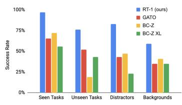

## 伦理考量


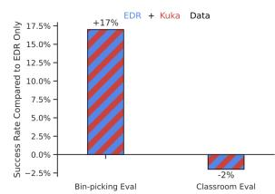  
• 处于早期研究阶段，尚未评估该模型是否适合在其当前研究环境之外使用。

## 注意事项与建议

• 虽然当前模型仅涵盖了可能的机器人操作任务中的一小部分，但它提供了一种

可扩展机器人学习的方案，以及一个展现出良好泛化和数据吸收特性的架构。

## C.3 MODEL SELECTION AT SCALE

As robot learning systems become more capable and the number of instructions they can handle increases, evaluation of these models becomes difficult (Kalashnikov et al., 2021a; Jang et al., 2021). This is an important consideration not only for evaluating different model classes and data distributions during the development process, but also for selecting the most performant model checkpoints for a particular training run. While there have been a number of proposed solutions to this problem (Dud´ık et al., 2011; Irpan et al., 2019; Hanna et al., 2017), mostly known in the offline reinforcement learning literature as “off-policy evaluation”, it still remains an open research challenge to evaluate multi-task robot learning systems at scale.

In this work, we propose leveraging simulation for “real to sim” transfer as a scalable tool that provides an approximate estimate of model performance during training across many real tasks. We run policies trained from real data in a simulator to test the full rollout performance. Note that all of our training data comes from the real world (except the experiment in Section 6.3), and the simulator is used only for model selection. To accomplish this, we expand the simulation environment proposed by Lee et al. (2022b) to support 551 of the tasks described in Section 5.2. For each of these tasks, we define a set of scene setup randomizations, robot pose randomizations, and success detection criteria. To bridge the visual distribution shift between the real world and the simulation, we train a RetinaGAN (Ho et al., 2020) model that transforms simulated images into realistic looking images. Then, we deploy policies trained on real data directly into these simulation environments by applying RetinaGAN visual transformations at each timestep and measuring rollout simulated task success rates.

While models trained only on real world data perform better in the real world than they do in simulation, we find that the simulation success rates of high-performing real world policies are higher than the simulation success rates of low-performing real world policies. In other words, the ordering of simulation policy success rates are informative for predicting the ordering of real world policy success rates. We note that in this real-to-sim evaluation setting, we have a less strict requirement for simulation accuracy compared to sim-to-real settings; as long as simulation success rates are directionally correlated with real success rates, we can accept a moderate or even high gap between real and simulation success rates.

We present example camera images from simulation as well as their RetinaGAN-based transformations in Fig. 8.

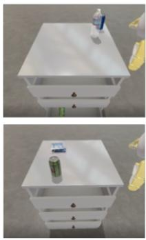  
Raw  
Simulation

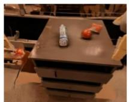

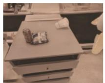  
Simulation + RetinaGAN

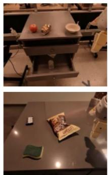  
Real World  
Figure 8: Example camera images showcasing raw simulation, simulation with RetinaGAN applied, and the real world.

## C.3 大规模模型选择

随着机器人学习系统的能力越来越强，以及其能够处理的指令数量不断增加，对这些模型的评估变得愈发困难（Kalashnikov et al., 2021a; Jang et al., 2021）。这不仅是在开发过程中评估不同模型类别和数据分布的重要考量，也是为特定训练运行选择性能最佳的模型检查点的重要考量。虽然针对该问题已提出了一些解决方案（Dud´ık et al., 2011;Irpan et al., 2019; Hanna et al., 2017）——在离线强化学习文献中通常被称为“离策略评估”，但大规模评估多任务机器人学习系统仍是一个开放的研究挑战。

在这项工作中，我们提出利用仿真进行“真实到仿真”（real to sim）迁移，作为一种可扩展的工具，在许多真实任务的训练过程中提供模型性能的近似估计。我们在仿真器中运行由真实数据训练出的策略，以测试完整的 rollout 性能。请注意，我们所有的训练数据均来自真实世界（第 6.3 节中的实验除外），仿真器仅用于模型选择。为此，我们扩展了 Lee 等人（2022b）提出的仿真环境，以支持第 5.2 节中描述的 551 项任务。对于其中的每一项任务，我们都定义了一组场景设置随机化、机器人位姿随机化以及成功检测标准。为了弥合真实世界与仿真之间的视觉分布偏移，我们训练了一个 RetinaGAN（Ho et al., 2020）模型，用于将仿真图像转换为外观逼真的图像。然后，我们通过在每个时间步应用 RetinaGAN 视觉变换并测量 rollout 仿真任务成功率，将基于真实数据训练的策略直接部署到这些仿真环境中。

虽然仅在真实世界数据上训练的模型在真实世界中的表现优于其在仿真中的表现，但我们发现，高性能真实世界策略的仿真成功率高于低性能真实世界策略的仿真成功率。换句话说，仿真策略成功率的排序对预测真实世界策略成功率的排序具有参考价值。我们注意到在这种真实到仿真评估设置中，与仿真到真实设置相比，我们对仿真精度的要求没那么严格；只要仿真成功率与真实成功率具有方向上的相关性，我们就可以接受真实与仿真成功率之间存在中等甚至较大的差距。

我们在图 8 中展示了来自仿真的示例相机图像及其基于 RetinaGAN 的转换。

  
Raw  
Simulation

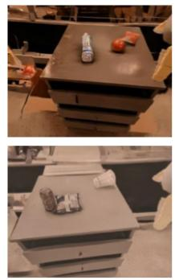  
Simulation + RetinaGAN

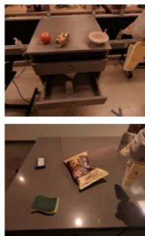  
Real World  
图 8：展示原始仿真、应用 RetinaGAN 的仿真以及真实世界的相机图像示例。

## C.4 DATA COLLECTION PROCESS

Figure 9 shows the growth of data, number of tasks, and the success rate of the policy over time. The number of tasks/instructions that our system is capable of grows over time as more data is collected. The same is true with the performance of seen tasks. One of the important aspects of the future work is develop techniques that allow us to grow the data as well as the robots performance and general capabilities at a faster rate.

  
Figure 9: The growth of data, number of tasks, and seen instruction performance over time.

## C.4 数据收集过程

图 9 展示了数据量、任务数量以及策略成功率随时间的增长情况。随着收集到更多数据，我们系统能够执行的任务/指令数量也随之增加。已见任务的性能表现同样如此。未来工作的一个重要方面是开发相应技术，使我们能够以更快的速度扩增数据，并提升机器人的性能与通用能力。

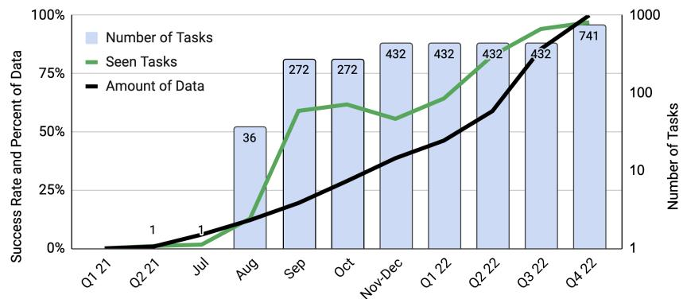  
图 9：数据、任务数量以及已知指令性能随时间的增长情况。

## D EXPERIMENTS

## D.1 EVALUATION DETAILS

In Section 6.2, we study the zero-shot generalization capabilities of RT-1 to difficult scenarios not present in the training dataset. To fairly evaluate different ablations of RT-1 as well as baseline policies, we design standardized evaluation procedures that cover a range of incremental difficulty levels.

Seen tasks. We evaluate on 744 tasks present in the training dataset. The breakdown between 12 skills is shown in Table 1. For all “Seen” evaluations, we use the same classroom setting used for data collection as described in Section 5.2. For each policy, we report a single representative metric that takes a skill-weighted average across individual skill evaluations.

Unseen tasks. We evaluate policy performance on 53 tasks that are held out during training. While the unseen instructions’ specific combinations of skills and objects are not seen during training, other combinations of the same skills and objects are present in the training set. We evaluate these unseen tasks in the same environment and the same randomization procedure as the Seen tasks. A full list of these unseen tasks is shown in Table 8.

Distractor robustness. We test three tasks (“pick coke can”, “place coke can upright”, “move coke can near green rice chip bag”) with incrementally more distractor objects added to the scene. The easy setting includes 0, 2, or 5 distractor objects. The medium setting includes 9 distractor objects, but the coke can is never obscured. The hard setting includes 9 distractor objects, but the scene is more crowded and the coke can is partially occluded. Both the medium are hard setting are more difficult than scenarios in the training dataset, which contained between 0 and 4 distractors. Examples of these difficulty settings and policy evaluation rollouts are shown in Figure 12.

Background robustness. We test six tasks (“pick coke can”, “move blue chip bag near orange”, “knock redbull can over”, “pick green jalapeno chip bag”, “move sponge near brown chip bag”,“place redbull can upright”) with incrementally more challenging backgrounds and counter textures. In the easy setting, we utilize the same background environments and counter textures as the training dataset. In the medium setting, we utilize the same background environment but add a patterned tablecloth to change the counter texture. In the hard setting, we utilize a brand new kitchen environment with a new countertop; this changes the counter texture, drawer material and color, and

## D 实验

## D.1 评估详情

在第 6.2 节中，我们研究了 RT‑1 在训练数据集中未出现的困难场景下的零样本泛化能力。为了公平地评估 RT‑1 的不同消融实验以及基线策略，我们设计了涵盖一系列递增难度级别的标准化评估流程。

已见任务。我们在训练数据集中存在的 744 项任务上进行评估。表 1 显示了 12 种技能的细分情况。对于所有“已见”评估，我们使用第 5.2 节所述用于数据收集的相同教室环境设置。对于每种策略，我们报告一个代表性指标，该指标对各项技能评估计算技能加权平均值。

未见任务。我们在训练期间保留的 53 项任务上评估策略性能。虽然未见指令中技能和物体的特定组合在训练期间未曾见过，但相同技能和物体的其他组合存在于训练集中。我们在与已见任务相同的环境和相同的随机化流程下评估这些未见任务。表 8 展示了这些未见任务的完整列表。

干扰物鲁棒性。我们测试了三项任务（“拿起可乐罐”、“竖直放置可乐罐”、“将可乐罐移到绿色米片袋附近”），并在场景中递增添加更多干扰物体。简单设置包含 0、2 或 5 个干扰物体。中等设置包含 9 个干扰物体，但可乐罐绝不会被遮挡。困难设置包含 9 个干扰物体，但场景更加拥挤且可乐罐被部分遮挡。中等和困难设置都比训练数据集中的场景更困难，训练数据集中包含 0 到 4 个干扰物。这些难度设置和策略评估轨迹的示例见图 12。

背景鲁棒性。我们测试了六项任务（“抓取可乐罐”、“将蓝色薯片袋移至橙子附近”、“推倒红牛罐”、“抓取绿色墨西哥辣椒薯片袋”、“将海绵移至棕色薯片袋附近”、“将红牛罐直立放置”），并逐步增加更具挑战性的背景和台面纹理。在简单设置中，我们使用与训练数据集相同的背景环境和台面纹理。在中等设置中，我们使用相同的背景环境，但添加了带图案的桌布以改变台面纹理。在困难设置中，我们使用带有新台面的全新厨房环境；这改变了台面纹理、抽屉材质和颜色，以及

background visuals. Examples of these difficulty settings and policy evaluation rollouts are shown in Figure 10.

Realistic instructions. To study how RT-1 performs in more realistic scenarios, we propose an evaluation setting in a real office kitchen that is a dramatic shift from the original training classroom environment. We propose a variety of skills that combine aspects of the previous zero-shot evaluations, including adding new distractors, including new backgrounds, and new combinations of objects with skills. We refer to the easiest scenario as L1 generalization, which introduces a new countertop and lighting condition but keeps the skills and objects the same. Next, L2 generalization additionally adds novel distractor objects such as kitchen jar containers. Finally, L3 generalization adds new objects or new locations such as near a sink. While some of these distribution shifts are tested in Section 6.2, these realistic instructions aim to test multiple dimensions simultaneously. Examples of these instructions are presented in Fig. 11.

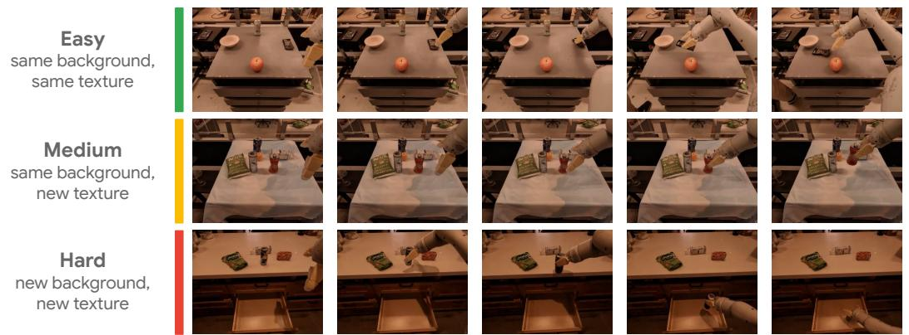  
Figure 10: “Backgrounds” evaluations focus on testing the performance of RT-1 on settings with different table textures and different backgrounds, such as those found in kitchens never trained on. These visual differences are quite pronounced, which in the most challenging case entails a new kitchen with different counter texture, different lighting conditions, different counter material, and a different background.

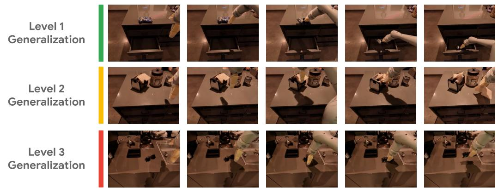  
Figure 11: “Realistic instructions” evaluations propose realistic scenarios multiple distribution shifts that incrementally increase in difficulty. L1 generalization introduces a new real office kitchen with new lighting conditions. L2 generalization additionally adds unseen distractor objects. Finally, L3 generalization includes new objects or objects in new locations, such as next to a sink.

## D.2 HETEROGENEOUS DATA

We also explore the limits of RT-1 for utilizing highly heterogeneous data. We demonstrate how RT-1 can incorporate and learn from vastly different data sources and improve from such data without 背景视觉效果。这些难度设置和策略评估轨迹的示例如图 10 所示。

现实指令。为了研究 RT‑1 在更真实场景中的表现，我们提出了一个真实办公室厨房的评估设置，这与最初的训练教室环境相比发生了巨大的转变。我们提出了多种结合了此前零样本评估各方面特性的技能，包括添加新的干扰物、引入新的背景以及物体与技能的新组合。我们将最简单的场景称为 L1 泛化，它引入了新的台面和光照条件，但保持技能和物体不变。接下来，L2泛化还额外添加了新颖的干扰物体，例如厨房储物罐容器。最后， L3 泛化添加了新物体或新位置，例如水槽附近。虽然第 6.2 节测试了其中一些分布偏移，但这些现实指令旨在同时测试多个维度。图 11 展示了这些指令的示例。

图 10：“背景”评估侧重于测试 RT‑1 在具有不同桌面纹理和不同背景的设置下的性能，例如在从未训练过的厨房中所见的情形。这些视觉差异非常明显，在最具挑战性的情况下，涉及一个具有不同台面纹理、不同光照条件、不同台面材质以及不同背景的新厨房。  
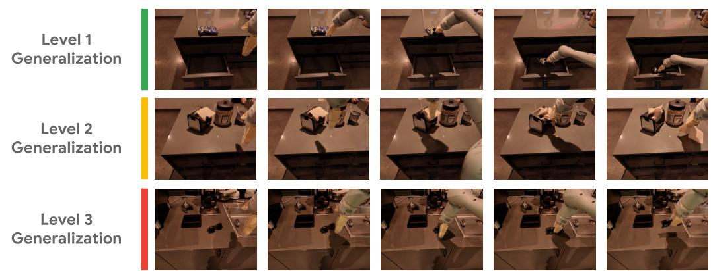  
图 11：“真实指令”评估提出了难度逐步增加的多重分布偏移真实场景。 L1泛化引入了具有新光照条件的全新真实办公室厨房。 L2 泛化还增加了未见过的干扰物体。最后， L3泛化包括新物体或位于新位置（例如水槽旁）的物体。

## D.2 异构数据

我们还探索了 RT‑1 利用高度异构数据的能力极限。我们展示了 RT‑1 如何整合截然不同的数据源并从中学习，以及如何从此类数据中获得提升而无需

Instruction pick coke can from top drawer and place on counter pick green can from top drawer and place on counter pick green rice chip bag from middle drawer and place on counter pick redbull can from top drawer and place on counter place 7up can into bottom drawer place brown chip bag into top drawer place green can into middle drawer move 7up can near redbull can move apple near green rice chip bag move apple near paper bowl move apple near redbull can move blue chip bag near blue plastic bottl move blue chip bag near pepsi can move blue chip bag near sponge move brown chip bag near apple move brown chip bag near green rice chip bag move brown chip bag near redbull can move coke can near green jalapeno chip bag move coke can near water bottle move green can near 7up can move green can near apple move green can near coke can move green jalapeno chip bag near blue chip bag move green rice chip bag near orange move green rice chip bag near orange can move green rice chip bag near paper bowl move orange can near brown chip bag move pepsi can near orange can move redbull can near coke can move rxbar blueberry near blue plastic bottle move rxbar blueberry near orange can move rxbar chocolate near paper bowl move rxbar chocolate near rxbar blueberr move sponge near apple move water bottle near 7up can move water bottle near sponge move white bowl near orange can pick blue plastic bottle pick green rice chip bag pick orange pick rxbar chocolate pick sponge place pepsi can upright knock orange can over pick blue plastic bottle from paper bowl and place on counter pick brown chip bag from white bowl and place on counter pick green can from paper bowl and place on counter pick green jalapeno chip bag from white bowl and place on counter pick orange can from white bowl and place on counter pick redbull can from white bowl and place on counte place blue plastic bottle into paper bowl place coke can into paper bowl place orange can into paper bowl

Table 8: List of Unseen Instructions in Sec. 6.2. For the “Unseen Tasks” evaluation, we exclude a total of 53 tasks during training. While these exact instructions were not present in the training set, the objects and skills contained in these instructions were still present in the training set.

指令从顶层抽屉拿起可乐罐并放在台面上从顶层抽屉拿起绿色罐并放在台面上从中间抽屉拿起绿色米片袋并放在台面上从顶层抽屉拿起红牛罐并放在台面上将七喜罐放入底层抽屉将棕色薯片袋放入顶层抽屉将绿色罐放入中间抽屉将七喜罐移到红牛罐附近将苹果移到绿色米片袋附近将苹果移到纸碗附近将苹果移到红牛罐附近将蓝色薯片袋移到蓝色塑料瓶附近将蓝色薯片袋移到百事可乐罐附近将蓝色薯片袋移到海绵附近将棕色薯片袋移到苹果附近将棕色薯片袋移到绿色米片袋附近将棕色薯片袋移到红牛罐附近将可乐罐移到绿色墨西哥辣椒薯片袋附近将可乐罐移到水瓶附近将绿色罐移到七喜罐附近将绿色罐移到苹果附近将绿色罐移到可乐罐附近将绿色墨西哥辣椒薯片袋移到蓝色薯片袋附近将绿色米片袋移到橙子附近将绿色米片袋移到橙色易拉罐附近将绿色米片袋移到纸碗附近将橙色易拉罐移到棕色薯片袋附近将百事可乐罐移到橙色易拉罐附近将红牛罐移到可乐罐附近将蓝莓味 RXBAR 移到蓝色塑料瓶附近将蓝莓味 RXBAR 移到橙色易拉罐附近将RXBAR巧克力移到纸碗附近将RXBAR巧克力移到蓝莓味 RXBAR 附近将海绵移到苹果附近将水瓶移到七喜罐附近将水瓶移到海绵附近将白碗移到橙色易拉罐附近抓取蓝色塑料瓶抓取绿色米片袋抓取橙子抓取RXBAR巧克力抓取海绵将百事可乐罐竖直放置推倒橙色易拉罐从纸碗中抓取蓝色塑料瓶并放在台面上从白碗中抓取棕色薯片袋并放在台面上从纸碗中拿起绿色罐并放到台面上从白碗中拿起绿色墨西哥辣椒薯片袋并放到台面上从白碗中拿起橙色易拉罐并放到台面上从白碗中拿起红牛罐并放到台面上将蓝色塑料瓶放入纸碗中将可乐罐放入纸碗中将橙色易拉罐放入纸碗中

表 8：第6.2 节中的未见指令列表。对于“未见任务”评估，我们在训练期间共排除了 53 个任务。虽然这些确切的指令并未出现在训练集中，但这些指令中包含的物体和技能仍存在于训练集中。

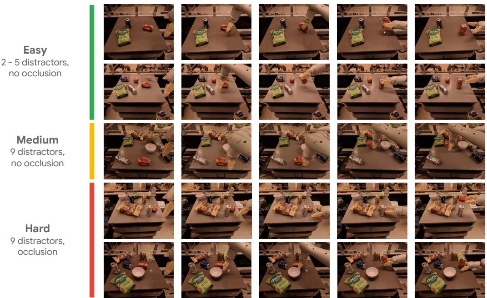  
Figure 12: “Distractors” evaluations focus on diversifying initial scene configurations well beyond the distributions contained in the training dataset, which contain between 2 and 4 distractor objects. In the most challenging scenarios, the scene is extremely cluttered and contains occlusions for the objects of interest.

sacrificing its original-tasks performance across the varied tasks inherent in this data. To this end, we conduct two experiments: (1) RT-1 trained and tested on both real data and simulation data and (2) RT-1 trained across large datasets of different tasks, originally collected by different robots.

Absorbing simulation data. Table 9 shows the ability of RT-1, and baselines, to absorb both real and simulation data. To test this, we take all of the real demonstration data but we also provide additional simulation data that includes objects that the robot has never seen in the real world. We add a set of sim objects and only show them on a subset of tasks, specifically the picking tasks, in simulation. To accomplish this, we run our real2sim method described in Sec. C.3 to bootstrap a simulation policy from the real world policy that is then trained with multi-task RL (Kalashnikov et al., 2021a) with additional objects in simulation. From this process, we extract 518k successful trajectories of picking new objects and mix them with the real data that was used in the previous experiments. The goal of this experiment is to demonstrate that by expanding the dataset of simulation trajectories, we can benefit RT-1’s generalization capabilities without sacrificing the original training performance – a desired property of an absorbent model.

To evaluate the properties of this model, we specify different generalization scenarios: for seen skills with real objects the training data has real data of that instruction (i.e., performance on seen tasks), for seen skills with sim objects the training data has sim data of that instruction (e.g. “pick up a sim object”, which was present in sim), and for unseen skills with sim objects the training data has sim data of that object but there are no examples of the instruction describing the skill with that object either in sim or in real (e.g., “move a sim object to apple”, even though the robot has only practiced in picking that sim object and not moving it near other objects). All evaluations are done in the real world but to limit the number of instructions evaluated, we focus on pick and move-to skills.

We find in Table 9 that for RT-1, we do not lose performance adding simulation data compared to the Real Only dataset. We do however, see a significant increase in performance (from 23% to 87%) on objects and tasks seen only in simulation, to approximately the performance of the those in real, demonstrating an impressive degree of domain transfer. We also see a significant increase in performance on unseen instructions from 7% to 33%; impressive given the object in question has never been seen in real and the instruction never seen at all. Overall, we find that RT-1 is able to efficiently “sponge up” new data, even from a very different domain.

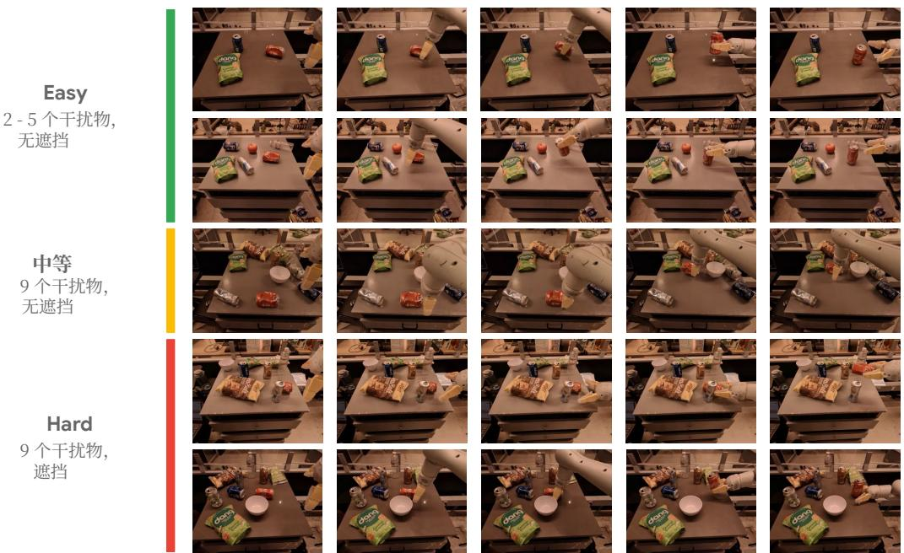  
图 12：“干扰物”评估侧重于使初始场景配置多样化，远超出训练数据集中包含的分布（其中包含 2 到 4 个干扰物体）。在最具挑战性的场景中，场景极其杂乱，且包含对目标物体的遮挡。

牺牲其在这些数据固有的各类任务上的原始任务性能。为此，我们进行了两项实验：(1) 在真实数据和仿真数据上训练和测试 RT‑1；(2) 在最初由不同机器人采集的不同任务大型数据集上训练 RT‑1。

吸收仿真数据。表 9 展示了 RT‑1 和基线吸收真实数据与仿真数据的能力。为了测试这一点，我们采用了全部真实示教数据，但也提供了额外的仿真数据，其中包括机器人在真实世界中从未见过的物体。我们添加了一组仿真物体，并且仅在仿真中的一部分任务（具体为抓取任务）中展示它们。为实现这一点，我们运行第 C.3 节所述的 real2sim 方法，从真实世界策略中引导出一个仿真策略，然后在仿真中使用额外物体通过多任务强化学习（Kalashnikov 等人，2021a）对其进行训练。从这个过程中，我们提取了 51.8 万条抓取新物体的成功轨迹，并将它们与之前实验中使用的真实数据混合。本实验的目标是证明，通过扩充仿真轨迹数据集，我们可以在不牺牲原始训练性能的情况下提升 RT‑1 的泛化能力——这是吸收模型所期望具备的特性。

为了评估该模型的特性，我们指定了不同的泛化场景：对于真实物体的已见技能，训练数据包含该指令的真实数据（即在已见任务上的表现）；对于仿真物体的已见技能，训练数据包含该指令的仿真数据（例如“抓取仿真物体”，该指令曾出现在仿真中）；而对于仿真物体的未见技能，训练数据包含该物体的仿真数据，但在仿真或真实世界中都没有描述涉及该物体技能的指令示例（例如“将仿真物体移动到苹果”，即使机器人仅练习过抓取该仿真物体，而未将其移动到其他物体附近）。所有评估均在真实世界中进行，但为了限制评估指令的数量，我们重点关注抓取和移动技能。

我们在表 9 中发现，对于 RT‑1 而言，与 Real Only 数据集相比，加入仿真数据并不会降低性能。然而，我们确实看到，在仅在仿真中见过的物体和任务上，性能显著提升（从 23% 提升至 87%），接近真实场景下的表现，展示了令人瞩目的领域迁移能力。我们还看到未见指令上的性能从 7% 显著提升至 33%；鉴于相关物体在现实中从未见过，且该指令也完全未曾见过，这一提升令人印象深刻。总体而言，我们发现 RT‑1 能够高效地如“海绵”般吸收新数据，即使这些数据来自截然不同的领域。

<table><tr><td rowspan="2">Models</td><td rowspan="2">Training Data</td><td>Real Objects</td><td colspan="2">Sim Objects (not seen in real)</td></tr><tr><td>Seen Skill w/ Objects</td><td>Seen Skill w/ Objects</td><td>Unseen Skill w/ Objects</td></tr><tr><td>RT-1</td><td>Real Only</td><td>92</td><td>23</td><td>7</td></tr><tr><td>RT-1</td><td>Real + Sim</td><td>90</td><td>87</td><td>33</td></tr></table>

  
Table 9: Experimental results for incorporating simulation data in RT-1. Adding simulation data does not impact the performance on real objects, while significantly improving real performance on objects that were only introduced in simulation.

Absorbing data from different robots. To push the data absorption limits of RT-1, we conduct an additional set of experiments where we combine two data sources that originate from different robots: Kuka IIWA as well as the Everyday Robots mobile manipulators used in the experiments so far. The Kuka data contains all the successful examples collected in QT-Opt (Kalashnikov et al., 2018), which corresponds to 209k episodes, where the robot was indiscriminately grasping objects in a bin (see an example of a Kuka episode in Table. 10). Our goal in this experiment is to analyze whether the performance on the RT-1 tasks drops when adding the additional data and, more importantly, whether we can observe any transfer from data collected by a different robot morphology.

We would like to emphasize the difficulty of this setting by noting the major differences between the datasets. Not only are the robots that collected the data different in appearance and action space, but also the environment they were deployed in has different appearance and dynamics. In addition the QT-Opt data presents a completely different action distribution – it was collected by an RL agent as opposed to human demonstrations present in our dataset.

To mix the Kuka data together with the RT-1 data, we first transform the original Kuka 4-DOF action space into the same action space as RT-1, namely we set the roll and pitch to 0, while keeping the yaw values that were present in the original Kuka data. In addition, we transform the binary gripper-close command into a continuous gripper-closedness command that is present in the RT-1 data. We also need text instructions corresponding to the task performed and since the Kuka data does not contain the name of the object that was grasped, we relabel all the data to the “pick anything” instruction. With these modifications, we mix both datasets with the 2:1 (RT-1 data : Kuka data) ratio and train RT-1 to obtain the final model.

To test whether RT-1 can effectively absorb these two very different datasets, we evaluate the performance on the original RT-1 tasks (in this case, we also focus on “pick” and “move to” skills), which we refer to as the standard “Classroom eval”, as well as the performance on the newly constructed tasks that reflect the bin-picking setup present in the Kuka data, which we refer to as the “Bin-picking eval”. For the Bin-picking eval to be close to the original dataset, we put in the same looking bin for the objects as well as modify the robot to be similar to the Kuka manipulators by adding extra wires and coloring the gripper gray. For all of the evaluations we use the Everyday Robots robot with the picking commands and evaluate it based on 72 grasping trials.

The results are presented in Table 10. We observe that the model that mixes the RT-1 data and the Kuka data has only a minimal decrease in the original tasks’ performance (i.e. Classroom eval), i.e. 2%. Even more importantly, in the Bin-picking eval, we observe that the model trained on multirobot data performs at 39% compared to the 22% of the model that was trained only on the RT-1 data. This is a 17% performance difference (almost 2x). Additionally, RT-1 trained on Kuka bin-picking data and evaluated on the bin-picking tasks with the Everyday Robots (EDR) robot achieves 0% performance, confirming that it is difficult to transfer a behavior from another robot morphology. However, mixing the data from both robots allows RT-1 to infer the correct actions of the EDR robot even when faced with the states observed by Kuka robots. This is achieved without explicit demonstrations of bin-picking on EDR robot and by taking advantage of past experiences collected by Kuka robots. These results indicate that RT-1’s absorption properties also include the ability to 表 9：在 RT‑1 中引入仿真数据的实验结果。添加仿真数据不会影响在真实物体上的性能， 同时显著提升了仅在仿真中引入的物体上的真实性能。

<table><tr><td rowspan="2" colspan="2">模型训练数据</td><td colspan="3">真实物体 仿真物体(真实场景中未见)</td></tr><tr><td>已见技能包含物体</td><td>已见技能包含物体</td><td>未见技能包含物体</td></tr><tr><td>RT-1</td><td>仅真实</td><td>92</td><td>23</td><td>7</td></tr><tr><td>RT-1</td><td>真实 + 仿真</td><td>90</td><td>87</td><td>33</td></tr></table>


吸收来自不同机器人的数据。为了拓展 RT‑1 的数据吸收极限，我们开展了一组额外的实验，结合了来自不同机器人的两个数据源：Kuka IIWA 以及迄今为止实验中使用的 EverydayRobots 移动操作机。Kuka 数据包含在 QT‑Opt（Kalashnikov 等人，2018 年）中收集的所有成功示例，对应 20.9 万个回合，其中机器人在料箱中不加区分地抓取物体（参见表 10 中的Kuka 回合示例）。我们在该实验中的目标是分析在添加额外数据时 RT‑1 任务的性能是否会下降，更重要的是，观察我们能否发现由不同机器人形态收集的数据所带来的任何迁移效果。

我们希望通过指出各数据集之间的主要差异来强调这一设定的难度。不仅收集数据的机器人在外观和动作空间上有所不同，而且它们所部署的环境在外观和动力学特性上也存在差异。此外，QT‑Opt 数据展现出了完全不同的动作分布——它是由强化学习智能体收集的，而不是像我们数据集中那样来自人类示范。

为了将 Kuka 数据与 RT‑1 数据混合在一起，我们首先将原始 Kuka 4自由度动作空间转换为与 RT‑1 相同的动作空间，即我们将横滚和俯仰设置为 0，同时保留原始 Kuka 数据中存在的偏航值。此外，我们将二进制夹爪闭合指令转换为 RT‑1 数据中存在的连续夹爪闭合度指令。我们还需要与所执行任务相对应的文本指令，并且由于 Kuka 数据不包含所抓取物体的名称，因此我们将所有数据重新标注为“pick anything”指令。通过这些修改，我们以 2:1（RT‑1 数据 : Kuka 数据）的比例混合两个数据集，并训练 RT‑1 以获得最终模型。为了测试 RT‑1 是否能够有效吸收这两个截然不同的数据集，我们评估了其在原始 RT‑1 任务上的表现（在此情况下，我们也重点关注“抓取”和“移动到”技能），我们称之为标准的“Classroom 评估”；同时也评估了其在反映 Kuka 数据中料箱抓取设置的新构建任务上的表现，我们称之为“Bin‑picking 评估”。为了使 Bin‑picking 评估贴近原始数据集，我们放置了外观相同的料箱来盛放物体，并通过添加额外线缆以及将夹爪涂成灰色来改造机器人，使其与 Kuka 机械臂相似。在所有评估中，我们均使用带有抓取命令的 Everyday Robots 机器人，并基于 72 次抓取试验进行评估。

结果如表 10 所示。我们观察到，混合了 RT‑1 数据和 Kuka 数据的模型在原始任务上的表现（即Classroom 评估）仅有微小的下降，即 2%。更重要的是，在 Bin‑picking 评估中，我们观察到在多机器人数据上训练的模型表现达到了 39%，相比之下，仅在 RT‑1 数据上训练的模型表现为 22%。这是 17% 的性能差距（几乎是 2 倍）。此外，在 Kuka 料箱抓取数据上训练并在 EverydayRobots (EDR) 机器人上评估料箱抓取任务的 RT‑1 取得了 0% 的表现，证实了从另一种机器人形态迁移行为是很困难的。然而，混合来自这两种机器人的数据使 RT‑1 即使在面对 Kuka 机器人观察到的状态时，也能推断出 EDR机器人的正确动作。这是在没有 EDR机器人料箱抓取的显式演示的情况下，通过利用 Kuka 机器人收集的以往经验来实现的。这些结果表明，RT‑1 的吸收特性还包括能够acquire new skills through observing other robots’ experiences and present an exciting avenue offuture work where we combine many more multi-robot datasets to enhance the robot capabilities.

<table><tr><td>Models</td><td>Training Data</td><td>Classroom eval</td><td>Bin-picking eval</td></tr><tr><td>RT-1</td><td>Kuka bin-picking data + EDR data</td><td>90</td><td>39</td></tr><tr><td>RT-1</td><td>EDR only data</td><td>92</td><td>22</td></tr><tr><td>RT-1</td><td>Kuka bin-picking only data</td><td>0</td><td>0</td></tr></table>

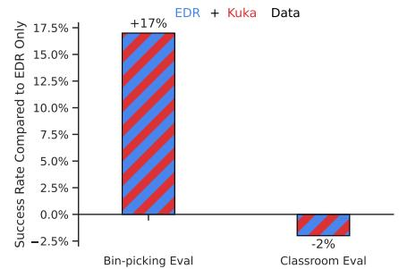  
Table 10: Experimental results for mixing data from two different robots. Incorporating Kuka bin-picking data from QT-Opt (Kalashnikov et al., 2018) in RT-1 minimally impacts the standard classroom evaluation performance and results in almost a 2x improvement in generalization to the Bin-picking evaluation (that is similar to the setup in the Kuka data) on the Everyday Robots manipulator. This demonstrates an effective transfer across two different robot morphologies.

## D.3 LONG-HORIZON EVALUATION DETAILS

In addition to short-horizon individual skill evaluations shown in previous sections, we also evaluate how RT-1 performs in a long-horizon realistic kitchen setting that chains multiple manipulation and navigation skills to accomplish natural language instructions within the SayCan framework (Ahn et al., 2022). A list of long-horizon instructions used for these evaluations is listed in Table 12.

The success rate of long-horizon tasks decreases exponentially with the length of the task, so high success rates in manipulation skills are particularly important. Furthermore, as mobile manipulation tasks require both navigation and manipulation, the policies ability to be robust to base position is crucial. Since SayCan combines many low-level instructions to perform high-level instructions, the number of possible high-level instructions increases combinatorially with instructions, so the skill-breadth of RT-1 can be fully seen.

SayCan works by grounding language models in robotic affordances and it leverages few-shot prompting to break down a long horizon task expressed in natural language to a sequence of low level skills. An example of long horizon task would be “Bring me two different sodas”, and one feasible plan would be “1. find a coke, 2. pick up the coke, 3. bring it to you, 4. put down the coke, 5. find a pepsi, 6. pick up the pepsi, 7. bring it to you, 8. put down the pepsi, 9. done.” To obtain the affordance function we use value functions trained with MT-OPT (Kalashnikov et al., 2021a). For a detailed description of SayCan algorithm please refer to (Ahn et al., 2022).

Since the focus of this paper is acquisition of many generalizable skills, we focus our evaluation on one subset of tasks presented in Ahn et al. (2022). It is the long-horizon family of tasks, involving 15 instructions, each instruction requires an average of 9.6 steps to complete, and involves an average of 2.4 manipulation skills per instruction. A full list of the instructions can be found in Table 12.

We compare against 3 baselines. 1) SayCan with BC-Z, which uses SayCan planning algorithm with BC-Z as manipulation policy, 2) SayCan with Gato, which uses SayCan planning algorithm with Gato as manipulation policy, 3) Originally reported SayCan results, which use SayCan planning algorithm with BC-Z, but since it uses a slightly different prompt, the planning success rate is lower. We reimplemented 3) in 1) for a fair comparison.

As shown in Table 11, except for original SayCan, all methods get 87% as planning success rate, and RT-1 performs the best, with 67% execution success rate in Kitchen1. Kitchen2 constitutes a much more challenging generalization scene, since the Robot Classroom training scenes are modeled after Kitchen1 (see the pictures of the kitchens in Fig. 2). Due to this generalization difficulty, SayCan with Gato is not able to finish any long horizon task, and SayCan with BC-Z is able to achieve a success rate of 13%. The original SayCan paper did not evaluate performance in a new kitchen. Surprisingly, the manipulation performance does not see a visible drop from Kitchen1 to Kitchen2 表 10：混合来自两种不同机器人的数据的实验结果。在 RT‑1 中结合来自 QT‑Opt（ Kalashnikov 等人，2018 年）的 Kuka 料箱抓取数据对标准 Classroom 评估性能的影响 微乎其微，并使 Everyday Robots 机械臂在 Bin‑picking 评估（与 Kuka 数据中的设置 相似）上的泛化能力获得了近 2 倍的提升。这证明了跨两种不同机器人形态的有效迁移。

<table><tr><td>模型</td><td>训练数据</td><td colspan="2">Classroom 评估 Bin-picking 评估</td></tr><tr><td>RT-1</td><td>Kuka 料箱抓取数据 +EDR 数据</td><td>90</td><td>39</td></tr><tr><td>RT-1</td><td>仅 EDR 数据</td><td>92</td><td>22</td></tr><tr><td>RT-1</td><td>仅 Kuka 料箱抓取数据</td><td>0</td><td>0</td></tr></table>

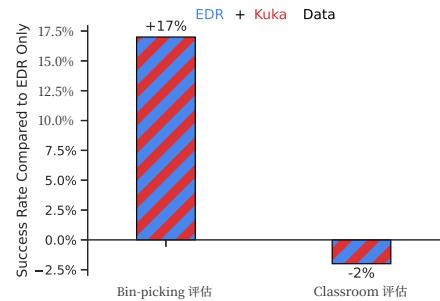

通过观察其他机器人的经验来获取新技能，并为未来的工作展现了一条令人兴奋的途径，即我们可以结合更多的多机器人数据集来增强机器人能力。

## D.3 长程评估详情

除了前面各节中展示的短程单项技能评估外，我们还在真实的厨房长程环境中评估了RT‑1 的表现，该环境在 SayCan 框架（Ahn 等人，2022 年）内将多项操作与导航技能串联起来以完成自然语言指令。表 12 列出了用于这些评估的长程指令列表。

长程任务的成功率随着任务长度呈指数级下降，因此操作技能的高成功率尤为重要。此外，由于移动操作任务同时需要导航和操作，策略对底座位置的鲁棒性能力至关重要。由于SayCan 结合了许多底层指令来执行高层指令，可能的高层指令数量会随指令呈组合式增长，因此可以充分展现 RT‑1 的技能广度。

SayCan 的工作原理是将语言模型与机器人可供性相结合，并利用少样本提示将以自然语言表达的长视距任务分解为一系列低级技能。长视距任务的一个示例是“给我拿两听不同的苏打水”，一个可行的计划是“1. 找到一听可乐，2. 拿起可乐，3. 拿给你，4. 放下可乐，5. 找到一听百事可乐，6. 拿起百事可乐，7. 拿给你，8. 放下百事可乐，9. 完成。”为了获得可供性函数，我们使用通过MT‑OPT (Kalashnikov et al., 2021a) 训练的价值函数。有关 SayCan 算法的详细描述，请参阅(Ahn et al., 2022)。

由于本文的重点是获取多种可泛化的技能，因此我们将评估重点放在 Ahn et al.(2022) 中提出的一组任务子集上。即长视距任务族，共包含 15 条指令，每条指令平均需要 9.6 个步骤来完成，且每条指令平均涉及 2.4 个操作技能。指令的完整列表可在表 12 中找到。

我们与 3 种基线进行了对比：1) SayCan 结合 BC‑Z，其使用 SayCan 规划算法并以 BC‑Z 作为操作策略；2) SayCan 结合 Gato，其使用 SayCan 规划算法并以 Gato 作为操作策略；3) 最初报告的 SayCan 结果，其同样使用结合 BC‑Z 的 SayCan 规划算法，但由于使用了略微不同的提示词，规划成功率较低。为了公平对比，我们在 1) 中重新实现了 3)。

如表 11 所示，除原始 SayCan 外，所有方法的规划成功率均为 87%，且 RT‑1 表现最佳，在Kitchen1 中的执行成功率达到 67%。Kitchen2 构成了一个更具挑战性的泛化场景，因为机器人教室的训练场景是仿照 Kitchen1 构建的（参见图 2 中的厨房图片）。由于这一泛化难度，SayCan 结合 Gato 无法完成任何长时程任务，而 SayCan 结合 BC‑Z 能够取得 13% 的成功率。原始 SayCan论文并未评估在全新厨房中的性能。令人惊讶的是，从 Kitchen1 到 Kitchen2，操作性能并未出现明显下降。

for our method. In the supplementary video, we show that this enables us to operate unseen drawers in Kitchen2, and that we can use SayCan-RT1 to plan and execute ultra-long horizon tasks, with as many as 50 steps.

<table><tr><td rowspan="2"></td><td colspan="2">SayCan tasks in Kitchen1</td><td colspan="2">SayCan tasks in Kitchen2</td></tr><tr><td>Planning</td><td>Execution</td><td>Planning</td><td>Execution</td></tr><tr><td>Original SayCan (Ahn et al., 2022)*</td><td>73</td><td>47</td><td>-</td><td>-</td></tr><tr><td>SayCan w/ Gato (Reed et al., 2022)</td><td>87</td><td>33</td><td>87</td><td>0</td></tr><tr><td>SayCan w/ BC-Z (Jang et al., 2021)</td><td>87</td><td>53</td><td>87</td><td>13</td></tr><tr><td>SayCan w/ RT-1 (ours)</td><td>87</td><td>67</td><td>87</td><td>67</td></tr></table>

Table 11: SayCan style long horizon tasks in Kitchen1 and Kitchen2. (\*Original SayCan eval uses a slightly different prompt so the planning success rate is lower.)

## D.4 MODEL ABLATIONS

## What are the important and practical decisions in the design of the model and how do they affect performance and generalization?

To answer this question, we perform a set of ablations over different design decisions in RT-1. We aim to test a number of hypotheses that will help us disambiguate where the benefits of our method come from. Possible hypotheses about the source of improvement include: (i) the capacity and expressiveness of our model, which we verify by ablating the model size, trying other architectures (e.g., by removing the Transformer component); (ii) the particular action representation, which makes it easy to represent complex multi-modal action distributions, which we test by switching to continuous (normally distributed) actions, as well as by ablating the auto-regressive action representation; (iii) the ImageNet pre-trained initialization of the components, which we test by initializing the model’s weights randomly; and (iv) access to the short history, which we test by excluding observation history. More concretely, we ablate our model by (1) decreasing the model size (from 35M to 21M parameters), (2) removing the Transformer architecture (using a pre-trained EfficientNet instead), (3) using a continuous instead of discrete action space (using an MSE loss and multivariate normal output), (4) auto-regressively conditioning on actions, (5) removing ImageNet pre-training of the FiLM EfficientNet, and (6) removing history (reducing the sequence of six images as input to a single image). For each ablation we compare on the axes of performance on seen tasks, performance on unseen tasks, as well as inference speed and robustness to distractors and backgrounds (with a more detailed description of each category in Section 6.1 and Appendix D.1).

Table 13 shows the results of each ablation and the delta performance compared to the full RT-1. RT-1 achieves impressive performance on tasks and new environments, and particularly outperforms baselines on the most challenging robustness problems. We also find that each design decision is important, though at varying levels. We first evaluate a model that replaces the per-dimension discretized action representation in our model with a more standard continuous Gaussian distribution. We observe a significant decline in performance from this modification. The per-dimension discretization allows our model to represent complex multi-modal distributions, while the Gaussian distribution captures only a single mode. These results suggest that this standard and popular choice is highly suboptimal with the more complex and diverse demonstration data used by our system. ImageNet pre-training is particularly important for model generalization and robustness, decreasing the unseen task performance rate by 33%, as a result of the large and diverse visuals of the ImageNet dataset. Adding history has an impact primarily on generalization to distractors, while removing the Transformer component has a uniform but small negative impact across the seen tasks, unseen tasks and distractors. In order to keep the ImageNet pre-training while reducing the model size, we reduce the number of parameters only by 40% (from 31M to 25M). Resulting performance drops across training and generalization tasks but not as much as in other ablations. Finally, autoregressively conditioning on actions, as used in (Reed et al., 2022; Chen et al., 2021; Lee et al., 2022a), did not benefit performance and slowed inference by more than 2x.

As described in Sec. 5.1, in order to run large Transformer models on real robots, we require a model that supports fast inference for real-time operation. Note that in order to achieve our target control rate of 3Hz (described in Sec. 5.1), we also need to consider other sources of latency in the pipeline, such as the camera latency and communication overhead. However, these factors will be constant 对于我们的方法。在补充视频中，我们展示了这使我们能够操作 Kitchen2 中未见过的抽 屉，并且我们可以使用 SayCan‑RT1 规划和执行多达 50 步的超长时程任务。

<table><tr><td rowspan="2"></td><td colspan="2">Kitchen1 中的 SayCan 任务</td><td colspan="2">Kitchen2 中的 SayCan 任务</td></tr><tr><td>规划</td><td>执行</td><td>规划</td><td>执行</td></tr><tr><td>原始 SayCan (Ahn et al., 2022)*</td><td>73</td><td>47</td><td>-</td><td>-</td></tr><tr><td>SayCan 搭配 Gato (Reed et al., 2022)</td><td>87</td><td>33</td><td>87</td><td>0</td></tr><tr><td>SayCan 搭配 BC-Z (Jang et al., 2021)</td><td>87</td><td>53</td><td>87</td><td>13</td></tr><tr><td>SayCan 搭配 RT-1(本文方法)</td><td>87</td><td>67</td><td>87</td><td>67</td></tr></table>

表 11：Kitchen1 和 Kitchen2 中的 SayCan 风格长程任务。（\*原始 SayCan 评估使用了略微不同的提示，因此规划成功率较低。）

## D.4 模型消融实验

## 在模型设计中有哪些重要且实用的决策？它们如何影响表现与泛化？

为了回答这个问题，我们对 RT‑1 中的不同设计决策进行了一组消融实验。我们的目标是测试若干假设，以帮助我们厘清我们方法的优势究竟来自何处。关于提升来源的可能假设包括：(i) 我们模型的容量和表达能力，我们通过消融模型大小、尝试其他架构（例如移除 Transformer 组件）来进行验证；(ii) 特定的动作表示，它使得表示复杂的多模态动作分布变得容易，我们通过切换到连续（正态分布的）动作以及消融自回归动作表示来进行测试；(iii) 组件的 I

mageNet 预训练初始化，我们通过随机初始化模型权重来进行测试；以及 (iv) 访问短期历史信息的能力，我们通过排除观察历史来进行测试。具体而言，我们通过以下方式对模型进行消融：(1) 减小模型大小（从 35M 减少到 21M 参数），(2) 移除 Transformer 架构（改用预训练的EfficientNet），(3) 使用连续动作空间代替离散动作空间（使用 MSE损失 和多元正态输出），(4) 针对动作进行自回归条件化，(5) 移除 FiLM EfficientNet 的 ImageNet 预训练，以及 (6)移除历史信息（将输入的 6 张图像序列缩减为单张图像）。对于每个消融实验，我们都在已见任务性能、未见任务性能、推理速度以及对干扰物和背景的鲁棒性等维度上进行对比（第 6.1节和附录 D.1 中对每个类别有更详细的描述）。

表 13 展示了各项消融实验的结果以及与完整 RT‑1 相比的表现差异。RT‑1 在各项任务和新环境中均取得了令人瞩目的表现，尤其在最具挑战性的鲁棒性问题上显著优于基线。我们还发现每个设计决策都很重要，尽管其重要程度各有不同。我们首先评估了一个将模型中逐维离散化的动作表示替换为更标准的连续高斯分布的模型。我们观察到这一修改导致表现显著下降。逐维离散化使我们的模型能够表示复杂的多峰分布，而高斯分布只能捕获单峰。这些结果表明，在我们系统所使用的更复杂、更多样化的示教数据面前，这种标准且常见的选择是极为次优的。ImageNet 预训练对模型的泛化和鲁棒性尤为重要；得益于 ImageNet 数据集庞大且多样化的视觉内容，（缺失该预训练）使未见任务表现率下降了 33%。加入历史信息主要影响对干扰物的泛化能力，而移除 Transformer 组件则对已见任务、未见任务和干扰物均产生了一致但较小的负面影响。为了在减小模型大小的同时保留 ImageNet 预训练，我们仅将参数量减少了 40%（从 31M 降至 25M）。由此导致训练和泛化任务的表现均有所下降，但降幅不及其他消融实验。最后，像 (Reed et al., 2022; Chen et al., 2021; Lee et al., 2022a) 中那样基于动作进行自回归条件建模不仅没有提升表现，反而使推理速度变慢了 2 倍以上。

如第 5.1 节所述，为了在真实机器人上运行大型 Transformer 模型，我们需要一个支持快速推理以实现实时运行的模型。请注意，为了达到 3Hz 的目标控制频率（如第 5.1 节所述），我们还需要考虑流水线中的其他延迟来源，例如相机延迟和通信开销。然而，这些因素是恒定的

<table><tr><td>Instruction</td></tr><tr><td>How would you put an energy bar and water bottle on the table</td></tr><tr><td>How would you bring me a lime soda and a bag of chips</td></tr><tr><td>Can you throw away the apple and bring me a coke</td></tr><tr><td>How would you bring me a 7up can and a tea?</td></tr><tr><td>How would throw away all the items on the table?</td></tr><tr><td>How would you move an multigrain chips to the table and an apple to the far counter?</td></tr><tr><td>How would you move the lime soda, the sponge, and the water bottle to the table?</td></tr><tr><td>How would you bring me two sodas?</td></tr><tr><td>How would you move three cokes to the trash can?</td></tr><tr><td>How would you throw away two cokes?</td></tr><tr><td>How would you bring me two different sodas?</td></tr><tr><td>How would you bring me an apple, a coke, and water bottle?</td></tr><tr><td>I spilled my coke on the table, how would you throw it away and then bring me something to help clean?</td></tr><tr><td>I just worked out, can you bring me a drink and a snack to recover?</td></tr><tr><td>How would you bring me a fruit, a soda, and a bag of chips for lunch</td></tr></table>

Table 12: List of SayCan instructions evaluated in Sec. 6.4

<table><tr><td rowspan="2">Model</td><td rowspan="2">Seen Tasks</td><td rowspan="2">Unseen Tasks</td><td colspan="4">Distractors</td><td colspan="2">Backgrounds</td></tr><tr><td>All</td><td>Easy</td><td>Medium</td><td>Hard</td><td>All</td><td>Inference Time (ms)</td></tr><tr><td>Gato (Reed et al., 2022)</td><td>65 (-32)</td><td>52 (-24)</td><td>43 (-40)</td><td>71</td><td>44</td><td>29</td><td>35 (-24)</td><td>129</td></tr><tr><td>BC-Z (Jang et al., 2021)</td><td>72 (-25)</td><td>19 (-57)</td><td>47 (-36)</td><td>100</td><td>67</td><td>7</td><td>41 (-18)</td><td>5.3</td></tr><tr><td>BC-Z XL</td><td>56 (-41)</td><td>43 (-33)</td><td>23 (-60)</td><td>57</td><td>33</td><td>0</td><td>35 (-24)</td><td>5.9</td></tr><tr><td>RT-1 (ours)</td><td>97</td><td>76</td><td>83</td><td>100</td><td>100</td><td>64</td><td>59</td><td>15</td></tr><tr><td>RT-1 w/o big model</td><td>89 (-8)</td><td>62 (-14)</td><td>77 (-6)</td><td>100</td><td>100</td><td>50</td><td>53 (-6)</td><td>13.5</td></tr><tr><td>RT-1 w/o pre-training</td><td>84 (-13)</td><td>43 (-33)</td><td>60 (-23)</td><td>100</td><td>67</td><td>36</td><td>41 (-18)</td><td>15</td></tr><tr><td>RT-1 w/ continuous actions</td><td>68 (-29)</td><td>43 (-33)</td><td>37 (-46)</td><td>71</td><td>67</td><td>0</td><td>35 (-24)</td><td>16</td></tr><tr><td>RT-1 w/ auto-regressive actions</td><td>85 (-12)</td><td>71 (-5)</td><td>67 (-16)</td><td>100</td><td>78</td><td>43</td><td>65 (+6)</td><td>36</td></tr><tr><td>RT-1 w/o history</td><td>82 (-15)</td><td>62 (-14)</td><td>50 (-33)</td><td>71</td><td>89</td><td>14</td><td>59 (+0)</td><td>15</td></tr><tr><td>RT-1 w/o Transformer</td><td>86 (-13)</td><td>62 (-14)</td><td>67 (-16)</td><td>100</td><td>100</td><td>29</td><td>59 (+0)</td><td>26</td></tr></table>

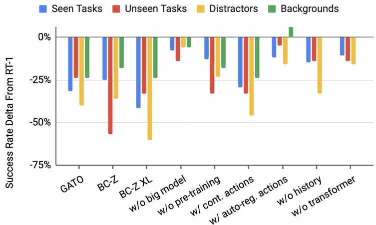  
Table 13: Various model ablations of RT-1 across seen tasks, generalization to unseen tasks, and robustness to distractors and backgrounds.

for all the models, and therefore we focus our evaluation on just the network inference time. The last column of Table 13 shows the inference speed of all the models. RT-1 is almost an order of magnitude faster than Gato with a similar number of parameters, but it is also considerably slower than a ResNet-based BC-Z. In terms of the different ablations of our model, we observe that the biggest slow-down is caused by including auto-regressive actions (∼2x slow-down), and since this does not significantly influence the performance, the final version of RT-1 does not generate actions auto-regressively.

```txt
指令

你会如何将能量棒和水瓶放在桌上
你会如何给我拿青柠苏打水和一包薯片
你能把苹果扔掉并给我拿可乐吗
你会如何给我拿七喜罐和茶？
你会如何扔掉桌子上的所有物品？
你会如何把多谷物薯片移到桌子上，并把苹果移到远处的台面上？
你会如何把青柠苏打水、海绵和水瓶移到桌子上？
你会如何给我拿两瓶苏打水？
你会如何把三罐可乐移到垃圾桶？
你会如何扔掉两罐可乐？
你会如何给我拿两种不同的苏打水？
你会如何给我拿一个苹果、一罐可乐和一个水瓶？
我把可乐洒在桌子上了，你会如何把它扔掉，然后给我拿些东西来帮忙清理？
我刚锻炼完，你能给我拿一份饮料和零食来恢复体力吗？
你会如何给我拿一份水果、一罐苏打水和一包薯片作为午餐
```  
表 1 2: 在 Se 中评估的 SayCan 指令列表

<table><tr><td rowspan="2">模型</td><td rowspan="2">已见任务</td><td rowspan="2">未见任务</td><td colspan="4">干扰物</td><td rowspan="2">背景</td><td rowspan="2">推理时间 (ms)</td></tr><tr><td>All</td><td>简单</td><td>中等</td><td>困难</td></tr><tr><td>Gato (Reed et al., 2022)</td><td>65 (-32)</td><td>52 (-24)</td><td>43 (-40)</td><td>71</td><td>44</td><td>29</td><td>35 (-24)</td><td>129</td></tr><tr><td>BC-Z (Jang et al., 2021)</td><td>72 (-25)</td><td>19 (-57)</td><td>47 (-36)</td><td>100</td><td>67</td><td>7</td><td>41 (-18)</td><td>5.3</td></tr><tr><td rowspan="2">BC-Z XLRT-1 (本文方法)</td><td>56 (-41)</td><td>43 (-33)</td><td>23 (-60)</td><td>57</td><td>33</td><td>0</td><td>35 (-24)</td><td>5.9</td></tr><tr><td>97</td><td>76</td><td>83</td><td>100</td><td>100</td><td>64</td><td>59</td><td>15</td></tr><tr><td>无大模型的 RT-1</td><td>89 (-8)</td><td>62 (-14)</td><td>77 (-6)</td><td>100</td><td>100</td><td>50</td><td>53 (-6)</td><td>13.5</td></tr><tr><td>RT-1 无预训练</td><td>84 (-13)</td><td>43 (-33)</td><td>60 (-23)</td><td>100</td><td>67</td><td>36</td><td>41 (-18)</td><td>15</td></tr><tr><td>RT-1 采用连续动作</td><td>68 (-29)</td><td>43 (-33)</td><td>37 (-46)</td><td>71</td><td>67</td><td>0</td><td>35 (-24)</td><td>16</td></tr><tr><td>RT-1 采用自回归动作</td><td>85 (-12)</td><td>71 (-5)</td><td>67 (-16)</td><td>100</td><td>78</td><td>43</td><td>65 (+6)</td><td>36</td></tr><tr><td>无历史信息的 RT-1</td><td>82 (-15)</td><td>62 (-14)</td><td>50 (-33)</td><td>71</td><td>89</td><td>14</td><td>59 (+0)</td><td>15</td></tr><tr><td>无 Transformer 的 RT-1</td><td>86 (-13)</td><td>62 (-14)</td><td>67 (-16)</td><td>100</td><td>100</td><td>29</td><td>59 (+0)</td><td>26</td></tr></table>

  
表 13：RT‑1 在已见任务、对未见任务的泛化以及对干扰物和背景的鲁棒性方面的各项模型消融实验。

对所有模型而言都是如此，因此我们的评估仅集中在网络推理时间上。表 13 的最后一列显示了所有模型的推理速度。在参数量相似的情况下，RT‑1 比 Gato 快了近一个数量级，但同时也明显慢于基于 ResNet 的 BC‑Z。就我们模型的不同消融实验而言，我们观察到最大的速度下降是由引入自回归动作引起的（速度减慢 ∼2倍），鉴于这并未对性能产生显著影响，RT‑1 的最终版本不再以自回归方式生成动作。

## D.5 SUMMARY AND ANALYSIS

In this section, we summarize some of our findings and propose intuition for RT-1’s high performance, generalization, and robustness. First, ImageNet pretraining (along with Universal Sentence Encoder language embedding) has a large impact particularly on unseen tasks. We observe that RT-1 inherits some of the knowledge that results from the generality and diversity of the datasets these models were trained on. Second, continuous actions have a large impact across all aspects of performance. This has been previously observed and may be due to the ability to represent more complex action distributions – the per-dimension discretization allows our model to represent complex multi-modal distributions, while the Gaussian distribution captures only a single mode. Third, given such expressive multitask models, data diversity has a larger impact than data size. Indeed, even datasets collected in simulated environments or from different robotic embodiments can be leveraged by RT-1, opening avenues for new regimes of data collection.

Finally, RT-1 fuses language into the image pipeline early via FiLM conditioning, compared to e.g., Gato’s late fusion. This enables image tokens that focus only on relevant features for the instruction at hand, which may be the cause of poor distractor performance for Gato. Figure 13 visualizes the attention during rollouts of RT-1. We see that the attention is focused on relevant features and particularly on interaction between the gripper and the object of interest. The bottleneck of attention layers such as these results in a compact representation which effectively ignores distractors and varying backgrounds.

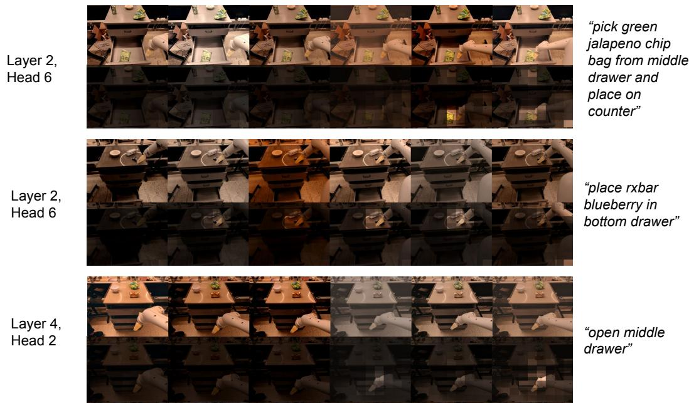  
Figure 13: In this figure we show the attention map of the RT-1 policy. Different layers and heads generally focus on different part of the image. Most commonly, they focus on the parts of the scene with the richest interaction affordances, such as graspable objets. For example, Layer 2 Head 6 focuses on the jalapeno chips and pepsi can in grasping tasks; and Layer 4 Head 2 focuses on the drawer in drawer opening tasks.

## D.5 总结与分析

在本节中，我们总结了一些发现，并对 RT‑1 的高性能、泛化和鲁棒性提出了直觉解释。首先，ImageNet 预训练（以及 Universal Sentence Encoder 语言嵌入）具有重大影响，尤其是在未见任务上。我们观察到，RT‑1 继承了训练这些模型的数据集的通用性和多样性所带来的部分知识。其次，连续动作对各项性能都有很大影响。这在以往已被观察到，可能是由于能够表示更复杂的动作分布——逐维度离散化使我们的模型能够表示复杂的多峰分布，而高斯分布只能捕获单一模态。第三，鉴于此类具有强大表现力的多任务模型，数据多样性比数据规模的影响更大。事实上，即使是在仿真环境中或来自不同机器人具身形态收集的数据集，也可以被 RT‑1 所利用，从而为数据收集的新范式开辟了途径。

最后，与例如 Gato 的后期融合相比，RT‑1 通过 FiLM 条件化较早地将语言融合到图像流水线中。这使得图像 token 仅聚焦于当前指令的相关特征，而这也可能是 Gato 在干扰物场景下表现不佳的原因。图 13 可视化了 RT‑1 在 rollout 期间的注意力。我们看到注意力集中在相关特征上，尤其是夹爪与目标物体之间的交互。诸如此类的注意力层瓶颈带来了紧凑的表示，有效忽略了干扰物和多变的背景。

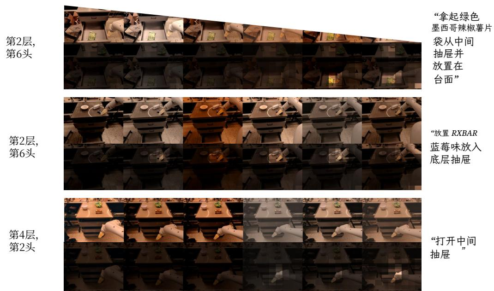  
图 13：在本图中，我们展示了 RT‑1 策略的注意力图。不同的层和头通常关注图像的不同部分。最常见的是，它们关注场景中交互示能最丰富的部分，例如可抓取的物体。例如，第 2 层第 6 头在抓取任务中关注墨西哥辣椒薯片和百事可乐罐；而第 4 层第 2 头在开抽屉任务中关注抽屉。