# RT-2: Vision-Language-Action Models Transfer Web Knowledge to Robotic Control

Anthony Brohan, Noah Brown, Justice Carbajal, Yevgen Chebotar, Xi Chen, Krzysztof Choromanski, Tianli Ding, Danny Driess, Avinava Dubey, Chelsea Finn, Pete Florence, Chuyuan Fu,

Montse Gonzalez Arenas, Keerthana Gopalakrishnan, Kehang Han, Karol Hausman, Alexander Herzog, Jasmine Hsu, Brian Ichter, Alex Irpan, Nikhil Joshi, Ryan Julian, Dmitry Kalashnikov, Yuheng Kuang, Isabel Leal, Lisa Lee, Tsang-Wei Edward Lee, Sergey Levine, Yao Lu, Henryk Michalewski, Igor Mordatch, Karl Pertsch, Kanishka Rao, Krista Reymann, Michael Ryoo, Grecia Salazar, Pannag Sanketi,

Pierre Sermanet, Jaspiar Singh, Anikait Singh, Radu Soricut, Huong Tran, Vincent Vanhoucke, Quan Vuong, Ayzaan Wahid, Stefan Welker, Paul Wohlhart, Jialin Wu, Fei Xia, Ted Xiao, Peng Xu, Sichun Xu, Tianhe Yu, and Brianna Zitkovich

Google DeepMind. Authors listed in alphabetical order, with contributions listed in Appendix A.

We study how vision-language models trained on Internet-scale data can be incorporated directly into end-to-end robotic control to boost generalization and enable emergent semantic reasoning. Our goal is to enable a single end-to-end trained model to both learn to map robot observations to actions and enjoy the benefits of large-scale pretraining on language and vision-language data from the web. To this end, we propose to co-fine-tune state-of-the-art vision-language models on both robotic trajectory data and Internet-scale vision-language tasks, such as visual question answering. In contrast to other approaches, we propose a simple, general recipe to achieve this goal: in order to fit both natural language responses and robotic actions into the same format, we express the actions as text tokens and incorporate them directly into the training set of the model in the same way as natural language tokens. We refer to such category of models as vision-language-action models (VLA) and instantiate an example of such a model, which we call RT-2. Our extensive evaluation (6k evaluation trials) shows that our approach leads to performant robotic policies and enables RT-2 to obtain a range of emergent capabilities from Internet-scale training. This includes significantly improved generalization to novel objects, the ability to interpret commands not present in the robot training data (such as placing an object onto a particula number or icon), and the ability to perform rudimentary reasoning in response to user commands (such as picking up the smallest or largest object, or the one closest to another object). We further show that incorporating chain of thought reasoning allows RT-2 to perform multi-stage semantic reasoning, for example figuring out which object to pick up for use as an improvised hammer (a rock), or which type of drink is best suited for someone who is tired (an energy drink).

## 1. Introduction

High-capacity models pretrained on broad web-scale datasets provide an efective and powerful platform for a wide range of downstream tasks: large language models can enable not only fluent text generation (Anil et al., 2023; Brohan et al., 2022; OpenAI, 2023) but emergent problem-solving (Cobbe et al., 2021; Lewkowycz et al., 2022; Polu et al., 2022) and creative generation of prose (Brown et al., 2020; OpenAI, 2023) and code (Chen et al., 2021), while vision-language models enable open-vocabulary visual recognition (Kirillov et al., 2023; Minderer et al., 2022; Radford et al., 2021) and can even make complex inferences about object-agent interactions in images (Alayrac et al., 2022; Chen et al., 2023a,b; Driess et al., 2023; Hao et al., 2022; Huang et al., 2023; Wang et al., 2022). Such semantic reasoning, problem solving, and visual interpretation capabilities would be tremendously useful for generalist robots that must perform a variety of tasks in real-world environments. However,

# RT‑2：视觉‑语言‑动作模型将网络知识迁移至机器人控制

Anthony Brohan, Noah Brown, Justice Carbajal, Yevgen Chebotar, Xi Chen, Krzysztof Choromanski, Tianli Ding, Danny Driess, Avinava Dubey, Chelsea Finn, Pete Florence, Chuyuan Fu, Montse Gonzalez Arenas, Keerthana Gopalakrishnan, Kehang Han, Karol Hausman, Alexander Herzog, Jasmine Hsu, Brian Ichter, Alex Irpan, Nikhil Joshi, Ryan Julian, Dmitry Kalashnikov, Yuheng Kuang, Isabel Leal, Lisa Lee, Tsang‑Wei Edward Lee, Sergey Levine, Yao Lu, Henryk Michalewski, Igor Mordatch, Karl Pertsch, Kanishka Rao, Krista Reymann, Michael Ryoo, Grecia Salazar, Pannag Sanketi, Pierre Sermanet, Jaspiar Singh, Anikait Singh, Radu Soricut, Huong Tran, Vincent Vanhoucke, Quan Vuong, Ayzaan Wahid, Stefan Welker, Paul Wohlhart, Jialin Wu, Fei Xia, Ted Xiao, Peng Xu, Sichun Xu, Tianhe Yu 以及 Brianna Zitkovich

Google DeepMind。作者按姓氏字母顺序列出，贡献见附录A。

我们研究了如何将基于互联网规模数据训练的视觉‑语言模型直接融入端到端机器人控制中，以提升泛化能力并实现涌现语义推理。我们的目标是使单一的端到端训练模型既能学会将机器人观测映射到动作，又能享受来自网络的语言和视觉‑语言数据大规模预训练的优势。为此，我们提出在机器人轨迹数据和互联网规模的视觉‑语言任务（例如视觉问答）上联合微调最先进的视觉‑语言模型。与其他方法不同，我们提出了一个简单通用的方案来实现这一目标：为了使自然语言响应和机器人动作适应相同的格式，我们将动作表示为文本 token，并以与自然语言 token 相同的方式将其直接纳入模型的训练集中。我们将此类模型称为视觉‑语言‑动作模型（VLA），并实例化了此类模型的一个范例，称之为 RT‑2。我们广泛的评估（6000 次评估测试）表明，我们的方法能够产生高性能的机器人策略，并使 RT‑2 能够从互联网规模的训练中获得一系列涌现能力。这包括对新物体的泛化能力显著提高、能够理解机器人训练数据中不存在的指令（例如将物体放置在特定的数字或图标上），以及根据用户指令执行初步推理的能力（例如拿起最小或最大的物体，或者离另一个物体最近的物体）。我们进一步证明，结合思维链推理能够让 RT‑2 执行多阶段语义推理，例如找出应该拿起哪个物体作为临时锤子（一块石头），或者哪种饮料最适合疲惫的人（功能饮料）。

## 1. 引言

在广泛的网络规模数据集上预训练的高容量模型为各种下游任务提供了有效且强大的平台：大语言模型不仅能够实现流畅的文本生成（Anil et al., 2023; Brohanet al., 2022; OpenAI, 2023），还能实现涌现式问题解决（Cobbe et al., 2021; Lewkowycz et al., 2022; Polu et al., 2022）以及文章（Brown et al., 2020; OpenAI, 2023）和代码（Chen et al., 2021）的创造性生成，而视觉‑语言模型则能够实现开放词汇视觉识别（Kirillov et al., 2023; Minderer et al., 2022; Radford et al., 2021），甚至能对图像中的物体‑智能体交互进行复杂的推理（Alayrac et al., 2022; Chen et al., 2023a,b; Driesset al., 2023; Hao et al., 2022; Huang et al., 2023; Wang et al., 2022）。这种语义推理、问题解决和视觉解释能力对于必须在真实世界环境中执行各种任务的通用机器人来说将大有裨益。然而，

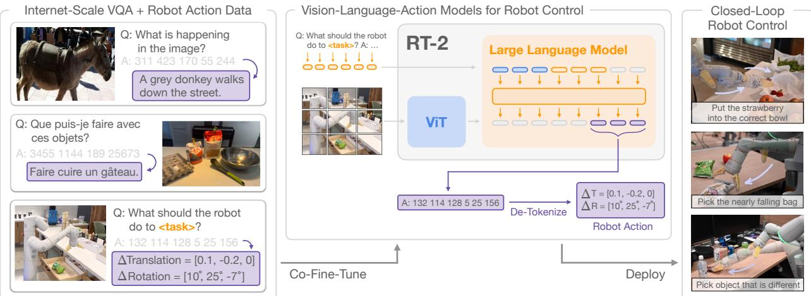  
Figure 1 | RT-2 overview: we represent robot actions as another language, which can be cast into text tokens and trained together with Internet-scale vision-language datasets. During inference, the text tokens are de-tokenized into robot actions, enabling closed loop control. This allows us to leverage the backbone and pretraining of vision-language models in learning robotic policies, transferring some of their generalization, semantic understanding, and reasoning to robotic control. We demonstrate examples of RT-2 execution on the project website: robotics-transformer2.github.io.

it is unclear how robots should acquire such capabilities. While a brute force approach might entai collecting millions of robotic interaction trials, the most capable language and vision-language models are trained on billions of tokens and images from the web (Alayrac et al., 2022; Chen et al., 2023a,b; Huang et al., 2023) – an amount unlikely to be matched with robot data in the near future. On the other hand, directly applying such models to robotic tasks is also dificult: such models reason about semantics, labels, and textual prompts, whereas robots require grounded low-level actions, such as Cartesian end-efector commands. While a number of recent works have sought to incorporate language models (LLMs) and vision-language models (VLMs) into robotics (Ahn et al., 2022; Driess et al., 2023; Vemprala et al., 2023), such methods generally address only the “higher level” aspects of robotic planning, essentially taking the role of a state machine that interprets commands and parses them into individual primitives (such as picking and placing objects), which are then executed by separate low-level controllers that themselves do not benefit from the rich semantic knowledge of Internet-scale models during training. Therefore, in this paper we ask: can large pretrained visionlanguage models be integrated directly into low-level robotic control to boost generalization and enable emergent semantic reasoning?

To this end, we explore an approach that is both simple and surprisingly efective: we directly train vision-language models designed for open-vocabulary visual question answering and visual dialogue to output low-level robot actions, along with solving other Internet-scale vision-language tasks. Although such models are typically trained to produce natural language tokens, we can train them on robotic trajectories by tokenizing the actions into text tokens and creating “multimoda sentences” (Driess et al., 2023) that “respond” to robotic instructions paired with camera observations by producing corresponding actions. In this way, vision-language models can be directly trained to act as instruction following robotic policies. This simple approach is in contrast with prior alternatives for incorporating VLMs into robot policies (Shridhar et al., 2022a) or designing new vision-languageaction architectures from scratch (Reed et al., 2022): instead, pre-existing vision-language models, with already-amortized significant compute investment, are trained without any new parameters to output text-encoded actions. We refer to this category of models as vision-language-action (VLA) models. We instantiate VLA models by building on the protocol proposed for RT-1 (Brohan et al., 2022), using a similar dataset, but expanding the model to use a large vision-language backbone. Hence we refer to our model as RT-2 (Robotics Transformer 2). We provide an overview in Figure 1.

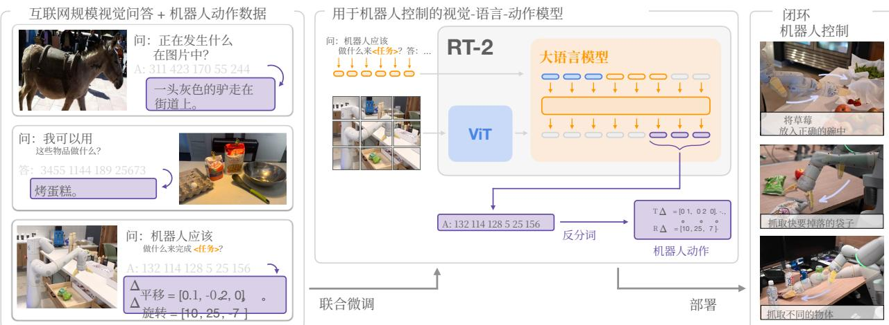  
图 |RT‑2 概述：我们将机器人动作表示为另一种语言，可将其转换为文本 token 并与互联网规模的视觉语言数据集一同训练。在推理过程中，文本 token 被反分词为机器人动作，从而实现闭环控制。这使我们能够在学习机器人策略时利用视觉‑语言模型的骨干网络和预训练，将其部分泛化、语义理解和推理能力迁移到机器人控制中。我们在项目网站上展示了 RT‑2 执行的示例： robotics-transformer2.github.io。

目前尚不清楚机器人应如何获得此类能力。尽管强力方法可能需要收集数百万次机器人交互试验，但能力最强的语言模型和视觉‑语言模型是在来自网络的数十亿个词元和图像上训练的（Alayrac etal., 2022; Chenet al.,2023a,b;Huang et al., 2023）——这一规模在短期内不太可能与机器人数据相匹敌。另一方面，直接将此类模型应用于机器人任务也十分困难：这些模型针对语义、标签和文本提示进行推理，而机器人则需要具身的低层动作，例如笛卡尔末端执行器指令。尽管最近有许多研究试图将语言模型（LLMs）和视觉‑语言模型（VLMs）引入机器人学（Ahn et al., 2022;Driesset al., 2023; Vemprala et al., 2023），但此类方法通常仅解决机器人规划的“更高层”方面，本质上扮演着状态机的角色，负责解析指令并将其分解为各个动作原语（例如抓取和放置物体），随后由独立的底层控制器执行，而这些底层控制器在训练过程中本身并没有受益于网络规模模型的丰富语义知识。因此，在本文中我们提出这样一个问题：能否将大型预训练视觉‑语言模型直接整合到底层机器人控制中，以提升泛化能力并实现涌现语义推理？

为此，我们探索了一种既简单又出奇有效的方法：我们直接训练专为开放词汇视觉问答和视觉对话设计的视觉‑语言模型来输出底层机器人动作，同时解决其他互联网规模的视觉‑语言任务。尽管此类模型通常被训练用于生成自然语言 token，但我们可以通过将动作标记化为文本 token 并创建“多模态句子”（Driessetal.,2023）来在机器人轨迹上对其进行训练，从而通过生成相应的动作来“响应”与相机观察配对的机器人指令。通过这种方式，视觉‑语言模型可以直接被训练作为遵循指令的机器人策略。这种简单的方法与以往将视觉‑语言模型整合到机器人策略中的替代方案（Shridhar et al., 2022a）或从零开始设计新的视觉‑语言‑动作架构（Reed et al., 2022）形成对比：相反，已有大量计算投入被摊销的既有视觉‑语言模型在无需任何新参数的情况下接受训练，以输出文本编码的动作。我们将此类模型称为视觉‑语言‑动作（VLA）模型。我们基于为 RT‑1（）提出的协议来实例化 VLA 模型，使用类似的数据集，但扩展了模型以使用大型视觉‑语言骨干网络。因此，我们将我们的模型称为 RT‑2（Robotics Transformer 2）。我们在图 中提供了概览。

We observe that robotic policies derived from such vision-language models exhibit a range of remarkable capabilities, combining the physical motions learned from the robot data with the ability to interpret images and text learned from web data into a single model. Besides the expected benefit of dramatically improving generalization to novel objects and semantically varied instructions, we observe a number of emergent capabilities. While the model’s physical skills are still limited to the distribution of skills seen in the robot data, the model acquires the ability to deploy those skills in new ways by interpreting images and language commands using knowledge gleaned from the web. Some example highlights are shown in Figure 2. The model is able to re-purpose pick and place skills learned from robot data to place objects near semantically indicated locations, such as specific numbers or icons, despite those cues not being present in the robot data. The model can also interpret relations between objects to determine which object to pick and where to place it, despite no such relations being provided in the robot demonstrations. Furthermore, if we augment the command with chain of thought prompting, the model is able to make even more complex semantic inferences, such as figuring out which object to pick up for use as an improvised hammer (a rock), or which type of drink is best suited for someone who is tired (an energy drink).

Our main contribution is RT-2, a family of models derived from fine-tuning large vision-language models trained on web-scale data to directly act as generalizable and semantically aware robotic policies. Our experiments investigate models with up to 55B parameters trained on Internet data and instruction-annotated robotic trajectories from previous work (Brohan et al., 2022). Over the course of 6k robotic evaluations, we show that RT-2 enable significant improvements to generalization over objects, scenes, and instructions, and exhibit a breadth of emergent capabilities inherited from web-scale vision-language pretraining.

## 2. Related Work

Vision-language models. There are several categories of Vision-Language Models (VLMs) (Gan et al., 2022), with perhaps two most relevant: (1) representation-learning models, e.g. CLIP (Radford et al., 2021), which learn common embeddings for both modalities, and (2) visual language models of the form {vision, text} → {text} which learn to take vision and language as input and provide free-form text. Both categories have been used to provide pretraining for a wide variety of applied to downstream applications such as object classification (Radford et al., 2021), detection (Gu et al., 2021), and segmentation (Ghiasi et al., 2021). In this work, we focus on the latter category (Alayrac et al., 2022; Chen et al., 2023a,b; Driess et al., 2023; Hao et al., 2022; Li et al., 2023, 2019; Lu et al., 2019). These models are generally trained on many diferent tasks, such as image captioning, vision-question answering (VQA), and general language tasks on multiple datasets at the same time. While prior works study VLMs for a wide range of problems and settings including in robotics, our focus is on how the capabilities of VLMs can be extended to robotics closed-loop control by endowing them with the ability to predict robot actions, thus leveraging the knowledge already present in VLMs to enable new levels of generalization.

Generalization in robot learning. Developing robotic controllers that can broadly succeed in a variety of scenarios is a long-standing goal in robotics research (Kaelbling, 2020; Smith and Coles, 1973). A promising approach for enabling generalization in robotic manipulation is by learning from large and diverse datasets (Dasari et al., 2019; Levine et al., 2018; Pinto and Gupta, 2016). By doing i h d h d d h b li l bj i ( i d Levine, 2017; Levine et al., 2018; Mahler et al., 2017; Pinto and Gupta, 2016; Young et al., 2021), to tasks involving novel combinations of objects and skills (Dasari and Gupta, 2021; Finn et al., 2017; James et al., 2018; Jang et al., 2021; Yu et al., 2018), to new goals or language instructions (Jang et al., 2021; Jiang et al., 2022; Liu et al., 2022; Mees et al., 2022; Nair et al., 2022a; Pong et al.,

我们观察到，从这类视觉‑语言模型中派生出的机器人策略展现出了一系列卓越的能力，将从机器人数据中学习到的物理运动与从网络数据中学习到的图像和文本解读能力结合在单个模型中。除了显著提高对新物体和语义多样指令的泛化能力这一预期优势外，我们还观察到了许多涌现能力。尽管该模型的物理技能仍局限于机器人数据中所见技能的分布，但该模型获得了通过利用从网络中收集的知识来解读图像和语言命令，从而以新方式部署这些技能的能力。图 2 展示了一些示例要点。该模型能够重新利用从机器人数据中学习到的抓取和放置技能，将物体放置在具有语义指示的位置附近（例如特定的数字或图标），尽管这些线索并未出现在机器人数据中。该模型还可以解读物体之间的关系，以确定要抓取哪个物体以及将其放置在哪里，尽管机器人演示中并未提供此类关系。此外，如果我们使用思维链提示来扩充命令，该模型能够进行更加复杂的语义推理，例如找出拾取哪种物体来充当临时锤子（一块石头），或者哪种类型的饮料最适合疲惫的人（能量饮料）。

我们的主要贡献是 RT‑2，这是一系列通过微调在网络规模数据上训练的大型视觉‑语言模型而构建的模型家族，可直接用作具备泛化能力和语义感知能力的机器人策略。我们的实验研究了参数量高达 55B 的模型，这些模型基于互联网数据以及来自先前工作（Brohan etal., 2022）的指令标注机器人轨迹进行训练。在 6000 次机器人评估中，我们表明 RT‑2 显著提升了在物体、场景和指令上的泛化能力，并展现出继承自网络级视觉‑语言预训练的广泛涌现能力。

## 2. 相关工作

视觉‑语言模型。视觉‑语言模型（VLMs）（Gan et al., 2022）有几个类别，其中可能最相关的有两类：(1) 表征学习模型，例如 CLIP（Radford et al., 2021），它们学习两种模态的通用嵌入；(2) 形式为 {vision, text} → {text} 的视觉语言模型，它们学习接收视觉和语言作为输入并提供自由格式文本。这两个类别都已被用于为广泛的下游应用提供预训练，例如物体分类（Radford etal., 2021）、检测（Gu et al., 2021）和分割（Ghiasi et al., 2021）。在这项工作中，我们专注于后一类别（Alayrac et al., 2022; Chen et al., 2023a,b; Driess et al., 2023; Hao et al., 2022;Li et al., 2023, 2019; Lu et al., 2019）。这些模型通常在多个数据集上同时针对许多不同任务进行训练，例如图像描述、视觉问答（VQA）以及通用语言任务。尽管先前的研究在包括机器人学在内的广泛问题和设置中对视觉‑语言模型进行了探索，但我们的重点在于如何通过赋予视觉‑语言模型预测机器人动作的能力，将其能力扩展到机器人学闭环控制，从而利用视觉‑语言模型中已经存在的知识来实现全新水平的泛化。

机器人学习中的泛化。开发能够在各种场景中广泛取得成功的机器人控制器是机器人学研究中一个长期的目标 (Kaelbling, 2020; Smith and Coles, 1973)。在机器人操作中实现泛化的一种很有前景的方法是从大规模且多样化的数据集中学习 (Dasari et al., 2019; Levine et al., 2018; Pinto andGupta, 2016)。通过这种方式，先前的方法展示了机器人如何能够泛化到新物体实例 (Finn andLevine, 2017; Levine et al., 2018; Mahler et al., 2017; Pinto and Gupta, 2016; Young etal.,2021)、涉及物体与技能新组合的任务 (Dasari and Gupta, 2021; Finn et al., 2017; James et al.,2018; Jang et al., 2021; Yu et al., 2018)、新目标或语言指令 (Jang et al., 2021; Jiang et al., 2022;Liu et al., 2022; Mees et al., 2022; Nair et al., 2022a; Pong et al.,

2019), to tasks with novel semantic object categories (Shridhar et al., 2021; Stone et al., 2023), and to unseen environments (Cui et al., 2022; Du et al., 2023a; Hansen et al., 2020). Unlike most of these prior works, we aim to develop and study a single model that can generalize to unseen conditions along all of these axes. A key ingredient of our approach is to leverage pre-trained models that have been exposed to data that is much broader than the data seen by the robot.

Pre-training for robotic manipulation. Pre-training has a long history in robotic learning. Most works focus on pre-trained visual representations that can be used to initialize the encoder of the robot’s camera observations, either via supervised ImageNet classification (Shah and Kumar, 2021), data augmentation (Kostrikov et al., 2020; Laskin et al., 2020a,b; Pari et al., 2021) or objectives that are tailored towards robotic control (Karamcheti et al., 2023; Ma et al., 2022; Majumdar et al., 2023b; Nair et al., 2022b; Xiao et al., 2022b). Other works have incorporated pre-trained language models, often either as an instruction encoder (Brohan et al., 2022; Hill et al., 2020; Jang et al., 2021; Jiang et al., 2022; Lynch and Sermanet, 2020; Nair et al., 2022a; Shridhar et al., 2022b) or for high-level planning (Ahn et al., 2022; Driess et al., 2023; Huang et al., 2022; Mu et al., 2023; Singh et al., 2023; Wu et al., 2023). Rather than using pre-training vision models or pre-trained language models, we specifically consider the use of pre-trained vision-language models (VLMs), which provide rich, grounded knowledge about the world. Prior works have studied the use of VLMs for robotics (Driess et al., 2023: Du et al., 2023b: Gadre et al., 2022: Karamcheti et al., 2023: Shah et al., 2023; Shridhar et al., 2021; Stone et al., 2023), and form part of the inspiration for this work. These prior approaches use VLMs for visual state representations (Karamcheti et al., 2023), for identifying objects (Gadre et al., 2022; Stone et al., 2023), for high-level planning (Driess et al., 2023), or for providing supervision or success detection (Du et al., 2023b; Ma et al., 2023; Sumers et al., 2023; Xiao et al., 2022a; Zhang et al., 2023). While CLIPort (Shridhar et al., 2021) and MOO (Stone et al., 2023) integrate pre-trained VLMs into end-to-end visuomotor manipulation policies, both incorporate significant structure into the policy that limits their applicability. Notably, our work does not rely on a restricted 2D action space and does not require a calibrated camera. Moreover, a critical distinction is that, unlike these works, we leverage VLMs that generate language, and the unified output space of our formulation enables model weights to be entirely shared across language and action tasks, without introducing action-only model layer components.

## 3. Vision-Language-Action Models

In this section, we present our model family and the design choices for enabling training VLMs to directly perform closed-loop robot control. First, we describe the general architecture of our models and how they can be derived from models that are commonly used for vision-language tasks. Then, we introduce the recipe and challenges of fine-tuning large VLMs that are pre-trained on web-scale data to directly output robot actions, becoming VLA models. Finally, we describe how to make these models practical for robot tasks, addressing challenges with model size and inference speed to enable real-time control.

## 3.1. Pre-Trained Vision-Language Models

The vision-language models (Chen et al., 2023a; Driess et al., 2023) that we build on in this work take as input one or more images and produce a sequence of tokens, which conventionally represents natural language text. Such models can perform a wide range of visual interpretation and reasoning tasks, from inferring the composition of an image to answering questions about individual objects and their relations to other objects (Alayrac et al., 2022; Chen et al., 2023a; Driess et al., 2023; Huang et al., 2023). Representing the knowledge necessary to perform such a wide range of tasks

2019)、具有新语义物体类别的任务 (Shridhar et al., 2021;Stoneetal., 2023)，以及未见环境 (Cuiet al., 2022; Du et al.,2023a;Hansen etal., 2020)。与大多数这些先前工作不同，我们的目标是开发并研究一个能够在所有这些维度上泛化到未见条件的单一模型。我们方法的一个关键要素是利用接触过远比机器人所见数据更为广泛的数据的预训练模型。

用于机器人操作的预训练。预训练在机器人学习中有着悠久的历史。大多数工作侧重于预训练视觉表征，这些表征可通过监督 ImageNet 分类 (Shah and Kumar, 2021)、数据增强 (Kostrikov et al.,2020; Laskin et al., 2020a,b; Pari et al., 2021) 或专为机器人控制定制的目标 (Karamcheti et al.,2023; Ma et al., 2022; Majumdar et al., 2023b; Nair et al., 2022b; Xiao et al., 2022b) 用于初始化机器人相机观测的编码器。其他工作则结合了预训练语言模型，通常将其用作指令编码器 (Brohan etal., 2022; Hill et al., 2020; Jang et al., 2021; Jiang et al., 2022; Lynch and Sermanet, 2020;Nair et al., 2022a; Shridhar et al., 2022b) 或用于高层规划 (Ahn et al., 2022; Driess et al., 2023;Huang et al., 2022; Mu et al., 2023; Singh et al., 2023; Wu et al., 2023)。与使用预训练视觉模型或预训练语言模型不同，我们特别考虑使用预训练视觉‑语言模型 (VLMs)，这类模型提供了关于世界的丰富且扎根的知识。先前的研究探讨了将视觉‑语言模型用于机器人学 (Driess et al., 2023; Du et al.,2023b; Gadre et al., 2022; Karamcheti et al., 2023; Shah et al., 2023; Shridhar et al., 2021;Stone et al., 2023)，这也是本工作的灵感来源之一。这些先前的途径将视觉‑语言模型用于视觉状态表征 (Karamcheti et al., 2023)、识别物体 (Gadre et al., 2022; Stone et al., 2023)、高层规划 (Driess et al., 2023)，或用于提供监督或成功检测 (Du et al., 2023b; Ma et al., 2023; Sumers et al.,2023; Xiao et al., 2022a; Zhang et al., 2023)。尽管 CLIPort (Shridhar et al., 2021) 和 MOO(Stone et al., 2023) 将预训练视觉‑语言模型集成到端到端视觉运动操作策略中，但两者都在策略中引入了较多的结构设计，从而限制了其适用性。值得注意的是，我们的工作不依赖于受限的 2D 动作空间，也不需要标定相机。此外，一个关键区别在于，与这些工作不同，我们利用了能够生成语言的视觉‑语言模型，且我们方案的统一输出空间使得模型权重能够在语言和动作任务之间完全共享，而无需引入仅用于动作的模型层组件。

## 3. 视觉‑语言‑动作模型

在本节中，我们介绍我们的模型家族以及训练视觉‑语言模型以直接执行闭环机器人控制的设计选择。首先，我们描述我们模型的通用架构，以及它们如何从常用于视觉‑语言任务的模型衍生而来然后，我们介绍微调在网络规模数据上预训练的大型视觉‑语言模型以直接输出机器人动作、从而成为 VLA 模型的方案与挑战。最后，我们介绍如何使这些模型适用于机器人任务，解决模型大小和推理速度方面的挑战以实现实时控制。

## 3.1. 预训练视觉‑语言模型

我们在本工作中所基于的视觉‑语言模型（Chen et al., 2023a;Driess et al., 2023）以一张或多张图像作为输入，并生成一个 token 序列，该序列通常表示自然语言文本。此类模型能够执行广泛的视觉解释和推理任务，从推断图像的构图到回答有关单个对象及其与其他对象关系的问题（Alayrac et al., 2022; Chen etal., 2023a; Driesset al., 2023;Huang et al., 2023）。表征执行如此广泛任务所需的知识

requires large models and web-scale datasets. In this work, we adapt two previously proposed VLMs to act as VLA models: PaLI-X (Chen et al., 2023a) and PaLM-E (Driess et al., 2023). We will refer to vision-language-action versions of these models as RT-2-PaLI-X and RT-2-PaLM-E. We leverage instantiations of these models that range in size from billions to tens of billions of parameters. We provide a detailed description of the architecture of these two models in Appendix D.

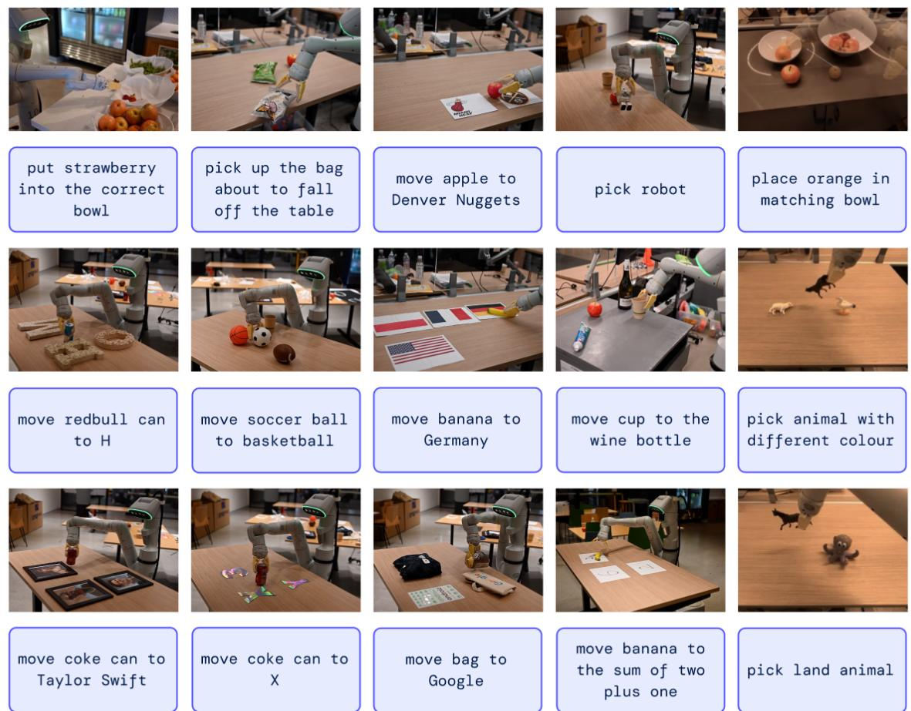  
Figure 2 | RT-2 is able to generalize to a variety of real-world situations that require reasoning, symbol understanding, and human recognition. We study these challenging scenarios in detail in Section 4.

## 3.2. Robot-Action Fine-tuning

To enable vision-language models to control a robot, they must be trained to output actions. We take a direct approach to this problem, representing actions as tokens in the model’s output, which are treated in the same way as language tokens. We base our action encoding on the discretization proposed by Brohan et al. (2022) for the RT-1 model. The action space consists of 6-DoF positional and rotational displacement of the robot end-efector, as well as the level of extension of the robot gripper and a special discrete command for terminating the episode, which should be triggered by the policy to signal successful completion. The continuous dimensions (all dimensions except for the discrete termination command) are discretized into 256 bins uniformly. Thus, the robot action can be represented using ordinals of the discrete bins as 8 integer numbers. In order to use these discretized actions to finetune a vision-language into a vision-language-action model, we need to associate tokens from the model’s existing tokenization with the discrete action bins. This requires 需要大型模型和网络规模数据集。在本工作中，我们将先前提出的两种视觉‑语言模型调整为 VLA 模型：PaLI‑X（Chenet al., 2023a）和 PaLM‑E（Driessetal., 2023）。我们将这些模型的视 觉‑语言‑动作版本称为 RT‑2‑PaLI‑X 和 RT‑2‑PaLM‑E。我们利用了参数规模从数十亿到数百亿不 等的这些模型的实例化版本。我们在附录 D 中对这两个模型的架构进行了详细描述。

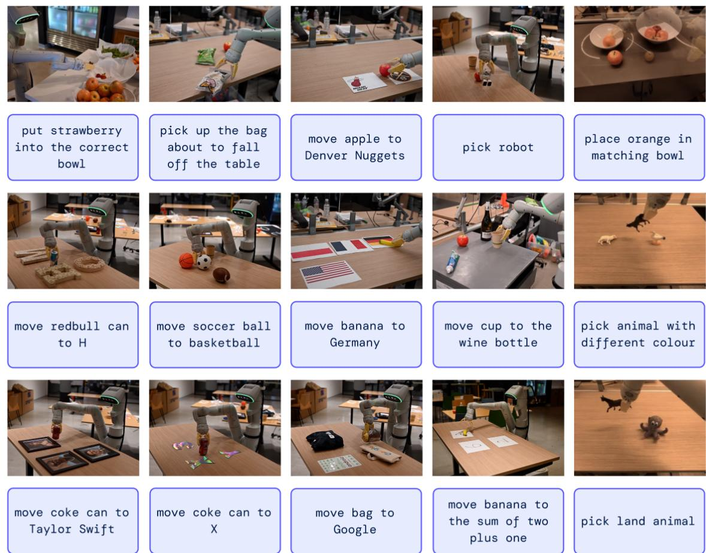  
图 2 | RT‑2 能够泛化到需要推理、符号理解和人类识别的各种真实世界场景。我们在第4 节中详细研究了这些具有挑战性的场景。

## 3.2. 机器人动作微调

为了使视觉‑语言模型能够控制机器人，必须训练它们输出动作。我们对此问题采用了一种直接的方法，即将动作表示为模型输出中的标记，并以与语言标记相同的方式对待它们。我们的动作编码基于 Brohan 等人（2022）针对 RT‑1 模型提出的离散化方案。动作空间由机器人末端执行器的6 自由度位置与旋转位移、机器人夹爪的展开程度，以及一个用于终止回合的特殊离散指令组成，该指令应由策略触发以指示成功完成。连续维度（除离散终止指令之外的所有维度）被均匀离散化为 256 个分箱。因此，机器人动作可以用离散分箱的序号表示为 8 个整数。为了使用这些离散化动作将视觉‑语言模型微调为视觉‑语言‑动作模型，我们需要将来自模型现有标记化的标记与离散动作分箱关联起来。这需要

reserving 256 tokens to serve as action tokens. Which tokens to choose depends on the particular tokenization used by each VLM, which we discuss later in this section. In order to define a target for VLM fine-tuning we convert the action vector into a single string by simply concatenating action tokens for each dimension with a space character:

“terminate Δpos Δpos Δpos Δrot� Δrot Δrot� gripper\_extension”.

A possible instantiation of such a target could be: “1 128 91 241 5 101 127”. The two VLMs that we finetune in our experiments, PaLI-X (Chen et al., 2023a) and PaLM-E (Driess et al., 2023), use diferent tokenizations. For PaLI-X, integers up to 1000 each have a unique token, so we simply associate the action bins to the token representing the corresponding integer. For the PaLM-E model, which does not provide this convenient representation of numbers, we simply overwrite the 256 least frequently used tokens to represent the action vocabulary. It is worth noting that training VLMs to override existing tokens with action tokens is a form of symbol tuning (Wei et al., 2023), which has been shown to work well for VLMs in prior work.

Taking the action representation described above, we convert our robot data to be suitable for VLM model fine-tuning, where our inputs include robot camera image and textual task description (using standard VQA format “Q: what action should the robot take to [task instruction]? A:”), and our output is formatted as a string of numbers/least frequently used tokens representing a robot action.

Co-Fine-Tuning. As we will show in our experiments, a key technical detail of the training recipe that improves robot performance is co-fine-tuning robotics data with the original web data instead of naïve finetuning on robot data only. We notice that co-fine-tuning leads to more generalizable policies since the policies are exposed to both abstract visual concepts from web scale data and low level robot actions during fine-tuning, instead of just robot actions. During co-fine-tuning we balance the ratios of robot and web data in each training batch by increasing the sampling weight on the robot dataset.

Output Constraint. One important distinction between RT-2 and standard VLMs is that RT-2 is required to output valid action tokens for execution on the real robot. Thus, to ensure that RT-2 outputs valid action tokens during decoding, we constrain its output vocabulary via only sampling valid action tokens when the model is prompted with a robot-action task, whereas the model is still allowed to output the full range of natural language tokens on standard vision-language tasks.

## 3.3. Real-Time Inference

The size of modern VLMs can reach tens or hundreds of billions of parameters (Chen et al., 2023a; Driess et al., 2023). The largest model trained in this work uses 55B parameters. It is infeasible to directly run such models on the standard desktop-style machines or on-robot GPUs commonly used for real-time robot control. To the best of our knowledge, our model is the largest ever, by over an order of magnitude, used for direct closed-loop robotic control, and therefore requires a new set of solutions to enable eficient real-time inference. We develop a protocol that allows us to run RT-2 models on robots by deploying them in a multi-TPU cloud service and querying this service over the network. With this solution, we can achieve a suitable frequency of control and also serve multiple robots using the same cloud service. The largest model we evaluated, the 55B parameter RT-2-PaLI-X-55B model, can run at a frequency of 1-3 Hz. The smaller version of that model, consisting of 5B parameters, can run at a frequency of around 5 Hz.

## 4. Experiments

Our experiments focus on real-world generalization and emergent capabilities of RT-2 and aim to answer the following questions:

预留 256 个标记来用作动作标记。选择哪些标记取决于每个视觉语言模型所使用的特定标记化方式，我们将在本节稍后部分对此进行讨论。为了定义视觉语言模型微调的目标，我们只需用空格字符连接每个维度的动作标记，将动作向量转换为单个字符串：

$$
\text { "terminate } \Delta \mathrm{pos} _ {x} \Delta \mathrm{pos} _ {y} \Delta \mathrm{pos} _ {z} \Delta \mathrm{rot} _ {x} \Delta \mathrm{rot} _ {y} \Delta \mathrm{rot} _ {z} \text { gripper\_extension" }.
$$

此类目标的一个可能实例化形式为：“1 128 91 241 5 101 127”。我们在实验中微调的两个视觉‑语言模型——PaLI‑X（Chen 等人，2023 ）与 PaLM‑E（Driess 等人，2023）使用了不同的标记化方式。对于 PaLI‑X，不超过 1000 的整数各自拥有一个唯一的标记，因此我们只需将动作分箱关联到表示对应整数的标记。对于 PaLM‑E 模型，由于其不提供这种便捷的数字表示方式，我们直接覆盖 256 个使用频率最低的标记来表示动作词表。值得注意的是，通过训练视觉‑语言模型用动作标记覆盖现有标记是符号微调的一种形式（Wei 等人，2023），先前的研究表明这在视觉‑语言模型中效果良好。

采用上述动作表示，我们将机器人数据转换为适用于视觉语言模型微调的形式，其中输入包括机器人相机图像和文本任务描述（使用标准视觉问答格式“Q:what action should the robot take to [task instruction]? A:”），输出则格式化为表示机器人动作的数字/最不常用标记（least frequently used token）字符串。

联合微调。正如我们将在实验中展示的那样，提升机器人性能的训练配方中的一个关键技术细节是将机器人学数据与原始网络数据进行联合微调，而不是仅在机器人数据上进行单纯的微调。我们注意到，联合微调可以带来更具泛化性的策略，因为在微调过程中，策略不仅接触到机器人动作，还能同时接触到来自网络规模数据的抽象视觉概念以及底层机器人动作。在联合微调期间，我们通过增加机器人数据集上的采样权重，来平衡每个训练批次中机器人数据与网络数据的比例。

输出约束。RT‑2 与标准视觉‑语言模型之间的一个重要区别在于，RT‑2 需要输出有效的动作标记以在真实机器人上执行。因此，为了确保 RT‑2 在解码期间输出有效的动作标记，我们在模型接收到机器人动作任务提示时，通过仅对有效动作标记进行采样来约束其输出词表，而在标准视觉语言任务中，模型仍被允许输出全部范围的自然语言标记。

## 3.3. 实时推理

现代视觉‑语言模型的规模可达数百亿或数千亿参数（Chen 等人，2023a；Driess 等人，2023）。本工作训练的最大模型使用了 55B 参数。直接在通常用于实时机器人控制的标准台式机或机器人机载 GPU 上运行此类模型是不可行的。据我们所知，我们的模型是有史以来用于直接闭环机器人控制的最大模型（大出一个数量级以上），因此需要一套全新的解决方案来实现高效的实时推理。我们开发了一种协议，通过将 RT‑2 模型部署在多 TPU 云服务中并通过网络查询该服务，使我们能够在机器人上运行 RT‑2 模型。借助该解决方案，我们能够实现合适的控制频率，并使用相同的云服务同时为多台机器人提供服务。我们评估的最大模型——拥有 55B 参数的 RT‑2‑PaLI‑X‑55B模型——能以 1‑3 Hz 的频率运行。该模型的较小版本包含 5B 参数，能以约 5 Hz 的频率运行。

## 4. 实验

我们的实验侧重于 RT‑2 的真实世界泛化和涌现能力，旨在回答以下问题：

1. How does RT-2 perform on seen tasks and more importantly, generalize over new objects, backgrounds, and environments?

2. Can we observe and measure any emergent capabilities of RT-2?

3. How does the generalization vary with parameter count and other design decisions?

4. Can RT-2 exhibit signs of chain-of-thought reasoning similarly to vision-language models?

We evaluate our approach and several baselines with about 6,000 evaluation trajectories in a variety of conditions, which we describe in the following sections. Unless specified otherwise, we use a 7DoF mobile manipulator with the action space described in Sec. 3.2. We also demonstrate examples of RT-2 execution on the project website: robotics-transformer2.github.io. We train two specific instantiations of RT-2 that leverage pre-trained VLMs: (1) RT-2-PaLI-X is built from 5B and 55B PaLI-X (Chen et al., 2023a), and (2) RT-2-PaLM-E is built from 12B PaLM-E (Driess et al., 2023).

For training, we leverage the original web scale data from Chen et al. (2023a) and Driess et al. (2023), which consists of visual question answering, captioning, and unstructured interwoven image and text examples. We combine it with the robot demonstration data from Brohan et al. (2022), which was collected with 13 robots over 17 months in an ofice kitchen environment. Each robot demonstration trajectory is annotated with a natural language instruction that describes the task performed, consisting of a verb describing the skill (e.g., “pick”, ”open”, “place into”) and one or more nouns describing the objects manipulated (e.g., “7up can”, “drawer”, “napkin”) (see Appendix B for more details on the used datasets). For all RT-2 training runs we adopt the hyperparameters from the original PaLI-X (Chen et al., 2023a) and PaLM-E (Driess et al., 2023) papers, including learning rate schedules and regularizations. More training details can be found in Appendix E.

Baselines. We compare our method to multiple state-of-the-art baselines that challenge diferent aspects of our method. All of the baselines use the exact same robotic data. To compare against a state-of-the-art policy, we use RT-1 (Brohan et al., 2022), a 35M parameter transformer-based model. To compare against state-of-the-art pretrained representations, we use VC-1 (Majumdar et al., 2023a) and R3M (Nair et al., 2022b), with policies implemented by training an RT-1 backbone to take their representations as input. To compare against other architectures for using VLMs, we use MOO (Stone et al., 2023), which uses a VLM to create an additional image channel for a semantic map, which is then fed into an RT-1 backbone. More information is provided in Appendix C.

4.1. How does RT-2 perform on seen tasks and more importantly, generalize over new objects, backgrounds, and environments?

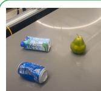

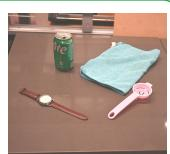  
(a) Unseen Objects

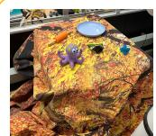

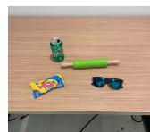

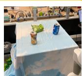  
(b) Unseen Backgrounds  
Figure 3 | Example generalization scenarios used for evaluation in Figures 4 and 6b and Tables 4 and 6.

(c) Unseen Environments  
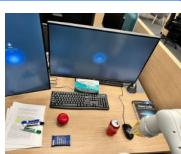

To evaluate in-distribution performance as well as generalization capabilities, we compare the RT-2-PaLI-X and RT-2-PaLM-E models to the four baselines listed in the previous sections. For the seen tasks category, we use the same suite of seen instructions as in RT-1 (Brohan et al., 2022), which include over 200 tasks in this evaluation: 36 for picking objects, 35 for knocking objects, 35 for placing things upright, 48 for moving objects, 18 for opening and closing various drawers, and 36 for picking out of and placing objects into drawers. Note, however, that these “in-distribution” evaluations still vary the placement of objects and factors such as time of day and robot position, requiring the skills to generalize to realistic variability in the environment.

## 1. RT‑2 在已见任务上的表现如何，更重要的是，它如何泛化到新物体上

背景和环境中？2. 我们能否观察并衡量 RT‑2 的任何涌现能力？3. 泛化能力如何随参数量和其他设计决策而变化？4. RT‑2 是否能像视觉‑语言模型那样表现出思维链推理的迹象？

我们在多种条件下通过约 6,000 条评估轨迹对我们的方法和若干基线进行了评估，下文各节将对此进行描述。除非另有说明，我们使用的是具备第 3.2节所述动作空间的 7自由度移动操作机。我们还在项目网站上展示了 RT‑2 的执行示例： robotics-transformer2.github.io。我们训练了利用预训练视觉‑语言模型的两种 RT‑2 具体实例化版本：(1) RT-2-PaLI-X 基于 5B 和 55B PaLI‑X 构建（Chenet al.,2023a），以及 (2) RT-2-PaLM-E 基于 12B PaLM‑E 构建（Driess et al., 2023）。

在训练中，我们利用了来自 Chen et al.（2023a）和 Driess et al.（2023）的原始网络规模数据，这些数据由视觉问答、图像描述以及非结构化的图文交织样本组成。我们将其与来自 Brohanetal. （2022）的机器人演示数据相结合，这些数据是在办公室厨房环境中由 13 台机器人在 17 个月内收集的。每个机器人演示轨迹都标注有描述所执行任务的自然语言指令，该指令由一个描述技能的动词（例如“抓取”、“打开”、“放入”）和一个或多个描述所操作物体的名词（例如“七喜罐”、“抽屉”、“餐巾纸”）组成（参见附录 B 以了解所用数据集的更多详细信息）。对于所有 RT‑2 训练运行，我们都采用了来自原始 PaLI‑X（Chen et al., 2023a）和 PaLM‑E（Driessetal., 2023）论文的超参数，包括学习率调度和正则化。更多训练细节见附录 E。

基线。我们将我们的方法与从不同方面挑战我们方法的多个最先进基线进行比较。所有基线均使用完全相同的机器人数据。为了与最先进的策略进行比较，我们使用了 RT-1 （Brohan 等人，2022），这是一个拥有 3500 万参数、基于 Transformer 的模型。为了与最先进的预训练表征进行比较，我们使用了 VC-1 （Majumdar 等人，2023a）和 R3M （Nair 等人

，2022b），其策略是通过训练一个以它们的表征作为输入的 RT‑1 骨干网络来实现的。为了与其他使用视觉‑语言模型的架构进行比较，我们使用了 MOO（Stone 等人，2023），它使用视觉语言模型为语义地图创建一个额外的图像通道，然后将其输入到 RT‑1 骨干网络中。更多信息见附录 C。

## 4.1. RT‑2 在已见任务上的表现如何？更重要的是，它如何泛化到新的物体、背景和环境？

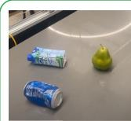  
(a) 未见物体

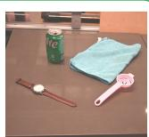

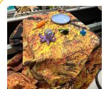

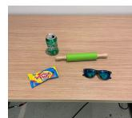  
(b) 未见背景

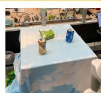

(c) 未见环境  
  
图 3 | 用于评估的泛化场景示例，见图4和6b以及表4和6

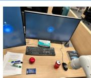

为了评估分布内性能以及泛化能力，我们将 RT‑2‑PaLI‑X 和 RT‑2‑PaLM‑E 模型与前文列出的四个基线进行了比较。对于已见任务类别，我们使用了与 RT‑1（Brohan etal., 2022）中相同的已见指令集，在此次评估中包含 200 多个任务：36 个抓取物体任务、35 个击倒物体任务、35 个竖立放置物品任务、48 个移动物体任务、18 个开关各种抽屉任务，以及 36 个从抽屉中取出和放入物体任务。但请注意，这些“分布内”评估仍然改变了物体的摆放位置以及时间段和机器人位置等因素，这就要求技能能够泛化到环境中的真实变化。

Figure 3 shows example generalization evaluations, which are split into unseen categories (objects, backgrounds and environments), and are additionally split into easy and hard cases. For unseen objects, hard cases include harder-to-grasp and more unique objects (such as toys). For unseen backgrounds, hard cases include more varied backgrounds and novel objects. Lastly, for unseen environments, hard cases correspond to a more visually distinct ofice desk environment with monitors and accessories, while the easier environment is a kitchen sink. These evaluations consists of over 280 tasks that focus primarily on pick and placing skills in many diverse scenarios. The list of instructions for unseen categories is specified in Appendix F.2.

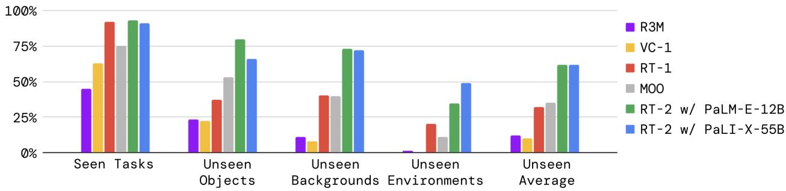  
Figure 4 | Overall performance of two instantiations of RT-2 and baselines across seen training tasks as well as unseen evaluations measuring generalization to novel objects, novel backgrounds, and novel environments. Appendix Table 4 details the full results.

The evaluation results are shown in Figure 4 and Appendix Table 4. The performance on seen tasks is similar between the RT-2 models and RT-1, with other baselines attaining a lower success rate. The diference between the RT-2 models and the baseline is most pronounced in the various generalization experiments, suggesting that the strength of vision-language-action models lies in transferring more generalizable visual and semantic concepts from their Internet-scale pretraining data. Here, on average, both instantiations of RT-2 perform similarly, resulting in ∼2x improvement over the next two baselines, RT-1 and MOO, and ∼6x better than the other baselines. The PaLM-E version of RT-2 seems to perform better than the RT-2-PaLI-X in harder versions of generalization scenarios while under-performing on easier ones, resulting in a similar average performance.

Open Source Language Table Benchmark. To provide an additional point of comparison using open-source baselines and environments, we leverage the open-source Language-Table simulation environment from Lynch et al. (2022). We co-fine-tune a smaller PaLI 3B model on several prediction tasks, including in-domain VQA tasks, for the Language-Table dataset, and evaluate the resulting policy in simulation. For the action prediction task, we discretize and encode actions as text in the format “X Y”, where X and Y range between {-10, -9, . . . , +9, +10}, and represent delta 2D cartesian setpoints of the end efector. Due to its reduced size, the resulting model can run inference at a similar rate (5 Hz) as the other baselines. The results of this experiment are presented in Table 1. We observe a significant performance boost when using our model compared to the baselines, indicating that the VLM-based pre-training together with the expressiveness of the large PaLI model can be beneficial in other scenarios, in this case, simulation with a diferent robot. We also show qualitative real-world out-of-distribution behaviors behaviors in Figure 5, demonstrating novel pushing tasks and targeting objects not before seen in this environment. More details about the Language Table experiments can be found in Appendix B and D.

## 4.2. Can we observe and measure any emergent capabilities of RT-2?

In addition to evaluating the generalization capabilities of vision-language-action models, we also aim to evaluate the degree to which such models can enable new capabilities beyond those demonstrated

图 3 展示了泛化评估的示例，这些评估分为未见类别（物体、背景和环境），并额外细分为简单和困难情况。对于未见物体，困难情况包括更难抓取且更独特的物体（例如玩具）。对于未见背景，困难情况包括更多样的背景和新物体。最后，对于未见环境，困难情况对应于具有显示器和配件的在视觉上更独特的办公桌环境，而较简单的环境则是厨房水槽。这些评估包含 280 多个任务，主要侧重于多种不同场景中的抓取和放置技能。未见类别的指令列表详见附录F.2。

  
图 | RT‑2 的两个实例化模型与各基线在已见训练任务以及衡量对新物体、新背景和新环境泛化能力的未见评估中的总体性能。附录表 详细列出了完整结果。

评估结果如图 和附录表 所示。RT‑2 模型和 RT‑1 在已见任务上的表现相似，而其他基线取得的成功率较低。RT‑2 模型与基线之间的差异在各项泛化实验中最显著，这表明视觉‑语言‑动作模型的优势在于能够从其互联网规模预训练数据中迁移更具泛化性的视觉和语义概念。在此，平均而言，RT‑2 的两个实例化模型表现相近，取得了 ∼2倍于紧随其后的两个基线 RT‑1 和 MOO 的提升，并且比其他基线好 ∼6倍。RT‑2 的 PaLM‑E 版本在难度更高的泛化场景中似乎比RT‑2‑PaLI‑X 表现更好，而在较简单的场景中表现欠佳，从而取得了相近的平均性能。

开源 Language Table 基准。为了使用开源基线和环境提供额外的对比，我们采用了来自Lynch 等人 （2022）的开源 Language‑Table 仿真环境。我们在针对 Language‑Table 数据集的多个预测任务（包括域内 VQA 任务）上联合微调了一个较小的 PaLI 3B 模型，并在仿真中评估所得策略。对于动作预测任务，我们将动作离散化并编码为“X Y”格式的文本，其中 X和 Y的取值范围在 {‑10, ‑9, . . . , +9,+10} 之间，表示末端执行器的增量二维笛卡尔设定点。由于其尺寸减小，所得模型可以与其他基线以相似的速率（5 Hz）进行推理。该实验的结果如表1所示。我们观察到，与基线相比，使用我们的模型时性能有了显著提升，这表明基于 VLM 的预训练结合大型PaLI 模型的表达能力在其他场景中也是有益的，在当前情况下即使用不同机器人的仿真。我们还在图 中展示了定性的真实世界分布外行为，演示了新颖的推任务以及针对此前在该环境中未见过的目标物体。有关 Language Table 实验的更多详细信息，请参见附录 B 和D。

## 4.2. 我们能否观察和测量 RT‑2 的任何涌现能力？

除了评估视觉‑语言‑动作模型的泛化能力之外，我们还旨在评估此类模型在多大程度上能够实现超越已有展示的新能力

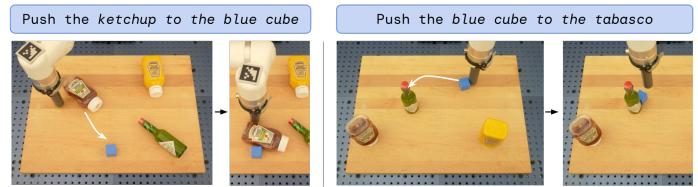  
Figure 5 | Real-world out-of-distribution behaviors in the Language Table environment. Identical RT-2-PaLI-3B model checkpoint is used as in Tab. 1.

<table><tr><td>Model</td><td>Language-Table</td></tr><tr><td>BG-Zero (Jang et al., 2021)</td><td>72 ± 3</td></tr><tr><td>RT-1 (Brohan et al., 2022)</td><td>74 ± 13</td></tr><tr><td>LAVA (Lynch et al., 2022)</td><td>77 ± 4</td></tr><tr><td>RT-2-PaLI-3B (ours)</td><td>90 ± 10</td></tr></table>

Table 1 | Performance on the simulated Language-Table tasks (Lynch and Sermanet, 2020).

in the robot data by transferring knowledge from the web. We refer to such capabilities as emergent, in the sense that they emerge by transferring Internet-scale pretraining. We do not expect such transfer to enable new robotic motions, but we do expect semantic and visual concepts, including relations and nouns, to transfer efectively, even in cases where those concepts were not seen in the robot data.

Qualitative Evaluations. First, we experiment with our RT-2-PaLI-X model to determine various emergent capabilities transferred from vision-language concepts. We demonstrate some examples of such interactions in Figure 2. We find through our explorations that RT-2 inherits novel capabilities in terms of semantic understanding and basic reasoning in the context of the scene. For example accomplishing the task “put strawberry into the correct bowl” requires a nuanced understanding of not only what a strawberry and bowl are, but also reasoning in the context the scene to know the strawberry should go with the like fruits. For the task “pick up the bag about to fall of the table,” RT-2 demonstrates physical understanding to disambiguate between two bags and recognize the precariously placed object. All the interactions tested in these scenarios have never been seen in the robot data, which points to the transfer of semantic knowledge from vision-language data.

Quantitative Evaluations. To quantify these emergent capabilities, we take the top two baselines from the previous evaluations, RT-1 and VC-1, and compare them against our two models: RT-2-PaLI-X and RT-2-PaLM-E. To reduce the variance of these experiment, we evaluate all of the methods using the A/B testing framework (Fisher, 1936), where all four models are evaluated one after another in the exact same conditions.

We’ split the emergent capabilities of RT-2 into three categories covering axes of reasoning and semantic understanding (with examples of each shown in Appendix Figure 8). The first we term symbol understanding, which explicitly tests whether the RT-2 policy transfers semantic knowledge from vision-language pretraining that was not present in any of the robot data. Example instructions in this category are “move apple to 3” or “push coke can on top of heart”. The second category we term reasoning, which demonstrates the ability to apply various aspects of reasoning of the underlying VLM to control tasks. These tasks require visual reasoning (“move the apple to cup with same color”), math (“move X near the sum of two plus one”), and multilingual understanding (“mueve la manzana al vaso verde”). We refer to the last category as human recognition tasks, which include tasks such as “move the coke can to the person with glasses”, to demonstrate human-centric understanding and recognition. The full list of instructions used for this evaluation is specified in Appendix F.2.

We present the results of this experiment in Figure 6a with all the numerical results in Appendix H.2. We observe that our VLA models significantly outperform the baselines across all categories, with our best RT-2-PaLI-X model achieving more than 3x average success rate over the next best baseline (RT-1). We also note that while the larger PaLI-X-based model results in better symbol understanding, reasoning and person recognition performance on average, the smaller PaLM-E-based model has an edge on tasks that involve math reasoning. We attribute this interesting result to the diferent pre-training mixture used in PaLM-E, which results in a model that is more capable at math calculation than the mostly visually pre-trained PaLI-X.

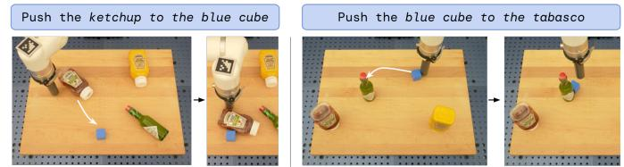  
图 5 | Language Table 环境中的真实世界分布外行为。使用了与表 1 中相同的 RT‑2‑PaLI‑3B 模型检查点。

<table><tr><td>模型</td><td>Language-Table</td></tr><tr><td>BG-Zero (Jang et al., 2021)</td><td>72 ± 3</td></tr><tr><td>RT-1(Brohan 等人,2022)</td><td>74 ± 13</td></tr><tr><td>LAVA (Lynch 等人,2022)</td><td>77 ± 4</td></tr><tr><td>RT-2-PaLI-3B (本文)</td><td>90 ± 10</td></tr></table>

表 1 | 在模拟 Language‑Table 任务上的性能 (Lynchand Ser-manet, 2020)。

—— 即通过从网络迁移知识，超越机器人数据中的能力。我们将此类能力称为涌现能力，因为它们是通过迁移互联网规模预训练而涌现出来的。我们并不期望这种迁移能够实现新的机器人动作，但我们确实期望语义和视觉概念（包括关系和名词）能够有效迁移，即使在机器人数据中未曾见过这些概念的情况下也是如此。

定性评估。首先，我们使用 RT‑2‑PaLI‑X 模型进行实验，以确定从视觉‑语言概念迁移而来的各种涌现能力。我们在图2中展示了此类交互的一些示例。通过探索我们发现，RT‑2 在场景上下文的语义理解和基础推理方面继承了新的能力。例如，完成“将草莓放入正确的碗中”这一任务，不仅需要细致理解什么是草莓和碗，还需要结合场景上下文进行推理，以明确草莓应当与同类水果放在一起。对于“捡起快要从桌上掉落的袋子”这一任务，RT‑2 展现出了物理理解能力，能够区分两个袋子并识别出放置位置不稳的物体。在这些场景中测试的所有交互均未在机器人数据中出现过，这表明了语义知识从视觉‑语言数据中的迁移。

定量评估。为了量化这些涌现能力，我们选取了前述评估中表现最好的两个基线（RT‑1 和VC‑1），并将它们与我们的两个模型（RT‑2‑PaLI‑X 和 RT‑2‑PaLM‑E）进行对比。为了减小这些实验的方差，我们使用 A/B 测试框架（Fisher, 1936）评估所有方法，即所有四个模型都在完全相同的条件下依次进行评估。

我们将 RT‑2 的涌现能力划分为涵盖推理和语义理解维度的三个类别（各类别示例见附录图8）。我们将第一个类别称为符号理解，它明确测试了 RT‑2 策略是否从视觉语言预训练中迁移了在任何机器人数据中均未出现过的语义知识。该类别中的示例指令包括“将苹果移到 3”或“将可乐罐推到心形图案上”。我们将第二个类别称为推理，展示了将底层视觉语言模型的各类推理能力应用于控制任务的能力。这些任务需要视觉推理（“将苹果移到相同颜色的杯子中”）、数学（“将 X 移到二加一之和的附近”）以及多语言理解（“mueve la manzana alvasoverde”）。我们将最后一个类别称为人类识别任务，其中包括“将可乐罐移给戴眼镜的人”等任务，以展示以人为中心的理解和识别能力。用于本次评估的完整指令列表详见附录 F.2。

我们在图 6a中展示了该实验的结果，所有数值结果见附录 H.2。我们观察到，我们的 VLA 模型在所有类别中均显著优于基线，其中表现最好的 RT‑2‑PaLI‑X 模型的平均成功率是次优基线（RT‑1）的 3 倍以上。我们还注意到，尽管基于 PaLI‑X 的较大模型在符号理解、推理和人物识别性能方面平均表现更好，但基于 PaLM‑E 的较小模型在涉及数学推理的任务上更具优势。我们将这一有趣的结果归因于 PaLM‑E 中使用的不同预训练混合数据，这使得该模型相比主要进行视觉预训练的 PaLI‑X 具有更强的数学计算能力。

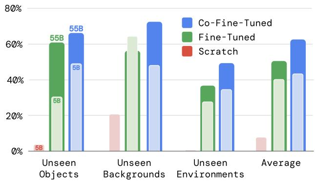  
(a) Performance comparison on various emergent skill evalu-(b) Ablations of RT-2-PaLI-X showcasing the impact of paramations (Figure 8) between RT-2 and two baselines. eter count and training strategy on generalization.

Figure 6 | Quantitative performance of RT-2 across (6a) emergent skills and (6b) size and training ablations. Appendix Tables 5 and 6 detail the full numerical results.

## 4.3. How does the generalization vary with parameter count and other design decisions?

For this comparison, we use RT-2-PaLI-X model because of its flexibility in terms of the model size (due to the nature of PaLM-E, RT-2-PaLM-E is restricted to only certain sizes of PaLM and ViT models). In particular, we compare two diferent model sizes, 5B and 55B, as well as three diferent training routines: training a model from scratch, without using any weights from the VLM pre-training; fine-tuning a pre-trained model using robot action data only; and co-fine-tuning (co-training with fine-tuning), the primary method used in this work where we use both the original VLM training data as well as robotic data for VLM fine-tuning. Since we are mostly interested in the generalization aspects of these models, we remove the seen tasks evaluation from this set of experiments.

The results of the ablations are presented in Figure 6b and Appendix Table 6. First, we observe that training a very large model from scratch results in a very poor performance even for the 5B model. Given this result, we decide to skip the evaluation of an even bigger 55B PaLI-X model when trained from scratch. Second, we notice that co-fine-tuning a model (regardless of its size) results in a better generalization performance than simply fine-tuning it with robotic data. We attribute this to the fact that keeping the original data around the fine-tuning part of training, allows the model to not forget its previous concepts learned during the VLM training. Lastly, somewhat unsurprisingly, we notice that the increased size of the model results in a better generalization performance.

## 4.4. Can RT-2 exhibit signs of chain-of-thought reasoning similarly to vision-language models?

Inspired by the chain-of-thought prompting method in LLMs (Wei et al., 2022), we fine-tune a variant of RT-2 with PaLM-E for just a few hundred gradient steps to increase its capability of utilizing language and actions jointly with the hope that it will elicit a more sophisticated reasoning behavior. We augment the data to include an additional “Plan” step, which describes the purpose of the action that the robot is about to take in natural language first, which is then followed by the actual action tokens, e.g. “Instruction: I’m hungry. Plan: pick rxbar chocolate. Action: 1 128 124 136 121 158 111 255.” This data augmentation scheme acts as a bridge between VQA datasets (visual reasoning) and manipulation datasets (generating actions).

We qualitatively observe that RT-2 with chain-of-thought reasoning is able to answer more sophisticated commands due to the fact that it is given a place to plan its actions in natural language first. This is a promising direction that provides some initial evidence that using LLMs or VLMs as planners (Ahn et al., 2022; Driess et al., 2023) can be combined with low-level policies in a single VLA model. Rollouts of RT-2 with chain-of-thought reasoning are shown in Figure 7 and in Appendix I.

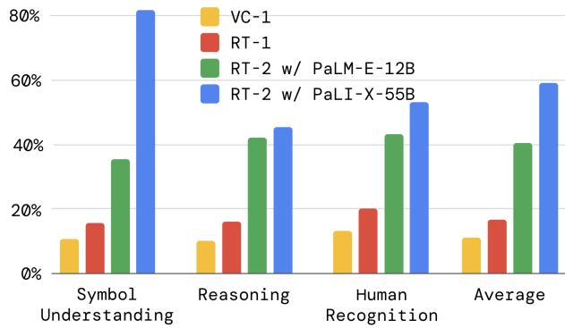

  
(a) 在各种涌现技能评(b) RT‑2‑PaLI‑X 的消融实验，展示了参数估（图 8）中 RT‑2 与两个基线的性能对比。量和训练策略对泛化的影响。

图 6 | RT‑2 在（6a）涌现技能以及（6b）规模和训练消融实验中的定量性能。附录表 5 和 6 详细列出了完整的数值结果。

## 4.3. 泛 化如何随参数量和其他设计决策而变化

s?

在此对比中，我们使用 RT‑2‑PaLI‑X 模型，因为它在模型大小方面具有灵活性（由于 PaLM‑E 的特性，RT‑2‑PaLM‑E 仅限于特定大小的 PaLM 和 ViT 模型）。具体而言，我们对比了两种不同的模型大小（5B 和 55B），以及三种不同的训练例程：从零开始训练模型（不使用视觉语言模型预训练的任何权重）；仅使用机器人动作数据微调预训练模型；以及联合微调（结合微调的协同训练）即本工作采用的主要方法，在进行视觉语言模型微调时同时使用原始视觉语言模型训练数据和机器人数据。由于我们主要关注这些模型的泛化方面，因此我们从这组实验中移除了已见任务的评估。

消融实验的结果展示在图 6b 和附录表 6 中。首先，我们观察到，即使对于 5B 模型，从零开始训练一个超大模型也会导致非常糟糕的性能。鉴于此结果，我们决定跳过对从零开始训练的更大规模 55B PaLI‑X 模型的评估。其次，我们注意到（无论模型大小如何）对模型进行联合微调所带来的泛化性能都优于仅使用机器人数据对其进行微调。我们将其归因于在微调训练阶段保留原始数据可以让模型不会遗忘其在视觉语言模型训练期间学到的先验概念。最后，毫不意外的是，模型尺寸的增大带来了更好的泛化性能。

## 4.4. RT‑2 是否能够 像视觉‑语言模型那样展现出思维链推理的迹象？

受大语言模型中思维链提示方法的启发（Wei etal., 2022），我们仅使用数百个梯度步数对PaLM‑E 版 RT‑2 变体进行微调，以提高其联合利用语言和动作的能力，希望借此激发更复杂的推理行为。我们对数据进行了增强，使其包含一个额外的“Plan”（计划）步骤，该步骤首先用自然语言描述机器人即将采取的动作目的，随后接上实际的动作标记，例如“Instruction: I’mhungry. Plan: pick RXBAR 巧克力. Action: 1 128 124 136 121 158 111 255。”这种数据增强方案充当了 VQA 数据集（视觉推理）与操作数据集（生成动作）之间的桥梁。

我们定性地观察到，结合了思维链推理的 RT‑2 能够响应更复杂的指令，这是因为它可以首先用自然语言来规划其动作。这是一个很有前景的方向，提供了一些初步证据，表明将大语言模型或视觉‑语言模型用作规划器（Ahn et al., 2022; Driess etal., 2023）可以与底层策略结合在单个 VLA模型中。结合思维链推理的 RT‑2 执行轨迹展示在图 7 和附录 I 中。

Prompt: Given  Instruction: Bring me a drink. Prediction: Plan: pick 7up can. Action: 1 143 129 123 145 114 115 127

Prompt: Given  Instruction: Move all the objects together. Prediction: Plan: move green can near green rice chip bag. Action: 1 128 126 127 135 123 119 127

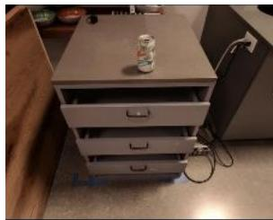

Prompt: Given  Instruction: Pick the object that is different from all other objects Prediction: Plan: pick rxbar chocolate. Action: 1 128 129 125 131 125 128 127

Prompt: Given  Instruction: Move the green objects together. Prediction: Plan: move green can near green rice chip bag. Action: 1 130 129 121 131 127 128 127

Prompt: Given  I need to hammer a nail, what object from the scene might be useful? Prediction: Rocks. Action: 1 129 138 122 132 135 106 127

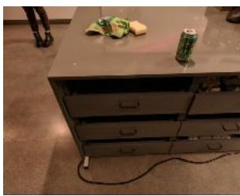

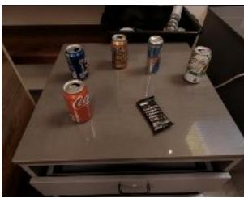

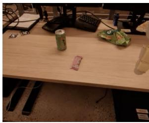

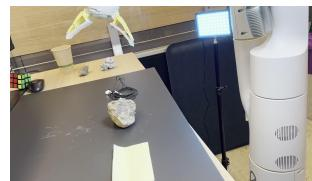

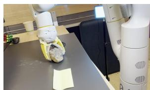

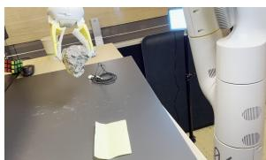  
Figure 7 | Rollouts of RT-2 with chain-of-thought reasoning, where RT-2 generates both a plan and an action. 5. Limitations

Even though RT-2 exhibits promising generalization properties, there are multiple limitations of this approach. First, although we show that including web-scale pretraining via VLMs boosts generalization over semantic and visual concepts, the robot does not acquire any ability to perform new motions by virtue of including this additional experience. The model’s physical skills are still limited to the distribution of skills seen in the robot data (see Appendix G), but it learns to deploy those skills in new ways. We believe this is a result of the dataset not being varied enough along the axes of skills. An exciting direction for future work is to study how new skills could be acquired through new data collection paradigms such as videos of humans.

Second, although we showed we could run large VLA models in real time, the computation cost of these models is high, and as these methods are applied to settings that demand high-frequency control, real-time inference may become a major bottleneck. An exciting direction for future research is to explore quantization and distillation techniques that might enable such models to run at higher rates or on lower-cost hardware. This is also connected to another current limitation in that there are only a small number of generally available VLM models that can be used to create RT-2. We hope that more open-sourced models will become available (e.g. https://llava-vl.github.io/) and the proprietary ones will open up their fine-tuning APIs, which is a suficient requirement to build VLA models.

## 6. Conclusions

In this paper, we described how vision-language-action (VLA) models could be trained by combining vision-language model (VLM) pretraining with robotic data. We then presented two instantiations of VLAs based on PaLM-E and PaLI-X, which we call RT-2-PaLM-E and RT-2-PaLI-X. These models are cofine-tuned with robotic trajectory data to output robot actions, which are represented as text tokens. We showed that our approach results in very performant robotic policies and, more importantly, leads to a significantly better generalization performance and emergent capabilities inherited from

Prompt: Given  Instruction: Bring me a drink.Prediction: Plan: pick 7up can. Action: 1 143 129 123 145 114 115 12

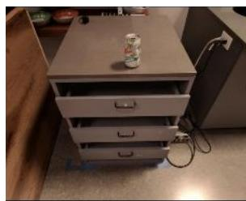

Prompt: Given  Instruction: Pick the object that is different from all other objectsPrediction: Plan: pick rxbar chocolate. Action: 1 128 129 125 131 125 128 127

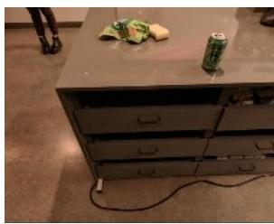

Prompt: Given  Instruction: Move the green objects together. Prediction: Plan: move green can near green rice chip bag. Action: 1 130 129 121 13112 128 127

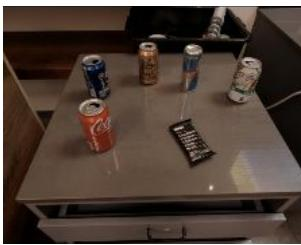

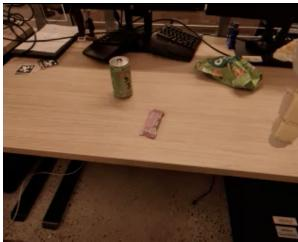

Prompt: Given  I need to hammer a nail, what object from the scene might be useful? Prediction: Rocks. Action: 1 129 138 122 132 135 106 127

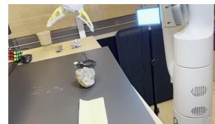

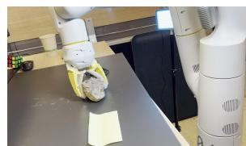

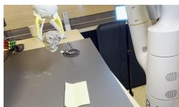  
图 7 | 采用思维链推理的 RT‑2 执行过程，其中 RT‑2 同时生成规划与动作。

## 5. 局限性

尽管 RT‑2 展现出令人鼓舞的泛化特性，但该方法仍存在诸多局限性。首先，虽然我们表明通过视觉‑语言模型进行网络规模的预训练可以增强在语义和视觉概念上的泛化能力，但机器人并不会因为融入了这一额外经验而获得执行新动作的能力。该模型的物理技能仍局限于机器人数据中所见技能的分布（参见附录 G），但它学会了以新的方式来运用这些技能。我们认为这是由于数据集在技能维度上不够丰富所致。未来研究的一个令人兴奋的方向是探索如何通过诸如人类视频等新的数据收集范式来获取新技能。

其次，尽管我们证明了可以实时运行大型 VLA 模型，但这些模型的计算成本很高；当这些方法应用于需要高频控制的场景时，实时推理可能会成为主要瓶颈。未来研究的一个令人兴奋的方向是探索量化和蒸馏技术，这些技术或能使此类模型以更高速率或在更低成本的硬件上运行。这还与当前的另一个局限性相关，即目前可用于构建 RT‑2 的通用视觉语言模型数量较少。我们希望未来能出现更多开源模型（例如 https://llava-vl.github.io/），同时专有模型也能开放其微调 API，这是构建 VLA 模型的充分条件。

## 6. 结论

在本文中，我们阐述了如何通过将视觉语言模型（VLM）预训练与机器人数据相结合来训练视觉语言‑动作（VLA）模型。随后，我们展示了基于 PaLM‑E 和 PaLI‑X 的两种 VLA 实例化模型，分别称为 RT‑2‑PaLM‑E 和 RT‑2‑PaLI‑X。这些模型与机器人轨迹数据进行联合微调以输出机器人动作，这些动作被表示为文本 token。我们证明了我们的方法能产生非常高效的机器人策略，更重要的是，带来了显著提升的泛化性能以及继承自

web-scale vision-language pretraining. We believe that this simple and general approach shows a promise of robotics directly benefiting from better vision-language models, which puts the field of robot learning in a strategic position to further improve with advancements in other fields.

## Acknowledgments

We would like to acknowledge Fred Alcober, Jodi Lynn Andres, Carolina Parada, Joseph Dabis, Rochelle Dela Cruz, Jessica Gomez, Gavin Gonzalez, John Guilyard, Tomas Jackson, Jie Tan, Scott Lehrer, Dee M, Utsav Malla, Sarah Nguyen, Jane Park, Emily Perez, Elio Prado, Jornell Quiambao, Clayton Tan, Jodexty Therlonge, Eleanor Tomlinson, Wenxuan Zhou, and the greater Google DeepMind team for their feedback and contributions.

网络级视觉‑语言预训练的涌现能力。我们相信，这种简单而通用的方法展现了机器人学直接受益于更优质的视觉‑语言模型的前景，从而使机器人学习领域处于一个能够随着其他领域的进步而进一步提升的战略地位。

## 致谢

我们在此感谢 Fred Alcober、JodiLynn Andres、Carolina Parada、Joseph Dabis、Rochelle Dela Cruz、Jessica Gomez、Gavin Gonzalez、John Guilyard、Tomas Jackson、Jie Tan、Scott Lehrer、Dee M、Utsav Malla、Sarah Nguyen、Jane Park、Emily Perez、Elio Prado、Jornell Quiambao、Clayton Tan、Jodexty Therlonge、Eleanor Tomlinson、Wenxuan Zhou 以及 Google DeepMind 整个团队的反馈和贡献。

Chen, X. Wang, S. Changpinyo, A. Piergiovanni, P. Padlewski, D. Salz, S. Goodman, A. Grycner, B. Mustafa, L. Beyer, A. Kolesnikov, J. Puigcerver, N. Ding, K. Rong, H.

## References

M. Ahn, A. Brohan, N. Brown, Y. Chebotar, O. Cortes, B. David, C. Finn, K. Gopalakrishnan, K. Hausman, A. Herzog, et al. Do as I can, not as I say: Grounding language in robotic afordances. arXiv preprint arXiv:2204.01691, 2022.

J.-B. Alayrac, J. Donahue, P. Luc, A. Miech, I. Barr, Y. Hasson, K. Lenc, A. Mensch, K. Millican, M. Reynolds, et al. Flamingo: a visual language model for few-shot learning. arXiv preprint arXiv:2204.14198, 2022.

R. Anil, A. M. Dai, O. Firat, M. Johnson, D. Lepikhin, A. Passos, S. Shakeri, E. Taropa, P. Bailey, Z. Chen, et al. Palm 2 technical report. arXiv preprint arXiv:2305.10403, 2023.

A. Brohan, N. Brown, J. Carbajal, Y. Chebotar, J. Dabis, C. Finn, K. Gopalakrishnan, K. Hausman, A. Herzog, J. Hsu, et al. Rt-1: Robotics transformer for real-world control at scale. arXiv preprint arXiv:2212.06817, 2022.

T. Brown, B. Mann, N. Ryder, M. Subbiah, J. D. Kaplan, P. Dhariwal, A. Neelakantan, P. Shyam, G. Sastry, A. Askell, et al. Language models are few-shot learners. Advances in neural information processing systems, 33:1877–1901, 2020.

D. Cer, Y. Yang, S. Kong, N. Hua, N. Limtiaco, R. S. John, N. Constant, M. Guajardo-Cespedes, S. Yuan, C. Tar, Y. Sung, B. Strope, and R. Kurzweil. Universal sentence encoder. CoRR, abs/1803.11175, 2018. URL http://arxiy.org/abs/1803.11175

M. Chen, J. Tworek, H. Jun, Q. Yuan, H. P. d. O. Pinto, J. Kaplan, H. Edwards, Y. Burda, N. Joseph, G. Brockman, et al. Evaluating large language models trained on code. arXiv preprint arXiv:2107.03374, 2021.

X. Chen, J. Djolonga, P. Padlewski, B. Mustafa, S. Changpinyo, J. Wu, C. R. Ruiz, S. Goodman, X. Wang, Y. Tay, S. Shakeri, M. Dehghani, D. Salz, M. Lucic, M. Tschannen, A. Nagrani, H. Hu, M. Joshi, B. Pang, C. Montgomery, P. Pietrzyk, M. Ritter, A. Piergiovanni, M. Minderer, F. Pavetic, A. Waters, G. Li, I. Alabdulmohsin, L. Beyer, J. Amelot, K. Lee, A. P. Steiner, Y. Li, D. Keysers, A. Arnab, Y. Xu, K. Rong, A. Kolesnikov, M. Seyedhosseini, A. Angelova, X. Zhai, N. Houlsby, and R. Soricut. Pali-x: On scaling up a multilingual vision and language model, 2023a.

X. Chen, X. Wang, S. Changpinyo, A. Piergiovanni, P. Padlewski, D. Salz, S. Goodman, A. Grycner, B. Mustafa, L. Beyer, A. Kolesnikov, J. Puigcerver, N. Ding, K. Rong, H. Akbari, G. Mishra, L. Xue, A. Thapliyal, J. Bradbury, W. Kuo, M. Seyedhosseini, C. Jia, B. K. Ayan, C. Riquelme, A. Steiner, A. Angelova, X. Zhai, N. Houlsby, and R. Soricut. Pali: A jointly-scaled multilingual language-image model, 2023b.

K. Cobbe, V. Kosaraju, M. Bavarian, M. Chen, H. Jun, L. Kaiser, M. Plappert, J. Tworek, J. Hilton, R. Nakano, et al. Training verifiers to solve math word problems. arXiv preprint arXiv:2110.14168, 2021.

Z. J. Cui, Y. Wang, N. Muhammad, L. Pinto, et al. From play to policy: Conditional behavior generation from uncurated robot data. arXiv preprint arXiv:2210.10047, 2022.

S. Dasari and A. Gupta. Transformers for one-shot visual imitation. In Conference on Robot Learning, pages 2071–2084. PMLR, 2021.

S. Dasari, F. Ebert, S. Tian, S. Nair, B. Bucher, K. Schmeckpeper, S. Singh, S. Levine, and C. Finn. Robonet: Large-scale multi-robot learning. In Conference on Robot Learning, 2019.

## 参考文献

M. Ahn, A. Brohan, N. Brown, Y. Chebotar, O. Cortes, B. David, C. Finn, K. Gopalakrishnan, K. Hausman, A. Herzog 等。按我所能做，而非按我所言：将语言扎根于机器 人示能。arXiv 预印本 arXiv:2204.01691, 2022。J.‑B. Alayrac, J. Donahue, P. Luc, A.

Miech, I. Barr, Y. Hasson, K. Lenc, A. Mensch, K. Millican, M. Reynolds 等。Flamingo：用于少样本学习的视觉语言模型。arXiv 预印本 arXiv:2204.14198, 2022。R. Anil, A. M. Dai,O. Firat, M. Johnson, D. Lepikhin, A. Passos, S. Shakeri, E. Taropa, P. Bailey, Z. Chen 等。PaLM 2 技术报告。arXiv 预印本 arXiv:2305.10403, 2023。A. Brohan, N. Brown, J.

Carbajal, Y. Chebotar, J. Dabis, C. Finn, K. Gopalakrishnan, K. Hausman, A. Herzog, J.Hsu 等。RT‑1：用于大规模真实世界控制的机器人 Transformer。arXiv 预印本

http://arxiv.org/abs/1803.11175。M. Chen, J. Tworek, H. Jun, Q. Yuan, H. P. d. O. Pinto, J. Kaplan, H. Edwards, Y. Burda, N. Joseph, G. Brockman 等。评估在代码上训练的 大语言模型。arXiv 预印本 arXiv:2107.03374, 2021。X. Chen, J. Djolonga, P. Padlewski, B. Mustafa, S. Changpinyo, J. Wu, C. R. Ruiz, S. Goodman, X. Wang, Y. Tay, S. Shakeri,

Akbari, G. Mishra, L. Xue, A. Thapliyal, J. Bradbury, W. Kuo, M. Seyedhosseini, C. Jia, B. K. Ayan, C. Riquelme, A. Steiner, A. Angelova, X. Zhai, N. Houlsby 与 R. Soricut。 PaLI：联合扩展的多语言语言‑图像模型，2023b。K. Cobbe, V. Kosaraju, M. Bavarian, M. Chen, H. Jun, L. Kaiser, M. Plappert, J. Tworek, J. Hilton, R. Nakano 等。训练验证器以解 决数学应用题。arXiv 预印本 arXiv:2110.14168, 2021。Z. J. Cui, Y. Wang, N. Muhammad,

L. Pinto 等。从游玩到策略：从未经整理的机器人数据中生成条件行为。arXiv 预印本arXiv:2210.10047, 2022。S. Dasari 与 A. Gupta。用于单样本视觉模仿的 Transformer。收录于 机器人学习大会，第 2071–2084 页。PMLR, 2021。S. Dasari, F. Ebert, S. Tian, S. Nair, B.Bucher, K. Schmeckpeper, S. Singh, S. Levine 与 C. Finn。RoboNet：大规模多机器人学习。收录于 机器人学习大会, 2019。

M. Dehghani, J. Djolonga, B. Mustafa, P. Padlewski, J. Heek, J. Gilmer, A. Steiner, M. Caron, R. Geirhos, I. Alabdulmohsin, R. Jenatton, L. Beyer, M. Tschannen, A. Arnab, X. Wang, C. Riquelme, M. Minderer, J. Puigcerver, U. Evci, M. Kumar, S. van Steenkiste, G. F. Elsayed, A. Mahendran, F. Yu, A. Oliver, F. Huot, J. Bastings, M. P. Collier, A. Gritsenko, V. Birodkar, C. Vasconcelos, Y. Tay, T. Mensink, A. Kolesnikov, F. Pavetić, D. Tran, T. Kipf, M. Lučić, X. Zhai, D. Keysers, J. Harmsen, and N. Houlsby. Scaling vision transformers to 22 billion parameters, 2023.

D. Driess, F. Xia, M. S. Sajjadi, C. Lynch, A. Chowdhery, B. Ichter, A. Wahid, J. Tompson, Q. Vuong, T. Yu, et al. Palm-e: An embodied multimodal language model. arXiv preprint arXiv:2303.03378, 2023.

M. Du, S. Nair, D. Sadigh, and C. Finn. Behavior retrieval: Few-shot imitation learning by querying unlabeled datasets. arXiv preprint arXiv:2304.08742, 2023a.

Y. Du, K. Konyushkova, M. Denil, A. Raju, J. Landon, F. Hill, N. de Freitas, and S. Cabi. Vision-language models as success detectors. arXiv preprint arXiv:2303.07280, 2023b.

C. Finn and S. Levine. Deep visual foresight for planning robot motion. In 2017 IEEE International Conference on Robotics and Automation (ICRA), pages 2786–2793. IEEE, 2017.

C. Finn, T. Yu, T. Zhang, P. Abbeel, and S. Levine. One-shot visual imitation learning via meta-learning. In Conference on robot learning, pages 357–368. PMLR, 2017.

R. A. Fisher. Design of experiments. British Medical Journal, 1(3923):554, 1936.

S. Y. Gadre, M. Wortsman, G. Ilharco, L. Schmidt, and S. Song. Clip on wheels: Zero-shot object navigation as object localization and exploration. arXiv preprint arXiv:2203.10421, 2022.

Z. Gan, L. Li, C. Li, L. Wang, Z. Liu, J. Gao, et al. Vision-language pre-training: Basics, recent advances, and future trends. Foundations and Trends® in Computer Graphics and Vision, 14(3–4):163–352, 2022.

G. Ghiasi, X. Gu, Y. Cui, and T.-Y. Lin. Open-vocabulary image segmentation. arXiv preprint arXiv:2112.12143, 2021.

K. Grauman, A. Westbury, E. Byrne, Z. Chavis, A. Furnari, R. Girdhar, J. Hamburger, H. Jiang, M. Liu, X. Liu, M. Martin, T. Nagarajan, I. Radosavovic, S. K. Ramakrishnan, F. Ryan, J. Sharma, M. Wray, M. Xu, E. Z. Xu, C. Zhao, S. Bansal, D. Batra, V. Cartillier, S. Crane, T. Do, M. Doulaty, A. Erapalli, C. Feichtenhofer, A. Fragomeni, Q. Fu, A. Gebreselasie, C. Gonzalez, J. Hillis, X. Huang, Y. Huang, W. Jia, W. Khoo, J. Kolar, S. Kottur, A. Kumar, F. Landini, C. Li, Y. Li, Z. Li, K. Mangalam, R. Modhugu, J. Munro, T. Murrell, T. Nishiyasu, W. Price, P. R. Puentes, M. Ramazanova, L. Sari, K. Somasundaram, A. Southerland, Y. Sugano, R. Tao, M. Vo, Y. Wang, X. Wu, T. Yagi, Z. Zhao, Y. Zhu, P. Arbelaez, D. Crandall, D. Damen, G. M. Farinella, C. Fuegen, B. Ghanem, V. K. Ithapu, C. V. Jawahar, H. Joo, K. Kitani, H. Li, R. Newcombe, A. Oliva, H. S. Park, J. M. Rehg, Y. Sato, J. Shi, M. Z. Shou, A. Torralba, L. Torresani, M. Yan, and J. Malik. Ego4d: Around the world in 3,000 hours of egocentric video, 2022.

X. Gu, T.-Y. Lin, W. Kuo, and Y. Cui. Open-vocabulary object detection via vision and language knowledge distillation. arXiv preprint arXiv:2104.13921, 2021.

N. Hansen, R. Jangir, Y. Sun, G. Alenyà, P. Abbeel, A. A. Efros, L. Pinto, and X. Wang. Self-supervised policy adaptation during deployment. arXiv preprint arXiv:2007.04309, 2020.

Y. Hao, H. Song, L. Dong, S. Huang, Z. Chi, W. Wang, S. Ma, and F. Wei. Language models are general-purpose interfaces. arXiv preprint arXiv:2206.06336, 2022.

F. Hill, S. Mokra, N. Wong, and T. Harley. Human instruction-following with deep reinforcement learning via transfer-learning from text. arXiv preprint arXiv:2005.09382, 2020.

S. Huang, L. Dong, W. Wang, Y. Hao, S. Singhal, S. Ma, T. Lv, L. Cui, O. K. Mohammed, Q. Liu, et al. Language is not all you need: Aligning perception with language models. arXiv preprin arXiv:2302.14045, 2023.

W. Huang, P. Abbeel, D. Pathak, and I. Mordatch. Language models as zero-shot planners: Extracting actionable knowledge for embodied agents. In International Conference on Machine Learning, pages 9118–9147. PMLR, 2022.

S. James, M. Bloesch, and A. J. Davison. Task-embedded control networks for few-shot imitation learning. In Conference on robot learning, pages 783–795. PMLR, 2018.

E. Jang, A. Irpan, M. Khansari, D. Kappler, F. Ebert, C. Lynch, S. Levine, and C. Finn. Bc-z: Zeroshot task generalization with robotic imitation learning. In Conference on Robot Learning, pages 991–1002. PMLR, 2021.

Y. Jiang, A. Gupta, Z. Zhang, G. Wang, Y. Dou, Y. Chen, L. Fei-Fei, A. Anandkumar, Y. Zhu, and L. Fan. Vima: General robot manipulation with multimodal prompts. arXiv preprint arXiv:2210.03094, 2022.

L. P. Kaelbling. The foundation of eficient robot learning. Science, 369(6506):915–916, 2020.

S. Karamcheti, S. Nair, A. S. Chen, T. Kollar, C. Finn, D. Sadigh, and P. Liang. Language-driven representation learning for robotics. arXiv preprint arXiv:2302.12766, 2023.

A. Kirillov, E. Mintun, N. Ravi, H. Mao, C. Rolland, L. Gustafson, T. Xiao, S. Whitehead, A. C. Berg, W.-Y. Lo, et al. Segment anything. arXiv preprint arXiv:2304.02643, 2023.

I. Kostrikov, D. Yarats, and R. Fergus. Image augmentation is all you need: Regularizing deep reinforcement learning from pixels. arXiv preprint arXiv:2004.13649, 2020.

M. Laskin, K. Lee, A. Stooke, L. Pinto, P. Abbeel, and A. Srinivas. Reinforcement learning with augmented data. Advances in neural information processing systems, 33:19884–19895, 2020a.

M. Laskin, A. Srinivas, and P. Abbeel. Curl: Contrastive unsupervised representations for reinforcement learning. In International Conference on Machine Learning, pages 5639–5650. PMLR, 2020b.

S. Levine, P. Pastor, A. Krizhevsky, J. Ibarz, and D. Quillen. Learning hand-eye coordination for robotic grasping with deep learning and large-scale data collection. The International journal of robotics research, 37(4-5):421–436, 2018.

A. Lewkowycz, A. Andreassen, D. Dohan, E. Dyer, H. Michalewski, V. Ramasesh, A. Slone, C. Anil I. Schlag, T. Gutman-Solo, et al. Solving quantitative reasoning problems with language models. arXiv preprint arXiv:2206.14858, 2022.

J. Li, D. Li, S. Savarese, and S. Hoi. Blip-2: Bootstrapping language-image pre-training with frozen image encoders and large language models. arXiv preprint arXiv:2301.12597, 2023.

L. H. Li, M. Yatskar, D. Yin, C.-J. Hsieh, and K.-W. Chang. Visualbert: A simple and performant baseline for vision and language. arXiv preprint arXiv:1908.03557, 2019.

H. Liu, L. Lee, K. Lee, and P. Abbeel. Instruction-following agents with jointly pre-trained visionlanguage models. arXiv preprint arXiv:2210.13431, 2022.

F. Hill, S. Mokra, N. Wong, and T. Harley. 通过来自文本的迁移学习实现基于深度强化学习的人类指令遵循。arXivpreprint arXiv:2005.09382, 2020。 S. Huang, L. Dong, W. Wang, Y.Hao, S. Singhal, S. Ma, T. Lv, L. Cui, O. K. Mohammed, Q. Liu, et al. 语言并非所需的一切：将感知与语言模型对齐。arXiv preprintarXiv:2302.14045, 2023。 W. Huang, P. Abbeel, D.Pathak, and I. Mordatch. 语言模型作为零样本规划器：为具身智能体提取可操作知识。In 国际机器学习大会, pages 9118–9147. PMLR, 2022。 S. James, M. Bloesch, and A. J. Davison. 用于少样本模仿学习的任务嵌入控制网络。In 机器人学习大会, pages 783–795. PMLR, 2018。 E.Jang, A. Irpan, M. Khansari, D. Kappler, F. Ebert, C. Lynch, S. Levine, and C. Finn.BC‑Z：基于机器人模仿学习的零样本任务泛化。In 机器人学习大会, pages 991–1002. PMLR,2021。 Y. Jiang, A. Gupta, Z. Zhang, G. Wang, Y. Dou, Y. Chen, L. Fei‑Fei, A.Anandkumar, Y. Zhu, and L. Fan. VIMA：基于多模态提示的通用机器人操作。arXivpreprintarXiv:2210.03094, 2022。 L. P. Kaelbling. 高效机器人学习的基石。Science,369(6506):915–916, 2020。 S. Karamcheti, S. Nair, A. S. Chen, T. Kollar, C. Finn, D.Sadigh, and P. Liang. 用于机器人学的语言驱动表征学习。arXivpreprint arXiv:2302.12766,2023。 A. Kirillov, E. Mintun, N. Ravi, H. Mao, C. Rolland, L. Gustafson, T. Xiao, S.Whitehead, A. C. Berg, W.‑Y. Lo, et al. Segment Anything。arXivpreprintarXiv:2304.02643, 2023。 I. Kostrikov, D. Yarats, and R. Fergus. 图像增强就是你所需的一切：对基于像素的深度强化学习进行正则化。arXivpreprint arXiv:2004.13649, 2020。 M.Laskin, K. Lee, A. Stooke, L. Pinto, P. Abbeel, and A. Srinivas. 基于增强数据的强化学习。神经信息处理系统大会, 33:19884–19895, 2020a。 M. Laskin, A. Srinivas, and P. Abbeel.CURL：用于强化学习的对比无监督表征。In 国际机器学习大会, pages 5639–5650. PMLR,2020b。 S. Levine, P. Pastor, A. Krizhevsky, J. Ibarz, and D. Quillen. 通过深度学习和大规模数据收集学习用于机器人抓取的手眼协调。The International journal of roboticsresearch,37(4‑5):421–436, 2018。 A. Lewkowycz, A. Andreassen, D. Dohan, E. Dyer, H.Michalewski, V. Ramasesh, A. Slone, C. Anil, I. Schlag, T. Gutman‑Solo, et al. 利用语言模型解决定量推理问题。arXivpreprint arXiv:2206.14858, 2022。 J. Li, D. Li, S. Savarese, and S.Hoi. BLIP‑2：利用冻结的图像编码器和大语言模型引导语言‑图像预训练。arXivpreprintarXiv:2301.12597, 2023。 L. H. Li, M. Yatskar, D. Yin, C.‑J. Hsieh, and K.‑W. Chang.VisualBERT：用于视觉和语言的简单高效基线。arXiv preprintarXiv:1908.03557, 2019。 H.Liu, L. Lee, K. Lee, and P. Abbeel. 基于联合预训练视觉‑语言模型的指令遵循智能体。arXivpreprint arXiv:2210.13431, 2022。

J. Lu, D. Batra, D. Parikh, and S. Lee. Vilbert: Pretraining task-agnostic visiolinguistic representations for vision-and-language tasks. Advances in neural information processing systems, 32, 2019.

C. Lynch and P. Sermanet. Language conditioned imitation learning over unstructured data. arXiv preprint arXiv:2005.07648, 2020.

C. Lynch, A. Wahid, J. Tompson, T. Ding, J. Betker, R. Baruch, T. Armstrong, and P. Florence. Interactive language: Talking to robots in real time. arXiv preprint arXiv:2210.06407, 2022.

Y. J. Ma, S. Sodhani, D. Jayaraman, O. Bastani, V. Kumar, and A. Zhang. Vip: Towards universal visual reward and representation via value-implicit pre-training. arXiv preprint arXiv:2210.00030, 2022.

Y. J. Ma, W. Liang, V. Som, V. Kumar, A. Zhang, O. Bastani, and D. Jayaraman. Liv: Language-image representations and rewards for robotic control. arXiv preprint arXiv:2306.00958, 2023.

J. Mahler, J. Liang, S. Niyaz, M. Laskey, R. Doan, X. Liu, J. A. Ojea, and K. Goldberg. Dex-net 2.0: Deep learning to plan robust grasps with synthetic point clouds and analytic grasp metrics. arXiv preprint arXiv:1703.09312, 2017.

A. Majumdar, K. Yadav, S. Arnaud, Y. J. Ma, C. Chen, S. Silwal, A. Jain, V.-P. Berges, P. Abbeel, J. Malik, et al. Where are we in the search for an artificial visual cortex for embodied intelligence? arXiv preprint arXiv:2303.18240, 2023a.

A. Majumdar, K. Yadav, S. Arnaud, Y. J. Ma, C. Chen, S. Silwal, A. Jain, V.-P. Berges, P. Abbeel, J. Malik, et al. Where are we in the search for an artificial visual cortex for embodied intelligence? arXiv preprint arXiv:2303.18240, 2023b.

O. Mees, L. Hermann, and W. Burgard. What matters in language conditioned robotic imitation learning over unstructured data. IEEE Robotics and Automation Letters, 7(4):11205–11212, 2022.

M. Minderer, A. Gritsenko, A. Stone, M. Neumann, D. Weissenborn, A. Dosovitskiy, A. Mahendran, A. Arnab, M. Dehghani, Z. Shen, et al. Simple open-vocabulary object detection with vision transformers. arXiv preprint arXiv:2205.06230, 2022.

Y. Mu, Q. Zhang, M. Hu, W. Wang, M. Ding, J. Jin, B. Wang, J. Dai, Y. Qiao, and P. Luo. Embodiedgpt: Vision-language pre-training via embodied chain of thought. arXiv preprint arXiv:2305.15021, 2023.

S. Nair, E. Mitchell, K. Chen, S. Savarese, C. Finn, et al. Learning language-conditioned robot behavior from ofline data and crowd-sourced annotation. In Conference on Robot Learning, pages 1303–1315. PMLR, 2022a.

S. Nair, A. Rajeswaran, V. Kumar, C. Finn, and A. Gupta. R3m: A universal visual representation for robot manipulation. arXiv preprint arXiv:2203.12601, 2022b.

OpenAI. Gpt-4 technical report, 2023.

J. Pari, N. M. Shafiullah, S. P. Arunachalam, and L. Pinto. The surprising efectiveness of representation learning for visual imitation. arXiv preprint arXiv:2112.01511, 2021.

L. Pinto and A. Gupta. Supersizing self-supervision: Learning to grasp from 50k tries and 700 robot hours. In 2016 IEEE international conference on robotics and automation (ICRA), pages 3406–3413. IEEE, 2016.

S. Polu, J. M. Han, K. Zheng, M. Baksys, I. Babuschkin, and I. Sutskever. Formal mathematics statement curriculum learning. arXiv preprint arXiv:2202.01344, 2022.

J. Lu、D. Batra、D. Parikh 和 S. Lee。ViLBERT：面向视觉与语言任务的预训练任务不可知视觉‑语言表征。神经信息处理系统大会，32，2019。C. Lynch 和 P. Sermanet。基于非结构化数据的语言条件模仿学习。arXivpreprintarXiv:2005.07648，2020。C. Lynch、A. Wahid、J.Tompson、T. Ding、J. Betker、R. Baruch、T. Armstrong 和 P. Florence。交互式语言：与机器人进行实时对话。arXivpreprint arXiv:2210.06407，2022。Y. J. Ma、S. Sodhani、D.Jayaraman、O. Bastani、V. Kumar 和 A. Zhang。VIP：通过隐式价值预训练实现通用视觉奖励与表征。arXivpreprint arXiv:2210.00030，2022。Y. J. Ma、W. Liang、V. Som、V. Kumar、A. Zhang、O. Bastani 和 D. Jayaraman。LIV：用于机器人控制的语言‑图像表征与奖励。arXivpreprint arXiv:2306.00958，2023。J. Mahler、J. Liang、S. Niyaz、M. Laskey、R.Doan、X. Liu、J. A. Ojea 和 K. Goldberg。Dex‑Net 2.0：利用合成点云和解析抓取度量通过深度学习规划稳健抓取。arXivpreprintarXiv:1703.09312，2017。A. Majumdar、K. Yadav、S.Arnaud、Y. J. Ma、C. Chen、S. Silwal、A. Jain、V.‑P. Berges、P. Abbeel、J. Malik 等。寻找具身智能人工视觉皮层的进展如何？arXivpreprintarXiv:2303.18240，2023a。A. Majumdar、K. Yadav、S. Arnaud、Y. J. Ma、C. Chen、S. Silwal、A. Jain、V.‑P. Berges、P. Abbeel、J. Malik 等。寻找具身智能人工视觉皮层的进展如何？arXivpreprintarXiv:2303.18240，2023b。O. Mees、L. Hermann 和 W. Burgard。非结构化数据上以语言为条件的机器人模仿学习中的关键要素。IEEE Robotics and AutomationLetters，7(4):11205–11212，2022。M. Minderer、A.Gritsenko、A. Stone、M. Neumann、D. Weissenborn、A. Dosovitskiy、A. Mahendran、A. Arnab、M. Dehghani、Z. Shen 等。基于视觉 Transformer 的简易开放词表目标检测。arXivpreprint arXiv:2205.06230，2022。Y. Mu、Q. Zhang、M. Hu、W. Wang、M. Ding、J.Jin、B. Wang、J. Dai、Y. Qiao 和 P. Luo。EmbodiedGPT：通过具身思维链进行视觉‑语言预训练。arXiv preprint arXiv:2305.15021，2023。S. Nair、E. Mitchell、K. Chen、S. Savarese、C. Finn 等。从离线数据和众包标注中学习以语言为条件的机器人行为。收录于 机器人学习大会，第 1303–1315 页。PMLR，2022a。S. Nair、A. Rajeswaran、V. Kumar、C. Finn 和 A.Gupta。R3M：面向机器人操作的通用视觉表征。arXivpreprint arXiv:2203.12601，2022b。OpenAI。GPT‑4 技术报告，2023。J. Pari、N. M. Shafiullah、S. P. Arunachalam 和 L.Pinto。表征学习在视觉模仿中的惊人效果。arXivpreprint arXiv:2112.01511，2021。L. Pinto 和A. Gupta。超大规模自监督：从 5 万次尝试和 700 小时机器人时长中学习抓取。收录于2016IEEE国际机器人与自动化会议 (ICRA)，第 3406–3413 页。IEEE，2016。S. Polu、J. M. Han、K. Zheng、M. Baksys、I. Babuschkin 和 I. Sutskever。形式化数学命题课程学习。arXivpreprint arXiv:2202.01344，2022。

V. H. Pong, M. Dalal, S. Lin, A. Nair, S. Bahl, and S. Levine. Skew-fit: State-covering self-supervised reinforcement learning. arXiv preprint arXiv:1903.03698, 2019.

A. Radford, J. W. Kim, C. Hallacy, A. Ramesh, G. Goh, S. Agarwal, G. Sastry, A. Askell, P. Mishkin, J. Clark, et al. Learning transferable visual models from natural language supervision. In International Conference on Machine Learning, pages 8748–8763. PMLR, 2021.

S. Reed, K. Zolna, E. Parisotto, S. G. Colmenarejo, A. Novikov, G. Barth-Maron, M. Gimenez, Y. Sulsky, J. Kay, J. T. Springenberg, et al. A generalist agent. arXiv preprint arXiv:2205.06175, 2022.

M. Ryoo, A. Piergiovanni, A. Arnab, M. Dehghani, and A. Angelova. Tokenlearner: Adaptive space-time tokenization for videos. Advances in Neural Information Processing Systems, 34:12786–12797, 2021.

D. Shah, B. Osiński, b. ichter, and S. Levine. Lm-nav: Robotic navigation with large pre-trained models of language, vision, and action. In K. Liu, D. Kulic, and J. Ichnowski, editors, Proceedings of The 6th Conference on Robot Learning, volume 205 of Proceedings of Machine Learning Research, pages 492– 504. PMLR, 14–18 Dec 2023. URL https://proceedings.mlr.press/v205/shah23b.html.

R. Shah and V. Kumar. Rrl: Resnet as representation for reinforcement learning. arXiv preprint arXiv:2107.03380, 2021.

M. Shridhar, L. Manuelli, and D. Fox. Cliport: What and where pathways for robotic manipulation. In Proceedings of the 5th Conference on Robot Learning (CoRL), 2021.

M. Shridhar, L. Manuelli, and D. Fox. Cliport: What and where pathways for robotic manipulation. In Conference on Robot Learning, pages 894–906. PMLR, 2022a.

M. Shridhar, L. Manuelli, and D. Fox. Perceiver-actor: A multi-task transformer for robotic manipulation. arXiv preprint arXiv:2209.05451, 2022b.

I. Singh, V. Blukis, A. Mousavian, A. Goyal, D. Xu, J. Tremblay, D. Fox, J. Thomason, and A. Garg. Progprompt: Generating situated robot task plans using large language models. In ICRA, 2023.

M. H. Smith and L. S. Coles. Design of a low cost, general purpose robot. In IJCAI, pages 324–336, 1973.

A. Stone, T. Xiao, Y. Lu, K. Gopalakrishnan, K.-H. Lee, Q. Vuong, P. Wohlhart, B. Zitkovich, F. Xia, C. Finn, et al. Open-world object manipulation using pre-trained vision-language models. arXiv preprint arXiv:2303.00905, 2023.

T. Sumers, K. Marino, A. Ahuja, R. Fergus, and I. Dasgupta. Distilling internet-scale vision-language models into embodied agents. arXiv preprint arXiv:2301.12507, 2023.

Y. Tay, M. Dehghani, V. Q. Tran, X. Garcia, J. Wei, X. Wang, H. W. Chung, S. Shakeri, D. Bahri, T. Schuster, H. S. Zheng, D. Zhou, N. Houlsby, and D. Metzler. Ul2: Unifying language learning paradigms, 2023.

S. Vemprala, R. Bonatti, A. Bucker, and A. Kapoor. Chatgpt for robotics: Design principles and model abilities. Microsoft Auton. Syst. Robot. Res, 2:20, 2023.

J. Wang, Z. Yang, X. Hu, L. Li, K. Lin, Z. Gan, Z. Liu, C. Liu, and L. Wang. Git: A generative image-to-text transformer for vision and language. arXiv preprint arXiv:2205.14100, 2022.

J. Wei, X. Wang, D. Schuurmans, M. Bosma, E. Chi, Q. Le, and D. Zhou. Chain of thought prompting elicits reasoning in large language models. arXiv preprint arXiv:2201.11903, 2022.

V. H. Pong、M. Dalal、S. Lin、A. Nair、S. Bahl 和 S. Levine。Skew‑fit：状态覆盖的自监督强化学习。arXivpreprint arXiv:1903.03698，2019。A. Radford、J. W. Kim、C. Hallacy、A.Ramesh、G. Goh、S. Agarwal、G. Sastry、A. Askell、P. Mishkin、J. Clark 等。通过自然语言监督学习可迁移的视觉模型。收录于 国际机器学习大会，第 8748–8763 页。PMLR，2021。

S. Reed、K. Zolna、E. Parisotto、S. G. Colmenarejo、A. Novikov、G. Barth‑Maron、M.Gimenez、Y. Sulsky、J. Kay、J. T. Springenberg 等。通用智能体。arXivpreprintarXiv:2205.06175，2022。M. Ryoo、A. Piergiovanni、A. Arnab、M. Dehghani 和 A.

https://proceedings.mlr.press/v205/shah23b.html。R. Shah 和 V. Kumar。RRL：ResNet 作为强化学习的表征。arXiv preprintarXiv:2107.03380，2021。M. Shridhar、L.

Manuelli 和 D. Fox。CLIPort：用于机器人操作的“是什么”和“在哪里”通路。收录于第 5 届机器人学习大会 (CoRL) 论文集，2021。M. Shridhar、L. Manuelli 和 D. Fox。CLIPort：用于机器人操作的“是什么”和“在哪里”通路。收录于机器人学习大会，第 894–906 页。PMLR，2022a。M. Shridhar、L. Manuelli 和 D. Fox。Perceiver‑Actor：用于机器人操作的多任务Transformer。arXivpreprint arXiv:2209.05451，2022b。I. Singh、V. Blukis、A.

ProgPrompt：使用大语言模型生成情境化机器人任务规划。收录于 ICRA，2023。M. H. Smith 和 L. S. Coles。低成本通用机器人的设计。收录于IJCAI，第 324–336 页，1973。A. Stone、T. Xiao、Y. Lu、K. Gopalakrishnan、K.‑H. Lee、Q. Vuong、P. Wohlhart、B.Zitkovich、F. Xia、C. Finn 等。使用预训练视觉‑语言模型的开放世界目标操作。arXivpreprintarXiv:2303.00905，2023。T. Sumers、K. Marino、A. Ahuja、R. Fergus 和 I.Dasgupta。将互联网规模的视觉‑语言模型蒸馏到具身智能体中。arXivpreprint arXiv:2301.12507，2023。Y. Tay、M. Dehghani、V. Q. Tran、X. Garcia、J. Wei、X. Wang、H. W. Chung、S. Shakeri、D. Bahri、T. Schuster、H. S. Zheng、D. Zhou、N. Houlsby 和 D. Metzler。UL2：统一语言学习范式，2023。S. Vemprala、R. Bonatti、A. Bucker 和 A. Kapoor。ChatGPT 用于机器人学：设计原则与模型能力。Microsoft Auton. Syst. Robot. Res，2:20，2023。

J. Wang、Z. Yang、X. Hu、L. Li、K. Lin、Z. Gan、Z. Liu、C. Liu 和 L. Wang。GIT：用于视觉与语言的生成式图像到文本 Transformer。arXivpreprint arXiv:2205.14100，2022。J.Wei、X. Wang、D. Schuurmans、M. Bosma、E. Chi、Q. Le 和 D. Zhou。思维链提示激发大语言模型的推理能力。arXivpreprint arXiv:2201.11903，2022。

J. Wei, L. Hou, A. Lampinen, X. Chen, D. Huang, Y. Tay, X. Chen, Y. Lu, D. Zhou, T. Ma, and Q. V. Le. Symbol tuning improves in-context learning in language models, 2023.

J. Wu, R. Antonova, A. Kan, M. Lepert, A. Zeng, S. Song, J. Bohg, S. Rusinkiewicz, and T. Funkhouser. Tidybot: Personalized robot assistance with large language models. arXiv preprint arXiv:2305.05658, 2023.

T. Xiao, H. Chan, P. Sermanet, A. Wahid, A. Brohan, K. Hausman, S. Levine, and J. Tompson. Robotic skill acquisition via instruction augmentation with vision-language models. arXiv preprint arXiv:2211.11736, 2022a.

T. Xiao, I. Radosavovic, T. Darrell, and J. Malik. Masked visual pre-training for motor control. arXiv preprint arXiv:2203.06173, 2022b.

S. Young, D. Gandhi, S. Tulsiani, A. Gupta, P. Abbeel, and L. Pinto. Visual imitation made easy. In Conference on Robot Learning, pages 1992–2005. PMLR, 2021.

K.-T. Yu, M. Bauza, N. Fazeli, and A. Rodriguez. More than a million ways to be pushed. a high-fidelity experimental dataset of planar pushing. In 2016 IEEE/RSJ international conference on intelligent robots and systems (IROS), pages 30–37. IEEE, 2016.

T. Yu, C. Finn, A. Xie, S. Dasari, T. Zhang, P. Abbeel, and S. Levine. One-shot imitation from observing humans via domain-adaptive meta-learning. arXiv preprint arXiv:1802.01557, 2018.

X. Zhai, A. Kolesnikov, N. Houlsby, and L. Beyer. Scaling vision transformers. In Proceedings of the IEEE/CVF Conference on Computer Vision and Pattern Recognition, pages 12104–12113, 2022.

X. Zhang, Y. Ding, S. Amiri, H. Yang, A. Kaminski, C. Esselink, and S. Zhang. Grounding classical task planners via vision-language models. arXiv preprint arXiv:2304.08587, 2023.

J. Wei, L. Hou, A. Lampinen, X. Chen, D. Huang, Y. Tay, X. Chen, Y. Lu, D. Zhou, T.Ma 与 Q. V. Le。符号微调改善语言模型中的上下文学习，2023。J. Wu, R. Antonova, A.Kan, M. Lepert, A. Zeng, S. Song, J. Bohg, S. Rusinkiewicz 与 T. Funkhouser。Tidybot：基于大语言模型的个性化机器人协助。arXiv preprint arXiv:2305.05658，2023。T. Xiao, H.

Chan, P. Sermanet, A. Wahid, A. Brohan, K. Hausman, S. Levine 与 J. Tompson。通过视觉‑语言模型进行指令增强以获取机器人技能。arXivpreprintarXiv:2211.11736，2022a。T. Xiao,I. Radosavovic, T. Darrell 与 J. Malik。用于运动控制的掩蔽视觉预训练。

arXivpreprintarXiv:2203.06173，2022b。S. Young, D. Gandhi, S. Tulsiani, A. Gupta, P.Abbeel 与 L. Pinto。视觉模仿变得简单。载于 机器人学习大会，第 1992–2005 页。PMLR，

2021。K.‑T. Yu, M. Bauza, N. Fazeli 与 A. Rodriguez。被推挤的百余万种方式：平面推挤的高保真实验数据集。载于 2016 IEEE/RSJ智能机器人与系统国际会议 (IROS)，第 30–37 页。IEEE，

2016。T. Yu, C. Finn, A. Xie, S. Dasari, T. Zhang, P. Abbeel 与 S. Levine。通过领域自适应 元学习从观察人类中进行单样本模仿。arXivpreprint arXiv:1802.01557，2018。X. Zhai, A.

Kolesnikov, N. Houlsby 与 L. Beyer。扩展视觉 Transformer。载于 IEEE/CVF 计算机视觉与模式识别会议论文集，第 12104–12113 页，2022。X. Zhang, Y. Ding, S. Amiri, H. Yang, A.Kaminski, C. Esselink 与 S. Zhang。通过视觉‑语言模型对经典任务规划器进行落地。arXivpreprintarXiv:2304.08587，2023。

## A. Contributions

• Training and Evaluations (designing and executing procedures for training models, evaluating models in simulation and the real world, running ablations for algorithm design choices): Yevgen Chebotar, Krzysztof Choromanski, Tianli Ding, Danny Driess, Avinava Dubey, Pete Florence, Chuyuan Fu, Montse Gonzalez Arenas, Keerthana Gopalakrishnan, Kehang Han, Alexander Herzog, Brian Ichter, Alex Irpan, Isabel Leal, Lisa Lee, Yao Lu, Henryk Michalewski, Igor Mordatch, Karl Pertsch, Michael Ryoo, Anikait Singh, Quan Vuong, Ayzaan Wahid, Paul Wohlhart, Fei Xia, Ted Xiao, and Tianhe Yu.

• Network Architecture (designing and implementing model network modules, working on tokenization of actions, enabling inference of the model networks during experiments): Yevgen Chebotar, Xi Chen, Krzysztof Choromanski, Danny Driess, Pete Florence, Keerthana Gopalakrishnan, Kehang Han, Karol Hausman, Brian Ichter, Alex Irpan, Isabel Leal, Lisa Lee, Henryk Michalewski, Igor Mordatch, Kanishka Rao, Michael Ryoo, Anikait Singh, Quan Vuong, Ayzaan Wahid, Jialin Wu, Fei Xia, Ted Xiao, and Tianhe Yu.

• Data Collection (collecting data on real robots, running real robot evaluations, executing operations required for running real robots): Noah Brown, Justice Carbajal, Tianli Ding, Krista Reymann, Grecia Salazar, Pierre Sermanet, Jaspiar Singh, Huong Tran, Stefan Welker, and Sichun Xu.

• Leadership (leading the project eforts, managing the project staf, advising on project directions): Yevgen Chebotar, Chelsea Finn, Karol Hausman, Brian Ichter, Sergey Levine, Yao Lu, Igor Mordatch, Kanishka Rao, Pannag Sanketi, Radu Soricut, Vincent Vanhoucke, and Tianhe Yu.

• Paper (working on the paper manuscript, designing paper visualizations and figures): Yevgen Chebotar, Danny Driess, Chelsea Finn, Pete Florence, Karol Hausman, Brian Ichter, Lisa Lee, Sergey Levine, Igor Mordatch, Karl Pertsch, Quan Vuong, Fei Xia, Ted Xiao, and Tianhe Yu.

• Infrastructure (working on infrastructure and code base backbone needed for training models, running experiments, storing and accessing data): Anthony Brohan, Yevgen Chebotar, Danny Driess, Kehang Han, Jasmine Hsu, Brian Ichter, Alex Irpan, Nikhil Joshi, Ryan Julian, Dmitry Kalashnikov, Yuheng Kuang, Isabel Leal, Lisa Lee, Tsang-Wei Edward Lee, Yao Lu, Igor Mordatch, Quan Vuong, Ayzaan Wahid, Fei Xia, Ted Xiao, Peng Xu, and Tianhe Yu.

## B. Datasets

The vision-language datasets are based on the dataset mixtures from Chen et al. (2023b) and Driess et al. (2023). The bulk of this data consists of the WebLI dataset, which is around 10B image-text pairs across 109 languages, filtered to the top 10% scoring cross-modal similarity examples to give 1B training examples. Many other captioning and vision question answering datasets are included as well, and more info on the dataset mixtures can be found in Chen et al. (2023b) for RT-2-PaLI-X, and Driess et al. (2023) for RT-2-PaLM-E. When co-fine-tuning RT-2-PaLI-X, we do not use the Episodic WebLI dataset described by Chen et al. (2023a).

The robotics dataset is based on the dataset from Brohan et al. (2022). This consists of demonstration episodes collected with a mobile manipulation robot. Each demonstration is annotated with a natural language instruction from one of seven skills: "Pick Object", "Move Object Near Object", "Place Object Upright", "Knock Object Over", "Open Drawer", "Close Drawer", "Place Object into Receptacle", and "Pick Object from Receptacle and place on the counter". Further details can be found in Brohan et al. (2022).

RT-2-PaLI-X weights the robotics dataset such that it makes up about 50% of the training mixture

## A. 贡献

• 训练与评估（设计和执行模型训练流程，在仿真与真实世界中评估模型，针对算法设计选择运行消融实验）：Yevgen Chebotar, Krzysztof Choromanski, Tianli Ding, Danny Driess, Avinava Dubey,Pete Florence, Chuyuan Fu, Montse Gonzalez Arenas, Keerthana Gopalakrishnan, KehangHan, Alexander Herzog, Brian Ichter, Alex Irpan, Isabel Leal, Lisa Lee, Yao Lu, HenrykMichalewski, Igor Mordatch, KarlPertsch, Michael Ryoo, Anikait Singh, Quan Vuong, AyzaanWahid, Paul Wohlhart, Fei Xia, Ted Xiao 与 Tianhe Yu。

• 网络架构（设计并实现模型网络模块、负责动作标记化、在实验期间支持模型网络推理）：Yevgen Chebotar, Xi Chen, Krzysztof Choromanski, Danny Driess, Pete Florence,Keerthana Gopalakrishnan, Kehang Han, Karol Hausman, Brian Ichter, Alex Irpan,Isabel Leal, Lisa Lee, Henryk Michalewski,Igor Mordatch,Kanishka Rao, Michael Ryoo,AnikaitSingh, Quan Vuong, Ayzaan Wahid, Jialin Wu, Fei Xia, Ted Xiao, and Tianhe Yu.

• 数据收集（在真实机器人上收集数据、运行真实机器人评估、执行运行真实机器人所需的操作）：Noah Brown, Justice Carbajal, Tianli Ding, Krista Reymann, Grecia Salazar,Pierre Sermanet, JaspiarSingh, Huong Tran, Stefan Welker, and Sichun Xu.

• 项目领导（领导项目工作、管理项目人员、指导项目方向）：Yevgen Chebotar,ChelseaFinn, Karol Hausman, Brian Ichter, Sergey Levine, Yao Lu, Igor Mordatch,Kanishka Rao, Pannag Sanketi, Radu Soricut, Vincent Vanhoucke, and Tianhe Yu.

• 论文（撰写论文手稿、设计论文可视化及图表）：Yevgen Chebotar, Danny Driess, Chelsea Finn, Pete Florence, Karol Hausman, Brian Ichter, Lisa Lee, Sergey Levine, Igor Mordatch, Karl Pertsch, Quan Vuong, Fei Xia, TedXiao, and Tianhe Yu.

• 基础设施（负责训练模型、运行实验、存储和访问数据所需的基础设施和代码库骨干）：AnthonyBrohan, Yevgen Chebo‑ tar, Danny Driess, Kehang Han, Jasmine Hsu, Brian Ichter, Alex Irpan, Nikhil Joshi, Ryan Julian, Dmitry Kalashnikov, Yuheng Kuang, Isabel Leal, Lisa Lee, Tsang‑Wei Edward Lee, Yao Lu, Igor Mordatch, Quan Vuong, Ayzaan Wahid, Fei Xia, Ted Xiao, Peng Xu, and Tianhe Yu.

## B. 数据集

视觉‑语言数据集基于 Chen 等人 （2023b）以及 Driess 等人 （2023）的混合数据集。这些数据的大部分由 WebLI 数据集组成，该数据集包含涵盖 109 种语言的约 100 亿个图文对，经过筛选保留跨模态相似度排名前 10% 的样本，从而得到 10 亿个训练样本。此外还包含了许多其他图像描述和视觉问答数据集，关于混合数据集的更多信息，RT‑2‑PaLI‑X 可参见 Chen 等人 （2023b），RT‑2‑PaLM‑E 可参见 Driess 等人 （2023）。在联合微调 RT‑2‑PaLI‑X 时，我们没有使用Chen 等人 （2023a）所描述的 Episodic WebLI 数据集。

机器人数据集基于 Brohan 等人 （2022）的数据集。该数据集由使用移动操作机器人收集的演示片段组成。每个演示都标有来自以下七种技能之一的自然语言指令：“抓取 Object”、“将Object 移至 Object 附近”、“将 Object 正立放置”、“撞倒 Object ”、“打开 Drawer”“关闭 Drawer”、“将 Object 放入 Receptacle”以及“从 Receptacle 抓取 Object 并放到台面上”。更多详情可参见 Brohan 等人 （2022）。

RT‑2‑PaLI‑X 对机器人数据集进行加权，使其约占训练混合数据的 50%

for co-fine-tuning. RT-2-PaLM-E weights the robotics dataset to be about 66% of the training mixture.

For the results on Language-Table in Table 1, our model is trained on the Language-Table datasets from Lynch et al. (2022). Our model is co-fine-tuned on several prediction tasks: (1) predict the action, given two consecutive image frames and a text instruction; (2) predict the instruction, given image frames; (3) predict the robot arm position, given image frames; (4) predict the number of timesteps between given image frames; and (5) predict whether the task was successful, given image frames and the instruction.

## C. Baselines

We compare our method to multiple state-of-the-art baselines that challenge diferent aspects of our method. All of the baselines use the exact same robotic data.

• RT-1: Robotics Transformer 1 Brohan et al. (2022) is a transformer-based model that achieved state-of-the-art performance on a similar suite of tasks when it was published. The model does not use VLM-based pre-training so it provides an important data point demonstrating whether VLM-based pre-training matters.

• VC-1: VC-1 Majumdar et al. (2023a) is a visual foundation model that uses pre-trained visua representations specifically designed for robotics tasks. We use pre-trained representations from the VC-1 ViT-L model. Since VC-1 does not include language conditioning, we add this by separately embedding the language command via Universal Sentence Encoder Cer et al. (2018) to enable comparison to our method. In particular, we concatenate the resulting language embedding tokens to the image tokens produced by VC-1, and pass the concatenated token sequences through token learner Ryoo et al. (2021). The token sequences produced by token learner are then consumed by an RT-1 decoder-only transformer model to predict robot action tokens. We train the VC-1 baseline end-to-end and unfreeze the VC-1 weights during training, since this led to far better results than using frozen VC-1 weights.

• R3M: R3M Nair et al. (2022b) is a similar method to VC-1 in that R3M uses pre-trained visual-language representations to improve policy training. In this case the authors use Ego4D dataset Grauman et al. (2022) of human activities to learn the representation that is used by the policy. Both VC-1 and R3M test diferent state-of-the-art representation learning methods as an alternative to using a VLM. To obtain a language-conditioned policy from the R3M pretrained representation, we follow the same procedure as described above for VC-1, except we use the R3M ResNet50 model to obtain the image tokens, and unfreeze it during training.

• MOO: MOO Stone et al. (2023) is an object-centric approach, where a VLM is first used to specify the object of interest in a form of a single, colored pixel in the original image. This pixelmodified image is then trained with an end-to-end policy to accomplish a set of manipulation tasks. This baseline corresponds to a situation where a VLM is used as a separate module that enhances perception but its representations are not used for policy learning.

## D. VLMs for RT-2

The PaLI-X model architecture consists of a ViT-22B Dehghani et al. (2023) to process images, which can accept sequences of � images, leading to � × � tokens per image, where � is the number of patches per image. The image tokens passing over a projection layer is then consumed by an encoder-decoder backbone of 32B parameters and 50 layers, similar to UL2 Tay et al. (2023), which jointly processes text and images as embeddings to generate output tokens in an auto-regressive manner. The tex 以用于联合微调。RT‑2‑PaLM‑E 对机器人数据集进行加权，使其约占训练混合数据的 66%。

对于表 1 中 Language‑Table 的结果，我们的模型是在来自 Lynch 等人 （2022）的Language‑Table 数据集上训练的。我们的模型在多个预测任务上进行了联合微调：(1) 在给定两个连续图像帧和文本指令的情况下预测动作；(2) 在给定图像帧的情况下预测指令；(3) 在给定图像帧的情况下预测机械臂位置；(4) 预测给定图像帧之间的时间步数；以及 (5) 在给定图像帧和指令的情况下预测任务是否成功。

## C. 基线

我们将我们的方法与多个先进的基线进行比较，这些基线从不同方面对我们的方法构成挑战。所有基线均使用完全相同的机器人数据。

• RT-1：Robotics Transformer 1 Brohan 等人 （2022）是一个基于 Transformer 的模型，在该模型发表时，它在一组类似的任务上取得了当前最优性能。该模型没有使用基于 VLM 的预训练，因此它提供了一个重要的数据点，证明了基于 VLM 的预训练是否至关重要。

• VC-1：VC‑1 Majumdaret al. （2023a）是一种视觉基础模型，它使用专门为机器人学任务设计的预训练视觉表征。我们使用来自 VC‑1 ViT‑L 模型的预训练表征。由于 VC‑1 不包含语言条件，为了能够与我们的方法进行比较，我们通过通用句子编码器 Ceret al. （2018）单独嵌入语言指令来添加该条件。具体来说，我们将生成的语言嵌入标记与 VC‑1 生成的图像标记进行拼接，并将拼接后的标记序列传入 TokenLearner Ryooet al. （2021）。然后，由TokenLearner 生成的标记序列被输入到一个仅包含解码器的 RT‑1 Transformer 模型中，以预测机器人动作标记。我们端到端地训练了 VC‑1 基线，并在训练期间解冻了 VC‑1 的权重，因为这样得到的结果远好于使用冻结的 VC‑1 权重。

• R3M：R3M Nair et al. （2022b）是与 VC‑1 类似的方法，因为 R3M 使用预训练的视觉语言表征来改进策略训练。在这种情况下，作者使用人类活动的 Ego4D 数据集 Graumanetal.（2022）来学习策略所使用的表征。VC‑1 和 R3M 都测试了不同的最先进表征学习方法，以作为使用视觉语言模型的替代方案。为了从 R3M 预训练表征中获得以语言为条件的策略，我们遵循上述针对 VC‑1 所描述的相同流程，不同之处在于我们使用 R3M ResNet50 模型来获取图像标记，并在训练期间对其进行解冻。

• MOO：MOO Stone et al. （2023）是一种以物体为中心的方法，其中首先使用视觉语言模型以原始图像中单个彩色像素的形式指定目标物体。然后使用端到端策略对该经过像素修改的图像进行训练，以完成一组操作任务。该基线对应于将视觉语言模型用作增强感知的独立模块、但其表征不用于策略学习的情况。

## D. 用于 RT‑2 的视觉‑语言

## 模型

PaLI‑X 模型架构包含一个用于处理图像的 ViT‑22B Dehghani et al. （2023），它可以接收由 � 张图像组成的序列，每张图像产生 �×�个 token，其中 �是每张图像的图像块数量。图像 token 经过投影层后，接着由一个类似于 UL2 Tay et al. （2023）、包含 32B 参数和 50 层的编码器‑解码器主干网络处理，该网络将文本和图像作为嵌入进行联合处理，以自回归方式生成输出 token。文本

input usually consists of the type of task and any additional context (e.g., "Generate caption in ⟨lang⟩" for captioning tasks or "Answer in ⟨lang⟩: question" for VQA tasks).

The PaLI-3B model trained on Language-Table (Table 1) uses a smaller ViT-G/14 (Zhai et al., 2022) (2B parameters) to process images, and UL2-3B (Tay et al., 2023) for the encoder-decoder network.

The PaLM-E model is based on a decoder-only LLM that projects robot data such as images and text into the language token space and outputs text such as high-level plans. In the case of the used PaLM-E-12B, the visual model used to project images to the language embedding space is a ViT-4B Chen et al. (2023b). The concatenation of continuous variables to textual input allows PaLM-E to be fully multimodal, accepting a wide variety of inputs such as multiple sensor modalities, object-centric representations, scene representations and object entity referrals.

## E. Training Details

We perform co-fine-tuning on pre-trained models from the PaLI-X (Chen et al., 2023a) 5B & 55B model, PaLI (Chen et al., 2023b) 3B model and the PaLM-E (Driess et al., 2023) 12B model. For RT-2-PaLI-X-55B, we use learning rate 1e-3 and batch size 2048 and co-fine-tune the model for 80K gradient steps whereas for RT-2-PaLI-X-5B, we use the same learning rate and batch size and co-fine-tune the model for 270K gradient steps. For RT-2-PaLM-E-12B, we use learning rate 4e-4 and batch size 512 to co-fine-tune the model for 1M gradient steps. Both models are trained with the next token prediction objective, which corresponds to the behavior cloning loss in robot learning. For RT-2-PaLI-3B model used for Language-Table results in Table 1, we use learning rate 1e-3 and batch size 128 to co-fine-tune the model for 300K gradient steps.

## F. Evaluation Details

## F.1. Evaluation Scenarios

For studying the emergent capabilities of RT-2 in a quantitative manner, we study various challenging semantic evaluation scenarios that aim to measure capabilities such as reasoning, symbol understanding, and human recognition. A visual overview of a subset of these scenes is provided in Figure 8, and the full list of instructions used for quantiative evalution is shown in Table 3.

## F.2. Evaluation Instructions

Table 2 lists natural language instructions used in model evaluations for unseen objects, backgrounds, and environments. Each instruction was run between 1-5 times, depending on the number of total instructions in that evaluation set. Table 3 lists natural language instructions used to evaluate quantitative emergent evals. Each instruction was run 5 times.

输入通常由任务类型和任何附加上下文组成（例如，图像描述任务的“Generatecaption in lang”或VQA 任务的“Answer in lang: question”）。

在 Language‑Table 上训练的 PaLI‑3B 模型（表 1）使用较小的 ViT‑G/14（Zhai etal.,2022）（2B 参数）来处理图像，并使用 UL2‑3B（Tay et al., 2023）作为编码器‑解码器网络。

PaLM‑E 模型基于仅解码器大语言模型，该模型将图像和文本等机器人数据投影到语言标记空间，并输出高层规划等文本。在所使用的 PaLM‑E‑12B 中，用于将图像投影到语言嵌入空间的视觉模型是 ViT‑4B Chen et al. (2023b）。将连续变量与文本输入拼接使 PaLM‑E 具备完全多模态能力，能够接收多种多样的输入，例如多种传感器模态、以物体为中心的表征、场景表征和物体实体指代。

## E. 训练细节

我们对来自 PaLI‑X（Chen et al., 2023a）5B 与 55B 模型、PaLI（Chenetal., 2023b）3B 模型以及PaLM‑E（Driesset al., 2023）12B 模型的预训练模型进行联合微调。对于 RT‑2‑PaLI‑X‑55B，我们使用 1e‑3 的学习率和 2048 的批次大小，对模型进行 80K 梯度步数的联合微调；而对于RT‑2‑PaLI‑X‑5B，我们使用相同的学习率和批次大小，对模型进行 270K 梯度步数的联合微调。对于RT‑2‑PaLM‑E‑12B，我们使用 4e‑4 的学习率和 512 的批次大小，对模型进行 1M 梯度步数的联合微调。两个模型均采用下一标记预测目标进行训练，该目标对应于机器人学习中的行为克隆损失。对于用于表1 中 Language‑Table 结果的 RT‑2‑PaLI‑3B 模型，我们使用 1e‑3 的学习率和 128 的批次大小，对模型进行 300K 梯度步数的联合微调。

## F. 评估详情

## F.1. 评估场景

为了以定量方式研究 RT‑2 的涌现能力，我们研究了各种具有挑战性的语义评估场景，旨在评估推理、符号理解和人类识别等能力。图 8 提供了这些场景中一部分的可视化概述，用于定量评估的完整指令列表见表 3。

## F.2. 评估指令

表 2 列出了在未见物体、背景和环境的模型评估中使用的自然语言指令。每条指令运行 1 至 5 次，具体取决于该评估集中的指令总数。表 3列出了用于定量涌现评估的自然语言指令。每条指令运行5 次。

表 3 | 用于定量涌现能力评估的自然语言指令。

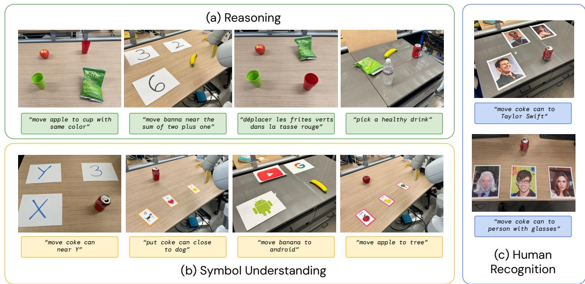

Figure 8 | An overview of some of the evaluation scenarios used to study the emergent capabilities of RT-2. They focus on three broad categories, which are (a) reasoning, (b) symbol understanding, and (c) human recognition. The visualized instructions are a subset of the full instructions, which are listed in Appendix F.2.

<table><tr><td>Task Group</td><td>Tasks</td></tr><tr><td>Symbol Understanding: Symbol 1</td><td>move coke can near X, move coke can near 3, move coke can near Y</td></tr><tr><td>Symbol Understanding: Symbol 2</td><td>move apple to tree, move apple to duck, move apple to apple, move apple to matching card</td></tr><tr><td>Symbol Understanding: Symbol 3</td><td>put coke can close to dog, push coke can on top of heart, place coke can above star</td></tr><tr><td>Reasoning: Math</td><td>move banana to 2, move banna near the sum of two plus one, move banana near the answer of three times two, move banana near the smallest number</td></tr><tr><td>Reasoning: Logos</td><td>move cup to google, move cup to android, move cup to youtube, move cup to a search engine, move cup to a phone</td></tr><tr><td>Reasoning: Nutrition</td><td>get me a healthy snack, pick a healthy drink, pick up a sweet drink, move the healthy snack to the healthy drink, pick up a salty snack</td></tr><tr><td>Reasoning: Color and Multilingual</td><td>move apple to cup with same color, move apple to cup with different color, move green chips to matching color cup, move apple to vaso verde, Bewegen Sie den Apfel in die rote Tasse, move green chips to vaso rojo, mueve la manzana al vaso verde, déplacer les frites verts dans la tasse rouge</td></tr><tr><td>Person Recognition: Celebrities</td><td>move coke can to taylor swift, move coke can to tom cruise, move coke can to snoop dog</td></tr><tr><td>Person Recognition: CelebA</td><td>move coke can to person with glasses, move coke can to the man with white hair, move coke can to the brunette lady</td></tr></table>

Table 3 | Natural language instructions used for quantitative emergent evalutions.

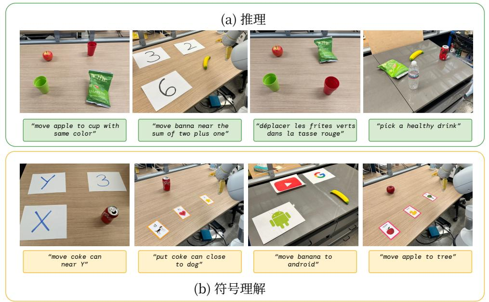

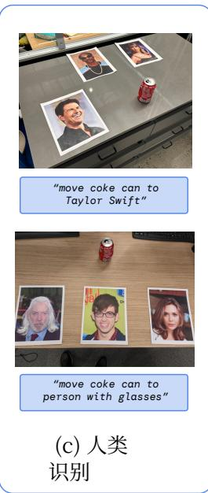

图 8 | 用于研究 RT‑2 涌现能力的部分评估场景概览。它们聚焦于三大类别，即 (a) 推理、(b) 符号理解和(c) 人类识别。可视化的指令是完整指令的一个子集，完整指令列于附录F.2。

<table><tr><td>任务组</td><td>任务</td></tr><tr><td>符号理解-:符号1</td><td>将可乐罐移到X附近,将可乐罐移到3附近,将可乐罐移到Y附近</td></tr><tr><td>符号理解-解:符号2</td><td>将苹果移动到树,将苹果移动到鸭子,将苹果移动到苹果,将苹果移动到匹配卡片</td></tr><tr><td>符号理-解:符号3</td><td>将可乐罐放到狗附近,将可乐罐推到心形上方,放置可乐罐星星上方</td></tr><tr><td>推理:数学</td><td>将香蕉移动到2,将香蕉移动到二加一的和附近,将香蕉移动到三乘以二的答案附近,将香蕉移动到最小数字附近</td></tr><tr><td>推理:标志</td><td>将杯子移到谷歌,将杯子移到安卓,将杯子移到YouTube,将杯子移到搜索引擎,将杯子移到手机</td></tr><tr><td>推理:营养</td><td>给我拿一份健康零食,选一份健康饮品,拿起一份甜饮品,将健康零食移到健康饮品处,拿起一份咸味零食</td></tr><tr><td>推理:颜色与多语言</td><td>将苹果移至相同颜色的杯子中,将苹果移至不同颜色的杯子中,将绿色薯片移至相匹配颜色的杯子中,将苹果移至绿色杯子中,将苹果移至红色杯子中,将绿色薯片移至红色杯子中,将苹果移至绿色杯子中,将绿色薯片移至杯子胭脂</td></tr><tr><td>人物 识别:名人</td><td>把可乐罐移到泰勒·斯威夫特,把可乐罐移到汤姆·克鲁斯,把可乐罐移到史努比狗狗</td></tr><tr><td>人物 识别:CelebA</td><td>将可乐罐移动到戴眼镜的人身边,将可乐罐移动到白发男子身边,将可乐罐移动到深发女士身边</td></tr></table>

## G. Example Failure Cases

In Fig. 9 we provide examples of a notable type of failure case in the Language Table setting, with the RT-2 model not generalizing to unseen object dynamics. In these cases, although the model is able to correctly attend to the language instruction and move to the first correct object, it is not able to control the challenging dynamics of these objects, which are significantly diferent than the small set of block objects that have been seen in this environment Lynch et al. (2022). Then pen simply rolls of the table (Fig. 9, left), while the banana’s center-of-mass is far from where the robot makes contact (Fig. 9, right). We note that pushing dynamics are notoriously dificult to predict and control Yu et al. (2016). We hypothesize that greater generalization in robot-environment interaction dynamics may be possible by further scaling the datasets across diverse environments and objects – for example, in this case, datasets that include similar types of more diverse pushing dynamics Dasari et al. (2019).

In addition, despite RT-2’s promising performance on real world manipulation tasks in qualitative and quantitative emergent evaluations, we still find numerous notable failure cases. For example, with the current training dataset composition and training method, RT-2 seemed to perform poorly at:

• Grasping objects by specific parts, such as the handle

• Novel motions beyond what was seen in the robot data, such as wiping with a towel or tool use

• Dexterous or precise motions, such as folding a towel

• Extended reasoning requiring multiple layers of indirection

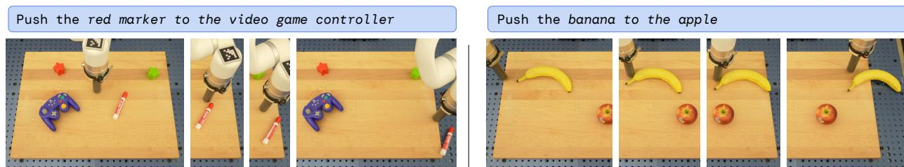  
Figure 9 | Qualitative example failure cases in the real-world failing to generalize to unseen object dynamics.

## G. 失败案例示例

在图 9 中，我们提供了 Language Table 环境中一类显著失败案例的示例，其中 RT‑2 模型未能泛化到未见过的物体动力学。在这些情况下，尽管模型能够正确响应语言指令并移动到第一个正确的物体，但它无法控制这些物体具有挑战性的动力学特性，这些特性与该环境中见过的少量积木物体显著不同 Lynchetal.（2022）。笔直接滚落下了桌子（图 9，左），而香蕉的质心距离机器人接触的位置较远（图 9，右）。我们注意到，推挤动力学众所周知难以预测和控制Yu et al.（2016）。我们推测，通过在多样化的环境和物体上进一步扩展数据集，可能在机器人‑环境交互动力学方面实现更强的泛化——例如在本例中，包含类似类型的更加多样化的推挤动力学数据集 Dasari et al.（2019）。

此外，尽管 RT‑2 在定性与定量涌现能力评估中的真实世界操作任务上展现出了良好的性能，但我们仍然发现了许多值得注意的失败案例。例如，在当前的训练数据集构成和训练方法下，RT‑2 似乎在以下方面表现不佳：

• 抓取物体的特定部位，例如把手

• 超出机器人数据中所见范围的新颖动作，例如用毛巾擦拭或工具使用

• 灵巧或精确的动作，例如折叠毛巾

• 需要多层间接推理的扩展推理

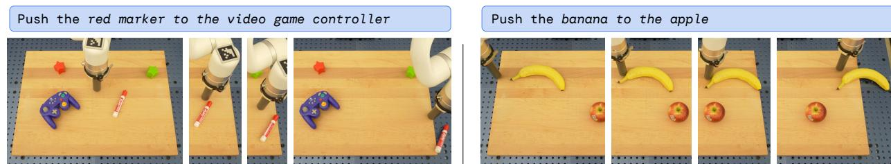  
图 9 | 定性 在真实世界中未能泛化到未见物体动力学的代表性失败案例。

## H. Quantitative Experimental Results

## H.1. Overall Performance, for Section 4.1

Table 4 lists our quantitative overall evaluation results. We find that RT-2 performs as well or better than baselines on seen tasks and significantly outperforms baselines on generalization to unseen objects, backgrounds, and environments.

<table><tr><td rowspan="2">Model</td><td rowspan="2">Seen Tasks</td><td colspan="2">Unseen Objects</td><td colspan="2">Unseen Backgrounds</td><td colspan="2">Unseen Environments</td><td rowspan="2">Unseen Average</td></tr><tr><td>Easy</td><td>Hard</td><td>Easy</td><td>Hard</td><td>Easy</td><td>Hard</td></tr><tr><td>R3M (Nair et al., 2022b)</td><td>45</td><td>32</td><td>14</td><td>13</td><td>9</td><td>0</td><td>2</td><td>12</td></tr><tr><td>VC-1 (Majumdar et al., 2023a)</td><td>63</td><td>34</td><td>10</td><td>13</td><td>3</td><td>0</td><td>0</td><td>10</td></tr><tr><td>RT-1 (Brohan et al., 2022)</td><td>92</td><td>31</td><td>43</td><td>71</td><td>9</td><td>26</td><td>14</td><td>32</td></tr><tr><td>MOO (Stone et al., 2023)</td><td>75</td><td>58</td><td>48</td><td>38</td><td>41</td><td>19</td><td>3</td><td>35</td></tr><tr><td>RT-2-PaLI-X-55B (ours)</td><td>91</td><td>70</td><td>62</td><td>96</td><td>48</td><td>63</td><td>35</td><td>62</td></tr><tr><td>RT-2-PaLM-E-12B $^{1}$  (ours)</td><td>93</td><td>84</td><td>76</td><td>75</td><td>71</td><td>36</td><td>33</td><td>62</td></tr></table>

Table 4 | Overall performance of two instantiations of RT-2 and baselines across seen training tasks as well as unseen evaluations measuring generalization to novel objects, novel backgrounds, and novel environments.

## H. 定量实验结果

## H.1. 总体性能，对应章节 4.1

表 4 列出了我们的定量总体评估结果。我们发现，RT‑2 在已见任务上的表现与基线相当或更优，并且在对未见物体、背景和环境的泛化方面显著优于基线。

<table><tr><td rowspan="2">模型</td><td rowspan="2">已见任务</td><td colspan="2">未见物体</td><td colspan="2">未见背景</td><td colspan="2">未见环境</td><td rowspan="2">未见平均值</td></tr><tr><td>Easy</td><td>Hard</td><td>Easy</td><td>Hard</td><td>Easy</td><td>Hard</td></tr><tr><td>R3M (Nair 等人, 2022b)</td><td>45</td><td>32</td><td>14</td><td>13</td><td>9</td><td>0</td><td>2</td><td>12</td></tr><tr><td>VC-1 (Majumdar et al., 2023a)</td><td>63</td><td>34</td><td>10</td><td>13</td><td>3</td><td>0</td><td>0</td><td>10</td></tr><tr><td>RT-1 (Brohan 等人,2022)</td><td>92</td><td>31</td><td>43</td><td>71</td><td>9</td><td>26</td><td>14</td><td>32</td></tr><tr><td>MOO (Stone 等人,2023)</td><td>75</td><td>58</td><td>48</td><td>38</td><td>41</td><td>19</td><td>3</td><td>35</td></tr><tr><td>RT-2-PaLI-X-55B(本文方法)</td><td>91</td><td>70</td><td>62</td><td>96</td><td>48</td><td>63</td><td>35</td><td>62</td></tr><tr><td>RT-2-PaLM-E-12B $^{1}$ (本文方法)</td><td>93</td><td>84</td><td>76</td><td>75</td><td>71</td><td>36</td><td>33</td><td>62</td></tr></table>

表 RT‑2 的两种实例化模型与基线在已见训练任务以及衡量对新物体、新背景和新环境泛化能力的未见评估中的总体性能。

## H.2. Emergent Evaluation, for Section 4.2

Table 5 lists all of our quantitative emergent evaluation results. We find that RT-2 performs 2x to 3x better than RT-1 on these new instructions, without any additional robotic demonstrations. This showcases how our method allows us to leverage capabilities from pretraining on web-scale vision-language datasets.

<table><tr><td rowspan="2">Model</td><td colspan="4">Symbol Understanding</td><td colspan="5">Reasoning</td><td colspan="3">Person Recognition</td><td rowspan="2">Average</td></tr><tr><td>Symbol 1</td><td>Symbol 2</td><td>Symbol 3</td><td>Average</td><td>Math</td><td>Logos</td><td>Nutrition</td><td>Color/Multilingual</td><td>Average</td><td>Celebrities</td><td>CelebA</td><td>Average</td></tr><tr><td>VC-1 (Majumdar et al., 2023a)</td><td>7</td><td>25</td><td>0</td><td>11</td><td>0</td><td>8</td><td>20</td><td>13</td><td>10</td><td>20</td><td>7</td><td>13</td><td>11</td></tr><tr><td>RT-1 (Brohan et al., 2022)</td><td>27</td><td>20</td><td>0</td><td>16</td><td>5</td><td>0</td><td>32</td><td>28</td><td>16</td><td>20</td><td>20</td><td>20</td><td>17</td></tr><tr><td>RT-2-PaLI-X-55B (ours)</td><td>93</td><td>60</td><td>93</td><td>82</td><td>25</td><td>52</td><td>48</td><td>58</td><td>46</td><td>53</td><td>53</td><td>53</td><td>60</td></tr><tr><td>RT-2-PaLM-E-12B (ours)</td><td>67</td><td>20</td><td>20</td><td>36</td><td>35</td><td>56</td><td>44</td><td>35</td><td>43</td><td>33</td><td>53</td><td>43</td><td>40</td></tr></table>

Table 5 | Performance of RT-2 and baselines on quantitative emergent evaluations.

## H.3. Size and Training Ablations, for Section 4.3

Table 6 details quantitative results for ablations across model size and training approach. Across each, we see that model size plays an important role in performance and that co-fine-tuning outperforms fine-tuning, which outperforms training from scratch.

<table><tr><td rowspan="2">Model</td><td rowspan="2">Size</td><td rowspan="2">Training</td><td colspan="2">Unseen Objects</td><td colspan="2">Unseen Backgrounds</td><td colspan="2">Unseen Environments</td><td rowspan="2">Average</td></tr><tr><td>Easy</td><td>Hard</td><td>Easy</td><td>Hard</td><td>Easy</td><td>Hard</td></tr><tr><td>RT-2-PaLI-X</td><td>5B</td><td>from scratch</td><td>0</td><td>10</td><td>46</td><td>0</td><td>0</td><td>0</td><td>9</td></tr><tr><td>RT-2-PaLI-X</td><td>5B</td><td>fine-tuning</td><td>24</td><td>38</td><td>79</td><td>50</td><td>36</td><td>23</td><td>42</td></tr><tr><td>RT-2-PaLI-X</td><td>5B</td><td>co-fine-tuning</td><td>60</td><td>38</td><td>67</td><td>29</td><td>44</td><td>24</td><td>44</td></tr><tr><td>RT-2-PaLI-X</td><td>55B</td><td>fine-tuning</td><td>60</td><td>62</td><td>75</td><td>38</td><td>57</td><td>19</td><td>52</td></tr><tr><td>RT-2-PaLI-X</td><td>55B</td><td>co-fine-tuning</td><td>70</td><td>62</td><td>96</td><td>48</td><td>63</td><td>35</td><td>63</td></tr></table>

Table 6 | Ablations of RT-2 showcasing the impact of parameter count and training strategy on generalization.

## H.2. 涌现能力评估，针对章节 4.2

表 5 列出了我们所有的定量涌现能力评估结果。我们发现，在无需任何额外机器人示范的情况下，RT‑2 在这些新指令上的表现比 RT‑1 优异 2 到 3 倍。这展示了我们的方法如何利用在网络规模视觉‑语言数据集上进行预训练所获得的能力。

<table><tr><td rowspan="2">模型</td><td colspan="4">符号理解</td><td colspan="5">推理</td><td colspan="3">人物识别</td><td rowspan="2">平均</td></tr><tr><td>符号1</td><td>符号2</td><td>符号3</td><td>平均</td><td>Math</td><td>标志</td><td>营养</td><td>颜色/多语言</td><td>平均</td><td>名人</td><td>CelebA</td><td>平均</td></tr><tr><td>VC-1 (Majumdar et al., 2023a)</td><td>7</td><td>25</td><td>0</td><td>11</td><td>0</td><td>8</td><td>20</td><td>13</td><td>10</td><td>20</td><td>7</td><td>13</td><td>11</td></tr><tr><td>RT-1(Brohan 等人,2022)</td><td>27</td><td>20</td><td>0</td><td>16</td><td>5</td><td>0</td><td>32</td><td>28</td><td>16</td><td>20</td><td>20</td><td>20</td><td>17</td></tr><tr><td>RT-2-PaLI-X-55B(本文方法)</td><td>93</td><td>60</td><td>93</td><td>82</td><td>25</td><td>52</td><td>48</td><td>58</td><td>46</td><td>53</td><td>53</td><td>53</td><td>60</td></tr><tr><td>RT-2-PaLM-E-12B(本文方法)</td><td>67</td><td>20</td><td>20</td><td>36</td><td>35</td><td>56</td><td>44</td><td>35</td><td>43</td><td>33</td><td>53</td><td>43</td><td>40</td></tr></table>

表 5 | RT‑2 与基线在定量涌现能力评估上的性能表现。

## H.3. 规模与训练消融实验，对应第4.3 节

表 6 详细列出了不同模型大小和训练方法的消融实验定量结果。在各项对比中，我们可以看到模型大小对性能起着重要作用，且联合微调优于微调，而微调又优于从头训练。

<table><tr><td rowspan="2">模型</td><td rowspan="2">Size</td><td rowspan="2">训练</td><td colspan="2">未见物体</td><td colspan="2">未见背景</td><td colspan="2">未见环境</td><td rowspan="2">平均</td></tr><tr><td>Easy</td><td>Hard</td><td>Easy</td><td>Hard</td><td>Easy</td><td>Hard</td></tr><tr><td>RT-2-PaLI-X</td><td>5B</td><td>从零开始</td><td>0</td><td>10</td><td>46</td><td>0</td><td>0</td><td>0</td><td>9</td></tr><tr><td>RT-2-PaLI-X</td><td>5B</td><td>微调</td><td>24</td><td>38</td><td>79</td><td>50</td><td>36</td><td>23</td><td>42</td></tr><tr><td>RT-2-PaLI-X</td><td>5B</td><td>联合微调</td><td>60</td><td>38</td><td>67</td><td>29</td><td>44</td><td>24</td><td>44</td></tr><tr><td>RT-2-PaLI-X</td><td>55B</td><td>微调</td><td>60</td><td>62</td><td>75</td><td>38</td><td>57</td><td>19</td><td>52</td></tr><tr><td>RT-2-PaLI-X</td><td>55B</td><td>联合微调</td><td>70</td><td>62</td><td>96</td><td>48</td><td>63</td><td>35</td><td>63</td></tr></table>

表 6 | RT‑2 的消融实验，展示了参数量和训练策略对泛化的影响。

We present additional examples of chain-of-thought reasoning rollouts accomplished with RT-2-PaLM-E, as described in Sec. 4.4, in Figure 10.

## I. Additional Chain-Of-Thought Reasoning Results

## I. 补充思维链推理结果

我们展示了使用 RT‑2‑PaLM‑E 完成的思维链推理展开过程的更多示例，如第 4.4 节所述，见图 10。

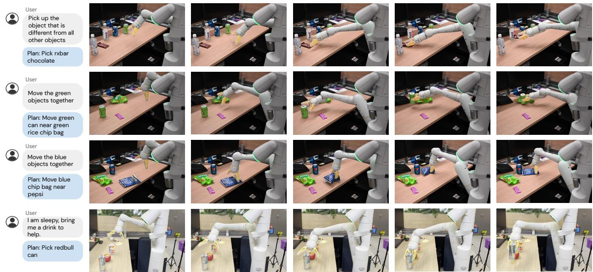  
Figure 10 | Additional examples of RT-2 with chain-of-thought reasoning

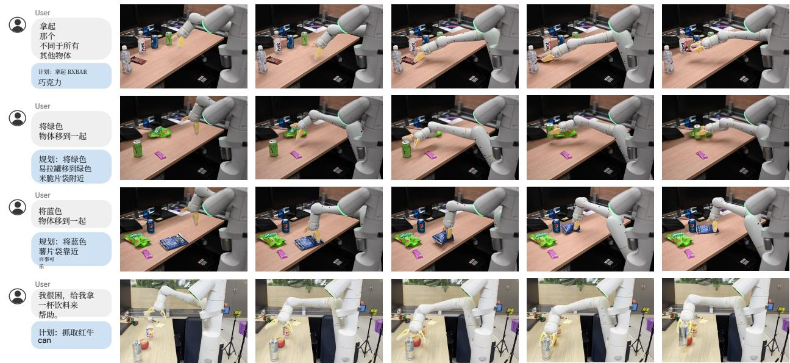  
图 10 | RT‑2 结合思维链推理的更多示例

<table><tr><td>Task Group</td><td>Tasks</td></tr><tr><td>Unseen Objects (Easy)</td><td>pick banana, move banana near coke can, move orange can near banana, pick oreo, move oreo near apple, move redbull can near oreo, pick pear, pick coconut water, move pear near coconut water, move pepsi can near pear</td></tr><tr><td>Unseen Objects (Hard)</td><td>pick cold brew can, pick large orange plate, pick chew toy, pick large tennis ball, pick bird ornament, pick fish toy, pick ginger lemon kombucha, pick egg separator, pick wrist watch, pick green sprite can, pick blue microfiber cloth, pick yellow pear, pick pretzel chip bag, pick disinfectant wipes, pick pineapple hint water, pick green cup, pick pickle snack, pick small blue plate, pick small orange rolling pin, pick octopus toy, pick catnip toy</td></tr><tr><td>Unseen Back-grounds (Easy)</td><td>pick green jalapeno chip bag, pick orange can, pick pepsi can, pick 7up can, pick apple, pick blue chip bag, pick orange, pick 7up can, move orange near sink, pick coke can, pick sponge, pick rxbar blueberry</td></tr><tr><td>Unseen Back-grounds (Hard)</td><td>pick wrist watch, pick egg separator, pick green sprite can, pick blue microfiber cloth, pick yellow pear, pick pretzel chip bag, pick disinfectant wipes, pick pineapple hint water, pick green cup, pick pickle snack, pick small blue plate, pick small orange rolling pin, pick octopus toy, pick catnip toy, pick swedish fish bag, pick large green rolling pin, pick black sunglasses</td></tr><tr><td>Unseen Environ-ments (Easy)</td><td>pick coke can, pick apple, pick rxbar blueberry, move apple near coke can, move rxbar blueberry near apple, move coke can near rxbar blueberry, pick blue plastic bottle, pick sponge, pick blue chip bag, move sponge near blue plastic bottle, move blue chip bag near sponge, move blue plastic bottle near blue chip bag, move coke can near white mug, move sponge near white mug, move coke can near yellow bowl, move sponge near yellow bowl, move coke can near green cloth, move sponge near green cloth, move coke can near plate, move sponge near plate, move coke can near spoon, move sponge near spoon, move coke can near orange cup, move sponge near orange cup, pick white mug, pick yellow bowl, pick green cloth, move white mug near sponge, move yellow bowl near sponge, move green cloth near sponge, pick plate, pick spoon, pick orange cup, move plate near sponge, move spoon near sponge, move orange cup near sponge, put coke can into sink, drop coke can into sink, push coke can into sink, put sponge into sink, drop sponge into sink, push sponge into sink, put green cloth into sink, drop green cloth into sink, push green cloth into sink</td></tr><tr><td>Unseen Environ-ments (Hard)</td><td>pick coke can, pick apple, pick rxbar blueberry, move apple near coke can, move rxbar blueberry near apple, move coke can near rxbar blueberry, move coke can near stapler, move apple near stapler, move coke can near keyboard, move apple near keyboard, move coke can near tissue box, move apple near tissue box, move coke can near papers, move apple near papers, move coke can near mouse, move apple near mouse, move coke can near book, move apple near book, pick marker, pick stapler, pick mouse, move marker near apple, move stapler near apple, move mouse near apple, push coke can to the left, push coke can to the right, push sponge to the left, push sponge to the right, push tissue box to the left, push tissue box to the right, point at coke can, point at sponge, point at tissue box</td></tr></table>

Table 2 | Natural language instructions used for evaluations testing controlled distribution shifts along the dimension of novel objects, novel environments, and novel backgrounds. For each category, we introduce evaluation settings with smaller distribution shifts as well as larger distribution shifts. A visualization of these scenarios if shown in Figure 3. 26 26

<table><tr><td>任务组</td><td>任务</td></tr><tr><td>未见物体(简单)</td><td>抓取香蕉,将香蕉移至可乐罐附近,将橙色罐移至香蕉附近,拿起奥利奥,将奥利奥移到苹果附近,将红牛罐移到奥利奥附近,拿起梨,拿起椰子水,将梨移到椰子水附近,将百事可乐罐移到pear</td></tr><tr><td>未见物体(困难)</td><td>拿起冷萃咖啡罐,拿起大号橙色盘子,拿起咀嚼玩具,拿起大号网球,拿起小鸟饰品,拿起鱼玩具,拿起生姜柠檬康普茶,抓取分蛋器,抓取手表,抓取绿色雪碧罐,抓取蓝色超细纤维布,抓取黄梨,抓取椒盐脆饼片袋,抓取消毒湿巾,抓取菠萝味Hint水,抓取绿色杯子,抓取腌黄瓜零食,抓取蓝色小盘,抓取橙色小擀面杖,抓取章鱼玩具,抓取猫薄荷玩具</td></tr><tr><td>未见(简单)背景</td><td>抓取绿色墨西哥辣椒薯片袋,抓取橙色罐,抓取百事可乐罐,抓取七喜罐,抓取苹果,抓取蓝色薯片袋,抓取橙子,抓取七喜罐,移动橙子到水槽附近,抓取可乐罐,抓取海绵,抓取蓝莓味RXBAR</td></tr><tr><td>未见(困难)背-景</td><td>抓取手表,抓取分蛋器,抓取绿色雪碧罐,抓取蓝色超细纤维布,抓取黄梨,抓取椒盐脆饼片袋,抓取消毒湿巾,抓取菠萝味Hint水,抓取绿色杯子,抓取腌黄瓜零食,抓取蓝色小盘,抓取橙色小擀面杖,抓取章鱼玩具,抓取猫薄荷玩具,抓取瑞典鱼软糖袋,抓取绿色大擀面杖,抓取黑色太阳镜</td></tr><tr><td>未见环境(简单)</td><td>抓取可乐罐,抓取苹果,抓取蓝莓味RXBAR,将苹果移动到可乐罐附近,将蓝莓味RXBAR移动到苹果附近,将可乐罐移动到蓝莓味RXBAR附近,抓取蓝色塑料瓶,抓取海绵,抓取蓝色薯片袋,移动海绵到蓝色塑料瓶附近,移动蓝色薯片袋到海绵附近,移动蓝色塑料瓶到蓝色薯片袋附近,移动可乐罐到白色马克杯附近,移动海绵到白色马克杯附近,移动可乐罐到黄色碗附近,移动海绵到黄色碗附近,移动可乐罐到绿色抹布附近,移动海绵到绿色抹布附近,移动可乐罐到盘子附近,移动海绵到盘子附近,移动将可乐罐移到勺子附近,将海绵移到勺子附近,将可乐罐移到橙色杯子附近,将海绵移到橙色杯子附近,拿起白色马克杯,拿起黄色碗,拿起绿色抹布,将白色马克杯移到海绵附近,将黄色碗移到海绵附近,将绿色抹布移到海绵附近,拿起盘子,拿起勺子,拿起橙色杯子,将盘子移到海绵附近,将勺子移到海绵附近,将橙色杯子移到海绵附近,将可乐罐放入水槽,将可乐罐丢入水槽,将可乐罐推入水槽,将海绵放入水槽,将海绵扔入水槽,将海绵推入水槽,将绿色抹布放入水槽,将绿色抹布扔入水槽,将绿色抹布推入水槽</td></tr><tr><td>未见环境(困难)</td><td>抓取可乐罐,抓取苹果,抓取蓝莓味RXBAR,将苹果移到可乐罐附近,将蓝莓味RXBAR移到苹果附近,将可乐罐移到蓝莓味RXBAR附近,将可乐罐移到订书机附近,将苹果移到订书机附近,将可乐罐移到键盘附近,将苹果移到键盘附近,将可乐罐移到纸巾盒附近,将苹果移到纸巾盒附近,将可乐罐移到纸张附近,将苹果移到纸张附近,将可乐罐移到鼠标附近,将苹果移到鼠标附近,将可乐罐移到书附近,将苹果移到书附近,抓取记号笔,抓取订书机,抓取鼠标,将记号笔移到苹果附近,将订书机移到苹果附近,将鼠标移到苹果附近,将可乐罐向左推,将可乐罐向右推,将海绵向左推,将海绵向右推,将纸巾盒向左推,将纸巾盒向右推,指向可乐罐,指向海绵,指向纸巾盒</td></tr></table>

表 2 | 用于测试沿新物体、新环境和新背景维度的受控分布偏移评估所采用的自然语言指令。对于每个类别，我们引入了具有较小分布偏移以及较大分布偏移的评估设置。这些场景的可视化如图3所示。26