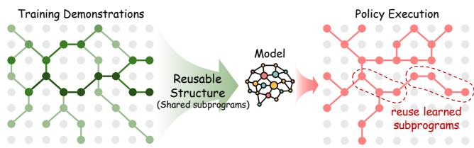
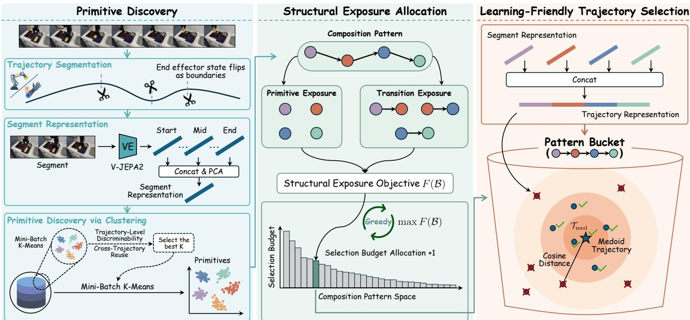
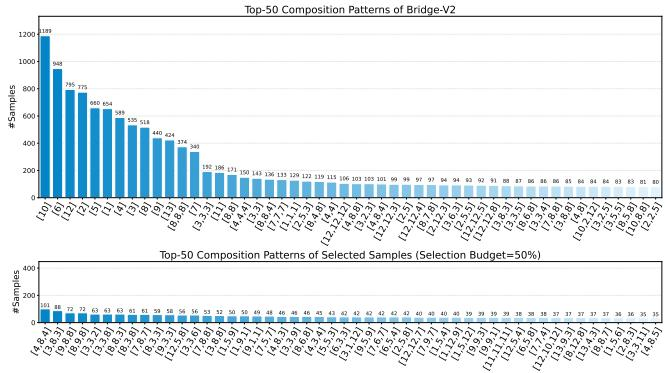
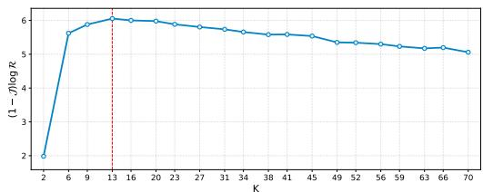
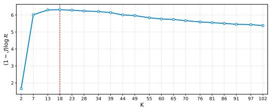
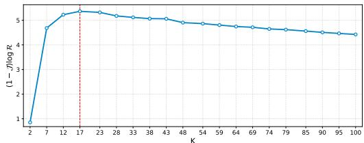

# SIEVE: Structure-Aware Data Selection for Imitation Learning with VLA Models

Changti Wu1,2\*, Bin Yu3,2\*, Zhaolong Shen4,2\*, Shijie Lian5,2, Xiaopeng Lin6,8, Cong Huang7, Zhirui Zhang8, Lei Zhang1†, Kai Chen7,2,8†

1East China Normal University 2Zhongguancun Academy 3Harbin Institute of Technology 4Beihang University 5Huazhong University of Science and Technology 6The Hong Kong University of Science and Technology (Guangzhou) 7Zhongguancun Institute of Artificial Intelligence 8DeepCybo

## Abstract

Vision-Language-Action (VLA) models are typically trained by imitation learning on large-scale robot demonstration datasets, but more data does not necessarily yield better policies due to redundancy, noise, and uneven coverage. Existing data selection methods often assess demonstrations at either the trajectory or state-action level, missing the reusable structures that compose long-horizon behaviors. In this paper, we propose SIEVE, a structure-aware data selection method for VLA imitation learning. SIEVE views demonstrations as compositions of reusable primitives and transition interfaces. It first discovers visuo-motor primitives from segmented trajectories, then allocates selection budgets to composition patterns by maximizing reuse-aware structural exposure under diminishing returns. Finally, it selects medoid trajectories within each composition-pattern bucket to retain central, stable, and imitation-friendly demonstrations. Experiments across multiple datasets, benchmarks, and VLA models show that SIEVE consistently outperforms competitive data selection baselines. Notably, SIEVE can surpass fulldata training while using only 50% of demonstrations and 50% of training steps, suggesting that reusable structure, captured through primitives and transitions, is an important signal for efficient VLA imitation learning.

Code — https://github.com/ChangtiWu/SIEVE

## Introduction

Vision-Language-Action (VLA) models have emerged as a scalable paradigm for robotic control, typically acquiring manipulation skills through imitation learning (IL) over large-scale demonstrations (Zitkovich et al. 2023; O’Neill et al. 2024; Kim et al. 2024; Black et al. 2024; Intelligence et al. 2025). However, the rapid growth of robot demonstration datasets does not automatically translate into better policies. In practice, such datasets often contain substantial trajectory redundancy, noisy human demonstrations, suboptimal behaviors, and uneven task coverage (Sathyanarayan, Vantilborgh, and Abraham 2025; Belkhale, Cui, and Sadigh 2023; Lin et al. 2025a; Xing et al. 2025). Training on unfiltered data can repeatedly expose the model to near-duplicate behaviors while also propagating inconsistent or low-quality supervision. These issues make data selection an increasingly important problem for VLA imitation learning: given a large demonstration pool, we aim to retain a compact subset that is more beneficial for policy learning.

  
Figure 1: Motivation of SIEVE. Training demonstrations contain recurring primitive-transition patterns that can be viewed as reusable behavioral subprograms. Inspired by the MDL principle, SIEVE aims to select demonstrations that expose such reusable structures, enabling the policy to internalize shared subprograms.

Existing data selection methods for imitation learning typically curate demonstrations by estimating sample utility at different granularities. One line relies on trajectory-level signals, such as trajectory-representation similarity for redundancy removal, demonstration reliability, or downstream task feedback (Dass et al. 2025; Chen et al. 2025; Zhang et al. 2025; Xu et al. 2026). While these signals provide a global view of demonstration utility, they may collapse a long-horizon trajectory into a single score and obscure which internal stages or behavior compositions are useful; moreover, feedback-based methods often require costly additional model training. Another line estimates utility from state-action-level signals, such as state-action mutual information, task progress, or joint state-action similarity (Zhang et al. 2025; Hejna et al. 2025). These fine-grained signals can capture local predictability or redundancy, but they are often either too myopic to characterize coherent long-horizon task semantics or primarily designed for local pruning. This creates a granularity mismatch: effective IL data selection requires evidence that is coarser than individual state-action pairs, yet more structured than holistic trajectory scores.

Inspired by the Minimum Description Length (MDL) principle (Barron, Rissanen, and Yu 1998; Rissanen 2004; Grunwald 2007), we view useful demonstrations as those ¨ that expose reusable behavioral regularities. In its two-part form, MDL seeks a description that minimizes the cost of encoding both the model and the data:

$$
L (x) = \min _ {H \in \mathcal {H}} \left[ L (H) - \log P (x \mid H) \right],\tag{1}
$$

where $L ( H )$ is the number of bits required to encode the model H, and − log $P ( x \mid H )$ is the number of bits required to encode the data x. This formulation operationalizes Occam’s razor: a model is penalized unless it yields a shorter description of the data. When repeating patterns exist, they can be stored in the model rather than redundantly encoded in each data instance. This view implies that a learner tends to compress data by absorbing repeating patterns into its parameters, so as to encode more data under limited parameters and computation budgets. Useful data, therefore, is not merely abundant or locally predictable, but rich in extractable structure (i.e., non-random regularities that a bounded learner can internalize and reuse as shared behavioral subprograms) (Finzi et al. 2026). For robotic imitation learning, such structure is naturally expressed as primitive composition: a trajectory consists of atomic behavior primitives and transition interfaces. Thus, we estimate trajectory utility by the primitives it exposes, how they are composed, and which transitions support long-horizon execution, yielding a mid-level scoring granularity that captures reusable behavior patterns shared across demonstrations.

In addition, since IL is typically optimized by behavior cloning (BC), selected demonstrations should also provide stable and predictable action supervision. Atypical or noisy realizations of the same behavior pattern may introduce inconsistent actions under similar observations, making the conditional action prediction target harder to fit (Ross and Bagnell 2010; Hussein et al. 2017; Belkhale, Cui, and Sadigh 2023). Therefore, effective data selection should not only decide which behavioral structures to preserve, but also which concrete demonstrations to imitate. This motivates an IL-friendly selection principle: after identifying useful behavior patterns, one should prefer stable central trajectory realizations that provide more consistent supervision for BC.

Based on these insights, we propose SIEVE, a structureaware data selection framework for VLA imitation learning. SIEVE first discovers reusable atomic behavior primitives by segmenting trajectories at physically grounded interaction boundaries and clustering segment representations. Each trajectory is then represented as a primitive sequence, which defines a composition pattern and its adjacent transitions. SIEVE allocates the selection budget over composition-pattern buckets to maximize reusable primitive and transition exposure under diminishing returns, and then selects medoid trajectories within each bucket to obtain central, stable, and imitation-friendly realizations. This yields a compact subset that exposes reusable behavioral structure while providing predictable supervision for BC. Our contributions are as follows:

• We propose a primitive-compositional view of trajectory utility, realized by Primitive Discovery and Structural Exposure Allocation, which allocate selection budgets according to reuse-aware primitive and transition exposure under diminishing returns.

• We introduce Learning-Friendly Trajectory Selection, which selects medoid trajectories within each composition-pattern bucket to favor central, stable, and predictable realizations for behavior cloning.

• We present SIEVE, a structure-aware data selection method for VLA imitation learning, and demonstrate its effectiveness across datasets, benchmarks, and models. SIEVE can outperform full-data training using only 50% of demonstrations and 50% of training steps, while consistently improving over competitive baselines under multiple experimental settings.

## Related Work

## Vision-Language-Action Models.

Recent advances in vision-language models (VLMs) (Shao et al. 2025; Bai et al. 2025; Lin et al. 2025b) have accelerated the development of Vision-Language-Action (VLA) models, establishing a scalable paradigm for language-conditioned robotic control (Zitkovich et al. 2023; O’Neill et al. 2024; Kim et al. 2024). Modern VLAs map visual observations and language instructions to robot actions through generative policy architectures, such as autoregressive action tokenization, diffusion, or flow-matching models (Zitkovich et al. 2023; Chi et al. 2025; Black et al. 2024; Intelligence et al. 2025; Bjorck et al. 2025; Kim, Finn, and Liang 2025; Lian et al. 2026; Intelligence et al. 2026). These models are typically trained on large-scale demonstrations via imitation learning (IL), most commonly formulated as behavior cloning (Hussein et al. 2017). However, robotic datasets often contain noisy, redundant, and unevenly distributed demonstrations, so scaling training data indiscriminately can waste computation and yield diminishing returns (Xing et al. 2025; Sathyanarayan, Vantilborgh, and Abraham 2025; Belkhale, Cui, and Sadigh 2023; Lin et al. 2025a; O’Neill et al. 2024). This motivates selecting compact yet informative subsets for efficient VLA imitation learning.

## Data Selection for Imitation Learning.

Some related studies mainly focus on macroscopic datasetlevel evaluation, mixing optimization across data sources and VLM data selection (Xiao et al. 2025; Belkhale, Cui, and Sadigh 2023; Hejna et al. 2024; Wu et al. 2026; Zhou, Chang, and Wu 2026). Beyond dataset-level curation, existing IL data selection methods typically estimate sample utility either at the trajectory or state-action level. Trajectorylevel methods use global signals such as representation similarity, reliability, downstream task feedback, or validationloss-based influence estimation (Zhang et al. 2025; Chen et al. 2025; Dass et al. 2025; Xu et al. 2026), but they often collapse long-horizon demonstrations into a single score and, for feedback-based criteria, require costly additional model training. State-action-level methods instead rely on local signals such as mutual information, task progress, or joint state-action similarity (Hejna et al. 2025; Zhang et al. 2025; Yu et al. 2026). However, these criteria are often either too myopic to capture coherent task semantics or primarily designed for local pruning.

  
Figure 2: Overview of SIEVE. 1) Primitive Discovery: trajectories are segmented into primitives through representation learning and clustering. 2) Structural Exposure Allocation: a structural exposure objective estimates primitive composition coverage and allocates the selection budget across composition patterns. 3) Learning-Friendly Trajectory Selection: representative trajectories are selected within each composition-pattern bucket to construct a compact, diverse, and learning-friendly training subset.

## SIEVE

We propose SIEVE, a structure-aware data selection method for imitation learning with VLA models. The key idea is to exploit the structural exposure of demonstrations for data selection. To this end, SIEVE first discovers visuo-motor primitives from trajectory segments and represents each trajectory as a composition of these primitives. It then allocates the selection budget based on structural exposure and selects representative, learning-friendly trajectories within each composition pattern. The resulting subset retains informative behavioral structures while improving the efficiency of imitation learning.

## Primitive Discovery

A demonstration trajectory is typically a composition of several reusable visuo-motor segments. This underlying structural prior motivates us to uncover a vocabulary of primitives from trajectories. We define a primitive as a reusable visuomotor behavior unit discovered from trajectories, which serves as a proxy for a reusable behavioral subprogram.

Trajectory segmentation. Let $\textit { \textbf { D } } = \ \{ \mathcal { T } _ { 1 } , \ldots , \mathcal { T } _ { N } \}$ denote the original dataset, where each sample $\mathcal { T } _ { i }$ is a demonstration trajectory. For each trajectory $\bar { \mathcal T } _ { i } ~ \in ~ \mathcal D$ , we segment it using end effector (gripper/dexterous-hand) state flips (i.e., grasp/release flips) as physically grounded interaction boundaries to obtain $L _ { i }$ segments $\mathcal { T } _ { i } = \{ S _ { i } ^ { 1 } , \ldots , S _ { i } ^ { L _ { i } } \}$ To suppress spurious boundaries caused by transient actuation jitter, a state transition is accepted only if it persists for five consecutive frames.

Segment representation. We then extract the representation for each segment using a pretrained video encoder (VE). Specifically, for each segment Sji $( j \in \{ 1 , \ldots , L _ { i } \} )$ we uniformly sample 8 frames and encode them with V-JEPA2 (Assran et al. 2025). As the start, middle, and end frames provide a compact summary of the segment’s state evolution, we concatenate their representations to form a single feature that captures both semantic content and coarse temporal structure. To suppress noise, improve clustering stability, and reduce computational cost, we further reduce the representation to 256 dimensions with PCA:

$$
\begin{array}{r} z _ {i} ^ {j} \gets \mathrm{PCA} (\mathrm{Concat} (\mathrm{VE} (S _ {i} ^ {j}) _ {\mathrm{start}}; \\ \mathrm{VE} (S _ {i} ^ {j}) _ {\mathrm{mid}}; \mathrm{VE} (S _ {i} ^ {j}) _ {\mathrm{end}})). \end{array}\tag{2}
$$

Primitive discovery via clustering. We discover primitives by clustering the segment representations using Mini-Batch K-Means (Sculley 2010). Rather than manually specifying the number of clusters, we select K automatically on a randomly sampled subset of trajectories. We seek a primitive vocabulary that is both reusable across trajectories and discriminative at the trajectory level: useful primitives should recur across demonstrations, while not collapsing structurally different trajectories into nearly identical primitive composition patterns.

For each candidate K, we first cluster the segment representations from the randomly sampled subset and summarize each trajectory $\mathcal { T } _ { i }$ by the set of clusters it covers:

$$
\mathcal {C} _ {i} = \{c _ {i} ^ {1}, \ldots , c _ {i} ^ {| \mathcal {C} _ {i} |} \} \subseteq \{1, \ldots , K \},\tag{3}
$$

where each $c _ { i } ^ { u } \in \{ 1 , \ldots , K \}$ is a cluster index covered by at least one segment in $\mathcal { T } _ { i }$ . Based on these trajectory-level cluster sets, we evaluate each candidate vocabulary using a reuse-aware criterion comprising two components. The first, trajectory-level discriminability ${ \mathcal { I } } ,$ , measures how distinct different trajectories remain after being represented by cluster coverage. We compute $\mathcal { I }$ as the median of the average pairwise Jaccard similarities over the cluster sets $\mathcal { C } _ { i }$ across all sampled trajectories:

$$
\mathcal {J} = \operatorname{median} _ {i = 1} ^ {n} \frac {1}{n - 1} \sum_ {j \neq i} ^ {n} \operatorname{Jaccard} (\mathcal {C} _ {i}, \mathcal {C} _ {j}).\tag{4}
$$

A lower $\mathcal { I }$ indicates better preservation of structural distinctions between trajectories.

The second component, cross-trajectory reuse $\mathcal { R }$ , quantifies how broadly each discovered cluster recurs across trajectories. R is defined as the median occurrence count of each cluster across all trajectories:

$$
\mathcal {R} = \operatorname{median} _ {k = 1} ^ {K} \sum_ {i = 1} ^ {n} \mathbf {1} [ k \in \mathcal {C} _ {i} ].\tag{5}
$$

A higher R implies that the discovered primitives capture widely applicable behavior units.

We choose the number of clusters by maximizing

$$
K ^ {*} = \arg \max _ {K} \left[ (1 - \mathcal {J}) \log \mathcal {R} \right].\tag{6}
$$

This criterion favors primitive vocabularies that are broadly reused across trajectories while still preserving trajectorylevel discriminability. After selecting $K ^ { * }$ , we rerun Mini-Batch K-Means on all segment representations, and each resulting cluster is treated as a discovered primitive.

## Structural Exposure Allocation

After primitive discovery, each trajectory $\mathcal { T } _ { i }$ is represented by an ordered primitive sequence, referred to as a composition pattern:

$$
P _ {i} = [ c _ {i} ^ {1}, \ldots , c _ {i} ^ {| P _ {i} |} ],\tag{7}
$$

where each $c _ { i } ^ { m } \in \mathcal { C } _ { i }$ is a discovered primitive.

We further define a transition as the local compositional interface between two adjacent primitives in a composition pattern. For trajectories with $| P _ { i } | \geq 2$ , the transitions are

$$
e _ {i} ^ {j} = (c _ {i} ^ {j} \to c _ {i} ^ {j + 1}), \qquad j = 1, \ldots , | P _ {i} | - 1.\tag{8}
$$

For trajectories consisting of a single primitive, we introduce a terminal null state ∅ and define the terminal transition:

$$
e _ {i} = (c _ {i} ^ {1} \to \varnothing),\tag{9}
$$

so that every trajectory contains at least one transition.

Let $\mathcal { P } ~ = ~ \{ P ^ { ( 1 ) } , . . . , P ^ { ( | \mathcal { P } | ) } \}$ denote the set of unique composition patterns in the dataset, where $P ^ { ( \ell ) }$ denotes the ℓ-th unique composition pattern, corresponding to a pattern bucket containing trajectories with the same composition pattern. This composition-pattern space provides the structural reference for measuring how broadly reusable structures are shared across demonstrations. In SIEVE, we capture such reusable structures through primitive composition, where trajectories expose both atomic behavior primitives and the transition interfaces connecting them. To effectively learn reusable structures, the model should be repeatedly exposed not only to primitives themselves but also to how they are composed through transitions. In our setting, these transition interfaces often coincide with critical state changes (e.g., gripper grasp/release) in the task, and therefore provide informative cues for local behavior progression. Moreover, primitives and transitions that are reused across more composition patterns support a broader range of executable behaviors and should be preferentially preserved.

To retain diverse and important structural information, we allocate the selection budget over the composition-pattern space. Let

$$
\mathcal {B} = [ b _ {1}, \dots , b _ {| \mathcal {P} |} ]\tag{10}
$$

denote the allocation vector, where $b _ { \ell }$ is the number of trajectories retained for composition pattern $P ^ { ( \ell ) }$ . We optimize the budget allocation B by maximizing the following structural exposure objective:

$$
F (\mathcal {B}) = \sum_ {c \in \mathcal {C}} w _ {c} \log \bigl (1 + n _ {c} (\mathcal {B}) \bigr) + \sum_ {e \in \mathcal {E}} w _ {e} \log \bigl (1 + n _ {e} (\mathcal {B}) \bigr),\tag{11}
$$

where $\mathcal { C }$ and $\mathcal { E }$ denote the sets of all discovered primitives and transitions, respectively. Here, $n _ { c } ( B )$ and $n _ { e } ( B )$ denote the numbers of occurrences of primitive c and transition e among the selected trajectories under allocation B. The primitive and transition weights are defined by their reuse frequency over the composition-pattern space:

$$
\begin{array}{l l} w _ {c} = \frac {q _ {c}}{| \mathcal {P} |}, & q _ {c} = | \big \{P \in \mathcal {P}: c \in P \big \} |, \\ w _ {e} = \frac {q _ {e}}{| \mathcal {P} |}, & q _ {e} = | \big \{P \in \mathcal {P}: e \in P \big \} |. \end{array}\tag{12}
$$

Here, $q _ { c }$ and $q _ { e }$ denote the numbers of composition patterns containing primitive c and transition $e ,$ respectively. Consequently, primitives and transitions that participate in more composition patterns receive larger weights. The logarithmic utility introduces diminishing returns, encouraging the budget to expose the model to a broader set of reusable structures rather than repeatedly reinforcing the same ones.

We optimize $F ( B )$ greedily. Starting from $\begin{array} { r } { B ^ { ( 0 ) } = \mathbf { 0 } , } \end{array}$ , each iteration allocates one additional sample to the composition pattern with the largest marginal gain:

$$
\Delta (P ^ {(\ell)} \mid \mathcal {B}) = F (\mathcal {B} + \mathbf {b} _ {\ell}) - F (\mathcal {B}),\tag{13}
$$

where $\mathbf { b } _ { \ell }$ is the one-hot allocation vector that increases the budget of pattern $P ^ { ( \ell ) }$ by one. We select

$$
\ell^ {\star} = \operatorname * {a r g   m a x} _ {\ell \in \{1, \ldots , | \mathcal {P} | \}} \Delta (P ^ {(\ell)} \mid \mathcal {B}),\tag{14}
$$

and update

$$
\mathcal {B} \leftarrow \mathcal {B} + \mathbf {b} _ {\ell^ {*}}.\tag{15}
$$

After the budget is exhausted, B specifies how many trajectories should be retained from each pattern bucket. The actual trajectories are then selected within each pattern bucket in the next stage.

## Learning-Friendly Trajectory Selection

Given the pattern-level budget allocation, this stage selects representative and learning-friendly trajectories within each pattern bucket. Behavior cloning trains the policy by minimizing

$$
\mathcal {L} _ {\mathrm{BC}} (\theta) = \mathbb {E} _ {(s, a) \sim \mathcal {D}} [ - \log \pi_ {\theta} (a | s) ],\tag{16}
$$

where $( s , a )$ is a state-action pair sampled from the demonstration dataset ${ \mathcal { D } } ,$ and $\pi _ { \boldsymbol { \theta } } ( a | \boldsymbol { s } )$ is the probability assigned by the policy $\pi _ { \theta }$ to action a under state s. Demonstrations with more consistent state-action mappings provide clearer supervision and are easier for imitation learning to optimize. Since directly estimating conditional action entropy is impractical, we use representation-space centrality as a practical proxy: trajectories near the center of a composition pattern are less likely to be outliers or ambiguous demonstrations, and thus tend to provide more stable supervision.

For each trajectory $\mathcal { T } _ { i }$ with composition pattern $P ^ { ( \ell ) }$ , we construct a trajectory representation $x _ { i }$ by concatenating the segment representations along its primitive sequence:

$$
x _ {i} = \mathrm{Concat} (z _ {i} ^ {1}; \ldots ; z _ {i} ^ {| P _ {i} |}).\tag{17}
$$

Within each composition pattern, we compare trajectories using cosine similarity and identify the medoid trajectory $\mathcal { T } _ { \mathrm { m e d } }$ , which has the largest aggregate similarity $\begin{array} { r l } { S _ { i } } & { { } = } \end{array}$ $\textstyle \sum _ { j \neq i } \cos ( x _ { i } , x _ { j } )$ to other trajectories in the same pattern. We then rank trajectories by their distance to the medoid, defined as $d _ { i } = 1 - \cos ( x _ { i } , x _ { \mathrm { m e d } } )$ , and retain the $B [ \ell ]$ trajectories with the smallest distances, where $B [ \ell ]$ is the budget assigned to composition pattern $P ^ { ( \ell ) }$ by Structural Exposure Allocation. This selects trajectories closest to the pattern bucket center, yielding representative and learning-friendly demonstrations.

## Experiments

## Experiment Setup

Datasets and Evaluation. Here we evaluate SIEVE on three representative robot imitation learning datasets to assess both its data selection effectiveness and its applicability across different embodiments and environments. Unless otherwise specified, Bridge-V2 with SimplerEnv-WidowX serves as the default training and evaluation setting.

• Bridge-V2: We train models on the Bridge-V2 dataset (Walke et al. 2023), a real-world subset of Open X-Embodiment, containing approximately 53K demonstration trajectories collected with a WidowX robot equipped with a parallel gripper. Policies are evaluated in SimplerEnv-WidowX (Li et al. 2024), which includes four manipulation tasks: Stack Cube, Put Carrot, Put Spoon, and Put Eggplant. Evaluation is conducted under multiple unseen kitchen backgrounds and randomized object configurations, providing a challenging outof-distribution (OOD) benchmark.

• Fractal: We further evaluate SIEVE on the Fractal subset of Open X-Embodiment (O’Neill et al. 2024), which contains approximately 87K real-world manipulation trajectories collected with a Google Robot manipulator. Policies are evaluated in SimplerEnv-GoogleRobot (Li et al.

2024) on three manipulation tasks: Grasp Coke Can, Move Near, and Close/Open Drawer.

• GR00T-X-Sim: We additionally evaluate SIEVE on the downsampled Humanoid Robot Tabletop Manipulation subset of GR00T-X-Embodiment-Sim (Bjorck et al. 2025), which contains 24K simulated demonstration trajectories collected with a humanoid robot equipped with dexterous hands. Policies are evaluated in RoboCasa-GR1 (Nasiriany et al. 2024), a benchmark comprising 24 tabletop manipulation tasks across diverse scene layouts and object configurations.

Models. We evaluate SIEVE on two representative VLA models, Qwen3-VL-4B-GR00T and Qwen3-VL-4B-OFT. Unless otherwise specified, all main experiments and ablation studies are conducted using Qwen3-VL-4B-GR00T.

• Qwen3-VL-4B-GR00T (Bjorck et al. 2025): This model combines the Qwen3-VL-4B vision-language backbone (Bai et al. 2025) with a GR00T-style flow-matching policy head that predicts continuous robot actions through conditional flow matching.

• Qwen3-VL-4B-OFT (Kim, Finn, and Liang 2025): This model uses the Qwen3-VL-4B backbone and adopts the OpenVLA-OFT action decoding recipe, which performs parallel continuous action prediction with an MLP-based prediction head trained using an L1 regression objective.

Baselines. We compare SIEVE with the following baselines. All experiments use the same training hyperparameters for a fair comparison (see Appendix for details):

• Full-Training: trains on the complete dataset without data selection and serves as the full-data reference.

• Random: uniformly samples demonstrations from the original training set.

• DemInf (Hejna et al. 2025): selects demonstrations according to state-action mutual information estimates.

• SCIZOR (Zhang et al. 2025): filters low-quality data by identifying redundant trajectories and suboptimal stateaction pairs.

## Main Results

Table 1 summarizes the main results on Bridge-V2 using Qwen3-VL-4B-GR00T. We evaluate two selection budgets, 50% and 70%, corresponding to 26.5K and 37.1K demonstrations, respectively. For each budget, we consider two training schedules. The first scales the number of training steps proportionally to the selected data size (25K and 35K steps for the 50% and 70% budgets, respectively), reducing both training data and computation. The second trains each selected subset for the same 50K training steps as Full-Training. Comparing these two settings allows us to disentangle improvements brought by data selection from those potentially arising from increased optimization per sample under a fixed training budget.

As shown in Table 1, SIEVE consistently achieves the highest average success rate across all selection budgets and training schedules. Notably, using only 50% of the demonstrations and 25K training steps, SIEVE attains an average success rate of 56.3%, outperforming Full-Training (51.8%), which uses the complete dataset and twice the training steps. This result indicates that SIEVE is able to identify a compact subset that is more effective for imitation learning while substantially reducing both training data and computation.

<table><tr><td>Method</td><td>Training Steps</td><td>Stack Green Cube On Yellow Cube</td><td>Put Carrot On Plate</td><td>Put Spoon On Table Cloth</td><td>Put Eggplant In Basket</td><td>Avg.</td></tr><tr><td>Full-Training</td><td>50K</td><td>22.9</td><td>53.1</td><td>68.8</td><td>62.5</td><td>51.8</td></tr><tr><td colspan="7">Selection Budget: 26.5K (50%)</td></tr><tr><td>Random</td><td rowspan="4">25K (50%)</td><td>20.8</td><td>41.7</td><td>64.6</td><td>31.3</td><td>39.6</td></tr><tr><td>DemInf</td><td>11.5</td><td>37.5</td><td>58.3</td><td>65.6</td><td>43.2</td></tr><tr><td>SCIZOR</td><td>13.5</td><td>36.5</td><td>68.8</td><td>90.6</td><td>52.2</td></tr><tr><td>SIEVE (Ours)</td><td>25.0</td><td>54.2</td><td>70.8</td><td>75.0</td><td>56.3</td></tr><tr><td>Random</td><td rowspan="4">50K (100%)</td><td>25.0</td><td>36.5</td><td>66.7</td><td>33.3</td><td>40.4</td></tr><tr><td>DemInf</td><td>12.5</td><td>40.6</td><td>69.8</td><td>63.5</td><td>46.6</td></tr><tr><td>SCIZOR</td><td>16.7</td><td>39.6</td><td>72.9</td><td>92.7</td><td>55.5</td></tr><tr><td>SIEVE (Ours)</td><td>29.2</td><td>57.3</td><td>75.0</td><td>76.0</td><td>59.4</td></tr><tr><td colspan="7">Selection Budget: 37.1K (70%)</td></tr><tr><td>Random</td><td rowspan="4">35K (70%)</td><td>16.7</td><td>50.0</td><td>74.0</td><td>37.5</td><td>44.6</td></tr><tr><td>DemInf</td><td>18.8</td><td>51.0</td><td>78.1</td><td>72.9</td><td>55.2</td></tr><tr><td>SCIZOR</td><td>20.8</td><td>41.7</td><td>72.9</td><td>91.7</td><td>56.8</td></tr><tr><td>SIEVE (Ours)</td><td>22.9</td><td>57.3</td><td>81.3</td><td>87.5</td><td>62.3</td></tr><tr><td>Random</td><td rowspan="4">50K (100%)</td><td>12.5</td><td>51.0</td><td>77.1</td><td>46.9</td><td>46.9</td></tr><tr><td>DemInf</td><td>17.7</td><td>57.3</td><td>79.2</td><td>74.0</td><td>57.1</td></tr><tr><td>SCIZOR</td><td>19.8</td><td>45.8</td><td>76.0</td><td>90.6</td><td>58.1</td></tr><tr><td>SIEVE (Ours)</td><td>21.9</td><td>58.3</td><td>86.5</td><td>83.3</td><td>62.5</td></tr></table>

Table 1: Performance comparison with baselines on SimplerEnv-WidowX using Qwen3-VL-4B-GR00T. We compare SIEVE with baselines under 50% and 70% selection budgets, at different training steps. “Avg.” denotes the average success rate.

Compared with existing data selection baselines, SIEVE consistently delivers the best performance. Under the 50% selection budget, SIEVE achieves average success rates of 56.3% and 59.4% under the proportional and 50K training schedules, outperforming SCIZOR (52.2% and 55.5%, respectively). Under the 70% budget, SIEVE further achieves average success rates of 62.3% and 62.5% with 35K and 50K training steps, respectively, again outperforming all competing methods. SIEVE also exhibits consistently stronger per-task performance. It outperforms Random on every task under all evaluation settings, suggesting that the performance gains arise from selecting structurally informative demonstrations rather than simply reducing the training set size. Compared with SCIZOR, SIEVE produces more balanced performance across tasks. While SCIZOR performs particularly well on Put Eggplant In Basket, its performance drops noticeably on Stack Green Cube On Yellow Cube and Put Carrot On Plate. In contrast, SIEVE maintains competitive performance across all four tasks, resulting in the best overall average success rate.

Since SimplerEnv evaluates policies under substantial visual and environmental variations relative to Bridge-V2, these results further demonstrate that the subsets selected by SIEVE generalize well under distribution shift.

## Extended Results

Performance Across Different Datasets. We further evaluate SIEVE across different training datasets and evaluation benchmarks. For Bridge-V2, Full-Training is trained for 50K steps, whereas for Fractal and GR00T-X-Sim, Full-Training is trained for 100K steps. For all data selection methods, we retain 50% of the training data and train for 50% of the corresponding Full-Training steps (25K for Bridge-V2 and 50K for Fractal and GR00T-X-Sim). As shown in Table 2 (see the Appendix for detailed results), SIEVE achieves the highest average success rate across all three settings. On Bridge-V2 and Fractal, SIEVE achieves average success rates of 56.3% and 76.4%, outperforming Full-Training (51.8% and 75.0%, respectively), while using only half of the training data and half of the training steps. On GR00T-X-Sim, Random selection already slightly outperforms Full-Training. One possible explanation is that both GR00T-X-Sim and RoboCasa-GR1 are simulated tabletop manipulation environments, making RoboCasa-GR1 relatively in-domain for GR00T-X-Sim. In this setting, training on a smaller subset may provide more effective optimization per demonstration. Nevertheless, SIEVE still achieves the highest average success rate among all methods. These results demonstrate that SIEVE generalizes effectively across different datasets, robot embodiments, and evaluation benchmarks.

<table><tr><td>Method</td><td>Bridge-V2</td><td>Fractal</td><td>GR00T-X-Sim</td></tr><tr><td>Full-Training</td><td>51.8</td><td>75.0</td><td>52.7</td></tr><tr><td>Random</td><td>39.6</td><td>55.6</td><td>53.5</td></tr><tr><td>DemInf</td><td>43.2</td><td>67.4</td><td>53.8</td></tr><tr><td>SCIZOR</td><td>52.2</td><td>71.9</td><td>54.2</td></tr><tr><td>SIEVE (Ours)</td><td>56.3</td><td>76.4</td><td>54.8</td></tr></table>

Table 2: Performance across different datasets using Qwen3- VL-4B-GR00T. Full-Training uses the complete dataset, while all selection methods use 50% of the data and 50% of the training steps. We report average success rates (%).

Performance Across Different Models. We further evaluate whether SIEVE-selected data remains effective across different VLA models. Since this experiment aims to evaluate model generalization rather than compare all data selection methods, we compare SIEVE with Full-Training and

<table><tr><td>Method</td><td>Stack Green Cube On Yellow Cube</td><td>Put Carrot On Plate</td><td>Put Spoon On Table Cloth</td><td>Put Eggplant In Basket</td><td>Avg.</td></tr><tr><td colspan="6">Qwen3-VL-4B-GR00T</td></tr><tr><td>Full-Training</td><td>22.9</td><td>53.1</td><td>68.8</td><td>62.5</td><td>51.8</td></tr><tr><td>Random</td><td>20.8</td><td>41.7</td><td>64.6</td><td>31.3</td><td>39.6</td></tr><tr><td>SIEVE (Ours)</td><td>25.0</td><td>54.2</td><td>70.8</td><td>75.0</td><td>56.3</td></tr><tr><td colspan="6">Qwen3-VL-4B-OFT</td></tr><tr><td>Full-Training</td><td>21.9</td><td>25.0</td><td>45.8</td><td>62.5</td><td>38.8</td></tr><tr><td>Random</td><td>9.4</td><td>33.3</td><td>16.6</td><td>45.8</td><td>26.3</td></tr><tr><td>SIEVE (Ours)</td><td>21.9</td><td>58.3</td><td>50.0</td><td>95.8</td><td>56.5</td></tr></table>

Table 3: Performance across different models on SimplerEnv-WidowX. Full-Training uses the complete dataset with 50K training steps, while all selection methods use 50% of the data and 50% of the training steps.

Random under the same 50% selection budget. As shown in Table 3, SIEVE consistently achieves the highest average success rate on both Qwen3-VL-4B-GR00T and Qwen3- VL-4B-OFT. On Qwen3-VL-4B-GR00T, SIEVE achieves an average success rate of 56.3%, outperforming both Random (39.6%) and Full-Training (51.8%). On Qwen3- VL-4B-OFT, SIEVE further achieves an average success rate of 56.5%, outperforming Random (26.3%) and Full-Training (38.8%). The gains are particularly evident on tasks such as Put Carrot On Plate and Put Eggplant In Basket, where SIEVE-selected data consistently achieves substantially higher success rates than both reference methods. These results indicate that the effectiveness of SIEVE is not tied to a particular VLA model.

<table><tr><td>Method</td><td>Stack Green Cube On Yellow Cube</td><td>Put Carrot On Plate</td><td>Put Spoon On Table Cloth</td><td>Put Eggplant In Basket</td><td>Avg.</td></tr><tr><td colspan="6">Ablation of Structural Exposure Allocation</td></tr><tr><td>w/o Trans.</td><td>22.9</td><td>47.9</td><td>67.7</td><td>64.6</td><td>50.8</td></tr><tr><td>w/o Prim.</td><td>25.0</td><td>51.0</td><td>68.8</td><td>61.5</td><td>51.6</td></tr><tr><td colspan="6">Ablation of Learning-Friendly Trajectory Selection</td></tr><tr><td>Most-Dissim</td><td>18.8</td><td>45.8</td><td>64.6</td><td>31.3</td><td>40.1</td></tr><tr><td>Random</td><td>29.2</td><td>36.5</td><td>77.1</td><td>71.9</td><td>53.7</td></tr><tr><td>SIEVE (Ours)</td><td>25.0</td><td>54.2</td><td>70.8</td><td>75.0</td><td>56.3</td></tr></table>

Table 4: Ablation study on SimplerEnv-WidowX using Qwen3-VL-4B-GR00T under the 50% selection budget and 50% of the training steps. “w/o Trans.” and “w/o Prim.” remove the transition and primitive exposure terms, respectively. “Most-Dissim” selects the most dissimilar samples to maximize within-bucket trajectory diversity, while “Random” uses random within-bucket selection.

## Ablation Study and Further Analysis

Ablation of Structural Exposure Allocation. We ablate the two structural exposure terms in SIEVE. Removing the transition or primitive exposure term decreases the average success rate from 56.3% to 50.8% and 51.6%, respectively, indicating that both primitives and transitions contribute to effective data selection. The larger performance drop without transition exposure further suggests that transition interfaces provide important supervision for modeling how reusable behavior units are connected during task execution.

Ablation of Learning-Friendly Trajectory Selection. We ablate the within-bucket sample selection strategy. Replacing the proposed selection with Most-Dissim, which selects trajectories with the lowest aggregate cosine similarity to other samples to maximize trajectory diversity, reduces the average success rate from 56.3% to 40.1%, indicating that atypical trajectories within the same composition pattern are less suitable for imitation learning. Random withinbucket selection performs better than most-dissimilar selection but still trails SIEVE, improving the average success rate only from 53.7% to 56.3%. These results validate our design choice of selecting representative and stable demonstrations within each composition-pattern bucket.

  
Figure 3: Distribution of top-50 composition patterns before and after SIEVE selection (Selection budget=50%) on Bridge-V2. Each x-axis label denotes a composition pattern, represented as an ordered list of primitive IDs.

Composition Pattern Redistribution. Figure 3 illustrates how SIEVE reshapes the composition-pattern distribution on Bridge-V2. The original dataset is dominated by a small number of high-frequency patterns, many of which consist of a single primitive, indicating limited compositional diversity. After selection, the distribution becomes substantially more balanced, and the most frequent selected patterns are predominantly multi-primitive sequences, covering a wider range of primitives and transitions. This redistribution suggests that SIEVE shifts the selected subset away from frequency-dominated patterns toward structurally richer composition patterns, thereby exposing more reusable primitives and transitions for imitation learning.

## Conclusion

We introduced SIEVE, a structure-aware data selection method for VLA imitation learning. SIEVE selects demonstrations by exposing reusable primitive compositions and transition interfaces, while favoring central and stable realizations within each composition pattern for behavior cloning. Across multiple datasets, benchmarks, and VLA models, SIEVE consistently improves over competitive baselines and can outperform full-data training using fewer demonstrations and training steps. These results highlight the importance of selecting data according to reusable structure, offering a practical route toward more efficient VLA imitation learning.

## References

Assran, M.; Bardes, A.; Fan, D.; Garrido, Q.; Howes, R.; Muckley, M.; Rizvi, A.; Roberts, C.; Sinha, K.; Zholus, A.; et al. 2025. V-jepa2: Self-supervised video models enable understanding, prediction and planning. arXiv preprint arXiv:2506.09985.

Bai, S.; Cai, Y.; Chen, R.; Chen, K.; Chen, X.; Cheng, Z.; Deng, L.; Ding, W.; Gao, C.; Ge, C.; et al. 2025. Qwen3-vl technical report. arXiv preprint arXiv:2511.21631.

Barron, A.; Rissanen, J.; and Yu, B. 1998. The minimum description length principle in coding and modeling. IEEE transactions on information theory, 44(6): 2743–2760.

Belkhale, S.; Cui, Y.; and Sadigh, D. 2023. Data quality in imitation learning. Advances in neural information processing systems, 36: 80375–80395.

Bjorck, J.; Castaneda, F.; Cherniadev, N.; Da, X.; Ding,˜ R.; Fan, L.; Fang, Y.; Fox, D.; Hu, F.; Huang, S.; et al. 2025. Gr00t n1: An open foundation model for generalist humanoid robots. arXiv preprint arXiv:2503.14734.

Black, K.; Brown, N.; Driess, D.; Esmail, A.; Equi, M.; Finn, C.; Fusai, N.; Groom, L.; Hausman, K.; Ichter, B.; et al. 2024. π0: A Vision-Language-Action Flow Model for General Robot Control. arXiv preprint arXiv:2410.24164.

Chen, A. S.; Lessing, A. M.; Liu, Y.; and Finn, C. 2025. Curating demonstrations using online experience. arXiv preprint arXiv:2503.03707.

Chi, C.; Xu, Z.; Feng, S.; Cousineau, E.; Du, Y.; Burchfiel, B.; Tedrake, R.; and Song, S. 2025. Diffusion policy: Visuomotor policy learning via action diffusion. The International Journal ofRobotics Research, 44(10-11): 1684–1704.

Dass, S.; Khaddaj, A.; Engstrom, L.; Madry, A.; Ilyas, A.; and Mart´ın-Mart´ın, R. 2025. Datamil: Selecting data for robot imitation learning with datamodels. arXiv preprint arXiv:2505.09603.

Finzi, M.; Qiu, S.; Jiang, Y.; Izmailov, P.; Kolter, J. Z.; and Wilson, A. G. 2026. From Entropy to Epiplexity: Rethinking Information for Computationally Bounded Intelligence. arXiv preprint arXiv:2601.03220.

Grunwald, P. D. 2007. ¨ The minimum description length principle. MIT press.

Hejna, J.; Bhateja, C.; Jiang, Y.; Pertsch, K.; and Sadigh, D. 2024. Re-mix: Optimizing data mixtures for large scale imitation learning. arXiv preprint arXiv:2408.14037.

Hejna, J.; Mirchandani, S.; Balakrishna, A.; Xie, A.; Wahid, A.; Tompson, J.; Sanketi, P.; Shah, D.; Devin, C.; and Sadigh, D. 2025. Robot data curation with mutual information estimators. arXiv preprint arXiv:2502.08623.

Hussein, A.; Gaber, M. M.; Elyan, E.; and Jayne, C. 2017. Imitation learning: A survey of learning methods. ACM Computing Surveys (CSUR), 50(2): 1–35.

Intelligence, P.; Ai, B.; Amin, A.; Aniceto, R.; Balakrishna, A.; Balke, G.; Black, K.; Bokinsky, G.; Cao, S.; Charbonnier, T.; et al. 2026. π : a Steerable Generalist Robotic Foundation Model with Emergent Capabilities. arXiv preprint arXiv:2604.15483.

Intelligence, P.; Black, K.; Brown, N.; Darpinian, J.; Dhabalia, K.; Driess, D.; Esmail, A.; Equi, M.; Finn, C.; Fusai, N.; et al. 2025. π : a Vision-Language-Action Model with Open-World Generalization. arXiv preprint arXiv:2504.16054.

Kim, M. J.; Finn, C.; and Liang, P. 2025. Fine-tuning vision-language-action models: Optimizing speed and success. arXiv preprint arXiv:2502.19645.

Kim, M. J.; Pertsch, K.; Karamcheti, S.; Xiao, T.; Balakrishna, A.; Nair, S.; Rafailov, R.; Foster, E.; Lam, G.; Sanketi, P.; et al. 2024. Openvla: An open-source vision-languageaction model. arXiv preprint arXiv:2406.09246.

Li, X.; Hsu, K.; Gu, J.; Pertsch, K.; Mees, O.; Walke, H. R.; Fu, C.; Lunawat, I.; Sieh, I.; Kirmani, S.; et al. 2024. Evaluating real-world robot manipulation policies in simulation. arXiv preprint arXiv:2405.05941.

Lian, S.; Yu, B.; Lin, X.; Shen, Z.; Yang, L. T.; Jin, Y.; Liu, H.; Wu, C.; Yuan, H.; Huang, C.; et al. 2026. IntentVLA: Short-Horizon Intent Modeling for Aliased Robot Manipulation. arXiv preprint arXiv:2605.14712.

Lin, F.; Hu, Y.; Sheng, P.; Wen, C.; You, J.; and Gao, Y. 2025a. Data scaling laws in imitation learning for robotic manipulation. In International Conference on Learning Representations, volume 2025, 54877–54910.

Lin, X.; Lian, S.; Yu, B.; Yang, R.; Shen, Z.; Wu, C.; Miao, Y.; Jin, Y.; Shi, Y.; He, J.; et al. 2025b. Physbrain: Human egocentric data as a bridge from vision language models to physical intelligence. arXiv preprint arXiv:2512.16793.

Nasiriany, S.; Maddukuri, A.; Zhang, L.; Parikh, A.; Lo, A.; Joshi, A.; Mandlekar, A.; and Zhu, Y. 2024. Robocasa: Large-scale simulation of everyday tasks for generalist robots. arXiv preprint arXiv:2406.02523.

O’Neill, A.; Rehman, A.; Maddukuri, A.; Gupta, A.; Padalkar, A.; Lee, A.; Pooley, A.; Gupta, A.; Mandlekar, A.; Jain, A.; et al. 2024. Open x-embodiment: Robotic learning datasets and rt-x models: Open x-embodiment collaboration 0. In 2024 IEEE International Conference on Robotics and Automation (ICRA), 6892–6903. IEEE.

Rissanen, J. 2004. Minimum description length principle. Encyclopedia of statistical sciences, 7.

Ross, S.; and Bagnell, D. 2010. Efficient reductions for imitation learning. In Proceedings of the thirteenth international conference on artificial intelligence and statistics, 661–668. JMLR Workshop and Conference Proceedings.

Sathyanarayan, H.; Vantilborgh, V.; and Abraham, I. 2025. Quality Over Quantity: Curating Contact-Based Robot Datasets Improves Learning. arXiv preprint arXiv:2510.18137.

Sculley, D. 2010. Web-scale k-means clustering. In Proceedings ofthe 19th international conference on World wide web, 1177–1178.

Shao, R.; Li, W.; Zhang, L.; Zhang, R.; Liu, Z.; Chen, R.; and Nie, L. 2025. Large vlm-based vision-language-action models for robotic manipulation: A survey. arXiv preprint arXiv:2508.13073.

Walke, H. R.; Black, K.; Zhao, T. Z.; Vuong, Q.; Zheng, C.; Hansen-Estruch, P.; He, A. W.; Myers, V.; Kim, M. J.; Du, M.; et al. 2023. Bridgedata v2: A dataset for robot learning at scale. In Conference on Robot Learning, 1723–1736. PMLR.

Wu, C.; Mao, J.; Miao, Y.; Lian, S.; Yu, B.; Lin, X.; Huang, C.; Zhang, L.; and Chen, K. 2026. ScalSelect: Scalable Training-Free Multimodal Data Selection for Efficient Visual Instruction Tuning. arXiv preprint arXiv:2602.11636.

Xiao, J.; Yan, B.; Zhang, J.; Wang, J.; Li, C.; Cheng, Z.; and Zhai, G. 2025. Data Assessment for Embodied Intelligence. arXiv preprint arXiv:2511.09119.

Xing, Y.; Luo, X.; Xie, J.; Gao, L.; Shen, H.; and Song, J. 2025. Shortcut learning in generalist robot policies: The role of dataset diversity and fragmentation. arXiv preprint arXiv:2508.06426.

Xu, T.; Wang, J.; Zhang, R.; Guan, J.; Zeng, X.; Song, W.; Zhou, X.; Chen, Z.; Chen, G.; and Li, Y.-L. 2026. ATHENA: Accelerated Multi-Task Heterogeneous Influence Functions for Robot Data Curation. arXiv preprint arXiv:2606.16208.

Yu, B.; Lian, S.; Lin, X.; Shen, Z.; Wei, Y.; Wu, C.; Yuan, H.; Liu, H.; Wang, B.; Huang, C.; et al. 2026. FrameSkip: Learning from Fewer but More Informative Frames in VLA Training. arXiv preprint arXiv:2605.13757.

Zhang, Y.; Xie, Y.; Liu, H.; Shah, R.; Wan, M.; Fan, L.; and Zhu, Y. 2025. Scizor: A self-supervised approach to data curation for large-scale imitation learning. arXiv preprint arXiv:2505.22626.

Zhou, Y.; Chang, Y.; and Wu, Y. 2026. Synthetic Data for Multimodal Large Language Models: A Lifecycle-Oriented Survey.

Zitkovich, B.; Yu, T.; Xu, S.; Xu, P.; Xiao, T.; Xia, F.; Wu, J.; Wohlhart, P.; Welker, S.; Wahid, A.; et al. 2023. Rt-2: Vision-language-action models transfer web knowledge to robotic control. In Conference on Robot Learning, 2165– 2183. PMLR.

## Appendix

## Training Hyperparameters

All experiments are conducted using the same training hyperparameters summarized in Table 5, ensuring a fair comparison across different methods. All models are trained on 8 NVIDIA H100 (80GB) GPUs.

## Implementation Details of Primitive Discovery via Clustering.

To determine the number of primitive clusters, we adopt a practical search strategy. Specifically, for each dataset, we randomly sample 10% of the demonstrations and uniformly evaluate 20 candidate values of K within a reasonable search range. For each candidate, we perform primitive clustering and compute the clustering score (1 − J) log R defined in the Primitive discovery via clustering section. The value of K that maximizes this score is selected for all subsequent experiments. Figure 4 shows the search results on Bridge-V2, Fractal, and GR00T-X-Sim. The clustering score exhibits a clear peak on all three datasets, suggesting that the proposed criterion provides a stable and practical heuristic for determining the number of primitive clusters.

<table><tr><td>Hyperparameter</td><td>Value</td></tr><tr><td>Optimizer</td><td>AdamW</td></tr><tr><td>Learning rate (VLM)</td><td>1e-5</td></tr><tr><td>Learning rate (Action Head)</td><td>1e-4</td></tr><tr><td>LR scheduler</td><td>Cosine decay</td></tr><tr><td>Warmup ratio</td><td>10%</td></tr><tr><td>AdamW ( $\beta_1, \beta_2$ )</td><td>(0.9, 0.95)</td></tr><tr><td>Weight decay</td><td>1e-8</td></tr><tr><td>Gradient clipping</td><td>1.0</td></tr><tr><td>Per-device batch size</td><td>16</td></tr><tr><td>Gradient accumulation</td><td>1</td></tr><tr><td>Mixed precision</td><td>BF16</td></tr><tr><td>Distributed training</td><td>DeepSpeed ZeRO-2</td></tr></table>

Table 5: Training hyperparameters.  

(a) Bridge-V2  
  
(b) Fractal

  
(c) GR00T-X-Sim  
Figure 4: Selection of the number of primitive clusters K on different datasets. Following the practical protocol used in our experiments, we randomly sample 10% of each training dataset and uniformly evaluate 20 candidate K values within a reasonable search range. The optimal K is selected by maximizing the clustering score (1 − J) log R, and is indicated by the red dashed line.

## Details on Performance Across Different Datasets

Tables 6 and 7 present the detailed results corresponding to Table 2 in the main paper. Consistent with the main results, SIEVE achieves the highest average success rate on both Fractal and GR00T-X-Sim while maintaining competitive performance across individual evaluation categories.

<table><tr><td>Method</td><td>Grasp Single Opened Coke Can</td><td>Move Near Google Baked Tex</td><td>Close/Open Drawer Custom</td><td>Avg.</td></tr><tr><td>Full-Training</td><td>95.8</td><td>87.5</td><td>41.7</td><td>75.0</td></tr><tr><td>Random</td><td>100.0</td><td>66.7</td><td>0.0</td><td>55.6</td></tr><tr><td>DemInf</td><td>100.0</td><td>85.4</td><td>16.7</td><td>67.4</td></tr><tr><td>SCIZOR</td><td>99.0</td><td>87.5</td><td>29.2</td><td>71.9</td></tr><tr><td>SIEVE (Ours)</td><td>100.0</td><td>91.7</td><td>37.5</td><td>76.4</td></tr></table>

Table 6: Detailed results on Fractal. This table expands the Fractal results reported in Table 2, showing the success rate for each evaluation task. Full-Training uses the complete dataset with 100K training steps, while all data selection methods use 50% of the training data and 50% of the training steps.

<table><tr><td>Method</td><td>PnP * To * Close</td><td>PnP Novel From Cuttingboard To *</td><td>PnP Novel From Placemat To *</td><td>PnP Novel From Plate To *</td><td>PnP Novel From Tray To *</td><td>Avg.</td></tr><tr><td>Full-Training</td><td>52.8</td><td>54.8</td><td>46.5</td><td>55.5</td><td>54.0</td><td>52.7</td></tr><tr><td>Random</td><td>50.5</td><td>56.8</td><td>49.8</td><td>60.3</td><td>50.1</td><td>53.5</td></tr><tr><td>DemInf</td><td>53.3</td><td>55.1</td><td>48.6</td><td>58.1</td><td>53.9</td><td>53.8</td></tr><tr><td>SCIZOR</td><td>54.0</td><td>56.1</td><td>48.1</td><td>60.5</td><td>52.3</td><td>54.2</td></tr><tr><td>SIEVE (Ours)</td><td>55.3</td><td>56.7</td><td>47.9</td><td>61.3</td><td>52.8</td><td>54.8</td></tr></table>

Table 7: Detailed results on GR00T-X-Sim. This table expands the GR00T-X-Sim results reported in Table 2, showing the average success rate for each RoboCasa-GR1 task category. Full-Training uses the complete dataset with 100K training steps, while all data selection methods use 50% of the training data and 50% of the training steps.