# Safe Learning for Contact-Rich Robot Tasks: A Survey from Classical Learning-Based Methods to Safe Foundation Models

Heng Zhang\*1,2,3, Rui Dai4, Gokhan Solak1, Pokuang Zhou3, Yu She3, and Arash Ajoudani1

1Human-Robot Interfaces and Interaction Lab, Istituto Italiano di Tecnologia, Genova, Italy 2Ph.D. program of national interest in Robotics and Intelligent Machines (DRIM) and Universit di Genova, Genoa, Italy

3Edwardson School of Industrial Engineering, Purdue University, West Lafayette, IN, USA 4HHCM Lab, Istituto Italiano di Tecnologia, Genova, Italy

## Abstract

Contact-rich tasks pose significant challenges for robotic systems due to inherent uncertainty, complex dynamics, and the high risk of damage during interaction. Recent advances in learningbased control have shown great potential in enabling robots to acquire and generalize complex manipulation skills in such environments, but ensuring safety, both during exploration and execution, remains a critical bottleneck for reliable real-world deployment.

This survey provides a comprehensive overview of safe learning-based methods for robot contactrich tasks. We categorize existing approaches into two main domains: safe exploration, which focuses on minimizing the risk of unsafe actions during the learning phase, and safe execution, which ensures policy robustness and constraint satisfaction during deployment and interaction. We review key techniques, including constrained reinforcement learning, risk-sensitive optimization, uncertainty-aware modeling, control barrier functions, and model predictive safety shields, and highlight how these methods incorporate prior knowledge, task structure, and online adaptation to balance safety and efficiency.

A particular emphasis of this survey is on how these safe learning principles extend to and interact with emerging robotic foundation models, especially vision-language models (VLMs) and visionlanguage-action models (VLAs), which unify perception, language, and control for contact-rich manipulation. We discuss both the new safety opportunities enabled by VLM/VLA-based methods, such as language-level specification of constraints and multimodal grounding of safety signals, and the amplified risks and evaluation challenges they introduce. Finally, we outline current limitations and promising future directions toward deploying reliable, safety-aligned, and foundation-modelenabled robots in complex contact-rich environments. More details and materials are available at our Project GitHub Repository.

Keywords: contact-rich tasks, safe learning, robot manipulation, physical interaction

“Contact is the heart of robotic manipulation. To understand manipulation, you must understand contact.” The Heart of Robotic Manipulation —– Matthew T. Mason

## 1 Introduction

Robots are increasingly expected to operate in unstructured and dynamic environments, where interaction with the physical world is inevitable [1, 2]. Among such interactions, contact-rich tasks, such as assembly, insertion, cutting, or tool use, are particularly challenging due to the complex, discontinuous dynamics and the need for precise force and motion control. Traditional model-based control methods often struggle in these scenarios due to inaccurate or hard-to-obtain models, while learning-based methods promise flexibility and adaptability by leveraging data-driven representations [3].

However, applying learning-based methods to contact-rich tasks raises critical safety concerns [4]. Exploration during training may lead to unsafe actions that cause damage to the robot, the environment, or humans [5]. Similarly, the execution of learned policies in a deployment must guarantee constraint satisfaction and robustness, especially under distributional shifts or unmodeled dynamics [6]. Therefore, safety must be addressed both during exploration and during execution to ensure the reliable operation of autonomous systems in the real world.

This survey focuses on safe learning-based approaches that address the dual challenges of safe exploration and safe execution in robot contact-rich tasks. We categorize and analyze a wide range of methods, including constrained and risk-aware reinforcement learning, uncertainty-aware control, model-based safety filters, and hybrid approaches that combine learning with formal guarantees. These methods aim to strike a balance between learning efficiency, task performance, and safety assurance.

We begin by outlining the unique challenges posed by contact-rich tasks and the requirements for safety in this context. We then present a taxonomy of existing methods based on the learning paradigm and safety mechanism employed. Finally, we identify open problems and future research directions, including benchmark design, generalization, and integration of safety across system levels.

This survey aims to provide a structured overview of the current landscape, foster a deeper understanding of safe learning in contact-rich robotics, and inspire new research toward safe and capable autonomous systems. In particular, it emphasizes the emerging role of VLMs and VLAs as robotic foundation models that unify perception, language, and control for contact-rich tasks. By framing safety challenges and design principles in the context of these models, the survey seeks to guide the development of VLM/VLA-based systems that are not only powerful and general, but also verifiably safe in real-world deployment.

A number of recent surveys have explored topics at the intersection of safety, learning, and contactrich robotic manipulation. However, none comprehensively address the unique challenges and opportunities posed by safe learning in contact-rich tasks. Our survey aims to bridge this gap by providing a focused, methodical overview of the state-of-the-art, specifically within this critical niche. Several surveys have investigated safe learning and RL more generally. Works such as [4, 7, 8] provide comprehensive overviews of safety mechanisms in learning-based control and safe RL, including constraints, shielding, and exploration strategies. More specialized perspectives are offered in surveys on state-wise safety [7], control barrier functions in RL [9] and shielded RL [10]. While these surveys address safety in learning, they often neglect the complexities introduced by physical interaction and contact dynamics.

From the perspective of robotic manipulation and contact, surveys such as [11, 12] and [13] analyze manipulation strategies and control frameworks, including both model-based and model-free methods. Others review variable impedance control [14] and compliant mechanisms [15], which are crucial for adapting to contact uncertainties but do not directly integrate learning-based safety frameworks. The application of RL in robotic assembly has also been reviewed in recent literature [3, 16, 17] with emphasis on task success and sample efficiency. However, these surveys primarily focus on task performance and learning architectures, offering limited discussion on safety guarantees during exploration or deployment. Some surveys focused on contact-rich tasiks but lost safety highlight, such as [18] only focus on imitation learning methods.

More recent efforts begin to address physical risk and safety in the era of data-driven and foundation model-based robotics [19–22], highlighting the growing relevance of scalable safety mechanisms. However, they often center on high-level policy alignment or general-purpose systems, lacking specificity in contact-rich manipulation contexts.

Publications per year

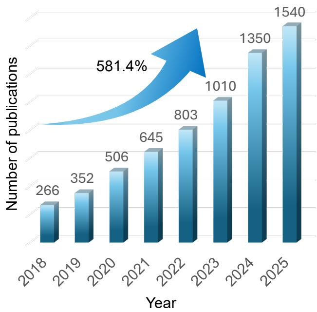  
Related keywords

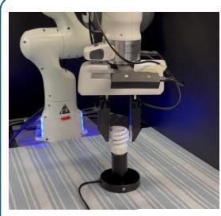

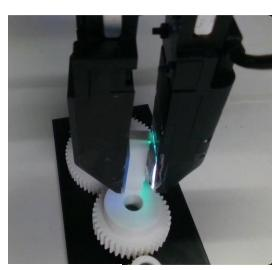

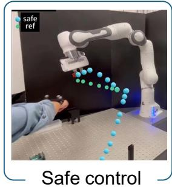  
Contact rich

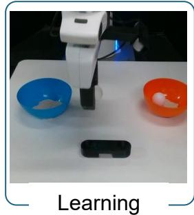  
Figure 1: Trend of research publications with the keywords related to the safety, contact-rich robotics and learning. Representative example works are shown: contact-rich tasks, safe control, and learning-based methods [31, 32].

Advanced agentic embodied AI sheds light on a generalist robotic system, while the safety issue remains due to a lack of physical interaction data. [23] Safety for VLA robotic generalists lags because high-fidelity, failure and nearmiss contact data are scarce, and foundational semantic models still misground force, region, and tolerance constraints in physically complex interaction regimes [24]. Hybrid planparameterizefilter stacks that couple semantic/VLM layers with compliant action abstractions and certified online shields improve robustness under distribution shift but remain challenged by contact mode transitions and geometry/material variation [17, 25–27]. Advancing VLA safety thus hinges on curated multimodal contact corpora, standardized force/violation metrics, and tighter analyticaldata-driven integration for adaptive constraint grounding and reactive invariance maintenance [23].

Lastly, surveys on human-like manipulation [28] force/torque control [29], and safety in robotic manufacturing [30] provide valuable domain-specific insights but remain largely disconnected from the safe learning perspective, especially the standard of safety was discussed in [30].

In contrast to the aforementioned surveys, our work uniquely focuses on the intersection of safe learning and contact-rich robotics, where safety must be ensured not only in policy learning but also in dynamic interaction with the environment. We systematically review methods that account for safety during physical contact, discuss open challenges in real-world applications, and outline promising directions for future research. We conducted a detailed analysis of the research intensity in this field over recent years, covering the period from 2018 to the present (2025). Fig. 1 shows the trend of research interest in this area.

Therefore, it is necessary to provide a comprehensive survey of recent advancements in safe learning for robotic contact-rich tasks. This survey focuses on learning-based approaches that directly integrate safety mechanisms into the learning process, such as safe reinforcement learning and model-based safety strategies. We deliberately exclude imitation learning methods, as their primary objective is to replicate demonstrated behaviors rather than actively managing safety during exploration or execution, an aspect critical in contact-rich environments where uncertainty and dynamic interaction play a significant role.

In light of the aforementioned challenges and recent advancements, we systematically review the landscape of safe learning methods for robotic contact-rich tasks, which pose unique challenges due to the dynamic, force-intensive, and uncertain nature of physical interactions. Our contributions are threefold:

1. A Safety-Centric Taxonomy We introduce a structured taxonomy that categorizes safe learning approaches based on key dimensions, including learning phase (exploration vs. execution), level of safety integration (planning, control, or end-to-end), and modalities used (force/torque, vision, etc.). This survey provides a comprehensive lens through which researchers can analyze existing methods and identify safety design trade-offs.

2. Contextualization Within Contact-Rich Tasks Beyond general safe learning, we focus on its application to contact-rich robotic tasks such as insertion, polishing, and assembly. We detail how safety constraints are embedded in these tasks, and map the methods used to specific operational challenges (e.g., compliance, contact-inavatiable tasks, collision avoidance, and force control).

3. Identification of Gaps, Challenges, and Future Directions. We synthesize open research questions and outline critical challenges such as sim-to-real transfer under safety constraints, the scarcity of standardized benchmarks, and the need for provably safe generalization. We also discuss underexplored directions, including hybrid control-learning frameworks and human-in-the-loop safety mechanisms. Most importantly, we highlight the challenges and future opportunities in integrating safe contact-rich learning with large robotic foundation models, particularly VLMs and VLAs.

The remainder of this survey is organized as follows. In Section 2, we provide background on contact-rich tasks and formalize safety definitions in this context. Section 3 categorizes existing safe learning methods from multiple perspectives, including learning paradigms and safety mechanisms. In Section 4, we discuss open challenges and limitations in current approaches. Finally, Section 5 outlines promising future research directions to advance safe learning in robotic contact-rich tasks.

## 2 Background and Definitions in Safe Robotic Interaction

## 2.1 Robotic Contact-Rich Tasks

The definition of contact-rich tasks varies in the literature, and it was also referred to by different terms such as physical interaction tasks [38], or manipulation in contact [11]. According to our definition, a task is contact-rich when its successful execution requires dynamic and extended physical contact with the environment.

In this regard, obstacle avoidance is not a contact-rich task: even though contact can happen sometimes, the task can be accomplished without contact. Simple pick-and-place tasks are not included even though they involve contacts with objects, because these contacts are fixed (i.e., not dynamic) after the grasp. However, tool-use tasks where the grasped object interacts with the environment, or in-hand manipulation where the contacts between the object and the robot hand are not fixed, are considered contact-rich. The definition also excludes the impact-based tasks such as throwing [39], hitting [40] or catching [41, 42] an object, in which the contact is momentary or sparse (i.e., not extended). These tasks are contact-intensive, but not contact-rich.

Some examples of typical contact-rich tasks are peg-in-hole insertion, surface grinding, massaging a human, multi-finger manipulation, vegetable cutting, and box pushing (Fig. 2). We advance our discussion on the contact-rich tasks in Sec. 3.2, by grouping the tasks in the reviewed literature into four main categories, and presenting uncommon task variants that introduce novel challenges.

## 2.2 Definition of Safety in Contact-Rich Tasks

Safety in contact-rich manipulation spans multiple, complementary notions that arise from diverse objectives, stakeholders, and operational contexts [22]. Rather than a single definition, safety should be understood along several axes: physical interaction and energy exchange; stability and invariance; con straint satisfaction and reachability; risk- and data-driven guarantees; human-centered factors and standards [43]; and phase- and level-specific integration (exploration vs. execution; planning vs. control). We formalize these axes and situate them within contact-rich robotics with representative references.

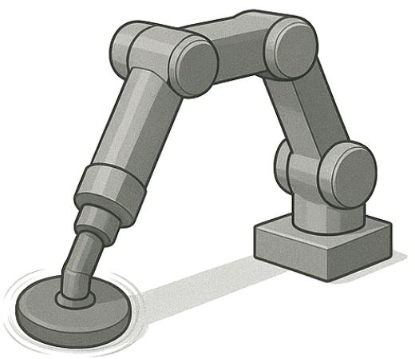

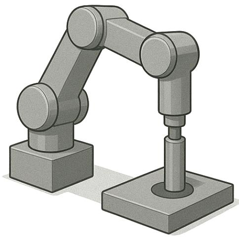

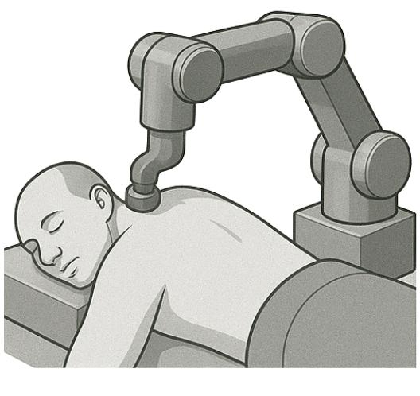

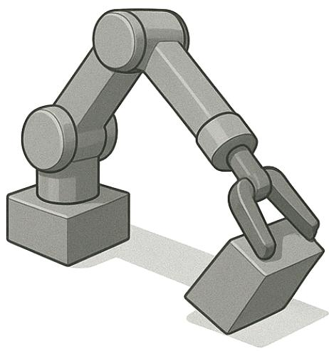  
Figure 2: Illustrations of typical contact-rich tasks: Surface grinding [33], peg-in-hole [34], massaging [35] and non-prehensile object manipulation [36, 37]. The images are generated using ChatGPT 5.1.

## 2.2.1 Physical-Interaction Safety: Contact-force, Energy and Passivity

Contact force is a primary lens for safety in contact-rich manipulation. Excessive normal or tangential forces, whether as high transient impact at contact onset or as sustained forces/pressures during steady interaction, can damage workpieces and tooling, or injure humans in collaborative settings. A practical definition of safety, therefore, specifies force envelopes over time, including bounds on magnitude, rate of change, and impulse, together with region- or phase-specific limits (e.g., fragile surfaces, no-touch faces). Reviews on interaction/impedance control and force regulation formalize these aspects and their stability implications [2, 44].

Achieving force-centric safety requires (i) reliable sensing/estimation of contact forces and states, (ii) controllers that prioritize force regulation under uncertainty, and (iii) runtime mechanisms that enforce hard limits. Force/torque sensing combined with observers and multimodal perception [45] supports contact-state estimation (onset, sticking/slip) and force-grounded policy inputs; this enables early guard actions (e.g., approach deceleration, alignment) to reduce peaks and avoid lateral overload. Classical hybrid positionforce control and impedance/admittance control provide physically interpretable means to track force references while maintaining compliant interaction; variable impedance schemes adapt stiffness/damping online to keep forces within bounds amid modeling error and task variation [2, 44]. In learning-integrated systems, producing high-level references (pose/force/impedance gains) rather than direct torques helps preserve stability margins while meeting force objectives [46].

Enforcement at execution time benefits from casting force bounds (and friction cones) as constraints. Model-based safety filters, such as MPC with hard/soft constraints or barrier-based action projection, can minimally modify a nominal (possibly learned) command to preserve admissible contact forces, especially near transitions (free-space to contact, contact to sliding). This projection viewpoint also supports chance/risk-aware limits to reduce rare but damaging force spikes [46–48]. When specifications are given in natural language or task rules (e.g., do not exceed 5 N on cable, avoid pressing the painted surface), grounding them into formal force/region constraints and injecting them into the safety layer provides reliable guardrails during execution [25, 39].

Energy and passivity complement the force-first view by regulating how much energy the robot injects into the environment. Passivity indices and energy reservoirs (energy tanks) offer monitors and buffers that cap impact energy and prevent force runaway under delays, unmodeled compliance, or highgain settings. In practice, combining passivity-aware impedance/admittance with explicit force envelopes yields robust behavior across approach, impact, and sustained-contact phases, and remains compatible with learning-based references and uncertainty-aware shields [2, 44, 46].

## 2.2.2 Stability and Invariance: Lyapunov and CBF Views

A second axis treats safety as stability and set invariance. Lyapunov methods certify convergence or boundedness and can imply safety when safe sets are invariant sublevel sets of a Lyapunov function [49, 50]. Control Barrier Functions (CBFs) enforce forward invariance of safety sets online, minimally modifying actions to prevent constraint violations; they have seen increasing use in contact-aware robotics and safe RL [9, 51–53]. End-to-end safe RL can embed barrier-based constraints into training or runtime filtering [54, 55]. Here, safety means remaining inside certified invariant sets while preserving task feasibility.

## 2.2.3 Constraint Satisfaction and Reachability

Safety can be defined as the satisfaction of state, input, and contact constraints (e.g., joint/velocity/torque limits, friction cones, force envelopes). Safe MPC enforces constraints over a horizon with robust tubes or uncertainty sets [56, 57]. HamiltonJacobi reachability and safety filters compute (or approximate) safe sets and veto actions that would exit them [22, 58, 59]. In the constraint-centric view, safety is the persistent satisfaction of physically meaningful bounds throughout approach, impact, sliding, and re-grasp phases.

## 2.2.4 Risk- and Data-Driven Safety

Data-driven definitions quantify safety via risk-sensitive objectives, recovery zones, or auxiliary critics that predict and penalize unsafe outcomes. Recovery RL separates exploration from recovery to reduce unsafe excursions [60]; safety critics or pessimistic objectives downweight risky actions under uncertainty [4, 8, 61]. Recent work provides theoretical formulations (e.g., safe value functions, shielding and generalization guarantees) to connect statistical learning with formal safety [62, 63]. In this axis, safety is a probabilistic guarantee or risk bound over contact outcomes under imperfect models and noisy sensing.

## 2.2.5 Human-Centered and Standard-Driven Safety

In humanrobot collaboration and assistance, safety must address physical limits (contact pressure, speedand-separation, ergonomics) and perceived safety (predictability, comfort, trust) [2, 64]. Standards such as ISO 10218 and ISO/TS 15066 codify limits and processes, shaping acceptable forces, speeds, and safety-rated monitoring [30, 65]. Perception- and policy-level safeguards further bound human exposure to risk in collaborative and assistive tasks [66–69]. Along this axis, safety extends beyond robot/object protection to human well-being and acceptability.

## 2.2.6 Semantic Safety with VisionLanguage(Action) Models

Semantic safety concerns aligning task intent, environment context, and contact constraints with what the robot actually executes, so that language-/vision-conditioned policies do not trigger unsafe contact behaviors. In contact-rich settings, this means grounding task semantics (objects, affordances, no-touch zones, insertion axes, force limits) and safety rules (limits, PPE, human proximity) into actionable constraints and monitors for execution [46].

Modern VLM/VLA systems can (i) parse natural-language goals and safety rules, (ii) ground them in the sensed scene (objects, surfaces, grasp points) [25, 27, 70], and (iii) parameterize low-level compliant controllers or skill libraries with safety-aware references (pose/force/impedance) [26, 71, 72] rather than direct torques. Typical architectures use a hierarchical split: a languagevision planner selects certified skills/options; mid-level skills expose safety-relevant parameters; low-level safety enforcers (impedance, CBF/MPC, rate limiters) guarantee contact stability and constraint satisfaction during execution [72–75].

## 2.3 Problem Formulation and Learning Paradigm Overview

## 2.3.1 Problem Formulation

Contact-rich manipulation arises across assembly, insertion, forceful surface interaction, and humanrobot collaboration. We consider a general formulation that does not commit to a single mathematical model. Tasks are described by (i) a state representation $x _ { t }$ that includes robot kinematics/dynamics, latent contact modes, and measured or estimated wrenches; (ii) a control signal $u _ { t }$ that can be low-level torques/velocities or higher-level references such as force targets and impedance/admittance gains; and (iii) safety and feasibility specifications involving force/torque envelopes, friction and approach cones, motion limits, and human-centric constraints [2, 44, 46]. Depending on assumptions and requirements, the underlying decision model may be an unconstrained Markov decision process (MDP) or a partially observable Markov decision process (POMDP), a constrained variant (e.g., constrained Markov decision process (CMDP)), or a hybrid-systems/control-theoretic problem with explicit contact transitions. In all cases, safety is operationalized through limits on contact forces/pressures and motion, potentially augmented by risk- or semantics-derived rules [25, 26, 39, 46].

Observability and abstraction are key design choices. When direct force/torque sensing is available, controllers can track force references and tighten safety envelopes; otherwise, observers or learned estimators provide wrench/contact-state cues for policy inputs and online monitoring [44]. Action abstraction often improves safety and sim-to-real transfer: outputting pose/force targets or impedance parameters instead of raw torques yields compliant interaction and clearer hooks for runtime safety mechanisms [2, 44, 46]. Finally, semantics (VLM/VLA) supply high-level task structure and safety rules that must be grounded into formal constraints and checked during execution [25, 26, 39, 76, 77].

## 2.3.2 Learning Paradigm

We summarize four main learning paradigms and how they interface with safety in contact-rich manipulation.

RL: RL learns policies for variable-impedance forceful skills and insertions, often using action spaces that output force targets or stiffness/damping to preserve compliant interaction. Safety is enhanced by conservative objectives, recovery strategies, and shielded execution (e.g., barrier/reachability/MPC layers) [6, 16, 78–81]

IL: Demonstrations initialize contact sequencing and force profiles (approach, touch, slide) and are commonly refined by RL or supervised updates; hybrid trajectoryforce learning and one/few-shot strategies are prevalent in insertion and assembly settings. IL shares the same safety-friendly action abstractions and leverages compliant controllers during execution [32, 82, 83]

Learning for Model-based and control-theoretic methods Impedance/admittance regulation, robust/adaptive force controllers, MPC with contact constraints, and barrier/reachability filters operationalize limits on contact force/torque, friction cones, and approach geometry. Learning augments these by identifying dynamics, adapting gains, or shaping feasible sets, yielding transparent enforcement at runtime [53, 84, 84–87]

Foundation model-based methods Foundation models for robotics leverage large-scale VLA pretraining to parse open-ended goals, infer affordances, and impose safety-aware constraints before execution. In contact-rich settings, these methods are typically embedded in a plan parameterize enforce stack: (i) a VLM/VLA module interprets natural-language goals and scene context to propose task sketches and safety rules (e.g., force caps, no-touch regions, speed-and-separation); (ii) the semantic plan is compiled into formal constraints and parameterized skill references (pose/force/impedance) rather than raw torques to preserve compliant interaction; and (iii) low-level safety layers (e.g., MPC/CBF filters, rate limiters) execute with verifiable bounds on contact forces and approach geometry [25, 26, 39]. Data and evaluation rely on open toolchains and safety-oriented benchmarks to quantify violation rates, refusal/recovery behavior, and generalization under distribution shift [48, 76, 77, 88]. Practically, safety guardrails for foundation-model pipelines include structured prompting and tool schemas, text-to-constraint grounding with pre-execution checks, conservative default limits (force/velocity caps), and plan-then-filter action projection through certified controllers; these mitigations address hallucination and mis-grounding that could otherwise lead to overloads at contact [25–27].

Hybrid integration (planlearnenforce) Planning and skill graphs (potentially guided by VLM/VLA) provide structure; learned policies output pose/force/impedance parameters; safety layers project actions to satisfy certified constraints. Semantic modules further align high-level intent and safety rules with the certified execution stack [26, 27, 76, 77]. Evaluation commonly reports violations, near misses, and generalization using standardized suites and simulators [48, 88, 89].

## 3 Methods Categorization from Different Perspectives

This section organizes existing safe learning approaches for contact-rich robot tasks along several complementary dimensions to clarify their underlying assumptions and design trade-offs. By examining methods through perspectives such as task characteristics, sensing and policy modalities, data acquisition strategies, simulation environments and benchmarks, safety evaluation metrics, safety abstraction levels, and safety enforcement spaces, the survey highlights common patterns and gaps that are not apparent from any single taxonomy. This multi-view categorization also helps connect classical controltheoretic techniques with modern learning-based and foundation-model-based approaches, providing a unified lens for analyzing current methods and guiding future developments.

## 3.1 Safe Learning for Contact-Rich Tasks

## 3.1.1 Safe Exploration (safe learning before contact)

This section introduces safe learning before executing the task, highlighting its importance in ensuring reliable and risk-free performance prior to real execution.

Safe HRC has traditionally been approached through path planning algorithms such as rapidlyexploring random tree star (RRT∗) [90] for dynamic human-robot systems, or artificial potential field (APF) [91] and virtual fixtures [92] for real-time adjustment of the robot’s trajectory. However, these methods often yield slow trajectory computation and limited generalization, since they require taskspecific tuning, assume simplified environments, and adapt poorly to dynamic or unstructured settings [92].

Recent approaches enforce safety constraints via control barrier functions (CBFs), where quadratic programs compute minimal trajectory deviations to maintain safety [93–95]. Extensions to uncertain CBFs (U-CBFs) handle environmental uncertainty [96, 97], though worst-case assumptions often yield conservative designs. Stochastic frameworks using chance constraints offer less conservative alternatives [98, 99], but remain computationally intractable for most HRC applications due to non-convex feasible regions [100]. Complementary work examines risk factors in HRC [101–104]. While these approaches can better inform the tolerable risk-bound for different applications, a risk tunable CBF can solve the limitation [31].

Ensuring system safety while maintaining performance requires sophisticated approaches that balance computational efficiency, safety guarantees, and adaptability. Below, we present four prominent categories of methods that address these challenges through different theoretical frameworks and computational strategies.

Reachability-based Trajectory Safeguard (RTS) [105] is an offline-online safety layer that precomputes reachable sets for plan tracking and, at runtime, filters the reinforcement learning policy’s continuous actions to the nearest safe plan without throttling learning speed. Compared to Model Predictive Control (MPC), CBF, and Safety-set methods, which provide strong online guarantees but require heavier per-step optimization, RTS offers computational efficiency through its offline precomputation strategy. Similarly, while Radial Basis Function (RBF) and Gaussian Process (GP)-based safe learning methods offer flexible uncertainty modeling, they often rely on probabilistic guarantees and incur expensive computational costs. this approach relies on a reasonably accurate system model and can be less adaptive when dynamics or obstacles change significantly during operation.

Model predictive shielding (MPS) [106] provide a model-predictive shield around any RL policy: they forecast violations and replace unsafe actions with safe, goal-directed recoveries, enabling zeroviolation training and deployment. CBF-Guided MPC [107] embeds barrier constraints in MPC and tunes them online for proactive, explainable hard-safety during tracking/avoidance at the cost of online optimization and careful model or CBF design. These MPC-based methods trade offline precomputation for online optimization to improve task progress with interpretable constraints.

Implicit Safe Set Algorithm [108]. A model-free safe control method that queries a black-box dynamics (e.g., digital twin) to synthesize a safety index (barrier certificate) and a corresponding safe control law, guaranteeing forward invariance and finite-time convergence. Data-Driven Permissible Safe Control with Barrier Certificates [109] learns unknown stochastic dynamics via Gaussian Processes and constructs piecewise stochastic barrier functions to compute a maximal set of permissible strategies that satisfy a target probabilistic safety level; as data increases, the permissible set grows toward the knownmodel benchmark while maintaining safety.

Advantage-Based Intervention [110] achieves safety by online interventions and surrogate MDP training (requires a safe backup policy/advantage estimates), whereas AlwaysSafe [111] achieves safety by a model-based abstraction of safety dynamics (requires a correct abstraction); both enable safe data collection for learning.

Reachability filters policy actions via offline reachable sets for real-time, hard-safety execution; MPC/CBF enforces safety online via predictive checks and constraints with interpretable but optimization heavy control; safety-set constructs invariant or permissible safe regions model-free or GP-based for certified operation; and safe exploration guarantees no violations during learning via interventions or abstract safety models, trading flexibility and sample efficiency against model/backup policy assumptions.

Here we group learning-based methods by what they learn and how they ensure safety. Lyapunoy actorcritic [112] learns policy weights under an explicit Lyapunov constraint, and executes through an adaptive impedance layer for compliant, stability-guaranteed motion. Safety-Aware Unsupervised Skill Discovery [113] learns a skill policy and a safety-critic that estimates failure probability, yielding intrinsically safe skills for downstream tasks. Variable-Impedance Skill Learning [114] learns a latent skill prior/decoder, a latent policy, and impedance as part of the action, achieving safety via compliant interaction and bounded contact forces. Impedance-learning adaptive control for HRI [115] learns impedance gains, feedforward interaction force, dynamics parameters, and robust Sliding Mode Control (SMC) gain, with Lyapunov proofs of bounded tracking. Impedance iterative-learning SMC [116] updates impedance and SMC gains across trials, combining compliance and robustness guarantees for non-repetitive tasks.

Learning-based approaches directly optimize policies, skills and impedance from data, offering greater adaptability to unmodeled dynamics and complex contact phenomena with less hand-crafted modeling, most advantageous when rich demonstrations or interactive rollouts are available and the task/environment is hard to model yet demands fast, compliant behavior under distribution shift.

## 3.1.2 Safe Execution (after contact).

Safe execution is crucial in contact-rich robotic tasks, as robots must interact not only with complex and uncertain environments but often also in close proximity to humans [2]. During these interactions, any unsafe behavior can result in damage to the robot, the manipulated objects, or even pose risks to human safety. Ensuring safe execution means that the robot’s actions consistently respect physical constraints [117], avoid hazardous situations, and maintain robust performance despite uncertainties or disturbances. This is especially important in real-world deployments, where unpredictable events and unmodeled dynamics are common. Therefore, developing methods that guarantee safety during execution is essential for the reliable and trustworthy operation of robots in contact-rich scenarios.

A widely adopted and effective approach to enhance safe execution in contact-rich robotic tasks is the use of compliant controllers [114, 118–121]. These controllers enable robots to interact safely with their environment and with humans by allowing controlled flexibility and adaptability in response to external forces. Among the most common compliant control strategies are impedance control and admittance control. Impedance control regulates the dynamic relationship between the robot’s motion (position or velocity) and the forces it experiences, effectively making the robot behave like a virtual mass-springdamper system [119]. This allows the robot to absorb impacts and maintain stable contact with uncertain or moving surfaces. Admittance control, on the other hand, measures external forces and commands the robot to move accordingly, making it suitable for tasks where the environment imposes significant forces on the robot [122, 123]. Both approaches are fundamental in ensuring that robots can safely and robustly perform manipulation tasks involving physical contact, reducing the risk of damage or injury during interaction.

One key challenge in ensuring safe execution is properly tuning controller parameters (such as stiffness, damping, and inertia) to suit different task scenarios and contact conditions [44]. Incorrect parameter settings can lead to unsafe behaviors, such as excessive contact forces, instability, or failure to accomplish the task. Traditionally, these parameters are manually tuned based on expert knowledge and trial and error, which is time-consuming and may not generalize well across diverse tasks or environments. Learning-based methods offer a promising solution by automatically adapting controller parameters through data-driven optimization, enabling robots to achieve both safety and high performance in varying and uncertain contact-rich scenarios [24, 27].

A major research direction in safe execution for contact-rich tasks is the use of RL to automatically tune the parameters of compliant controllers [3], such as impedance or admittance control. In these approaches, RL algorithms are employed to learn optimal values for parameters such as stiffness [6], damping, and inertia, enabling the robot to adapt its compliance to varying task requirements and contact conditions [124]. This data-driven adaptation helps maintain safety by minimizing excessive contact forces, preventing instability, and improving task performance.

Recent research has demonstrated the effectiveness of RL-based parameter learning in a variety of contact-rich scenarios. For example, RL has been used to adjust impedance parameters online to ensure safe and robust assembly[16, 125–127], insertion [128–130], and surface interaction tasks [131]. Some works incorporate safety constraints directly into the RL framework, such as limiting the maximum allowable force or ensuring stability margins during learning [6, 54, 132]. Others combine RL with model-based safety filters [133] or control barrier functions [134] to guarantee constraint satisfaction throughout the learning and execution process. [6]

These methods offer several advantages: they reduce the need for manual parameter tuning, allow for adaptation to unmodeled dynamics or changes in the environment, and can explicitly balance safety and performance objectives. However, challenges remain in ensuring sample efficiency, generalization across tasks, and providing formal safety guarantees during both training and deployment. Ongoing research continues to address these issues by integrating uncertainty estimation, risk-sensitive objectives, and hybrid learning-control architectures.

Large robot foundation models enhance safe execution by converting unstructured scene and instruction inputs into structured, verifiable manipulation plans, then constraining lowlevel interaction. Planparameterizeenforce (PPE). High-level language/vision modules parse tasks and safety rules (e.g., force caps, no-touch regions, human proximity) and compile them into machine-checkable constraints; mid-level policies parameterize compliant skills (pose/force/impedance) rather than direct torques; lowlevel safety filters (CBF/reachability/MPC shields) project commands online to maintain invariance and limits [26]. Constrained VLA (e.g., safeVLA, TLA-style) Semantic policies are restricted via schemaconformant action spaces and pre-execution checks; code-as-policies and structured prompting inject explicit guardrails (caps, forbidden zones) before motion is issued [25–27]. Semantic-to-physical constraint grounding. VLMs/VLAs translate natural-language rules and scene understanding (affordances, fragile surfaces) into explicit force/region/speed constraints that downstream safety layers can enforce [75].

## 3.1.3 Provable Safety Methods

Robotic safety has long been researched in classical control before learning-based methods became prevalent [38, 49, 58, 119]. Rigorous mathematical tools were developed to provide provable guarantees of stability and safety [50, 135–137]. This section aims to systematically describe foundational methods for certifying safety, including Lyapunov-based methods, control barrier functions (CBF), contraction metrics, reachability analysis and invariant sets. While originally developed for classical model-based control, many of these tools are increasingly integrated in modern learning-based frameworks [22]. This section aims to establish the control theoretical foundations for understanding and developing safe learning methods for contact-rich robotic tasks.

Lyapunov-based methods build on the concept of a Lyapunov function, a scalar energy-like function $V ( { \pmb x } )$ that decreases along trajectories of a dynamical system. Formally, consider a system ${ \dot { \pmb x } } = f ( { \pmb x } , { \pmb u } )$ with state $\mathbf { \boldsymbol { x } } \in \mathcal { X }$ and control input $\mathbf { \pmb { u } } \in \mathcal { U } .$ A continuously differentiable function $V : \mathbb { R } ^ { n }  \mathbb { R } _ { > 0 }$ is a Lyapunov function for a closed-loop system if it is positive definite $( V ( \mathbf { 0 } ) = 0 , V ( \pmb { x } ) > 0$ for $\mathbf { \boldsymbol { x } } \neq \mathbf { \boldsymbol { 0 } } )$ and its time derivative is negative semi-definite $( \dot { V } ( \pmb { x } ) \le 0 \forall \pmb { x } )$ . For safety, Lyapunov analysis is often used to certify invariant sets. If we can identify a set of safe states $S ( e . g .  S = \{ \pmb { x } \ | \ V ( \pmb { x } ) \leq c \} )$ and a Lyapunov-like function $V ( { \pmb x } )$ that decreases or stays constant on ${ \mathcal { S } } ,$ , then any trajectory starting in S will remain in S for all time, making $\boldsymbol { \mathcal { S } }$ a forward-invariant safe set [49].

Lyapunov-based methods are well-suited to scenarios where the main objective is stability, for example, regulating contact force to a desired value. Nearly all classical robot controllers, e.g., PD controllers or compliance controllers, are derived with an implicit Lyapunov function to prove stability [112, 138, 139]. Passivity-based control is another Lyapunov-related approach. By designing the closedloop system to be passive, one can guarantee stable interactions, which means the robot can safely interact with the environment because it will not generate energy that could cause instability [140–142].

Despite their broad use, a major challenge for Lyapunov methods is finding a suitable Lyapunov function for complex nonlinear systems [49]. For high-dimensional robots with complex contact dynamics, hand-designing a $V ( { \pmb x } )$ that decreases in all conditions, especially across contact/non-contact modes, is difficult. In hybrid systems, standard Lyapunov theory does not directly apply and one may need multiple Lyapunov functions [143–145]. Another limitation is that classical Lyapunov methods are primarily designed to certify stability or asymptotic convergence of the closed-loop system. Unless the Lyapunov sublevel sets are explicitly constructed to be forward invariant and contained in a prescribed safe set, Lyapunov stability alone does not guarantee that state or input constraints are respected along the entire transient [146, 147]. In particular, a Lyapunov-stable controller may drive a robot back to its desired equilibrium after a disturbance but still allow temporary violations of safe force or workspace limits [148, 149]. Therefore, Lyapunov-based designs are well-suited for ensuring long-term stability or boundedness, but typically need to be augmented with barrier-type conditions to enforce state constraint and safety [51, 135].

Control barrier functions (CBFs) provide a formal, Lyapunov-like tool specifically for enforcing safety constraints. While Lyapunov functions certify the stability of an equilibrium, barrier functions certify forward invariance of a safe set, which prove the system will never enter certain unsafe regions [51, 146, 150]. The typical setup is as follows: Define a continuously differentiable scalar boundary function $h ( { \pmb x } )$ such that the safe set $\mathcal { C }$ is $\{ { \pmb x } \ | \ h ( { \pmb x } ) \ge 0 \}$ and the unsafe set is $\{ { \pmb x } \ | \ h ( { \pmb x } ) < 0 \}$ . As an example, the boundary $h ( { \pmb x } ) = 0$ can describe the contact force reaching a limit. A valid CBF satisfies a condition that ensures $h ( { \pmb x } )$ cannot decrease into the negative unsafe region. One common form: There exists an extended class-K function $\alpha ( \cdot )$ such that for all states on the boundary of ${ \mathcal { C } } ,$ , we can choose control inputs u to yield $\dot { h } ( { \pmb x } , { \pmb u } ) \geq - \alpha ( h ( { \pmb x } ) )$ ). If this holds, then whenever $h ( { \pmb x } )$ is zero or positive, its derivative cannot drive $h ( { \pmb x } )$ across the zero boundary into the unsafe region. Geometrically, $h ( { \pmb x } )$ can be seen as a ”barrier” that goes to zero at the safety boundary and typically to negative values outside the safe set. The CBF condition forces the controlled dynamics to hover at or increase $h ( { \pmb x } )$ at the boundary, never allowing a drop below zero [149].

CBFs are especially powerful for real-time enforcement of safety constraints. Unlike open-loop potential field methods [151, 152], CBFs offer a guarantee of safety because the CBF condition is a hard constraint on the control input.

Despite their strengths, CBFs come with several challenges. First, they require a reasonably accurate model of the system and environment. Model uncertainty or external disturbances can break the guarantee. There is active research on robust CBFs and adaptive CBFs to account for uncertainty, but guaranteeing safety under uncertainty often leads to conservative controllers [153–155]. Second, there can be conflicts between multiple CBFs or between a CBF and control goals. It is possible that no single controller can simultaneously satisfy all constraints and achieve the desired motion. In such cases, typically one should relax constraints [156, 157]. Third, the design of CBFs becomes significantly more involved for safety constraints with high relative degree, such as contact and force constraints that depend on higher-order derivatives of the state, which are ubiquitous in contact-rich robotic tasks [158–160].

Contraction metrics offer a fundamentally different viewpoint than the Lyapunov-based and CBF methods that provide scalar certificates for stability or safety with respect to particular equilibria or safe sets. Rather than analyzing the behavior of trajectories relative to a fixed point or a boundary, contraction theory studies the evolution of the differential distance between arbitrary trajectories of a dynamical system. A system is said to be contracting if infinitesimal displacements between trajectories converge exponentially to zero under an appropriate Riemannian metric. When such a contraction metric exists, all trajectories within a contraction region converge exponentially toward one another, independent of their initial conditions. This yields a strong form of incremental stability: not only do trajectories converge to a specific equilibrium, but they converge toward a unique flow or invariant trajectory structure of the system. The contraction metric thus serves as the formal certificate ensuring this incremental convergence and generalizes classical Lyapunov analysis to trajectory-to-trajectory stability [145, 161, 162].

A metric is typically given by a positive definite matrix function $M ( x )$ defining a weighted norm $| \delta \pmb { x } | _ { M } ^ { 2 } = \delta \pmb { x } ^ { \top } M ( \pmb { x } ) \delta \pmb { x }$ for infinitesimal perturbations δx. The system ${ \dot { \pmb x } } = f ( { \pmb x } , { \pmb u } )$ is contracting with rate $\lambda > 0$ if there exists a uniformly positive definite metric $M ( x )$ such that the Jacobian of the dynamics satisfies a matrix inequality:

$$
\frac {\partial f}{\partial \boldsymbol {x}} (\boldsymbol {x}, \boldsymbol {u}) ^ {\top} \boldsymbol {M} (\boldsymbol {x}) + \boldsymbol {M} (\boldsymbol {x}) \frac {\partial f}{\partial \boldsymbol {x}} (\boldsymbol {x}, \boldsymbol {u}) \preceq - 2 \lambda \boldsymbol {M} (\boldsymbol {x}), \forall \boldsymbol {x}, \boldsymbol {u}.\tag{1}
$$

This condition means the distance between two nearby solutions measured by M decays at least at rate λ. One can interpret it as a generalized Lyapunov condition applied to the difference dynamics. If we consider the error $| \tilde { \pmb { x } } | = \pmb { x } _ { 1 } - \pmb { x } _ { 2 }$ between two trajectories $\mathbf { \boldsymbol { x } } _ { 1 }$ and $\mathbf { x } _ { 2 }$ , contraction theory guarantees $| \tilde { \mathbf { x } } | \leq$ $k e ^ { - \lambda t } | \tilde { \pmb { x } } ( \mathbf { 0 } ) |$ for some $k > 0$ . A remarkable property is that if a system is contracting, it has a unique equilibrium or invariant trajectory that is globally exponentially stable [161]. In control contexts, we often speak of control contraction metrics (CCMs). A CCM extends the problem to controlled systems. It provides a condition under which a feedback controller can be designed so that the closed-loop system is contracting. If a CCM exists, one can synthesize a controller that achieves exponential tracking of any feasible reference trajectory [145].

Contraction metrics are particularly useful in scenarios requiring robust trajectory tracking and disturbance rejection. A major challenge of this approach is finding a contraction metric for a given system, which can be challenging as finding a Lyapunov function. For complicated robots, $M ( x )$ might need to be very complex or even non-existent in closed form [163, 164]. Another challenge is that contraction typically addresses stability properties but not explicit state constraints [165].

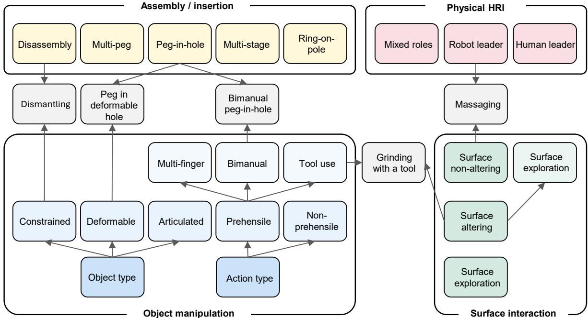  
Figure 3: We review the contact-rich tasks under four main categories indicated with separate colors. Each category is further divided into sub-categories. The categories are not mutually exclusive. Examples of some downstream tasks that belong to multiple categories are shown as rectangular nodes.

Reachability analysis and invariant sets approaches compute the set of states from which the system can remain safe indefinitely or the set of states that could lead to an unsafe condition. Techniques like Hamilton-Jacobi (HJ) reachability solve a PDE to find the backward reachable set of an unsafe target [58, 166]. Consider a system whose dynamics are described by an ordinary differential equation ${ \dot { \pmb x } } = f ( { \pmb x } ( t ) , { \pmb u } ( t ) )$ where x is the system’s states, ${ \mathbf { } } { \mathbf { } } { \mathbf { } } { \mathbf { } } { \mathbf { } } { \mathbf { } } { \mathbf { } } { \mathbf { } } { \mathbf { } } { \mathbf { } } { \mathbf { } } \mathbf { } { \mathbf { } } \mathbf { } { \mathbf { } } \mathbf { } { \mathbf { } } \mathbf { } \mathbf { } \mathbf { } \mathbf { } \mathbf { } \mathbf { } \mathbf { } \mathbf { } \mathbf { } \mathbf { } \mathbf { } \mathbf { } \mathbf { } \mathbf { } \mathbf { } \mathbf { } \mathbf { } \mathbf { } \mathbf { } \mathbf { } \mathbf { } \mathbf { } \mathbf { } \mathbf { } \mathbf { } \mathbf { } \mathbf { } \mathbf { } \mathbf { } \mathbf { } \mathbf { } \mathbf { } \mathbf { } \mathbf { } \mathbf { } \mathbf { } \mathbf { } \mathbf { } \mathbf { } \mathbf { } \mathbf { } \mathbf { } \mathbf { } \mathbf { } \mathbf { } \mathbf { } \mathbf { } \mathbf { } \mathbf { } \mathbf { } \mathbf { } \mathbf { } \mathbf { } \mathbf { } \mathbf { } \mathbf { } \mathbf { } \mathbf { } \mathbf { } \mathbf { } \mathbf { } \mathbf { } \mathbf { } \mathbf { } \mathbf { } \mathbf { } \mathbf { } \mathbf { } \mathbf { } \mathbf { } \mathbf { } \mathbf { } \mathbf { } \mathbf { } \mathbf { } \mathbf { } \mathbf { } \mathbf { } \mathbf { } \mathbf { } \mathbf { } \mathbf { } \mathbf { } \mathbf { } \mathbf { } \mathbf { } \mathbf { } \mathbf { } \mathbf { } \mathbf { } \mathbf { } \mathbf { } \mathbf \Psi { } \mathbf { } \mathbf { } \mathbf { } \mathbf { } \mathbf { } \mathbf \Psi { } \mathbf \Psi { } \mathbf \mathbf { } \mathbf { } \mathbf { } \mathbf \Psi \Psi { } \mathbf \mathbf { } \mathbf { } \mathbf \Psi \mathbf { } \mathbf { } \mathbf \mathbf { } \mathbf \Psi \mathbf { } \mathbf \Psi \Psi \mathbf { } \mathbf \mathbf { } \mathbf \mathbf { } \mathbf \mathbf { } \mathbf \mathbf \Psi \Psi \mathbf { } \mathbf \mathbf \Psi \mathbf { } \mathbf \mathbf \Psi \mathbf { } \mathbf \mathbf \Psi \mathbf \Psi \mathbf { } \mathbf \mathbf \mathbf \Psi \mathbf  \mathbf \Psi \mathbf \Psi \mathbf \Psi \mathbf \Psi \mathbf \Psi \mathbf $ is the control input. To compute the reachable set, a value function $V ( { \pmb x } , t )$ is typically defined, representing whether the system can reach the target set from state x at time t. This value function satisfies the HJ equation:

$$
\frac {\partial V}{\partial t} + H (\pmb {x}, \nabla V) = 0\tag{2}
$$

where H is the Hamiltonian defined as

$$
H (\boldsymbol {x}, \nabla V) = \max _ {\boldsymbol {u} \in \mathcal {U}} \{- \boldsymbol {f} (\boldsymbol {x}, \boldsymbol {u}) \cdot \nabla V \}\tag{3}
$$

By solving this equation, the boundary of the reachable set can be obtained, allowing for the analysis of the system’s behavior under various control strategies [167–169].

The limitation is the curse of dimensionality. Solving HJ PDEs or exhaustive reachability is only feasible for simplified systems [170–172]. In safe learning contexts, reachability is often used as a runtime safety filter [105, 173, 174].

## 3.2 Contact-Rich Tasks

In this section, we review the safety-concerned online learning methods from the task perspective. In accordance with our scope, we compile and discuss the contact-rich robotics tasks that are tackled with these methods in the literature. For this purpose, we identified the tasks in each of the papers we scanned for this survey. Our analysis shows that the insertion or assembly tasks are the most common type of physical interaction tasks. These are followed by the surface interaction tasks such as polishing and grinding. We also identify the task types of object manipulation and physical human-robot interaction (pHRI). We reviewed the tasks in the recent works under these four categories as shown in Fig. 3. Details and downstream examples of these categories are given in the following sections. Please see Fig. 2 for example task illustrations.

Our categorization is application-independent, however, it is possible to categorize the tasks also w.r.t. the application areas such as industry, household and healthcare [18]. Many contact-rich tasks are demonstrated for household applications that cannot be automated, as opposed to industry. These include general household tasks such as wiping a table or a vase [175, 176], inserting a plug [177, 178], and opening a door [179, 180]; and kitchen tasks such as cutting vegetables [57, 181], stirring or scooping food [182, 183], and rolling pizza [184]. Industry applications usually focus on flexible manufacturing tasks such as inserting a gear [125, 185], nut threading [186], building furniture [187], and disassembly [188, 189]. Healthcare applications mostly include the surgery operations [190, 191] and physically assisting humans (Sec. 3.2.4).

Please note that there may be overlaps and similarities between the four categories as shown in Fig. 3. For example, many peg insertion tasks could also be seen as object manipulation, or specific tool use tasks may aim for surface interaction. Depending on the problem formulation some downstream tasks may bring the challenges of multiple categories, which are detailed below.

## 3.2.1 Assembly and Insertion

tasks have been studied in the control literature for a long time both for their importance in industry and the challenges they offer [192]. Robotic solutions to this problem can enable flexible assembly applications [193], and human-like activities such as inserting a key or a plug [194, 195].

The challenges include the precision requirement to achieve the tight fit, safety requirements to avoid damaging the equipment or getting stuck, and sensing difficulties as vision modality is less informative due to occlusions and the force-based nature of the task. Assembly problems may involve multi-step insertion actions to achieve a more complex plan [186, 187]. The classical peg-in-hole task focuses on a single insertion of a securely grasped peg into a single upright hole [196]. The problem is gradually made more challenging through limited or noisy sensor data, leading to uncertainties over the peg and hole poses [197], varying peg shapes and sizes [198], or limited control options, such as rigid positioncontrol [199].

Other varieties were introduced for covering different application cases: Inserting multiple pegs (e.g., plugs) simultaneously [200, 201], assembly in obstructed environments that also require path planning [202], bimanually manipulating the hole and peg in the same time [203, 204], multi-stage insertion of vertically complex pegs (e.g., L-shape) [83], inserting into a deformable hole [205], reverse insertion (ring-on-pole) [125], and bolt threading [186]. The task varieties add new challenges such as synchronization between manipulators, added degrees of freedom, added constraints such as obstacles, multistage task solving and more complex dynamics.

Additionally, the disassembly tasks should be mentioned here. They invert the assembly task goal: There is already an inserted piece that has to be removed such as extracting a tightly fit part [189], sliding a bolt along a groove [188], or removing batteries [206]. The challenges of the disassembly tasks are similar to constrained object manipulation tasks such as opening a door or a drawer (Sec. 3.2.3). However, disassembly presents tighter constraints that may easily lead to jamming.

## 3.2.2 Surface Interaction

tasks require a continuous purposeful interaction with a physical surface. This problem is important to achieve both autonomous manipulation tasks that are hazardous for humans such as sanding [207], and daily living activities in human spaces such as cleaning a table [208] or stirring a porridge [183]. These tasks usually require keeping a stable contact with the surface and applying consistent force while also following a desired trajectory. Maintaining a precise force and velocity profile enables the consistent quality of results. The problem is made more challenging by varying the surface curvature [33, 138] or tracking complex motion trajectories [209]. The robot may be equipped with a power tool such as a polisher that causes significant vibrations [210].

The goal of the surface interaction tasks is to achieve a change on the surface. We observe these tasks under 3 categories: 1. Surface altering tasks that change the surface geometry by removing material, such as grinding and sanding [33, 207]; 2. surface non-altering tasks that do not cause a physical change in the surface, such as wiping and polishing [132, 211]; 3. particle interaction tasks that go beyond the surface and move particles, such as scooping a soft tissue [191] or stirring a granular medium [182, 183]. These tasks may require intricate 6-dof maneuvers and high force to move through or process the particles [203]. In case of deformable objects [212], surface altering is easily achieved and revertible; in case of elastic objects such as a sponge [213], shape deformation is temporal and naturally reversed. Massaging is a special surface interaction task that is challenging due to involving a human, thus the safety concerns are more critical [214]. Interaction with deformable surfaces is an under-explored area, attracting more contributions.

We also identify the surface exploration tasks as a type of surface non-altering tasks that are less explored in the literature. In these works, the touch is fundamental to facilitate navigation and direct the agent towards the goal, such as in blind maze exploration [6, 215]. These tasks are similar to other surface interaction tasks as the interaction is usually non-prehensile and continuous, however, the goal of these tasks is not manipulating the surface, but navigating or following a trajectory [216].

Surface interaction tasks are different than the object manipulation tasks as the target object is not expected to move. On the contrary, it is desired to keep the object stable while achieving the surface interaction. The object of these tasks are usually physically constrained, however, wiping the surface of an unconstrained object, such as a vase, requires bimanual coordination to keep it stable during interaction [176].

## 3.2.3 Object Manipulation

tasks involve long-term and dynamic contacts with an object. Usually, the object constitutes the target of the task, i.e., it is manipulated. However, it is also possible that the object is grasped by the robot and used as a tool in a physical interaction task [217]. The tool can be used to indirectly achieve a surface interaction, insertion or other contact-rich tasks.

The object manipulation tasks are commonly categorized as prehensile and non-prehensile. The former requires grasping an object, while the latter interacts with the object without holding it, such as pushing [202, 218], sliding [219] and pivoting [220]. Non-prehensile tasks can be done with a simpler manipulator that maintains a single contact with the object, however, they also have a limited control over the object motion. Consequently, the safety of these tasks depend on the motion of the object in challenging environmental conditions: [202] evaluate their method in cluttered environments where collisions are frequent and the object should be moved through narrow paths; the experiments of [218] involve pushing the object through a narrow gap where the object orientation becomes important, or through a bridge with the risk of the object falling. On the other hand, prehensile tasks require at least two contacts with the object to maintain a grasp. Simple grippers can tightly grasp an object, however they do not allow complex object manipulations, thus they are limited to pick-and-place or tool-use tasks. In contrast, bimanual manipulation is done through two high-DoF manipulators, and it can achieve complex interactions with the object such as lifting, pushing, flipping and rotating [113, 221]. Safe bimanual manipulation requires maintaining safe levels of contact forces without dropping the object, in addition to the workspace and motion limits [113]. Multi-fingered hands allow high manipulability of the object with increased control complexity. For a detailed review on dexterous hand manipulation we direct the reader to another survey [28].

The object manipulation tasks can be further categorized w.r.t. the nature of the object, such as constrained, articulated, and deformable. Constrained object manipulation tasks, such as opening a door or a drawer, impose strict kinematic constraints on the object motion [222]. These constraints may lead to high levels of force, if not handled with compliant and adaptive behavior [179]. Objects like a door, drawer or lever are also termed articulated objects [223]. Disassembly tasks (Sec. 3.2.1) are challenging examples of constrained object manipulation. Deformable object manipulation is an under-explored research problem that is challenging due to the sensing and modeling complexities [212].

## 3.2.4 Physical HRI

tasks involve physical contact with humans [64], unlike the human-robot coexistence tasks, where avoid ing the human is the main goal of the safety method [68]. pHRI tasks are challenging because of the increased criticality of human safety and the added uncertainty due to the human actor. Thus, the methods should estimate the human behavior and accommodate the uncertainty [2]. In traditional pHRI, the robot assumes the passive role, and follows the human intention through compliance control. A special case of this is a robot interacting with both the human and the environment, as in [224], where the human guides the robot while it interacts with a surface. In [225], the robot can switch between human-guided and autonomous in-contact manipulation modes to adapt its impedance characteristics.

The safety-critical contact-rich interactions between an active robot and human fit better to our scope. In prominent scenarios, the robot touches the human while the human takes a passive role, such as dressing [69] and bathing assistance [116], ultrasound scanning [226], and massaging [35, 214]. When the robot is physically coupled with the human, such as the rehabilitation robotics, the controller should estimate the human impedance parameters to ensure stability [120].

Crucially, the notion of safety expands with the inclusion of a human. For example, [116] limit the vision system to a LIDAR during bathing assistance for ethical considerations. Human perceived safety also becomes important for the trustworthy and socially acceptable interactions [227].

## 3.3 Sensing and Policy Modalities

In contact-rich manipulation, the choice of policy input has a direct impact on safety. The controller must detect the onset and evolution of contact, respect safety constraints such as joint/torque limits, admissible contact forces and friction cones, and remain robust to modelling errors and partial observability. To this end, modern safe learning pipelines leverage a spectrum of sensing modalities, ranging from purely proprioceptive state, through force/torque and high-bandwidth vision, to rich multimodal and languageconditioned inputs. Table 1 summarizes the dominant input types and how they are typically exploited for safety.

## 3.3.1 Pose and Proprioceptive State

Several works rely predominantly on proprioceptive and kinematic state, i.e., joint configurations, endeffector poses and their derivatives, sometimes augmented with a few task-level geometric variables, while omitting explicit force/torque (F/T) signals from the policy input. In these settings, safety emerges from conservative motion generation, collision-aware planning and geometric reasoning about contact, often supported by explicit constraints, recovery sets or safety-oriented value functions [40, 57, 60, 83, 113, 199, 202, 228–230, 232].

A first group of approaches couples a compact state representation (pose and velocity) with an explicit description of goals and safety constraints, and then uses model-predictive or safe-RL updates to keep trajectories inside a certified safe set. The policy or controller observes the current system state together with reference poses and bounds on states and inputs, sometimes augmented with uncertainty estimates, safety penalties or human-provided safety signals [57, 68, 113, 229, 230, 232, 270]. Because distances to constraint boundaries are part of the observation, the algorithm can reason explicitly about safety margins without having to infer risk from raw contact forces, e.g. tightening constraints near obstacles, slowing down near joint limits, or triggering backup controllers when the state approaches a learned unsafe region.

A second family of methods organises behaviour around pose-based skills or motion primitives. Here, the observation typically consists of robot joint or end-effector states together with task-relevant geometric features, such as relative part poses or planner-generated waypoints, while the policy outputs bounded pose increments or selects from a library of safe trajectories [83, 199, 202, 228]. Motionplanner-augmented RL and planner or demonstration-driven frameworks exemplify this pattern. The learned policy reasons over kinematic state and high-level task features, whereas collision-free paths and smooth accelerations are enforced by a downstream planner or stabilising controller. Safety is thus embedded in the way pose sub-goals are parameterised and filtered, ensuring that abrupt or large displacements are routed through a geometry-aware planning layer.

Table 1: Sensing and policy modalities

<table><tr><td>Dominant modality</td><td>Typical safety leverage</td><td>References</td></tr><tr><td>Proprioceptive and kinematic state only</td><td>Contact reasoning from joint configurations and end effector pose; conservative motion generation</td><td>[57, 83, 199, 202, 216, 219, 228–232]</td></tr><tr><td>Force/torque</td><td>Real-time enforcement of force and impedance limits, slip detection, compliant correction of model error</td><td>[34, 35, 39, 47, 69, 112, 114, 126, 128, 131, 132, 138, 139, 176, 179, 182, 186, 188, 193, 197, 200, 201, 203, 208, 211, 213, 214, 218, 223–226, 233–262]</td></tr><tr><td>Vision</td><td>Contact evaluation, localizing task features, and supplying global context that force sensors cannot provide</td><td>[25, 39, 40, 60, 68, 69, 113, 116, 131, 138, 176, 179, 188, 193, 195, 198, 203, 207, 209, 218, 233, 234, 237, 238, 249, 260, 262–266]</td></tr><tr><td>Natural-language instruction</td><td>Large multimodal models interpret a human&#x27;s insturation and then check internal low-level safety</td><td>[25, 70, 237, 267]</td></tr><tr><td>Tactile</td><td>High-resolution contact localization, pressure distribution monitoring, and incipient slip detection</td><td>[187, 222, 268, 269]</td></tr><tr><td>Multimodal fusion</td><td>Enables high precision under occlusion</td><td>[25, 39, 69, 131, 138, 176, 179, 188, 193, 203, 218, 233, 234, 237, 238, 249, 260, 262, 268, 269]</td></tr></table>

Pose-dominant observations are also used when exteroceptive information is represented directly in configuration space rather than as raw pixels. Benchmark interaction tasks encode the positions of pucks, tools or human partners as Cartesian poses, combined with the robots own pose and velocity, so that learning algorithms can enforce distance-based constraints, safety fields around humans, or recovery zones in a low-dimensional geometric space [40, 60, 271]. Even in visuomotor settings where images are available, the safety shaping is often defined over the proprioceptive and pose coordinates through joint limits, collision distances or certified invariant sets, while the visual input mainly serves to infer these geometric quantities or to disambiguate task context [202, 209, 260, 263, 265]. Compared with forcecentric designs, such pose-based formulations trade direct measurement of contact forces for simpler, more structured safety reasoning in configuration space, and are particularly attractive when high-quality kinematic models and planners are available.

## 3.3.2 Force and Torque Sensing

For many contact-rich tasks, especially those involving insertion, surface following, or physical humanrobot interaction, F/T measurements at the wrist or fingers act as the primary safety interface. Policies typically observe these signals together with joint and end-effector state and use them to cap contact loads, detect slip or jamming, and adapt impedance so that tracking performance is achieved without violating force or pressure limits [114, 138, 233, 235]. In contrast to purely kinematic designs, such formulations expose safety-relevant quantities directly in the observation, which allows controllers to react immediately to unsafe contact events in assembly, surface interaction, and terrain-contact scenarios [35, 131, 139, 242].

A large family of methods couples F/T sensing with variable impedance or admittance control. The policy input in these works typically concatenates joint or end-effector pose and velocity with measured interaction forces/torques, and sometimes task descriptors such as surface or tissue properties, environment stiffness, or task phase [35, 138, 139, 214]. The action space is parameterized in terms of stiffness, damping, or target forces, and safety is enforced by bounding these impedance parameters, shaping them over time, or embedding stability and performance objectives into the learning problem [114, 239, 244, 257]. This pattern appears across industrial assembly and sanding, massage and rehabilitation, and sliding or surface following tasks, where the policy learns to reshape compli ance in response to the measured wrench so that interaction forces remain within prescribed envelopes [131, 242, 250, 268]. Some approaches further introduce latent policy classes or structured action spaces over impedance parameters, which makes it easier to impose smoothness and magnitude limits on the learned stiffness and damping profiles [225, 233, 243, 253].

F/T signals are also combined with explicit safety margins, constraints or stability certificates derived from control theory. In this line of work, the observation space does not stop at raw wrench measurements and state. Controllers additionally receive features derived from Lyapunov functions, control barrier functions, passivity errors or other safety indicators that are computed using the measured forces and state trajectories [47, 112, 225, 226]. Learning algorithms then operate directly on these structured safety variables, for example by penalizing trajectories that approach constraint boundaries, adjusting admittance or impedance gains when passivity residuals grow, or biasing exploration away from regions with high estimated risk [68, 213, 242, 258]. This idea extends naturally to uncertainty-aware formulations, where system state, force/torque and uncertainty estimates are combined, and the policy is trained to remain robustly within contact-safe sets despite modelling errors and partial observability [182, 246].

In physical humanrobot interaction and teleoperation, F/T channels additionally encode human intent and comfort. Many frameworks treat human-applied forces at the end-effector, interaction torques, or teleoperated wrenches as part of the policy input together with robot joint or end-effector state and task phase [120, 224, 236, 245]. These signals are interpreted either as demonstrations of desired compliant behaviour or as instantaneous preferences over interaction forces, and are used to adapt impedance online, to learn tele-impedance mappings, or to construct task-oriented safety fields around the human partner [64, 237, 250, 255]. Safety here is twofold: the robot must both respect human-specified force envelopes and ensure that the resulting closed-loop behaviour remains stable under changing human dynamics.

Another recurrent pattern is to use F/T sensing for contact-state estimation, search, and long-horizon assembly. In such settings, policies augment pose and geometry with force histories, contact-state labels, or belief maps over likely contact locations [128, 223, 234, 240]. Contact cues extracted from wrench measurements, such as contact onset, sticking versus sliding, or successful insertion, are then used to gate skills, switch admittance gains, or trigger recovery behaviours when jamming or misalignment is detected [47, 139, 201, 241]. Active-search methods in particular combine end-effector pose and force/torque with Bayesian belief updates and safety features, enabling the robot to probe cautiously, back off when measured forces exceed certified bounds, and refine subsequent search motions while remaining within safe contact regions [211, 226, 246, 256]. Compared with vision-only pipelines, these force-centric designs provide a direct window into the quality of contact, enabling safer behaviour under occlusion, poor lighting, or inaccurate geometric models.

Even when richer sensory modalities such as vision or tactile arrays are available, force/torque remains a core channel through which safety is enforced. Multimodal policies often use vision primarily to infer geometry and high-level task context, while relying on force/torque and proprioception to regulate local interaction [69, 203, 204, 218]. End-to-end sensorimotor models that consume images, joint state and force/torque typically define safety shaping, through penalties, auxiliary critics or recovery policies, over wrench and configuration features rather than pixels, underscoring that F/T sensing is the main substrate on which safe contact behaviour is learned and executed [39, 241, 260].

## 3.3.3 Vision Sensing

Vision is widely used to provide non-contact, global information about objects, surfaces and humans that is difficult or impossible to infer from proprioception and force alone. Depending on the camera placement, visual inputs range from birds-eye or third-person views that cover the entire workspace, through fixed eye-to-hand cameras that monitor a local cell, to wrist- or eye-in-hand cameras that track the interaction region from the robots point of view [68, 116, 179, 188, 234, 237, 263, 266]. Across these configurations, safety is enhanced in two complementary ways: by anticipating future contact and potential collisions based on scene geometry, and by monitoring the evolution of interaction in the immediate vicinity of the end-effector.

Global and external viewpoints are typically used to capture task geometry, object and fastener poses, and human motion. Assembly and disassembly systems exploit RGB or RGB-D images, often converted into scene graphs or object pose estimates, alongside joint and end-effector state to ensure that motion plans respect part tolerances and obstacle constraints before contact is made [179, 188, 193, 260, 262]. Surface-interaction and bathing applications reconstruct patient or workpiece shape from point clouds or depth maps and use this geometry, together with robot pose, to generate reference paths that avoid sharp curvature and maintain safe approach angles during contact [116, 131, 138, 233]. In humanrobot collaboration, visual tracking of human pose or trajectories is fused with robot state and sometimes interaction forces to construct task-oriented safety fields around the person. These fields enter the policy input as spatial risk maps that reshape robot motion to avoid unsafe proximity or contact [68, 237]. Pixelbased safe RL and visuomotor world models further push this idea by using raw images as the primary observation, with safety-aware critics or constraint penalties guiding behaviour toward image regions that correspond to safe configurations [60, 113, 263, 266].

Local eye-in-hand or wrist-mounted cameras provide a complementary, close-range view that is particularly valuable in contact-rich tasks where the relative pose between tool and environment must be controlled with high precision. Insertion and fastening pipelines use visual estimates of peghole or objectfixture pose from such cameras as part of the policy input, so that approach and alignment motions are corrected before large contact forces occur [195, 198, 234, 264]. Diffusion-based compliance policies and force-constrained dressing controllers condition on sequences of RGB or RGB-D images from wrist or nearby cameras, together with end-effector poses, to predict how candidate motions will influence contact geometry and thereby avoid unsafe configurations [69, 176, 203]. In variable-impedance manipulation with image-conditioned action spaces, multiple RGB views of the workspace are combined with end-effector pose and velocity, so that the controller can adapt stiffness and damping not only to measured forces but also to visually perceived contact conditions, occlusions and environmental changes [39, 207, 209].

A prominent trend is to fuse visual information with haptic and proprioceptive sensing in a joint representation that directly feeds safety-aware policies. Visualhaptic variable impedance controllers combine latent visual features extracted from RGB images with force/torque or tactile readings and robot state, enabling the policy to reason simultaneously about global geometry and local contact quality when selecting compliant actions [204, 222]. Dressing and bathing systems integrate segmented point clouds or image-based features with end-effector force histories and candidate motions, using learned dynamics or prediction models to filter out actions whose predicted contact forces exceed task-dependent thresholds [69, 116, 203]. In furniture assembly and other complex contact-rich tasks, multimodal context sequences concatenate proprioceptive vectors, RGB observations and high-resolution tactile readings, allowing residual policies or skill-transfer mechanisms to refine motion precisely at the moment of contact while keeping interaction forces within safe ranges [187, 272, 273]. Recurrent or belief-state architectures extend this idea by maintaining a latent estimate of the scene and contact state under partial observability, with both vision and force/torque streams contributing to belief updates and safety-aware

action selection [39, 218].

Finally, several frameworks place visual perception within larger safety-aware learning stacks that combine high-level reasoning with low-level control. Safety-aware unsupervised skill discovery and recovery-based RL methods treat vision as part of the state used to infer which regions of the environment are safe to explore, and to learn recovery zones or backup skills that can be invoked when the system approaches unsafe visual configurations [60, 113, 218]. Visionlanguageaction models extend this further by taking images alongside natural-language instructions and past interaction histories, and by incorporating safety feedback into the training objective so that the resulting policies can interpret human intent while avoiding visually grounded unsafe behaviours [25]. Overall, these works highlight that visual inputs, whether global or hand-centric and whether raw pixels or structured geometry, play a central role in making safety-relevant aspects of the environment explicit to the policy, so that contact-rich behaviour can be regulated proactively rather than reactively.

## 3.3.4 Language Instructions

Natural language is increasingly used as a high-level input channel through which humans specify tasks, constraints and preferences, while lower-level controllers remain responsible for enforcing physical safety during execution. Instead of hard-coding task objectives in cost functions or reward weights, these approaches let users describe what the robot should do, and often how cautiously it should behave, in free-form [274], which is then grounded into symbolic plans, motion goals or policy parameters [25, 70, 267]. From the perspective of safety inputs, language thus complements geometric and haptic signals by exposing human intent and safety requirements explicitly at the policy interface.

One line of work couples language with visual and proprioceptive observations in large VLA architectures. In such systems, camera images and robot state are processed jointly with a natural-language instruction to produce either low-level actions or intermediate code that can be executed by downstream controllers [25, 267]. Safety is then imposed at two levels: the model is aligned to avoid generating obviously harmful plans, and the generated code or action sequences are checked against constraint sets or safety filters before deployment [25, 267]. Compared to purely numeric task encodings, this design allows the same sensorimotor stack to be reused across tasks, while safety-relevant differences are captured in the language input rather than in separate controllers.

Another set of approaches emphasizes preference-driven interaction. Here, users do not only issue initial instructions, but also provide follow-up signals indicating whether a behaviour is safe, comfortable, or acceptable, and these signals are incorporated into the learning objective or alignment procedure [25, 270]. Text-conditioned models, for instance, may take as input a description of the desired interaction style together with histories of states, actions and safety feedback, and are trained to predict actions that satisfy both task and safety preferences [25, 70]. Human-centered safe RL frameworks complement this by treating human feedback as an additional observation channel that shapes the policy toward behaviours that humans deem safe, even when those behaviours are not easily captured by simple numerical constraints [270].

Across these works, language does not replace low-level safety mechanisms such as force limits, control barrier functions or conservative exploration. Rather, it provides a flexible interface for specifying and updating what safe means in a given context. High-level instructions determine which regions of the state and action spaces are desirable or forbidden, while the underlying visuomotor and force-aware controllers ensure that, once a plan is chosen, contact forces, distances and stability constraints remain within acceptable bounds [25, 70, 267, 270]. As language models and alignment techniques improve, this combination of linguistic intent with structured safety inputs offers a promising route to robots that can be both responsive to human guidance and reliably safe in contact-rich environments.

## 3.3.5 Tactile Sensing

There exist many types of tactile sensors. In robot learning, the most widely used are vision-based tactile sensors such as the GelSight family [275, 276], as well as low-cost, easily arrayable tactile sensor designs such as flexible tactile sensor array [277]. There has also been progress in vision-based tactile sensors with task-adaptive geometries, such as hemispherical and finger-shaped designs [278–280]. High-resolution vision-based tactile sensing provides high-resolution, local information about contact that complements global vision and low-dimensional F/T measurements. Rather than only measuring a single wrench at the wrist, tactile skins and fingertip arrays reveal pressure distributions, shear and incipient slip at the exact points of interaction, making it possible to detect unsafe contact patterns, such as concentrated loads on corners or sliding on fragile surfaces, before they escalate into damage or failure [187, 204, 268]. For safe learning, these rich contact cues are typically fed directly into the policy alongside proprioceptive state, so that both exploration and execution can be guided away from behaviours that produce sharp spikes or unstable contact transitions [268, 269].

One group of methods uses tactile arrays as the main channel for encoding task success and safe contact configurations. In furniture assembly, for example, tactile ensembles distributed across fingers or grippers are used to characterise how surfaces, edges and fasteners behaviors during successful insertions or alignments. Policies are then trained to reproduce these tactile signatures while avoiding contact patterns associated with jamming or over-tightening [187]. Gentle manipulation frameworks similarly treat touch as the primary feedback for regulating interaction intensity. Policies observe proprioception and tactile events, and are rewarded for acquiring task-relevant information while keeping per-taxel pressures and impact magnitudes low, which naturally steers exploration toward soft, sliding contacts rather than hard impacts [269]. In both cases, safety is not an external constraint but an emergent property of how tactile patterns are encoded in the observation and reward.

Tactile sensing also plays a key role in variable-impedance control for contact-rich motion along surfaces. In aerial or lightweight manipulators that slide along uneven terrain or structural elements, the policy often receives only proprioceptive state and tactile readings, without full F/T information at the base [268]. The tactile stream indicates whether contact is lost, sticking, or concentrated on an unsafe subset of the surface, while the proprioceptive state captures global motion. Variable-impedance updates are then conditioned on these signals, increasing stiffness to maintain stable contact when support is good, and softening or backing off when tactile cues reveal high local pressure or impending slip [268]. This coupling allows robots with limited payload and sensing to exploit contact safely, even when the exact environment model is unknown.

A further set of approaches embeds tactile input within multimodal visualhapticproprioceptive representations. Hierarchical variable-impedance controllers, for instance, build high-level policies on vi sual features that capture object pose and scene layout, while lower-level modules refine actions using haptic channels that may include both force/torque and tactile measurements [204]. In such designs, vision plans where and when contact should occur, while tactile feedback confirms whether contact is distributed and stable in the way the planner expects. More recent multimodal RL systems explicitly combine visual observations, tactile signals and joint state into a shared latent space, and train adaptive policies that allocate different roles to each modality. Vision is used to anticipate geometric constraints, tactile cues to detect unsafe local pressure or slip, and proprioception to enforce kinodynamic limits [222]. By tying safety-related decisions to tactile cues rather than to coarse force thresholds alone, these methods achieve more nuanced and robust protection for delicate objects, complex assemblies and human collaborators.

## 3.4 Data Acquisition

Data acquisition plays a foundational role in safe learning for contact-rich manipulation. The quality, diversity, and safety-relevance of the data directly influence the performance and generalizability of learned policies, especially in scenarios involving unpredictable contacts or constrained physical interaction. In this section, we discuss three key paradigms in data acquisition: (i) simulation-based data generation, (ii) real-world data collection, and (iii) hybrid and self-supervised data acquisition.

Data matters for policy learning, especially for a safe policy where negative samples play a significant role in training the agent to be aware of what unsafe scenarios are. However, acquiring such data is time-consuming and labor-intensive. Crucially, unlike the vast text and image corpora scraped from the Internet to train LLMs and VLAs, physical interaction data, specifically high-fidelity contact forces, torques, and safety-critical failure modes, cannot be obtained from the web. This scarcity of contact data in foundation models creates a significant gap in their ability to reason about physical dynamics and safety. Consequently, physical data collection remains inevitable and irreplaceable for contact-rich tasks, despite efforts to leverage simulation and internet-scale proxies. As shown in the data pyramid Fig.4, real-world contact data sits at the apexscarce but essential. And in Fig.4 we retain only the most representative concepts in each layer to highlight the progression rather than exhaustively listing all sources. Within each layer, the listed keywords are ordered by increasing contact fidelity and safety relevance: for real-world data, from generic task execution logs to explicit safety and failure cases; for simulation, from generic randomized environments to simulation elements that most directly support sim-to-real transfer; and for internet and shared datasets, from general web-scale corpora to task-specific real-robot benchmarks.

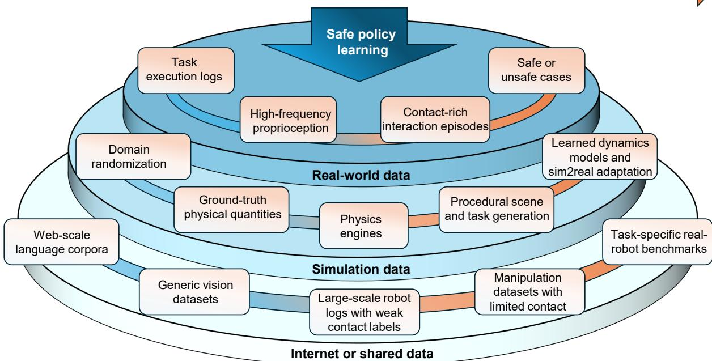  
Figure 4: Data pyramid for safe policy learning in contact-rich manipulation. The pyramid is organized into three layers according to physical fidelity and safety relevance. (1) Real-world data: includes task execution logs, high-frequency proprioception (joint states, velocities, tactile and force–torque sensing ), contact-rich interaction episodes, and safe and unsafe or failure cases, which provide the most direct evidence about real physical contacts and safety-critical events. (2) Simulation: includes domain randomization (dynamics, appearance, noise), groundtruth physical quantities (forces, poses, contacts), physics engines (MuJoCo, PyBullet, Isaac Lab), procedural scene and task generation, and residual or learned dynamics models with sim-to-real adaptation, enabling largescale exploration of contact scenarios under controllable yet imperfect dynamics. (3) Internet and shared datasets: includes web-scale language corpora (LLM data), generic vision datasets (web images and videos), large-scale robot logs with weak contact labels, manipulation datasets with limited contact or safety labels, and task-specific real-robot benchmarks with small scale, which are abundant but only indirectly capture contact-rich and safetycritical phenomena.

## 3.4.1 Simulation-Based Data Generation

Simulated environments provide a safe, scalable, and cost-effective way to generate large volumes of data for contact-rich tasks without risking damage to hardware or fixtures. Physics engines such as MuJoCo [281], MuJoCo Playground [282], PyBullet [283], and Isaac Gym [284] enable learning-based agents to interact with objects under diverse contact conditions, often with ground-truth access to forces, velocities, object poses, and other latent quantities that are difficult or expensive to measure on real systems. These simulators support large-scale parallel rollout, accelerating the training of data-hungry methods such as deep RL and imitation learning for contact-rich manipulation.

To improve generalization and robustness, domain randomization and procedural scene generation are widely used to expose policies to variations in geometry, mass, friction, sensor noise, and task parameters, which is crucial for sim-to-real transfer in assembly, insertion, and other tight-tolerance tasks [220, 241, 285]. Recent work further combines high-fidelity rendering and physics to generate multimodal datasets (vision, force/torque, tactile) that can be used to train VLM/VLA-style models and other foundation models for contact-rich robotics.

However, simulations still suffer from a pronounced reality gap, particularly for phenomena such as material deformation, frictional sticking and sliding, small-clearance contacts, and compliant or flexible components, which can lead to significant discrepancies in policy behavior when transferred to real hardware. To mitigate this, recent approaches incorporate learned residual models, online adaptation, or human-in-the-loop corrections on top of simulation-trained policies, for example by learning residual compliance parameters or gated residual policies that refine the base controller in the real world [286, 287]. Together, these trends point toward hybrid pipelines in which accurate simulation, structured domain randomization, and residual or adaptive components jointly address the sim-to-real challenges of safe contact-rich manipulation.

## 3.4.2 Real-World Data Collection

Real-world data collection remains a cornerstone of safe learning, as it captures the complexities and uncertainties of physical interactions that simulations may not fully replicate. This involves deploying robots in controlled environments or real-world settings to gather data on contact forces, object dynamics, and task performance under various conditions. However, collecting high-quality data in the real world is often time-consuming, expensive, and potentially unsafe, especially in contact-rich tasks where excessive forces or unexpected contacts can damage hardware or pose safety risks to humans. To address these challenges, researchers often employ techniques such as teleoperation, where human operators guide the robot through tasks while collecting data on safe and unsafe interactions [288, 289]. Additionally, safety constraints can be integrated into the data collection process, ensuring that the robot operates within predefined limits to avoid damaging itself or its environment [116, 238]. Furthermore, real-world data can be augmented with simulation data through techniques like domain adaptation or transfer learning, allowing policies trained in simulation to be fine-tuned on real-world data [6, 290].

Table 2: Simulators used in contact-rich tasks for learning-based methods

<table><tr><td>Simulators</td><td>Deformable</td><td>GPU</td><td>Tasks</td><td>References</td></tr><tr><td>MuJoCo</td><td>✓</td><td>✕</td><td>Manipulation, Locomotion</td><td>[6]</td></tr><tr><td>MuJoCo XLA/MJX</td><td>✓</td><td>✓</td><td>Manipulation, Locomotion</td><td>[6]</td></tr><tr><td>Genesis</td><td>✓</td><td>✓</td><td>Soft-body, Articulated</td><td>[291]</td></tr><tr><td>PyBullet</td><td>✓</td><td>✕</td><td>Manipulation, Grasping</td><td>[288, 289]</td></tr><tr><td>Isaac Gym</td><td>✓</td><td>✓</td><td>RL Training, Manipulation</td><td>[284]</td></tr><tr><td>Isaac Sim</td><td>✓</td><td>✓</td><td>Photorealistic, Digital Twin</td><td>[290, 292]</td></tr><tr><td>Isaac Lab</td><td>✓</td><td>✓</td><td>Robot learning</td><td>[293]</td></tr><tr><td>Orbit</td><td>✓</td><td>✓</td><td>Interactive Robot Learning</td><td>[294]</td></tr><tr><td>Drake</td><td>✕</td><td>✕</td><td>Model-based Control</td><td>[295]</td></tr><tr><td>Factory</td><td>✕</td><td>✓</td><td>RL, Assembly</td><td>[296]</td></tr></table>

## 3.4.3 Hybrid and Self-Supervised Data Acquisition

Hybrid approaches combine simulation and real-world data to leverage the strengths of both modalities. By pre-training policies in simulation and then fine-tuning them on real-world data, researchers can achieve better generalization and robustness in contact-rich tasks. This approach allows for the efficient exploration of a wide range of scenarios in simulation while still adapting to the nuances of real-world interactions [290]. Self-supervised learning techniques can also be employed to generate additional training signals from the robot’s own interactions, allowing it to learn from its experiences without requiring extensive labeled data [6]. For example, robots can learn to predict future states or contact forces based on their own sensory inputs, creating a form of intrinsic motivation that drives exploration and learning in contact-rich environments [6]. These hybrid and self-supervised approaches can help bridge the reality gap and improve the robustness of learned policies in contact-rich tasks, enabling them to generalize better to real-world scenarios. By combining simulated and real-world data, researchers can create more comprehensive training datasets that capture a wider range of contact scenarios, leading to safer and more effective policies for robotic manipulation. For instance, researchers may pre-train policies in simulation and then fine-tune them on real-world data, or use simulated data to augment limited real-world datasets [290]. Self-supervised learning techniques can also be employed to generate additional training signals from the robot’s own interactions, allowing it to learn from its experiences without requiring extensive labeled data [6]. These approaches can help bridge the reality gap and improve the robustness of learned policies in contact-rich tasks, enabling them to generalize better to real-world scenarios.

Table 3: Benchmarks used in contact-rich tasks

<table><tr><td>Benchmarks</td><td>Scalable</td><td>Deformable</td><td>GPU</td><td>Tasks</td><td>References</td></tr><tr><td>RoboVerse</td><td>√</td><td>√</td><td>√</td><td>Manipulation, RL Benchmarks</td><td>[76]</td></tr><tr><td>RoboCasa</td><td>√</td><td>√</td><td>√</td><td>Household Tasks, Manipulation</td><td>[297]</td></tr><tr><td>RoboSuite</td><td>√</td><td>√</td><td>√</td><td>Manipulation, RL Benchmarks</td><td>[298]</td></tr><tr><td>ManiSkill</td><td>√</td><td>√</td><td>√</td><td>Manipulation, RL Benchmarks</td><td>[299, 300]</td></tr><tr><td>Meta-World</td><td>√</td><td>✕</td><td>√</td><td>Manipulation, RL Benchmarks</td><td>[301]</td></tr><tr><td>OpenAI Gym</td><td>√</td><td>✕</td><td>√</td><td>RL Benchmarks, Manipulation</td><td>[302]</td></tr><tr><td>RLBench</td><td>√</td><td>✕</td><td>√</td><td>Manipulation, RL Benchmarks</td><td>[303]</td></tr><tr><td>Stable Baselines</td><td>√</td><td>✕</td><td>√</td><td>RL Benchmarks, Manipulation</td><td>[89]</td></tr><tr><td>Gymnasium</td><td>√</td><td>✕</td><td>√</td><td>RL Benchmarks, Manipulation</td><td>[88]</td></tr><tr><td>Safety Gymnasium</td><td>√</td><td>✕</td><td>√</td><td>Safety in RL, Manipulation</td><td>[48]</td></tr><tr><td>Robust gymnasium</td><td>√</td><td>✕</td><td>√</td><td>Safety in RL, Robotics</td><td>[77]</td></tr><tr><td>Safe-Control-Gym</td><td>√</td><td>✕</td><td>√</td><td>Safety in RL, Control</td><td>[46]</td></tr></table>

## 3.5 Simulation Environment and Benchmarks

Simulation plays a critical role in the development and evaluation of safe learning algorithms for contactrich robotic tasks. These tasks often involve complex dynamics, high-dimensional state spaces, and the potential for hardware damage, making direct deployment on real robots risky and costly during early stages of learning. Simulated environments provide a safe, controllable, and repeatable platform to test algorithms, enabling rapid iteration and the generation of large-scale data without physical wear. [304]

Moreover, standardized benchmarks enable consistent comparison across different approaches, thereby fostering reproducibility and progress in the field. By utilizing well-defined simulation platforms and task suites, researchers can more effectively assess safety, generalization, and performance under varied conditions before transitioning to real-world applications.

## 3.5.1 Simulation Environment

We group commonly used tools into a richer taxonomy reflecting the physics core, parallelism, sensing realism, and intended evaluation protocols. We highlight the perspective of contact-rich tasks in this survey, readers can find more comparative details in [290].

General robotics simulators (ROS-ready). Gazebo [199, 251, 268, 272, 305, 306], Webots [260], CoppeliaSim [307], and Drake [217] emphasize sensor realism (RGB-D/LiDAR), ROS control, and plugins for actuation/perception. They suit closed-loop, system-level validation, including safety monitors.

Rigid-body dynamics engines. CPU engines such as DART (via robot dart) [308] emphasize accurate contact, joint limits, and articulated constraints. PyBullet [61, 285, 309–313] remains a widely used open-source engine with strong community support. MuJoCo, one of the most popular simulators for contact-rich tasks, is known for its inherent contact modeling and fast simulation speed. It powers standard benchmarks such as RoboSuite [314] and Safety Gym [315], and is extensively used in contact-rich manipulation tasks including insertion [129, 195, 197], assembly [127, 202], and surface interaction [132, 175]. Furthermore, it supports research in safe exploration and control [47, 55, 60, 266], as well as data collection and skill learning [238, 241, 253, 256, 316]. It is also widely adopted in nonprehensile and articulated object manipulation [218–220, 223], dynamic and locomotion tasks [39, 231], and complex media interaction [182, 269]. Additional applications span diverse contact-rich scenarios [317–332].

GPU engines leverage massive parallelism to accelerate data collection for RL. The Isaac ecosystem is widely adopted, including Isaac Gym and Isaac Sim, along with their modular frameworks like Factory [296], Orbit [294], Isaac Lab [293], and RoboVerse [76]. These platforms support large-scale training for contact-rich tasks [113, 186, 333–336]. Recently, MuJoCo MJX [282] has also introduced GPUaccelerated physics to the MuJoCo ecosystem.

Domain-specific environments. support safety-critical perception/planning; Assistive Gym [309] focuses on assistive scenarios. Box2D [337] remains useful for 2D contact/control prototyping.

Interfaces and experiment factories. OpenAI Gym-style wrappers [312, 338] standardize observation/action APIs across engines and tasks; SAI 2.0 [339, 340] and related stacks provide perceptioncontrol scaffolding for contact-rich tasks.

## 3.5.2 Benchmarks

Standardized benchmarks are essential for quantifying progress in safety, generalization, and contact robustness. We categorize them into general manipulation suites, contact-intensive benchmarks, and safety-specific environments.

General manipulation suites. RoboSuite [314] standardizes robot models and canonical tasks (insertion, door opening), serving as a primary testbed for modular design. Meta-World [301] and RLBench [303] offer multi-task breadth, though often with simplified contact physics. Recently, RoboVerse [76] and RoboCasa [297] have scaled these to large-scale, scene-level manipulation tasks using foundation models.

Contact-intensive and generalizable benchmarks. To address the reality gap in contact physics, ManiSkill [299] and ManiSkill2 [300] feature diverse articulated objects and high-fidelity physics for learning generalizable policies. Factory [296] provides physically accurate assembly tasks (nut-bolt threading) specifically designed for testing contact-rich policies in Isaac Gym.

Safety-oriented benchmarks. Safety Gym and its successor Safety Gymnasium [48, 315] are the de facto standards for safe RL, defining constrained navigation and manipulation tasks with hazard maps and cost signals. Beyond penalty-based safety, Safe-Control-Gym [46] integrates control-theoretic constraints (symbolic priors, partial observability) for evaluating certified safety methods. Robust Gymnasium [77] specifically targets safety under distributional shifts and adversarial disturbances, critical for robust sim-to-real transfer.

## 3.6 Safety Evaluation Metrics

Safe learning works differ from traditional learning works in their primary goals. Traditionally, the learned models are evaluated for their predictive performance or their task completion success. Some works also focus on the efficiency of the learning system and generalization to novel situations. Although the safe learning works are still concerned with these metrics, they add new ones related to safety, such as a statistic of constraint violations or a cost value. In the case of contact-rich problems, the safety metrics are usually related to the contact forces.

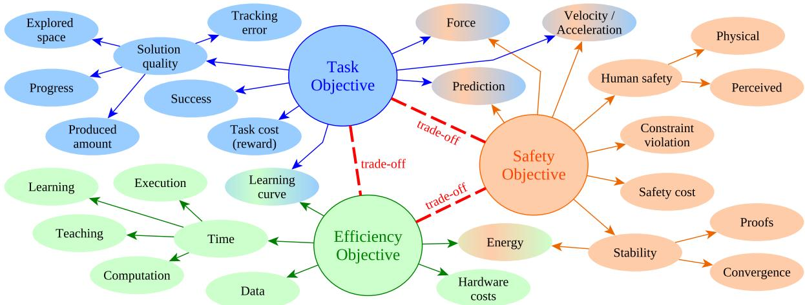  
Figure 5: The metrics in the contact-rich safe learning literature can be categorized according to their objectives: Safety, task and efficiency. There are trade-offs between these objectives. The researchers aim to develop safe systems with a good trade-off for task success and efficiency. Some metrics, such as force, velocity and energy serve to measure multiple objectives.

In the following, we present and categorize the evaluation metrics used by the relevant works scanned in our survey. We present the prominent metrics as categorized according to their goals in Fig. 5. The identified metrics aim to measure the safety, task (success) and efficiency objectives.

## 3.6.1 Safety, Efficiency and Task Objectives

Safety is usually assessed through the violation of predefined constraints [236, 263] or the value of a cost function [266]. In physical interaction tasks, it is often quantified through physical metrics such as force, acceleration and velocity [179, 213]. Control stability and human safety are important subcategories of the safety objective. Stability can be measured by the convergence rate [57, 138] or the energy flow of the system [79, 215, 341]. The human safety includes primarily the physical safety of the human in direct contact tasks like massaging or bathing assistance [35, 116], however, perceived safety concepts such as trust, predictability and comfort gain importance for the acceptance of robots in social spaces [64]. A relevant work [69] evaluates the perceived safety through 7-point Likert survey in their dressing assistance experiments.

The safety objective is the main topic of this survey, however, it cannot be considered in isolation from the other criteria. The task objective is quantified by the frequency of achieving a success [218] or the value of a task cost function (i.e., reward) [260]. In some works, the quality of a solution is assessed by the progress of task completion ([69]: dressing rate, [57]: vegetable slicing progress), size of the explored space [233], amount of produced output ([203]: ground fine powder), or the tracking accuracy [116]. [188] defines an instability index to quantify the episode reward deviation between runs. The efficiency objective is assessed by the energy consumption [222], and time requirements of the data collection (e.g., teaching) [273], learning a model [202], task execution [234, 260], or computation of an action or a plan [218, 237]. Since robot hardware is costly, reducing real-world trials by learning in simulation is preferable [235].

## 3.6.2 Trade-off Between Objectives

The three objectives (Fig. 5) may conflict in many instances, thus the designers often analyze the tradeoff between these. The trade-off can be measured by a combined metric, such as the ratio of the safe and successful experiments to constraint violating ones [6, 60]. A safety-efficiency reward function was proposed by [264] to achieve a good trade-off. On the other hand, [236] and [263] compare the numbers of successful and violating runs side-by-side instead of directly calculating a ratio between them.

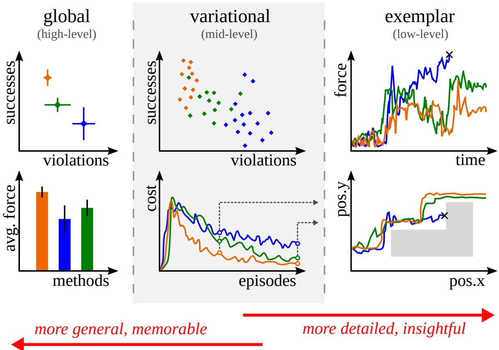  
Figure 6: Three levels of result analyses: Global (high-level), variational (mid-level), and exemplar (low-level).

Machine learning metrics such as prediction accuracy has been used to measure task objectives, however, it is also relevant in works that use learned models for safety-related predictions [57, 235]. Just as the learning curves provide insights on the success and efficiency trade-off, some works present the learning curves of success, violation and their ratio to portray the trade-off between the three objectives during training [6, 60].

Although shifting the focus to safety can decrease the task performance or learning efficiency, these objectives can be aligned in the case of physically interpretable metrics such as force and motion tracking errors, and energy consumption. Physically meaningful results such as the force-velocity behavior can provide intuition towards the safety of the system [211, 233]. Tracking the target force without large deviations in the Lyapunov-based boundaries directly translates to both the control stability and task achievement quality [138]. On the other hand, learning energy-based stability from data directly translates to energy efficiency in deployment [79].

## 3.6.3 Improved Evaluation

The safety aspect of a learning system can be further evaluated through added noise and disturbance. [116] evaluates the convergence of their trajectory tracking controller under external disturbance. The noise can be injected in observation-space [186, 218, 238] or action-space [188]. These tests help assess the limitations and sensing requirements of the systems. [198] evaluate their system under uniformly sampled simulation parameters, in addition to localization uncertainties. This allows demonstrating the robustness and generalization capacity of the method.

Most of the metrics can be presented at different levels of detail. In Fig. 6, we define 3 levels of analyses to establish a common understanding and encourage more insightful results: 1. global (high-level) analyses present aggregated summary statistics such as the maximum force, total number of violations, or mean (± variance) tracking error over many episodes. 2. variational (mid-level) analyses show the trends of metrics among many episodes or seeds, such as a learning curve, a histogram of execution times, or a scatter plot of success ratio versus force violation. 3. exemplar (low-level) analyses present descriptive case studies, often real-time measurements from a single episode, such as motion trajectories, force measurements, or even multi-media material. Going downwards, the amount of detail and depth of analysis increase; going upwards, the results get more general and memorable. Variational comparisons allow a more in-depth analysis of the system behavior from temporal, spatial or multi-variate perspective. Exemplar results can give valuable insights on why and how the method works, or when it fails, without deriving general conclusions. We recommend providing analyses at all levels for a more comprehensive communication of the results.

## 3.7 Safety Abstraction Level

In contact-rich robotic tasks, safety can be embedded at various abstraction levels in the system hierarchy, ranging from high-level task planning to low-level control, and even spanning across end-to-end learning architectures. Each level presents different trade-offs between interpretability, reactivity, and generalizability. This section categorizes learning-based safety approaches by the level of abstraction at which they operate and discusses their respective advantages, challenges, and applications.

## 3.7.1 High-Level Planning

At the high level, safety is typically encoded through symbolic reasoning, task graphs, or decisionmaking policies that govern long-horizon behavior. Learning-based approaches at this level often involve hierarchical reinforcement learning (HRL) [342, 343], safe policy search with task constraints [265, 308], or logic-based planning augmented by learned models [344, 345]. In contact-rich settings, these methods aim to avoid unsafe task sequences or infeasible contact configurations by reasoning over constraints such as force thresholds, joint limits, or task success probabilities [346, 347].

For example, shielded planning mechanisms and arbitration graphs can learn to prune unsafe highlevel actions using safety classifiers or predictive models [348–350]. While such methods provide good interpretability and modularity, they depend heavily on accurate abstractions and may suffer from limited reactivity to unforeseen contact dynamics during execution. Temporal logic specifications have also been integrated into diffusion-based planning to satisfy temporally-extended symbolic constraints [351].

Recently, the emergence of LLMs and VLMs has enabled advanced high-level planning capabilities for robotic systems, including in contact-rich tasks. These models can interpret complex task instructions, reason about safety constraints from natural language or visual cues, and generate high-level action sequences or code that proactively avoid unsafe situations [26, 267, 352, 353]. For example, VLM-enhanced planners can leverage multimodal perception to identify hazardous regions or delicate objects in the environment, integrating this information into symbolic task planning or policy generation [25, 70, 354, 355]. This allows robots to adapt their strategies dynamically, ensuring that safety considerations are embedded from the outset of task execution.

## 3.7.2 Low-Level Control

Low-level safety control focuses on ensuring safe interactions at the actuation and feedback level. This includes real-time enforcement of physical constraints such as force, torque, impedance, and stability, which are especially critical in contact-rich scenarios. Learning-based methods here typically involve adaptive impedance control, learning CBFs, model-predictive safety filters, or robust policy adaptation techniques. [200]

Compliant control and impedance learning. A widely adopted strategy is to learn variable impedance or admittance parameters rather than direct torques [114, 118, 239, 264]. By modulating stiffness and damping online based on contact feedback, these methods ensure compliant behavior that naturally limits interaction forces and absorbs impacts [233, 243, 253]. Recent approaches also integrate passivity constraints or energy tanks into the learning process to guarantee coupled stability during dynamic contact [79, 208].

Safety filters and barriers. To enforce hard safety constraints (e.g., joint limits, friction cones, maximum force), Control Barrier Functions (CBFs) and safety filters are often employed as a protective layer wrapping the learned policy [47, 48, 53]. These mechanisms monitor the control input and minimally deviate it to maintain the system within a forward-invariant safe set. Model Predictive Safety Filters (MPSF) extend this by reasoning over a short horizon to prevent inevitable future violations, which is crucial for systems with inertia or actuation limits [57, 348].

Robust and adaptive safety. For scenarios with significant model uncertainty (e.g., unknown friction or payload), robust control techniques such as Sliding Mode Control (SMC) or adaptive control are combined with learning to maintain safety margins [116, 218, 246]. These low-level controllers compensate for disturbances and unmodeled dynamics that might otherwise destabilize a high-level learned policy.

## 3.7.3 End-to-End Safety Enhancement

End-to-end methods aim to integrate perception, decision-making, and actuation within a unified model while embedding safety either implicitly (e.g., through regularization) or explicitly (e.g., via constrained optimization or safety critics). This includes safe reinforcement learning frameworks that learn both task policies and safety constraints simultaneously from raw sensory data [54, 202, 356]. For instance, [39] proposed a neural network-based approach that learns to predict safe actions directly from raw sensory inputs, such as images and proprioceptive data, allowing the robot to adapt its behavior in real-time to avoid unsafe actions during contact-rich tasks.

Recently, Vision-Language-Action (VLA) models have emerged as a powerful paradigm for endto-end safety enhancement. These models bridge perception, reasoning, and control by learning from large-scale multimodal datasets that include language instructions, visual observations, and robot actions [25–27]. Safety is enhanced in VLA systems through several mechanisms: (i) Safety-aware prompting and grounding: VLA models can be conditioned on safety-specific prompts or rules (e.g., ”move slowly near the glass”) to generate compliant behaviors [70, 267]. (ii) Safety critics and filtering: Auxiliary safety modules or critics can be trained to evaluate the risk of generated actions before execution, filtering out potentially hazardous commands [75, 353, 355]. (iii) Multimodal alignment: By aligning visual and linguistic representations with physical safety constraints (e.g., force limits), VLA models can better generalize safety concepts to novel objects and environments [351, 352, 354]. While these methods promise scalability and generalization, especially in contact-uncertain environments, they often suffer from limited interpretability and pose challenges in formal safety verification compared to modular architectures.

## 3.7.4 Hybrid Methods

Hybrid methods combine safety mechanisms across multiple abstraction levels to leverage the strengths of each [120]. For instance, a high-level planner might filter task options using a safety-aware graph while a low-level controller enforces contact force constraints through learned CBFs. Alternatively, endto-end models may be guided by high-level logic rules or shielded using low-level safety filters during deployment.

Planlearnfilter pipelines. A highlevel planner (graph, sampling, optimization, or semantic decomposition) proposes nominal contact strategies or intermediate subgoals; a learned policy (often variable impedance/admittance or residual) generates parameterized actions (pose, force, stiffness); then a runtime safety layer (CBF / reachability / MPC shield/projection) minimally modifies unsafe commands while preserving progress [46, 47, 124, 239, 240, 264]. This layering reduces unsafe transients at approach, impact, and sustained contact phases and limits overconservatism by deferring exact constraint satisfaction to an online filter.

Compliant action abstraction + certified projection. Rather than outputting raw torques, hybrid methods learn action abstractions (desired Cartesian displacements, force targets, diagonal or structured stiffness gains) that preserve passivity margins and expose explicit hooks for safety modification [6, 78, 79, 118, 239, 264]. Certified projection (QP with CBF constraints, shield veto, reachability prechecks) enforces forward invariance or constraint satisfaction without retraining the core policy [46– 48, 240].

Generative/residual policies under safety wrappers. Diffusion or residual RL policies produce candidate motions or compliance updates; a safety critic or barrier/MPC layer evaluates predicted force envelopes, energy flow, or constraint margins before execution (generatescoreproject) [6, 39, 47, 79, 203, 357, 358]. Residual admittance and stiffness adaptation compensate for unmodeled contact geometry while the wrapper prevents force spikes [118, 239, 264, 316].

Semantic / VLMVLA hybrid safety. Visionlanguage(-action) and emerging foundation model components parse unstructured instructions and scene context into structured constraint objects (force caps, forbidden surface masks, approach cones) [25–27]. These are handed to the planlearnfilter stack: semantic planner produces goal / sequence; learned variable impedance or residual policy outputs compliant parameters [75, 355]; runtime CBF / reachability / MPC shield enforces limits; logging layer records violations for calibration [46, 47, 239, 264]. Multimodal fusion (vision + force) disambiguates occlusions and anticipates risky contact transitions, while structured prompting and action schema reduce hallucinationinduced unsafe commands [25, 26, 39]. This hybridization aligns highlevel semantic intent with certifiable lowlevel execution, enabling scalable yet physically grounded safe manipulation in contactrich settings.

Such multi-layered architectures can offer robustness and flexibility, especially in unstructured contactrich tasks. However, hybrid methods also introduce complexity in integration and may require careful coordination to avoid conflicts between safety modules operating at different levels.

## 3.8 Safety Enforcement Spaces

In safe learning for robotic contact-rich tasks, a central consideration is where safety constraints are enforced within the control or learning pipeline. Safety can be realized at different levels of the robots architecture, from the physical interaction interface (task space), to the internal actuation system (joint space), and even at the policy decision layer. Each of these domains provides distinct opportunities and challenges for incorporating safety. Task-space enforcement directly regulates end-effector motion and contact forces with the environment, joint-space methods shape internal robot behavior to avoid unsafe configurations or torques, while policy-level mechanisms ensure that the agents decision-making respects safety constraints from the outset. This section categorizes and compares prior works based on the level at which safety is defined and enforced, highlighting dominant trends, common control strategies, and emerging hybrid approaches.

## 3.8.1 Task Space

Many approaches ensure safety directly in the task (Cartesian) space, meaning they constrain the robots end-effector motion and interaction forces. These methods typically impose limits on end-effector position, orientation, velocity, or contact force to keep them within safe bounds during contact-rich tasks. For example, some works explicitly bound the forces and torques at the end-effector to prevent excessive contact pressures, integrating such constraints into the controller or learning process [233, 234].

By formulating safety at the task level, the robot only executes motions that respect predefined safe regions and force thresholds in the workspace. A common strategy is to employ impedance or admittance control in Cartesian space, adjusting the end-effectors stiffness or damping in real time based on feedback to maintain compliant, gentle contact [112, 176, 203, 223, 235]. This allows the robot to absorb shocks and limit forces during manipulation while still following the desired trajectory. Several researchers integrate these variable impedance frameworks with learning algorithms, so the policy itself can modulate compliance for safety, for instance, by outputting stiffness parameters or virtual force targets that keep interactions soft and stable [114, 209, 239].

In reinforcement learning settings, safety constraints in task space are often enforced by penalizing or stopping unsafe behavior. Episodes might terminate or incur a large cost if the robots force sensor detects a contact force exceeding a set threshold [186, 188, 189, 305]. Likewise, the action space can be shaped to avoid dangerous moves. Some methods confine the end-effectors motions to a safe subset of the workspace or around demonstrated trajectories, preventing the agent from exploring configurations that could lead to collisions or high forces [113, 199, 236, 262]. Through these measures, task-space safety approaches directly guard the physical interaction interface of the robot, ensuring that all contact with the environment or humans remains within safe limits.

Beyond basic compliance and force limiting, formal safety techniques have also been applied at the task-space level. Control barrier functions and similar safety filters can constrain the end-effectors position and force within a known safe region at all times, overriding any controller command that would violate safety limits [68, 226, 258].

Some works derive safe sets from data or models, for instance, learning a set of permissible endeffector states from demonstrations or via Gaussian processes, and then formulating the task-space controller or planner to keep the robots trajectory inside this safe latent manifold [57, 359]

There are also planning-based approaches that build safety into motion generation. Before execution or learning, they compute contact-rich trajectories that satisfy contact stability, task unrelated collision avoidance, and joint limits, so that any subsequent policy learning begins with inherently safe trajectories [228, 267].

Energy-based methods add another layer of safety by ensuring the robot behaves as a passive system in task space. For example, adaptive impedance controllers with energy tanks or passivity constraints guarantee that the robot cannot inject unbounded energy into the environment, thus preventing spikes in force or unstable interactions [208, 254].

Notably, in humanrobot interaction scenarios, task-space safety often involves maintaining a safe distance and force relative to humans. Techniques like dynamic safety fields enforce minimum separation distances and speed limits for the end-effector when a person is nearby, and controllers can be designed to comply with industry safety standards, e.g. ISO force limits, during physical contact [70, 237, 309].

In summary, by enforcing safety in the task space, these approaches directly regulate the robots endeffector behavior through keeping contact forces, motions, and interactions within safe, tolerable bounds to guarantee safe manipulation.

## 3.8.2 Joint Space

Another line of research enforces safety in the joint (configuration) space, focusing on the robots internal angles, velocities, and torques. Joint-space safety methods ensure the robots actuators never produce motions that could be unsafe, thereby indirectly protecting the end-effector and its environment.

One way this is achieved is by augmenting the robots low-level controllers with safety constraints. For instance, joint-level control barrier functions can impose limits on joint motion or torque. A controller will automatically adjust or saturate commands so that resulting contact forces do not exceed a strict threshold [213]. Similarly, variable impedance control can be formulated at the joint level with guarantees of stability. By enforcing that the learned joint stiffness and damping matrices remain positive-definite (and hence passive), the system maintains Lyapunov stability and safe behavior throughout contact interactions [221, 225].

Some approaches use adaptive joint-torque controllers that account for external forces. They regulate joint torques in response to contact feedback, ensuring that sudden impacts are absorbed by the compliance in the joints rather than causing dangerous forces [218, 246]. In reinforcement learning contexts where policies output joint commands, researchers incorporate joint-space safety by constraining the action range and optimizing within safe bounds. For example, an RL policy might be allowed to command only small joint movements directly, while larger repositioning actions invoke a motion planner that finds collision-free joint trajectories, thereby avoiding unsafe jumps in configuration [202].

It is also common to include penalties for approaching joint limits or producing high torques in the reward function, so the agent naturally prefers to stay within a safe range of motion [261]. In one case, a policy was trained to perform robotic massage by learning joint-level impedance parameters. To keep the interaction safe with the human, the algorithm limited joint velocities and forces via compliance control, effectively bounding the output torque delivered to the person [214]. By prioritizing safety in the joint space, these methods keep the robots fundamental degrees of freedom under control through preventing excessive joint speeds or forces, which in turn helps maintain stable and safe interactions at the task space as well.

## 3.8.3 Dual-Space Safety Enforcement

While enforcing safety solely in either task space or joint space can already reduce risk, each perspective has blind spots. Task-space constraints may miss internal joint-limit or actuator issues, whereas purely joint-space safeguards may overlook subtle but harmful contact patterns at the end-effector.

For this reason, some frameworks combine safety mechanisms in both the task space and the joint space to provide a more comprehensive safety net. In these approaches, the robot monitors and constrains its behavior at the end-effector level and at the actuator level simultaneously. For example, a hierarchical safe control scheme might use a Cartesian impedance controller to ensure compliant, force-limited contact with the environment, while a parallel joint-space module detects unexpected collisions or excessive torques and reacts by altering joint commands to dissipate force safely [132]. This dual-layer design guarantees that even if an unforeseen contact occurs that was not accounted for by the task-space planner, the joint-space safety reflex can kick in to prevent damage.

Another representative work uses a two-loop control architecture for a robot with flexible joints. An outer loop regulates the contact force in task space to track a desired force trajectory, and an inner loop stabilizes the joint motion [211]. Through Lyapunov-based analysis, it is proven that both the force error and the joint deviations remain bounded, illustrating theoretical safety in both domains. In learningbased settings, ensuring stability in the joint space can indirectly enforce task-space safety. For instance, a model-based actorcritic method confines the joint controllers behavior within stability limits using an analytical model of the robot and environment stiffness. As a result, the end-effector never pushes beyond safe force limits because the joint controller wont allow an unsafe regime [259]. Even in dynamic locomotion tasks, a similar philosophy is applied.

One study on robotic hopping ensured the policy respected joint torque and angle limits at all times, which inherently kept the robots jumping motions stable and prevented falls or hardware stress during ground contact [231]. By addressing safety at multiple levels, these approaches leverage the strengths of each domain. The task-space layer handles safe interaction with objects and surfaces, while the joint-space layer ensures the robots own mechanics remain within secure operating conditions. This redundancy provides robust safety even under varying uncertainties or if one layers assumptions are violated.

## 3.8.4 Policy Spaces

In addition to physical control spaces, researchers have also explored safety in the policy or decisionmaking space. That is, integrating safety considerations into the robots learning and planning algorithms themselves. Rather than hard limits on forces or torques, these methods introduce abstract constraints or safety-centric objectives that guide the policy toward safe behavior.

One common approach is to formulate the problem as a CMDP, where certain state-action pairs or outcomes are labeled as unsafe with an associated cost. The reinforcement learning agent must then optimize its policy while satisfying a constraint on this unsafe cost, often via Lagrange multiplier techniques, to ensure it never exceeds a tolerated risk level [25]. In essence, the policy learns to avoid any behavior that would trigger the unsafe cost, adhering to safety requirements by design.

Another strategy is to learn a safety critic or value function that predicts the long-term risk of states and actions. For example, an algorithm might train a feasibility value function that estimates the probability of constraint violation for a given situation. The policy is then constrained or adjusted using this knowledge, selecting only actions that keep the robot in low-risk regions [230]. Along these lines, a recovery RL framework can learn a special recovery policy that intervenes whenever the agent is near an unsafe state. If the safety critic signals high risk for the agents intended action, control is handed over to the recovery policy, which drives the system back to a safe region before returning control to the main policy [60]. In high-dimensional problems, like vision-based manipulation, some works first learn a compact latent state representation and define safety in that latent space. For instance, a variational autoencoder might encode images of the robot workspace into a latent vector, and a learned barrier function on this latent space separates safe and unsafe states. The RL policy is then trained with an additional constraint to remain on the safe side of the barrier, even without explicit physical measurements [266].

There are also human-in-the-loop approaches where safety is addressed at a policy level through human feedback and oversight. In such frameworks, the robots exploration is guided by human evaluators or pre-defined safety rules. The robot might query a human or use a human-provided value function to ensure its learned policy aligns with human safety preferences and avoids dangerous actions during training [270].

Lastly, recent generative approaches ensure safe decision sequences by design. For example, diffusionbased policy models can be guided to prefer smooth, low-uncertainty action sequences, which reduces the chance of sudden erratic behavior that could be unsafe [229]. By incorporating safety directly into the decision-making process, these approaches aim to prevent unsafe commands from ever being chosen, complementing the lower-level safety controllers. This policy-space perspective ensures that the robots behavior remains within acceptable risk bounds from the planning stage through to execution, adding an extra layer of safety on top of physical enforcement.

## 4 Key Challenges

Despite rapid progress in learning-based methods for contact-rich robotic manipulation, several key challenges remain before these approaches can be deployed safely and reliably at scale. This section outlines major open problems, with particular attention to how emerging VLM/VLA-based methods both exacerbate and help address these issues.

## 4.1 Fragile Safety and Stability Guarantees

Learning-based controllers, including those using deep networks and VLAs, often lack formal guarantees of passivity, stability, and constraint satisfaction under hard contacts [79, 254, 360], which can lead to unsafe behaviors and hardware damage. While passivity-centric and energy-constrained formulations offer promising directions, integrating them seamlessly with large, expressive policies remains technically challenging, especially when contact conditions change rapidly or unpredictably.

## 4.2 Data Scarcity and Biased Supervision

Contact-rich skills require precise force control and tight tolerances, but high-quality demonstrations and interaction data are expensive, brittle, and difficult to scale compared to standard visionlanguage datasets. VLMs and VLAs promise better generalization through pretraining, yet they are typically supervised by weak or indirect signals that do not capture fine-grained contact events, leading to policies that may look competent visually but fail under subtle force or geometry variations.

## 4.3 Limited Robustness, Generalization, and Uncertainty Awareness

Learning-based policies for contact-rich manipulation, especially ones trained on narrow task distributions, often overfit to specific layouts, materials, or sensing conditions and degrade sharply under distribution shifts. Although VLAs offer broader prior knowledge, current models typically have weak uncertainty estimation, making it difficult to detect when a contact-rich interaction [25, 361] is entering an unsafe regime and requiring fallback to safer behaviors or human intervention.

## 4.4 Safe Exploration Under Physical Risk

Exploration remains the most safety-critical phase: naive probing causes jamming, surface damage, or tool wear in insertion, polishing, and assembly contexts [6, 46]. Existing constrained and risk-sensitive reinforcement learning frameworks provide expectation or probabilistic bounds, yet exhibit weakness under distribution shift. Shielding and action-projection (barrier / reachability / model-predictive) layers offer hard online guarantees, but typically depend on conservative uncertainty sets, limiting data efficiency.

## 4.5 Safe Execution and Performance Trade-offs

Ensuring sustained constraint satisfaction post-training (safe execution) requires balancing responsiveness, task efficiency, and physical margin. Variable impedance or admittance policies learned from demonstrations or reinforcement signals modulate compliance adaptively [6, 239, 264], yet stability margins under rapid re-tuning are seldom quantified. Runtime safety filters can erode performance through excessive intervention, while soft filtering strategies risk cumulative force violations. There is insufficient methodology for joint optimization over (i) violation probability; (ii) force/energy envelopes; and (iii) efficiency.

## 4.6 Benchmark and Dataset Limitations

Existing simulation suites and benchmarks provide limited coverage of deformable objects, multistage processes, toolsupported tasks, and tasks performed in close collaboration with humans. [76, 77, 88]. Public datasets rarely include (i) high-frequency wrench traces aligned with failure annotations; (ii) rich near-miss episodes essential for shaping recovery policies; or (iii) semantic safety labels (forbidden regions, fragile surfaces). This scarcity impedes reproducible comparison of violation metrics, recovery latency, and generalization. Emerging safety-oriented RL frameworks and robust benchmarks partially address constrained exploration but lack standardized contact-force evaluation protocols [48, 89].

## 4.7 Safety Risks Specific to VLMs and VLAs

Generalist VLM/VLA policies introduce new safety concerns, such as misinterpreting language instructions, hallucinating feasible contact strategies, or overconfidently executing plans that violate implicit safety constraints. Recent work on safety-aligned VLAs and failure detection for generalist policies underscores how difficult it is to systematically elicit unsafe behaviors, constrain them during learning, and verify that contact-rich deployments remain within acceptable risk bounds.

## 4.8 Human-Robot-Collaboration Safety

Human proximity or direct physical collaboration introduces soft constraints (comfort, predictability) alongside hard limits (force, speed). For contact-rich tasks near or with humans, operators must be able to anticipate robot behavior and intervene effectively, yet current learning-based controllers often lack transparency and interpretable failure modes. Existing safe learning pipelines predominantly encode physical thresholds while neglecting temporal predictability or trust metrics central to acceptance [362– 364]. Adaptive safety frameworks that integrate ergonomic and standard-driven constraints (e.g., force envelopes in ISO/TS 15066 of [43]) with learning-enabled modulation are limited. Advanced models, including VLAs, can in principle explain intentions or request help, but designing interaction protocols, interfaces, and explanations that are both faithful and useful in high-contact scenarios remains an open challenge.

## 5 Perspectives

Safe robot learning for contact-rich manipulation is entering a phase where systematic advances in data, evaluation, and architectural composability must complement incremental improvements in algorithms. We outline key forward-looking directions.

## 5.1 Standardized Safe-contact Benchmarks

Current suites under-represent multi-stage forceful interaction, deformables, and human-adjacent tasks [46, 76, 77, 88]. Future benchmarks for safe learning in contact-rich robotics should move beyond isolated manipulation tasks to suites that stress high-force interactions, tight clearances, and diverse materials and fixtures. A key opportunity is to design benchmarks where visionlanguage models (VLMs) and visionlanguageaction (VLA) models must interpret natural language task descriptions and safety rules, then execute contact-rich skills under explicit constraints on forces, slippage, and failure recovery.

## 5.2 Safety-aware and Data-efficient Learning Frameworks

Next-generation safe learning frameworks should tightly couple formal safety mechanisms with ad vanced function approximators, including VLAs and other large policies pretrained on internet-scale multimodal data and robot demonstrations. Promising directions include risk-sensitive and constraintaware variants of VLA-based controllers, hybrid model-based/model-free schemes that use large models for high-level decision-making while maintaining certified low-level safety filters, and methods that exploit language to specify and verify safety conditions during contact-rich interaction.

## 5.3 Bridging the Sim-to-real Safety Gap

Closing the sim-to-real gap for safe contact-rich behavior will require simulators that expose robots to realistic contact phenomena while also capturing the perceptual and linguistic variability seen by VLM/VLA policies. This opens the door to leveraging generative models and large-scale VLAs to create rich synthetic curricula of tasks, objects, and safety-critical edge cases, followed by safety-aware adaptation and online refinement on real hardware with strict monitoring of contact forces and failure modes.

## 5.4 Multimodal Semantic Grounding

VLM/VLA models enable symbolic specification of scene understanding, semantic reasoning[25–27], yet robust grounding remains fragile under occlusion and clutter. A promising direction is layered grounding, which proceeds from scene parsing to affordance and constraint extraction, followed by formal constraint compilation (e.g., CBF/MPC sets), and ultimately runtime conformance validation. In addition, safetyaware prompting and structured action frameworks can reduce the risk of hallucinated unsafe plans.

## 5.5 Human-Centric and Lifecycle-aware Safety

Physical safety envelopes, such as limits on force and speed, are necessary but not sufficient for collaborative adoption [2]. Human-centered safe learning frameworks can benefit from language-conditioned policies that understand instructions, preferences, and corrections expressed in natural language, enabling non-expert users to shape safe behavior even in contact-rich collaboration. Over the system lifecycle, advanced models such as VLAs can support continual learning and self-diagnostics, where robots explain their contact strategies, flag emerging risks, and update policies while preserving guarantees about human safety and equipment integrity.

## 5.6 Scalable Verification for Learning-based Controllers

Diffusion, latent variable, and residual impedance policies challenge classical verification. Abstraction of action space (e.g., stiffness, damping) into reachable sets. Data-driven certificates, such as learned barrier functions, need procedures for failure detection and repair to avoid degradation.

## 5.7 Physically-Aware Foundation Models

Generalist manipulation models often fail to capture the mechanics of physical contact. A promising direction is to integrate structured physical priors such as friction cones, energy tanks, and passivity margins into largescale action models to limit unsafe extrapolation. A hybrid generation pipeline: first planning with a foundation model, then refining under impedance and barrier constraints, formalizes a planparameterizeenforce paradigm [26, 39]. Building curated datasets that are rich in contact interactions and include explicit safety annotations is a necessary step toward reliable deployment.

## 5.8 Open Problems

Key unresolved issues include: (i) certified generalization under simultaneous geometric and material shifts [17]; (ii) synthesis of minimally conservative multi-contact safe sets; (iii) semantic-to-physical constraint robustness; and (iv) lifecycle adaptation with formal transient bounds. Addressing these will hinge on tighter integration of analytical safety structures with data-driven representations and foundation models.

## 5.9 Outlook

Future progress will rely on bringing together physically grounded control methods such as impedance and passivity, formal safety tools including barrier functions and reachability analysis, scalable data resources like benchmarks and higherlevel semantic reasoning layers. A growing consensus supports layered planlearnfilterexecute architectures, which provide a practical foundation. Moving toward clear metrics and standardized safety will be key to enabling reliable deployment of learningbased robotic systems in complex, contactrich environments.

## 6 Conclusion

In this survey, a comprehensive overview of safe learning methods for contact-rich robotic tasks has been presented, with a particular focus on how emerging foundation models reshape the landscape. Existing approaches have been organized along multiple dimensions, including sensing modalities, data acquisition strategies, simulation environments, safety evaluation metrics, abstraction levels, and task mobility contexts, to provide a structured view of the design space for safe contact-rich manipulation.

The survey highlights the central role of multimodal sensing, such as force/torque, tactile, and vision, in enabling safe and robust behavior under complex contact conditions. Key challenges persist in data acquisition, safety metrics and certification, modeling of contact-rich interactions, and consistently enforcing safety constraints from high-level reasoning down to low-level control.

Looking forward, hybrid architectures and advanced learning paradigms offer promising avenues. Opportunities include combining high-level planning with low-level compliant control, integrating classical safety mechanisms with learning-based policies, and leveraging VLM and VLA models to interpret safety requirements, ground them in multimodal observations, and support transparent, human-centered interaction in contact-rich scenarios.

## References

[1] A. Billard and D. Kragic, “Trends and challenges in robot manipulation,” Science, vol. 364, no. 6446, p. eaat8414, 2019.

[2] A. Ajoudani, A. M. Zanchettin, S. Ivaldi, A. Albu-Schaffer, K. Kosuge, and O. Khatib, “Progress¨ and prospects of the human–robot collaboration,” Autonomous robots, vol. 42, pp. 957–975, 2018.

[3] ´I. Elguea-Aguinaco, A. Serrano-Munoz, D. Chrysostomou, I. Inziarte-Hidalgo, S. Bøgh, and ˜ N. Arana-Arexolaleiba, “A review on reinforcement learning for contact-rich robotic manipulation tasks,” Robotics and Computer-Integrated Manufacturing, vol. 81, p. 102517, 2023.

[4] L. Brunke, M. Greeff, A. W. Hall, Z. Yuan, S. Zhou, J. Panerati, and A. P. Schoellig, “Safe learning in robotics: From learning-based control to safe reinforcement learning,” Annual Review of Control, Robotics, and Autonomous Systems, vol. 5, no. 1, pp. 411–444, 2022.

[5] M. Noseworthy, B. Tang, B. Wen, A. Handa, C. Kessens, N. Roy, D. Fox, F. Ramos, Y. Narang, and I. Akinola, “Forge: Force-guided exploration for robust contact-rich manipulation under uncertainty,” IEEE Robotics and Automation Letters, 2025.

[6] H. Zhang, G. Solak, G. J. G. Lahr, and A. Ajoudani, “Srl-vic: A variable stiffness-based safe reinforcement learning for contact-rich robotic tasks,” IEEE Robotics and Automation Letters, vol. 9, no. 6, pp. 5631–5638, 2024.

[7] W. Zhao, T. He, R. Chen, T. Wei, and C. Liu, “State-wise safe reinforcement learning: A survey,” in International Joint Conference on Artificial Intelligence. IJCAI, 2023.

[8] S. Gu, L. Yang, Y. Du, G. Chen, F. Walter, J. Wang, and A. Knoll, “A review of safe reinforcement learning: Methods, theories and applications,” IEEE Transactions on Pattern Analysis and Machine Intelligence, 2024.

[9] M. Guerrier, H. Fouad, and G. Beltrame, “Learning control barrier functions and their application in reinforcement learning: A survey,” arXiv preprint arXiv:2404.16879, 2024.

[10] H. Odriozola-Olalde, M. Zamalloa, and N. Arana-Arexolaleiba, “Shielded reinforcement learning: A review of reactive methods for safe learning,” in 2023 IEEE/SICE International Symposium on System Integration (SII). IEEE, 2023, pp. 1–8.

[11] M. Suomalainen, Y. Karayiannidis, and V. Kyrki, “A survey of robot manipulation in contact,” Robotics and Autonomous Systems, vol. 156, p. 104224, 2022.

[12] O. Kroemer, S. Niekum, and G. Konidaris, “A review of robot learning for manipulation: Challenges, representations, and algorithms,” Journal of machine learning research, vol. 22, no. 30, pp. 1–82, 2021.

[13] J. Xu, Z. Hou, Z. Liu, and H. Qiao, “Compare contact model-based control and contact model-free learning: A survey of robotic peg-in-hole assembly strategies,” arXiv preprint arXiv:1904.05240, 2019.

[14] F. J. Abu-Dakka and M. Saveriano, “Variable impedance control and learninga review,” Frontiers in Robotics and AI, vol. 7, p. 590681, 2020.

[15] Z. Samadikhoshkho, E. Saive, and M. G. Lipsett, “A review of compliant mechanisms for contact robotics applications,” Robotics and Autonomous Systems, p. 104902, 2024.

[16] L. Stan, A. F. Nicolescu, and C. Pupaz˘ a, “Reinforcement learning for assembly robots: A review,”˘ Proceedings in Manufacturing Systems, vol. 15, no. 3, pp. 135–146, 2020.

[17] A. R. Das and M. Koskinopoulou, “Towards sustainable manufacturing: A review on innovations in robotic assembly and disassembly,” IEEE Access, 2025

[18] T. Toshiaki, K. Yasuhiro, S. Gokhan, Z. Heng, P. Tadej, N. Francesco, and A. Arash, “A survey on imitation learning for contact-rich tasks in robotics,” arXiv preprint arXiv:2506.13498, 2025.

[19] T. Kojima, Y. Zhu, Y. Iwasawa, T. Kitamura, G. Yan, S. Morikuni, R. Takanami, A. Solano, T. Matsushima, A. Murakami et al., “A comprehensive survey on physical risk control in the era of foundation model-enabled robotics,” arXiv preprint arXiv:2505.12583, 2025.

[20] P. Lamba, K. Ravish, A. Kushwaha, and P. Kumar, “Alignment and safety of diffusion models via reinforcement learning and reward modeling: A survey,” arXiv preprint arXiv:2505.17352, 2025.

[21] W. Xie and N. Correll, “Towards forceful robotic foundation models: a literature survey,” arXiv preprint arXiv:2504.11827, 2025.

[22] K. P. Wabersich, A. J. Taylor, J. J. Choi, K. Sreenath, C. J. Tomlin, A. D. Ames, and M. N. Zeilinger, “Data-driven safety filters: Hamilton-jacobi reachability, control barrier functions, and predictive methods for uncertain systems,” IEEE Control Systems Magazine, vol. 43, no. 5, pp. 137–177, 2023.

[23] S. Salimpour, L. Fu, F. Keramat, L. Militano, G. Toffetti, H. Edelman, and J. P. Queralta, “Towards embodied agentic ai: Review and classification of llm-and vlm-driven robot autonomy and interaction,” arXiv preprint arXiv:2508.05294, 2025.

[24] R. Cruz-Oliver, “Learning for contact-rich tasks with cobots,” Master’s thesis, 2024.

[25] B. Zhang, Y. Zhang, J. Ji, Y. Lei, J. Dai, Y. Chen, and Y. Yang, “Safevla: Towards safety alignment of vision-language-action model via constrained learning,” arXiv preprint arXiv:2503.03480, 2025.

[26] M. Tolle, T. Gruner, D. Palenicek, J. G¨ unster, P. Liu, J. Watson, D. Tateo, and J. Peters, “Towards¨ safe robot foundation models,” arXiv preprint arXiv:2503.07404, 2025.

[27] Z. Zhao, S. Cheng, Y. Ding, Z. Zhou, S. Zhang, D. Xu, and Y. Zhao, “A survey of optimizationbased task and motion planning: From classical to learning approaches,” IEEE/ASME Transactions on Mechatronics, pp. 1–27, 2024.

[28] Y. Huang, D. Fan, H. Duan, D. Yan, W. Qi, J. Sun, Q. Liu, and P. Wang, “Human-like dexterous manipulation for anthropomorphic five-fingered hands: A review,” Biomimetic Intelligence and Robotics, p. 100212, 2025.

[29] T. Sy Horng Ting, Y. H. Goh, K. M. Chin, Y. K. Tan, T. H. Chiew, G. Ma, and C. K. How, “A review of advanced force torque control strategies for precise nut-to-bolt mating in robotic assembly.” International Journal ofRobotics & Control Systems, vol. 5, no. 1, 2025.

[30] S. Lakshminarayanan, S. Kana, A. De San Bernabe, S. H. Turlapati, D. Accoto, and D. Campolo, “Robots in manufacturing: Programming, control, and safety standards,” in Digital Manufacturing. Elsevier, 2024, pp. 85–131.

[31] V. K. Sharma, P. Zhou, Z. Xu, Y. She, and S. Sivaranjani, “Safe humanrobot collaboration with risk tunable control barrier functions,” IEEE/ASME Trans. Mechatron., vol. 30, no. 4, pp. 3133–3141, 2025.

[32] Q. K. Luu, P. Zhou, Z. Xu, Z. Zhang, Q. Qiu, and Y. She, “Manifeel: Benchmarking and understanding visuotactile manipulation policy learning,” arXiv preprint arXiv:2505.18472, 2025.

[33] Z. Zheng, Y. Wang, C. Chen, Z. Gao, F. Peng, and R. Yan, “Admittance control for robot polishing force tracking based on reinforcement learning,” in International Conference on Intelligent Robotics and Applications. Springer, 2023, pp. 335–345.

[34] S. Li, X. Yuan, and J. Niu, “Robotic peg-in-hole assembly strategy research based on reinforcement learning algorithm,” Applied Sciences, vol. 12, no. 21, p. 11149, Nov. 2022. [Online]. Available: http://dx.doi.org/10.3390/app122111149

[35] M. Xiao, T. Zhang, Y. Zou, S. Chen, and W. Wu, “Research on robot massage force control based on residual reinforcement learning,” IEEE Access, vol. 12, pp. 18 270–18 279, 2023.

[36] M. Kim, J. Han, J. Kim, and B. Kim, “Pre- and post-contact policy decomposition for non-prehensile manipulation with zero-shot sim-to-real transfer,” Sep. 2023, arXiv:2309.02754 [cs]. [Online]. Available: http://arxiv.org/abs/2309.02754

[37] H.-Y. Lee, P. Zhou, A. Duan, W. Ma, C. Yang, and D. Navarro-Alarcon, “Non-Prehensile Tool-Object Manipulation by Integrating LLM-Based Planning and Manoeuvrability-Driven Controls,” Aug. 2025, arXiv:2412.06931 [cs]. [Online]. Available: http://arxiv.org/abs/2412.06931

[38] N. Hogan, “Contact and physical interaction,” Annual Review of Control, Robotics, and Autonomous Systems, vol. 5, no. 1, pp. 179–203, 2022.

[39] S. Bahl, M. Mukadam, A. Gupta, and D. Pathak, “Neural dynamic policies for end-to-end sensorimotor learning,” Advances in Neural Information Processing Systems, vol. 33, pp. 5058–5069, 2020.

[40] C. Chuck, C. Qi, M. J. Munje, S. Li, M. Rudolph, C. Shi, S. Agarwal, H. Sikchi, A. Peri, S. Dayal et al., “Robot air hockey: A manipulation testbed for robot learning with reinforcement learning,” arXiv preprint arXiv:2405.03113, 2024.

[41] Y. Zhang, T. Liang, Z. Chen, Y. Ze, and H. Xu, “Catch it! learning to catch in flight with mobile dexterous hands,” in 2025 IEEE International Conference on Robotics and Automation (ICRA). IEEE, 2025, pp. 14 385–14 391.

[42] K. Lu, J.-X. Zhong, B. Yang, B. Wang, and A. Markham, “Learning to catch reactive objects with a behavior predictor,” in 2024 IEEE International Conference on Robotics and Automation (ICRA), 2024, pp. 9205–9211.

[43] International Organization for Standardization, “Robots and robotic devices collaborative robots,” International Organization for Standardization, Geneva, Switzerland, ISO/TS 15066:2016, 2016, technical Specification. [Online]. Available: https://www.iso.org/standard/62996.html

[44] A. Calanca, R. Muradore, and P. Fiorini, “A review of algorithms for compliant control of stiff and fixed-compliance robots,” IEEE/ASME transactions on mechatronics, vol. 21, no. 2, pp. 613–624, 2015.

[45] Z. Huang, H. Hou, and D. Berenson, “Unified Multimodal Diffusion Forcing for Forceful Manipulation,” Nov. 2025, arXiv:2511.04812 [cs] version: 1. [Online]. Available: http://arxiv.org/abs/2511.04812

[46] Z. Yuan, A. W. Hall, S. Zhou, L. Brunke, M. Greeff, J. Panerati, and A. P. Schoellig, “Safe-controlgym: A unified benchmark suite for safe learning-based control and reinforcement learning in robotics,” IEEE Robotics and Automation Letters, vol. 7, no. 4, pp. 11 142–11 149, 2022.

[47] S. A. Khader, H. Yin, P. Falco, and D. Kragic, “Stability-guaranteed reinforcement learning for contact-rich manipulation,” IEEE Robotics and Automation Letters, vol. 6, no. 1, pp. 1–8, 2020.

[48] J. Ji, B. Zhang, J. Zhou, X. Pan, W. Huang, R. Sun, Y. Geng, Y. Zhong, J. Dai, and Y. Yang, “Safety gymnasium: A unified safe reinforcement learning benchmark,” Advances in Neural Information Processing Systems, vol. 36, pp. 18 964–18 993, 2023.

[49] H. K. Khalil and J. W. Grizzle, Nonlinear systems. Prentice hall Upper Saddle River, NJ, 2002, vol. 3.

[50] S. Kumar and R. Prakash, “Safe and Optimal Variable Impedance Control via Certified Reinforcement Learning,” Nov. 2025, arXiv:2511.16330 [cs]. [Online]. Available: http: //arxiv.org/abs/2511.16330

[51] A. D. Ames, S. Coogan, M. Egerstedt, G. Notomista, K. Sreenath, and P. Tabuada, “Control barrier functions: Theory and applications,” in 2019 18th European Control Conference (ECC), 2019, pp. 3420–3431.

[52] J. Liu, J. Yang, J. Mao, T. Zhu, Q. Xie, Y. Li, X. Wang, and S. Li, “Flexible active safety motion control for robotic obstacle avoidance: A cbf-guided mpc approach,” IEEE Robotics and Automation Letters, vol. 10, no. 3, p. 26862693, Mar. 2025. [Online]. Available: http://dx.doi.org/10.1109/lra.2025.3534519

[53] H. Liang, X. Wang, J. Mao, and J. Yang, “Control barrier function-based force constrained safety compliance control for manipulator,” in 2023 28th International Conference on Automation and Computing (ICAC). IEEE, Aug. 2023, p. 17. [Online]. Available: http://dx.doi.org/10.1109/icac57885.2023.10275266

[54] R. Cheng, G. Orosz, R. M. Murray, and J. W. Burdick, “End-to-end safe reinforcement learning through barrier functions for safety-critical continuous control tasks,” in Proceedings ofthe AAAI conference on artificial intelligence, vol. 33, no. 01, 2019, pp. 3387–3395.

[55] J.-B. Bouvier, K. Nagpal, and N. Mehr, “Policed rl: Learning closed-loop robot control policies with provable satisfaction of hard constraints,” in Robotics: Science and Systems, 2024.

[56] L. Hewing, K. P. Wabersich, M. Menner, and M. N. Zeilinger, “Learning-based model predictive control: Toward safe learning in control,” Annual Review of Control, Robotics, and Autonomous Systems, vol. 3, no. Volume 3, 2020, pp. 269–296, 2020. [Online]. Available: https://www.annualreviews.org/content/journals/10.1146/annurev-control-090419-075625

[57] I. Mitsioni, P. Tajvar, D. Kragic, J. Tumova, and C. Pek, “Safe data-driven model predictive control of systems with complex dynamics,” IEEE Transactions on Robotics, vol. 39, no. 4, pp. 3242– 3258, 2023.

[58] S. Bansal, M. Chen, S. Herbert, and C. J. Tomlin, “Hamilton-jacobi reachability: A brief overview and recent advances,” in 2017 IEEE 56th Annual Conference on Decision and Control (CDC), 2017, pp. 2242–2253.

[59] Y. S. Shao, C. Chen, S. Kousik, and R. Vasudevan, “Reachability-based trajectory safeguard (rts): A safe and fast reinforcement learning safety layer for continuous control,” IEEE Robotics and Automation Letters, vol. 6, no. 2, p. 36633670, Apr. 2021. [Online]. Available: http://dx.doi.org/10.1109/lra.2021.3063989

[60] B. Thananjeyan, A. Balakrishna, S. Nair, M. Luo, K. Srinivasan, M. Hwang, J. E. Gonzalez, J. Ibarz, C. Finn, and K. Goldberg, “Recovery rl: Safe reinforcement learning with learned recovery zones,” IEEE Robotics and Automation Letters, vol. 6, no. 3, pp. 4915–4922, 2021.

[61] K. Srinivasan, B. Eysenbach, S. Ha, J. Tan, and C. Finn, “Learning to be safe: Deep rl with a safety critic,” arXiv preprint arXiv:2010.14603, 2020.

[62] P.-F. Massiani, S. Heim, F. Solowjow, and S. Trimpe, “Safe value functions,” IEEE Transactions on Automatic Control, vol. 68, no. 5, p. 27432757, May 2023. [Online]. Available: http://dx.doi.org/10.1109/tac.2022.3200948

[63] K.-C. Hsu, A. Z. Ren, D. P. Nguyen, A. Majumdar, and J. F. Fisac, “Sim-to-lab-to-real: Safe reinforcement learning with shielding and generalization guarantees,” Artificial Intelligence, vol. 314, p. 103811, Jan. 2023. [Online]. Available: http://dx.doi.org/10.1016/j.artint.2022.103811

[64] M. Farajtabar and M. Charbonneau, “The path towards contact-based physical human–robot interaction,” Robotics and Autonomous Systems, p. 104829, 2024.

[65] P. Chemweno, L. Pintelon, and W. Decre, “Orienting safety assurance with outcomes of hazard analysis and risk assessment: A review of the iso 15066 standard for collaborative robot systems,” Safety Science, vol. 129, p. 104832, Sep. 2020. [Online]. Available: http://dx.doi.org/10.1016/j.ssci.2020.104832

[66] X. Zhao, T. Fan, Y. Li, Y. Zheng, and J. Pan, “An efficient and responsive robot motion controller for safe human-robot collaboration,” IEEE Robotics and Automation Letters, vol. 6, no. 3, pp. 6068–6075, 2021.

[67] M. El-Shamouty, X. Wu, S. Yang, M. Albus, and M. F. Huber, “Towards safe human-robot collaboration using deep reinforcement learning,” in 2020 IEEE international conference on robotics and automation (ICRA). IEEE, 2020, pp. 4899–4905.

[68] D. Zhang, M. Van, S. Mcllvanna, Y. Sun, and S. McLoone, “Adaptive safety-critical control with uncertainty estimation for human–robot collaboration,” IEEE Transactions on Automation Science and Engineering, vol. 21, no. 4, pp. 5983–5996, 2023.

[69] Z. Sun, Y. Wang, D. Held, and Z. Erickson, “Force-constrained visual policy: Safe robot-assisted dressing via multi-modal sensing,” IEEE Robotics and Automation Letters, 2024.

[70] J. Thumm, C. Agia, M. Pavone, and M. Althoff, “Text2interaction: Establishing safe and preferable human-robot interaction,” in Conference on Robot Learning. PMLR, 2025, pp. 1250–1267.

[71] W. Zhou, M. Tao, C. Zhao, H. Guo, H. Dong, M. Tang, and J. Wang, “PhysVLM: Enabling Visual Language Models to Understand Robotic Physical Reachability,” Mar. 2025, arXiv:2503.08481 [cs]. [Online]. Available: http://arxiv.org/abs/2503.0848

[72] X. Wei, H. Zhang, X. Cao, S. Xie, W. Ge, Y. Li, and C. Wang, “Audio-VLA: Adding Contact Audio Perception to Vision-Language-Action Model for Robotic Manipulation,” Nov. 2025, arXiv:2511.09958 [cs]. [Online]. Available: http://arxiv.org/abs/2511.09958

[73] Y. Cui, Y. Zhang, L. Tao, Y. Li, X. Yi, and Z. Li, “End-to-End Dexterous Arm-Hand VLA Policies via Shared Autonomy: VR Teleoperation Augmented by Autonomous Hand VLA Policy for Efficient Data Collection.” [Online]. Available: https://arxiv.org/abs/2511.00139v1

[74] G. Lu, W. Guo, C. Zhang, Y. Zhou, H. Jiang, Z. Gao, Y. Tang, and Z. Wang, “VLA-RL: Towards Masterful and General Robotic Manipulation with Scalable Reinforcement Learning,” May 2025, arXiv:2505.18719 [cs]. [Online]. Available: http://arxiv.org/abs/2505.18719

[75] H. Zhang, W.-H. Huang, G. Solak, and A. Ajoudani, “Omnivic: A self-improving variable impedance controller with vision-language in-context learning for safe robotic manipulation,” arXiv preprint arXiv:2510.17150, 2025.

[76] H. Geng, F. Wang, S. Wei, Y. Li, B. Wang, B. An, C. T. Cheng, H. Lou, P. Li, Y.-J. Wang et al., “Roboverse: Towards a unified platform, dataset and benchmark for scalable and generalizable robot learning,” arXiv preprint arXiv:2504.18904, 2025.

[77] S. Gu, L. Shi, M. Wen, M. Jin, E. Mazumdar, Y. Chi, A. Wierman, and C. Spanos, “Robust gymnasium: A unified modular benchmark for robust reinforcement learning,” arXiv preprint arXiv:2502.19652, 2025.

[78] L. Roveda, J. Maskani, P. Franceschi, A. Abdi, F. Braghin, L. Molinari Tosatti, and N. Pedrocchi, “Model-based reinforcement learning variable impedance control for human-robot collaboration,” Journal ofIntelligent & Robotic Systems, vol. 100, no. 2, pp. 417–433, 2020.

[79] H. Zhang, G. Solak, S. Hjorth, and A. Ajoudani, “Passivity-centric safe reinforcement learning for contact-rich robotic tasks,” 2025. [Online]. Available: https://arxiv.org/abs/2503.00287

[80] N. Lin, L. Zhang, Y. Chen, Y. Zhu, R. Chen, P. Wu, and X. Chen, “Reinforcement learning for robotic safe control with force sensing,” in 2019 WRC Symposium on Advanced Robotics and Automation (WRC SARA). IEEE, 2019, pp. 148–153.

[81] A. Li, R. Liu, X. Yang, and Y. Lou, Reinforcement Learning Strategy Based on Multimodal Representationsfor High-Precision Assembly Tasks. Springer International Publishing, 2021, p. 5666. [Online]. Available: http://dx.doi.org/10.1007/978-3-030-89095-7 6

[82] J. Luo, P. Dong, Y. Zhai, Y. Ma, and S. Levine, “Rlif: Interactive imitation learning as reinforcement learning,” arXiv preprint arXiv:2311.12996, 2023.

[83] Y. Wang, C. C. Beltran-Hernandez, W. Wan, and K. Harada, “Robotic imitation of human assembly skills using hybrid trajectory and force learning,” in 2021 IEEE International Conference on Robotics and Automation (ICRA). IEEE, 2021, pp. 11 278–11 284.

[84] A. S. Anand, J. T. Gravdahl, and F. J. Abu-Dakka, “Model-based variable impedance learning control for robotic manipulation,” Robotics and Autonomous Systems, vol. 170, p. 104531, Dec. 2023. [Online]. Available: http://dx.doi.org/10.1016/j.robot.2023.104531

[85] H. Zhou, S. Ma, G. Wang, Y. Deng, and Z. Liu, “A hybrid control strategy for grinding and polishing robot based on adaptive impedance control,” Advances in Mechanical Engineering, vol. 13, no. 3, Mar. 2021. [Online]. Available: http://dx.doi.org/10.1177/16878140211004034

[86] T. Pang, Planning, sensing, and control for contact-rich robotic manipulation with quasi-static contact models. Massachusetts Institute of Technology, 2023.

[87] Y. Xu, Z. Liu, G. Duan, J. Zhu, X. Bai, and J. Tan, “Look Before You Leap: Safe Model-Based Reinforcement Learning with Human Intervention,” Jun. 2021. [Online]. Available: https://openreview.net/forum?id=oqZrUx-PRqb

[88] M. Towers, A. Kwiatkowski, J. Terry, J. U. Balis, G. De Cola, T. Deleu, M. Goulao, A. Kallinteris,˜ M. Krimmel, A. KG et al., “Gymnasium: A standard interface for reinforcement learning environments,” arXiv preprint arXiv:2407.17032, 2024.

[89] A. Raffin, A. Hill, A. Gleave, A. Kanervisto, M. Ernestus, and N. Dormann, “Stable-baselines3: Reliable reinforcement learning implementations,” Journal ofmachine learning research, vol. 22, no. 268, pp. 1–8, 2021.

[90] W. Chi and M. Q.-H. Meng, “Risk-rrt\*: A robot motion planning algorithm for the human robot coexisting environment,” in Proc. 18th Int. Conf. Adv. Robot. (ICAR). IEEE, 2017, pp. 583–588.

[91] D. Rodr´ıguez-Guerra, A. Mosca, A. Valente, I. Cabanes, and E. Carpanzano, “An advanced dual apf-based controller for efficient simultaneous collision and singularity avoidance for human-robot collaborative assembly processes,” CIRP Annals, vol. 72, no. 1, pp. 5–8, 2023.

[92] S. A. Bowyer, B. L. Davies, and F. R. y Baena, “Active constraints/virtual fixtures: A survey,” IEEE Trans. Robot., vol. 30, no. 1, pp. 138–157, 2013.

[93] K.-C. Hsu, H. Hu, and J. F. Fisac, “The safety filter: A unified view of safety-critical control in autonomous systems,” Annu. Rev. Control Robot. Auton. Syst., vol. 7, 2023.

[94] F. Ferraguti, C. T. Landi, S. Costi, M. Bonfe, S. Farsoni, C. Secchi, and C. Fantuzzi, “Safety barrier\` functions and multi-camera tracking for humanrobot shared environment,” Rob. Auton. Syst., vol. 124, p. 103388, 2020.

[95] B. Dai, R. Khorrambakht, P. Krishnamurthy, V. Goncalves, A. Tzes, and F. Khorrami, “Safe navigation and obstacle avoidance using differentiable optimization based control barrier functions,” IEEE Robot. Autom. Lett., 2023.

[96] E. Das and J. W. Burdick, “Robust control barrier functions using uncertainty estimation with application to mobile robots,” arXiv preprint arXiv:2401.01881, 2024.

[97] J. Li, Q. Liu, W. Jin, J. Qin, and S. Hirche, “Robust safe learning and control in an unknown environment: An uncertainty-separated control barrier function approach,” IEEE Robot. Autom. Lett., 2023.

[98] D. Wang and J. Zhang, “Flow shop scheduling with humanrobot collaboration: A joint chanceconstrained programming approach,” Int. J. Prod. Res., vol. 62, no. 4, pp. 1297–1317, 2024.

[99] N. E. D. Toit and J. W. Burdick, “Probabilistic collision checking with chance constraints,” IEEE Trans. Robot., vol. 27, no. 4, pp. 809–815, 2011.

[100] S. Ahmed and A. Shapiro, “Solving chance-constrained stochastic programs via sampling and integer programming,” in State-of-the-Art Decision-Making Tools in the Information-Intensive Age. INFORMS, 2008, pp. 261–269.

[101] N. Berx, W. Decre, I. Morag, P. Chemweno, and L. Pintelon, “Identification and classification of´ risk factors for human-robot collaboration from a system-wide perspective,” Computers & Industrial Engineering, vol. 163, p. 107827, 2022.

[102] R. Inam, K. Raizer, A. Hata, R. Souza, E. Forsman, E. Cao, and S. Wang, “Risk assessment for human-robot collaboration in an automated warehouse scenario,” in 2018 IEEE 23rd International Conference on Emerging Technologies and Factory Automation (ETFA), vol. 1. IEEE, 2018, pp. 743–751.

[103] Z. Liu, X. Wang, Y. Cai, W. Xu, Q. Liu, Z. Zhou, and D. T. Pham, “Dynamic risk assessment and active response strategy for industrial human-robot collaboration,” Computers & Industrial Engineering, vol. 141, p. 106302, 2020.

[104] A. Majumdar and M. Pavone, “How should a robot assess risk? towards an axiomatic theory of risk in robotics,” in Robotics Research: The 18th International Symposium ISRR. Springer, 2020, pp. 75–84.

[105] Y. S. Shao, C. Chen, S. Kousik, and R. Vasudevan, “Reachability-based trajectory safeguard (rts): A safe and fast reinforcement learning safety layer for continuous control,” IEEE Robotics and Automation Letters, vol. 6, no. 2, pp. 3663–3670, 2021.

[106] A. Banerjee, K. Rahmani, J. Biswas, and I. Dillig, “Dynamic model predictive shielding for provably safe reinforcement learning,” Advances in Neural Information Processing Systems, vol. 37, pp. 100 131–100 159, 2024.

[107] J. Liu, J. Yang, J. Mao, T. Zhu, Q. Xie, Y. Li, X. Wang, and S. Li, “Flexible active safety motion control for robotic obstacle avoidance: A cbf-guided mpc approach,” IEEE Robotics and Automation Letters, 2025.

[108] W. Zhao, F. Li, and C. Liu, “Implicit safe set algorithm for provably safe reinforcement learning,” arXiv preprint arXiv:2405.02754, 2024.

[109] R. Mazouz, J. Skovbekk, F. B. Mathiesen, E. Frew, L. Laurenti, and M. Lahijanian, “Data-driven permissible safe control with barrier certificates,” in 2024 IEEE 63rd Conference on Decision and Control (CDC). IEEE, 2024, pp. 6844–6849.

[110] N. C. Wagener, B. Boots, and C.-A. Cheng, “Safe reinforcement learning using advantage-based intervention,” in International Conference on Machine Learning. PMLR, 2021, pp. 10 630– 10 640.

[111] T. D. Simao, N. Jansen, and M. T. Spaan, “Alwayssafe: Reinforcement learning without safety˜ constraint violations during training,” 2021.

[112] X. Li, J. Xiao, Y. Cheng, and H. Liu, “An actor-critic learning framework based on lyapunov stability for automatic assembly,” Applied Intelligence, vol. 53, no. 4, pp. 4801–4812, 2023.

[113] S. Kim, J. Kwon, T. Lee, Y. Park, and J. Perez, “Safety-aware unsupervised skill discovery.” in ICRA, 2023, pp. 894–900.

[114] Q. Yang, A. Durr, E. A. Topp, J. A. Stork, and T. Stoyanov, “Variable impedance skill learning for¨ contact-rich manipulation,” IEEE robotics and automation letters, vol. 7, no. 3, pp. 8391–8398, 2022.

[115] M. Sharifi, V. Azimi, V. K. Mushahwar, and M. Tavakoli, “Impedance learning-based adaptive control for humanrobot interaction,” IEEE Transactions on Control Systems Technology, vol. 30, no. 4, pp. 1345–1358, 2022.

[116] Y. Xu, X. Guo, G. Zhang, J. Li, X. Huo, B. Xuan, Z. Gu, and H. Sun, “A learning control strategy for robot-assisted bathing via impedance sliding mode technique with non-repetitive tasks,” International Journal ofControl, Automation and Systems, vol. 22, no. 3, pp. 946–962, 2024.

[117] M. Guo, B. Yao, Z. Ji, W. Xu, and Z. Zhou, “Adaptive admittance control for physical humanrobot interaction based on imitation and reinforcement learning,” in 2023 29th International Conference on Mechatronics and Machine Vision in Practice (M2VIP). IEEE, Nov. 2023, p. 15. [Online]. Available: http://dx.doi.org/10.1109/m2vip58386.2023.10413438

[118] M. A. Murtaza, S. Aguilera, M. Waqas, and S. Hutchinson, “Safety compliant control for robotic manipulator with task and input constraints,” IEEE Robotics and Automation Letters, vol. 7, no. 4, pp. 10 659–10 664, 2022.

[119] N. Hogan, “Impedance control: An approach to manipulation: Part itheory,” Journal ofDynamic Systems, Measurement, and Control, vol. 107, no. 1, pp. 1–7, 1985.

[120] M. Sharifi, V. Azimi, V. K. Mushahwar, and M. Tavakoli, “Impedance learning-based adaptive control for human–robot interaction,” IEEE Transactions on Control Systems Technology, vol. 30, no. 4, pp. 1345–1358, 2021.

[121] Z. Samadikhoshkho, E. Saive, and M. G. Lipsett, “A review of compliant mechanisms for contact robotics applications,” Robotics and Autonomous Systems, vol. 186, p. 104902, Apr. 2025. [Online]. Available: https://www.sciencedirect.com/science/article/pii/S0921889024002860

[122] Y. Sun, M. Van, S. McIlvanna, N. N. Minh, S. McLoone, and D. Ceglarek, “Adaptive admittance control for safety-critical physical human robot collaboration,” IFAC-PapersOnLine, vol. 56, no. 2, p. 13131318, 2023. [Online]. Available: http://dx.doi.org/10.1016/j.ifacol.2023.10.1772

[123] K. Samuel, K. Haninger, R. Oboe, S. Haddadin, and S. Oh, “A perturbation-robust framework for admittance control of robotic systems with high-stiffness contacts and heavy payload,” IEEE Robotics and Automation Letters, vol. 9, no. 7, p. 64326439, Jul. 2024. [Online]. Available: http://dx.doi.org/10.1109/lra.2024.3406055

[124] D. Mart´ınez, G. Alenya, and C. Torras, “Safe robot execution in model-based reinforcement learning,” in 2015 IEEE/RSJ International Conference on Intelligent Robots and Systems (IROS). IEEE, 2015, pp. 6422–6427.

[125] J. Luo, E. Solowjow, C. Wen, J. A. Ojea, A. M. Agogino, A. Tamar, and P. Abbeel, “Reinforcement learning on variable impedance controller for high-precision robotic assembly,” in 2019 International Conference on Robotics and Automation (ICRA). IEEE, 2019, pp. 3080–3087.

[126] Y. Gai, B. Wang, J. Zhang, D. Wu, and K. Chen, “Robotic assembly control reconfiguration based on transfer reinforcement learning for objects with different geometric features,” Engineering Applications of Artificial Intelligence, vol. 129, p. 107576, Mar. 2024. [Online]. Available: http://dx.doi.org/10.1016/j.engappai.2023.107576

[127] A. Hafez, M. I. Awad, W. Gomaa, and S. A. Maged, “Meta reinforcement learning for robust and adaptable robotic assembly tasks,” in 2021 16th International Conference on Computer Engineering and Systems (ICCES). IEEE, Dec. 2021, p. 17. [Online]. Available: http://dx.doi.org/10.1109/icces54031.2021.9686128

[128] C. Chen, C. Zhang, and Y. Pan, “Active compliance control of robot peg-in-hole assembly based on combined reinforcement learning,” Applied Intelligence, vol. 53, no. 24, p. 3067730690, Nov. 2023. [Online]. Available: http://dx.doi.org/10.1007/s10489-023-05156-5

[129] G. Schoettler, A. Nair, J. A. Ojea, S. Levine, and E. Solowjow, “Meta-reinforcement learning for robotic industrial insertion tasks,” in 2020 IEEE/RSJ International Conference on Intelligent Robots and Systems (IROS). IEEE, 2020, pp. 9728–9735.

[130] X. Wu, D. Zhang, F. Qin, and D. Xu, “Deep reinforcement learning of robotic precision insertion skill accelerated by demonstrations,” in 2019 IEEE 15th International Conference on Automation Science and Engineering (CASE). IEEE, Aug. 2019, p. 16511656. [Online]. Available: http://dx.doi.org/10.1109/coase.2019.8842940

[131] Y. Ding, J. Zhao, and X. Min, “Impedance control and parameter optimization of surface polishing robot based on reinforcement learning,” Proceedings of the Institution of Mechanical Engineers, Part B: Journal of Engineering Manufacture, vol. 237, no. 12, p. 216228, May 2022. [Online]. Available: http://dx.doi.org/10.1177/09544054221100004

[132] X. Zhu, S. Kang, and J. Chen, “A contact-safe reinforcement learning framework for contactrich robot manipulation,” in 2022 IEEE/RSJ International Conference on Intelligent Robots and Systems (IROS). IEEE, 2022, pp. 2476–2482.

[133] Y. Tang, X. Chu, J. Huang, and K. S. Au, “Learning-based mpc with safety filter for constrained deformable linear object manipulation,” IEEE Robotics and Automation Letters, vol. 9, no. 3, pp. 2877–2884, 2024.

[134] T. Zhang, J. Xu, and H. Zhang, “Enhancing Safety in Model-Based Reinforcement Learning With High-Order Control Barrier Functions,” International Journal of Robust and Nonlinear Control, vol. n/a, no. n/a, eprint: https://onlinelibrary.wiley.com/doi/pdf/10.1002/rnc.7888. [Online]. Available: https://onlinelibrary.wiley.com/doi/abs/10.1002/rnc.7888

[135] F. Blanchini, “Set invariance in control,” Automatica, vol. 35, no. 11, pp. 1747–1767, 1999.

[136] F. Blanchini, S. Miani et al., Set-theoretic methods in control. Springer, 2008, vol. 78.

[137] J.-J. E. Slotine, W. Li et al., Applied nonlinear control. Prentice hall Englewood Cliffs, NJ, 1991, vol. 199, no. 1.

[138] Y. Li, Y. Wang, Z. Li, L. Yingxiang, J. Chai, and E. Dong, “Deep reinforcement learning-based variable impedance control for grinding workpieces with complex geometry,” Robotic Intelligence and Automation, 2025.

[139] Y. Li, L. Zheng, Y. Wang, E. Dong, and S. Zhang, “Impedance learning-based adaptive force tracking for robot on unknown terrains,” IEEE Transactions on Robotics, 2025.

[140] A. Van Der Schaft, D. Jeltsema et al., “Port-hamiltonian systems theory: An introductory overview,” Foundations and Trends® in Systems and Control, vol. 1, no. 2-3, pp. 173–378, 2014.

[141] F. Forni and R. Sepulchre, “Differential dissipativity theory for dominance analysis,” IEEE Transactions on Automatic Control, vol. 64, no. 6, pp. 2340–2351, 2018.

[142] D. J. Hill and T. Liu, “Dissipativity, stability, and connections: Progress in complexity,” IEEE Control Systems Magazine, vol. 42, no. 2, pp. 88–106, 2022.

[143] M. S. Branicky, “Multiple lyapunov functions and other analysis tools for switched and hybrid systems,” IEEE Transactions on automatic control, vol. 43, no. 4, pp. 475–482, 2002.

[144] P. Giesl and S. Hafstein, “Review on computational methods for lyapunov functions,” Discrete and Continuous Dynamical Systems-B, vol. 20, no. 8, pp. 2291–2331, 2015.

[145] I. R. Manchester and J.-J. E. Slotine, “Control contraction metrics: Convex and intrinsic criteria for nonlinear feedback design,” IEEE Transactions on Automatic Control, vol. 62, no. 6, pp. 3046– 3053, 2017.

[146] M. Z. Romdlony and B. Jayawardhana, “Stabilization with guaranteed safety using control lyapunov–barrier function,” Automatica, vol. 66, pp. 39–47, 2016.

[147] B. Li, S. Wen, Z. Yan, G. Wen, and T. Huang, “A survey on the control lyapunov function and control barrier function for nonlinear-affine control systems,” IEEE/CAA Journal of Automatica Sinica, vol. 10, no. 3, pp. 584–602, 2023.

[148] A. Manjunath and Q. Nguyen, “Safe and robust motion planning for dynamic robotics via control barrier functions,” in Proc. IEEE Conf. Decis. Control (CDC), 2021, pp. 2122–2128.

[149] G. Wu and K. Sreenath, “Safety-critical and constrained geometric control synthesis using control lyapunov and control barrier functions for systems evolving on manifolds,” in 2015 American Control Conference (ACC). IEEE, 2015, pp. 2038–2044.

[150] A. D. Ames, X. Xu, J. W. Grizzle, and P. Tabuada, “Control barrier function based quadratic programs for safety critical systems,” IEEE Transactions on Automatic Control, vol. 62, no. 8, pp. 3861–3876, 2016.

[151] A. Batinovic, J. Goricanec, L. Markovic, and S. Bogdan, “Path planning with potential field-based obstacle avoidance in a 3d environment by an unmanned aerial vehicle,” in 2022 International Conference on Unmanned Aircraft Systems (ICUAS). IEEE, 2022, pp. 394–401.

[152] Z. Pan, C. Zhang, Y. Xia, H. Xiong, and X. Shao, “An improved artificial potential field method for path planning and formation control of the multi-uav systems,” IEEE Transactions on Circuits and Systems II: Express Briefs, vol. 69, no. 3, pp. 1129–1133, 2021.

[153] T. Pati and S. Z. Yong, “Robust control barrier functions for control affine systems with timevarying parametric uncertainties,” IFAC-PapersOnLine, vol. 56, no. 2, pp. 10 588–10 594, 2023.

[154] J. Buch, S.-C. Liao, and P. Seiler, “Robust control barrier functions with sector-bounded uncertainties,” IEEE Control Systems Letters, vol. 6, pp. 1994–1999, 2021.

[155] S. Wang and S. Wen, “Safe control against uncertainty: A comprehensive review of control barrier function strategies,” IEEE Systems, Man, and Cybernetics Magazine, vol. 11, no. 1, pp. 34–47, 2025.

[156] A. Isaly, M. Ghanbarpour, R. G. Sanfelice, and W. E. Dixon, “On the feasibility and continuity of feedback controllers defined by multiple control barrier functions,” IEEE Transactions on Automatic Control, vol. 69, no. 11, pp. 7326–7339, 2024.

[157] J. Breeden and D. Panagou, “Compositions of multiple control barrier functions under input constraints,” in 2023 American Control Conference (ACC). IEEE, 2023, pp. 3688–3695.

[158] ——, “High relative degree control barrier functions under input constraints,” in 2021 60th IEEE Conference on Decision and Control (CDC). IEEE, 2021, pp. 6119–6124.

[159] H. Wang, J. Peng, F. Zhang, H. Zhang, and Y. Wang, “High-order control barrier functions-based impedance control of a robotic manipulator with time-varying output constraints,” ISA transactions, vol. 129, pp. 361–369, 2022.

[160] K. Wong, M. Stolzle, W. Xiao, C. Della Santina, D. Rus, and G. Zardini, “Contact-aware¨ safety in soft robots using high-order control barrier and lyapunov functions,” arXiv preprint arXiv:2505.03841, 2025.

[161] W. Lohmiller and J.-J. E. Slotine, “On contraction analysis for non-linear systems,” Automatica, vol. 34, no. 6, pp. 683–696, 1998.

[162] J.-J. E. Slotine, “Modular stability tools for distributed computation and control,” International Journal ofAdaptive Control and Signal Processing, vol. 17, no. 6, pp. 397–416, 2003.

[163] P. Giesl, S. Hafstein, and I. Mehrabinezhad, “Computing contraction metrics for three-dimensional systems,” IFAC-PapersOnLine, vol. 54, no. 9, pp. 297–303, 2021.

[164] P. Giesl, S. Hafstein, and C. Kawan, “Review on contraction analysis and computation of contraction metrics,” arXiv preprint arXiv:2203.01367, 2022.

[165] S. Singh, A. Majumdar, J.-J. Slotine, and M. Pavone, “Robust online motion planning via contraction theory and convex optimization,” in 2017 IEEE International Conference on Robotics and Automation (ICRA). IEEE, 2017, pp. 5883–5890.

[166] I. M. Mitchell, A. M. Bayen, and C. J. Tomlin, “A time-dependent hamilton-jacobi formulation of reachable sets for continuous dynamic games,” IEEE Transactions on automatic control, vol. 50, no. 7, pp. 947–957, 2005.

[167] C. E. Mballo, D. Lee, and C. J. Tomlin, “A hamilton-jacobi reachability framework with soft constraints for safety-critical systems,” arXiv preprint arXiv:2510.24933, 2025.

[168] J. J. Choi, D. Lee, B. Li, J. P. How, K. Sreenath, S. L. Herbert, and C. J. Tomlin, “A forward reachability perspective on robust control invariance and discount factors in reachability analysis,” arXiv preprint arXiv:2310.17180, 2023.

[169] V. Liu, C. Manzie, and P. M. Dower, “A hamilton-jacobi-bellman approach to ellipsoidal approximations of reachable sets for linear time-varying systems,” IEEE Transactions on Automatic Control, 2024.

[170] J. Darbon and S. Osher, “Algorithms for overcoming the curse of dimensionality for certain hamilton–jacobi equations arising in control theory and elsewhere,” Research in the Mathematical Sciences, vol. 3, no. 1, p. 19, 2016.

[171] S. Bansal and C. J. Tomlin, “Deepreach: A deep learning approach to high-dimensional reachability,” in 2021 IEEE International Conference on Robotics and Automation (ICRA). IEEE, 2021, pp. 1817–1824.

[172] M. Ganai, Z. Gong, C. Yu, S. Herbert, and S. Gao, “Iterative reachability estimation for safe reinforcement learning,” Advances in Neural Information Processing Systems, vol. 36, pp. 69 764– 69 797, 2023.

[173] M. Selim, A. Alanwar, S. Kousik, G. Gao, M. Pavone, and K. H. Johansson, “Safe reinforcement learning using black-box reachability analysis,” IEEE Robotics and Automation Letters, vol. 7, no. 4, pp. 10 665–10 672, 2022.

[174] N. Kochdumper, H. Krasowski, X. Wang, S. Bak, and M. Althoff, “Provably safe reinforcement learning via action projection using reachability analysis and polynomial zonotopes,” IEEE Open Journal ofControl Systems, vol. 2, pp. 79–92, 2023.

[175] T. Lew, S. Singh, M. Prats, J. Bingham, J. Weisz, B. Holson, X. Zhang, V. Sindhwani, Y. Lu, F. Xia, P. Xu, T. Zhang, J. Tan, and M. Gonzalez, “Robotic table wiping via reinforcement learning and whole-body trajectory optimization,” in 2023 IEEE International Conference on Robotics and Automation (ICRA). IEEE, May 2023, p. 71847190. [Online]. Available: http://dx.doi.org/10.1109/icra48891.2023.10161283

[176] Y. Hou, Z. Liu, C. Chi, E. Cousineau, N. Kuppuswamy, S. Feng, B. Burchfiel, and S. Song, “Adaptive compliance policy: Learning approximate compliance for diffusion guided control,” arXiv preprint arXiv:2410.09309, 2024.

[177] W. Rundong, C. Yanchun, Y. Qilong, P. Alok, F. E. Tay, and M. H. Ang, “Robomt: Human-like compliance control for assembly via a bilateral robotic teleoperation and hybrid mamba-transformer framework,” IEEE Robotics and Automation Letters, vol. 10, no. 8, p. 77717778, Aug. 2025. [Online]. Available: http://dx.doi.org/10.1109/lra.2025.3579238

[178] K. Tracy, Z. Manchester, A. Jain, K. Go, S. Schaal, T. Erez, and Y. Tassa, “Efficient online learning of contact force models for connector insertion,” in 2025 IEEE International Conference on Robotics and Automation (ICRA). IEEE, May 2025, p. 1094410950. [Online]. Available: http://dx.doi.org/10.1109/icra55743.2025.11127717

[179] G. Kang, H. Seong, D. Lee, and D. H. Shim, “A versatile door opening system with mobile manipulator through adaptive position-force control and reinforcement learning,” Robotics and Autonomous Systems, vol. 180, p. 104760, 2024.

[180] M. Okada, M. Komatsu, R. Okumura, and T. Taniguchi, “Learning compliant stiffness by impedance control-aware task segmentation and multi-objective bayesian optimization with priors,” in 2023 IEEE/RSJ International Conference on Intelligent Robots and Systems (IROS). IEEE, Oct. 2023, p. 81558162. [Online]. Available: http://dx.doi.org/10.1109/iros55552.2023. 10342096

[181] A. Padalkar, M. Nieuwenhuisen, D. Schulz, and F. Stulp, Closing the Gap: Combining Task Specification and Reinforcement Learning for Compliant Vegetable Cutting. Springer International Publishing, 2022, p. 187206. [Online]. Available: http://dx.doi.org/10.1007/ 978-3-030-92442-3 11

[182] C.-Y. Kuo, A. Schaarschmidt, Y. Cui, T. Asfour, and T. Matsubara, “Uncertainty-aware contactsafe model-based reinforcement learning,” IEEE Robotics and Automation Letters, vol. 6, no. 2, pp. 3918–3925, 2021.

[183] M. J. Mathew, S. Sidhik, M. Sridharan, M. Azad, A. Hayashi, and J. Wyatt, “Online learning of feed-forward models for task-space variable impedance control,” in 2019 IEEE-RAS 19th International Conference on Humanoid Robots (Humanoids). IEEE, 2019, pp. 222–229.

[184] W. Si, Y. Guan, and N. Wang, “Adaptive compliant skill learning for contact-rich manipulation with human in the loop,” IEEE Robotics and Automation Letters, vol. 7, no. 3, pp. 5834–5841, 2022.

[185] M. Oikawa, T. Kusakabe, K. Kutsuzawa, S. Sakaino, and T. Tsuji, “Reinforcement learning for robotic assembly using non-diagonal stiffness matrix,” IEEE Robotics and Automation Letters, vol. 6, no. 2, p. 27372744, Apr. 2021. [Online]. Available: http: //dx.doi.org/10.1109/lra.2021.3060389

[186] M. Noseworthy, B. Tang, B. Wen, A. Handa, N. Roy, D. Fox, F. Ramos, Y. Narang, and I. Akinola, “Forge: Force-guided exploration for robust contact-rich manipulation under uncertainty,” arXiv preprint arXiv:2408.04587, 2024.

[187] H. Lin, R. Corcodel, and D. Zhao, “Generalize by touching: Tactile ensemble skill transfer for robotic furniture assembly,” in 2024 IEEE International Conference on Robotics and Automation (ICRA). IEEE, 2024, pp. 9227–9233.

[188] M. Qu, Y. Wang, and D. T. Pham, “Robotic disassembly task training and skill transfer using reinforcement learning,” IEEE Transactions on Industrial Informatics, vol. 19, no. 11, pp. 10 934– 10 943, 2023.

[189] A. Serrano-Munoz, N. Arana-Arexolaleiba, D. Chrysostomou, and S. Bøgh, “Learning and generalising object extraction skill for contact-rich disassembly tasks: an introductory study,” The International Journal of Advanced Manufacturing Technology, vol. 124, no. 9, pp. 3171–3183, 2023.

[190] Q. Ren, W. Zhu, Z. Feng, and W. Liang, “Learning-based force control of a surgical robot for tool-soft tissue interaction,” IEEE Robotics and Automation Letters, vol. 6, no. 4, p. 63456352, Oct. 2021. [Online]. Available: http://dx.doi.org/10.1109/lra.2021.3093018

[191] A. Straizys, M. Burke, and S. Ramamoorthy, “Surfing on an uncertain edge: Precision cutting ofˇ soft tissue using torque-based medium classification,” in 2020 IEEE International Conference on Robotics and Automation (ICRA). IEEE, 2020, pp. 4623–4629.

[192] J. Jiang, Z. Huang, Z. Bi, X. Ma, and G. Yu, “State-of-the-art control strategies for robotic pih assembly,” Robotics and Computer-Integrated Manufacturing, vol. 65, p. 101894, 2020.

[193] J. Li, D. Pang, Y. Zheng, X. Guan, and X. Le, “A flexible manufacturing assembly system with deep reinforcement learning,” Control Engineering Practice, vol. 118, p. 104957, 2022.

[194] J. Luo, O. Sushkov, R. Pevceviciute, W. Lian, C. Su, M. Vecerik, N. Ye, S. Schaal, and J. Scholz, “Robust multi-modal policies for industrial assembly via reinforcement learning and demonstrations: A large-scale study,” arXiv preprint arXiv:2103.11512, 2021.

[195] O. Spector and D. Di Castro, “Insertionnet-a scalable solution for insertion,” IEEE Robotics and Automation Letters, vol. 6, no. 3, pp. 5509–5516, 2021.

[196] S. Levine and P. Abbeel, “Learning neural network policies with guided policy search under unknown dynamics,” Advances in neural information processing systems, vol. 27, 2014.

[197] C. C. Beltran-Hernandez, D. Petit, I. G. Ramirez-Alpizar, and K. Harada, “Variable compliance control for robotic peg-in-hole assembly: A deep-reinforcement-learning approach,” Applied Sciences, vol. 10, no. 19, p. 6923, 2020.

[198] O. Spector and M. Zacksenhouse, “Learning contact-rich assembly skills using residual admittance policy,” in 2021 IEEE/RSJ International Conference on Intelligent Robots and Systems (IROS). IEEE, 2021, pp. 6023–6030.

[199] C. C. Beltran-Hernandez, D. Petit, I. G. Ramirez-Alpizar, T. Nishi, S. Kikuchi, T. Matsubara, and K. Harada, “Learning force control for contact-rich manipulation tasks with rigid positioncontrolled robots,” IEEE Robotics and Automation Letters, vol. 5, no. 4, pp. 5709–5716, 2020.

[200] Z. Hou, Z. Li, C. Hsu, K. Zhang, and J. Xu, “Fuzzy logic-driven variable time-scale predictionbased reinforcement learning for robotic multiple peg-in-hole assembly,” IEEE Transactions on Automation Science and Engineering, vol. 19, no. 1, pp. 218–229, 2020.

[201] X. Li, J. Xiao, W. Zhao, H. Liu, and G. Wang, “Multiple peg-in-hole compliant assembly based on a learning-accelerated deep deterministic policy gradient strategy,” Industrial Robot: the international journal ofrobotics research and application, vol. 49, no. 1, pp. 54–64, 2022.

[202] J. Yamada, Y. Lee, G. Salhotra, K. Pertsch, M. Pflueger, G. Sukhatme, J. Lim, and P. Englert, “Motion planner augmented reinforcement learning for robot manipulation in obstructed environments,” in Conference on Robot Learning. PMLR, 2021, pp. 589–603.

[203] M. Aburub, C. C. Beltran-Hernandez, T. Kamijo, and M. Hamaya, “Learning diffusion policies from demonstrations for compliant contact-rich manipulation,” arXiv preprint arXiv:2410.19235, 2024.

[204] X. Li, W. Shang, W. Rao, and S. Cong, “Hierarchical learning based on visual-haptic perception for robotic variable impedance control,” IEEE Transactions on Industrial Electronics, 2025.

[205] J. Luo, E. Solowjow, C. Wen, J. A. Ojea, and A. M. Agogino, “Deep reinforcement learning for robotic assembly of mixed deformable and rigid objects,” in 2018 IEEE/RSJ International Conference on Intelligent Robots and Systems (IROS). IEEE, 2018, pp. 2062–2069.

[206] J. H. Kang, S. Joshi, R. Huang, and S. K. Gupta, “Robotic compliant object prying using diffusion policy guided by vision and force observations,” IEEE Robotics and Automation Letters, 2025.

[207] Y. Huo, P. Li, D. Chen, Y.-H. Liu, and X. Li, “Model-free adaptive impedance control for autonomous robotic sanding,” IEEE Transactions on Automation Science and Engineering, vol. 19, no. 4, pp. 3601–3611, 2021.

[208] M. Dalle Vedove, E. Lamon, D. Fontanelli, L. Palopoli, and M. Saveriano, “A passivity-based variable impedance controller for incremental learning of periodic interactive tasks,” in 2024 IEEE 20th International Conference on Automation Science and Engineering (CASE). IEEE, 2024, pp. 2604–2609.

[209] R. Mart´ın-Mart´ın, M. A. Lee, R. Gardner, S. Savarese, J. Bohg, and A. Garg, “Variable impedance control in end-effector space: An action space for reinforcement learning in contact-rich tasks,” in 2019 IEEE/RSJ international conference on intelligent robots and systems (IROS). IEEE, 2019, pp. 1010–1017.

[210] G. Solak and A. Ajoudani, “Online learning for vibration suppression in physical robot interaction using power tools,” arXiv preprint arXiv:2508.03559, 2025.

[211] X. Yu, S. Liu, S. Zhang, W. He, and H. Huang, “Adaptive neural network force tracking control of flexible joint robot with an uncertain environment,” IEEE Transactions on Industrial Electronics, vol. 71, no. 6, pp. 5941–5949, 2023.

[212] J. Zhu, A. Cherubini, C. Dune, D. Navarro-Alarcon, F. Alambeigi, D. Berenson, F. Ficuciello, K. Harada, J. Kober, X. Li et al., “Challenges and outlook in robotic manipulation of deformable objects,” IEEE Robotics & Automation Magazine, vol. 29, no. 3, pp. 67–77, 2022.

[213] X. Wang, J. Yang, J. Mao, J. Liang, S. Li, and Y. Yan, “Guarding force: Safety-critical compliant control for robot-environment interaction,” arXiv preprint arXiv:2405.04859, 2024.

[214] Z. Li, C. Zeng, Z. Deng, Q. Xu, B. He, and J. Zhang, “Learning variable impedance control for robotic massage with deep reinforcement learning: A novel learning framework,” IEEE Systems, Man, and Cybernetics Magazine, vol. 10, no. 1, pp. 17–27, 2024.

[215] B. Huang, Y. Gong, Z. Yang, T. Ren, and L. Figueredo, “Contact-Safe Reinforcement Learning with ProMP Reparameterization and Energy Awareness,” Nov. 2025, arXiv:2511.13459 [cs] version: 1. [Online]. Available: http://arxiv.org/abs/2511.13459

[216] G. Peng, C. P. Chen, and C. Yang, “Neural networks enhanced optimal admittance control of robot–environment interaction using reinforcement learning,” IEEE Transactions on Neural Networks and Learning Systems, vol. 33, no. 9, pp. 4551–4561, 2021.

[217] L. Wang, J. Zhao, Y. Du, E. H. Adelson, and R. Tedrake, “Poco: Policy composition from and for heterogeneous robot learning,” arXiv preprint arXiv:2402.02511, 2024.

[218] F. Wirnshofer, P. S. Schmitt, G. von Wichert, and W. Burgard, “Controlling contact-rich manipulation under partial observability.” in Robotics: Science and Systems, 2020.

[219] M. Kim, S. Niekum, and A. D. Deshpande, “Scape: Learning stiffness control from augmented position control experiences,” in Conference on Robot Learning. PMLR, 2022, pp. 1512–1521.

[220] X. Zhang, C. Wang, L. Sun, Z. Wu, X. Zhu, and M. Tomizuka, “Efficient sim-to-real transfer of contact-rich manipulation skills with online admittance residual learning,” in Conference on Robot Learning. PMLR, 2023, pp. 1621–1639.

[221] P. De Risi, F. Amadio, G. Garofalo, F. Ficuciello, and P. Falco, “Variable impedance control combining reinforcement learning and gaussian process regression,” in 2024 IEEE-RAS 23rd International Conference on Humanoid Robots (Humanoids). IEEE, 2024, pp. 343–350.

[222] M. Ulmer, E. Aljalbout, S. Schwarz, and S. Haddadin, “Learning robotic manipulation skills using an adaptive force-impedance action space,” arXiv preprint arXiv:2110.09904, 2021.

[223] B. Abbatematteo, E. Rosen, S. Thompson, T. Akbulut, S. Rammohan, and G. Konidaris, “Composable interaction primitives: A structured policy class for efficiently learning sustained-contact manipulation skills,” in 2024 IEEE International Conference on Robotics and Automation (ICRA). IEEE, 2024, pp. 7522–7529.

[224] X. Xing, E. Burdet, W. Si, C. Yang, and Y. Li, “Impedance learning for human-guided robots in contact with unknown environments,” IEEE Transactions on Robotics, vol. 39, no. 5, pp. 3705– 3721, 2023.

[225] Y. Pan, Z. Li, T. Shi, and C. Wen, “Composite learning variable impedance robot control with stability and passivity guarantees,” IEEE Robotics and Automation Letters, vol. 9, no. 1, pp. 119– 126, 2023.

[226] F. Vinter-Hviid, C. Sloth, T. R. Savarimuthu, and I. Iturrate, “Safe contact-based robot active search using bayesian optimization and control barrier functions,” Frontiers in Robotics and AI, vol. 11, p. 1344367, 2024.

[227] C. Bartneck, D. Kulic, E. Croft, and S. Zoghbi, “Measurement instruments for the anthropomor-´ phism, animacy, likeability, perceived intelligence, and perceived safety of robots,” International journal ofsocial robotics, vol. 1, no. 1, pp. 71–81, 2009.

[228] H. Zhu, T. Zhao, X. Ni, J. Wang, K. Fang, L. Righetti, and T. Pang, “Should we learn contact-rich manipulation policies from sampling-based planners?” IEEE Robotics and Automation Letters, vol. 10, no. 6, p. 62486255, Jun. 2025. [Online]. Available: http://dx.doi.org/10.1109/lra.2025.3564701

[229] B. Chen, D. Mart´ı Monso, Y. Du, M. Simchowitz, R. Tedrake, and V. Sitzmann, “Diffusion forc-´ ing: Next-token prediction meets full-sequence diffusion,” Advances in Neural Information Processing Systems, vol. 37, pp. 24 081–24 125, 2024.

[230] J. Gunster, P. Liu, J. Peters, and D. Tateo, “Handling long-term safety and uncertainty in safe¨ reinforcement learning,” arXiv preprint arXiv:2409.12045, 2024.

[231] R. Soni, D. Harnack, H. Isermann, S. Fushimi, S. Kumar, and F. Kirchner, “End-to-end reinforcement learning for torque based variable height hopping,” in 2023 IEEE/RSJ International Conference on Intelligent Robots and Systems (IROS). IEEE, 2023, pp. 7531–7538.

[232] B. Thananjeyan, A. Balakrishna, U. Rosolia, F. Li, R. McAllister, J. E. Gonzalez, S. Levine, F. Borrelli, and K. Goldberg, “Safety augmented value estimation from demonstrations (saved): Safe deep model-based rl for sparse cost robotic tasks,” IEEE Robotics and Automation Letters, vol. 5, no. 2, p. 36123619, Apr. 2020. [Online]. Available: http://dx.doi.org/10.1109/lra.2020.2976272

[233] E. Cramer, L. Jaschke, and S. Trimpe, “Cheq-ing the box: Safe variable impedance learning for¨ robotic polishing,” arXiv preprint arXiv:2501.07985, 2025.

[234] Y. Zang, Z. Wang, M. Pan, Z. Hou, Z. Ding, and M. Zhao, “Safe peg-in-hole automatic assembly using virtual guiding force: A deep reinforcement learning solution,” Robotics and Autonomous Systems, vol. 185, p. 104894, 2025.

[235] M. Okada, M. Komatsu, and T. Taniguchi, “A contact model based on denoising diffusion to learn variable impedance control for contact-rich manipulation,” in 2024 IEEE/RSJ International Conference on Intelligent Robots and Systems (IROS). IEEE, 2024, pp. 7286–7293.

[236] A. Padalkar, G. Quere, A. Raffin, J. Silverio, and F. Stulp, “Guiding real-world reinforcement´ learning for in-contact manipulation tasks with shared control templates,” Autonomous Robots, vol. 48, no. 4, p. 12, 2024.

[237] C. Zhu, T. Yu, and Q. Chang, “Task-oriented safety field for robot control in human-robot collaborative assembly based on residual learning,” Expert Systems with Applications, vol. 238, p. 121946, 2024.

[238] Q. Liu, Z. Ji, W. Xu, Z. Liu, B. Yao, and Z. Zhou, “Knowledge-guided robot learning on compliance control for robotic assembly task with predictive model,” Expert Systems with Applications, vol. 234, p. 121037, 2023.

[239] Q. Yang, A. Durr, E. A. Topp, J. A. Stork, and T. Stoyanov, “Learning impedance actions for safe¨ reinforcement learning in contact-rich tasks,” in NeurIPS 2021 Workshop on Deployable Decision Making in Embodied Systems (DDM),(Online conference), Sydney, Australia, December 6-14, 2021, 2021.

[240] C. Yan, J. Wu, and Q. Zhu, “Learning-based contact status recognition for peg-in-hole assembly,” in 2021 IEEE/RSJ International Conference on Intelligent Robots and Systems (IROS). IEEE, 2021, pp. 6003–6009.

[241] X. Zhang, M. Tomizuka, and H. Li, “Bridging the sim-to-real gap with dynamic compliance tuning for industrial insertion,” in 2024 IEEE International Conference on Robotics and Automation (ICRA). IEEE, May 2024, p. 43564363. [Online]. Available: http://dx.doi.org/10.1109/icra57147.2024.10610707

[242] S. Jadav and H. J. Palanthandalam-Madapusi, “Configuration and force-field aware variable impedance control with faster re-learning,” Journal of Intelligent Robotic Systems, vol. 110, no. 1, Dec. 2023. [Online]. Available: http://dx.doi.org/10.1007/s10846-023-02022-x

[243] A. S. Anand, R. Kaushik, J. T. Gravdahl, and F. J. Abu-Dakka, “Data-efficient reinforcement learning for variable impedance control,” IEEE Access, vol. 12, p. 1563115641, 2024. [Online]. Available: http://dx.doi.org/10.1109/access.2024.3355311

[244] Z. Ji, G. Liu, W. Xu, B. Yao, X. Liu, and Z. Zhou, “Deep reinforcement learning on variable stiffness compliant control for programming-free robotic assembly in smart manufacturing,” International Journal ofProduction Research, vol. 62, no. 19, p. 70737095, Feb. 2024. [Online]. Available: http://dx.doi.org/10.1080/00207543.2024.2318488

[245] A. Giammarino, J. M. Gandarias, and A. Ajoudani, “An open tele-impedance framework to generate data for contact-rich tasks in robotic manipulation,” in 2023 IEEE International Conference on Advanced Robotics and Its Social Impacts (ARSO). IEEE, Jun. 2023, p. 140146. [Online]. Available: http://dx.doi.org/10.1109/arso56563.2023.10187436

[246] Z. Yao, F. Xu, G.-P. Jiang, and J. Yao, “Data-driven control of hydraulic manipulators by reinforcement learning,” IEEE/ASME Transactions on Mechatronics, vol. 29, no. 4, p. 26732684, Aug. 2024. [Online]. Available: http://dx.doi.org/10.1109/tmech.2023.3336070

[247] P. Xiang, J. Zhang, D. Sun, K. Qiu, Q. Fang, X. Mi, Y. Wang, R. Xiong, and H. Lu, “Learning-based high-precision force estimation and compliant control for small-scale continuum robot,” IEEE Transactions on Automation Science and Engineering, vol. 21, no. 4, p. 53895401, Oct. 2024. [Online]. Available: http://dx.doi.org/10.1109/tase.2023.3311179

[248] H. Wu, Q. Hu, Y. Shi, J. Zheng, K. Sun, and J. Wang, “Space manipulator optimal impedance control using integral reinforcement learning,” Aerospace Science and Technology, vol. 139, p. 108388, Aug. 2023. [Online]. Available: http://dx.doi.org/10.1016/j.ast.2023.108388

[249] Y. Wang, C. C. Beltran-Hernandez, W. Wan, and K. Harada, “An adaptive imitation learning framework for robotic complex contact-rich insertion tasks,” Frontiers in Robotics and AI, vol. 8, Jan. 2022. [Online]. Available: http://dx.doi.org/10.3389/frobt.2021.777363

[250] A. S. Anand, M. Hagen Myrestrand, and J. T. Gravdahl, “Evaluation of variable impedanceand hybrid force/motioncontrollers for learning force tracking skills,” in 2022 IEEE/SICE International Symposium on System Integration (SII). IEEE, Jan. 2022, p. 8389. [Online]. Available: http://dx.doi.org/10.1109/sii52469.2022.9708826

[251] J. Xu, Y. Lin, H. Zhou, and H. Min, “Generating manipulation sequences using reinforcement learning and behavior trees for peg-in-hole task,” in 2022 IEEE International Conference on Systems, Man, and Cybernetics (SMC). IEEE, Oct. 2022, p. 27152720. [Online]. Available: http://dx.doi.org/10.1109/smc53654.2022.9945269

[252] T. Zhang, C. Yuan, and Y. Zou, “Online optimization method of controller parameters for robot constant force grinding based on deep reinforcement learning rainbow,” Journal of Intelligent & Robotic Systems, vol. 105, no. 4, p. 85, 2022.

[253] G. Liu, B. Yao, W. Xu, and X. Liu, “Optimizing non-diagonal stiffness matrix of compliance control for robotic assembly using deep reinforcement learning,” Journal of Physics: Conference Series, vol. 2402, no. 1, p. 012013, Dec. 2022. [Online]. Available: http://dx.doi.org/10.1088/1742-6596/2402/1/012013

[254] K. Karacan, H. Sadeghian, R. Kirschner, and S. Haddadin, “Passivity-based skill motion learning in stiffness-adaptive unified force-impedance control,” in 2022 IEEE/RSJ International Conference on Intelligent Robots and Systems (IROS). IEEE, 2022, pp. 9604–9611.

[255] L. Roveda, A. Testa, A. A. Shahid, F. Braghin, and D. Piga, “Q-learning-based model predictive variable impedance control for physical human-robot collaboration,” Artificial Intelligence, vol. 312, p. 103771, 2022.

[256] C. C. Beltran-Hernandez, “Reinforcement learning for contact-rich assembly,” Ph.D. dissertation, The University of Osaka, 2022.

[257] X. Feng, T. Shi, W. Li, P. Lu, and Y. Pan, “Reinforcement learning-based impedance learning for robot admittance control in industrial assembly,” in 2022 International Conference on Advanced Robotics and Mechatronics (ICARM). IEEE, Jul. 2022, p. 10921097. [Online]. Available: http://dx.doi.org/10.1109/icarm54641.2022.9959152

[258] C. Wang, X. Zhang, Z. Kuang, and M. Tomizuka, “Safe online gain optimization for cartesian space variable impedance control,” in 2022 IEEE 18th International Conference on Automation Science and Engineering (CASE). IEEE, 2022, pp. 751–757.

[259] X. Zhao, S. Han, B. Tao, Z. Yin, and H. Ding, “Model-based actor-critic learning of robotic impedance control in complex interactive environment,” IEEE Transactions on Industrial Electronics, vol. 69, no. 12, pp. 13 225–13 235, 2021.

[260] Z. Hou, J. Fei, Y. Deng, and J. Xu, “Data-efficient hierarchical reinforcement learning for robotic assembly control applications,” IEEE Transactions on Industrial Electronics, vol. 68, no. 11, pp. 11 565–11 575, 2020.

[261] M. Bogdanovic, M. Khadiv, and L. Righetti, “Learning variable impedance control for contact sensitive tasks,” IEEE Robotics and Automation Letters, vol. 5, no. 4, p. 61296136, Oct. 2020. [Online]. Available: http://dx.doi.org/10.1109/lra.2020.3011379

[262] X. Zhao, H. Zhao, P. Chen, and H. Ding, “Model accelerated reinforcement learning for high precision robotic assembly,” International Journal ofIntelligent Robotics and Applications, vol. 4, no. 2, p. 202216, Jun. 2020. [Online]. Available: http://dx.doi.org/10.1007/s41315-020-00138-z

[263] P. Lancaster, N. Hansen, A. Rajeswaran, and V. Kumar, “Modem-v2: Visuo-motor world models for real-world robot manipulation,” in 2024 IEEE International Conference on Robotics and Automation (ICRA). IEEE, 2024, pp. 7530–7537.

[264] Y. Li and D. Xu, “Skill learning for robotic insertion based on one-shot demonstration and reinforcement learning,” International Journal of Automation and Computing, vol. 18, no. 3, pp. 457–467, 2021.

[265] M. Mayr, Learning with skill-based robot systems: Combining planning & knowledge representation with reinforcement learning. Lund University, 2024.

[266] S. Zhan, Y. Wang, Q. Wu, R. Jiao, C. Huang, and Q. Zhu, “State-wise safe reinforcement learning with pixel observations,” in 6th Annual Learning for Dynamics & Control Conference. PMLR, 2024, pp. 1187–1201.

[267] M. Ni, L. Zhang, Z. Chen, K. Bai, Z. Chen, J. Zhang, and W. Zuo, “Don’t let your robot be harmful: Responsible robotic manipulation via safety-as-policy,” arXiv preprint arXiv:2411.18289, 2024.

[268] W. Zhang, L. Ott, M. Tognon, and R. Siegwart, “Learning variable impedance control for aerial sliding on uneven heterogeneous surfaces by proprioceptive and tactile sensing,” IEEE Robotics and Automation Letters, vol. 7, no. 4, p. 1127511282, Oct. 2022. [Online]. Available: http://dx.doi.org/10.1109/lra.2022.3194315

[269] S. H. Huang, M. Zambelli, J. Kay, M. F. Martins, Y. Tassa, P. M. Pilarski, and R. Hadsell, “Learning gentle object manipulation with curiosity-driven deep reinforcement learning,” arXiv preprint arXiv:1903.08542, 2019.

[270] S. Gu, A. Kshirsagar, Y. Du, G. Chen, J. Peters, and A. Knoll, “A human-centered safe robot reinforcement learning framework with interactive behaviors,” Frontiers in Neurorobotics, vol. 17, p. 1280341, 2023.

[271] H. Zhang, G. Solak, and A. Ajoudani, “Bresa: Bio-inspired reflexive safe reinforcement learning for contact-rich robotic tasks,” arXiv preprint arXiv:2503.21989, 2025.

[272] C. Wang, L. Yang, Z. Lin, Y. Liao, G. Chen, and L. Xie, “Cognitive manipulation: Semisupervised visual representation and classroom-to-real reinforcement learning for assembly in semi-structured environments,” arXiv preprint arXiv:2406.00364, 2024.

[273] Y. Shi, Z. Chen, Y. Wu, D. Henkel, S. Riedel, H. Liu, Q. Feng, and J. Zhang, “Combining learning from demonstration with learning by exploration to facilitate contact-rich tasks,” in 2021 IEEE/RSJ International Conference on Intelligent Robots and Systems (IROS). IEEE, 2021, pp. 1062–1069.

[274] A. H. Kyaw, R. Gupta, D. Shah, A. Sinha, K. Mathewson, S. Pender, S. Chitta, Y. Koga, F. Ahmed, L. Sass, and R. Davis, “Text to Robotic Assembly of Multi Component Objects using 3D Generative AI and Vision Language Models,” Nov. 2025, arXiv:2511.02162 [cs]. [Online]. Available: http://arxiv.org/abs/2511.02162

[275] W. Yuan, S. Dong, and E. H. Adelson, “Gelsight: High-resolution robot tactile sensors for estimating geometry and force,” Sensors, vol. 17, no. 12, p. 2762, 2017.

[276] S. Wang, Y. She, B. Romero, and E. Adelson, “Gelsight wedge: Measuring high-resolution 3d contact geometry with a compact robot finger,” in 2021 IEEE International Conference on Robotics and Automation (ICRA). IEEE, 2021, pp. 6468–6475.

[277] B. Huang, Y. Wang, X. Yang, Y. Luo, and Y. Li, “3d-vitac: Learning fine-grained manipulation with visuo-tactile sensing,” arXiv preprint arXiv:2410.24091, 2024.

[278] J. Jiang, X. Zhang, D. F. Gomes, T.-T. Do, and S. Luo, “Rotipbot: Robotic handling of thin and flexible objects using rotatable tactile sensors,” IEEE Transactions on Robotics, vol. 41, pp. 3684–3702, 2025.

[279] H. Sun, K. J. Kuchenbecker, and G. Martius, “A soft thumb-sized vision-based sensor with accurate all-round force perception,” Nature Machine Intelligence, vol. 4, no. 2, pp. 135–145, 2022.

[280] W. K. Do and M. Kennedy, “Densetact: Optical tactile sensor for dense shape reconstruction,” in 2022 International Conference on Robotics and Automation (ICRA), 2022, pp. 6188–6194.

[281] E. Todorov, T. Erez, and Y. Tassa, “Mujoco: A physics engine for model-based control,” in 2012 IEEE/RSJ international conference on intelligent robots and systems. IEEE, 2012, pp. 5026– 5033.

[282] K. Zakka, B. Tabanpour, Q. Liao, M. Haiderbhai, S. Holt, J. Y. Luo, A. Allshire, E. Frey, K. Sreenath, L. A. Kahrs et al., “Mujoco playground,” arXiv preprint arXiv:2502.08844, 2025.

[283] E. Coumans and Y. Bai, “Pybullet, a python module for physics simulation for games, robotics and machine learning.(2016),” URL http://pybullet. org, 2016.

[284] V. Makoviychuk, L. Wawrzyniak, Y. Guo, M. Lu, K. Storey, M. Macklin, D. Hoeller, N. Rudin, A. Allshire, A. Handa, and G. State, “Isaac gym: High performance gpu-based physics simulation for robot learning,” 2021.

[285] Y. Shi, C. Yuan, A. Tsitos, L. Cong, H. Hadjar, Z. Chen, and J. Zhang, “A sim-to-real learning-based framework for contact-rich assembly by utilizing cyclegan and force control,” IEEE Transactions on Cognitive and Developmental Systems, vol. 15, no. 4, p. 21442155, Dec. 2023. [Online]. Available: http://dx.doi.org/10.1109/tcds.2023.3237734

[286] Z. Lin, C. Wang, S. Wu, and L. Xie, “Multimodal task attention residual reinforcement learning: Advancing robotic assembly in unstructured environment,” IEEE Robotics and Automation Letters, vol. 10, no. 4, p. 39003907, Apr. 2025. [Online]. Available: http://dx.doi.org/10.1109/lra.2025.3547647

[287] Y. Shi, Z. Chen, H. Liu, S. Riedel, C. Gao, Q. Feng, J. Deng, and J. Zhang, “Proactive action visual residual reinforcement learning for contact-rich tasks using a torque-controlled robot,” in 2021 IEEE International Conference on Robotics and Automation (ICRA). IEEE, May 2021, p. 765771. [Online]. Available: http://dx.doi.org/10.1109/icra48506.2021.9561162

[288] C. Mower, T. Stouraitis, J. Moura, C. Rauch, L. Yan, N. Z. Behabadi, M. Gienger, T. Vercauteren, C. Bergeles, and S. Vijayakumar, “Ros-pybullet interface: A framework for reliable contact simulation and human-robot interaction,” in Conference on robot learning. PMLR, 2023, pp. 1411– 1423.

[289] C. Luo, Y. Chen, H. Cao, M. A. Al Sibahee, W. Xu, and J. Zhang, “Multi-modal autonomous ultrasound scanning for efficient human–machine fusion interaction,” IEEE Transactions on Automation Science and Engineering, vol. 22, pp. 4712–4723, 2024.

[290] E. Berrocal, B. Sierra, and H. Herrero, “Evaluating pybullet and isaac sim in the scope of robotics and reinforcement learning,” in 2024 7th Iberian Robotics Conference (ROBOT). IEEE, 2024, pp. 1–6.

[291] G. Authors, “Genesis: A generative and universal physics engine for robotics and beyond,” December 2024. [Online]. Available: https://github.com/Genesis-Embodied-AI/Genesis

[292] D. NVIDIA, “Isaac Sim,” 2022. [Online]. Available: https://developer.nvidia.com/isaac/sim

[293] e. NVIDIA: Mayank Mittal, Pascal Roth, “Isaac lab: A gpu-accelerated simulation framework for multi-modal robot learning,” arXiv preprint arXiv:2511.04831, 2025.

[294] M. Mittal, C. Yu, Q. Yu, J. Liu, N. Rudin, D. Hoeller, J. L. Yuan, R. Singh, Y. Guo, H. Mazhar, A. Mandlekar, B. Babich, G. State, M. Hutter, and A. Garg, “Orbit: A unified simulation framework for interactive robot learning environments,” IEEE Robotics and Automation Letters, vol. 8, no. 6, pp. 3740–3747, 2023.

[295] R. Tedrake et al., “Drake: A planning, control, and analysis toolbox for nonlinear dynamical systems,” 2014.

[296] Y. Narang, K. Storey, I. Akinola, M. Macklin, P. Reist, L. Wawrzyniak, Y. Guo, A. Moravanszky, G. State, M. Lu et al., “Factory: Fast contact for robotic assembly,” arXiv preprint arXiv:2205.03532, 2022.

[297] S. Nasiriany, A. Maddukuri, L. Zhang, A. Parikh, A. Lo, A. Joshi, A. Mandlekar, and Y. Zhu, “Robocasa: Large-scale simulation of everyday tasks for generalist robots,” in RSS 2024 Workshop: Data Generation for Robotics, 2024.

[298] Y. Zhu, J. Wong, A. Mandlekar, R. Mart´ın-Mart´ın, A. Joshi, S. Nasiriany, and Y. Zhu, “robosuite: A modular simulation framework and benchmark for robot learning,” arXiv preprint arXiv:2009.12293, 2020.

[299] T. Mu, Z. Ling, F. Xiang, D. C. Yang, X. Li, S. Tao, Z. Huang, Z. Jia, and H. Su, “Maniskill: Generalizable manipulation skill benchmark with large-scale demonstrations,” in Thirty-fifth Conference on Neural Information Processing Systems Datasets and Benchmarks Track (Round 2), 2021.

[300] J. Gu, F. Xiang, X. Li, Z. Ling, X. Liu, T. Mu, Y. Tang, S. Tao, X. Wei, Y. Yao et al., “Maniskill2: A unified benchmark for generalizable manipulation skills,” in The Eleventh International Conference on Learning Representations, 2023.

[301] T. Yu, D. Quillen, Z. He, R. Julian, K. Hausman, C. Finn, and S. Levine, “Meta-world: A benchmark and evaluation for multi-task and meta reinforcement learning,” in Conference on robot learning. PMLR, 2020, pp. 1094–1100.

[302] G. Brockman, V. Cheung, L. Pettersson, J. Schneider, J. Schulman, J. Tang, and W. Zaremba, “Openai gym,” arXiv preprint arXiv:1606.01540, 2016.

[303] S. James, Z. Ma, D. R. Arrojo, and A. J. Davison, “Rlbench: The robot learning benchmark & learning environment,” IEEE Robotics andAutomation Letters, vol. 5, no. 2, pp. 3019–3026, 2020.

[304] X. Long, Q. Zhao, K. Zhang, Z. Zhang, D. Wang, Y. Liu, Z. Shu, Y. Lu, S. Wang, X. Wei et al., “A survey: Learning embodied intelligence from physical simulators and world models,” arXiv preprint arXiv:2507.00917, 2025.

[305] Y. Wang, C. C. Beltran-Hernandez, W. Wan, and K. Harada, “Hybrid trajectory and force learning of complex assembly tasks: A combined learning framework,” IEEE Access, vol. 9, pp. 60 175– 60 186, 2021.

[306] Q. Yang, J. A. Stork, and T. Stoyanov, “Null space based efficient reinforcement learning with hierarchical safety constraints,” in 2021 European Conference on Mobile Robots (ECMR). IEEE, 2021, pp. 1–6.

[307] G. Gabrielli and C. Secchi, “An actor-critic strategy for a safe and efficient human robot collaboration,” in 2021 20th International Conference on Advanced Robotics (ICAR). IEEE, Dec. 2021, p. 919926. [Online]. Available: http://dx.doi.org/10.1109/icar53236.2021.9659462

[308] M. Mayr, F. Ahmad, K. Chatzilygeroudis, L. Nardi, and V. Krueger, “Combining planning, reasoning and reinforcement learning to solve industrial robot tasks,” arXiv preprint arXiv:2212.03570, 2022.

[309] Z. Erickson, V. Gangaram, A. Kapusta, C. K. Liu, and C. C. Kemp, “Assistive gym: A physics simulation framework for assistive robotics,” in 2020 IEEE International Conference on Robotics and Automation (ICRA). IEEE, May 2020, p. 1016910176. [Online]. Available: http://dx.doi.org/10.1109/icra40945.2020.9197411

[310] Y. Shi, C. Yuan, A. Tsitos, L. Cong, H. Hadjar, Z. Chen, and J. Zhang, “A sim-to-real learningbased framework for contact-rich assembly by utilizing cyclegan and force control,” IEEE Transactions on Cognitive and Developmental Systems, vol. 15, no. 4, pp. 2144–2155, 2023.

[311] J. C. Kiemel and T. Kroger, “Learning collision-free and torque-limited robot trajectories based on alternative safe behaviors,” in 2022 IEEE-RAS 21st International Conference on Humanoid Robots (Humanoids). IEEE, Nov. 2022. [Online]. Available: http://dx.doi.org/10. 1109/humanoids53995.2022.10000077

[312] C. Yuan, Y. Shi, Q. Feng, C. Chang, M. Liu, Z. Chen, A. C. Knoll, and J. Zhang, “Sim-to-real transfer of robotic assembly with visual inputs using cyclegan and force control,” in 2022 IEEE International Conference on Robotics and Biomimetics (ROBIO). IEEE, Dec. 2022, p. 14261432. [Online]. Available: http://dx.doi.org/10.1109/robio55434.2022.10011878

[313] D. Palenicek, T. Gruner, T. Schneider, A. Bohm, J. Lenz, I. Pfenning, E. Kr ¨ amer, and J. Peters,¨ “Learning tactile insertion in the real world,” arXiv preprint arXiv:2405.00383, 2024.

[314] Y. Liu, D. Kang, and S. Ha, “Learning a high-quality robotic wiping policy using systematic reward analysis and visual-language model based curriculum,” in 2025 IEEE International Conference on Robotics and Automation (ICRA). IEEE, May 2025, p. 23472353. [Online]. Available: http://dx.doi.org/10.1109/icra55743.2025.11128687

[315] A. Sootla, A. I. Cowen-Rivers, T. Jafferjee, Z. Wang, D. H. Mguni, J. Wang, and H. Ammar, “Saute rl: Almost surely safe reinforcement learning using state augmentation,” in´ International Conference on Machine Learning. PMLR, 2022, pp. 20 423–20 443.

[316] A. Ranjbar, N. A. Vien, H. Ziesche, J. Boedecker, and G. Neumann, “Residual feedback learning for contact-rich manipulation tasks with uncertainty,” in 2021 IEEE/RSJ International Conference on Intelligent Robots and Systems (IROS). IEEE, Sep. 2021, p. 23832390. [Online]. Available: http://dx.doi.org/10.1109/iros51168.2021.9636176

[317] P. Mestres, A. Marzabal, and J. Cortes, “Anytime safe reinforcement learning,”´ arXiv preprint arXiv:2504.16417, 2025.

[318] S. Choi, Y. Lee, S. Kim, C.-S. Park, H. Hwang, and F. C. Park, “Diverse policy learning via random obstacle deployment for zero-shot adaptation,” IEEE Robotics and Automation Letters, vol. 10, no. 3, p. 25102517, Mar. 2025. [Online]. Available: http://dx.doi.org/10.1109/lra.2025.3532162

[319] E. Chane-Sane, P.-A. Leziart, T. Flayols, O. Stasse, P. Soures, and N. Mansard, “Cat: Constraints as terminations for legged locomotion reinforcement learning,” in 2024 IEEE/RSJ International Conference on Intelligent Robots and Systems (IROS). IEEE, Oct. 2024, p. 1330313310. [Online]. Available: http://dx.doi.org/10.1109/iros58592.2024.10802334

[320] F. Rozzi, L. Roveda, and K. Haninger, “Combining sampling- and gradient-based planning for contact-rich manipulation,” in 2024 IEEE/RSJ International Conference on Intelligent Robots and Systems (IROS). IEEE, Oct. 2024, p. 99019907. [Online]. Available: http://dx.doi.org/10.1109/iros58592.2024.10802369

[321] Z. Cen, Y. Yao, Z. Liu, and D. Zhao, “Feasibility consistent representation learning for safe reinforcement learning,” arXiv preprint arXiv:2405.11718, 2024.

[322] Z. Zhou, X. Xie, J. Song, Z. Shu, and L. Ma, “Gensafe: A generalizable safety enhancer for safe reinforcement learning algorithms based on reduced order markov decision process model,” IEEE Transactions on Neural Networks and Learning Systems, vol. 36, no. 6, p. 1067810692, Jun. 2025. [Online]. Available: http://dx.doi.org/10.1109/tnnls.2024.3496492

[323] Y. Fan, X. Li, K. Zhang, C. Qian, F. Zhou, T. Li, and Z. Huang, “Learning robust skills for tightly coordinated arms in contact-rich tasks,” IEEE Robotics and Automation Letters, vol. 9, no. 3, p. 29732980, Mar. 2024. [Online]. Available: http://dx.doi.org/10.1109/lra.2024.3359542

[324] L. Kova and I. Farka, Safe Reinforcement Learning inaSimulated Robotic Arm. Springer Nature Switzerland, 2023, p. 585589. [Online]. Available: http://dx.doi.org/10.1007/ 978-3-031-44207-0 53

[325] G. Xiang, S. Li, F. Shuang, F. Gao, and X. Yuan, “Sc-airl: Share-critic in adversarial inverse reinforcement learning for long-horizon task,” IEEE Robotics and Automation Letters, vol. 9, no. 4, p. 31793186, Apr. 2024. [Online]. Available: http://dx.doi.org/10.1109/lra.2024.3366023

[326] M. Kim, J. Han, J. Kim, and B. Kim, “Pre-and post-contact policy decomposition for non-prehensile manipulation with zero-shot sim-to-real transfer,” in 2023 IEEE/RSJ International Conference on Intelligent Robots and Systems (IROS). IEEE, Oct. 2023. [Online]. Available: http://dx.doi.org/10.1109/iros55552.2023.10341657

[327] J. Langaa and C. Sloth, “Expert initialized reinforcement learning with application to robotic assembly,” in 2022 IEEE 18th International Conference on Automation Science and Engineering (CASE). IEEE, Aug. 2022, p. 14051410. [Online]. Available: http: //dx.doi.org/10.1109/case49997.2022.9926540

[328] A. X. Lee, C. M. Devin, Y. Zhou, T. Lampe, K. Bousmalis, J. T. Springenberg, A. Byravan, A. Abdolmaleki, N. Gileadi, D. Khosid et al., “Beyond pick-and-place: Tackling robotic stacking of diverse shapes,” in Conference on Robot Learning. PMLR, 2022, pp. 1089–1131.

[329] X. Zhang, L. Sun, Z. Kuang, and M. Tomizuka, “Learning variable impedance control via inverse reinforcement learning for force-related tasks,” IEEE Robotics and Automation Letters, vol. 6, no. 2, pp. 2225–2232, 2021.

[330] S. Kuutti, S. Fallah, and R. Bowden, “Training adversarial agents to exploit weaknesses in deep control policies,” in 2020 IEEE International Conference on Robotics and Automation (ICRA). IEEE, May 2020, p. 108114. [Online]. Available: http://dx.doi.org/10.1109/icra40945. 2020.9197351

[331] Y. As, B. Sukhija, L. Treven, C. Sferrazza, S. Coros, and A. Krause, “Actsafe: Active exploration with safety constraints for reinforcement learning,” arXiv preprint arXiv:2410.09486, 2024.

[332] C. Tessler, D. J. Mankowitz, and S. Mannor, “Reward constrained policy optimization,” arXiv preprint arXiv:1805.11074, 2018.

[333] T. He, C. Zhang, W. Xiao, G. He, C. Liu, and G. Shi, “Agile but safe: Learning collision-free high-speed legged locomotion,” in Robotics: Science and Systems XX, ser. RSS2024. Robotics: Science and Systems Foundation, Jul. 2024. [Online]. Available: http://dx.doi.org/10.15607/rss.2024.xx.059

[334] B. Tang, M. Lin, I. Akinola, A. Handa, G. Sukhatme, F. Ramos, D. Fox, and Y. Narang, “Industreal: Transferring contact-rich assembly tasks from simulation to reality,” in Robotics: Science and Systems XIX, ser. RSS2023. Robotics: Science and Systems Foundation, Jul. 2023. [Online]. Available: http://dx.doi.org/10.15607/rss.2023.xix.039

[335] . Elguea-Aguinaco, A. Serrano-Muoz, D. Chrysostomou, I. Inziarte-Hidalgo, S. Bgh, and N. Arana-Arexolaleiba, “Goal-conditioned reinforcement learning within a human-robot disassembly environment,” Applied Sciences, vol. 12, no. 22, p. 11610, Nov. 2022. [Online]. Available: http://dx.doi.org/10.3390/app122211610

[336] Y. Cho, J. Han, Y. Cho, and B. Kim, “Corn: Contact-based object representation for nonprehensile manipulation of general unseen objects,” arXiv preprint arXiv:2403.10760, 2024.

[337] M. Hamaya, R. Lee, K. Tanaka, F. von Drigalski, C. Nakashima, Y. Shibata, and Y. Ijiri, “Learning robotic assembly tasks with lower dimensional systems by leveraging physical softness and environmental constraints,” in 2020 IEEE International Conference on Robotics and Automation (ICRA). IEEE, 2020, pp. 7747–7753.

[338] D. Mguni, U. Islam, Y. Sun, X. Zhang, J. Jennings, A. Sootla, C. Yu, Z. Wang, J. Wang, and Y. Yang, “Desta: A framework for safe reinforcement learning with markov games of intervention,” arXiv preprint arXiv:2110.14468, 2021.

[339] M. A. Lee, Y. Zhu, P. Zachares, M. Tan, K. Srinivasan, S. Savarese, L. Fei-Fei, A. Garg, and J. Bohg, “Making sense of vision and touch: Learning multimodal representations for contactrich tasks,” IEEE Transactions on Robotics, vol. 36, no. 3, pp. 582–596, 2020.

[340] M. A. Lee, Y. Zhu, K. Srinivasan, P. Shah, S. Savarese, L. Fei-Fei, A. Garg, and J. Bohg, “Making sense of vision and touch: Self-supervised learning of multimodal representations for contact-rich tasks,” in 2019 International Conference on Robotics and Automation (ICRA). IEEE, May 2019, p. 89438950. [Online]. Available: http://dx.doi.org/10.1109/icra.2019.8793485

[341] R. Zanella, G. Palli, S. Stramigioli, and F. Califano, “Learning passive policies with virtual energy tanks in robotics,” IET Control Theory & Applications, vol. 18, no. 5, pp. 541–550, 2024.

[342] X. Liu, G. Wang, Z. Liu, Y. Liu, Z. Liu, and P. Huang, “Hierarchical reinforcement learning integrating with human knowledge for practical robot skill learning in complex multi-stage manipulation,” IEEE Transactions on Automation Science and Engineering, vol. 21, no. 3, p. 38523862, Jul. 2024. [Online]. Available: http://dx.doi.org/10.1109/tase.2023.3288037

[343] G. Liu, J. de Winter, K. Merckaert, D. Steckelmacher, A. Nowe, and B. Vanderborght, “A taskefficient reinforcement learning task-motion planner for safe human-robot cooperation,” arXiv preprint arXiv:2510.12477, 2025.

[344] P. Kicki, D. Tateo, P. Liu, J. Guenster, J. Peters, and K. Walas, “Bridging the gap between learningto-plan, motion primitives and safe reinforcement learning,” arXiv preprint arXiv:2408.14063, 2024.

[345] H. Krasowski, P. Akella, A. D. Ames, and M. Althoff, “Safe reinforcement learning with probabilistic guarantees satisfying temporal logic specifications in continuous action spaces,” in 2023 62nd IEEE Conference on Decision and Control (CDC). IEEE, Dec. 2023, p. 43724378. [Online]. Available: http://dx.doi.org/10.1109/cdc49753.2023.10383601

[346] X. Zhu, D. K. Jha, D. Romeres, L. Sun, M. Tomizuka, and A. Cherian, “Multi-level reasoning for robotic assembly: From sequence inference to contact selection,” in 2024 IEEE International Conference on Robotics and Automation (ICRA). IEEE, May 2024, p. 816823. [Online]. Available: http://dx.doi.org/10.1109/icra57147.2024.10611259

[347] Y. Tian, J. Xu, Y. Li, J. Luo, S. Sueda, H. Li, K. D. Willis, and W. Matusik, “Assemble them all: Physics-based planning for generalizable assembly by disassembly,” ACM Transactions on Graphics (TOG), vol. 41, no. 6, pp. 1–11, 2022.

[348] A. Banerjee, K. Rahmani, J. Biswas, and I. Dillig, “Dynamic model predictive shielding for provably safe reinforcement learning,” Advances in Neural Information Processing Systems, vol. 37, pp. 100 131–100 159, 2024.

[349] A. Politowicz, S. Mazumder, and B. Liu, “Safety through permissibility: Shield construction for fast and safe reinforcement learning,” arXiv preprint arXiv:2405.19414, 2024.

[350] P. Spieker, N. L. Large, and M. Lauer, “Better safe than sorry: Enhancing arbitration graphs for safe and robust autonomous decision-making,” arXiv preprint arXiv:2411.10170, 2024.

[351] Z. Feng, H. Luan, P. Goyal, and H. Soh, “Ltldog: Satisfying temporally-extended symbolic constraints for safe diffusion-based planning,” IEEE Robotics and Automation Letters, vol. 9, no. 10, p. 85718578, Oct. 2024. [Online]. Available: http://dx.doi.org/10.1109/lra.2024.3443501

[352] A. Macaluso, N. Cote, and S. Chitta, “Toward automated programming for robotic assembly using chatgpt,” in 2024 IEEE International Conference on Robotics and Automation (ICRA). IEEE, May 2024, p. 1768717693. [Online]. Available: http: //dx.doi.org/10.1109/icra57147.2024.10610554

[353] S. Yin, X. Pang, Y. Ding, M. Chen, Y. Bi, Y. Xiong, W. Huang, Z. Xiang, J. Shao, and S. Chen, “Safeagentbench: A benchmark for safe task planning of embodied llm agents,” arXiv preprint arXiv:2412.13178, 2024.

[354] Y. Wi, M. Van der Merwe, P. Florence, A. Zeng, and N. Fazeli, “Calamari: Contact-aware and language conditioned spatial action mapping for contact-rich manipulation,” in 7th Annual Conference on Robot Learning, 2023.

[355] F. Batool, Y. Yaqoot, M. Zafar, R. A. Khan, M. H. Khan, A. Fedoseev, and D. Tsetserukou, “Impedancegpt: Vlm-driven impedance control of swarm of mini-drones for intelligent navigation in dynamic environment,” arXiv preprint arXiv:2503.02723, 2025.

[356] R. Soni, D. Harnack, H. Isermann, S. Fushimi, S. Kumar, and F. Kirchner, “End-to-end reinforcement learning for torque based variable height hopping,” in 2023 IEEE/RSJ International Conference on Intelligent Robots and Systems (IROS). IEEE, 2023, pp. 7531–7538.

[357] N. Geiger, T. Asfour, N. Hogan, and J. Lachner, “Diffusion-based impedance learning for contactrich manipulation tasks,” arXiv preprint arXiv:2509.19696, 2025.

[358] Y. Wu, Z. Chen, F. Wu, L. Chen, L. Zhang, Z. Bing, A. Swikir, S. Haddadin, and A. Knoll, “Tacdiffusion: Force-domain diffusion policy for precise tactile manipulation,” in 2025 IEEE International Conference on Robotics and Automation (ICRA). IEEE, May 2025, p. 1183111837. [Online]. Available: http://dx.doi.org/10.1109/icra55743.2025.11127334

[359] R. Soni, D. Harnack, H. Isermann, S. Fushimi, S. Kumar, and F. Kirchner, “End-to-end reinforcement learning for torque based variable height hopping,” in 2023 IEEE/RSJ International Conference on Intelligent Robots and Systems (IROS). IEEE, 2023, pp. 7531–7538.

[360] E. Spyrakos-Papastavridis, P. R. N. Childs, and J. S. Dai, “Passivity preservation for variable impedance control of compliant robots,” IEEE/ASME Transactions on Mechatronics, vol. 25, no. 5, pp. 2342–2353, 2020.

[361] Q. Gu, Y. Ju, S. Sun, I. Gilitschenski, H. Nishimura, M. Itkina, and F. Shkurti, “Safe: Multitask failure detection for vision-language-action models,” arXiv preprint arXiv:2506.09937, 2025.

[362] S. Lyu and C. C. Cheah, “Humanrobot interaction control based on a general energy shaping method,” IEEE Transactions on Control Systems Technology, vol. 28, no. 6, p. 24452460, Nov. 2020. [Online]. Available: http://dx.doi.org/10.1109/tcst.2019.2949525

[363] A.-N. Sharkawy and P. N. Koustoumpardis, “Humanrobot interaction: A review and analysis on variable admittance control, safety, and perspectives,” Machines, vol. 10, no. 7, p. 591, Jul. 2022. [Online]. Available: http://dx.doi.org/10.3390/machines10070591

[364] A. Hanna, K. Bengtsson, P.-L. Gotvall, and M. Ekstr¨ om, “Towards safe human robot¨ collaboration–risk assessment of intelligent automation,” in 2020 25th IEEE International Conference on Emerging Technologies and Factory Automation (ETFA), vol. 1. IEEE, 2020, pp. 424–431.