# Set-Supervised Diffusion Policy: Learning Action-Chunking Diffusion through Corrections

Zhaoting Li<sup>1</sup>, Gang Chen<sup>1</sup>, Javier Alonso-Mora<sup>1</sup>, Cosimo Della Santina<sup>1</sup>, Jens Kober<sup>2</sup> <sup>1</sup>Delft University of Technology, <sup>2</sup>University of Stuttgart {Z.Li-23, G.Chen-5, J.AlonsoMora, C.DellaSantina}@tudelft.nl, jens.kober@ki.uni-stuttgart.de

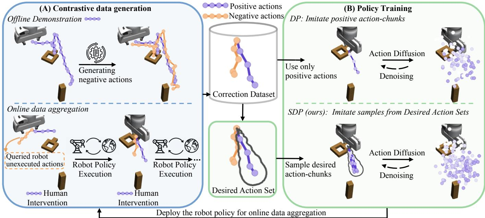  
Fig. 1: Framework of our Set-Supervised Diffusion Policy (SDP) method. A: Contrastive data, consisting of positive-negative action-chunk pairs, can be generated for both offline demonstrations and online interventions. B: SDP uses this contrastive data to construct desired action sets, which serve as set-valued action targets for policy learning. The diffusion policy is trained to generate action-chunks within these sets.

Abstract—Diffusion policies have recently emerged as a powerful framework for robotic manipulation. However, like other behavior cloning methods, they remain vulnerable to distributional shift, often requiring human-in-the-loop interventions to correct failures during deployment. These interactions naturally provide paired supervision in the form of the robot’s undesired actions and the human teacher’s corrective actions. Yet existing data aggregation pipelines and standard behavior cloning losses largely ignore this negative signal from undesired actions, leading to overfitting to teacher’s actions and an increasing reliance on costly expert data. To address this limitation, we propose Set-Supervised Diffusion Policy (SDP), a novel learning framework that utilizes contrastive action-chunk data to train diffusion policies from human corrections. From paired positive and negative action-chunks, SDP constructs a set of desired action-chunks and designs a training pipeline that encourages the diffusion policy to align with the set. Through extensive experiments across multiple robotic manipulation tasks, we demonstrate that SDP consistently improves policy performance, with particularly strong gains in robustness to noisy data. Moreover, SDP induces high-quality aggregated datasets, enabling more efficient and reliable policy learning from human-in-the-loop corrections. Our code is available at https://set-supervised-diffusion-policy.github.io/.

## I. INTRODUCTION

Imitation Learning (IL) has established itself as a cornerstone paradigm for robotic manipulation, enabling agents to acquire complex skills directly from expert demonstrations. Within this landscape, Diffusion Policies (DP) have emerged as a powerful policy representation, leveraging the generative diffusion models to operate robustly in high-dimensional continuous action-chunk spaces [8, 27, 4]. Despite these strengths, DPs remain vulnerable to distributional shift inherent in Behavior Cloning (BC), where the state distribution induced by the policy drifts away from the training data [18, 29]. A widely adopted mitigation strategy is human-in-the-loop intervention, where a human teacher temporarily takes control to correct robot’s mistakes [17, 35]. However, current BC approaches fail to fully exploit this correction information.

While these corrections generate a rich stream of data containing both the robot’s undesired actions and the teacher’s intervention actions, standard BC objectives only maximize the likelihood of the teacher’s actions, but ignore information from the robot’s undesired actions. Consequently, existing data aggregation methods record only the teacher’s actions [17, 29, 18], biasing learning toward the teacher’s distribution [15]. This bias can cause policies to overfit and over-rely on costly high-quality interventions [19].

Prior work has sought to address this limitation through methods that learn from preferences or corrections. However, approaches such as Direct Preference Optimization (DPO) struggle with high-dimensional action-chunk spaces and require a strong pre-trained policy [6, 25]. Beyond preferencebased learning, CLIC [19] proposes set-valued supervision for corrective feedback, where a positive-negative correction pair defines a set of acceptable actions rather than a single action target. This relaxation helps mitigate BC’s tendency to overfit to imperfect corrections. Yet, CLIC employs Energy-Based Models (EBMs) as the policy representation [33], which are difficult to train stably and integrate with action-chunking—one of the key mechanisms underpinning the strong empirical performance of DPs [8].

In this work, we introduce Set-Supervised Diffusion Policy (SDP), a framework that trains diffusion policies with setvalued action targets constructed from both the teacher’s corrective actions and the robot’s undesired actions. To achieve this, we embed the insights from the set-valued supervision of CLIC into diffusion policies and propose a set of desired action-chunks from a single pair of contrastive action-chunk data. Intuitively, this desired action set provides information about alternative action-chunks that could be equally desirable as the human action. However, directly applying the CLIC loss to train diffusion policies with the desired set is non-trivial, as the loss relies on explicit probability estimation available in EBMs but absent in diffusion models. To address this, we generalize the CLIC loss by sampling desired action-chunks from the desired set and maximizing the likelihood of these samples. Extensive experiments show that SDP consistently learns stronger policies in both online and offline settings, while also producing higher-quality training data during online data aggregation. Together, these results demonstrate that contrastive supervision is a powerful yet largely underutilized signal for robot policy learning.

## II. RELATED WORK

Diffusion Policies: Diffusion Policies (DP) have become a leading approach for visuomotor imitation learning thanks to their ability to generate expressive, multi-modal actions [8, 27]. Prior work has extended DP with 3D scene representations [43], SE(3)-equivariant architectures [42], hierarchical formulations [37], and flow-matching objectives to improve inference efficiency [41, 28]. Generalist vision-language-action (VLA) policies similarly adopt diffusion or flow-based action heads for their expressivity [12, 4, 31]. Across these works, diffusion or flow models are trained using the BC objective.

In contrast, our method departs from the BC paradigm and trains DPs using a set of desired action-chunks. This idea builds on the set-valued supervision introduced by CLIC, which trains policies to imitate a set of desired actions inferred from human corrections [19]. Similarly, counterfactual BC proposes a set of actions that the expert could have intended [30]. However, these approaches consider single-step actions and cannot be applied directly to action-chunks. We address this gap by extending desired-action-set supervision to the space of action-chunks, and designing novel training pipelines to train DP with set-valued supervision.

Human Intervention and Data Aggregation: Covariate shift is a central challenge in IL, and data aggregation is a wellestablished strategy to mitigate it [5, 24, 29]. DAgger addresses this issue by iteratively querying an expert to aggregate demonstrations along the learner’s state distribution [29]. Variants have refined how interventions are triggered and incorporated: HG-DAgger emphasizes human-gated interventions [17, 20, 10], while other work views interventions as implicit corrective signals [35]. Other approaches focus data collection on informative states, such as bottleneck states in long-horizon manipulation tasks [2]. Recent work has further integrated DP with intervention-based data aggregation [16, 18, 15, 40].

Unlike DAgger-style approaches that rely on BC losses and ignore negative actions, our approach aggregates correction data as paired positive-negative actions and optimizes the policy with set-valued supervision. By relaxing pointwise imitation, this supervision encourages exploration within a desired action set, yielding broader state coverage during online learning.

Finetuning with newly aggregated data: Finetuning is widely used to adapt pretrained policies to new tasks, domains, or user preferences. Supervised finetuning with additional demonstrations is common in VLA models [4, 31, 12], but inherits BC’s sensitivity to label noise and distribution shift. Finetuning with human preference data has also gained traction [7, 34, 38], though binary preferences can be sparser than action-level feedback. Another line of work uses reinforcement learning (RL) [44, 26]. Human-in-the-loop RL has been shown to improve dexterous manipulation beyond imitation performance [22]. Residual RL methods finetune only a corrective residual on top of a BC policy [3]. Low-quality data can also be utilized within an RL-based pipeline [1].

Different from these approaches, our SDP loss inherits the benefits of set-valued supervision and mitigates the overfitting issue in supervised finetuning. By optimizing the policy over a desired action set, SDP also shares a core advantage of RL fine-tuning: it enables policy improvements beyond the quality of the training data, rather than simply imitating it.

## III. PRELIMINARIES

## A. Diffusion Policy and Action Chunks

Denoising Diffusion Probabilistic Models (DDPMs) [32, 14, 33] generate samples by progressively transforming Gaussian noise into a data distribution through a learned denoising process. Diffusion Policy (DP) [8] adapts the DDPM formulation to imitation learning by modeling distributions over action chunks—sequences of single-step actions a $\in { \mathcal { A } }$ conditioned on observations O. The policy $\pi _ { \boldsymbol { \theta } } ( \mathbf { A } _ { t } | \mathbf { O } _ { t } )$ generates an actionchunk of fixed horizon $T$

$$
\mathbf {A} _ {t} = \left[ \mathbf {a} _ {t}, \mathbf {a} _ {t + 1}, \dots , \mathbf {a} _ {t + T - 1} \right] \in \mathcal {A} ^ {T},\tag{1}
$$

allowing the policy to resolve multimodal behavior and reduce the covariate shift issue common in robotics tasks.

During inference, DP generates clean actions ${ \bf A } _ { t } ^ { 0 }$ by following the reverse diffusion process of DDPM, conditioned on the current observation $\mathbf { O } _ { t }$ . Starting from a Gaussian prior $\mathbf { A } _ { t } ^ { K } \sim \mathcal { N } ( 0 , I )$ , the action is iteratively denoised according to

$$
\mathbf {A} _ {t} ^ {k - 1} = \alpha_ {k} \left(\mathbf {A} _ {t} ^ {k} - \gamma_ {k} \epsilon_ {\theta} (\mathbf {O} _ {t}, \mathbf {A} _ {t} ^ {k}, k)\right) + \sigma_ {k} \mathcal {N} (0, I),\tag{2}
$$

for $k = K , \ldots , 0$ . Here, $\epsilon _ { \theta }$ denotes a neural network that predicts the injected noise at step k. The coefficients $\alpha _ { k } , \gamma _ { k }$ and $\sigma _ { k }$ are determined by a predefined noise scheduler. After $K$ denoising steps, the procedure yields the clean action ${ \bf A } _ { t } ^ { 0 }$

Training of $\epsilon _ { \theta }$ proceeds by sampling clean action data $\mathbf { A } _ { t } ^ { 0 } : = \mathbf { A } _ { t }$ <sub>t</sub> and the observation $\mathbf { O } _ { t }$ from the dataset, selecting a random denoising step $k ,$ and corrupting the sample using a forward diffusion process:

$$
\mathbf {A} _ {t} ^ {k} = \sqrt {\bar {\alpha} _ {k}} \mathbf {A} _ {t} ^ {0} + \sqrt {1 - \bar {\alpha} _ {k}} \boldsymbol {\epsilon} ^ {k},\tag{3}
$$

where $\bar { \alpha } _ { k }$ accumulates the noise schedule and $\epsilon ^ { k } \sim \mathcal { N } ( 0 , I )$ The training objective is

$$
\ell_ {t} ^ {\mathrm{DP}} = \mathbb {E} _ {k \sim [ 1, K ], \mathbf {O} _ {t}, \mathbf {A} _ {t} ^ {0}, \epsilon^ {k}} \left[ \| \boldsymbol {\epsilon} ^ {k} - \epsilon_ {\theta} (\mathbf {O} _ {t}, \mathbf {A} _ {t} ^ {k}, k) \| ^ {2} \right].\tag{4}
$$

which encourages accurate reconstruction from the corrupted noise. Minimizing this objective maximizes a variational lower bound on the data log-likelihood.

## B. Set-valued Supervision from Interactive Corrections

CLIC [19] introduced a set-valued supervision framework for learning from interactive corrections. Given a state ${ \mathbf { s } } ,$ the correction data consists of a positive action $\mathbf { a } ^ { + }$ and a negative action $\mathbf { a } ^ { - }$ . Negative actions are generated by the suboptimal robot’s policy, while positive actions are actions provided by human teachers as feedback signals to improve the robot’s policy. Rather than treating $\mathbf { a } ^ { + }$ as the only valid target, this formulation constructs a desired action set that includes actions consistent with the correction.

1) Single-Step Desired Action Set: Given s and an action pair $( \mathbf { a } ^ { - } , \mathbf { a } ^ { + } )$ , CLIC constructs a single-step desired action set $\hat { \mathcal { A } } ^ { \mathrm { s s } } ( { \mathbf { a } } ^ { - } , { \mathbf { a } } ^ { + } ) \subseteq \mathcal { A }$ , which contains actions that are consistent with the correction data. This set provides guidance on how to improve the policy by ruling out actions outside it. BC can be treated as a special case of CLIC with $\hat { \mathcal { A } } ^ { \mathrm { s s } } ( { \bf a } ^ { - } , { \bf a } ^ { + } ) = \{ { \bf a } ^ { + } \}$ However, $\mathbf { B } \mathbf { C }$ assumes that $\mathbf { a } ^ { + }$ is a perfect training target, and this assumption can be brittle when corrections are noisy or when multiple nearby action-chunks are acceptable. In contrast, CLIC allows the desired action set to include imperfect actions, assuming only that a subregion of the set contains good actions. This weaker supervisory target helps reduce overfitting to individual imperfect action labels.

For $\mathbf { a } ^ { + }$ being intervention data, also referred to as an absolute correction, $\hat { \mathcal { A } } ^ { \mathrm { s s } } ( { \bf a } ^ { - } , { \bf a } ^ { + } )$ can be defined as a ball centered at $\mathbf { a } ^ { + }$ :

$$
\hat {\mathcal {A}} ^ {\mathrm{ss}} \left(\mathbf {a} ^ {-}, \mathbf {a} ^ {+}\right) = \left\{\mathbf {a} \in \mathcal {A} \mid r \cdot \mathbb {D} \left(\mathbf {a} ^ {+}, \mathbf {a} ^ {-}\right) \geq \mathbb {D} \left(\mathbf {a}, \mathbf {a} ^ {+}\right) \right\},\tag{5}
$$

where $\mathrm { { \mathbb { D } } ( a _ { 1 } , a _ { 2 } ) = \| a _ { 1 } - a _ { 2 } \| }$ , and $r \in \ [ 0 , 1 ]$ is a radiusratio hyperparameter controlling the volume of the ball. Thus, the negative action $\mathbf { a } ^ { - }$ determines the scale of the desired set through its distance to the positive action $\mathbf { a } ^ { + }$

2) Policy shaping via desired action sets: The desired action set can be utilized to guide the policy improvement. The policy can be trained by increasing the probability of selecting actions within the set $\hat { \mathcal { A } } ^ { s s } ( \mathbf { a } ^ { - } , \mathbf { a } ^ { + } )$ , denoted as

$$
\max _ {\theta} \pi_ {\theta} (\mathbf {a} \in \hat {\mathcal {A}} ^ {\mathrm{ss}} (\mathbf {a} ^ {-}, \mathbf {a} ^ {+}) | \mathbf {s})\tag{6}
$$

This objective can be achieved by minimizing the KL loss:

$$
\ell_ {K L} (\theta) = \underset {(\mathbf {s}, \mathbf {a} ^ {-}, \mathbf {a} ^ {+}) \sim p _ {\mathcal {D}}} {\mathbb {E}} \left[ \mathrm{KL} \left(\pi^ {\text { target }} (\mathbf {a} | \mathbf {s}) \| \pi_ {\theta} (\mathbf {a} | \mathbf {s})\right) \right],\tag{7}
$$

where $\pi ^ { \mathrm { t a r g e t } } ( \mathbf { a } | \mathbf { s } )$ is calculated by Bayes’ rules to assign a higher probability to actions within $\hat { \mathcal { A } } ^ { \mathrm { s s } } ( { \bf a } ^ { - } , { \bf a } ^ { + } )$

3) Refining Supervision Targets via Correction Aggregation: A single desired action set provides a weaker supervisory target than BC: it may contain suboptimal actions and is not assumed to exactly identify the true optimum. CLIC mitigates this ambiguity by aggregating corrections collected during interaction. For each state, different corrections rule out different regions of the action space that are inconsistent with the teacher’s feedback. As corrections accumulate, the remaining region consistent with the feedback is progressively refined, yielding a more informative supervision signal.

## IV. METHOD

In this section, we detail Set-Supervised Diffusion Policy (SDP), which trains a diffusion policy with set-valued supervision from human corrections. Instead of using BC loss to imitate individual action labels, SDP adapts the single-step desired action set formulation introduced in Sec. III-B1. To achieve this, we first extend this single-step desired action set to action-chunks in Sec. IV-B. Building on this desired action set for action-chunks, in Sec. IV-C, we then derive a training objective that encourages the diffusion policy to generate action-chunks within this set. Finally, we detail the practical implementation and present the SDP algorithm in Sec. IV-D.

## A. Problem Formulation

We consider the problem of policy learning from corrections, where a robot learns to perform complex tasks from human interventions. We assume access to a correction dataset ${ \mathcal D } _ { + - } ~ = ~ \{ [ { \bf O } , { \bf A } ^ { - } , { \bf A } ^ { + } ] \}$ , where ${ \bf A } ^ { - }$ and $\mathbf { A } ^ { + }$ are paired negative and positive action-chunks. Our goal is to leverage $\mathcal { D } _ { + - }$ to define a set of desired action-chunks for each observation and to use this information to improve a parameterized policy $\pi _ { \boldsymbol { \theta } } ( \mathbf { A } | \mathbf { O } )$ . We consider two learning settings: (i) Online interactive imitation learning, where corrective feedback is collected during policy execution and aggregated into $\mathcal { D } _ { + - } ;$ (ii) Offline learning, where the policy is trained from a fixed dataset $\mathcal { D } _ { + - }$ , obtained either from online human interventions or constructed by augmenting offline demonstration datasets.

## B. Extending Desired Action Set to Action-Chunks

CLIC [19] shows that imitating a set of desired actions, constructed by a pair of positive and negative actions, achieves more robust behavior than imitating only the positive action. Building on this idea, we generalize the single-step desired action set to action-chunks. At step t, under observation $\mathbf { O } _ { t }$ we denote a positive and negative action-chunk as

$$
\begin{array}{r} \mathbf {A} _ {t} ^ {+} := [ \mathbf {a} _ {t} ^ {+}, \mathbf {a} _ {t + 1} ^ {+}, \ldots , \mathbf {a} _ {t + T - 1} ^ {+} ], \\ \mathbf {A} _ {t} ^ {-} := [ \mathbf {a} _ {t} ^ {-}, \mathbf {a} _ {t + 1} ^ {-}, \ldots , \mathbf {a} _ {t + T - 1} ^ {-} ]. \end{array}
$$

Given $\mathbf { O } _ { t }$ and the preceding positive actions $\mathbf { a } _ { t } ^ { + } , \ldots , \mathbf { a } _ { t + i - 1 } ^ { + } ,$ the action $\mathbf { a } _ { t + i } ^ { + }$ is better than $\mathbf { a } _ { t + i } ^ { - }$ for all $i \in [ 1 , T - 1 ]$ . As we consider demonstration data or intervention feedback, to make learning efficient, we adopt the approximation that $\mathbf { a } _ { t + i } ^ { + }$ being a better action than $\mathbf { a } _ { t + i } ^ { - }$ depends only on $\mathbf { O } _ { t } .$ . Under this approximation, each timestep within the action-chunk yields a contrastive single-step action pair $( \mathbf { a } _ { t + i } ^ { - } , \mathbf { a } _ { t + i } ^ { + } )$ . Each such pair defines a single-step desired action set in CLIC:

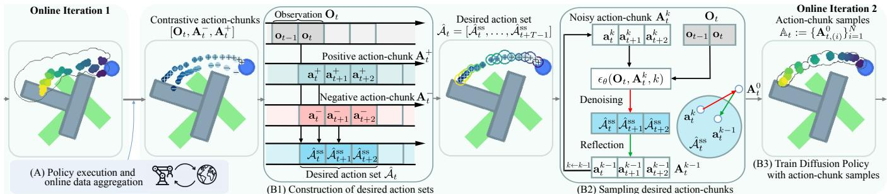  
Fig. 2: SDP Overview, illustrated on the Push-T task [8], where the blue end-effector pushes the gray T-object toward the green goal pose. (A) The policy interacts with the environment to collect new intervention data, progressively shrinking desired action sets. This refined supervision region is also illustrated in Fig. 3 (c). (B1) Given an observation, one contrastive action-chunk pair defines a desired action set. (B2) Desired action-chunks are sampled from this set via a denoising process with reflections, producing samples that remain inside the set while staying close to the current policy distribution. (B3) The diffusion policy is trained to imitate sampled action-chunks.

$$
\hat {\mathcal {A}} _ {t + i} ^ {\mathrm{ss}} := \hat {\mathcal {A}} ^ {\mathrm{ss}} (\mathbf {a} _ {t + i} ^ {-}, \mathbf {a} _ {t + i} ^ {+}) \subseteq \mathcal {A}.\tag{8}
$$

We then define the desired action set associated with the contrastive action-chunk pair $( \mathbf { A } _ { t } ^ { + } , \mathbf { A } _ { t } ^ { - } )$ as the sequence of single-step desired action sets

$$
\hat {\mathcal {A}} _ {t} := [ \hat {\mathcal {A}} _ {t} ^ {\mathrm{ss}}, \hat {\mathcal {A}} _ {t + 1} ^ {\mathrm{ss}}, \dots , \hat {\mathcal {A}} _ {t + T - 1} ^ {\mathrm{ss}} ].\tag{9}
$$

Visualization of this set is shown in Fig. 3 (a)(b) and Fig. 2 (B1). We say an action-chunk, $\mathbf { A } _ { t } ~ = ~ [ \hat { \mathbf { a } } _ { t } , \dots , \hat { \mathbf { a } } _ { t + T - 1 } ]$ belongs to this set $\hat { \mathcal { A } } _ { t } \mathrm { ~ i f ~ } \forall i \in [ 0 , T - 1 ] , \hat { \mathbf { a } } _ { t + i } \in \hat { \mathcal { A } } _ { t + i } ^ { \mathrm { s s } } .$ Actionchunks outside of this set $\hat { A } _ { t }$ are considered undesired. The information provided by this set can be used to train a policy, and we detail this in the following section.

## C. Policy Learning via Desired Action Sets

Here, we outline the methods for training a diffusion policy using desired action sets. First, we extend set-valued supervision from single-step actions to action-chunks in Sec. IV-C1. Second, to make this loss compatible with diffusion models, in Sec. IV-C2, we detail how this loss is approximated by maximizing the likelihood of a list of desired action-chunk samples. Finally, Sec. IV-C3 details the methods to generate these action-chunk samples.

1) Set-valued Supervision for Action-Chunks: Given $[ \mathbf { O } _ { t } , \mathbf { A } _ { t } ^ { - } , \mathbf { A } _ { t } ^ { + } ]$ , our goal is to train a policy that generates action-chunks belonging to the desired action set $\hat { \mathcal { A } } _ { t }$ , defined by ${ \mathbf A } _ { t } ^ { - }$ and ${ \bf A } _ { t } ^ { + }$ . Extending CLIC’s set-valued supervision to action-chunks, this objective can be written as maximizing the probability that the policy samples from the desired set:

$$
\max _ {\theta} \pi_ {\theta} (\mathbf {A} \in \hat {\mathcal {A}} _ {t} | \mathbf {O} _ {t})\tag{10}
$$

To optimize this objective, following CLIC, we adopt a policy improvement perspective by defining a target policy that assigns a higher probability to action-chunks consistent with the desired action set. Specifically, we define a likelihood model that indicates whether an action-chunk A belongs to the desired action set

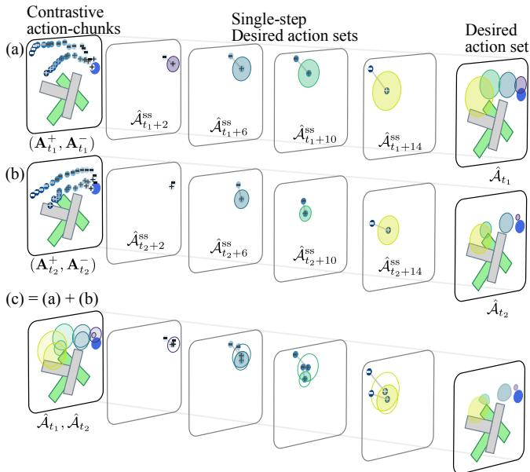  
Fig. 3: (a)(b): Visualization of the desired action set. (c): Combination of the desired action sets shown in (a) and (b). New corrections at a state can progressively refine the effective supervision region and reduce the influence of suboptimal actions from earlier desired action sets, such as $\hat { \mathcal { A } } _ { t 1 }$

$$
p (\mathbf {A} \in \hat {\mathcal {A}} _ {t} | \mathbf {O} _ {t}, \mathbf {A}) = \left\{ \begin{array}{l l} 1, & \mathbf {A} \in \hat {\mathcal {A}} _ {t}, \\ 0, & \text { otherwise }. \end{array} \right.
$$

Using this likelihood model to reweight the current policy yields the following target distribution:

$$
\pi^ {\text { target }} (\cdot | \mathbf {O} _ {t}) \propto p (\mathbf {A} \in \hat {\mathcal {A}} _ {t} | \mathbf {O} _ {t}, \mathbf {A}) \pi_ {\boldsymbol {\theta}} (\mathbf {A} | \mathbf {O} _ {t}),\tag{11}
$$

Intuitively, $\pi ^ { \mathrm { t a r g e t } }$ redistributes probability mass toward actionchunks consistent with the corrective feedback, while remaining close to the current policy. As in CLIC, optimizing Eq. (10) can be achieved by minimizing the KL divergence between the target policy and the current policy

$$
\ell = \mathbb {E} _ {(\mathbf {A} ^ {+}, \mathbf {A} ^ {-}, \mathbf {O} _ {t}) \sim p _ {\mathcal {D}}} \left[ \mathrm{KL} \big (\pi^ {\mathrm{target}} (\mathbf {A} | \mathbf {O} _ {t}) \big \| \pi_ {\boldsymbol {\theta}} (\mathbf {A} | \mathbf {O} _ {t}) \big) \right]
$$

This KL loss can be calculated for EBM-based or Gaussianbased policies in prior CLIC formulations. However, evaluating this loss requires access to the likelihood of an actionchunk under the policy, which is not directly available for diffusion models. We therefore introduce an approximation that enables optimizing this objective using diffusion models.

2) Approximating CLIC loss: The KL loss can be transformed into maximizing the likelihood of action-chunks sampled from the target policy:

$$
\ell = - \mathbb {E} _ {\mathbf {A} \sim \pi^ {\text { target }} (\cdot | \mathbf {O} _ {t})} \left[ \log \pi_ {\boldsymbol {\theta}} (\mathbf {A} | \mathbf {O} _ {t}) \right].
$$

We approximate the expectation with N samples

$$
\mathbb {A} _ {t} := \{\mathbf {A} _ {t, (i)} \} _ {i = 1} ^ {N}, \mathbf {A} _ {t, (i)} \sim \pi^ {\mathrm{target}} (\cdot | \mathbf {O} _ {t})\tag{12}
$$

For the diffusion model, the maximum-likelihood objective reduces to the standard denoising loss [32, 14]:

$$
\ell_{t} = \mathbb{E}_{\substack{k\sim [1,K],\mathbf{O}_{t}\\ \mathbf{A}^{0}\sim \mathbb{A}_{t},\boldsymbol{\epsilon}_{k}}}\Big[\| \boldsymbol{\epsilon}_{k} - \boldsymbol{\epsilon}_{\theta}(\mathbf{O}_{t},\sqrt{\bar{\alpha}_{k}}\mathbf{A}^{0} + \sqrt{1 - \bar{\alpha}_{k}}\boldsymbol{\epsilon}_{k},k)\|^{2}\Big]\tag{13}
$$

This loss is the same as the BC loss of the original DP (Eq. (4)), differing only in where the action labels come from. The DP loss uses ${ \bf A } _ { t } ^ { + }$ , whereas our SDP loss uses action-chunks sampled from $\pi ^ { \mathrm { t a r g e t } }$ . Next, we describe how to generate these samples.

3) Sampling Desired Action-Chunks: Uniformly sampling from the desired action set does not necessarily produce samples from the target distribution $\pi ^ { \mathrm { t a r g e t } }$ . Although the set includes actions consistent with the correction signal, some in-set actions can still be suboptimal, and training on them may mislead the policy. To sample action-chunks from the target distribution, we therefore adopt a constrained diffusion sampling procedure inspired by reflected diffusion methods [21, 39]. Concretely, we modify the standard denoising update (Eq. (2)) with a boundary constraint term:

```txt
Algorithm 1: SDP: Set-Supervised Diffusion Policy

1 Notations
    \(\mathcal{D}_{+-}\) : Dataset of contrastive action-chunk pairs [O, A\(^{-}\), A\(^{+}\)]
    \(\mathcal{D}_{\text{traj}}\) : \(\{[\mathbf{o}_t, \mathbf{a}_t^r, \mathbf{a}_t^h]\}\) (corrections) or \(\{[\mathbf{o}_t, \mathbf{a}_t^h]\}\) (demos)
    \(\pi_\theta\) : Robot policy represented via a diffusion model \(\epsilon_\theta\)
    \(T\) : Action-chunk length (environment execution horizon)
    \(T_r\) : Queried action-chunk length during intervention
    \(K\) : Total diffusion steps
    \(K_A\) : Start denoising step for sampling desired action-chunks
    \(\hat{\mathcal{A}}_i\) : Desired action set constructed from (A\(_i^+\), A\(_i^-\))
    \(b\) : In-episode update frequency
    \(N_{\text{training}}\) : End-of-episode training steps
    \(N\) : Number of desired action-chunk samples

2 ▷ SDP Policy Update (Fig. 2 (B1, B2))
3 Function PolicyShaping (\(\mathcal{D}_{+-}\), θ):
4 Sample batch \(\mathcal{B}\) from \(\mathcal{D}_{+-}\)
5 foreach [O, A\(^-\), A\(^+\)]\(_i\) ∈ \(\mathcal{B}\) in parallel do
6 Create desired action set \(\hat{\mathcal{A}}\) from A\(^+\), A\(^-\) via Eq. (9)
7 Initialize N samples A\(^{K_A}\) (e.g., \(\mathcal{N}(\mathbf{0}, \mathbf{I})\) or A\(^+\))
8 for \(k = K_A, \ldots, 0\) do // Obtain samples A\(^0\)
9 \(\mathbf{A}^{k-1} = \alpha(\mathbf{A}^k - \gamma \epsilon_\theta(\mathbf{O}, \mathbf{A}^k, k) + \mathcal{N}(0, \sigma^2 I))\)
10 \(\mathbf{A}^{k-1} = \mathbf{L}_{\hat{\mathcal{A}}}(\mathbf{A}^{k-1})\) (Eq. (14))
11 \(k \sim \text{Uniform}(0, \ldots, K)\), \(\epsilon_k \sim \mathcal{N}(\mathbf{0}, \mathbf{I})\)
12 Take gradient descent step on // Imitate A\(^0\)
13 \(\nabla_\theta\) \([\|\epsilon_k - \epsilon_\theta(\mathbf{O}, \sqrt{\bar{\alpha}_k}\mathbf{A}^0 + \sqrt{1 - \bar{\alpha}_k}\epsilon_k, k)\|^2]\)
14 return θ

15 ▷ Interactive Imitation Learning Loop (Fig. 1A and 2)
16 for online episode = 1, 2, ... do
17 for \(t = 1, 2, \ldots\) do
18 Observe o\(_t\); receive a\(_t^h\) if given or set a\(_t^h\) ← None
19 if Human intervention a\(_t^h\) is None then
20 Obtain A\(_i\) = A\(_t\) ~ π\(_θ\) (·|O\(_t\)) if no A\(_i\), i ∈ (t - T, t]
21 Execute a\(_t^r\) = A\(_i[t-i]\)
22 else // Teacher intervenes; Query robot policy
23 Obtain A\(_i\) = A\(_t\) ~ π\(_θ\) (·|O\(_t\)) if no A\(_i\), i ∈ (t - T_r, t]
24 Execute a\(_t^h\) ; obtain (unexecuted) a\(_t^r\) = A\(_i[t-i]\)
25 Append [o\(_t\), a\(_t^r\), a\(_t^h]\) to D\(_{\text{traj}}\)
26 if None not in [a\(_{t-T}^h,\ldots,\mathbf{a}_{t-1}^h]\ then
27 Get [O\(_{t-T}\), A\(_{t-T}^-\), A\(_{t-T}^+\)] from D\(_{\text{traj}}\), append to D\(_{+-}\)
28 if t%b = 0 or a\(_t^h\) is provided then
29 θ ← PolicyShaping (\(\mathcal{D}_{+-}\), θ)
30 Update policy πθ as in line 29 for N\(_{\text{training}}\) steps

31 ▷ Offline Learning Loop (Fig. 1A and 2B)
32 if D\(_{\text{traj}}\) is Demonstration dataset then
33 foreach [o\(_t\), a\(_t^h]\) ∈ D\(_{\text{traj}}\) do
34 Sample a\(_t^r\) s.t. \|a\(_t^r\) - a\(_t^h\) \| = 1; append a\(_t^r\) to [o\(_t\), a\(_t^h]\)
35 Extract D\(_{+-}\) from D\(_{\text{traj}}\) as in lines 26–27
36 for training episode = 1, 2, ... do
37 Update policy πθ as in line 29 for N\(_{\text{training}}\) steps
```

$$
\mathbf {A} _ {t} ^ {k - 1} = \mathbf {L} _ {\hat {\mathcal {A}} _ {t}} \left(\alpha \left(\mathbf {A} _ {t} ^ {k} - \gamma \boldsymbol {\epsilon} _ {\theta} \left(\mathbf {O} _ {t}, \mathbf {A} _ {t} ^ {k}, k\right)\right) + \sigma \cdot \mathcal {N} (0, I)\right),
$$

where $\mathbf { L } _ { \hat { \mathcal { A } } _ { t } }$ enforces that the intermediate samples remain within the desired set $\hat { \mathcal { A } } _ { t }$ during denoising. Fig. 2 (B2) visualizes this constrained sampling process. Leveraging the structure of the set defined in Eq. (9), the operator decomposes across individual time steps: $\mathbf { L } _ { \hat { \mathcal { A } } _ { t } } ( \mathbf { A } _ { t } ^ { k } ) \ =$ $[ \mathbf { L } _ { \hat { \mathcal { A } } _ { t } ^ { \mathrm { s s } } } ( \mathbf { a } _ { t } ^ { k } ) , \ldots , \mathbf { L } _ { \hat { \mathcal { A } } _ { t + T - 1 } ^ { \mathrm { s s } } } ( \mathbf { a } _ { t + T - 1 } ^ { k } ) ]$ , where each $\mathbf { L } _ { \hat { \mathcal { A } } _ { t + i } ^ { \mathrm { s s } } }$ operates on a single-step action:

$$
\mathbf {L} _ {\hat {\mathcal {A}} _ {t + i} ^ {\mathrm{ss}}} (\mathbf {a} _ {t + i} ^ {k}) = \left\{ \begin{array}{l l} \mathbf {a} _ {t + i} ^ {+}, & \mathbf {a} _ {t + i} ^ {k} \notin \hat {\mathcal {A}} _ {t + i} ^ {\mathrm{ss}}, \\ \mathbf {a} _ {t + i} ^ {k}, & \text {otherwise}. \end{array} \right.\tag{14}
$$

In reflected diffusion, L reflects samples in the normal direction whenever they cross the set boundary [21]. In our setting, $\hat { \mathcal { A } } _ { t + i } ^ { \mathrm { s s } }$ can be small, and we find that repeated normal reflections cause oscillations and increase sampling cost. Instead, we adopt a simplified projection strategy that directly maps actions outside $\hat { \mathcal { A } } _ { t + i } ^ { \mathrm { s s } }$ to $\mathbf { a } _ { t + i } ^ { + }$ . We empirically validate this design choice in Sec. V-C.

## D. Algorithm

Algorithm 1 provides the complete procedure for SDP, including the policy update, the online interactive imitation learning (IIL) loop, and offline training.

1) SDP policy update: Lines 2–14 shows the SDP policy update. For each contrastive action-chunk data $[ \mathbf { O } , \mathbf { A } ^ { - } , \mathbf { A } ^ { + } ]$ in a batch, we first construct a desired action set A<sup>ˆ</sup> using Eq. (9) (line 6). We then sample desired action-chunks by running a truncated denoising process from step $K _ { A }$ to 0 (lines 7–10). To reduce the computational cost, we start denoising from an intermediate step $K _ { A }$ rather than from the full horizon $K$ This process is coupled with the reflection operator $\mathbf { L } _ { \hat { \mathcal { A } } } ( \cdot )$ applied after every denoising step. This operator enforces per-timestep membership by reverting out-of-set actions to the corresponding positive action. In our implementation, we initialize $\mathbf { A } ^ { K _ { A } }$ either from $\mathcal { N } ( \mathbf { 0 } , \mathbf { I } )$ or using ${ \mathbf { A } } ^ { + }$ ; we found performance to be insensitive to this choice because of the reflection operations. The diffusion model is then trained to imitate these sampled chunks ${ \bf A } ^ { 0 }$ (lines 11–13).

2) Online learning: Lines 15–30 describe the online IIL loop. The robot takes actions from an action-chunk sampled from $\pi _ { \pmb { \theta } } .$ , sampling a new length-T chunk once the previously sampled chunk has been executed (lines 19–21). The teacher intervenes when undesired robot behavior is detected. During intervention, the human teacher’s action $\mathbf { a } _ { t } ^ { h }$ is executed, and we additionally query the robot policy to record the corresponding robot action $\mathbf { a } _ { t } ^ { r }$ (lines 23–24). We use a shorter horizon $T _ { r } \leq T$ during interventions to obtain more accurate robot actions. Data from each step is saved to $\mathcal { D } _ { \mathrm { t r a j } }$ . Using a length-T sliding window, once teacher actions are available for all $T$ steps, we obtain contrastive action-chunks by pairing teacher actions as positives and the corresponding robot actions as negatives, and save $[ { \bf O } , { \bf A } ^ { - } , { \bf A } ^ { + } ]$ to $\mathcal { D } _ { + - }$ (lines 26–27). In practice, we instruct the teacher to continue intervening for at least T consecutive steps once an intervention starts, ensuring that contrastive action-chunks can be extracted.

For a given state, desired action sets constructed from feedback at different time steps can be combined, as illustrated in Fig. 3(c). This combination refines the effective supervision region and therefore facilitates policy convergence, particularly in cases where the positive actions are noisy or suboptimal [19]. In practice, SDP does not explicitly combine desired action sets; rather, this refinement is approximated implicitly through policy updates from multiple corrections, and we assume that the generalization capabilities of DNNs enable this combination across similar states. Within the IIL loop, policy improvement leads to smaller desired action sets for newly collected data pairs, compared to earlier ones at the same state (Fig. 2).

3) Offline learning: Lines 31-37 describe offline training from demonstrations or corrections. For the demonstration dataset, each state-action pair is converted into a correction data tuple in lines 32-34. Specifically, an auxiliary negative action is sampled for each $\mathbf { a } ^ { h }$ such that the resulting set $\hat { \mathcal { A } } ^ { \mathrm { s s } }$ has radius r (Eq. (5)). Lines 35-37 extracts the correction dataset using the same procedure as in online learning, and the policy is trained on this dataset using the SDP policy update.

## V. EXPERIMENTS

We demonstrate the effectiveness of SDP through a series of simulations and real-world experiments. In Sec. V-A, we compare SDP with state-of-the-art methods within the online IIL framework. In Sec. V-B, we assess the quality of datasets collected by SDP and demonstrate that SDP can be trained effectively from offline datasets. In Sec. V-C, ablation studies are carried out to study the effectiveness of the key components of SDP. In Sec. V-D, we showcase the effectiveness of SDP in real-world experiments. Detailed experimental settings are provided in the Appendix.

Baselines: We compare our method against DP [8], DP-DPO [36], Ambient DP (ADP) [9], CLIC [19], and Implicit Behavior Cloning (IBC) [11]. Our SDP shares the same diffusion policy structure as DP, DP-DPO, and ADP, differing only in the loss function. DP is trained with a standard BC loss; DP-DPO adds additional direct preference optimization loss to DP; ADP extends DP to recover clean action distributions from highly-corrupted action data. CLIC and IBC use EBMs as policy representation and output single-step actions.

Tasks: We compared these methods across four simulated tasks, including a Push-T task [8] and three manipulation tasks from the robosuite benchmark [45] (see Appendix for task details). The observation includes images and the robot’s proprioceptive states. For interactive learning experiments, all the agents use absolute positions as actions. Both accurate and Gaussian-noise-corrupted intervention data are considered. Gaussian noise is added to the intervention actions to evaluate the robustness of each method to noisy action data. For offline learning, we evaluate both position and velocity controllers with action-chunk horizons $T = 1$ and $T = 1 6$

Dataset sources: In online learning experiments, the data $\mathcal { D } _ { \mathrm { t r a j } }$ are collected during the online interactions, following lines 15-30 in Algorithm 1. The agents learn from a simulated teacher to ensure repeatability. In offline learning, we consider three dataset types: (1) the dataset accumulated during the interactive learning of the SDP agent; (2) the dataset collected by DP under the same online framework; (3) the Robomimic dataset [23]. For both velocity and position control, SDP and DP datasets are collected with chunk length $T ~ = ~ 1 6$ and subsampled to contain the same number of contrastive action-chunk pairs. From the original Robomimic dataset, we construct separate datasets corresponding to each controller type. All offline experiments are conducted on the Square task.

## A. Results of Online Interactive Learning

Table I summarizes the results of interactive learning.

1) SDP better utilizes contrastive action data than DP-DPO and CLIC: Both SDP, DP-DPO, and CLIC leverage contrastive action data by incorporating positive and negative action information. However, their performance differs substantially, indicating different abilities to exploit contrastive action data effectively (Table I). DP-DPO performs worse than DP, suggesting that its pairwise comparison loss is less effective than the BC loss in manipulation tasks with the action-chunk space. One possible explanation is that the pairwise comparison objective provides a relatively weak supervision signal: it constrains only the relative ordering between two action-chunks, leaving the rest of the action-chunk space largely unconstrained. This limitation becomes more pronounced in higher-dimensional or more challenging tasks: DP-DPO performs close to DP on Push-T and PickCan, but degrades substantially on Square and TwoArmLift. In contrast, SDP outperforms DP-DPO, demonstrating that desired-actionset supervision is more effective at leveraging correction data than the pairwise comparison objective. SDP also outperforms CLIC, suggesting the advantage of diffusion models over EBMs in modeling high-dimensional action-chunk data.

TABLE I: Success rates of interactive learning experiments in simulation under accurate and noisy intervention feedback.

<table><tr><td></td><td>SDP</td><td>DP[8]</td><td>DP-DPO[36]</td><td>ADP[9]</td><td>CLIC[19]</td><td>IBC[11]</td></tr><tr><td colspan="7">Accurate</td></tr><tr><td>Push-T</td><td>0.729</td><td>0.633</td><td>0.633</td><td>0.600</td><td>0.527</td><td>0.486</td></tr><tr><td>Square</td><td>0.988</td><td>0.951</td><td>0.689</td><td>0.871</td><td>0.809</td><td>0.638</td></tr><tr><td>PickCan</td><td>0.998</td><td>0.993</td><td>0.924</td><td>0.996</td><td>0.962</td><td>0.897</td></tr><tr><td>TwoArmLift</td><td>0.957</td><td>0.934</td><td>0.518</td><td>0.859</td><td>0.789</td><td>0.214</td></tr><tr><td>Average</td><td>0.918</td><td>0.878</td><td>0.691</td><td>0.832</td><td>0.772</td><td>0.559</td></tr><tr><td colspan="7">Noisy</td></tr><tr><td>Push-T</td><td>0.600</td><td>0.333</td><td>0.400</td><td>0.410</td><td>0.390</td><td>0.333</td></tr><tr><td>Square</td><td>0.946</td><td>0.683</td><td>0.623</td><td>0.838</td><td>0.429</td><td>0.000</td></tr><tr><td>PickCan</td><td>0.990</td><td>0.933</td><td>0.933</td><td>0.995</td><td>0.900</td><td>0.838</td></tr><tr><td>TwoArmLift</td><td>0.924</td><td>0.895</td><td>0.529</td><td>0.881</td><td>0.705</td><td>0.000</td></tr><tr><td>Average</td><td>0.865</td><td>0.711</td><td>0.621</td><td>0.781</td><td>0.606</td><td>0.293</td></tr></table>

2) SDP outperforms DP counterparts through the setvalued supervision: Across both accurate and noisy feedback settings, SDP consistently outperforms DP (Table I), highlighting the benefit of explicitly incorporating negative actions during learning. DP directly imitates feedback actions using a BC objective, making its performance strongly dependent on data quality. As feedback transitions from accurate to noisy, DP experiences significant performance degradation due to the direct influence of corrupted labels. In contrast, SDP trains diffusion policies with desired action sets rather than exact action labels, allowing the learned actions to deviate from the action label and therefore enabling SDP to improve the policy even under noisy data. This results in substantially smaller performance drops under noisy conditions. A similar trend is observed between CLIC and IBC: IBC degrades more significantly due to its reliance on exact imitation. ADP has access to privileged information in the form of optimal actions to obtain the corruption matrix, which allows it to outperform DP under noisy conditions. However, even with this advantage, ADP underperforms SDP, underscoring the robustness of SDP to noisy intervention feedback.

## B. Results of offline learning from different datasets

Fig. 4 summarizes the results of offline policy training.

1) SDP generates higher-quality datasets during online data aggregation: For both SDP and DP policies, models trained on data collected by SDP consistently outperform those trained on DP-generated datasets. This performance gap suggests that SDP produces datasets with more favorable properties for offline learning. To understand this difference, we visualize the collected trajectories in Fig. 5. Compared to DP,

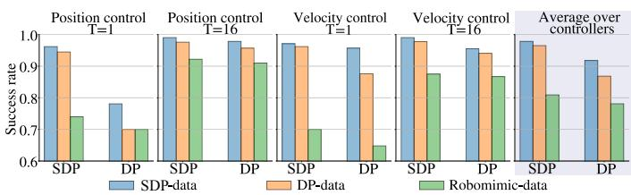  
Fig. 4: Results of offline training in the Square task.

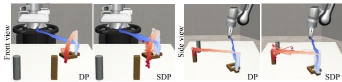  
Fig. 5: Visualization of the data obtained during one interactive learning using DP and SDP agents for the Square task. Initial states of all episodes are fixed for clear visualization. Only the position of the robot’s end effector is visualized. The trajectories of these position data are projected onto two cameras. DP has a narrower state coverage that follows the teacher policy, while SDP explores by taking actions from the desired action set, creating a broader state coverage.

SDP produces data with broader coverage of the state space. This stems from a key difference in online data collection: DPbased DAgger strictly imitates the teacher’s action with the BC objective, whereas SDP uses set-valued supervision and allows the policy to output actions from the desired action set. During early episodes of the online learning process, although actions sampled from the desired action set may be suboptimal, they encourage exploration around teacherinduced trajectories rather than strictly following them. This exploration behavior emerges from the set-valued supervision used by SDP and yields a dataset with broader coverage, thereby improving the quality of the aggregated dataset.

2) SDP outperforms DP across all datasets: Across all evaluated datasets, policies trained with offline SDP consistently outperform their DP counterparts. The performance gap is most significant under the controller using small actionchunks (T=1), which are less resilient to distributional shift than large action-chunks. DP also performs worse with velocity control. In contrast, SDP maintains superior performance across all controllers using online-collected datasets. We conjecture that SDP uses desired action sets to induce smoother action labels, which may reduce overfitting to individual action-chunks in the dataset and improve generalization to states near the training distribution. SDP also outperforms DP when trained on the Robomimic dataset, demonstrating that set-valued supervision can be applied to standard offline demonstration datasets, even in the absence of negative actionchunks.

## C. Ablation study

SDP demonstrates stable performance across a wide range of radius ratios for desired action sets, with ablations reported in the Appendix. Here, we study how different sampling strategies affect the quality of sampled desired action-chunks.

Once a desired action set is defined from the correction data, SDP requires a practical sampling method that generates action-chunks within this set while remaining close to the current policy distribution, as described in Sec. IV-C3. We therefore evaluate our reflected sampling method against four alternatives within the online interactive learning framework: (1) Random reflection, which follows our reflection procedure but projects out-of-set samples to random points inside the set; (2) Classifier guidance, which treats the desired action set as a classifier and biases the denoising process toward $\mathbf { a } ^ { + } ;$ (3) Classifier guidance + final filter, which removes outof-set samples after guidance; and (4) Classifier guidance + final reflection, which applies a single reflection step at the final denoising iteration following classifier guidance. Results are reported in Table II.

TABLE II: Ablations on sampling desired action-chunks

<table><tr><td></td><td>Classifier guidance</td><td>Guidance+ final filter</td><td>Guidance+ final reflection</td><td>Reflection to a+</td><td>Random reflection</td></tr><tr><td>Accurate</td><td>0.890</td><td>0.429</td><td>0.964</td><td>0.988</td><td>0.978</td></tr><tr><td>Noisy</td><td>0.448</td><td>0.452</td><td>0.771</td><td>0.946</td><td>0.933</td></tr></table>

Our default Reflection to $\mathbf { a } ^ { + }$ achieves consistently strong performance and matches Random reflection, indicating that enforcing set membership via reflection is more important than the exact projection strategy. In contrast, Classifier Guidance performs substantially worse. While adding a final reflection step improves its performance, it still lags behind reflectionbased sampling in the noisy setting. Overall, these results show that classifier guidance fails to reliably produce in-set desired action-chunks, whereas reflection-based sampling can enforce the set constraint while maintaining sample quality.

## D. Results of real-world Experiments

We evaluate the effectiveness of SDP on two challenging real-world, long-horizon manipulation tasks: a multi-modal Insert-T task [19] and a roundtable assembly task from FurnitureBench [13]. For comparison, we also evaluate DP, trained using the same datasets as SDP. The policy observations include RGB images from two cameras and the robot’s endeffector pose. The experiments are carried out using a 7-DoF KUKA iiwa manipulator for the Insert-T task and a 7-DoF Franka Panda manipulator for the roundtable task. A 6D space mouse is employed to provide intervention feedback on the pose of the robot’s end effector. Furthermore, in the roundtable task, a keyboard provides feedback on the gripper’s actuation.

TABLE III: Results of offline learning in the Insert-T task.

<table><tr><td rowspan="2"></td><td colspan="2">Pretraining with Demonstration</td><td colspan="2">Demonstration + Correction</td></tr><tr><td>Hard</td><td>Medium</td><td>Hard</td><td>Medium</td></tr><tr><td>SDP</td><td>0/40</td><td>23/40</td><td>35/40</td><td>39/40</td></tr><tr><td>DP</td><td>0/40</td><td>18/40</td><td>23/40</td><td>35/40</td></tr></table>

1) Insert-T task: The Insert-T task requires the robot to insert a T-shaped object into a U-shaped object by pushing to adjust their positions and orientations. The setup is shown in Fig. 6. Three difficulty levels can be defined [19]—easy (<1 contact changes), medium (<5), and hard (≥5)—based on the required contact changes from a teacher policy. We first collect 50 demonstrations to pretrain the policy using each method. Then the pretrained SDP policy is deployed on the robot, during which a human teacher provides corrective interventions, resulting in 40 episodes of intervention data. Each method is subsequently trained on the combined dataset of demonstrations and corrections. For both the hard and medium tasks, we evaluate the methods with the same set of 40 initial states. The results are reported in Table III.

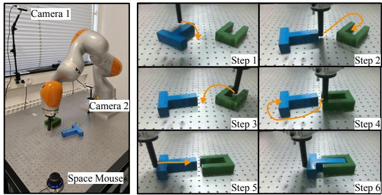  
Fig. 6: Left: Hardware setup for the Insert-T task. Right: An example of SDP policy rollout during evaluation (cropped views from camera 2).

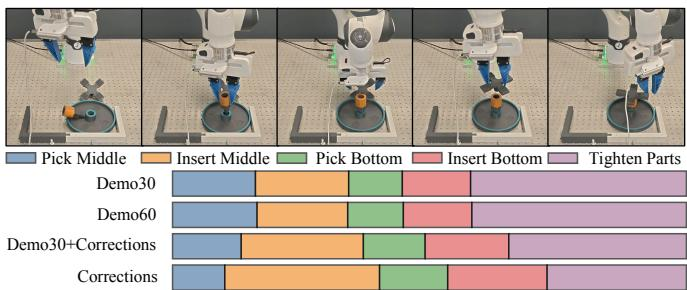  
Fig. 7:Stage distribution across datasets in the round-table task.

SDP consistently outperforms DP in terms of success rate, both after pretraining and when trained on the full dataset. These results align with the offline learning results in Sec. V-B. While both methods benefit from the correction dataset, SDP exhibits substantially larger improvements on the hard task. This suggests that SDP is more effective at leveraging intervention data, as it can leverage negative actions, whereas DP can only imitate human actions.

2) Round-table Assembly task: The round-table assembly task [13] requires the robot to perform a sequence of stages, as shown in the upper figure of Fig. 7. Such long-horizon tasks are challenging for offline IL methods [15] as even slight differences in the dataset at a given stage can compound and lead to task failure. We first collect 30 demonstrations (30,626 observation-action pairs) to pretrain both SDP and DP. Then, we deploy the SDP policy, and a human teacher provides corrective interventions on its undesired behavior. This deployment-and-correction process is repeated for three iterations, producing a final correction dataset consisting of 29,194 contrastive action-chunk pairs. Additionally, to assess the data quality of the correction dataset, we collected 30 extra demonstration datasets. This results in three training datasets:

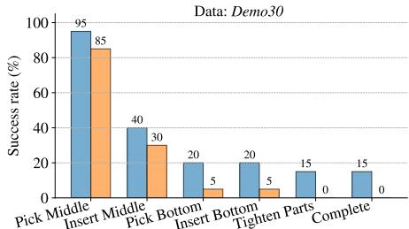

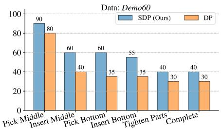

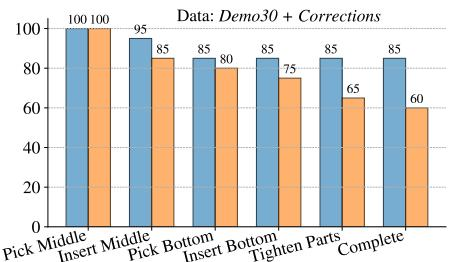  
Fig. 8: Round-table assembly results with stage-wise success breakdown. For each dataset and method, we report the fraction of 20 trials that successfully progress to each stage of the task sequence; “Complete” corresponds to overall task success.

Demo30 (initial 30 demonstrations), Demo30 + Corrections (30 demonstrations plus corrective interventions), and Demo60 (60 demonstrations). Both SDP and DP are trained on Demo30 for 12 hours with an Nvidia A40 GPU, after which each checkpoint is further trained for an additional 12 hours using either Demo30 + Corrections or Demo60. For the methods trained with each dataset, we evaluate the last checkpoint with the same 20 initial states. The results are reported in Fig. 8.

Both SDP and DP achieve higher success rates with Demo30 + Corrections than with Demo60 (with roughly the same amount of data). As illustrated in Fig. 7, demonstration data is strongly biased toward stages with longer execution time, such as the ‘Tighten Parts’ stage, which accounts for 41% of the total steps but is not the primary bottleneck stage. In contrast, correction data is naturally concentrated around failure-prone bottleneck stages, such as ‘Insert Middle’ and ‘Insert Bottom’. This explains the improved performance observed when corrective interventions are incorporated.

SDP consistently outperforms DP across all three datasets. When trained on Demo30 and Demo60, SDP achieves approximately 10% higher success rates, as SDP can imitate the behavior of the dataset while avoiding overfitting to each individual data point. Notably, when trained with the Demo30 + Corrections dataset, the performance gap between SDP and DP is the largest. We attribute this result to SDP’s ability to utilize the correction dataset, whereas DP only imitates the positive action-chunk and discards the negative ones.

Together with the Insert-T results, these findings indicate that SDP not only improves overall success rates in longhorizon manipulation tasks, but also makes more effective use of human corrective feedback than DP.

## VI. CONCLUSION

In this work, we introduced SDP, a set-supervised framework for training diffusion policies from human corrections. Instead of treating each teacher’s action as an exact action target, SDP uses the correction data to construct set-valued action targets. To achieve this, SDP extends the desiredaction-set formulation of CLIC to the action-chunk space and proposes a training pipeline that optimizes diffusion policies with these sets. Extensive experiments in both offline and online settings demonstrate consistent performance gains and improved data quality.

Limitations and Future work: Our work assumes intervention feedback and thus cannot be applied to relative corrections [19], which might break the approximation in Sec. IV-B. Additionally, SDP requires sampling desired action-chunks during training, which takes around 38% of the total training time in our experiment and therefore introduces an additional computational cost. Future work could explore extending SDP to alternative feedback modalities and improving sampling efficiency during training.

## ACKNOWLEDGMENTS

This project is made possible by a contribution from the National Growth Fund program NXTGEN Hightech. We also acknowledge the Delft AI Cluster (DAIC) for providing computational resources. We’d like to thank Rodrigo Perez-Dattari´ for helpful discussions, and Qifan Luo and Zi Huang for their valuable feedback on the code repository.

## REFERENCES

[1] Ali Amin, Raichelle Aniceto, Ashwin Balakrishna, Kevin Black, Ken Conley, Grace Connors, James Darpinian, Karan Dhabalia, Jared Di-Carlo, Danny Driess, et al. π<sup>∗</sup><sub>0.6</sub>: a VLA that learns from experience. arXiv preprint arXiv:2511.14759, 2025.

[2] Lars Ankile, Anthony Simeonov, Idan Shenfeld, and Pulkit Agrawal. Juicer: Data-efficient imitation learning for robotic assembly. In 2024 IEEE/RSJ International Conference on Intelligent Robots and Systems (IROS), pages 5096–5103. IEEE, 2024.

[3] Lars Ankile, Anthony Simeonov, Idan Shenfeld, Marcel Torne, and Pulkit Agrawal. From imitation to refinement-residual rl for precise assembly. In 2025 IEEE International Conference on Robotics and Automation (ICRA), pages 01–08. IEEE, 2025.

[4] Kevin Black, Noah Brown, Danny Driess, Adnan Esmail, Michael Robert Equi, Chelsea Finn, Niccolo Fusai, Lachy Groom, Karol Hausman, Brian Ichter, Szymon Jakubczak, Tim Jones, Liyiming Ke, Sergey Levine, Adrian Li-Bell, Mohith Mothukuri, Suraj Nair, Karl Pertsch, Lucy Xiaoyang Shi, Laura Smith, James Tanner, Quan Vuong, Anna Walling, Haohuan Wang, and Ury Zhilinsky. π<sub>0</sub>: A vision-language-action flow model for general robot control. In Proceedings of Robotics: Science and Systems (RSS), Los Angeles, CA, USA, June 2025. doi: 10.15607/RSS.2025.XXI.010.

[5] Carlos Celemin, Rodrigo Perez-Dattari, Eugenio Chisari, Giovanni´ Franzese, Leandro de Souza Rosa, Ravi Prakash, Zlatan Ajanovic, Marta´ Ferraz, Abhinav Valada, and Jens Kober. Interactive imitation learning in robotics: A survey. Foundations and Trends in Robotics, 10(1-2):1–197, 2022. URL https://www.nowpublishers.com/article/Details/ROB-072.

[6] Wendi Chen, Han Xue, Fangyuan Zhou, Yuan Fang, and Cewu Lu. Deformpam: Data-Efficient Learning for Long-Horizon Deformable Object Manipulation Via Preference-Based Action Alignment. In 2025 IEEE International Conference on Robotics and Automation (ICRA), pages 6896–6903, May 2025. doi: 10.1109/ICRA55743.2025.11127926. URL https://ieeexplore.ieee.org/abstract/document/11127926.

[7] Yuxin Chen, Devesh K Jha, Masayoshi Tomizuka, and Diego Romeres. Fdpp: Fine-tune diffusion policy with human preference. arXiv preprint arXiv:2501.08259, 2025.

[8] Cheng Chi, Siyuan Feng, Yilun Du, Zhenjia Xu, Eric Cousineau, Benjamin Burchfiel, and Shuran Song. Diffusion policy: Visuomotor policy learning via action diffusion. In Proceedings of Robotics: Science and Systems (RSS), 2023.

[9] Giannis Daras, Kulin Shah, Yuval Dagan, Aravind Gollakota, Alex Dimakis, and Adam Klivans. Ambient diffusion: Learning clean distributions from corrupted data. Advances in Neural Information Processing Systems, 36:288–313, 2023.

[10] Gaurav Datta, Ryan Hoque, Anrui Gu, Eugen Solowjow, and Ken Goldberg. Iifl: Implicit interactive fleet learning from heterogeneous human supervisors. In Conference on Robot Learning, pages 2340– 2356. PMLR, 2023.

[11] Pete Florence, Corey Lynch, Andy Zeng, Oscar A Ramirez, Ayzaan Wahid, Laura Downs, Adrian Wong, Johnny Lee, Igor Mordatch, and Jonathan Tompson. Implicit behavioral cloning. In Conference on Robot Learning, pages 158–168. PMLR, 2022. URL https://proceedings.mlr. press/v164/florence22a.html.

[12] Dibya Ghosh, Homer Rich Walke, Karl Pertsch, Kevin Black, Oier Mees, Sudeep Dasari, Joey Hejna, Tobias Kreiman, Charles Xu, Jianlan Luo, et al. Octo: An open-source generalist robot policy. In Proceedings of Robotics: Science and Systems (RSS), 2024.

[13] Minho Heo, Youngwoon Lee, Doohyun Lee, and Joseph J Lim. Furniturebench: Reproducible real-world benchmark for long-horizon complex manipulation. The International Journal of Robotics Research, 44 (10-11):1863–1891, 2025.

[14] Jonathan Ho, Ajay Jain, and Pieter Abbeel. Denoising diffusion probabilistic models. In Advances in Neural Information Processing Systems, volume 33, pages 6840–6851, 2020.

[15] Zheyuan Hu, Robyn Wu, Naveen Enock, Jasmine Li, Riya Kadakia, Zackory Erickson, and Aviral Kumar. Rac: Robot learning for longhorizon tasks by scaling recovery and correction. arXiv preprint arXiv:2509.07953, 2025.

[16] Nils Ingelhag, Jesper Munkeby, Michael C Welle, Marco Moletta, and Danica Kragic. Real-time operator takeover for visuomotor diffusion policy training. arXiv preprint arXiv:2502.02308, 2025.

[17] Michael Kelly, Chelsea Sidrane, Katherine Driggs-Campbell, and Mykel J Kochenderfer. Hg-dagger: Interactive imitation learning with human experts. In 2019 International Conference on Robotics and Automation (ICRA), pages 8077–8083. IEEE, 2019. URL https:// ieeexplore.ieee.org/abstract/document/8793698.

[18] Sung-Wook Lee, Xuhui Kang, and Yen-Ling Kuo. Diff-dagger: Uncertainty estimation with diffusion policy for robotic manipulation. In 2025 IEEE International Conference on Robotics and Automation (ICRA), pages 4845–4852. IEEE, 2025.

[19] Zhaoting Li, Rodrigo Perez-Dattari, Robert Babuska, Cosimo Della´ Santina, and Jens Kober. From action labels to sets: Rethinking action supervision for imitation learning from corrective feedback. 2026. URL https://arxiv.org/abs/2502.07645.

[20] Huihan Liu, Soroush Nasiriany, Lance Zhang, Zhiyao Bao, and Yuke Zhu. Robot Learning on the Job: Human-in-the-Loop Autonomy and Learning During Deployment. In Proceedings of Robotics: Science and Systems, Daegu, Republic of Korea, July 2023. doi: 10.15607/RSS.2023. XIX.005. URL https://www.roboticsproceedings.org/rss19/p005.html.

[21] Aaron Lou and Stefano Ermon. Reflected diffusion models. In International Conference on Machine Learning, pages 22675–22701. PMLR, 2023.

[22] Jianlan Luo, Charles Xu, Jeffrey Wu, and Sergey Levine. Precise and dexterous robotic manipulation via human-in-the-loop reinforcement learning. Science Robotics, 10(105):eads5033, 2025.

[23] Ajay Mandlekar, Danfei Xu, Josiah Wong, Soroush Nasiriany, Chen Wang, Rohun Kulkarni, Li Fei-Fei, Silvio Savarese, Yuke Zhu, and Roberto Mart´ın-Mart´ın. What matters in learning from offline human demonstrations for robot manipulation. In Conference on Robot Learning, pages 1678–1690. PMLR, 2022.

[24] Rodrigo Perez-Dattari, Carlos Celemin, Javier Ruiz-del Solar, and Jens´ Kober. Interactive learning with corrective feedback for policies based on deep neural networks. In Proceedings of the 2018 International Symposium on Experimental Robotics, pages 353–363. Springer, 2020.

[25] Rafael Rafailov, Archit Sharma, Eric Mitchell, Christopher D Manning, Stefano Ermon, and Chelsea Finn. Direct preference optimization: Your language model is secretly a reward model. In Advances in Neural

Information Processing Systems, volume 36, 2024.

[26] Allen Z. Ren, Justin Lidard, Lars Lien Ankile, Anthony Simeonov, Pulkit Agrawal, Anirudha Majumdar, Benjamin Burchfiel, Hongkai Dai, and Max Simchowitz. Diffusion policy policy optimization. In The Thirteenth International Conference on Learning Representations, 2025. URL https://openreview.net/forum?id=mEpqHvbD2h.

[27] Moritz Reuss, Maximilian Li, Xiaogang Jia, and Rudolf Lioutikov. Goal conditioned imitation learning using score-based diffusion policies. In Proceedings of Robotics: Science and Systems (RSS), 2023.

[28] Moritz Reuss, Hongyi Zhou, Marcel Ruhle,¨ Omer Erdinc¸ Ya<sup>¨</sup> gmurlu,˘ Fabian Otto, and Rudolf Lioutikov. Flower: Democratizing generalist robot policies with efficient vision-language-flow models. In Joseph Lim, Shuran Song, and Hae-Won Park, editors, Proceedings of The 9th Conference on Robot Learning, volume 305 of Proceedings of Machine Learning Research, pages 3736–3761. PMLR, 27–30 Sep 2025. URL https://proceedings.mlr.press/v305/reuss25a.html.

[29] Stephane Ross, Geoffrey Gordon, and Drew Bagnell. A reduction of´ imitation learning and structured prediction to no-regret online learning. In Proceedings of the Fourteenth International Conference on Artificial Intelligence and Statistics, pages 627–635. JMLR Workshop and Conference Proceedings, 2011. URL https://proceedings.mlr.press/v15/ross11a.

[30] Shahabedin Sagheb and Dylan P Losey. Counterfactual behavior cloning: Offline imitation learning from imperfect human demonstrations. arXiv preprint arXiv:2505.10760, 2025.

[31] Mustafa Shukor, Dana Aubakirova, Francesco Capuano, Pepijn Kooijmans, Steven Palma, Adil Zouitine, Michel Aractingi, Caroline Pascal, Martino Russi, Andres Marafioti, et al. Smolvla: A vision-languageaction model for affordable and efficient robotics. arXiv preprint arXiv:2506.01844, 2025.

[32] Jascha Sohl-Dickstein, Eric Weiss, Niru Maheswaranathan, and Surya Ganguli. Deep unsupervised learning using nonequilibrium thermodynamics. In International Conference on Machine Learning, pages 2256– 2265. PMLR, 2015.

[33] Yang Song, Jascha Sohl-Dickstein, Diederik P Kingma, Abhishek Kumar, Stefano Ermon, and Ben Poole. Score-based generative modeling through stochastic differential equations. In International Conference on Learning Representations, 2021.

[34] Yuda Song, Gokul Swamy, Aarti Singh, J Bagnell, and Wen Sun. The importance of online data: Understanding preference fine-tuning via coverage. Advances in Neural Information Processing Systems, 37: 12243–12270, 2024.

[35] Jonathan Spencer, Sanjiban Choudhury, Matthew Barnes, Matthew Schmittle, Mung Chiang, Peter Ramadge, and Siddhartha Srinivasa. Learning from interventions: Human-robot interaction as both explicit and implicit feedback. In Proceedings of Robotics: Science and Systems (RSS), 2020. URL https://www.roboticsproceedings.org/rss16/p055.pdf.

[36] Bram Wallace, Meihua Dang, Rafael Rafailov, Linqi Zhou, Aaron Lou, Senthil Purushwalkam, Stefano Ermon, Caiming Xiong, Shafiq Joty, and Nikhil Naik. Diffusion model alignment using direct preference optimization. In Proceedings of the IEEE/CVF Conference on Computer Vision and Pattern Recognition, pages 8228–8238, 2024.

[37] Dexin Wang, Chunsheng Liu, Faliang Chang, and Yichen Xu. Hierarchical diffusion policy: manipulation trajectory generation via contact guidance. IEEE Transactions on Robotics, 2025.

[38] Wenke Xia, Yichu Yang, Hongtao Wu, Xiao Ma, Tao Kong, and Di Hu. Robotic policy learning via human-assisted action preference optimization. arXiv preprint arXiv:2506.07127, 2025.

[39] Tianyu Xie, Yu Zhu, Longlin Yu, Tong Yang, Ziheng Cheng, Shiyue Zhang, Xiangyu Zhang, and Cheng Zhang. Reflected flow matching. In Forty-first International Conference on Machine Learning, 2024.

[40] Xiaomeng Xu, Yifan Hou, Zeyi Liu, and Shuran Song. Compliant residual DAgger: Improving real-world contact-rich manipulation with human corrections. In The Thirty-ninth Annual Conference on Neural Information Processing Systems, 2026. URL https://openreview.net/ forum?id=cjcm5LYVWm.

[41] Ge Yan, Jiyue Zhu, Yuquan Deng, Shiqi Yang, Ri-Zhao Qiu, Xuxin Cheng, Marius Memmel, Ranjay Krishna, Ankit Goyal, Xiaolong Wang, et al. Maniflow: A general robot manipulation policy via consistency flow training. In 9th Annual Conference on Robot Learning.

[42] Jingyun Yang, Ziang Cao, Congyue Deng, Rika Antonova, Shuran Song, and Jeannette Bohg. Equibot: Sim (3)-equivariant diffusion policy for generalizable and data efficient learning. In Conference on Robot Learning, pages 1048–1068. PMLR, 2025.

[43] Yanjie Ze, Gu Zhang, Kangning Zhang, Chenyuan Hu, Muhan Wang,

and Huazhe Xu. 3d diffusion policy: Generalizable visuomotor policy learning via simple 3d representations. In Proceedings of Robotics: Science and Systems (RSS), 2024.

[44] Tonghe Zhang, Chao Yu, Sichang Su, and Yu Wang. Reinflow: Finetuning flow matching policy with online reinforcement learning. In The Thirty-ninth Annual Conference on Neural Information Processing Systems, 2025. URL https://openreview.net/forum?id=ACagRwCCqu.

[45] Yuke Zhu, Josiah Wong, Ajay Mandlekar, Roberto Mart´ın-Mart´ın, Abhishek Joshi, Soroush Nasiriany, and Yifeng Zhu. robosuite: A modular simulation framework and benchmark for robot learning. In arXiv preprint arXiv:2009.12293, 2020.

## VII. APPENDIX

This appendix supplements the main paper with additional analyses and implementation details. Appendix VII-A presents ablation results on the radius ratio, while Appendix VII-B analyzes the computational cost of sampling desired action chunks. Policy implementation details are provided in $\mathsf { A p - }$ pendix VII-D. Appendix VII-E details the simulation experiments, and Appendix VII-F reports details of the real-world experimental setup and results.

## A. Ablation results for the radius ratio of desired action sets

We evaluate SDP across a wide range of radius ratios (Eq. (5)). As shown in Fig. 9 and Fig. 10, SDP maintains stable and consistently strong performance across both online and offline learning settings, indicating low sensitivity to this hyperparameter in practice. For data with accurate positive actions, $\mathrm { { s D P s } }$ performance degrades only when the radius is excessively large, where the desired set no longer provides sufficiently informative supervision. For data with noisy positive actions, overly small values of r can lead to worse performance by restricting the desired set to a narrow region that may exclude optimal actions. In the limiting case with the radius being $1 e - 7 .$ , the desired action set reduces to the positive action-chunk $\{ \mathbf { A } ^ { + } \}$ , and SDP’s performance also becomes similar to DP’s.

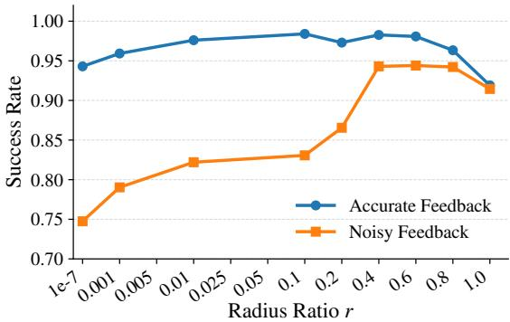  
Fig. 9: Effects of r in the online learning setting.

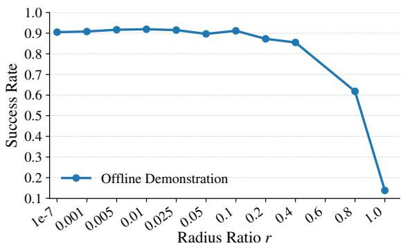  
Fig. 10: Effects of r in the offline learning setting with position control and T=16, using the Proficient-Human (PH) dataset in Robomimic [23]. The radius of each single-step desired action set is equal to $r ,$ as we enforce the auxiliary negative actions to satisfy $\| \mathbf { a } _ { t } ^ { r } - \mathbf { a } _ { t } ^ { h } \| = 1$ in 32-34 of Algorithm 1.

## B. Computation cost for sampling desired action-chunks

At each training step, given a batch size B and K sampled action chunks per data pair, we sample action-chunks of shape $( B \cdot K , T$ , action dim) $= ~ ( 6 4 ~ ^ { * } ~ 1 6$ , 16, 10) (line 7-10). On an NVIDIA A40 GPU, this sampling procedure takes approximately 0.233 seconds per training step. For offline learning with 296 episodes and 200 training steps per episode, the total training and evaluation process lasts around 10 hours. Within the total time, sampling desired action-chunks takes around 3.8 hours and takes around 38% of the total time.

## C. SDP Policy Update with Cached Desired Samples

To reduce the computational cost of repeatedly sampling desired action-chunks, we introduce a variant of SDP policy update that maintains a double-ended queue (deque) of previously sampled desired chunks for each contrastive actionchunk pair. At each policy update, only $N _ { q }$ new samples are generated through constrained denoising and added to the deque. The deque keeps at most N recent samples, which are reused as training targets for the diffusion denoising loss. This cached-sample variant is presented in Algorithm 2. Lines related to the cached-sample deque are highlighted in blue.

Anecdotally, moderate refresh rates, such as $N _ { q } \in \{ 2 , 4 , 8 \}$ with N = 16 or $N _ { q } = 4$ with $N = 3 2 .$ , produced performance close to the default SDP update in our runs on the Square task within the online IIL setting. In contrast, very small refresh ratios $N _ { q } / N$ , such as $N _ { q } = 1 , N = 1 6$ or $N _ { q } = 2 , N =$ 32, tended to reduce performance. These observations suggest that refreshing the deque too slowly can cause cached samples to become less aligned with the current policy distribution, potentially misleading the policy update.

<div class="mineru-algorithm" style="white-space: pre-wrap; font-family:monospace;">
Algorithm 2: SDP Policy Update with Sample Deque

1 Notations
 $Q_i$  : Desired-sample deque for  $[O, A^{-}, A^{+}]_i$ $N_q$  : Number of new desired samples per update
N : Maximum deque size / number of cached samples

2 Function PolicyShapingDeque ( $D_{+-}$ ,  $\theta$ ):
3 Sample batch B from  $D_{+-}$ 

4 foreach  $[O, A^{-}, A^{+}]_i \in B$  in parallel do

5 Create set  $\hat{A}$  from  $A^{+}$ ,  $A^{-}$ via Eq. (9)

6 Retrieve or initialize sample deque  $Q_i$ 

7 Set  $N_i \leftarrow N$  if  $|Q_i| &lt; N$ , otherwise  $N_i \leftarrow N_q$ 

8 Initialize  $N_i$  samples  $A^{K_A}$  (e.g.,  $\mathcal{N}(0, I)$  or  $A^+$ )

9 for  $k = K_A, \ldots, 0$  do // obtain samples  $A^0$ 

10  $\mathbf{A}^{k-1} = \alpha(\mathbf{A}^k - \gamma\epsilon_\theta(\mathbf{O}, \mathbf{A}^k, k) + \mathcal{N}(0, \sigma^2I))$ 

11  $\mathbf{A}^{k-1} = \mathbf{L}_{\hat{\mathcal{A}}}(\mathbf{A}^{k-1})$  (Eq. (14))

12 Update  $Q_i$  with  $A^0$  and keep the recent N samples

13 Obtain  $\tilde{A}^0$  from  $Q_i$  // reuse N cached samples

14  $k \sim \text{Uniform}(0, \ldots, K), \epsilon_k \sim \mathcal{N}(0, I)$ 

15 Take gradient descent step on // imitate  $\tilde{A}^0$ 

16  $\nabla_\theta\left[\|\epsilon_k - \epsilon_\theta(\mathbf{O}, \sqrt{\bar{\alpha}_k}\tilde{\mathbf{A}}^0 + \sqrt{1 - \bar{\alpha}_k}\epsilon_k, k)\|^2\right]$ 

17 return  $\theta$
</div>

## D. Policy Implementation Details

1) Observation encoder: For simulation experiments, we adopt the same CNN-based observation encoder from Diffusion Policy [8]. Each image observation is processed by a ResNet-18 backbone, followed by spatial softmax pooling to produce a compact latent representation.

For real-world experiments, we modify the encoder to improve robustness under visual variability. Concretely, we replace spatial softmax pooling with adaptive average pooling, which yields a 256-dimensional latent embedding. To further regularize the learned representation, we attach an image decoder that reconstructs the original observation from the latent embedding. The encoder is shared between the policy and the image decoder, and the reconstruction objective acts as an auxiliary loss during policy learning. In addition, we recorded an extra free-play dataset to train this autoencoder (see Appendix VII-F2).

2) Policy decoder: We use the UNet-based diffusion model from Diffusion Policy [8]. The latent observation embedding is injected via FiLM conditioning at each denoising block. During training, we employ a DDPM scheduler with $K = 1 0 0$ diffusion steps. During inference, to reduce runtime, we adopt a DDIM scheduler. We use 16 denoising steps for all tasks, except TwoArmLift, which uses 32 steps due to its higherdimensional action space.

3) Hyperparameters: Hyperparameters used for SDP are summarized in Table IV. All experiments use a batch size of 64 and an initial learning rate of 0.002. Regarding the learning-rate scheduling, we use a cosine schedule with a linear warmup. During online learning, the in-episode update frequency b is fixed to 2.

For diffusion-based baselines, the network structure and hyperparameters are the same, except that $N _ { \mathrm { t r a i n i n g } } = 1 0 0 0$ for baselines, which results in a similar wall-clock training time as SDP $( N _ { \mathrm { t r a i n i n g } } = 2 0 0 )$ on an Nvidia A40 GPU.

## E. Details of Simulation Experiments

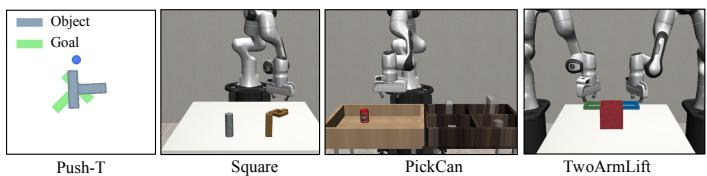  
Fig. 11: Tasks in the simulation experiments.

1) Task descriptions: The evaluated tasks are summarized below. (i) Push-T: Originally introduced by [8], this task requires a robot to push a T-shaped object to a predefined target location using a circular end effector. (ii) Square: The robot is required to align and place a square nut onto a fixed square peg. (iii) PickCan: In this task, the robot must grasp a can and move it to a designated target bin. (iv) TwoArmLift: Two robot manipulators collaboratively lift a single shared object. Each observation consists of RGB images from cameras and the robot’s end effector pose. At the start of each episode, the initial position of the manipulated object is sampled uniformly at random. For the Push-T task, instead of reporting the target area covered as in the original DP paper, we report the success rate of completing this task.

2) Action space: We consider two control modes: (1) For absolute position control, the single-step action is the pose of the robot end effector in the fixed world coordinate frame, along with a gripper command when applicable. (2) For velocity control, the single-step action is the delta change of the robot end effector pose and the gripper command. To ensure stable absolute position control during online learning, we apply a norm-based saturation on the commanded endeffector displacement. If the norm of the displacement exceeds a threshold $( d ~ = ~ 0 . 0 5$ for Robosutie and 15 for Push-T), it is rescaled to this maximum value while preserving its direction. This saturation is applied only to the end-effector position. This saturation is disabled for offline learning with the Robomimic dataset to maintain consistency with the dataset’s action distribution.

3) Simulated Teachers and Feedback: We employ a simulated teacher that monitors deviations between the robot action $\mathbf { a } ^ { r }$ and the optimal teacher’s action $\mathbf { a } ^ { * }$ , both defined in the same action space. Every 2 steps, if the difference exceeds a predefined threshold, the simulated teacher starts to give corrections for $2 T$ consecutive steps and then gives the control back to the robot. The deviation threshold is defined to 0.05 for absolute position control and 0.1 for velocity control.

For accurate feedback, the teacher action equals the optimal action: $\mathbf { a } ^ { h } \ = \ \mathbf { a } ^ { * }$ . For noisy feedback, we consider only absolute position control and model the teacher action as:

$$
\mathbf {a} ^ {h} = \mathbf {a} ^ {*} + \omega , \quad \omega \sim \mathcal {N} (\mathbf {0}, \sigma^ {2} \mathbf {I}),
$$

where

$$
\sigma = \min \left(\frac {1}{2} \| \mathbf {a} ^ {*} - \mathbf {a} ^ {r} \|, 0. 0 4\right).
$$

The upper bound $\sigma \leq 0 . 0 4$ is imposed to prevent the injected noise from becoming excessively large, as excessively large noise would eliminate meaningful guidance from the teacher.

4) Evaluation: For both online and offline learning, we train 296 episodes for 3 trials with different seeds. For each trial, we save checkpoints every 5 episodes and evaluate the last 21 checkpoints, each on 10 episodes with distinct initial states and evaluation seeds. We obtain the average of the success rates and report these results in Experiment section V-A, V-B, and V-C

## F. Details of Real-World Experiments

1) Task description: At each step, the observation $o _ { t }$ includes RGB images from two cameras and the robot’s end effector pose. The policy conditions on the current observation together with a fixed number of past observations and outputs an action chunk of horizon $T .$ . During online interaction and evaluation, only the first $T _ { a }$ single-step actions of the predicted action-chunk are executed.

For the Insert-T task, the single-step action is the 2D position over the table plane. For the roundtable assembly task, the single-step action is the pose of the robot end effector in the fixed world coordinate frame and the gripper command. The pose includes position and orientation, where the position is normalized by a predefined workspace and the orientation is represented as the first two columns of a rotation matrix [8]. The gripper command is also normalized to a fixed range.

TABLE IV: Hyperparameters for Set-Supervised Diffusion Policy. Ctrl: position or velocity control. $T _ { o } \mathrm { : }$ observation horizon. T: action-chunk horizon. $T _ { a } \mathrm { . }$ : action execution horizon, of which $T _ { a }$ steps of an action-chunk are executed. $T _ { r }$ : queried actionchunk length during intervention. ImgRes: environment observation resolution (Camera views x W x H). r: the radius ratio of the single-step desired action set. N: number of desired action-chunk samples. K: total diffusion steps. $K _ { A } { \mathrm { : } }$ : start denoising step for sampling desired action-chunks. $K _ { \mathrm { i n f e r e n c e } } .$ total diffusion steps during inference. $N _ { \mathrm { t r a i n i n g } } { \mathrm { : } }$ number of training steps performed at the end of each episode.

<table><tr><td>Hyperparameters</td><td>Ctrl</td><td> $T_o$ </td><td>T</td><td> $T_a$ </td><td> $T_r$ </td><td>ImgRes</td><td>Radius ratio r</td><td>N</td><td>K</td><td> $K_A$ </td><td> $K_{\text{inference}}$ </td><td> $N_{\text{training}}$ </td></tr><tr><td>Online Accurate</td><td></td><td></td><td></td><td></td><td></td><td></td><td></td><td></td><td></td><td></td><td></td><td></td></tr><tr><td>Push-T</td><td>Pos</td><td>2</td><td>16</td><td>8</td><td>2</td><td>2x84x84</td><td>0.1</td><td>16</td><td>100</td><td>16</td><td>16</td><td>200</td></tr><tr><td>Square</td><td>Pos</td><td>2</td><td>16</td><td>8</td><td>2</td><td>2x84x84</td><td>0.1</td><td>16</td><td>100</td><td>16</td><td>16</td><td>200</td></tr><tr><td>PickCan</td><td>Pos</td><td>2</td><td>16</td><td>8</td><td>2</td><td>2x84x84</td><td>0.1</td><td>16</td><td>100</td><td>16</td><td>16</td><td>200</td></tr><tr><td>TwoArmLift</td><td>Pos</td><td>2</td><td>16</td><td>8</td><td>2</td><td>4x84x84</td><td>0.1</td><td>16</td><td>100</td><td>16</td><td>32</td><td>200</td></tr><tr><td>Online Noisy</td><td></td><td></td><td></td><td></td><td></td><td></td><td></td><td></td><td></td><td></td><td></td><td></td></tr><tr><td>Push-T</td><td>Pos</td><td>2</td><td>16</td><td>8</td><td>2</td><td>2x84x84</td><td>0.6</td><td>16</td><td>100</td><td>16</td><td>16</td><td>200</td></tr><tr><td>Square</td><td>Pos</td><td>2</td><td>16</td><td>8</td><td>2</td><td>2x84x84</td><td>0.6</td><td>16</td><td>100</td><td>16</td><td>16</td><td>200</td></tr><tr><td>PickCan</td><td>Pos</td><td>2</td><td>16</td><td>8</td><td>2</td><td>2x84x84</td><td>0.6</td><td>16</td><td>100</td><td>16</td><td>16</td><td>200</td></tr><tr><td>TwoArmLift</td><td>Pos</td><td>2</td><td>16</td><td>8</td><td>2</td><td>4x84x84</td><td>0.6</td><td>16</td><td>100</td><td>16</td><td>32</td><td>200</td></tr><tr><td>Offline Robomimic</td><td></td><td></td><td></td><td></td><td></td><td></td><td></td><td></td><td></td><td></td><td></td><td></td></tr><tr><td>Position T= 1</td><td>Pos</td><td>2</td><td>1</td><td>1</td><td>N/A</td><td>2x84x84</td><td>0.01</td><td>16</td><td>100</td><td>16</td><td>16</td><td>400</td></tr><tr><td>Position T= 16</td><td>Pos</td><td>2</td><td>16</td><td>8</td><td>N/A</td><td>2x84x84</td><td>0.01</td><td>16</td><td>100</td><td>16</td><td>16</td><td>200</td></tr><tr><td>Velocity T= 1</td><td>Vel</td><td>2</td><td>1</td><td>1</td><td>N/A</td><td>2x84x84</td><td>0.01</td><td>16</td><td>100</td><td>16</td><td>16</td><td>200</td></tr><tr><td>Velocity T= 16</td><td>Vel</td><td>2</td><td>16</td><td>8</td><td>N/A</td><td>2x84x84</td><td>0.01</td><td>16</td><td>100</td><td>16</td><td>16</td><td>200</td></tr><tr><td>Offline SDP/DP-data</td><td></td><td></td><td></td><td></td><td></td><td></td><td></td><td></td><td></td><td></td><td></td><td></td></tr><tr><td>Position T= 1</td><td>Pos</td><td>2</td><td>1</td><td>1</td><td>N/A</td><td>2x84x84</td><td>0.1</td><td>16</td><td>100</td><td>16</td><td>16</td><td>200</td></tr><tr><td>Position T= 16</td><td>Pos</td><td>2</td><td>16</td><td>8</td><td>N/A</td><td>2x84x84</td><td>0.1</td><td>16</td><td>100</td><td>16</td><td>16</td><td>200</td></tr><tr><td>Velocity T= 1</td><td>Vel</td><td>2</td><td>1</td><td>1</td><td>N/A</td><td>2x84x84</td><td>0.1</td><td>16</td><td>100</td><td>16</td><td>16</td><td>200</td></tr><tr><td>Velocity T= 16</td><td>Vel</td><td>2</td><td>16</td><td>8</td><td>N/A</td><td>2x84x84</td><td>0.1</td><td>16</td><td>100</td><td>16</td><td>16</td><td>200</td></tr><tr><td>Real-world Demonstration</td><td></td><td></td><td></td><td></td><td></td><td></td><td></td><td></td><td></td><td></td><td></td><td></td></tr><tr><td>Insert-T</td><td>Pos</td><td>2</td><td>16</td><td>8</td><td>N/A</td><td>2x320x240</td><td>0.01</td><td>16</td><td>100</td><td>16</td><td>16</td><td>200</td></tr><tr><td>Round-table Assembly</td><td>Pos</td><td>2</td><td>16</td><td>8</td><td>N/A</td><td>2x320x240</td><td>0.001</td><td>16</td><td>100</td><td>16</td><td>16</td><td>200</td></tr><tr><td>Real-world Correction Dataset</td><td></td><td></td><td></td><td></td><td></td><td></td><td></td><td></td><td></td><td></td><td></td><td></td></tr><tr><td>Insert-T</td><td>Pos</td><td>2</td><td>16</td><td>8</td><td>2</td><td>2x320x240</td><td>0.1</td><td>16</td><td>100</td><td>16</td><td>16</td><td>200</td></tr><tr><td>Round-table Assembly</td><td>Pos</td><td>2</td><td>16</td><td>8</td><td>2</td><td>2x320x240</td><td>0.01</td><td>16</td><td>100</td><td>16</td><td>16</td><td>200</td></tr></table>

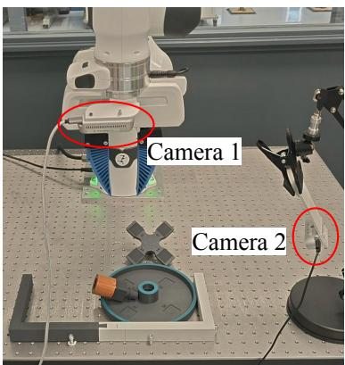

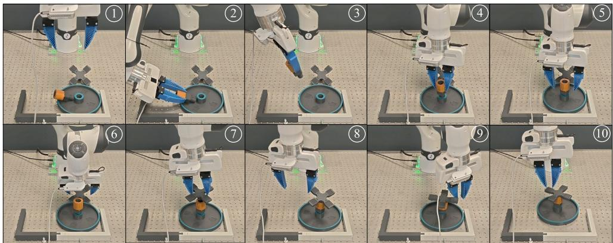  
Fig. 12: Left: Setup of the round-table experiment. Right: Example rollout of the SDP policy, trained with Demo30 + Corrections, during evaluation.

The single-step actions are sent to the low-level controller at

10 Hz, and the robot policy outputs a new action-chunk once the first $T _ { a }$ single-step actions of the previous action-chunk have been executed. Each single-step action is de-normalized before being sent to the low-level controller. For the Franka robot, we employ a Cartesian impedance controller operating at 1 kHz. For the KUKA robot, commanded Cartesian targets are first converted to joint-space goals using an inverse kinematics solver, and then tracked by a joint impedance controller running at 500 Hz. An overview of the round-table assembly setup is shown in Fig. 12.

2) Data collection: We follow the pipeline illustrated in Fig. 1. Our dataset is collected from three sources: demonstrations, free-play, and online corrections.

We first collect demonstration data using a space mouse device. This data serves as the initial pretraining dataset. Meanwhile, we also collect a free-play dataset used only for training the observation autoencoder (Appendix VII-D1). During free-play, the operator freely teleoperates the robot around the task objects without a predefined goal. The operator deliberately explores both in-distribution and out-ofdistribution states by interacting with and repositioning the objects. Data is saved to the free-play dataset when the operator presses the ‘enter’ key of the keyboard.

Using the demonstration and free-play datasets, we train the SDP agent for 12 hours on an Nvidia A40 GPU, with hyperparameters reported in Table IV. The trained agent is then deployed to perform the task, during which a human operator can provide online interventions via the space mouse to correct undesired behaviors. According to the IIL loop in Algorithm 1, extracting contrastive action-chunk data requires intervention segments of length T. Given a control frequency of 10 Hz and an action horizon of 16, we instruct the operator to maintain each intervention for at least 1.6 s after initiating control. In practice, there are a few cases where a teacher’s action is missing from a T-window due to the operator mistakenly releasing the control too early. To handle these cases and avoid wasting intervention data, we use a Python script to visualize the trajectory data and highlight the missing actions. These missing teacher actions can be relabeled by setting $\mathbf { a } ^ { h } \gets \mathbf { a } ^ { r }$ if the human operator observes that the corresponding robot action is close to the desired actions they would provide. The correction dataset is then extracted from the relabeled trajectories.

The resulting correction dataset is aggregated with the demonstration and free-play datasets to retrain the SDP agent. This deployment-and-correction cycle can be repeated iteratively. We perform one iteration for the Insert-T task and three iterations for the round-table assembly task. Final dataset sizes, reported as numbers of observation–action pairs, are summarized in Table V.

TABLE V: Dataset size in real-world experiments

<table><tr><td></td><td>Initial Demonstration</td><td>Free-play dataset</td><td>Correction</td></tr><tr><td>Insert-T</td><td>10,925</td><td>2,011</td><td>10,110</td></tr><tr><td>Round-table</td><td>30,626</td><td>2,222</td><td>29,194</td></tr></table>

3) Evaluations: Using the demonstration-only dataset, we train both SDP and DP for a fixed training budget of 12 hours on an Nvidia A40. From the final checkpoint of this stage, each method is further trained for an additional 12 hours using the combined demonstration and correction dataset. For each method and dataset setting, the final checkpoint after training is selected for evaluation.

For the Insert-T task, we evaluate the methods with the same set of 40 initial states for both hard and medium tasks. Examples of the initial states are shown in Fig. 13.

For the round-table assembly task, 20 initial states are evaluated for all methods. The orientation of the bottom part and the middle part are fixed in the global frame, while their positions are varied across initial states. Representative initial states are shown in Fig. 14. One example rollout of SDP agent during evaluation is shown in Fig. 12.

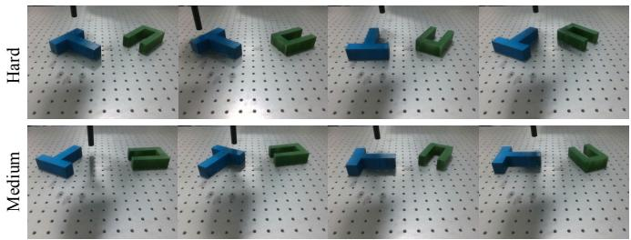  
Fig. 13: Examples of the initial states during the evaluation of the Insert-T task, for both the hard and medium tasks.

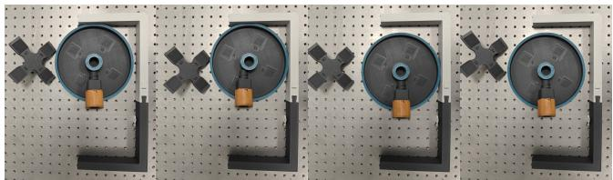  
Fig. 14: Examples of the initial states during the evaluation of the round-table assembly task.