# TIME OPTIMAL EXECUTION OF ACTION CHUNKPOLICIES BEYOND DEMONSTRATION SPEED

Sunwoo Kim Seoul National University ksunw0209@snu.ac.kr

Jeongjun Kim Vital Robotics jeongjun@vitalrobotics.ai

Joseph J. Lim KAIST, Vital Robotics joe.lim@kaist.ac.kr

## ABSTRACT

Achieving both speed and accuracy is a central challenge for real-world robot manipulation. While recent imitation learning approaches, including visionlanguage-action (VLA) models, have achieved remarkable precision and generalization, their execution speed is often limited by slow demonstration via teleoperation and by inference latency. In this work, we introduce a method to accelerate any imitation policy that predicts action chunks, enabling speeds that surpass those of the original demonstration. A naive approach of simply increasing the execution frequency of predicted actions leads to deviation from desired robot states and task failure, as it alters the underlying transition dynamics and encounters physical reachability constraints over shorter time horizons. These errors are further amplified by misaligned actions based on outdated robot state when using asynchronous inference to eliminate pauses during inference. Our method RACE addresses these challenges with a three-part solution: 1) using desired robot states as imitation targets instead of commanded actions, 2) retiming action chunks to execute them as fast as the robot’s physical limits allow, and 3) a test-time search for sampling aligned action chunk that maximizes controllability from the current robot state and dynamic. Through simulation and real-world experiments, we show that our method achieves up to a 4× acceleration over the original policy while maintaining high success rates. Project page: https://clvrai.github.io/RACE/.

## 1 INTRODUCTION

High execution speed of robots is crucial in real-world manipulation tasks for productivity and throughput, making them practically applicable. Accordingly, speed is an essential dimension of improvement, on par with precision and generalization. For instance, furniture assembly contains a lot of precise insertion, and fruit packaging should generalize to different colors and shapes of various fruits, while these industrial applications require high efficiency. There are numerous other examples, such as

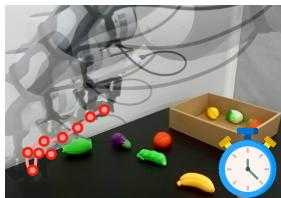  
Original Policy

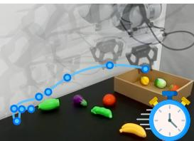  
RACE  
Figure 1: RACE. We propose a method that accelerates the execution speed of imitation policies.

cooking robots, surgical robots, and cleaning robots that collectively require precision, general ization, and speed. Recent imitation learning approaches have achieved notable precision through task-specific training of action chunk policies (Zhao et al., 2023; Chi et al., 2023) and generalization via multi-task pre-training of vision-language-action (VLA) models (Brohan et al., 2023; Black et al., 2024) on large-scale datasets (Khazatsky et al., 2024; O’Neill et al., 2024). However, these imitation learning methods have fundamental limitations in terms of speed: because they imitate the behavior of demonstration data, their speed is also constrained by the speed of the demonstration. Furthermore, the unintuitive interface of teleoperation often bottlenecks demonstration speed, resulting in slow execution of policies, especially for high-precision tasks. In this work, we focus on accelerating the execution of imitation policies beyond demonstration, while maintaining the precision and versatility of the policies.

Intuitively, increasing action execution frequency should speed up the policy. However, accelerating robot imitation policies beyond demonstration speeds in this direction presents two primary challenges. First, naively increasing execution frequency results in the robot deviating from desired states for two main reasons: the underlying transition dynamics are altered because the controller has less time to execute each command, and the required high-speed movements may become physically unreachable by exceeding the robot’s torque and velocity limits. This deviation from the desired trajectory, which we refer to as “state error” throughout the paper, accumulates during openloop execution when using action chunks, often leading to task failure. Second, inference delays become a speed bottleneck for increased acceleration rate. While using asynchronous inference can eliminate pauses due to inference delays, it introduces a new problem of misalignment. With asynchronous inference, the policy generates actions while previous actions are executed; thus, the new actions are based on an outdated robot state, while the robot has already moved according to the previous actions. This creates a discrepancy between the plan and the robot’s actual state that degrades controllability and amplifies errors.

Our main contribution is Reachability-aware Accelerated Chunk Execution (RACE), a method that accelerates action chunk imitation policies by systematically addressing the physical challenges of moving faster than demonstrations. To counter the state error caused by altered control dynamics, RACE first train the policy to imitate the reached states0 from demonstrations instead of action commands, making the imitation target robust to execution timing. To follow these states as fast as possible, it then applies time-optimal path parameterization to each action chunk (i.e., “state chunk” in our algorithm), creating a dynamically feasible, adaptively timed trajectory that respects the robot’s kinodynamic limits. Finally, to combat misalignment from asynchronous inference, RACE employs a test-time search that samples and selects the future action chunk forming the smoothest, most controllable path from the robot’s current state. RACE achieves Pareto-optimal performance, reaching over 2x demonstration speed in simulation tasks and 4x original policy speed in real-world high-precision tasks, all without degrading success rates. On practical, throughputintensive tasks, it doubles the throughput of a pre-trained Vision-Language-Action (VLA) model.

## 2 RELATED WORKS

Imitation Learning. Imitation Learning (IL) has surged with transformer- and diffusion-based policies (Zhao et al., 2023; Lee et al., 2024; Kim et al., 2024; Chi et al., 2023; Team et al., 2024; Black et al., 2024), enabling expressive imitation of demonstrations. Action chunking (Lai et al., 2022; Zhao et al., 2023; Chi et al., 2023) stabilizes temporal behavior and shortens the effective horizon, improving precision. Vision-Language-Action models (Brohan et al., 2023; Zitkovich et al., 2023; Kim et al., 2024; Black et al., 2024; Physical Intelligence et al., 2025) trained on large datasets (Ebert et al., 2021; Walke et al., 2023; Khazatsky et al., 2024; O’Neill et al., 2024) leverage visual and linguistic prior with multi-task learning, broadening generalization across manipulation tasks. While standard Imitation Learning predicts actions, our formulation of utilizing desired states relates to Learning from Observation (LfO) (Torabi et al., 2018; Burnwal et al., 2025). However, unlike typical LfO methods that assume fixed execution speeds, RACE uniquely adapts the execution timing of these state trajectories via optimal control to satisfy physical constraints.

Accelerating Inference Speed. Lines of work accelerate the inference speed of imitation policies. Diffusion-policy accelerations reduce sampling steps or distill to few-step policies (Høeg et al., 2024; Prasad et al., 2024; Wang et al., 2024; Song et al., 2023b). Parallel decoding predicts action chunks in a single pass (Song et al., 2025; Kim et al., 2025). Faster inference does not by itself guarantee faster execution. We view these methods as complementary to RACE for reducing latency.

Accelerating Execution Speed. Only a small body of work directly targets the speed of execution. Real-time chunking (Black et al., 2025) improves asynchronous consistency and often yields speedups. DemoSpeedup (Guo et al., 2025) accelerates policies by entropy-based downsampling and is complementary to RACE, which can be combined at training time for additional speedup.

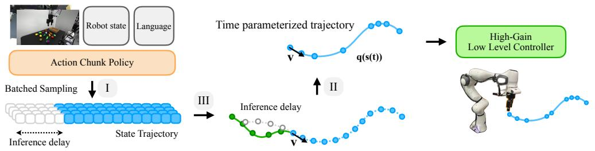

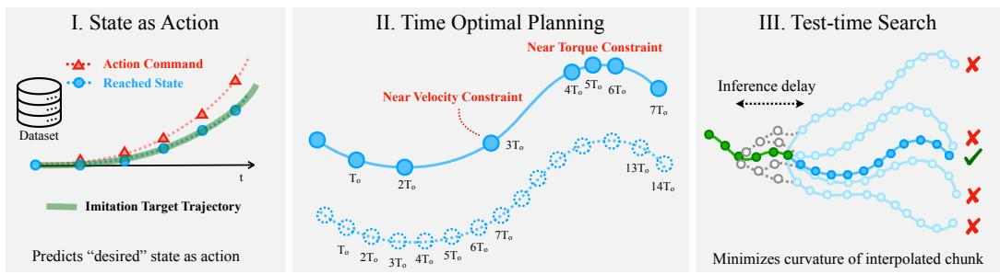  
Figure 2: Method Overview. RACE has three main components: I. predict desired robot states as actions to make control robust under a shorter time horizon (§3.1) II. time optimal planning of state trajectory that considers reachability under kinodynamic limits (§3.2) III. test-time search of smooth, controllable chunk given the current robot state after asynchronous inference (§3.3).

Perhaps the most similar works is SAIL (Arachchige et al., 2025), which increases action frequency with task-specific rules. We compare SAIL directly in Section 4.1.3.

Time Optimal Path Parameterization. Time Optimal Path Parameterization (TOPP) seeks the minimum-time traversal of a fixed path under kinodynamic limits. Classical Numerical-Integration (NI) methods integrate along switching curves of feasible accelerations (Bobrow et al., 1985; Shin & McKay, 1985; Shiller et al., 1996). Convex Optimization (CO) solves for a squared-speed profile with improved robustness (Verscheure et al., 2009; Lipp & Boyd, 2014). TOPP-RA (Pham & Pham, 2018) propagates controllable velocity sets with series of low-dimensional linear programs and achieves NI-like speed with CO-like robustness. RACE use TOPP-RA to retime predicted state trajectories under torque and velocity constraints.

Test-time Search and Alignment Test-time search/alignment (TTS/TTA) treats inference as on-thefly optimization toward an objective-aligned distribution. Best-of-N (BoN) (Touvron et al., 2023; Gui et al., 2024; Beirami et al., 2024; Huang et al., 2025) is simple yet powerful approach, which samples N candidates from the base model, scores them with the task objective, and returns the top one. Similarly, sampling-based optimization underpins classic model-based control, including CEM (De Boer et al., 2005) and MPPI (Williams et al., 2015), where objectives encode physical costs (Williams et al., 2018; Sundaralingam et al., 2023). For learning-based robot control, valueguided MPC/CEM (Chua et al., 2018; Hansen et al., 2023) and guided diffusion (Nakamoto et al., 2024; Wang et al., 2025) steer action inference, yet explicit alignment to physical properties remain less explored. We align action chunk sampling with trajectory-level physical criteria to improve controllability and reduce execution time under kinodynamic constraints.

## 3 RACE: REACHABILITY-AWARE ACCELERATED CHUNK EXECUTION

Accelerating robot beyond demonstration speed pose fundamental challenge: improving the policy beyond given data, which standard imitation learning methods are not capable of. Though reinforcement learning approaches can improve pre-trained imitation policies, they require additional rollouts, and most prior works focus on improving task success (Mark et al., 2024; Wagenmaker et al., 2025) rather than execution speed. We instead take a simpler way based on imitation learning and focus on following the action sequence generated by the policy at a higher speed. We propose RACE with three main components as solution:

## 3.1 DESIRED STATES AS ACTIONS

When rolling out action generated by policy, we may generate and execute the action at a higher frequency, expecting the robot to reach the desired states at the same rate of acceleration. We first explain why this naive approach fails. Action a leads from current state s to next desired state $s ^ { \prime }$ following the transition dynamic $P ( s ^ { \prime } | s , a )$ . Specifically for robots, these action commands are the input to the underlying low-level controller that outputs joint torques to control the robot, where these low-level controllers modulate the transition dynamics of robot states. A common convention in current imitation learning frameworks is using the same low-level controller for teleoperation and policy execution. If we execute the action at a higher frequency, that is, a shorter time for each single action, the low-level controller will lead the robot to a different state, hence altering the transition dynamics. To illustrate, when using PD controller, it applies a force proportional to the difference between the current state and the action command. As the time of force applied decreases, it will lead to a different state from the original desired state, resulting in state error. Furthermore, in an open-loop execution setting, as for action chunk policies, these errors accumulate, leading to larger deviations from the desired states.

To fix this, RACE directly imitates reached states in the demonstration, training or fine-tuning the model on state and next-state pairs, instead of state and action pairs. and use it as action command for low-level controller to accurately track the desired states. Then, we can utilize different low-level controllers during rollout, perhaps with higher gain, to minimize the tracking error, i.e., discrepancy from the desired state. For instance, by using a higher gain with the aforementioned PD controller, it applies a higher force to the robot, enabling the robot to reach the desired state even in a shorter time. In other words, by using desired states as actions instead of original action commands together with low-level controller with better tracking during execution, Thus, this enables the robot to track the desired states, making the transition dynamics more robust to execution timing changes. Note that even when action commands are absolute actions, there is a difference between the action and the reached state, and increasing gain during teleoperation to track the action accurately will make the robot excessively reactive, making teleoperation harder. From this point, the term “action” will refer to the desired state unless explicitly stated as “action command”.

Additionally, the gripper can fail to grasp the target object with accelerated execution due to slow gripping. We increased the gripper speed for our method and all baselines for acceleration in our experiments for fair comparison, unless explicitly mentioned.

## 3.2 REACHABILITY-BASED TIME OPTIMAL PLANNING OF CHUNK EXECUTION

Even if we use the desired state directly as an action and use a different controller from teleoperation, the desired state may not be reachable due to physical constraints, such as joint torque or velocity constraints. With the previously illustrated high-gain PD controller, as the desired state gets farther from the current state as the acceleration rate increases, the controller will exert high force and exceed the torque constraint at some point. Thus, we need to adaptively accelerate the robot depending on the current and desired state. To solve this problem, RACE apply Time-Optimal Path Parameterization based on Reachability Analysis (TOPP-RA) (Pham & Pham, 2018) on the state trajectory generated by the action chunk policy.

Given a geometric path $\mathbf { q } ( s ) \in \mathbb { R } ^ { n }$ representing the robot joint configuration parametrized by a scalar $s \in \ [ 0 , s _ { \mathrm { e n d } } ]$ , TOPP-RA finds a time parameterization $s ( t )$ that satisfies given constraints while minimizing the total duration T. To do so, it projects generalized second-order constraints (Hauser, 2014) defined by $\mathbf { A } ( \mathbf { q } ) \ddot { \mathbf { q } } + \dot { \mathbf { q } } ^ { \top } \mathbf { B } ( \mathbf { q } ) \dot { \mathbf { q } } + \mathbf { f } ( \mathbf { \bar { q } } ) \dot { \mathbf { \Omega } } \in \mathcal { C }$ into the path phase-space defined by squared velocity $x = \dot { s } ^ { 2 }$ and pseudo-acceleration $u = \ddot { s } .$ This yields the path constraints:

$$
\mathbf {a} (s) u + \mathbf {b} (s) x + \mathbf {c} (s) \in \mathcal {C} (s),\tag{1}
$$

where the coefficients are explicitly defined as $\mathbf { a } = \mathbf { A } \mathbf { q } ^ { \prime } , \mathbf { b } = \mathbf { A } \mathbf { q } ^ { \prime \prime } + \mathbf { q } ^ { \prime \top } \mathbf { B } \mathbf { q } ^ { \prime } , \mathrm { a n d } \mathbf { c } = \mathbf { f } .$

TOPP-RA discretizes the path into $s _ { 0 } , \ldots , s _ { N }$ . Given the final state set $\kappa _ { N }$ , it performs a backward pass to recursively find the controllable set $\kappa _ { i }$ , defined as the interval of states capable of reaching $\boldsymbol { { \cal K } } _ { i + 1 }$ using admissible controls satisfying equation 3.2. Finally, starting from $\bar { \kappa } _ { 0 }$ , the algorithm performs a forward pass that recursively selects the highest reachable x in the next controllable set.

To apply TOPP-RA in our setting, RACE interpolates the generated action chunk, which is a sequence of state waypoints, using a cubic spline with current velocity as a boundary condition to define path $\mathbf { q } ( s )$ . To satisfy the boundary condition, RACE set initial state as $\dot { s } _ { 0 } ^ { 2 } = 1$ , and $\dot { s } _ { N , \mathrm { m i n } } ^ { 2 } = 0$ $\dot { s } _ { N , \mathrm { m a x } } ^ { 2 } = 1$ to give degree of freedom for last state. This enables the robot to follow the given action chunk in the fastest way under constraints.

However, a solution of TOPP-RA doesn’t always exist. When the initial state is not controllable, that is, not in $\kappa _ { 0 } ,$ , it means there is no sequence of admissible controls that can follow the given path. In these cases, RACE fall back to the original control frequency without acceleration and keep replans after reaching the next waypoint until a solution exists.

## 3.3 TEST-TIME SEARCH OF CONTROLLABILITY-MAXIMIZING ACTION CHUNK

Asynchronous inference can overcome the speedup bottleneck due to pauses from inference delays, but it introduces the unique challenge of predicting actions for a future state that is inherently uncertain. To compensate for state execution during inference, we typically discard the first few actions of the new chunk based on the elapsed time. However, heuristic discarding fails to address two fundamental IL-specific failures caused by the stochastic latency of large models. First, due to drift during the large inference window, the robot’s actual state upon receiving the new chunk often differs significantly from the policy’s expected start state. This discrepancy can place the robot in a state x that is uncontrollable with respect to the new trajectory, meaning the immediate torque required to merge onto the new path exceeds physical limits. Second, unlike geometric planners, generative policies are probabilistic. Small variations in state or noise can lead to bifurcation where the new action chunk is topologically inconsistent with the currently executing one. This creates a sharp discontinuity at the handover point that is physically impossible to track at high speeds.

Crucially, both phenomena lead to the same critical failure mode where the TOPP solver fails because no valid time-parameterization exists that satisfies the system’s kinodynamic constraints given the misaligned initial state. While previous methods utilize action inpainting (Black et al., 2025; Arachchige et al., 2025) to encourage consistency, they do not explicitly guarantee physical feasibility under these varying constraints.

To resolve this, we utilize test-time search (TTS) to explicitly select action chunks that maximize smoothness and minimize curvature. This objective is not arbitrary and is directly linked to solvability. With misaligned actions or bifurcations, the path curvature at the handover point spikes and requires immense torque to change direction. By selecting the candidate that minimizes this curvature, we effectively reduce the actuation demand. This maximizes the volume of the initial controllable set $\kappa _ { 0 }$ and ensures that the robot’s current drifted state remains controllable, allowing the TOPP solver to successfully find a valid, high-speed execution plan even under severe asynchronous misalignment.

Specifically, we utilize Best-of-N sampling (Touvron et al., 2023; Beirami et al., 2024) where we sample multiple action chunks and select the one that maximizes the following objective related to the smoothness of the path:

$$
J (\mathbf {q} (s)) = \frac {s _ {\text { end }}}{\int_ {0} ^ {s _ {\text { end }}} | | \mathbf {q} ^ {\prime \prime} | | ^ {2} d s}\tag{2}
$$

where $\mathbf { q } ( s )$ is given by interpolating current state and generated action sample with current velocity as boundary condition, and $s _ { \mathrm { e n d } }$ in the numerator is for length normalization. $q ( s _ { \mathrm { e n d } } )$ can be intermediate action instead of last action in the chunk, in which its index in the chunk is a hyperparameter.

By optimizing this objective, we can increase the size of the controllable state set together. To see this, calculate the coefficients in Equation 3.2:

$$
\begin{array}{l l} \mathbf {a} (s) := \mathbf {A} \big (\mathbf {q} (s) \big) \mathbf {q} ^ {\prime} (s), & \mathbf {c} (s) := \mathbf {f} \big (\mathbf {q} (s) \big), \\ \mathbf {b} (s) := \mathbf {A} \big (\mathbf {q} (s) \big) \mathbf {q} ^ {\prime \prime} (s) + \mathbf {q} ^ {\prime} (s) ^ {\top} \mathbf {B} \big (\mathbf {q} (s) \big) \mathbf {q} ^ {\prime} (s), & \mathcal {C} (s) := \mathcal {C} \big (q (s) \big). \end{array}
$$

Note that the only coefficient that contains $\mathbf { q } ^ { \prime \prime }$ is $\mathbf { b } ( s )$ , coefficient of $\dot { s } ^ { 2 }$ . While multiple path samples are generated, they are all conditioned on common initial state $( { \bf q } ( 0 ) , { \bf q } ^ { \prime } ( 0 ) )$ . Consequently, the path curvature, $\mathbf { q } ^ { \prime \prime }$ becomes the most sensitive and dominant term distinguishing the samples. Over a short planning horizon, variations in the path’s position q are minimal, while any significant variation in the path’s tangent $\mathbf { q } ^ { \prime }$ over a short horizon necessitates a large magnitude in $\mathbf { q } ^ { \breve { \prime \prime } } .$ . When the difference in $\mathbf { q } ^ { \prime \prime }$ is dominating, $b ( s )$ can vary largely, which then directly determines the size of admissible state-control pairs. Larger smoothness, i.e., smaller curvature, will lead to smaller $| b ( s ) |$ and allow each state $\textstyle { \dot { s } } ^ { 2 }$ to have a larger set of admissible controls that can potentially lead to the next controllable set, hence the size of the controllable set also increases. Formal proposition for this statement and proofs can be found in Appendix B.

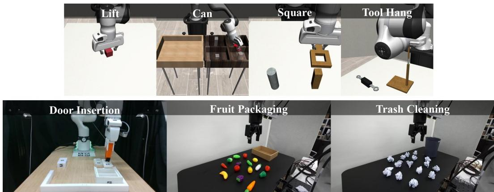  
Figure 3: Task Overviews. Top: Simulation Tasks, Bottom: Real-world Tasks.

This approach shares conceptual similarities with Model Predictive Control (MPC) (Williams et al., 2015) in using horizon-based optimization. However, unlike standard MPC, which typically uses random or gradient-based sampling, RACE utilizes the imitation policy itself as a generative sampler to preserve the naturalness of human demonstrations. Furthermore, our optimization objective is novel: we optimize for controllability volume by incorporating smoothness of the path to counter the specific misalignment challenges of asynchronous policy execution.

## 4 EXPERIMENTS

## 4.1 SIMULATION EXPERIMENTS

We seek to increase execution speed without sacrificing accuracy. We evaluate speed–accuracy trade-offs of RACE in simulation (§4.1) and on hardware (§4.2), then analyze the contributions of states-as-actions (§3.1), time-optimal planning (§3.2), and test-time search (§3.3) in ablations (§4.3.1, §4.3.2). Detailed explanation of environment and task setting, baselines, and metrics are provided in Appendix E

Common baselines. Action Fast-forward increases the frequency of executed action commands by the same ratio (e.g. 1x, 2x, 4x) where 1x corresponds to the original policy. State Fast-forward use desired state as action and increases execution frequency by the same ratio. Action Fast-forward (Async) combines Action Fast-forward with asynchronous inference, which predicts the next chunk of action commands while execution and switches to the next chunk after discarding a number of actions executed during execution. Action Fast-forward (Inpainting) is systematically identical to Action Fast-forward (Async), but inpaints on the previous chunk, like RTC (Black et al., 2025).

For simulation experiments, we use manipulation tasks from Robomimic (Mandlekar et al., 2021), which are Lift, Can, Square, and Tool Hang. While Lift and Can are sufficient with standard pick and place, Square and Tool Hang require insertion with high precision, making it more challenging for acceleration. To decompose the effect of inference delay, we use both settings with and without inference delay

## 4.1.1 WITHOUT INFERENCE DELAY

Setup. We trained diffusion policy (Chi et al., 2023) with prediction horizon $T _ { p } ~ = ~ 3 2$ on 200 proficient human (PH) demonstration data provided by Robomimic for 1000 epochs, save every 50 epochs, and select best performing epoch based on 50 rollouts. We separately trained models that predict action commands and reached states as imitation targets. For evaluation, 200 rollouts are done for each data point. We mainly focus on two metrics: success rate and speedup over demonstration, defined as the average duration of successful episodes divided by the average duration of demonstrations in the dataset. For baselines, we compare with Action Fast-forward and State Fastforward with 20Hz (1x), 40Hz (2x), 80Hz (4x). For RACE, we excluded test-time search since we aren’t using asynchronous inference.

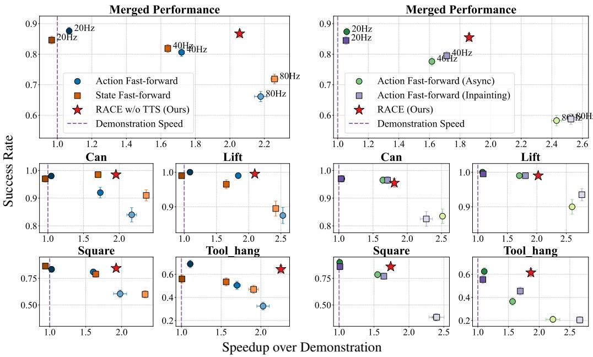  
(a) Without Inference Delay  
(b) With Inference Delay  
Figure 4: Simulation Experiments Results. Speedup over Demonstration vs. Success Rate plots. Left, Right: results with and without inference delay. Top: average performance over all 4 tasks, Bottom: performance for each 4 tasks. RACE (red start) achieve Pareto-optimal performance in speed-success trade-off, with up to 2x speedup without degradation in success rate, especially prominent in precise tasks (Square, Tool Hang). It also maintains similar performance with asynchronous inference under inference delays. Note that the standard error bars may be smaller than the marker.

Results. Figure 4 (a) shows the trade-off between speed and success rate and how RACE achieve Pareto-optimal performance by improving speed while maintaining a high success rate. As acceleration increases, the success rate of naive fast-forward methods decreases due to larger state error, especially for high-precision tasks like Square and Tool Hang. In contrast, RACE exceptionally performs well on these precise tasks, achieving even higher speed up compared to naive fast-forward methods with 80Hz while rating a similar success rate with the original policy in Tool Hang. Even when using the desired state as action, there isn’t much improvement in the Pareto curve, confirming the importance of time-optimal planning by considering the reachability of the states.

## 4.1.2 WITH INFERENCE DELAY

Setup. The setup closely follows 4.1.1, using the same trained models. The injected inference delay is 0.1 seconds, where the number of actions executed during inference depends on the acceleration rate. For baselines, we used Action Fast-forward (Async) and Action Fast-forward (Inpainting) with 20Hz (1x), 40Hz (2x), 80Hz (4x).

Results. Figure 4 (b) shows how RACE perform when using asynchronous inference with inference delays. Compared to Figure 4 (a), RACE achieves a similar success rate, indicating its robustness to inference delays. In contrast, baseline methods have larger drops in performance as the acceleration rate increases, especially in Square and Tool Hang. Even though inpainting helps improve, it’s insignificant compared to RACE that achieve Pareto-optimality.

## 4.1.3 COMPARISON WITH SAIL

Additionally, we directly compare RACE with SAIL (Arachchige et al., 2025), a recent work that also accelerates imitation policies and outperforms prior methods such as AWE (Shi et al., 2023) and BID (Liu et al., 2025), when adapted for acceleration. SAIL similarly uses state as actions to mitigate transition dynamic change, but does not use TOPP or test-time search. Instead, SAIL trains the model to predict Instead, nodel to predict

whether to accelerate or not based on geometric complexity analysis, where the acceleration rate should be tuned for each task. Also, SAIL generates new actions conditioned on the previous chunk to increase action consistency when the state error of previous actions is below some threshold. Compared to SAIL, RACE adaptively selects the acceleration rate of the action chunk via TOPP at inferencetime in task-agnostic way and bypasses the need of training a conditional model by utilizing test-time search. Comparison of the two methods is done in Robomimic setup of

Table 1: SAIL vs. RACE. Success Rate (SR) and Speedup over Demonstration (SOD) in Robomimic.

<table><tr><td rowspan="2">Task</td><td colspan="2">SAIL</td><td colspan="2">RACE (Ours)</td></tr><tr><td>SR ↑</td><td>SOD ↑</td><td>SR ↑</td><td>SOD ↑</td></tr><tr><td>Lift</td><td>0.930</td><td>2.520</td><td>0.995</td><td>2.068</td></tr><tr><td>Can</td><td>0.890</td><td>1.970</td><td>0.965</td><td>1.805</td></tr><tr><td>Square</td><td>0.750</td><td>1.620</td><td>0.805</td><td>1.819</td></tr><tr><td>Tool Hang</td><td>0.610</td><td>0.940</td><td>0.715</td><td>2.053</td></tr></table>

Arachchige et al. (2025), but with torque constraints enabled. The results are shown in Table 1.1 RACE outperforms SAIL in terms of success rate across all tasks, hence achieving a maximal speed up without sacrificing the accuracy of the original policy. Furthermore, it also gains better speed up in precise tasks (Square, Tool Hang), demonstrating the effectiveness of RACE for precise tasks under physical constraints.

## 4.2 REAL-WORLD EXPERIMENTS

## 4.2.1 HIGH-PRECISION TASK

Setup. For precise manipulation task in real-world, we use Door Insertion from FurnitureBench (Heo et al., 2023), one of the most precision-demanding subtask from the benchmark. Model training and evaluation closely follow 4.1 with some differences including that 50 rollouts are done per each data point, with more details in Appendix E. For baselines, we used Action Fast-forward and Action Fastforward (Async) with 10Hz (1x), 20Hz (2x), 40Hz (4x), 80Hz (8x; not for Async as it had near-zero success).

Results. Similar to simulation experiment results in 4.1.1 and 4.1.2, RACE achieves Pareto-optimial performance with maximal speedup without degradation in success rate, depicted in Figure 5. One thing worth noting is that RACE not only scores a similar

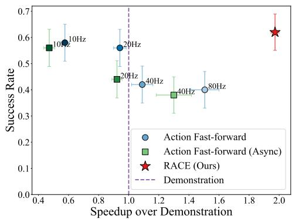  
Figure 5: Door Insertion Results.

success rate to the original policy, but achieves task completion speed far past baselines, including one with an 8x acceleration rate. We conjecture that by minimizing state error and maximizing controllability to closely follow the desired state trajectory, RACE prevent leading robots to out-ofdistribution states, reducing both failures and mistakes that hinder fast task completion

## 4.2.2 THROUGHPUT-INTENSIVE TASK

Setup. We benchmarked methods on two throughput-intensive tasks: Fruit Packaging and Trash Cleaning. We used opensource $\pi _ { 0 . 5 }$ fine-tuned on DROID dataset2 with additional fine-tuning as detailed in Appendix E. For baselines, we used Action Fast-forward with 15Hz (1x), 45Hz (3x) and Action Fast-forward (Async) with 15Hz (1x), 30Hz (2x) since higher frequency led to severe constraint violations for Async.

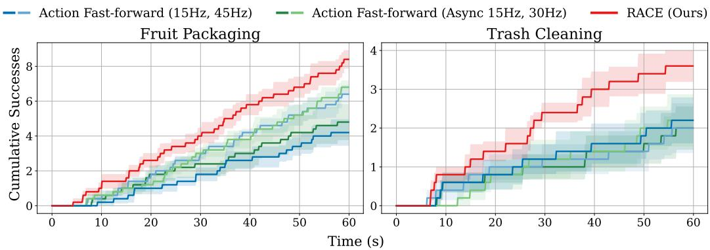  
Figure 6: Throughput-intensive Tasks Results. Time vs. Cumulative Successes plots representing the progress of tasks over time. Both Fruit Packaging and Trash Cleaning have 15 objects on the table. RACE achieves the highest throughput in all time.

Results. Figure 6 shows the cumulative successes across baselines and RACE in the two tasks. RACE clearly reach more successes in the same time compared to baselines, establishing enhanced throughput. It evidences that RACE can speed up while maintaining the versatility of VLA. One common failure mode of acceleration baselines was missing the object when grasping, resulting in low throughput even with high velocity. By improving precision, RACE reduces these mistakes and fully benefits from the increased execution speed.

## 4.2.3 DYNAMIC TASK

To evaluate RACE under external dynamics, we tested a ”Conveyor Belt Pick” task where the robot must pick a moving juice pack (Figure 7). We fine-tuned the π0.5 model on 106 demonstrations. We evaluated performance at the original conveyor speed and at a 2.5× unseen speed.

Results. As shown in Table 8, RACE maintains high success rates even at 2.5× conveyor speed, whereas baselines fail. This demonstrates that RACE can generalize effectively to predictable external dynamics where the policy accounts for object motion, minimizing performance degradation.

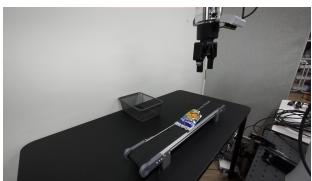  
Figure 7: Conveyor Setup

<table><tr><td rowspan="2">Method</td><td colspan="3">Original Speed</td><td colspan="3">2.5× Speed</td></tr><tr><td>SR</td><td>Time (s)</td><td>SOD</td><td>SR</td><td>Time (s)</td><td>SOD</td></tr><tr><td>Base (15Hz)</td><td>0.03</td><td>21.3</td><td>0.61×</td><td>0.00</td><td>-</td><td>-</td></tr><tr><td>Base (45Hz)</td><td>0.27</td><td>15.4</td><td>0.84×</td><td>0.00</td><td>-</td><td>-</td></tr><tr><td>RACE</td><td>0.63</td><td>9.8</td><td>1.32×</td><td>0.53</td><td>6.4</td><td>2.02×</td></tr></table>

Figure 8: Real-world Semi-Dynamic Task Results

## 4.3 ABLATIONS

## 4.3.1 TIME OPTIMAL PLANNING OF STATE TRAJECTORY MINIMIZES STATE ERRORS

To see how RACE reduces state error and improves performance, we compared RACE to Action Fast-forward and State Fast-forward baselines from 4.1.1. We used Square, Tool Hang, and Door Insertion, the set of most precision-demanding tasks in our evaluations. We measure the deviation of the current joint state from the desired joint state, defined as ’joint error’, as a metric for state error, for both single and chunk-level actions. Figure 9a shows how minimizing state error directly contributes to improving both success rate and speed, where RACE achieves the lowest error level and highest performance. The chunk-level error plot illustrates how state error accumulates during open-loop execution with naive acceleration, while RACE maintain low error. By accurately following the desired states, RACE prevent the robot from going to OOD states and lead to faster task completion.

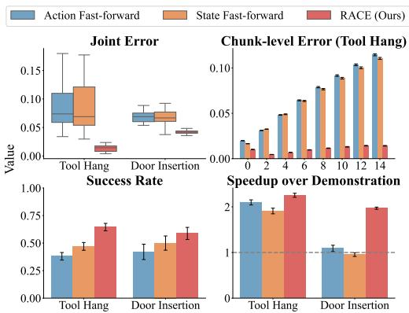  
(a) TOPP Ablation.

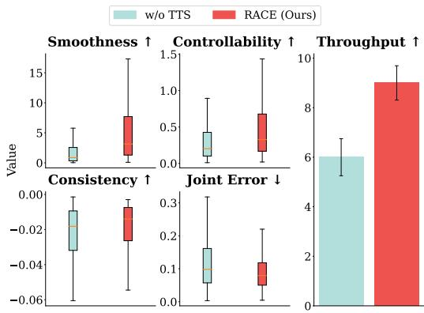  
(b) TTS Ablation.  
Figure 9: (a) Joint error: deviation of current joint from desired joint, Chunk-level error: joint error for each action in the chunk. (b) Smoothness: scaled version of Equation 3.3, Controllability: size of initial controllable set $\kappa _ { 0 }$ , Consistency: minus of euclidean distance with previous chunk. Arrows indicate whether higher is better (↑) or lower is better (↓)

## 4.3.2 TEST-TIME SEARCH ALIGNS ACTIONS WITH CURRENT STATES

To confirm that test-time search makes RACE robust to inference delay, we stress tested the algorithm with artificially longer inference time. Specifically, in the Fruit Packaging task, we add additional time delays to make the inference delay 0.2 seconds when the actual delay is shorter, but increased timem limit to 2-minute. We compare RACE with RACE without test-time search to decompose the effect of test-time search. Metrics are defined in E.5. Figure 9b shows how testtime search improves smoothness and controllability together, supproting he claims in Section 3.3. Furthermore, increased controllability makes trajectory tracking more accurate, lowering joint error. Also, aligning actions with the current state implicitly promotes consistent actions, even without explicit objectives like inpainting. As a whole, these improvements contribute to higher throughput, thus performance of RACE even with high inference delays.

## 5 CONCLUSION

Practical manipulation demands both accuracy and speed, yet strong IL policies are bottlenecked by demonstration speed. We present RACE, a policy-agnostic, task-agnostic approach that (1) trains policies to predict desired state trajectories, (2) time-optimally plans the execution, and (3) selects most controllable chunks via Best-of-N during asynchronous inference. RACE achieves beyonddemonstration execution at high success in both simulation and real-world, with especially large gains on precise tasks. Together, these results alleviate the speed bottleneck while preserving the precision and generality of modern imitation policies.

## REPRODUCIBILITY STATEMENT

To ensure the reproducibility of our work, we provide comprehensive details on our methodology and experimental setup. Appendix E consolidates our experimental protocols, covering the policies (including diffusion policies and $\pi _ { 0 . 5 } ) .$ , datasets (RoboMimic PH and custom hardware data), evaluation metrics, and baseline configurations. Furthermore, as stated in Appendix D, detailed implementations of our core algorithm are available in the supplementary material. We will release the full codebase, complete with all configuration files, demonstration counts, and evaluation scripts, upon publication. Videos of the real-world experiments are available at https://drive. google.com/drive/u/0/folders/1l1d3\_sOZoWZP2\_QwRDgBPoxD808iWotS.

## ACKNOWLEDGMENTS

This work was supported by Institute of Information & Communications Technology Planning & Evaluation (IITP) grants (No.RS-2019-II190075, Artificial Intelligence Graduate School Program, KAIST; No.2022-0-00077, AI Technology Development for Commonsense Extraction, Reasoning, and Inference from Heterogeneous Data; No.RS-2022-II220984, Development of Artificial Intelligence Technology for Personalized Plug-and-Play Explanation and Verification of Explanation), National Research Foundation of Korea (NRF) grant (NRF-2021H1D3A2A03103683, Brain Pool Research Program), funded by the Korea government (MSIT), and the Technology Innovation Program(or Industrial Strategic Technology Development Program-Robot Industry Technology Development)(RS-2024-00427719, Dexterous and Agile Humanoid Robots for Industrial Applications) funded By the Ministry of Trade Industry & Energy(MOTIE, Korea).

We thank the authors of SAIL for providing their raw data and conducting additional Tool Hang experiments. We are also grateful to Minho Heo for assisting with the FurnitureBench setup, Junkyu Min for the DROID setup, and Doohyun Lee and Junseung Lee for initial discussions on teleoperation and low-level controllers. Finally, we thank Hyunjun Lee and Kaixin Chai for reviewing the early draft, alongside all CLVR lab members, for their thoughtful and constructive discussions.

## REFERENCES

Nadun Ranawaka Arachchige, Zhenyang Chen, Wonsuhk Jung, Woo Chul Shin, Rohan Bansal, Pierre Barroso, Yu Hang He, Yingyang Celine Lin, Benjamin Joffe, Shreyas Kousik, and Danfei Xu. SAIL: Faster-than-Demonstration Execution of Imitation Learning Policies, June 2025. URL http://arxiv.org/abs/2506.11948. arXiv:2506.11948 [cs].

Ahmad Beirami, Alekh Agarwal, Jonathan Berant, Alexander D’Amour, Jacob Eisenstein, Chirag Nagpal, and Ananda Theertha Suresh. Theoretical guarantees on the best-of-n alignment policy. arXiv preprint arXiv:2401.01879, 2024.

Kevin Black, Noah Brown, Danny Driess, Adnan Esmail, Michael Equi, Chelsea Finn, Niccolo Fusai, Lachy Groom, Karol Hausman, Brian Ichter, Szymon Jakubczak, Tim Jones, Liyiming Ke, Sergey Levine, Adrian Li-Bell, Mohith Mothukuri, Suraj Nair, Karl Pertsch, Lucy Xiaoyang Shi, James Tanner, Quan Vuong, Anna Walling, Haohuan Wang, and Ury Zhilinsky. π0: A Vision– Language–Action Flow Model for General Robot Control. arXiv, November 2024. doi: 10.48550/ arXiv.2410.24164. URL http://arxiv.org/abs/2410.24164. arXiv:2410.24164 [cs].

Kevin Black, Manuel Y. Galliker, and Sergey Levine. Real-Time Execution of Action Chunking Flow Policies, June 2025. URL http://arxiv.org/abs/2506.07339. arXiv:2506.07339 [cs].

James E Bobrow, Steven Dubowsky, and John S Gibson. Time-optimal control of robotic manipulators along specified paths. The international journal ofrobotics research, 4(3):3–17, 1985.

Anthony Brohan, Noah Brown, Justice Carbajal, Yevgen Chebotar, Joseph Dabis, Chelsea Finn, Keerthana Gopalakrishnan, Karol Hausman, Alexander Herzog, Jasmine Hsu, Julian Ibarz, Brian Ichter, Alex Irpan, Tomas Jackson, Sally Jesmonth, Nikhil Joshi, Ryan Julian, Dmitry Kalashnikov, Yuheng Kuang, Isabel Leal, Kuang-Huei Lee, Sergey Levine, Yao Lu, Utsav Malla, Deeksha Manjunath, Igor Mordatch, Ofir Nachum, Carolina Parada, Jodilyn Peralta, Emily Perez, Karl Pertsch, Jornell Quiambao, Kanishka Rao, Michael Ryoo, Grecia Salazar, Pannag Sanketi, Kevin Sayed, Jaspiar Singh, Sumedh Sontakke, Austin Stone, Clayton Tan, Huong Tran, Vincent Vanhoucke, Steve Vega, Quan Vuong, Fei Xia, Ted Xiao, Peng Xu, Sichun Xu, Tianhe Yu, and Brianna Zitkovich. RT-1: Robotics Transformer for Real-World Control at Scale. In Robotics: Science and Systems XIX. Robotics: Science and Systems Foundation, July 2023. ISBN 978-0-9923747-9-2. doi: 10.15607/RSS.2023.XIX.025. URL http: //www.roboticsproceedings.org/rss19/p025.pdf.

Returaj Burnwal, Hriday Mehta, Nirav Pravinbhai Bhatt, and Balaraman Ravindran. Learning from observation: A survey of recent advances. arXiv preprint arXiv:2509.19379, 2025.

Cheng Chi, Siyuan Feng, Yilun Du, Zhenjia Xu, Eric Cousineau, Benjamin Burchfiel, and Shuran Song. Diffusion Policy: Visuomotor Policy Learning via Action Diffusion. In Robotics: Science and Systems XIX. Robotics: Science and Systems Foundation, July 2023. ISBN 978-0-9923747-9- 2. doi: 10.15607/RSS.2023.XIX.026. URL http://www.roboticsproceedings.org/ rss19/p026.pdf.

Kurtland Chua, Roberto Calandra, Rowan McAllister, and Sergey Levine. Deep reinforcement learning in a handful of trials using probabilistic dynamics models. Advances in neural information processing systems, 31, 2018.

Pieter-Tjerk De Boer, Dirk P Kroese, Shie Mannor, and Reuven Y Rubinstein. A tutorial on the cross-entropy method. Annals of operations research, 134(1):19–67, 2005.

Frederik Ebert, Yanlai Yang, Karl Schmeckpeper, Bernadette Bucher, Georgios Georgakis, Kostas Daniilidis, Chelsea Finn, and Sergey Levine. Bridge data: Boosting generalization of robotic skills with cross-domain datasets. arXiv preprint arXiv:2109.13396, 2021.

Lin Gui, Cristina Garbacea, and Victor Veitch. Bonbon alignment for large language models andˆ the sweetness of best-of-n sampling. Advances in Neural Information Processing Systems, 37: 2851–2885, 2024.

Lingxiao Guo, Zhengrong Xue, Zijing Xu, and Huazhe Xu. DemoSpeedup: Accelerating Visuomotor Policies via Entropy-Guided Demonstration Acceleration, June 2025. URL http: //arxiv.org/abs/2506.05064. arXiv:2506.05064 [cs].

Nicklas Hansen, Hao Su, and Xiaolong Wang. Td-mpc2: Scalable, robust world models for continuous control. arXiv preprint arXiv:2310.16828, 2023.

Kris Hauser. Fast interpolation and time-optimization with contact. The International Journal of Robotics Research, 33(9):1231–1250, 2014.

Minho Heo, Youngwoon Lee, Doohyun Lee, and Joseph J Lim. Furniturebench: Reproducible realworld benchmark for long-horizon complex manipulation. The International Journal ofRobotics Research, pp. 02783649241304789, 2023.

Audrey Huang, Adam Block, Qinghua Liu, Nan Jiang, Akshay Krishnamurthy, and Dylan J Foster. Is best-of-n the best of them? coverage, scaling, and optimality in inference-time alignment. arXiv preprint arXiv:2503.21878, 2025.

Sigmund H. Høeg, Yilun Du, and Olav Egeland. Streaming Diffusion Policy: Fast Policy Synthesis with Variable Noise Diffusion Models, October 2024. URL http://arxiv.org/abs/ 2406.04806. arXiv:2406.04806 [cs].

Alexander Khazatsky, Karl Pertsch, Suraj Nair, Ashwin Balakrishna, Sudeep Dasari, Siddharth Karamcheti, Soroush Nasiriany, Mohan Kumar Srirama, Lawrence Yunliang Chen, Kirsty Ellis, et al. Droid: A large-scale in-the-wild robot manipulation dataset. arXiv preprint arXiv:2403.12945, 2024.

Moo Jin Kim, Karl Pertsch, Siddharth Karamcheti, Ted Xiao, Ashwin Balakrishna, Suraj Nair, Rafael Rafailov, Ethan Foster, Grace Lam, Pannag Sanketi, Quan Vuong, Thomas Kollar, Benjamin Burchfiel, Russ Tedrake, Dorsa Sadigh, Sergey Levine, Percy Liang, and Chelsea Finn. OpenVLA: An Open-Source Vision-Language-Action Model, September 2024. URL http: //arxiv.org/abs/2406.09246. arXiv:2406.09246 [cs].

Moo Jin Kim, Chelsea Finn, and Percy Liang. Fine-Tuning Vision-Language-Action Models: Optimizing Speed and Success, February 2025. URL http://arxiv.org/abs/2502.19645. arXiv:2502.19645 [cs].

Lucy Lai, Ann Zixiang Huang, and Samuel J Gershman. Action chunking as policy compression. PsyArXiv, 2022.

Seungjae Lee, Yibin Wang, Haritheja Etukuru, H Jin Kim, Nur Muhammad Mahi Shafiullah, and Lerrel Pinto. Behavior generation with latent actions. arXiv preprint arXiv:2403.03181, 2024.

Thomas Lipp and Stephen Boyd. Minimum-time speed optimisation over a fixed path. International Journal of Control, 87(6):1297–1311, 2014.

Yuejiang Liu, Jubayer Ibn Hamid, Annie Xie, Yoonho Lee, Max Du, and Chelsea Finn. Bidirectional decoding: Improving action chunking via guided test-time sampling. In The Thirteenth International Conference on Learning Representations, 2025. URL https://openreview. net/forum?id=qZmn2hkuzw.

Ajay Mandlekar, Danfei Xu, Josiah Wong, Soroush Nasiriany, Chen Wang, Rohun Kulkarni, Li Fei-Fei, Silvio Savarese, Yuke Zhu, and Roberto Mart´ın-Mart´ın. What matters in learning from offline human demonstrations for robot manipulation. arXiv preprint arXiv:2108.03298, 2021.

Max Sobol Mark, Tian Gao, Georgia Gabriela Sampaio, Mohan Kumar Srirama, Archit Sharma, Chelsea Finn, and Aviral Kumar. Policy agnostic rl: Offline rl and online rl fine-tuning of any class and backbone. arXiv preprint arXiv:2412.06685, 2024.

Mitsuhiko Nakamoto, Oier Mees, Aviral Kumar, and Sergey Levine. Steering your generalists: Improving robotic foundation models via value guidance. arXiv preprint arXiv:2410.13816, 2024.

Abby O’Neill, Abdul Rehman, Abhiram Maddukuri, Abhishek Gupta, Abhishek Padalkar, Abraham Lee, Acorn Pooley, Agrim Gupta, Ajay Mandlekar, Ajinkya Jain, et al. Open x-embodiment: Robotic learning datasets and rt-x models: Open x-embodiment collaboration 0. In 2024 IEEE International Conference on Robotics and Automation (ICRA), pp. 6892–6903. IEEE, 2024.

Hung Pham and Quang-Cuong Pham. A new approach to time-optimal path parameterization based on reachability analysis. IEEE Transactions on Robotics, 34(3):645–659, 2018.

Physical Intelligence, Kevin Black, Noah Brown, James Darpinian, Karan Dhabalia, Danny Driess, Adnan Esmail, Michael Equi, Chelsea Finn, Niccolo Fusai, et al. π0.5: a Vision–Language–Action model with Open-World generalization. arXiv preprint arXiv:2504.16054, 2025.

Ashwini Pokle, Matthew J Muckley, Ricky TQ Chen, and Brian Karrer. Training-free linear image inverses via flows. arXiv preprint arXiv:2310.04432, 2023.

Aaditya Prasad, Kevin Lin, Jimmy Wu, Linqi Zhou, and Jeannette Bohg. Consistency Policy: Accelerated Visuomotor Policies via Consistency Distillation, June 2024. URL http: //arxiv.org/abs/2405.07503. arXiv:2405.07503 [cs].

Lucy Xiaoyang Shi, Archit Sharma, Tony Z. Zhao, and Chelsea Finn. Waypoint-Based Imitation Learning for Robotic Manipulation, July 2023. URL http://arxiv.org/abs/2307. 14326. arXiv:2307.14326 [cs].

Zvi Shiller, Hai Chang, and Vincent Wong. The practical implementation of time-optimal control for robotic manipulators. Robotics and computer-integrated manufacturing, 12(1):29–39, 1996.

Kang Shin and Neil McKay. Minimum-time control of robotic manipulators with geometric path constraints. IEEE Transactions on Automatic Control, 30(6):531–541, 1985.

Jiaming Song, Arash Vahdat, Morteza Mardani, and Jan Kautz. Pseudoinverse-guided diffusion models for inverse problems. In International Conference on Learning Representations, 2023a.

Wenxuan Song, Jiayi Chen, Pengxiang Ding, Han Zhao, Wei Zhao, Zhide Zhong, Zongyuan Ge, Jun Ma, and Haoang Li. Accelerating Vision-Language-Action Model Integrated with Action Chunking via Parallel Decoding, March 2025. URL http://arxiv.org/abs/2503.02310. arXiv:2503.02310 [cs].

Yang Song, Prafulla Dhariwal, Mark Chen, and Ilya Sutskever. Consistency models. In International Conference on Machine Learning, pp. 32211–32252. PMLR, 2023b.

Balakumar Sundaralingam, Siva Kumar Sastry Hari, Adam Fishman, Caelan Garrett, Karl Van Wyk, Valts Blukis, Alexander Millane, Helen Oleynikova, Ankur Handa, Fabio Ramos, et al. Curobo: Parallelized collision-free robot motion generation. In 2023 IEEE International Conference on Robotics and Automation (ICRA), pp. 8112–8119. IEEE, 2023.

Octo Model Team, Dibya Ghosh, Homer Walke, Karl Pertsch, Kevin Black, Oier Mees, Sudeep Dasari, Joey Hejna, Tobias Kreiman, Charles Xu, Jianlan Luo, You Liang Tan, Pannag Sanketi, Quan Vuong, Ted Xiao, Dorsa Sadigh, Chelsea Finn, and Sergey Levine. Octo: An Open-Source Generalist Robot Policy, May 2024. URL http://arxiv.org/abs/2405.12213. arXiv:2405.12213 [cs].

Faraz Torabi, Garrett Warnell, and Peter Stone. Behavioral cloning from observation. In Proceedings of the Twenty-Seventh International Joint Conference on Artificial Intelligence, pp. 4950–4957. International Joint Conferences on Artificial Intelligence Organization, 2018.

Hugo Touvron, Louis Martin, Kevin Stone, Peter Albert, Amjad Almahairi, Yasmine Babaei, Nikolay Bashlykov, Soumya Batra, Prajjwal Bhargava, Shruti Bhosale, et al. Llama 2: Open foundation and fine-tuned chat models. arXiv preprint arXiv:2307.09288, 2023.

Diederik Verscheure, Bram Demeulenaere, Jan Swevers, Joris De Schutter, and Moritz Diehl. Timeoptimal path tracking for robots: A convex optimization approach. IEEE Transactions on Automatic Control, 54(10):2318–2327, 2009.

Andrew Wagenmaker, Mitsuhiko Nakamoto, Yunchu Zhang, Seohong Park, Waleed Yagoub, Anusha Nagabandi, Abhishek Gupta, and Sergey Levine. Steering your diffusion policy with latent space reinforcement learning. arXiv preprint arXiv:2506.15799, 2025.

Homer Rich Walke, Kevin Black, Tony Z Zhao, Quan Vuong, Chongyi Zheng, Philippe Hansen-Estruch, Andre Wang He, Vivek Myers, Moo Jin Kim, Max Du, et al. Bridgedata v2: A dataset for robot learning at scale. In Conference on Robot Learning, pp. 1723–1736. PMLR, 2023.

Yanwei Wang, Lirui Wang, Yilun Du, Balakumar Sundaralingam, Xuning Yang, Yu-Wei Chao, Claudia Perez-D’Arpino, Dieter Fox, and Julie Shah. Inference-time policy steering through´ human interactions. In 2025 IEEE International Conference on Robotics and Automation (ICRA), pp. 15626–15633. IEEE, 2025.

Zhendong Wang, Zhaoshuo Li, Ajay Mandlekar, Zhenjia Xu, Jiaojiao Fan, Yashraj Narang, Linxi Fan, Yuke Zhu, Yogesh Balaji, Mingyuan Zhou, et al. One-step diffusion policy: Fast visuomotor policies via diffusion distillation. arXiv preprint arXiv:2410.21257, 2024.

Grady Williams, Andrew Aldrich, and Evangelos Theodorou. Model predictive path integral control using covariance variable importance sampling. arXiv preprint arXiv:1509.01149, 2015.

Grady Williams, Brian Goldfain, Paul Drews, Kamil Saigol, James M Rehg, and Evangelos A Theodorou. Robust sampling based model predictive control with sparse objective information. In Robotics: Science and Systems, volume 14, pp. 2018, 2018.

Tony Z Zhao, Vikash Kumar, Sergey Levine, and Chelsea Finn. Learning fine-grained bimanual manipulation with low-cost hardware. arXiv preprint arXiv:2304.13705, 2023.

Brianna Zitkovich, Tianhe Yu, Sichun Xu, Peng Xu, Ted Xiao, Fei Xia, Jialin Wu, Paul Wohlhart, Stefan Welker, Ayzaan Wahid, et al. Rt-2: Vision-language-action models transfer web knowledge to robotic control. In Conference on Robot Learning, pp. 2165–2183. PMLR, 2023.

## A PRELIMINARIES FOR PATH CONTROLLABILITY ANALYSIS

For rigor and clarity in the subsequent proofs, this section revisits and formalizes the necessary definitions from Time-Optimal Path Parameterization (TOPP-RA).

Definition 1 (Path State and Control). For a given geometric path $\mathbf { q } ( s )$ , the system’s state is defined by its squared velocity along the path, $x = \dot { s } ^ { \widetilde { 2 } }$ . The control input is the path acceleration, $u = \ddot { s }$

Definition 2 (Discretized Dynamics and Constraints). The path is discretized into points $s _ { 0 } , \ldots , s _ { N }$ The dynamics over a segment of length $\Delta _ { i } = s _ { i + 1 } - s _ { i }$ are given by the linear relation $x _ { i + 1 } =$ $x _ { i } + 2 \Delta _ { i } u _ { i }$ . At each point $s _ { i }$ , the robot’s physical constraints are projected into a linear constraint on the path state and control:

$$
a _ {i} u _ {i} + b _ {i} x _ {i} + c _ {i} \in \mathcal {C} _ {i}
$$

where $\mathcal { C } _ { i }$ is a convex polytope representing the set of feasible actuator efforts (e.g., joint torques).

Definition 3 (Admissible Controls and States). For a given state $x _ { i }$ at path point $s _ { i } ,$ the set of admissible controls $\mathcal { U } _ { i } ( x _ { i } )$ is the set of all path accelerations that satisfy the system’s physical constraints:

$$
\mathcal {U} _ {i} (x _ {i}) := \left\{u _ {i} \in \mathbb {R} \mid a _ {i} u _ {i} + b _ {i} x _ {i} + c _ {i} \in \mathcal {C} _ {i} \right\}
$$

A state $x _ { i }$ is considered admissible if this set is non-empty. The set of admissible states $\mathcal { X } _ { i }$ is therefore the set of all non-negative squared velocities for which an admissible control exists:

$$
\mathcal {X} _ {i} := \left\{x _ {i} \in \mathbb {R} _ {\geq 0} \mid \mathcal {U} _ {i} (x _ {i}) \neq \emptyset \right\}
$$

Definition 4 (Controllable Set). The desired final state set, $\mathbb { I } _ { N }$ , is a given interval of squared velocities at the end of the path.

The controllable set, $\kappa _ { i } \subseteq \mathcal X _ { i }$ , is the set of all states $x _ { i }$ from which it is possible to find a sequence of admissible controls to reach the desired final state set. It is computed recursively backwards, starting with ${ \mathcal { K } } _ { N } = \mathbb { I } _ { N } \cap { \mathcal { X } } _ { N }$ , via the one-step set $\mathcal { Q } _ { i } \mathrm { : }$

$$
\mathcal {K} _ {i} = \mathcal {Q} _ {i} (\mathcal {K} _ {i + 1}) := \left\{x _ {i} \in \mathcal {X} _ {i} \mid \exists u _ {i} \in \mathcal {U} _ {i} (x _ {i}) \text {s.t.} (x _ {i} + 2 \Delta_ {i} u _ {i}) \in \mathcal {K} _ {i + 1} \right\}
$$

## B PROOF OF CONTROLLABILITY MAXIMIZATION

Proposition 1. Let $\mathbf { q } _ { A } ( s )$ and $\mathbf { q } _ { B } ( s )$ be two piecewise $\mathcal { C } ^ { 2 }$ -continuous paths, and let the robot’s dynamic coefficient functions be Lipschitz continuous (Assumption 1). If Path B is a sufficiently smoother than Path A as defined by Assumptions 2 and 3, thenfor any given desiredfinal state, the controllable state setfor Path $B , \check { \mathcal { K } } ^ { B }$ , is a superset ofthe controllable state setfor Path $A , K ^ { A }$

$$
\mathcal {K} _ {i} ^ {A} \subseteq \mathcal {K} _ {i} ^ {B} \quad \forall i \in [ 0, N ]
$$

Assumption 1 (Lipschitz Continuity of Dynamics). The functions defining the robot’s dynamics, $A ( \mathbf { q } ) , \bar { B } ( \mathbf { q } )$ , and $\bar { f } ( { \bf q } )$ , are Lipschitz continuous with constants $L _ { A } , L _ { B }$ , and $L _ { f }$ respectively over the relevant workspace.

Assumption 2 (Geometric Proximity). Path B is in a small neighborhood of Path A. There exist small positive constants $\epsilon _ { q }$ and $\epsilon _ { \boldsymbol { q } ^ { \prime } }$ such thatfor all $s \in [ 0 , s _ { e n d } ] .$

$$
\left\| \mathbf {q} _ {B} (s) - \mathbf {q} _ {A} (s) \right\| \leq \epsilon_ {q} \quad a n d \quad \left\| \mathbf {q} _ {B} ^ {\prime} (s) - \mathbf {q} _ {A} ^ {\prime} (s) \right\| \leq \epsilon_ {q ^ {\prime}}
$$

Assumption 3 (Sufficient Smoothing Condition). Path B is significantly smoother than Path A. Let $\Delta \mathbf { q } ^ { \prime \prime } ( s ) = \mathbf { q } _ { A } ^ { \prime \prime } ( s ) - \mathbf { q } _ { B } ^ { \prime \prime } ( s )$ . The reduction in the second derivative is large enough to dominate the bounded variations from the first-order geometric changes. There exists a margin $\delta > 0$ such that for any state $x \geq 0$ and any $s \in [ 0 , s _ { e n d } ] .$

$$
\| A (\mathbf {q} _ {A}) \Delta \mathbf {q} ^ {\prime \prime} (s) x \| \geq K _ {a} | u _ {m a x} | + K _ {b} x + K _ {c} + \delta
$$

where $u _ { m a x }$ is the maximum possible path acceleration and $K _ { a } , K _ { b } , K _ { c }$ are positive constants derivedfrom the Lipschitz constants and path geometry bounds.

Discussion of Assumptions First, we assume the system’s dynamic matrices are Lipschitz continuous (Assumption 1). This means the forces and accelerations change predictably and are bounded in response to changes in the robot’s configuration. This assumption is standard for physical systems, as the dynamic matrices are derived from continuous properties like mass and inertia, which do not exhibit discontinuities in the robot’s workspace.

Second, we assume geometric proximity between the paths being compared (Assumption 2), meaning candidate paths remain in a small neighborhood of each other. This is a direct consequence of our Best-of-N sampling algorithm. Since all action chunks are sampled from the same state and applied over a short horizon, the resulting trajectories naturally form a tight bundle in the configuration space, making this assumption valid by the design of our method.

Finally, we assume the sufficient smoothing condition holds (Assumption 3). This posits that the dynamic benefit from a significantly reduced path curvature $( \mathbf { q } ^ { \prime \prime } )$ is large enough to outweigh the minor dynamic variations caused by the geometric proximity. This assumption is a statement on the efficacy of our proposed objective function, $J ( \mathbf { q } )$ . The objective is explicitly designed to find a path that maximizes smoothness. Therefore, this assumption is that our optimization successfully finds a candidate within the sampled bundle for which the “signal” of improved smoothness is stronger than the “noise” of geometric deviation.

Lemma 1. Given the Assumptions, the interval of admissible path accelerations for Path B is a superset of that for Path A.

$$
\mathcal {U} _ {i} ^ {A} (x _ {i}) \subseteq \mathcal {U} _ {i} ^ {B} (x _ {i}) \quad \forall x _ {i} \geq 0
$$

Proof. The polytope $\mathcal { C } _ { i }$ is defined by inequalities $\{ n _ { k } ^ { T } \tau ~ \leq ~ d _ { k } \}$ The path constraint is thus $n _ { k } ^ { T } ( a _ { i } u _ { i } + b _ { i } x _ { i } + c _ { i } ) \leq d _ { k }$ for all k. The change in the constraint function from Path A to Path B is $\Delta C _ { k } = n _ { k } ^ { T } ( \Delta a _ { i } u _ { i } + \Delta b _ { i } x _ { i } + \Delta c _ { i } )$ . We decompose the coefficient change $\Delta { b } _ { i }$ into the part from $\mathbf { q } ^ { \prime \prime }$ and the part from first-order path changes: $\Delta b _ { i } = ( A _ { B , i } { \bf q } _ { B , i } ^ { \prime \prime } - A _ { A , i } { \bf q } _ { A , i } ^ { \prime \prime } ) + ( { \bf q } _ { B , i } ^ { \prime } { } ^ { T } B _ { B , i } { \bf q } _ { B , i } ^ { \prime } -$ $\mathbf { q } _ { A , i } ^ { \prime } { } ^ { T } B _ { A , i } \mathbf { q } _ { A , i } ^ { \prime } )$ . Let $\Delta b _ { p e r t }$ be the collection of all terms in $\Delta a _ { i } , \Delta b _ { i } , \Delta c _ { i }$ not involving ${ \bf q } _ { A } ^ { \prime \prime } - { \bf q } _ { B } ^ { \prime \prime }$ The change can be expressed as $\Delta C _ { k } = n _ { k } ^ { T } ( - A _ { A , i } ( { \bf q } _ { A , i } ^ { \prime \prime } - { \bf q } _ { B , i } ^ { \prime \prime } ) x _ { i } +$ Perturbations). Using Assumptions 1 and 2, the magnitude of the perturbation terms can be bounded: $\Vert n _ { k } ^ { T }$ (Perturbations) $\parallel \leq$ $K _ { a } | \bar { u } _ { i } | + K _ { b } x _ { i } + K _ { c }$ . Assumption 3 states that the magnitude of the dominant beneficial term, $\| A _ { A , i } ^ { \cdot } ( \mathbf { q } _ { A , i } ^ { \prime \prime } - \mathbf { q } _ { B , i } ^ { \prime \prime } ) x _ { i } \|$ , is strictly greater than this upper bound. This guarantees that $\Delta C _ { k }$ is negative for any control u on the boundary of admissibility for Path $\mathbf { A }$ , moving the constraint boundary outward. This enlarges the feasible set of accelerations, so $\mathcal { U } _ { i } ^ { A } ( x _ { i } ) \subseteq \mathcal { U } _ { i } ^ { B } ( x _ { i } )$ 口

ProofofProposition. The proof proceeds by backward induction on the path index i.

Base Case $( i = N ) \colon$ The controllable set at the final point is ${ \mathcal { K } } _ { N } = \mathbb { I } _ { N } \cap { \mathcal { X } } _ { N }$ . From Lemma 1, we have established that $\mathcal { U } _ { N } ^ { A } ( x _ { N } ) \subseteq \mathcal { U } _ { N } ^ { B } ( x _ { N } )$ . This implies that if a state $x _ { N }$ is admissible for Path A $( { \mathrm { i . e . , } } { \mathcal { U } } _ { N } ^ { A } ( x _ { N } )$ is non-empty), it must also be admissible for Path B. Therefore, the set of admissible states $\mathcal { X } _ { N } ^ { A } \subseteq \mathcal { X } _ { N } ^ { B }$ . As the desired final state $\mathbb { I } _ { N }$ is identical, it follows that I $\cap \mathcal { X } _ { N } ^ { A } \subseteq \mathbb { I } _ { N } \cap \mathcal { X } _ { N } ^ { B }$ and thus ${ \mathcal { K } } _ { N } ^ { A } \subseteq { \mathcal { K } } _ { N } ^ { B }$

Inductive Step: Assume that for an arbitrary step $i + 1$ , the hypothesis holds: ${ \cal K } _ { i + 1 } ^ { A } \subseteq { \cal K } _ { i + 1 } ^ { B }$ . We must show this implies ${ \ K } _ { i } ^ { A } \subseteq { K } _ { i } ^ { B }$ . Let $x _ { i }$ be an arbitrary state in ${ \ K } _ { i } ^ { A }$ . By definition, there exists an admissible control $u _ { i } ^ { A } \in \mathcal { U } _ { i } ^ { A } ( x _ { i } )$ such that the next state, $x _ { i + 1 } ^ { A } = \dot { x } _ { i } + 2 \Delta _ { i } u _ { i } ^ { A }$ , is in ${ \kappa } _ { i + 1 } ^ { A }$ . From Lemma 1, $u _ { i } ^ { A }$ is also an admissible control for Path B, so $u _ { i } ^ { A } \in \mathcal { U } _ { i } ^ { B } ( x _ { i } )$ . Applying this control yields the same next state, $x _ { i + 1 } ^ { B } = x _ { i + 1 } ^ { A }$ . From our inductive hypothesis, since $x _ { i + 1 } ^ { A } \in \mathcal { K } _ { i + 1 } ^ { A }$ , it must follow that $x _ { i + 1 } ^ { A } \in \mathcal { K } _ { i + 1 } ^ { B }$ . We have thus shown that from state $x _ { i } ,$ , there exists a control for Path B that reaches the target set $\mathcal { K } _ { i + 1 } ^ { B }$ . By definition, this means $x _ { i } \in \mathcal { K } _ { i } ^ { B }$ . Since this holds for any $x _ { i } \in { \mathcal { K } } _ { i } ^ { A }$ , we have proven ${ \ K } _ { i } ^ { A } \subseteq { K } _ { i } ^ { B }$

By the principle of backward induction, the proposition holds for all $i \in [ 0 , N ]$

## C ILLUSTRATIVE EXAMPLES

To further motivate the components of RACE, we provide concrete examples contrasting our approach with naive baselines

Desired States as Actions. Consider a teleoperation scenario where a user provides a gentle ”move forward” command. If naively executed at 4× speed, a standard controller processing action commands might overshoot due to momentum. By treating the reached state (geometry) as the target and using a stiff, high-gain controller, RACE tracks the intended geometry precisely rather than simply replaying motor commands that are inappropriate at high speeds.

Time Optimal Planning. Consider a pick-and-place motion transitioning from a vertical lift to a horizontal transfer, creating a sharp corner in the path. A naive 4× speedup would demand torque exceeding motor limits at this turn, triggering a protective stop. TOPP anticipates this bottleneck, automatically slowing down only for the high-curvature segment to satisfy torque constraints, then aggressively accelerating on straight sections to minimize total duration.

Test-time Search. Due to inference delay, the robot might physically drift left while the new plan assumes it is centered. Naively executing the new plan would cause a sudden ”jerk” to the right. TTS samples multiple future chunks and selects one that curves smoothly from the current leftward velocity, preventing control instability and bifurcation.

## D IMPLEMENTATION DETAILS

Detailed implementation can be found in submitted supplementary material that contains code with the main algorithm of RACE.

## D.1 SYSTEM INTEGRATION

Integrating physics-based planning into a stochastic generative pipeline introduces unique systemwide challenges.

Queue Management with Timestamps. Unlike deterministic control loops, VLA inference latencies are large and stochastic. To prevent executing outdated plans, we attach precise execution timestamps to each action chunk based on inference start time, ensuring correct temporal ordering and discard logic.

Constraint Margins. In real-world hardware, hitting exact torque limits can trigger protective stops due to unmodeled friction or noise. We apply a safety margin (e.g., 90% of nominal limits) during TOPP planning to ensure robustness while still enabling high-speed execution.

## E EXPERIMENT DETAILS

This appendix consolidates training and evaluation details for reproducibility. It covers common settings, baseline implementations, task-specific protocols, and metrics used throughout Section 4.

## E.1 COMMON ENVIRONMENT AND POLICIES

Policies. We use diffusion policies (Chi et al., 2023) for simulation and Door Insertion tasks, and π0.5 (Physical Intelligence et al., 2025) for Fruit Packaging and Trash Cleaning tasks.

Datasets. For simulation we use RoboMimic proficient-human (PH) datasets (Mandlekar et al., 2021) for Lift, Can, Square, and Tool Hang. For Door Insertion, we collect 150 task-specific demonstrations as described below. For Fruit Packaging and Trash Cleaning, there is no additional data collected and only fine-tuned on subset of DROID dataset, detailed below.

Evaluation metrics. We report Success Rate (SR) and Speedup over Demonstration (SOD). SOD is defined as the ratio between the average duration of successful episodes and the average duration of the demonstrations in the dataset. When plotting SR vs. SOD, each point corresponds to one frequency setting or method variant.

## E.2 BASELINE IMPLEMENTATIONS

Action Fast-forward. This baseline accelerates the base policy by executing its action commands at a higher frequency without any timing or dynamics compensation. In simulation, we evaluate at 20 Hz (original), 40 Hz (2×), and 80 Hz (4×), using the same action horizon $T _ { a } { = } 1 6$ across methods. The policy produces a chunk of $T _ { a }$ actions; as soon as the previous chunk finishes executing, the next chunk is generated and executed back-to-back (i.e., no inference-delay handling in this synchronous setting).

State Fast-forward. This variant feeds the policy’s desired states (learned “reached states”) directly as the command stream at 40 Hz and 80 Hz, mirroring Action Fast-forward’s acceleration but with state targets instead of action commands. It is equivalent to adopting only the first component of RACE (using desired state as action) without time-optimal path parameterization (TOPP) or test-time search, and it uses $T _ { a } { = } 1 6$ like the other simulation baselines.

Action Fastforward (Async). This is the asynchronous acceleration baseline. While the robot executes the tail of the current chunk, the policy simultaneously infers the next chunk; upon completion, we discard the portion of the current chunk already executed during inference and then switch to the freshly generated chunk. In simulation, inference is triggered immediately after the previous inference finishes (purely asynchronous scheduling). In the real world (Door Insertion), we adapt the trigger: the policy begins inference when the remaining actions in the current chunk fall below $\widehat { N } _ { \mathrm { d i s c a r d } }$ plus a safety margin (“spare” actions), using $T _ { a } { = } 2 4$ and 8 spare actions to cushion unexpected latency. $\widehat { N } _ { \mathrm { d i s c a r d } }$ is estimated from a queue of observed inference delays using the maximum latency as a robust bound; we then set $N _ { \mathrm { d i s c a r d } } { = } \vert f _ { \mathrm { e x e c } } \cdot \widehat { \tau } _ { \mathrm { i n f } } \vert$ once the next chunk is ready. We evaluate at 10/20/40/80 Hz; note that 80 Hz is excluded for Action Fastforward (Async) in Door Insertion due to near-zero success at that rate.

Action Fastforward (Inpainting). This baseline augments Action Fastforward (Async) by conditioning the newly generated chunk on the previously executed chunk (inpainting), following prior asynchronous control practices such as RTC (Black et al., 2025) and SAIL (Arachchige et al., 2025). Concretely, we employ pseudoinverse guidance (Song et al., 2023a) with diffusion models to guide the next-chunk generation toward consistency with the trailing segment of the prior chunk; an analogous adaptation for flow models (Pokle et al., 2023) is used in RTC. Operationally, scheduling and chunk-switching mirror Action Fastforward (Async); the difference is the conditional sampling that encourages cross-chunk continuity.

Setting-specific hyperparameters. Simulation (Robomimic). All synchronous baselines use $T _ { a } { = } 1 6 ;$ acceleration rates are 20/40/80 Hz. Action Fastforward (Async) and Action Fastforward (Inpainting) use the same action-frequency grid and purely asynchronous scheduling (no extra safety margin). Real-world: Door Insertion. Action Fast-forward pauses after executing a chunk of $T _ { a } { = } 1 6$ while waiting for the next chunk; Action Fastforward (Async) uses $T _ { a } \mathrm { = } 2 4$ with 8 spare actions and a max-latency queue for robust discard estimation; we test 10/20/40/80 Hz and omit 80 Hz for the async baseline due to failures. Real-world: Throughput tasks. For Fruit Packaging and Trash Cleaning, Action Fast-forward uses $T _ { a } { = } 8$ and is evaluated at 15/45 Hz; Action Fastforward (Async) uses $T _ { a } \mathrm { = } 1 5$ with 7 spare actions at 15/30 Hz to avoid severe constraint violations observed at higher rates.

Notes on intent and limitations. These baselines isolate distinct failure modes under acceleration: (i) Action Fast-forward stresses state-tracking under faster open-loop actions; (ii) State Fast-forward tests whether using desired state targets alone (without TOPP) suffices; (iii) Action Fastforward (Async) exposes misalignment from inference latency; and (iv) Action Fastforward (Inpainting) examines whether chunk-consistency alone mitigates async misalignment. Together, they form the reference set used in the main text comparisons and ablations.

## E.3 SIMULATION PROTOCOL

Tasks. Lift, Can, Square, Tool Hang from RoboMimic (Mandlekar et al., 2021). Square and Tool Hang require precise insertion and are sensitive to tracking error when accelerating.

Training. We train diffusion policies with prediction horizon ${ T _ { p } = } 3 2$ on 200 PH demonstrations for 1000 epochs, checkpoint every 50 epochs, and select the best epoch via 50 rollouts. We train separate models that predict action commands and desired (reached) states as imitation targets.

Evaluation. Unless stated otherwise, we average 200 rollouts per point.

Frequencies. We evaluate at 20, 40 (2×), and 80 Hz (4×). Action horizon $T _ { a } { = } 1 6$ unless specified.

Synchronous setting. A new chunk is generated only after the previous chunk finishes execution, which isolates tracking/controllability effects without inference delay.

Asynchronous setting. We inject a 0.1 s inference delay. During inference the running chunk continues; when the next chunk arrives we discard and replace the actions produced during the delay window. Exact discard rules are shared across methods.

## E.4 REAL-WORLD PROTOCOL

High-precision: Door Insertion (FurnitureBench). We use the FurnitureBench cabinet setup (Heo et al., 2023) and evaluate the Door Insertion subtask that requires precise insertion after placement.

Training. We collect 150 demonstrations with a SpaceMouse and train a diffusion model that jointly predicts action commands and desired states; we use the checkpoint at epoch 800 for all methods.

Baselines.

• Action Fast-forward: same as simulation, but in hardware the policy pauses after executing a chunk of length $T _ { a } { = } 1 6$ to wait for the next chunk.

• Action Fast-forward (Async): inference starts when the remaining actions in the current chunk fall below the expected number of discarded actions plus 8 spare actions; we set $T _ { a } { = } 2 4$ . The time between inferences adapts to the acceleration rate. We estimate the number of discarded actions using the maximum over a running queue of recent delays, similar to Black et al. (2025).

Frequencies. 10, 20 (2×), 40 (4×), and 80 Hz (8×). We exclude 8× for Action Fast-forward (Async) due to near-zero SR.

Evaluation. 50 rollouts per point.

Throughput: Fruit Packaging and Trash Cleaning. We used opensource $\pi _ { 0 . 5 }$ fine-tuned on DROID dataset3 with additional fine-tuning on subset of DROID (task : put, place, pick, move, object : marker, cup—object, block) for two seperate model that predicts action command and desired state. Each task uses a language instruction (“Put the fruits in the box.”, “Put the trashes in the trash bin.”). We evaluate cumulative successes over 60 s with 15 objects and 5 rollouts per method. One fruit placed in the box or one trash placed in the bin counts as one success.

Models. We start from the open-source $\pi _ { 0 . 5 }$ checkpoint4 and apply additional fine-tuning on DROID subsets. We train two variants that predict action commands or desired states, respectively, and use them consistently across methods.

Baselines and frequencies.

• Action Fast-forward: ${ { T } _ { a } } \mathrm { { = } } 8$ at 15 and $4 5 \mathrm { { H z } ( 3 \times ) }$

• Action Fast-forward (Async): $T _ { a } \mathrm { = } 1 5$ with 7 spare actions at 15 and 30 Hz $( 2 \times )$ . Higher rates caused severe constraint violations in our setup.

## E.5 METRICS

Success Rate (SR). Fraction of rollouts that satisfy the task’s success predicate.

Speedup over Demonstration (SOD). SOD = avg. duration of successful episodes . The demonstration duraavg. duration of demonstrations tion is measured from the training set statistics for the corresponding task.

Joint error. Time-averaged $\ell _ { 2 }$ distance between executed joint positions and the retimed desired joint trajectory.

Smoothness. Equation 3.3, which is arc-length–normalized curvature of the joint-space spline fitted to a chunk, multiplied 100 for scaling. Lower curvature implies higher tolerance to torque and velocity limits, hence larger controllable sets.

Controllability. Size of the initial controllable set $\kappa _ { 0 }$ for the retimed trajectory under joint velocity, acceleration, jerk, and torque limits.

Consistency. Negative Euclidean distance between the new chunk $a _ { 0 : N }$ and the executed segment of the previous chunk $a _ { s : s + N } ^ { \mathrm { p r e v } }$ at the handoff: $- \left\| a _ { 0 : N } - a _ { s : s + N } ^ { \mathrm { p r e v } } \right\|$ , where N is the number of actions executed during inference and s is the starting index in the previous chunk.

## E.6 COMPARISON TO SAIL

We reproduce the SAIL evaluation protocol (Arachchige et al., 2025) with the following adjustments for comparability:

• Enable torque constraints to test reachability under realistic physical limits.

• Use a fixed delay of 4 action steps rather than wall-clock time to align asynchronous scheduling.

• Sweep identical frequency grids and use the same controller as in our experiments.

Table 1 reports SR and SOD under these settings.

## F ADDITIONAL EXPERIMENT RESULTS

## F.1 COMPONENT-WISE ABLATION

To disentangle the contributions of TOPP and TTS, we evaluated RACE variants on the precisiondemanding Square and Tool Hang tasks. As shown in Table 2, removing TOPP significantly reduces speed (SOD), while removing TTS degrades Success Rate (SR). RACE achieves Pareto-optimal performance only when both components are combined.

Table 2: Component-wise Ablation on Simulation Tasks

<table><tr><td rowspan="2">Method</td><td colspan="2">Square</td><td colspan="2">Tool Hang</td></tr><tr><td>SR ↑</td><td>SOD ↑</td><td>SR ↑</td><td>SOD ↑</td></tr><tr><td>RACE (Ours)</td><td>0.86</td><td>1.74</td><td>0.62</td><td>1.86</td></tr><tr><td>w/o TTS</td><td>0.81</td><td>1.74</td><td>0.59</td><td>1.85</td></tr><tr><td>w/o TOPP</td><td>0.85</td><td>1.42</td><td>0.61</td><td>1.36</td></tr><tr><td>w/o TOPP, TTS</td><td>0.82</td><td>1.43</td><td>0.59</td><td>1.39</td></tr></table>

## G VIDEOS

Videos of real-world experiments can be found in https://drive.google.com/drive/u/ 2/folders/1l1d3\_sOZoWZP2\_QwRDgBPoxD808iWotS.

## H LLM USAGE

LLMs are used for polishing writing in Section 2, 5 and Appendix E.