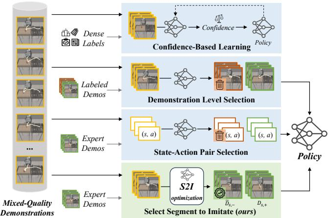
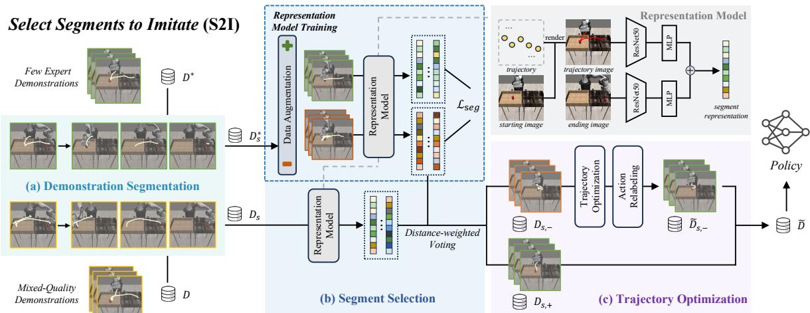
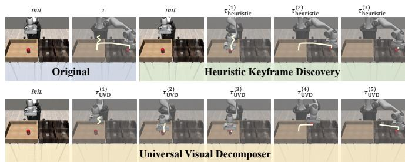
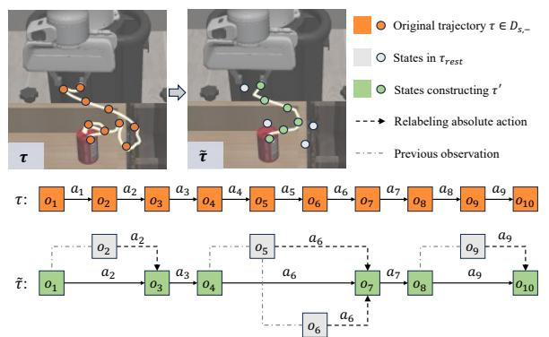
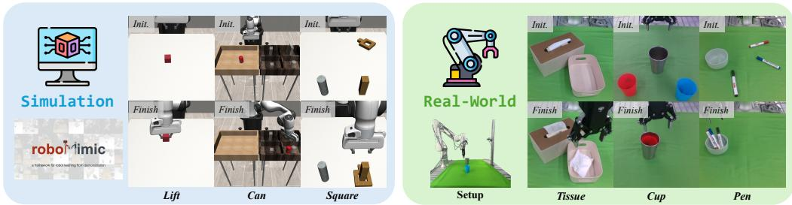
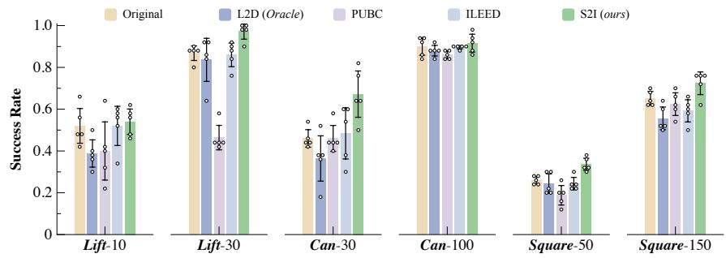
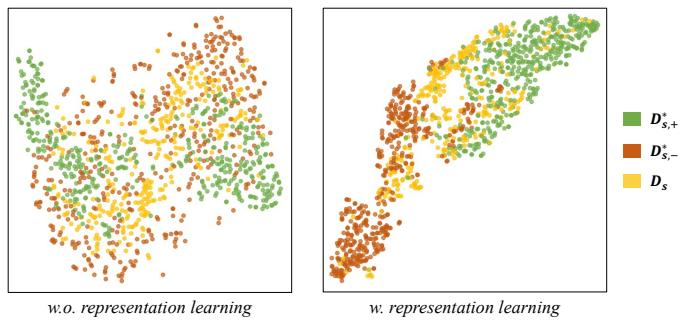
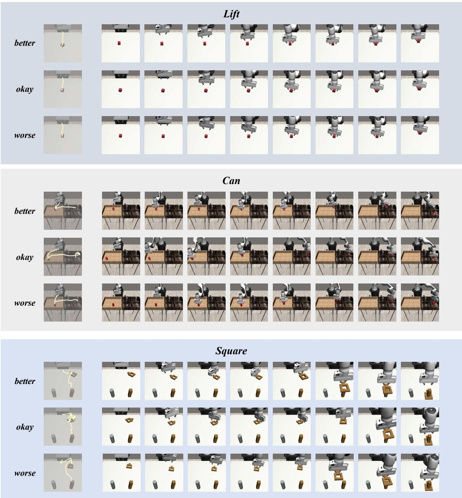
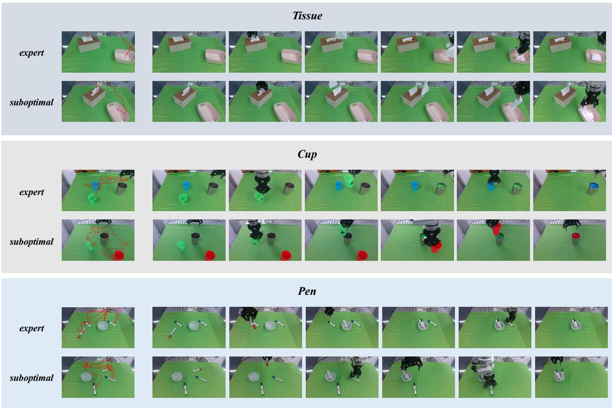

# Towards Effective Utilization of Mixed-Quality Demonstrations in Robotic Manipulation via Segment-Level Selection and Optimization

Jingjing Chen1, Hongjie Fang1, Hao-Shu Fang1 and Cewu Lu1,2,†

Abstract— Data is crucial for robotic manipulation, as it underpins the development of robotic systems for complex tasks. While high-quality, diverse datasets enhance the performance and adaptability of robotic manipulation policies, collecting extensive expert-level data is resource-intensive. Consequently, many current datasets suffer from quality inconsistencies due to operator variability, highlighting the need for methods to utilize mixed-quality data effectively. To mitigate these issues, we propose “Select Segments to Imitate” (S2I), a framework that selects and optimizes mixed-quality demonstration data at the segment level, while ensuring plug-and-play compatibility with existing robotic manipulation policies. The framework has three components: demonstration segmentation dividing origin data into meaningful segments, segment selection using contrastive learning to find high-quality segments, and trajectory optimization to refine suboptimal segments for better policy learning. We evaluate S2I through comprehensive experiments in simulation and real-world environments across six tasks, demonstrating that with only 3 expert demonstrations for reference, S2I can improve the performance of various downstream policies when trained with mixed-quality demonstrations. Project website: https://tonyfang.net/s2i/.

## I. INTRODUCTION

In the realm of robot manipulation, data serves as the cornerstone for developing effective and adaptive systems [55]. Robots rely on extensive datasets [2, 10, 14, 26, 47] to acquire the necessary knowledge and skills for performing complex tasks. The quality, diversity, and quantity of demonstration data directly affect the accuracy and generalization ability of robotic manipulation policies. Without sufficient and well-curated data, robots may struggle to achieve reliable performance and adaptability. Therefore, data is not merely a supplementary component but a fundamental element in the advancement and success of robot manipulation policies [3].

While demonstration data is essential for robotic manipulation, it often varies in quality and consistency due to differences in the expertise of data collection personnel [33]. For example, when collecting robot demonstration data using teleoperation devices [11, 15, 61], less experienced operators may make errors or perform unnecessary actions, leading to a decrease in the quality of the demonstration data. Although high-quality expert demonstrations are ideal for robotic manipulation policy training, acquiring a large amount of such data is both difficult and resource-intensive [3, 14].

As a result, these challenges underscore the need for methods that effectively utilize and enhance available mixedquality demonstration data, especially when policies must rely solely on existing data for learning, without the option to add new data [40] or interact with the environment [22]. Moreover, the method should aim to use as few manual annotations or expert demonstrations as possible to reduce the labor cost of data processing and optimization.

  
Fig. 1: Methods to Deal with Mixed-Quality Demonstrations. Compared with previous methods, our S2I framework selects and optimizes demonstrations at the segment level, preserving semantic consistency within segments while maximizing the retention of high-quality segments and improving lower-quality ones, leading to effective utilization of the mixed-quality demonstrations. With only 3 expert demonstrations for reference, the plug-and-play S2I framework can be used as a data preprocessing step to enhance the performance of various downstream robot manipulation policies when handling mixed-quality demonstrations.

There are two main lines of methods to address the issue: (1) improving the policy to handle mixed-quality data, often through weighted behavior cloning [41], which requires extensive labeled data for better performance [1, 51, 53, 58], and (2) optimizing the data to focus on higherquality demonstrations. The latter can involve filtering at the demonstration level [16, 29], potentially missing highquality segments, or at the state-action pair level [50], which may overlook contextual relevance. Many existing methods simply discard low-quality data without optimizing them, leading to ineffective utilization of mixed-quality datasets.

To this end, we propose “Select Segments to Imitate” (S2I), a framework that enhances the performance of robotic manipulation policies through effective utilization of the mixed-quality demonstrations, with the assistance of only 3 expert demonstrations. After dividing demonstrations into semantically consistent segments, our S2I framework processes at the segment level to extract more high-quality demonstration segments while preserving contextual information. To make the most of the available demonstrations, we also perform trajectory optimization and action relabeling on lowquality segments, which allows the policy to learn smooth trajectories and corrective behaviors. Experiments on both simulation environments and the real-world platform demonstrate the effectiveness of our S2I framework in utilizing mixed-quality demonstrations.

## II. RELATED WORKS

## A. Learning from Mixed-Quality Demonstrations

Imitation learning from mixed-quality demonstrations aims to learn a policy from demonstrations that may vary greatly in quality, and it can be roughly divided into two categories: confidence learning and demonstration selection.

a) Confidence Learning: Several studies address the challenge of learning from mixed-quality demonstrations by introducing confidence weights to assess the optimality of state-action pairs [1, 28, 41, 51, 52, 53, 58]. BCND [41] uses the policy from previous steps as weights for iterative refinement. DWBC [53] and ILEED [1] enhance policy performance through joint training with additional components: a discriminator and a state-encoder, respectively. However, these methods risk guiding the model towards incorrect distributions or increasing sensitivity to hyperparameters and training instability. Concurrently, a recent approach [54] constructs a state graph from the mixed-quality demonstrations, linking nearby states in visual representation space and consecutive states in demonstrations to determine confidence through graph search. Still, the effectiveness depends on carefully tuning the tolerance range for nearby states.

b) Demonstration Selection: The demonstration selection method decouples data processing from policy learning, simplifying the handling of mixed-quality data. L2D [29] employs preference learning to filter out low-quality demonstrations, while ELICIT [16] aligns demonstrations with expert policy but may neglect the usefulness of low-quality data. PUBC [50] creates negative samples by mismatching state-action pairs and updates the positive dataset iteratively through adaptive voting, , overlooking the significance of sequences. AWE [43] applies dynamic programming to smooth expert trajectories, potentially preserving outliers in mixedquality data. These methods reflect the difficulty of utilizing mixed-quality demonstrations without oversimplifying the data. Moreover, simply discarding the low-quality data [4, 16, 29, 50] can lead to inadequate data utilization and limit downstream policy performance.

## B. Robotic Manipulation Policies

Keyframe control [6, 17, 18, 24, 25, 44, 57] and continuous control [8, 33, 48, 49, 56, 61] are two commonly used control strategies in robotic manipulation policies. The former only predicts keyframe actions, while the latter forecasts continuous action trajectories. Continuous control is more general than keyframe control and can be applied to a broader range of robotic manipulation scenarios [59]. Thus, we mainly focus on improving its performance in this paper.

Based on the observation modality, the continuous manipulation policies can be roughly divided into three categories:

1D state-based [8, 33, 42], 2D image-based [8, 33, 61], and 3D point-cloud-based [48, 49, 56, 59]. Among these approaches, BC-RNN [33] integrates temporal information to improve behavior cloning [37], Diffusion Policy (DP) [8] models action prediction as the diffusion denoising process [23], and ACT [61] trains a Transformer-based policy using a CVAE [45] scheme. 3D-based methods typically employ point-based encoders [38, 48, 56, 59] or sparse convolutional encoders [9, 49] to perceive point cloud inputs.

## C. Contrastive Learning

Contrastive learning has made significant strides in representation learning [5, 7, 19, 21, 27]. In robotics, contrastive learning has been applied in various domains such as visual representation learning [31, 34], multimodal representation learning [30, 32], and offline data retrieval [12, 36]. L2D [29] also utilizes contrastive learning to effectively extract behavior features at the demonstration level, showcasing the versatility of this approach across mixed-quality demonstrations. This broad applicability highlights the potential of contrastive learning to unify learning strategies across different data modalities and improve overall task performance.

## III. SELECT SEGMENTS TO IMITATE

In this section, we first formally describe the problem of learning from mixed-quality demonstration data within the context of robotic manipulation (§III-A). We then propose “Select Segments to Imitate” (S2I), a framework for processing mixed-quality datasets, which consists of three parts: demonstration segmentation (§III-B), segment selection (§III-C), and trajectory optimization (§III-D). The overview of our S2I framework is illustrated in Fig. 2.

## A. Problem Formulation

Consider an offline dataset $\mathcal { D } ~ = ~ \{ \tau _ { 1 } , \tau _ { 2 } , . . . , \tau _ { N } \}$ containing N mixed-quality demonstrations for a robotic manipulation task. Each demonstration $\tau$ is a trajectory $\left( o _ { 1 } , a _ { 1 } , o _ { 2 } , a _ { 2 } , \dots , o _ { T } , a _ { T } \right)$ , where $t ~ \in ~ \{ 1 , 2 , \dots , T \}$ represents the timestep, $o _ { t }$ is the observation, and $a _ { t }$ is the action taken by the robot. Additionally, a small offline dataset $\mathcal { D } ^ { * } = \{ \tau _ { 1 } ^ { * } , \tau _ { 2 } ^ { * } , \cdot \cdot \cdot , \tau _ { M } ^ { * } \}$ of $M \ll N$ expert demonstrations is also provided for reference and cannot be used for policy learning. In some cases, each demonstration $\tau _ { i }$ in $\mathcal { D }$ may have a subjective quality label $l _ { i } .$ , which is assumed to be inaccessible in our problem setting.

The goal is to learn a robotic manipulation policy from the mixed-quality dataset D, leveraging the small expert dataset $\mathcal { D } ^ { * }$ , with no additional data collection or environmental interaction allowed during the learning process.

## B. Demonstration Segmentation

Segmenting demonstrations helps identify high-quality segments, particularly within low-quality data. In longhorizon tasks with multiple subtasks, human teleoperated demonstrations may exhibit instability in some subtasks but accuracy in others. By dividing a demonstration $\tau$ into segments ${ \bf \Phi } ( \tau ^ { ( 1 ) } , \tau ^ { ( 2 ) } , \cdots )$ , we can retain high-quality segments for policy learning while optimizing or discarding lowerquality ones. Accurate detection of transition points between segments is crucial: well-chosen points ensure meaningful segments, while poor choices may result in incoherent segments. Thus, a robust segmentation method is required for handling low-quality demonstrations effectively.

  
Fig. 2: Overview of the Select Segments to Imitate (S2I) Framework. (a) Demonstration segmentation stage divides demonstrations into semantic-meaningful segments; (b) Segment selection stage applies contrastive learning to train the representation model on the expert demonstration segments, and then use distance-weighted voting to determine the quality of the mixed-quality demonstration segments; (c) Trajectory optimization stage optimizes the robot trajectory within the low-quality segments and perform action relabeling for the efficient utilization of the whole demonstration dataset (for details, please refer to Fig. 4). Finally, the high-quality segments and the optimized low-quality segments form the final optimized dataset D˜, which can be used directly for downstream policy learning.

We consider two candidates for demonstration segmentation: heuristic keyframe discovery [24, 25, 44] and universal visual decomposer (UVD) [60]. Heuristic keyframe discovery identifies a frame as a keyframe based on either a change in gripper state or robot velocities approaching zero. In contrast, UVD uses pre-trained visual representations [30, 31, 34, 35, 39] to extract image features and recursively searches for keyframes through distance measurements. These keyframes are then used to divide the demonstration into segments. After visualizing the segmentation results in Fig. 3, we observe that visual changes can heavily affect the performance of UVD, leading to excessive and meaningless segments in low-quality demonstrations while heuristic keyframe discovery maintains complete and accurate segmentation for both demonstrations. Hence, we choose heuristic keyframe discovery to ensure effective and robust demonstration segmentation. After segmentation, we obtain mixed-quality demonstration segment dataset $\mathcal { D } _ { s }$ and expert demonstration segment dataset $\mathcal { D } _ { s } ^ { * }$ . In the following sections, we omit the superscript and use τ to denote the trajectory segment for brevity.

## C. Segment Selection

After demonstration segmentation, we need to select high quality segments from $\mathcal { D } _ { s }$ with the assistance of $\mathcal { D } _ { s } ^ { * }$ . To achieve this, we employ supervised contrastive learning [27] for segment representation learning.

To assess the quality of a demonstration segment, we consider two key factors: (1) the starting and ending states, which indicate action success or failure, and (2) the robot trajectory, which reflects task execution quality. We use these factors by inputting the starting and ending images of the segment, along with the robot trajectory, into a segment representation learning process. Given the multimodal nature of the inputs, which include both low-dimensional trajectories and images, effective fusion or alignment of these features is essential. Inspired by [46], we align the robot trajectory with the images by rendering the trajectory onto the starting image. We then pass the starting image with the rendered trajectory and the ending image through ResNet-50 encoders [20] for feature extraction. The extracted features are separately projected and concatenated to create the segment representation z.

  
Fig. 3: Segmentation Results of a RoboMimic-Can [33] Demonstration. UVD might produce meaningless and inconsistent segments like $\tau _ { \mathrm { U V D } } ^ { ( 3 ) }$ and $\tau _ { \mathrm { U V D } } ^ { ( 4 ) }$ compared to heuristic keyframe discovery.

Given that the expert demonstration segment dataset $\mathcal { D } _ { s } ^ { * }$ is too small, we perform data augmentations to generate positive and negative samples based on the dataset. Positive augmentation creates trajectory images from various perspectives of the original demonstration, while negative augmentation either introduces noise to trajectories or mismatches the ending image with the starting image with the rendered trajectory. After that, we obtain augmented positive segment dataset $\mathcal { D } _ { s } ^ { * } \cup \mathcal { D } _ { s , + } ^ { * }$ and negative segment dataset $\mathcal { D } _ { s , - } ^ { * }$ . The following objective is applied for segment representation

learning [27].

$$
\begin{array}{c} \mathcal {L} _ {\mathrm{seg}} = - \frac {1}{| \mathcal {B} _ {+} |} \sum_ {a \in \mathcal {B} _ {+}} \sum_ {b \in \mathcal {B} _ {+} \setminus \{a \}} \log \frac {\exp (\mathbf {z} _ {a} \cdot \mathbf {z} _ {b} / t)}{\sum_ {b ^ {\prime} \in \mathcal {B} \setminus \{a \}} \exp (\mathbf {z} _ {a} \cdot \mathbf {z} _ {b ^ {\prime}} / t)} \\ - \frac {1}{| \mathcal {B} _ {-} |} \sum_ {a \in \mathcal {B} _ {-}} \sum_ {b \in \mathcal {B} _ {-} \setminus \{a \}} \log \frac {\exp (\mathbf {z} _ {a} \cdot \mathbf {z} _ {b} / t)}{\sum_ {b ^ {\prime} \in \mathcal {B} \setminus \{a \}} \exp (\mathbf {z} _ {a} \cdot \mathbf {z} _ {b ^ {\prime}} / t)} \end{array}
$$

where B denotes a batch of segments during training, $\textstyle B _ { + } : =$ $B \cap ( \mathcal { D } _ { s } ^ { * } \cup \mathcal { D } _ { s , + } ^ { * } )$ is the set of positive segments in the batch, $\begin{array} { r } { \mathcal { B } _ { - } : = \mathcal { B } \cap \mathcal { D } _ { s , - } ^ { * } } \end{array}$ is the set of negative segments in the batch, and t is the temperature parameter.

After training the segment representation model, we extract the segment representation zτ for all $\tau \in \mathcal { D } _ { s }$ . Then the quality label of τ is determined via distance-weighted voting [13] from labeled dataset $\mathcal { D } _ { s } ^ { * } \cup \mathcal { D } _ { s , + } ^ { * } \cup \mathcal { D } _ { s , - } ^ { * } , i . e . , \tau$ is classified as a high-quality segment if and only if

$$
\frac {\sum_ {a \in N _ {k , +} (\tau)} \exp \left(- \| \mathbf {z} _ {\tau} - \mathbf {z} _ {a} \|\right)}{\sum_ {a \in N _ {k} (\tau)} \exp \left(- \| \mathbf {z} _ {\tau} - \mathbf {z} _ {a} \|\right)} \geq \delta_ {c}
$$

where $N _ { k } ( \tau )$ is the k-nearest neighbors of τ in the labeled dataset, $N _ { k , + } ( \tau ) : = N _ { k } ( \tau ) \cap ( \mathscr { D } _ { s } ^ { * } \cup \mathscr { D } _ { s , + } ^ { * } )$ is the positivelabeled trajectory set in $N _ { k } ( \tau )$ , and $\delta _ { c }$ is the threshold for classification. By labeling all segments in $\mathcal { D } _ { s }$ , we can create positive segment dataset $\mathcal { D } _ { s , + }$ directly for policy training and negative segment dataset ${ \mathcal D } _ { s , }$ − for trajectory optimization.

## D. Trajectory Optimization

Reducing errors is essential to fully utilize the valuable information in the negative segment dataset $\mathcal { D } _ { s , - } . ~ \mathrm { B y }$ focusing on rearranging states closer to the correct path, the downstream policy can learn more accurate action patterns. Meanwhile, models often struggle when faced with unseen states in imitation learning, as they have difficulties in inferring the correct behavior in out-of-distribution scenarios. Hence, it is necessary to recompute the actions for the states discarded in trajectory optimization, ensuring the policy can make full use of dataset by learning from relabeled actions.

Since the demonstration segment τ contains semantically consistent robot actions, we propose a greedy algorithm (Alg. 1) to approximate the optimal path $\tau ^ { \prime }$ by eliminating points with excessive spatial deviation. For $\tau \in \mathcal { D } _ { s , - }$ , we start with ${ \tau } ^ { \prime } = \{ ( o _ { 1 } , a _ { 1 } ) \}$ and iteratively select the next waypoint. Define $\mathbf { e } _ { i , j } : = e _ { i } - e _ { j }$ as the vector from $e _ { j } ~ { \mathrm { t o } } ~ e _ { i } ,$ where $e _ { i }$ represents the end-effector position at point i. We construct a candidate set $K$ for the next waypoint $\left( o _ { k } , a _ { k } \right)$ using a threshold $\delta _ { \theta }$ for the maximum angle between $\mathbf { e } _ { k , j }$ and $\mathbf { e } _ { T , j }$ , where $T$ is the ending timestep of the segment. This process filters out unnecessary actions that deviate $\mathrm { s i g . }$ nificantly from the action trend within the segment. We then choose $( o _ { k } , a _ { k } )$ with the minimum distance $| \mathbf { e } _ { k , j } |$ as the next waypoint and add it to $\tau ^ { \prime } .$ . The selection process continues until $\left( o _ { T } , a _ { T } \right)$ is included, forming the approximated optimal path $\tau ^ { \prime }$ for the low-quality segment τ .

After applying the greedy algorithm, we can use action relabeling on the discarded waypoints to preserve as much demonstration data as possible. By assuming absolute actions, the action relabeling can be written as $\tilde { a } _ { t } = a _ { t ^ { \prime } }$ where $t ^ { \prime } = \operatorname* { m i n } \{ t ^ { \prime } \mid t ^ { \prime } \geq t$ and $\tilde { a } _ { t ^ { \prime } + 1 } \in \tau ^ { \prime } \}$ , as illustrated in Fig. 4. Thus, the optimized negative dataset $\tilde { \mathcal { D } } _ { s , - }$ comprises the original trajectory τ with the relabeled actions $\{ ( o _ { t } , \tilde { a } _ { t } ) \} _ { t = 1 } ^ { T }$ derived from the optimized trajectory $\tau _ { \textrm { \scriptsize { d } } } ^ { \prime }$ , which we denote as $\tilde { \tau } .$ This enables $\tilde { \mathcal { D } } _ { s , - }$ to support manipulation policies with historical observation horizon [8] or action chunking [61]. Finally, we obtain the optimized dataset $\tilde { \mathcal { D } } = \mathcal { D } _ { s , + } \cup \tilde { \mathcal { D } } _ { s , + }$ for downstream policy learning.

Algorithm 1 Greedy Algorithm for Trajectory Optimization
Input:  $\tau = (o_{1}, a_{1}, \cdots, o_{T}, a_{T}) \in \mathcal{D}_{s,-}$ , tolerance angle  $\delta_{\theta}$ .
Output: Optimized segment  $\tau'$  of negative segment  $\tau$ .
1: Initialize  $\tau' \leftarrow \{(o_{1}, a_{1})\}$ ,  $\tau_{\text{rest}} \leftarrow \{(o_{i}, a_{i})\}_{i=2}^{T}$ .
2:  $\delta_{s} \leftarrow \max_{i=1}^{T-1} \|e_{i+1,i}\|$ .
3: while  $(o_{T}, a_{T}) \notin \tau'$  do
4: Let  $(o_{j}, a_{j})$  be the last element in  $\tau'$ .
5:  $K \leftarrow \{k \mid (o_{k}, a_{k}) \in \tau_{\text{rest}}, \angle(\mathbf{e}_{k,j}, \mathbf{e}_{T,j}) \leq \delta_{\theta}\}$ .
6: if K is  $\varnothing$  then
7:  $K \leftarrow \{k \mid (o_{k}, a_{k}) \in \tau_{\text{rest}}, \|e_{k,j}\| \geq \delta_{s}\}$ .
8: end if
9:  $k \leftarrow \arg\min_{k \in K} \|e_{k,j}\|$ .
10: Update  $\tau' \leftarrow \tau' \cup \{(o_{k}, a_{k})\}$ .
11: Update  $\tau_{\text{rest}} \leftarrow \tau_{\text{rest}} \setminus \{(o_{k}, a_{k})\}$ .
12: end while
13: Return  $\tau'$ .

  
Fig. 4: Trajectory Optimization and Action Relabeling. Orange points stand for the original trajectory, green ones denote optimized trajectory $\tau ^ { \prime } ,$ and grey ones are discarded points. We perform action relabeling on all points in the original trajectory τ to form the optimized $\tilde { \cdot \mathrm {  { \mathbf { \tau } } _ { \mathrm { t r a j e c t o r y } } } } ^ { , } \tilde { \tau }$ . The example here assumes absolute actions, but S2I can support both absolute and relative actions.

## IV. EXPERIMENTS

In this section, we aim to answer the following questions: (Q1) Can S2I improve the performance of robotic manipulation policies (§IV-B)? (Q2) What types of data are beneficial for policy learning (§IV-B)? (Q3) How do different design choices affect the performance of S2I (§IV-C)? (Q4) How effective is S2I in processing real-world demonstration data and improving downstream policy learning (§IV-D)?

## A. Setup

a) Tasks: For simulation experiments, we evaluate three RoboMimic [33] tasks (Lift, Can, Square) in Robo-Suite [63], and for real-world experiments, we evaluate three tasks (Tissue, Cup, Pen) on a platform with a Flexiv Rizon robotic arm, Dahuan AG-95 gripper and 2 Intel RealSense D435 cameras. Task details are shown in Fig. 5.

  
Fig. 5: Tasks. We select 3 tasks from RoboMimic [33] (Lift, Can and Square) in the simulation environment, and design 3 tasks (Tissue, Cup and Pen) in the real-world robot platform for evaluation. Detailed descriptions of all tasks: (1) Lift: pick the block; (2) Can: move the can into the target area; (3) Square: pick a square nut and place it on the target rod; (4) Tissue: take tissue out and place it in the container; (5) Cup: collect all the cups (at most 2) into the large metal cup; (6) Pen: collect all the pens (at most 3) into the bowl.

<table><tr><td>Method</td><td>Dataset Utilization</td><td>Average Gain ↑</td></tr><tr><td>Original</td><td>100.00%</td><td>0.00%</td></tr><tr><td>L2D [29] (Oracle)</td><td>51.59%</td><td>-12.37%</td></tr><tr><td>PUBC [50]</td><td>89.49%</td><td>-18.58%</td></tr><tr><td>ILEED [1]</td><td>100.00%</td><td>+0.97%</td></tr><tr><td>S2I (ours)</td><td>100.00%</td><td>+21.16%</td></tr></table>

Fig. 6: BC-RNN Performance on the State-Based RoboMimic Benchmark. The success rates are averaged across 5 different seeds, based on the checkpoint with the best performance. Our S2I framework effectively and consistently enhances success rates across different tasks with different amounts of demonstration data, outperforming baselines.  
TABLE I: BC-RNN Performance on the State-Based RoboMimic Benchmark. The results are averaged across 5 different seeds, based on the last 10 checkpoints. The performance gain is calculated w.r.t. original BC RNN and then averaged over 6 experiments.

b) Mixed-Quality Demonstration Dataset: We use the RoboMimic multi-human (MH) dataset [33] for simulation experiments, which includes demonstration data of varying quality from 6 operators. We sample multiple demonstrations per task from the dataset, ensuring a balanced mix of demonstration qualities, and use A-N to denote the results obtained from using N mixed-quality demonstrations in task A. For real-world experiments, we collect 25 expert and 25 suboptimal demonstrations per task, combining them into 50 mixed-quality datasets. For reference expert dataset, we select M = 3 demonstrations.

c) Robotic Manipulation Policies: For simulation experiments, we use the 1D state-based BC-RNN [33] and the Diffusion Policy (DP) [8] that can be applied to both 1D state and 2D image data as robot manipulation policies. For real-world experiments, we choose DP and ACT [61] as our 2D image-based policies, as well as RISE [49] as our 3D point-cloud-based policy. The hyper-parameters of all policies remain unchanged.

d) Baselines: For RoboMimic simulation experiments, we choose ILEED [1] for confidence-based learning, L2D [29] for demonstration-level selection, and PUBC [50] for state-action pair selection as baseline methods. Since L2D is not open-sourced but has reported high demonstrationlevel classification accuracy with ground-truth labels, we use “better” and “okay” labeled demonstrations for downstream policy learning, denoted as “L2D (Oracle)”.

e) Metrics: We use the success (completion) rate as the main metric. Performance gain $\frac { { \mathrm { S u c c e s s ~ R a t e - ' O r i g i n a l ~ S u c c e s s ~ R a t e } } } { \mathrm { O r i g i n a l ~ S u c c e s s ~ R a t e } }$ is also reported to evaluate the relative improvements.

f) Protocols: Due to variations in data scale from different data processing methods, we train the policy for a fixed number of iterations, each with a randomly sampled batch from the processed data. During the simulation evaluation, we randomly select 50 starting positions, which vary across seeds but are consistent with the same seed. For real-world experiments, we perform 20 consecutive trials with randomly placed objects in the workspace.

g) Implementation of S2I: For segment selection, we set the segment representation dimension to 256, use 64 neighbors for distance-weighted voting, and set the classification threshold δc to 0.5. We augment 500 positive and 500 negative samples per expert demonstration. In statebased simulation environments, we use empty images as starting and ending images in the representation model. The representation model is trained with an SGD optimizer at a learning rate of 0.005. We set the maximum angle threshold δθ for trajectory optimization to 75◦.

## B. Simulation Results

S2I can improve the performance of various downstream policies by optimizing the mixed-quality demonstration data (Q1). Fig. 6, Tab. I and Tab. VIII illustrate that S2I consistently outperforms baseline methods in simulation environments. This underscores the effectiveness of S2I in handling such data. In line with [8], we also report the average performance of the last 10 checkpoints to provide a representative assessment during training. S2I continues to surpass previous methods by a considerable margin (∼ +20%), demonstrating its ability to filter and optimize lowquality segments for substantial performance gains.

<table><tr><td rowspan="2">Method</td><td colspan="3">State-Based</td><td colspan="3">Image-Based</td></tr><tr><td>Lift-10</td><td>Can-30</td><td>Square-50</td><td>Lift-10</td><td>Can-30</td><td>Square-50</td></tr><tr><td>Original</td><td>0.952 / 0.912</td><td>0.824 / 0.749</td><td>0.504 / 0.409</td><td>0.964 / 0.743</td><td>0.640 / 0.547</td><td>0.568 / 0.492</td></tr><tr><td>L2D [29] (Oracle)</td><td>0.544 / 0.457</td><td>0.796 / 0.734</td><td>0.368 / 0.258</td><td>0.708 / 0.442</td><td>0.524 / 0.439</td><td>0.444 / 0.377</td></tr><tr><td>PUBC [50]</td><td>0.792 / 0.723</td><td>0.756 / 0.680</td><td>0.316 / 0.250</td><td>-</td><td>-</td><td>-</td></tr><tr><td>S2I (ours)</td><td>0.964 / 0.906</td><td>0.840 / 0.785</td><td>0.580 / 0.500</td><td>0.956 / 0.867</td><td>0.712 / 0.624</td><td>0.604 / 0.506</td></tr></table>

TABLE II: DP Performance on the RoboMimic Benchmark1. The success rates are averaged across 5 different seeds. Following [8], the same format of (best performance) / (average of last 10 checkpoints) is reported here.

<table><tr><td>Selection Level</td><td>w/wo Trajectory Optimization</td><td>Dataset Utilization</td><td>Average Gain ↑</td><td>Average Rank ↓</td></tr><tr><td>-</td><td></td><td>100.00%</td><td>0.00%</td><td>4.00</td></tr><tr><td>-</td><td>√</td><td>100.00%</td><td>-27.48%</td><td>6.00</td></tr><tr><td>Demonstration</td><td></td><td>70.93%</td><td>+0.81%</td><td>3.67</td></tr><tr><td>Demonstration</td><td>√</td><td>100.00%</td><td>+14.16%</td><td>2.33</td></tr><tr><td>Segment</td><td></td><td>84.50%</td><td>+1.84%</td><td>3.00</td></tr><tr><td>Segment</td><td>√</td><td>100.00%</td><td>+17.07%</td><td>1.83</td></tr></table>

TABLE III: Ablation Results of Different S2I Design Choices. BC-RNN average performance gains, as well as the average rank of the performance gain, on the state-based RoboMimic benchmark, are reported. The results are averaged over 6 experiments of 5 different seeds, based on the checkpoint with the best performance.

All types of data, as long as carefully optimized, are useful for policy learning (Q2). When naively discarding low-quality demonstrations, as in baselines like L2D and PUBC, policy performance drops significantly and the dataset utilization rates are relatively low, indicating that even suboptimal demonstrations are valuable for policy learning. These low-quality demonstrations can expand the exploration range in the state space. Therefore, it is crucial to leverage the valuable insights they provide and fully utilize the mixed-quality dataset. Thanks to our proposed trajectory optimization module, S2I offers an effective approach to optimize low-quality segments without altering the dataset’s exploration range, resulting in improved policy performance.

## C. Ablations

Segment-level selection and trajectory optimization (with action relabeling) are both crucial for performance improvement (Q3). We ablate the selection level and the trajectory optimization module. For demonstrationlevel selection, we assess demonstration quality by averaging the quality results of each segment. The ablation results in Tab. III show that without selection, performance drops when only trajectory optimization is applied (−27.48%), as highquality segments are already optimal. Selecting at demonstration or segment level improves performance marginally (+0.81% and +1.84%). Introducing trajectory optimization with action relabeling boosts both dataset utilization and performance, with segment-level application achieving the best results (+17.07%) by refining actions in low-quality data. These results validate S2I’s design choices.

1ILEED [1] is only compatible with policies employing Gaussian mixture heads and is therefore excluded from DP experiments. PUBC [50] is designed for state inputs, so we exclude it in the image-based experiments.

<table><tr><td rowspan="2">Method</td><td rowspan="2">Tissue-</td><td colspan="2">Cup</td><td colspan="3">Pen</td></tr><tr><td>1 cup</td><td>2 cups</td><td>1 pen</td><td>2 pens</td><td>3 pens</td></tr><tr><td>ACT [61]</td><td>0.00%</td><td>40.00%</td><td>35.00%</td><td>50.00%</td><td>25.00%</td><td>16.67%</td></tr><tr><td>ACT + S2I</td><td>25.00%</td><td>55.00%</td><td>45.00%</td><td>60.00%</td><td>40.00%</td><td>23.33%</td></tr><tr><td>DP [8]</td><td>10.00%</td><td>35.00%</td><td>30.00%</td><td>50.00%</td><td>30.00%</td><td>26.67%</td></tr><tr><td>DP + S2I</td><td>65.00%</td><td>55.00%</td><td>50.00%</td><td>70.00%</td><td>50.00%</td><td>36.67%</td></tr><tr><td>RISE [49]</td><td>90.00%</td><td>90.00%</td><td>87.50%</td><td>70.00%</td><td>50.00%</td><td>40.00%</td></tr><tr><td>RISE + S2I</td><td>90.00%</td><td>95.00%</td><td>95.00%</td><td>90.00%</td><td>80.00%</td><td>60.00%</td></tr></table>

TABLE IV: Results of Real-World Experiments. The policy success (completion) rates over 20 trials for each setup are reported.

## D. Real-World Results

S2I effectively optimizes real-world mixed-quality demonstration data, enhancing the performance of various downstream policies in real-world experiments (Q4). The comprehensive results shown in Tab IV reveal that S2I can significantly improve performance for various downstream policies across different tasks, especially for those with initially low success rates. Hence, S2I is also consistently effective in utilizing real-world mixed-quality demonstrations and can substantially contribute to a better robotic manipulation policy.

## V. CONCLUSION

This paper introduces “Select Segments to Imitate” (S2I), a framework designed to effectively use mixed-quality demonstrations for robotic manipulation policy learning by focusing on segment-level selection and optimization. S2I extracts high-quality segments via contrastive learning and refines lower-quality ones through trajectory optimization and action relabeling, ensuring effective learning of corrective behaviors while fully utilizing the demonstration dataset. Extensive experiments in both simulated and real-world environments demonstrate the robust ability of S2I to optimize demonstrations and significantly boost robotic manipulation policy performance. While S2I shows promising results across various tasks and policies, it may struggle in handling robot trajectories with complex rotations. Future work includes addressing this issue, applying S2I to large-scale robotic datasets [14], and extending S2I to optimize language-guided demonstrations.

## ACKNOWLEDGEMENT

This work was supported by the National Key Research and Development Project of China (No. 2022ZD0160102), the National Key Research and Development Project of China (No. 2021ZD0110704), Shanghai Artificial Intelligence Laboratory, XPLORER PRIZE grants.

[1] Mark Beliaev et al. “Imitation Learning by Estimating Expertise of Demonstrators”. In: International Conference on Machine Learning. Vol. 162. PMLR, 2022, pp. 1732–1748.

[2] Homanga Bharadhwaj et al. “RoboAgent: Generalization and Efficiency in Robot Manipulation via Semantic Augmentations and Action Chunking”. In: IEEE International Conference on Robotics and Automation. 2024, pp. 4788–4795.

[3] Anthony Brohan et al. “RT-1: Robotics Transformer for Real-World Control at Scale”. In: Robotics: Science and Systems. 2023.

[4] Xizhou Bu et al. “Aligning Human Intent From Imperfect Demonstrations With Confidence-Based Inverse Soft-Q Learning”. In: IEEE Robotics and Automation Letters (2024).

[5] Mathilde Caron et al. “Unsupervised Learning of Visual Features by Contrasting Cluster Assignments”. In: Advances in Neural Information Processing Systems 33 (2020), pp. 9912– 9924.

[6] Shizhe Chen et al. “PolarNet: 3D Point Clouds for Language-Guided Robotic Manipulation”. In: Conference on Robot Learning. PMLR. 2023, pp. 1761–1781.

[7] Ting Chen et al. “A Simple Framework for Contrastive Learning of Visual Representations”. In: International Conference on Machine Learning. PMLR. 2020, pp. 1597–1607.

[8] Cheng Chi et al. “Diffusion Policy: Visuomotor Policy Learning via Action Diffusion”. In: Robotics: Science and Systems. 2023.

[9] Christopher Choy, JunYoung Gwak, and Silvio Savarese. “4D Spatio-Temporal ConvNets: Minkowski Convolutional Neural Networks”. In: Proceedings of the IEEE/CVF Conference on Computer Vision and Pattern Recognition. 2019, pp. 3075–3084.

[10] Open X-Embodiment Collaboration et al. “Open X-Embodiment: Robotic Learning Datasets and RT-X Models”. In: IEEE International Conference on Robotics and Automation. 2024, pp. 6892–6903.

[11] Runyu Ding et al. “Bunny-VisionPro: Real-Time Bimanual Dexterous Teleoperation for Imitation Learning”. In: arXiv preprint arXiv:2407.03162 (2024).

[12] Maximilian Du et al. “Behavior Retrieval: Few-Shot Imitation Learning by Querying Unlabeled Datasets”. In: Robotics: Science and Systems. 2023.

[13] Sahibsingh A Dudani. “The Distance-Weighted k-Nearest-Neighbor Rule”. In: IEEE Transactions on Systems, Man, and Cybernetics 4 (1976), pp. 325–327.

[14] Hao-Shu Fang et al. “RH20T: A Comprehensive Robotic Dataset for Learning Diverse Skills in One-Shot”. In: IEEE International Conference on Robotics and Automation. 2024, pp. 653–660.

[15] Hongjie Fang et al. “AirExo: Low-Cost Exoskeletons for Learning Whole-Arm Manipulation in the Wild”. In: IEEE International Conference on Robotics and Automation. 2024, pp. 15031–15038.

[16] Kanishk Gandhi et al. “Eliciting Compatible Demonstrations for Multi-Human Imitation Learning”. In: Conference on Robot Learning. PMLR. 2023, pp. 1981–1991.

[17] Theophile Gervet et al. “Act3D: 3D Feature Field Transform- ´ ers for Multi-Task Robotic Manipulation”. In: Conference on Robot Learning. PMLR. 2023, pp. 3949–3965.

[18] Ankit Goyal et al. “RVT: Robotic View Transformer for 3D Object Manipulation”. In: Conference on Robot Learning. PMLR. 2023, pp. 694–710.

[19] Jean-Bastien Grill et al. “Bootstrap Your Own Latent - A New Approach to Self-Supervised Learning”. In: Advances in Neural Information Processing Systems 33 (2020), pp. 21271–21284.

[20] Kaiming He et al. “Deep Residual Learning for Image Recognition”. In: Proceedings of the IEEE Conference on Computer Vision and Pattern Recognition. 2016, pp. 770– 778.

[21] Kaiming He et al. “Momentum Contrast for Unsupervised Visual Representation Learning”. In: Proceedings of the IEEE/CVF Conference on Computer Vision and Pattern Recognition. 2020, pp. 9729–9738.

[22] Jonathan Ho and Stefano Ermon. “Generative Adversarial Imitation Learning”. In: Advances in Neural Information Processing Systems 29 (2016).

[23] Jonathan Ho, Ajay Jain, and Pieter Abbeel. “Denoising Diffusion Probabilistic Models”. In: Advances in Neural Information Processing Systems 33 (2020), pp. 6840–6851.

[24] Stephen James and Andrew J Davison. “Q-Attention: Enabling Efficient Learning for Vision-Based Robotic Manipulation”. In: IEEE Robotics and Automation Letters 7.2 (2022), pp. 1612–1619.

[25] Stephen James et al. “Coarse-to-Fine Q-Attention: Efficient Learning for Visual Robotic Manipulation via Discretisation”. In: Proceedings of the IEEE/CVF Conference on Computer Vision and Pattern Recognition. 2022, pp. 13739– 13748.

[26] Alexander Khazatsky et al. “DROID: A Large-Scale Inthe-Wild Robot Manipulation Dataset”. In: arXiv preprint arXiv:2403.12945 (2024).

[27] Prannay Khosla et al. “Supervised Contrastive Learning”. In: Advances in Neural Information Processing Systems 33 (2020), pp. 18661–18673.

[28] Geon-Hyeong Kim et al. “DemoDICE: Offline Imitation Learning with Supplementary Imperfect Demonstrations”. In: International Conference on Learning Representations. 2022.

[29] Sachit Kuhar et al. “Learning to Discern: Imitating Heterogeneous Human Demonstrations with Preference and Representation Learning”. In: Conference on Robot Learning. Vol. 229. PMLR, 2023, pp. 1437–1449.

[30] Yecheng Jason Ma et al. “LIV: Language-Image Representations and Rewards for Robotic Control”. In: International Conference on Machine Learning. PMLR. 2023, pp. 23301– 23320.

[31] Yecheng Jason Ma et al. “VIP: Towards Universal Visual Reward and Representation via Value-Implicit Pre-Training”. In: International Conference on Learning Representations. 2023.

[32] Yueen Ma et al. “Actra: Optimized Transformer Architecture for Vision-Language-Action Models in Robot Learning”. In: arXiv preprint arXiv:2408.01147 (2024).

[33] Ajay Mandlekar et al. “What Matters in Learning from Offline Human Demonstrations for Robot Manipulation”. In: Conference on Robot Learning. Vol. 164. PMLR. 2021, pp. 1678–1690.

[34] Suraj Nair et al. “R3M: A Universal Visual Representation for Robot Manipulation”. In: Conference on Robot Learning. Vol. 205. PMLR, 2022, pp. 892–909.

[35] Maxime Oquab et al. “DINOv2: Learning Robust Visual Features without Supervision”. In: Trans. Mach. Learn. Res. 2024 (2024).

[36] Jyothish Pari et al. “The Surprising Effectiveness of Representation Learning for Visual Imitation”. In: Robotics: Science and Systems. 2022.

[37] Dean A Pomerleau. “ALVINN: An Autonomous Land Vehicle in a Neural Network”. In: Advances in Neural Information Processing Systems. Vol. 1. 1988.

[38] Charles R Qi et al. “PointNet: Deep Learning on Point Sets for 3D Classification and Segmentation”. In: Proceedings of the IEEE Conference on Computer Vision and Pattern Recognition. 2017, pp. 652–660.

[39] Alec Radford et al. “Learning Transferable Visual Models from Natural Language Supervision”. In: International Conference on Machine Learning. PMLR. 2021, pp. 8748–8763.

[40] Stephane Ross, Geoffrey Gordon, and Drew Bagnell. “A ´ Reduction of Imitation Learning and Structured Prediction to No-Regret Online Learning”. In: International Conference on Artificial Intelligence and Statistics. 2011, pp. 627–635.

[41] Fumihiro Sasaki and Ryota Yamashina. “Behavioral Cloning from Noisy Demonstrations”. In: International Conference on Learning Representations. 2021.

[42] Nur Muhammad Shafiullah et al. “Behavior Transformers: Cloning k Modes with One Stone”. In: Advances in Neural Information Processing Systems. Vol. 35. 2022, pp. 22955– 22968.

[43] Lucy Xiaoyang Shi et al. “Waypoint-Based Imitation Learning for Robotic Manipulation”. In: Conference on Robot Learning. PMLR. 2023, pp. 2195–2209.

[44] Mohit Shridhar, Lucas Manuelli, and Dieter Fox. “Perceiver-Actor: A Multi-Task Transformer for Robotic Manipulation”. In: Conference on Robot Learning. PMLR. 2022, pp. 785– 799.

[45] Kihyuk Sohn, Honglak Lee, and Xinchen Yan. “Learning Structured Output Representation using Deep Conditional Generative Models”. In: Advances in Neural Information Processing Systems 28 (2015).

[46] Vitalis Vosylius et al. “Render and Diffuse: Aligning Image and Action Spaces for Diffusion-based Behaviour Cloning”. In: Robotics: Science and Systems. 2024.

[47] Homer Rich Walke et al. “BridgeData V2: A Dataset for Robot Learning at Scale”. In: Conference on Robot Learning. Vol. 229. PMLR, 2023, pp. 1723–1736.

[48] Chen Wang et al. “DexCap: Scalable and Portable Mocap Data Collection System for Dexterous Manipulation”. In: Robotics: Science and Systems. 2024.

[49] Chenxi Wang et al. “RISE: 3D Perception Makes Real-World Robot Imitation Simple and Effective”. In: arXiv preprint arXiv:2404.12281 (2024).

[50] Qiang Wang et al. “Improving Behavioural Cloning with Positive Unlabeled Learning”. In: Conference on Robot Learning. Vol. 229. PMLR, 2023, pp. 3851–3869.

[51] Kun Wu et al. “SWBT: Similarity Weighted Behavior Transformer with the Imperfect Demonstration for Robotic Manipulation”. In: arXiv preprint arXiv:2401.08957 (2024).

[52] Yueh-Hua Wu et al. “Imitation learning from imperfect demonstration”. In: International Conference on Machine Learning. PMLR. 2019, pp. 6818–6827.

[53] Haoran Xu et al. “Discriminator-Weighted Offline Imitation Learning from Suboptimal Demonstrations”. In: International Conference on Machine Learning. PMLR. 2022, pp. 24725–24742.

[54] Zhao-Heng Yin and Pieter Abbeel. “Offline Imitation Learning through Graph Search and Retrieval”. In: Robotics: Science and Systems (2024).

[55] Tianhe Yu et al. “Scaling Robot Learning with Semantically Imagined Experience”. In: Robotics: Science and Systems. 2023.

[56] Yanjie Ze et al. “3D Diffusion Policy: Generalizable Visuomotor Policy Learning via Simple 3D Representations”. In: Robotics: Science and Systems. 2024.

[57] Junjie Zhang et al. “SAM-E: Leveraging Visual Foundation Model with Sequence Imitation for Embodied Manipulation”. In: International Conference on Machine Learning. 2024.

[58] Songyuan Zhang et al. “Confidence-Aware Imitation Learning from Demonstrations with Varying Optimality”. In: Advances in Neural Information Processing Systems 34 (2021), pp. 12340–12350.

[59] Tong Zhang et al. “Leveraging Locality to Boost Sample Efficiency in Robotic Manipulation”. In: arXiv preprint arXiv:2406.10615 (2024).

[60] Zichen Zhang et al. “Universal Visual Decomposer: Long-Horizon Manipulation Made Easy”. In: IEEE International Conference on Robotics and Automation. IEEE. 2024, pp. 6973–6980.

[61] Tony Z Zhao et al. “Learning Fine-Grained Bimanual Manipulation with Low-Cost Hardware”. In: Robotics: Science and Systems. 2023.

[62] Yi Zhou et al. “On the Continuity of Rotation Representations in Neural Networks”. In: Proceedings of the IEEE/CVF Conference on Computer Vision and Pattern Recognition. 2019, pp. 5745–5753.

[63] Yuke Zhu et al. “Robosuite: A Modular Simulation Framework and Benchmark for Robot Learning”. In: arXiv preprint arXiv:2009.12293. 2020.

## A. Experiment Details

a) Simulation: All experiments in the state-based RoboSuite simulation environment [63] are conducted across seeds 1, 42, 233, 3407, and 9989, and the reported results are averaged across these seeds. To ensure a fair comparison in the simulation environment, we randomly generate 50 initialization setups for each seed and use the same generated setups across all methods during evaluations. Furthermore, demonstrations for each task are selected based on specific modular arithmetic rules to maintain a balanced distribution of demonstration qualities, as described in Appendix I.

b) Real-World: All experiments in the real-world robot platform are conducted with 20 consecutive trials, with the average success (completion) rate reported. The objects are randomly placed in the workspace. For trials with the same index across different methods, we keep the object positions in the workspace relatively fixed for fairness considerations.

## B. Baseline Implementations

We introduce the details of baseline implementations here, including L2D [29], ILEED [1], and PUBC [50]. Moreover, we also conduct experiments of AWE [43] to evaluate its performance in handling mixed-quality demonstration data.

a) L2D: We use the oracle classifier as the replacement of the L2D classifier due to similar accuracy. Then, we keep the demonstrations with “better” and “okay” labels while discarding those with “worse” labels to form the dataset for downstream policy learning.

b) ILEED: Following the instructions in the original paper and utilizing the official code as a reference, we implement two versions of ILEED: ILEED (w. labels) and ILEED (wo. labels). The former uses quality labels from the dataset as the expertise labels, and the latter assumes no quality labels are available and treats the expertise labels of all demonstrations as the same. The ILEED in Fig. 6 and Tab. I correspond to the former one (w. labels), which empirically demonstrates better performance. We use a state encoder (with softmax head) to extract information from the observation, which is combined with the expertise parameter ω as the weight. This process generates a scaling coefficient for the output variance of the Gaussian mixture head. The details of ILEED hyperparameters are shown in Tab. V.

<table><tr><td>Hyperparameters</td><td>Lift / Can / Square</td></tr><tr><td>State Encoder</td><td>3-layer MLP + Softmax</td></tr><tr><td>Activation</td><td>ReLU</td></tr><tr><td>Hidden Size</td><td>16</td></tr><tr><td>Iterations</td><td>2000</td></tr><tr><td>Learning Rate of ω</td><td>1e-4</td></tr><tr><td>State Embedding Dimension</td><td>2</td></tr></table>

TABLE V: Hyperparameters of ILEED [1] in the Experiments.

c) PUBC: We slightly modify the official code to generate positive dataset iteratively from the mixed-quality dataset D and seed positive dataset D∗. The generated positive dataset is used for downstream policy learning.

Because PUBC is designed specifically for 1D state inputs, we only conduct evaluations in state-based RoboMimic environments. We have carefully tuned the hyperparameters of PUBC and empirically determined the hyperparameters for our experiments based on their performances. The details of PUBC hyperparameters are shown in Tab. VI.

<table><tr><td>Hyperparameters</td><td>Lift</td><td>Can</td><td>Square</td></tr><tr><td>Models in Ensemble</td><td>3</td><td>3</td><td>3</td></tr><tr><td>Iterations</td><td>10</td><td>10</td><td>10</td></tr><tr><td>Negative Sampler</td><td>full</td><td>full</td><td>full</td></tr><tr><td>Epochs per Iteration</td><td>20</td><td>20</td><td>20</td></tr><tr><td>Batch Size</td><td>1024</td><td>1024</td><td>1024</td></tr><tr><td>Threshold Fitting Pow</td><td>8</td><td>10</td><td>10</td></tr><tr><td>Threshold High Bound</td><td>0.5</td><td>0.5</td><td>0.5</td></tr></table>

TABLE VI: Hyperparameters of PUBC [50] in the Experiments.

d) AWE: We directly use the official code to optimize all mixed-quality demonstration trajectories. All hyperparameters remain the same.

## C. Robotic Manipulation Policy Implementations

Since S2I does not require joint design or joint training with the policy, we do not need to modify the hyperparameters of the policies. Therefore, we inherit the original hyperparameters in their papers [8, 33, 49, 61]. In simulation environments, for BC-RNN (relative action space), we set the training epochs as 2000 and save a checkpoint every 100 epochs, with 250 warm-up epochs; for state-based DP (absolute action space), we set the training epochs as 2000 and save a checkpoint every 100 epochs; for image-based DP, we set the training epochs as 900 and save a checkpoint every 50 epochs. For real-world experiments, we set the training epochs as 1000 and use the last checkpoint in evaluations for all policies.

In terms of action representations, BC-RNN utilizes relative action representations, while the rest methods all use absolute action representations, with DP and RISE leveraging continuous 6D representation for rotation [62].

## D. Segment Representation Results

We use t-SNE to visualize the segment representation of Can-30 in Fig. 7, to illustrate how the contrastive learning process clusters similar quality samples in the feature space. This clustering organizes the segment data meaningfully and effectively helps distance-weighted voting by distinguishing different quality types.

  
Fig. 7: t-SNE Visualizations of the Feature Space of Can-100 w/wo Segment Representation Learning.

<table><tr><td rowspan="2">Method</td><td colspan="2">Lift</td><td colspan="2">Can</td><td colspan="2">Square</td><td rowspan="2" colspan="2">Average Gain ↑(best / last 10 average)</td></tr><tr><td>10</td><td>30</td><td>30</td><td>100</td><td>50</td><td>150</td></tr><tr><td>Original</td><td>0.520 / 0.372</td><td>0.868 / 0.769</td><td>0.460 / 0.357</td><td>0.900 / 0.829</td><td>0.260 / 0.177</td><td>0.652 / 0.511</td><td>0.00%</td><td>/ 0.00%</td></tr><tr><td>L2D [29] (Oracle)</td><td>0.388 / 0.330</td><td>0.836 / 0.738</td><td>0.364 / 0.278</td><td>0.880 / 0.792</td><td>0.244 / 0.134</td><td>0.556 / 0.438</td><td>-12.17%</td><td>/ -12.37%</td></tr><tr><td>PUBC [50]</td><td>0.396 / 0.300</td><td>0.464 / 0.365</td><td>0.460 / 0.361</td><td>0.860 / 0.760</td><td>0.188 / 0.123</td><td>0.624 / 0.503</td><td>-18.31%</td><td>/ -18.58%</td></tr><tr><td>ILEED [1] (w. labels)</td><td>0.520 / 0.432</td><td>0.860 / 0.776</td><td>0.484 / 0.374</td><td>0.896 / 0.793</td><td>0.244 / 0.171</td><td>0.592 / 0.469</td><td>-1.92%</td><td>/ +0.97%</td></tr><tr><td>ILEED [1] (wo. labels)</td><td>0.548 / 0.446</td><td>0.860 / 0.740</td><td>0.284 / 0.213</td><td>0.856 / 0.734</td><td>0.236 / 0.154</td><td>0.572 / 0.471</td><td>-10.03%</td><td>/ -9.36%</td></tr><tr><td>S2I-ILEED</td><td>0.544 / 0.436</td><td>0.880 / 0.768</td><td>0.568 / 0.454</td><td>0.912 / 0.822</td><td>0.236 / 0.174</td><td>0.608 / 0.482</td><td>+2.47%</td><td>/ +5.97%</td></tr><tr><td>S2I (ours)</td><td>0.532 / 0.417</td><td>0.972 / 0.898</td><td>0.672 / 0.556</td><td>0.916 / 0.826</td><td>0.336 / 0.228</td><td>0.724 / 0.581</td><td>+17.07%</td><td>/ +21.16%</td></tr></table>

TABLE VII: Detailed BC-RNN Performance (Success Rate) on the State-Based RoboMimic Benchmark. This table includes the full results of Fig. 6 and Tab. I. Following [8], the same format of (best performance) / (average of last 10 checkpoints) is utilized here. The results are averaged across 5 different seeds and 50 different initial environment setups (250 in total).

<table><tr><td>Environment</td><td>Method</td><td>Lift-10</td><td>Can-30</td><td>Square-50</td><td colspan="3">Average Gain ↑</td><td colspan="3">Worst Gain ↑</td></tr><tr><td rowspan="5">State-based</td><td>Original</td><td>0.952 / 0.912</td><td>0.824 / 0.749</td><td>0.504 / 0.409</td><td>0.00%</td><td>/</td><td>0.00%</td><td>0.00%</td><td>/</td><td>0.00%</td></tr><tr><td>L2D [29] (Oracle)</td><td>0.544 / 0.457</td><td>0.796 / 0.734</td><td>0.368 / 0.258</td><td>-24.41%</td><td>/</td><td>-29.60%</td><td>-42.86%</td><td>/</td><td>-49.89%</td></tr><tr><td>PUBC [50]</td><td>0.792 / 0.723</td><td>0.756 / 0.680</td><td>0.316 / 0.250</td><td>-20.79%</td><td>/</td><td>-22.94%</td><td>-37.30%</td><td>/</td><td>-38.88%</td></tr><tr><td>AWE [43]</td><td>0.688 / 0.605</td><td>0.836 / 0.774</td><td>0.552 / 0.482</td><td>-5.58%</td><td>/</td><td>-4.16%</td><td>-27.73%</td><td>/</td><td>-33.66%</td></tr><tr><td>S2I (ours)</td><td>0.964 / 0.906</td><td>0.840 / 0.785</td><td>0.580 / 0.500</td><td>+6.09%</td><td>/</td><td>+8.80%</td><td>+1.26%</td><td>/</td><td>-0.66%</td></tr><tr><td rowspan="4">Image-based</td><td>Original</td><td>0.964 / 0.743</td><td>0.640 / 0.547</td><td>0.568 / 0.492</td><td>0.00%</td><td>/</td><td>0.00%</td><td>0.00%</td><td>/</td><td>0.00%</td></tr><tr><td>L2D [29] (Oracle)</td><td>0.708 / 0.442</td><td>0.524 / 0.439</td><td>0.444 / 0.377</td><td>-22.17%</td><td>/</td><td>-27.88%</td><td>-26.56%</td><td>/</td><td>-40.51%</td></tr><tr><td>AWE [43]</td><td>0.996 / 0.951</td><td>0.728 / 0.660</td><td>0.464 / 0.385</td><td>+8.97%</td><td>/</td><td>-0.41%</td><td>-18.31%</td><td>/</td><td>-21.75%</td></tr><tr><td>S2I (ours)</td><td>0.956 / 0.867</td><td>0.712 / 0.624</td><td>0.604 / 0.506</td><td>+5.59%</td><td>/</td><td>+11.20%</td><td>-0.83%</td><td>/</td><td>+2.85%</td></tr></table>

TABLE VIII: Detailed DP Performance (Success Rate, with additional experiments of AWE [43]) on the RoboMimic Benchmark. The success rates are averaged across 5 different seeds. Following [8], the same format of (best performance) / (average of last 10 checkpoints) is reported here.

## E. Additional Simulation Results

We provide the detailed RoboMimic state-based results in Tab. VII, including methods ILEED (w. labels) and S2I-ILEED. In the latter one, we assume that two demonstrators have different expertise: one proficient producing all high-quality demonstrations and one rusty producing all low-quality demonstrations. We classify demonstrations into high-quality and low-quality sets using the selection results from S2I, averaged across all segments within each demonstration. Demonstrations in the high-quality set are attributed to the proficient demonstrator, while those in the low-quality set are attributed to the rusty demonstrator.

Using ground-truth expertise labels of demonstrators in the dataset can improve the performance of ILEED. If we treat all demonstrations as having the same level of expertise, performance is inferior compared to using groundtruth expertise labels. This shows that ground-truth expertise labels in the dataset can reflect the quality of the demonstrations to some extent. However, if the expertise labels are unavailable, vanilla ILEED may yield unsatisfactory results.

Using the quality labels of the demonstrations determined by S2I can further improve the performance of ILEED. We observe that demonstrators with okay expertise labels can sometimes produce low-quality demonstrations and those with worse labels can occasionally produce highquality demonstrations (Fig. 8). This variability can cause inconsistencies in the demonstration sets attributed to each demonstrator. In S2I-ILEED, by assuming one proficient and one rusty demonstrator and classifying demonstrations into two sets based on these virtual demonstrators, we achieve greater consistency in quality within each set. Consequently, the expertise labels derived in this manner are more consistent and effective than the ground-truth labels provided in the dataset. Experimental results confirm this, showing that S2I-ILEED further enhances the policy performance with ILEED (−1.92% → +2.47% / +0.97%→ +5.97%).

S2I also achieves consistent performance with DP on both state-based and image-based RoboMimic benchmarks. The detailed DP performance results on the RoboMimic benchmark are shown in Tab. VIII. We observe that S2I achieves consistent performance on both benchmarks (with an average performance gain of +6.09% / +8.80% and +5.59% / +11.20% for state-based and image-based benchmarks respectively), outperforming prior baselines (include AWE [43], which we will discuss later) by a large margin, demonstrating the effectiveness of S2I when combining with different downstream robot manipulation policies.

AWE, while achieves competitive performance with image-based DP on pick-and-place tasks like Lift and Can, fails in state-based environments like Lift and complex fine-grained tasks like Square. We suspect that this inconsistency can be attributed to the fact that AWE does not adequately preserve outliers in the state-based domain, which is crucial for handling the intricacies of such environments.

<table><tr><td rowspan="3">Selection Level</td><td rowspan="3">w/wo Trajectory Optimization</td><td rowspan="3">w/wo Action Relabeling</td><td colspan="6">Performance Gain ↑</td><td rowspan="3">Dataset Utilization</td><td rowspan="3">Average Gain ↑</td><td rowspan="3"># Tasks with Improvements ↑</td></tr><tr><td colspan="2">Lift</td><td colspan="2">Can</td><td colspan="2">Square</td></tr><tr><td>10</td><td>30</td><td>30</td><td>100</td><td>50</td><td>150</td></tr><tr><td>-</td><td></td><td></td><td>0.00%</td><td>0.00%</td><td>0.00%</td><td>0.00%</td><td>0.00%</td><td>0.00%</td><td>100.00%</td><td>0.00%</td><td>0 / 6</td></tr><tr><td>-</td><td>√</td><td></td><td>-51.54%</td><td>-27.19%</td><td>-46.09%</td><td>-34.67%</td><td>-50.77%</td><td>-40.49%</td><td>70.30%</td><td>-41.79%</td><td>0 / 6</td></tr><tr><td>-</td><td>√</td><td>√</td><td>-25.38%</td><td>-3.69%</td><td>-1.74%</td><td>-11.56%</td><td>-47.69%</td><td>-74.85%</td><td>100.00%</td><td>-27.48%</td><td>0 / 6</td></tr><tr><td>Demonstration</td><td></td><td></td><td>+26.15%</td><td>-0.46%</td><td>-9.57%</td><td>+2.22%</td><td>0.00%</td><td>-13.50%</td><td>70.93%</td><td>+0.81%</td><td>2 / 6</td></tr><tr><td>Demonstration</td><td>√</td><td></td><td>-5.38%</td><td>+5.53%</td><td>+13.04%</td><td>+4.44%</td><td>-32.31%</td><td>+4.91%</td><td>87.05%</td><td>-1.63%</td><td>4 / 6</td></tr><tr><td>Demonstration</td><td>√</td><td>√</td><td>-6.15%</td><td>+13.36%</td><td>+35.65%</td><td>+0.89%</td><td>+33.85%</td><td>+7.36%</td><td>100.00%</td><td>+14.16%</td><td>5 / 6</td></tr><tr><td>Segment</td><td></td><td></td><td>-7.69%</td><td>+0.46%</td><td>+6.09%</td><td>+2.67%</td><td>+7.69%</td><td>+1.84%</td><td>84.50%</td><td>+1.84%</td><td>5 / 6</td></tr><tr><td>Segment</td><td>√</td><td></td><td>+3.08%</td><td>-7.83%</td><td>+46.96%</td><td>+0.89%</td><td>-1.54%</td><td>+0.61%</td><td>91.04%</td><td>+7.03%</td><td>4 / 6</td></tr><tr><td>Segment</td><td>√</td><td>√</td><td>+2.31%</td><td>+11.98%</td><td>+46.09%</td><td>+1.78%</td><td>+29.23%</td><td>+11.04%</td><td>100.00%</td><td>+17.07%</td><td>6 / 6</td></tr></table>

TABLE IX: Detailed Ablation Results of Different S2I Design Choices. BC-RNN performance gains on the state-based RoboMimic benchmark are reported. We also count the number of tasks with improvements as a consistency metric. The results are averaged over 6 experiments of 5 different seeds, based on the checkpoint with the best performance.

<table><tr><td rowspan="3">Method</td><td colspan="2">Tissue</td><td colspan="4">Cup</td><td colspan="6">Pen</td></tr><tr><td>20%-80%</td><td>80%-20%</td><td colspan="2">20%-80%</td><td colspan="2">80%-20%</td><td colspan="3">20%-80%</td><td colspan="3">80%-20%</td></tr><tr><td>-</td><td>-</td><td>1 cup</td><td>2 cups</td><td>1 cup</td><td>2 cups</td><td>1 pen</td><td>2 pens</td><td>3 pens</td><td>1 pen</td><td>2 pens</td><td>3 pens</td></tr><tr><td>ACT [61]</td><td>0.00%</td><td>5.00%</td><td>30.00%</td><td>22.50%</td><td>45.00%</td><td>35.00%</td><td>40.00%</td><td>25.00%</td><td>20.00%</td><td>50.00%</td><td>30.00%</td><td>26.67%</td></tr><tr><td>ACT [61] + S2I</td><td>15.00%</td><td>20.00%</td><td>45.00%</td><td>30.00%</td><td>60.00%</td><td>37.50%</td><td>50.00%</td><td>35.00%</td><td>23.33%</td><td>60.00%</td><td>45.00%</td><td>36.67%</td></tr><tr><td>DP [8]</td><td>25.00%</td><td>35.00%</td><td>30.00%</td><td>25.00%</td><td>50.00%</td><td>40.00%</td><td>40.00%</td><td>30.00%</td><td>13.33%</td><td>70.00%</td><td>40.00%</td><td>33.33%</td></tr><tr><td>DP [8] + S2I</td><td>85.00%</td><td>60.00%</td><td>55.00%</td><td>45.00%</td><td>55.00%</td><td>45.00%</td><td>70.00%</td><td>45.00%</td><td>30.00%</td><td>70.00%</td><td>45.00%</td><td>36.67%</td></tr><tr><td>RISE [49]</td><td>90.00%</td><td>85.00%</td><td>80.00%</td><td>72.50%</td><td>95.00%</td><td>95.00%</td><td>65.00%</td><td>42.50%</td><td>35.00%</td><td>85.00%</td><td>72.50%</td><td>63.33%</td></tr><tr><td>RISE [49] + S2I</td><td>95.00%</td><td>95.00%</td><td>90.00%</td><td>80.00%</td><td>95.00%</td><td>95.00%</td><td>80.00%</td><td>70.00%</td><td>51.67%</td><td>95.00%</td><td>87.50%</td><td>73.33%</td></tr></table>

TABLE X: Additional Results of Real-World Experiments. This table reports the policy success (completion) rate over 20 trials for each task and data mixture setups (20%-80%: 20% expert demonstrations and 80% suboptimal demonstrations; 80%-20%: 80% expert demonstrations and 20% suboptimal demonstrations).

A possible explanation is that the image domain may be less sensitive to the discrepancies in state representations, allowing the model to overlook critical details without severely impacting performance. In contrast, state-based environments are more prone to overfitting incorrect behaviors, which significantly hampers performance in benchmarks designed for these settings (such as state-based Lift, AWE results in −33.66% performance degradation). Another example is the image-based Square, the fine-grained tasks might become more difficult with the possible preserved outliers after AWE optimization, leading to a −21.75% performance drop. Therefore, AWE is better at optimizing proficient data but struggles with edge cases, limiting its generalization. On the contrary, S2I maintains consistent performance for different tasks in both state-based and image-based environments (with the worse performance gain of −0.66% and −0.83% for state-based and image-based benchmark respectively), making the downstream policy more robust to the mixedquality demonstration data.

## F. Additional Ablations

We provide the full ablation results in Tab. IX, including the ablation of the action relabeling module. For demonstration-level selection, we assess demonstration qual ity by averaging the quality results of each segment instead of using the operator expertise labels provided in the dataset.

Demonstration-level and segment-level selections offer limited performance improvement without optimizing low-quality data. When simply discarding the lowquality data, demonstration-level and segment-level selections achieve average performance gains of +0.81% and +1.84%, respectively.

Segment-level selection outperforms demonstrationlevel selection in both average performance gain and improvement consistency. Every variant with segment-level selection achieves better performance gain compared to its corresponding variant with demonstration-level selection. Moreover, from the number of tasks with improvements, we can observe that segment-level selection has more consistent performance improvements across various tasks than demonstration-level selection.

Trajectory optimization (without action relabeling) on low-quality data improves performance while optimizing high-quality data might hurt performance. We found that vanilla trajectory optimization yields better performance (+1.84% → +7.03%) after segment-level selection. However, applying trajectory optimization to all demonstrations (no selection) or low-quality demonstrations (demonstrationlevel selection) can degrade policy performance (0.00% → −41.79% and +0.81% → −1.63%). We believe this occurs because trajectory optimization estimates a relatively optimal path, which enhances performance when optimizing lowquality segments but can harm performance with high-quality segments. Both scenarios (no selection and demonstrationlevel selection) involve optimizing high-quality segments, leading to negative effects on the policy. The phenomenon also underscores the importance of segment-level selection for fine-grained quality assessment and filtering of the demonstration data.

Action relabeling enhances the dataset utilizations and thus improves performances. As stated in Sec. IV-C, lowquality demonstrations can expand the exploration range in the state space. Action relabeling enables the policy to fully utilize the dataset, offering a broader exploration range compared to methods that discard samples during selection or optimization.

Our S2I framework, with segment-level selection, trajectory optimization, and action relabeling, yields the best performance improvement. Our S2I framework achieves an average performance gain of +17.07%, demonstrating effectiveness in handling mixed-quality demonstrations.

## G. Additional Real-World Results

We additionally collected 15 expert and 15 suboptimal demonstrations for each task, resulting in an expert dataset and a suboptimal dataset of 40 demonstrations each. We then create mixed-quality datasets by selecting demonstrations from both datasets in proportions of 20%-80%, 50%-50%, and 80%-20%, resulting in datasets with 50 demonstrations. Tab. IV has reported the results of a 50%-50% data mixture. We also provide results with other data mixtures in Tab. X.

S2I demonstrates consistent effectiveness across varying proportions of mixed-quality data. Every method incorporating S2I shows better performance gains than its variant without S2I, demonstrating the robustness and versatility of S2I across tasks with mixed-quality demonstration data. This also includes more complex scenarios such as handling multiple cups or multiple pens, where S2I consistently enhances performance and proves to be a reliable improvement in various experimental settings.

Methods with higher baseline performance show small gains from S2I. We observed that RISE already performs exceptionally well on the Tissue task despite being trained on mixed-quality demonstrations, resulting in only marginal improvements (90.00% → 95.00% / 85.00% → 95.00%) after incorporating S2I. This suggests that RISE is inherently robust, and while S2I provides an additional boost, the gains are relatively modest. We believe this occurs because S2I is beneficial when there is more room for improvement, and in the case of RISE for easy tasks, its high baseline limits the potential for performance enhancement.

Mixed data with higher proportions of low-quality samples benefits more from S2I. S2I proves more effective when dealing with mixed data containing higher proportions of low-quality samples. Generally, the 20%-80% data mixture (with 80% low-quality data) benefits more from S2I than the 80%-20% data mixture.

## H. Qualitative Analyses of Demonstrations

It is difficult to determine the quality of demonstrations simply from the expertise of the demonstrator. We visualize the demonstrations in RoboMimic multi-human (MH) dataset [33] in Fig. 8, where we manually select a demonstration from the okay-level, better-level and worselevel demonstrators respectively. It can be seen that the selected demonstrations from the worse-level demonstrators are comparable to the selected demonstration from the better-level demonstrators, suggesting that the expertise level of the demonstrator is not always a reliable indicator of demonstration quality. At times, even less experienced demonstrators can produce a small number of high-quality demonstrations, and even proficient demonstrators can make mistakes occasionally.

Fig. 9 shows the real-world mixed-quality demonstrations collected for our real-world experiments, revealing that expert demonstrations yield smooth trajectories, while subop timal ones are usually much noisier. This noise complicates the downstream policy in effectively learning robot actions from the demonstrations and also validates our contrastive learning design of augmentation negative segments (§III-C).

## I. Demonstration Selection Rules

In our simulation environment, we selected multiple demonstrations for each task to maintain a balanced demonstration quality. The demonstration IDs for each task were chosen based on the following criteria (Tab. XI), ensuring a diverse range of quality levels while keeping randomness.

<table><tr><td rowspan="2">Task</td><td rowspan="2">Selection Rule</td><td colspan="3"># Demonstrations</td></tr><tr><td>Better</td><td>Okay</td><td>Worse</td></tr><tr><td>Lift-10</td><td>ID mod 30 = 2</td><td>4</td><td>2</td><td>4</td></tr><tr><td>Lift-30</td><td>ID mod 10 = 1</td><td>10</td><td>10</td><td>10</td></tr><tr><td>Can-30</td><td>ID mod 10 = 1</td><td>10</td><td>10</td><td>10</td></tr><tr><td>Can-100</td><td>ID mod 3 = 1</td><td>34</td><td>34</td><td>32</td></tr><tr><td>Square-50</td><td>ID mod 6 = 1</td><td>18</td><td>16</td><td>16</td></tr><tr><td>Square-150</td><td>ID mod 2 = 0</td><td>50</td><td>50</td><td>50</td></tr></table>

TABLE XI: Demostration Selection Rules for Each Task. This table describes the selection criteria for demonstration IDs based on their modular arithmetic rules for each task.

  
Fig. 8: Visualization of Demonstrations with Different Expertise Levels in the RoboMimic Multi-Human (MH) Dataset. The RoboMimic dataset [33] divides demonstrators into three levels of expertise: better, okay, worse, and labels the demonstrations with th expertise of its demonstrator. However, we found that the better-level demonstrators do not necessarily produce high-quality demonstrations, and worse-level demonstrators may produce high-quality demonstrations, as visualized here.

  
Fig. 9: Visualization of Demonstrations with Different Expertise Level in Real World.