# Virtual Reality-based Solo Teleoperation for Aerial Manipulator Collaboration System

Jiayu Liu1, Zhan Li∗1,2, Mingjun Wang1, Hai Li1, Chen Dong1, and Quman Xu1

1 Research Institute of Intelligent Control and Systems, Harbin Institute of Technology, Harbin, 150001, China, zhanli@hit.edu.cn

2 National Key Laboratory of Complex System Control and Intelligent Agent Cooperation, Harbin, 150001, China

Abstract. Compared to Unmanned Aerial Vehicles (UAVs) , the Aerial Manipulator System (AMS) supports active interaction with the environment, thus having broader potential for applications. However, the motion planning of the contact-based interaction is a challenge due to the unstructured environment and the internal coupling of the AMS. The human-in-the-loop teleoperation system can enhance the intelligence of the AMS and simplify its planning layer. Current applications often separately teleoperate the UAV and manipulator, leading to a heavy cognitive burden on operators. This work establishes an all-in-one AMS teleoperation framework based on virtual reality (VR) technology. In this scheme, a digital twin model developed by Unity provides an immersive scenario in the Head Mounted Display (HMD). Additionally, with the intuitive operation methods provided by VR controllers and trackers, even one untrained operator using only one arm can guide the AMS to complete the aerial task. A experiment validated the robust collaborative capability of the proposed teleoperation system.

Keywords: virtual reality, teleoperation, aerial manipulator, human-inthe-loop

## 1 Introduction

The Aerial Manipulator System (AMS) is comprised of an unmanned aerial vehicle (UAV) equipped with a manipulator. It has promising prospects as it can not only carry out tasks like aerial inspection and photography, but also has the capability to perform complex aerial operations including transportation, grasping, and maintenance, replacing workers in hazardous aerial tasks [1].

However, the active interaction between the AMS and the environment is a challenge reflected in external and internal aspects. In terms of external factors, the unstructured environment and unknown objects increase the dificulty of aerial operations [2]. As for the AMS itself, it is intractable in both control and planning problems because the UAV and the manipulator are tightly coupled in these two dimensions. Several coupling disturbance compensation methods can efectively address the internal disturbance issues at the control level [3]. However, as for the research on AMS planning, many solutions rely on image information for target detection, visual servoing and motion planning, which are susceptible to interference from light and obstacles [4, 5].

To address the external and internal challenges faced by AMS during aerial operations, human-in-the-loop control is a viable solution. By Combining the intelligence of humans with the precision of AMS, this approach can efectively deal with uncertainties from the environment and objects, greatly simplifying the planning layer [6, 7]. Traditionally, based on the two-dimensional image information returned by the camera, operators give commands through the joysticks or operating levers [8]. However, in these approaches, the visual information obtained is limited, and the way of giving instructions is not intuitive enough.

In comparison, virtual reality (VR) technology can provide operators with an immersive visual experience and an intuitive interaction method. Reference [9] realized the grasping task of the AMS in the virtual environment using a VR handle. The VR-based AMS developed in [10] can control the manipulator through VR Trackers and gloves worn on the arm. The literature [11] built an immersive framework that combines VR and AR for a UAV with dual arms, creating a human-in-the-loop tactile-based platform. However, in these studies, the teleoperation of UAV and manipulator is separate and fragmented. This means that at least two steps are required to complete the teleoperation task, controlling the UAV’s position and controlling the manipulator’s posture. In most cases, the UAV operator and the manipulator operator need frequent communication and tacit cooperation, which increases their cognitive burden.

Regarding the above issues and motivated by the growing trend of VR technology, this paper innovatively proposes a teleoperation scheme, that only one operator without any prior training is needed to control the AMS to complete aerial tasks. Firstly, a digital twin model of the AMS is built by Unity, which allows the operator and AMS to share the same observation and action space. Secondly, VR trackers and controllers are utilized to intuitively control the state of manipulator, even when its kinematics are unknown. Thirdly, consider a practical scenario: when humans are unable to reach an object even with their arm fully extended, they will move in the direction of their arm to reach the object. Inspired by this behavior, a method of collaborative planning between UAV and manipulator is provided. The motion intention of the manipulator is utilized to guide the position of the UAV, enabling the manipulator to operate within a comfortable area. Through these methods, the manipulator and UAV will promptly respond to the operator’s commands, ensuring eficient aerial operations.

The rest of the paper is organized as follows. The teleoperation system structrue is given in Sect.2. The collaborative teleoperation method is provided in Sect.3. Sect.4 shows the conduct and analysis of the experiment, and Sect.5 presents the conclusions.

## 2 Teleoperation System Structure

## 2.1 Hardware Composition

The teleoperation system consists of an AMS, VR devices, and a digital twin model, as depicted in Fig.1. The digital twin model created by Unity serves as the connection between the AMS and VR devices.

The AMS is composed of an UAV, an OpenMANIPULATOR-X with 4 DOF and a RealSense D435 camera.

The VR devices required include an HTC VIVE Pro2 HMD, a VIVE handle, three VIVE trackers and no less than two base stations. The HMD with 120 degree FOV and up to 120Hz frequency is connected to the host through a streaming box in the Windows system. Three trackers are respectively strapped to the operator’s left shoulder, upper arm, and forearm, with the y-axis parallel to the shoulder facing outward. Meanwhile, the handle is held by the operator’s left hand.

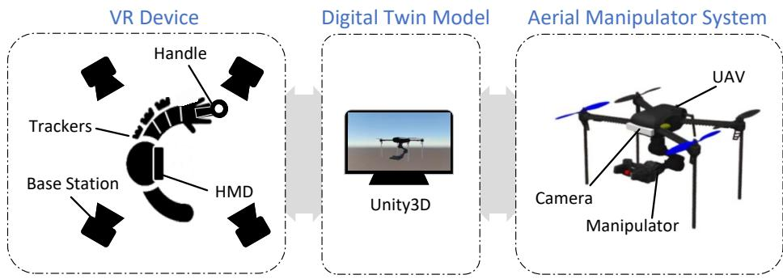  
Fig. 1. The construction of the VR-based aerial manipulator teleoperation system

## 2.2 Digital Twin Model Construction

High-fidelity 3D models of AMS and the environment can enable the operator to have the same observation and action space as the real environment. Therefore, it is necessary to ensure a realistic scene and consistent motion through efective communication.

Communication Architecture: To achieve the goal mentioned above, a communication architecture method based on ROS Bridge is proposed as shown in Fig.2. The signals related to the UAV, the manipulator and the image are represented by blue, green and orange lines respectively. Additionally, solid lines represent wired connections and dashed lines represent wireless connections. The ROS Bridge [12, 13] based on the WebSocket protocol is used to enable communication between ROS and Unity when they are on the same LAN.

Some measures are implemented to keep communication delays within acceptable limits, including the utilization of high-performance hosts for accelerated rendering processes, the adoption of 5GHz wireless networks for faster and more reliable data transfers, the optimization of data packets to minimize redundancy, and the compression of point cloud images to reduce data size and bandwidth usage.

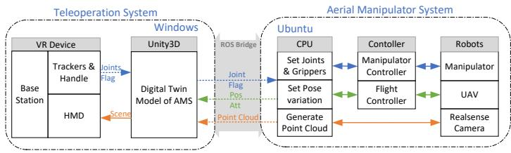  
Fig. 2. The signal flow of the VR-based aerial manipulator teleoperation system

Realistic Scene: The realistic scene should ensure the fidelity of the AMS model and its surrounding environment.

The URDF-Importer package [13] helps to construct the virtual appearance of the AMS. Place the URDF files of AMS in the assets folder and use URDF-Importer package to import the URDF file into the scene.

Point cloud technology based on depth camera can achieve scene reconstruction. First, the RealSense ROS Wrapper [14,15] is utilized to integrate data from the Intel RealSense camera into ROS. Next, the point cloud topic is transmitted to Unity via the ROS Bridge [16]. Then, the point cloud scene rendered with OpenGL will be displayed on the HMD.

Consistent Motion: It is necessary to ensure that the UAV pose and the manipulator state of the virtual and real model remain consistent.

As for keeping pose consistency of UAV, the Unity serves as the slave, subscribing the pose topic from the real AMS and using it to control the pose of the virtual AMS in scene.

Since VR trackers and handle are required to operate the manipulator, Unity acts as the master in this case. It receives pose data from VR devices and publishes the calculated desired joint angles and gripper status information.

## 3 Collaborative Teleoperation Method

## 3.1 Human-Manipulator Collaboration

As shown in Fig.3, three trackers and one handle are denoted as t1, t2, t3, and t4, respectively. According to the structure of the manipulator, they are positioned on the operator’s arm as follows: t1 serves as the reference tracker and is placed on the operator’s left shoulder. t2 and t3 are attached to the operator’s left upper arm and forearm respectively. The orientation of these three trackers is with the y-axis parallel to the outer side of the human shoulder. t4 is held forward by the operator’s left hand.

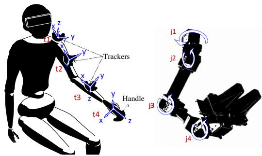  
Fig. 3. Diagram of the setup for the VR trackers and handle.

In the Unity engine, SteamVR plugin, OpenVR XR plugin and VIVE Input Utility package are used to manage and develop VR devices. The following steps are implemented to enable the operator to collaboratively teleoperate the manipulator.

Firstly, in the C# script, the transformation maxtrix $T _ { i } ( i = 1 , 2 , 3 , 4 )$ of the tracker $t _ { i } ( i = 1 , 2 , 3 , 4 )$ can be obtained using the TRS method.

Next, the transformation matrices of the shoulder, upper arm, forearm, and wrist coordinate systems are obtained respectively.

$$
\left\{ \begin{array}{l} T _ {1} ^ {3} = (T _ {1}) ^ {- 1} T _ {3} \\ T _ {1} ^ {2} = (T _ {1}) ^ {- 1} T _ {2} \\ T _ {2} ^ {3} = (T _ {2}) ^ {- 1} T _ {3} \\ T _ {3} ^ {4} = (T _ {3}) ^ {- 1} T _ {4} \end{array} \right.\tag{1}
$$

The rotation matrices of them have the following form.

$$
R = \left[ \begin{array}{l} r _ {0 0} r _ {0 1} r _ {0 2} \\ r _ {1 0} r _ {1 1} r _ {1 2} \\ r _ {2 0} r _ {2 1} r _ {2 2} \end{array} \right]\tag{2}
$$

Then, convert the rotation matrix to Euler angles according their relationship as following.

$$
\left\{ \begin{array}{l} \phi = \mathrm{actan2} (- r _ {1 2}, \sqrt {r _ {1 0} ^ {2} + r _ {1 1} ^ {2}}) \\ \theta = \mathrm{actan2} (r _ {0 2}, r _ {2 2}) \\ \psi = \mathrm{actan2} (r _ {1 0}, r _ {1 1}) \end{array} \right.\tag{3}
$$

The four sets of Euler angles after conversion are recorded as $E _ { 1 } ^ { 3 } = [ \phi _ { 1 } ^ { 3 } , \theta _ { 1 } ^ { 3 } , \psi _ { 1 } ^ { 3 } ] , E _ { 1 } ^ { 2 } =$ 11 $[ \phi _ { 1 } ^ { 2 } , \theta _ { 1 } ^ { 2 } , \psi _ { 1 } ^ { 2 } ] , E _ { 2 } ^ { 3 } = [ \phi _ { 2 } ^ { 3 } , \theta _ { 2 } ^ { 3 } , \psi _ { 2 } ^ { 3 } ] , E _ { 3 } ^ { 4 } = [ \phi _ { 3 } ^ { 4 } , \theta _ { 3 } ^ { 4 } , \psi _ { 3 } ^ { 4 } ]$

Finally, the expected joint angles $j _ { i } ( i = 1 , 2 , 3 , 4 )$ of the manipulator can be obtained, as shown below.

$$
\left\{ \begin{array}{l} j _ {1} = \psi_ {1} ^ {3} \\ j _ {2} = \theta_ {1} ^ {2} + 9 0 \\ j _ {3} = \theta_ {2} ^ {3} - 9 0 \\ j _ {4} = \theta_ {3} ^ {4} \end{array} \right.\tag{4}
$$

It is worth mentioning that the handle is used not only to regulate the joint angles, but also to control gripper status by the trigger, and adjust UAV yaw by the touchpad. When the trigger is pressed and the detected value exceeds 0.5, the gripper closes. Conversely, a value below 0.5 causes the gripper to open. If the touchpad’s x-direction value is below -0.7, the UAV’s yaw moves positively and when this value exceeds 0.7, the yaw rotates in the opposite direction. The gripper and yaw angle signals are stored in the flag variable. In conclusion, the contents of the topic that Unity transmits to ROS are $[ j _ { 1 } , j _ { 2 } , j _ { 3 } , j _ { 4 } , f l a g ]$

## 3.2 UAV-Manipulator Collaboration

In an ideal scenario, the manipulator is expected to interact with the target object in a comfortable posture, rather than near its extreme positions, as these are not conducive to its operation. The UAV position can determine whether the manipulator can interact with the target object comfortably within a certain area. Correspondingly, the UAV can adjust its position based on joint angles.

Set the limit of the i-th joint $j _ { i }$ to $[ l _ { i } ^ { m i n } , l _ { i } ^ { m a x } ]$ , the joint angle threshold triggering UAV position adjustment is $[ h _ { i } ^ { m i n } , h _ { i } ^ { m a x } ]$ , and the range of UAV position adjustment is $[ d _ { j } ^ { m i n } , d _ { j } ^ { m a x } ]$ . Where $i = { 1 , 2 , 3 , 4 }$ and $j \in ( x , y , z )$

Considering the guidance of $j _ { 2 }$ and j3 on the UAV’s motion along the x-axis direction, when the manipulator controlled by operator extends too far forward, moving the UAV forward can assist the manipulator approach the target object efectively. On the contrary, if the manipulator folds too far inward, moving the UAV backward will increase the operational space of the manipulator. The change in the x-axis ∆x is represented by the following equation.

$$
\Delta x = \left\{ \begin{array}{c l} \frac {d _ {x} ^ {\max} (j _ {2} - h _ {2} ^ {\max})}{l _ {2} ^ {\max} - h _ {2} ^ {\max}} & j _ {2} \in (h _ {2} ^ {\max}, l _ {2} ^ {\max}), j _ {3} \in (l _ {3} ^ {\min}, h _ {3} ^ {\min}) \\ \frac {d _ {x} ^ {\min} (j _ {2} - h _ {2} ^ {\min})}{l _ {2} ^ {\min} - h _ {2} ^ {\min}} & j _ {2} \in (l _ {2} ^ {\min}, h _ {2} ^ {\min}), j _ {3} \in (l _ {3} ^ {\min}, l _ {3} ^ {\max}) \\ 0 & j _ {2} \in (h _ {2} ^ {\max}, l _ {2} ^ {\max}), j _ {3} \in (h _ {3} ^ {\min}, l _ {3} ^ {\max}) \\ 0 & j _ {2} \in (h _ {2} ^ {\min}, h _ {2} ^ {\max}), j _ {3} \in (l _ {3} ^ {\min}, l _ {3} ^ {\max}) \end{array} \right.\tag{5}
$$

For the UAV’s motion in the y-axis direction, the $j _ { 1 }$ joint needs to be considered. When the manipulator moves too much to the left or right, the UAV’s movement to the left or right can allow the manipulator to contact the target with a forward posture.

$$
\Delta y = \left\{ \begin{array}{c c} \frac {d _ {y} ^ {\min} (j _ {1} - h _ {1} ^ {\max})}{l _ {1} ^ {\max} - h _ {1} ^ {\max}} & h _ {1} ^ {\max} <   j _ {1} <   l _ {1} ^ {\max} \\ \frac {d _ {y} ^ {\max} (j _ {1} - h _ {1} ^ {\min})}{l _ {1} ^ {\min} - h _ {1} ^ {\min}} & l _ {1} ^ {\min} <   j _ {1} <   h _ {1} ^ {\min} \\ 0 & h _ {1} ^ {\min} <   j _ {1} <   h _ {1} ^ {\max} \end{array} \right.\tag{6}
$$

Regarding the UAV’s z-axis motion, $j _ { 2 } , j _ { 3 }$ , and $j _ { 4 }$ should be considered. For simplicity, it is assumed that when the last joint $j _ { 4 }$ moves up or down beyond the threshold, the UAV should move up or down to assist the manipulator.

$$
\Delta z = \left\{ \begin{array}{c c} \frac {d _ {z} ^ {\max} (j _ {4} - h _ {4} ^ {\max})}{l _ {4} ^ {\max} - h _ {4} ^ {\max}} & h _ {4} ^ {\max} <   j _ {4} <   l _ {4} ^ {\max} \\ \frac {d _ {z} ^ {\min} (j _ {4} - h _ {4} ^ {\min})}{l _ {4} ^ {\min} - h _ {4} ^ {\min}} & l _ {4} ^ {\min} <   j _ {4} <   h _ {4} ^ {\min} \\ 0 & h _ {4} ^ {\min} <   j _ {4} <   h _ {4} ^ {\max} \end{array} \right.\tag{7}
$$

Denote $p _ { d } ^ { w } = [ x _ { d } ^ { w } , y _ { d } ^ { w } , z _ { d } ^ { w } ]$ as the desired position of the AMS which is calculated from the following formula.

$$
p _ {d} ^ {w} = p _ {s} ^ {w} + R (\psi) \varDelta p _ {d} ^ {b}\tag{8}
$$

Where $p _ { s } ^ { w } = [ x _ { s } ^ { w } , y _ { s } ^ { w } , z _ { s } ^ { w } ]$ represents the actual position of the AMS which is received from Mavlink, $R ( \psi )$ is rotation matrix of yaw and $\Delta p _ { d } ^ { b } = [ \varDelta x , \varDelta y , \varDelta z ]$ The program flow is shown in Fig.4.

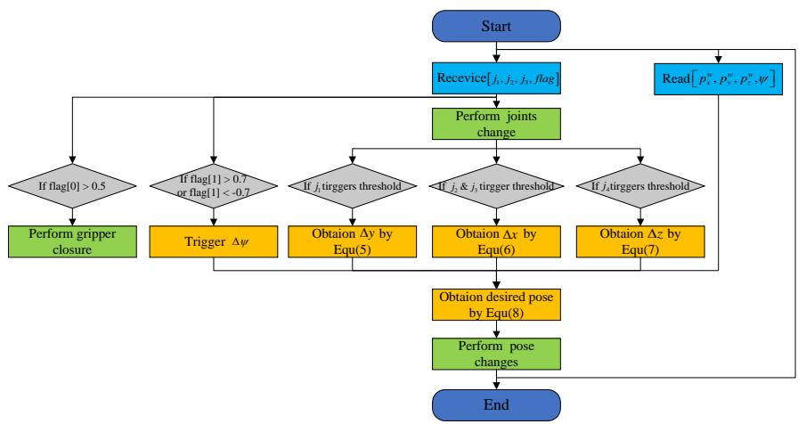  
Fig. 4. Program flow chart for UAV-manipulator collaboration.

## 4 Experiments

A experiment is designed to verify the efectiveness of the proposed teleoperation system. The experiment is carried out as shown in Fig.5, where the AMS simulation model in the Gazebo will complete the task of pushing down an orange bottle on a green wall. This task is accomplished with the assistance of an untrained operator, who relies on the visual information provided by the VR 3D scene. It is worth noting that the tracker supposed to be fixed on the operator’s shoulder is placed on the tabletop because it only served as a reference.

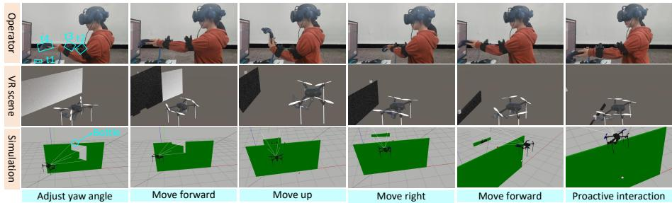  
Fig. 5. Experimental process for operator control, HMD scene, and Gazebo simulation.

To reduce latency, there is a wired connection between the hosts for Gazebo and Unity. The host is equipped with an i7 processor, 64GB memory and GTX4080 graphics card to support the development of Unity software. Table 1 provides a way to set the limit and threshold of the joints.

<table><tr><td>Joint</td><td> $l_{i}^{min}$ </td><td> $l_{i}^{max}$ </td><td> $h_{i}^{min}$ </td><td> $h_{i}^{max}$ </td><td>Motion dimension</td><td> $d_{j}^{min}$ </td><td> $d_{j}^{max}$ </td></tr><tr><td> $j_{1}$ </td><td>-40</td><td>40</td><td>-25</td><td>25</td><td>y</td><td>-0.4</td><td>0.4</td></tr><tr><td> $j_{2}$ </td><td>-60</td><td>60</td><td>-10</td><td>40</td><td rowspan="2">x</td><td rowspan="2">-0.4</td><td rowspan="2">0.4</td></tr><tr><td> $j_{3}$ </td><td>-60</td><td>60</td><td>-40</td><td>-</td></tr><tr><td> $j_{4}$ </td><td>-60</td><td>60</td><td>-40</td><td>40</td><td>z</td><td>-0.2</td><td>0.2</td></tr></table>

Table 1. The limit and threshold of joints

The joint control of the manipulator and the position control of the AMS are shown in Fig.6. At the beginning, the AMS hovers at (0,-1,1.5) in the ofboard mode. At about 0.6-1.6s, the yaw is adjusted by the touchpad to find the target object at (1.5,0,2) in the field of HMD. In around 2.6-11s, in order to approach the target object, the manipulator is extended forward. $j _ { 2 }$ and $j _ { 3 }$ reach the threshold and trigger the AMS to move in the direction of its own x-axis based on equation (5). Then, after adjusting the yaw angle, y, z, y and x direction orderly, the AMS reaches the vicinity of the target and pushes it down.

Remark 1. Fig.6 shows that the system has good real-time and accuracy in manipulator control, which ensures high precision in air operation. Fig.7 shows the flight track and gripper position during the experiment. Although the movement of the manipulator brings a certain disturbance to the AMS, the position can be followed and the AMS can reach the vicinity of the target point to perform contact tasks. It is verified that the proposed teleoperation system enables an untrained operator to control an AMS to perform aerial tasks eficiently.

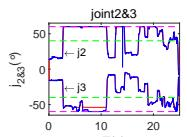

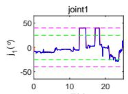

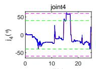

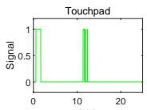

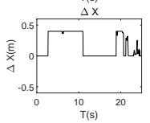

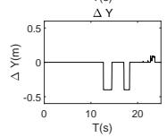

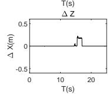

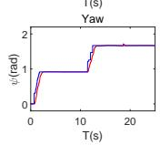  
Fig. 6. The teleoperated collaborative control of manipulator and UAV.(The blue and red lines depict target and actual joint or yaw angles, magenta dotted lines show angle limits, green dotted lines indicate angles triggering AMS position control, solid green line shows touchpad signal, and black lines depict expected AMS position increment.)

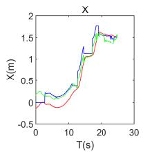

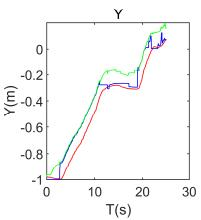

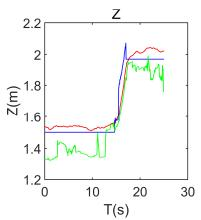

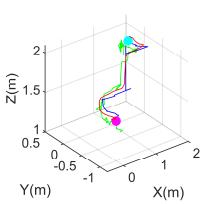  
Fig. 7. The trajectory curve of the AMS in the world coordinate system.(The blue and red lines represent the desired and actual position of the AMS respectively, the green lines are the position of gripper, the magenta dot indicates the starting point of the mission and the cyan dot indicates the position of the target object.)

## 5 Conclusion

This paper proposes a VR-based teleoperation system to enhance the operational quality of the AMS. With the powerful graphics rendering and data transmission capabilities of the Unity, a high-fidelity digital twin model is established. Leveraging the immersive and interactive nature of VR technology, an intuitive control scheme is implemented. The experiment shows that even an untrained operator can efectively control the AMS to perform tasks, demonstrating the reliability and robustness of the system.

## Acknowledgement

This work was supported partially by the National Natural Science Foundation of China (Grant No. 62273122), and Heilongjiang Natural Science Foundation (Grant No. YQ2023F009). (Corresponding author: Zhan Li)

## References

1. D. Mellinger, Q. Lindsey, M. Shomin, and V. Kumar, “Design, modeling, estimation and control for aerial grasping and manipulation,” in 2011 IEEE/RSJ International Conference on Intelligent Robots and Systems, 2011, pp. 2668–2673.

2. C. Liu, B. Fang, F. Sun, X. Li, and W. Huang, “Learning to grasp familiar objects based on experience and objects’ shape afordance,” IEEE Transactions on Systems, Man, and Cybernetics: Systems, vol. 49, no. 12, pp. 2710–2723, 2019.

3. H. Li, Z. Li, J. Liu, X. Zheng, X. Yu, and O. Kaynak, “Adaptive neural network backstepping control method for aerial manipulator based on coupling disturbance compensation,” Journal of the Franklin Institute, p. 106733, 2024.

4. X. Liu, J. Tan, and H. Zhong, “Design and implementation of task-oriented rotorflying manipulator,” in 2018 13th World Congress on Intelligent Control and Automation (WCICA), 2018, pp. 1120–1125.

5. X. Yu, H. Wu, M. Ding, and X. Zheng, “Kinematics analysis of cable-driven continuum manipulator based on improved particle swarm optimization,” Flight Control and Detection, vol. 6, no. 1, pp. 41–47, 2023.

6. M. U. Shoukat, L. Yan, W. Liu, F. Hussain, S. A. Nawaz, and A. Niaz, “Digital twin-driven virtual control technology of home-use robot: Human-cyber-physical system,” in 2022 17th International Conference on Emerging Technologies (ICET), 2022, pp. 240–246.

7. L. Chen, T. Cao, J. Yi, X. Zhang, Y. Zhao, and Q. Wang, “Autonomous complex terrain soft landing simulation system of lunar lander based on unity3d,” Flight Control and Detection, vol. 6, no. 1, pp. 48–55, 2023.

8. A. Ollero, G. Heredia, A. Franchi, G. Antonelli, K. Kondak, A. Sanfeliu, A. Viguria, J. R. Martinez-de Dios, F. Pierri, J. Cortes, A. Santamaria-Navarro, M. A. Trujillo Soto, R. Balachandran, J. Andrade-Cetto, and A. Rodriguez, “The aeroarms project: Aerial robots with advanced manipulation capabilities for inspection and maintenance,” IEEE Robotics and Automation Magazine, vol. 25, no. 4, pp. 12–23, 2018.

9. R. Verdín, G. Ramírez, C. Rivera, and G. Flores, “Teleoperated aerial manipulator and its avatar. communication, system’s interconnection, and virtual world,” in 2021 International Conference on Unmanned Aircraft Systems (ICUAS), 2021, pp. 1488–1493.

10. G. A. Yashin, D. Trinitatova, R. T. Agishev, R. Ibrahimov, and D. Tsetserukou, “Aerovr: Virtual reality-based teleoperation with tactile feedback for aerial manipulation,” in 2019 19th International Conference on Advanced Robotics (ICAR), 2019, pp. 767–772.

11. D. Kim and P. Y. Oh, “Toward avatar-drone: A human-embodied drone for aerial manipulation,” in 2021 International Conference on Unmanned Aircraft Systems (ICUAS), 2021, pp. 567–574.

12. M. E. Çakal, “ros-sharp,” 1 2024. [Online]. Available: https://github.com/ siemens/ros-sharp

13. H. Younesy, “Unity-Robotics-Hub,” 2 2022. [Online]. Available: https://github. com/Unity-Technologies/Unity-Robotics-Hub

14. R. I. A. Walles, “realsense2-description,” 2 2022. [Online]. Available: https: //github.com/issaiass/realsense2\_description

15. N. Azkiel, “realsense-ros,” 2 2024. [Online]. Available: https://github.com/ IntelRealSense/realsense-ros/tree/ros1-legacy

16. I. Jang, “PointCloudStreaming,” 5 2020. [Online]. Available: https://github.com/ inmo-jang/unity\_assets/tree/master/PointCloudStreaming