分类号：TP29

单位代码：10110

学 号：S2015008

中 北 大 学

# 硕 士 学 位 论 文

（学 硕）

## 基于强化学习与模仿学习结合的机械臂抓取控制研究

硕士研究生 申珅

指导教师 曾建潮

学科专业 控制科学与工程

2023 年 6 月 1 日

图书分类号 TP29

密级 非密

UDC 注 1

004.8

# 硕 士 学 位 论 文

# 基于强化学习与模仿学习结合的机械臂抓取控制研究

申珅

指导教师（姓名、职称） 曾建潮（教授）

申请学位级别 工学硕士

专业名称 控制科学与工程

论文提交日期 2023 年 3 月 31 日

论文答辩日期 2023 年 5 月 29 日

学位授予日期 年 月 日

论文评阅人

答辩委员会主席

2023 年 6 月 1 日

注1：注明《国际十进分类法 UDC》的分类

# 基于强化学习与模仿学习结合的机械臂抓取控制研究

## 摘要

机械臂是一种模仿人类手臂结构的机器人，能完成包括抓取、搬运和组装物体等操作。在工业生产、医疗保健、科学研究等应用领域中，为了确保抓取操作的成功和安全，机械臂抓取控制需要具备精确的控制能力。传统的机械臂抓取控制方法，需要根据环境模型和机械臂的几何特征进行人工编程。此类方法虽然能实现较高的抓取精度与成功率，但智能化程度较低，难以应对变化的环境或未知物体。相比传统的控制方法，基于强化学习的机械臂抓取控制方法，通过直接建立由传感器获取的环境状态与机械臂执行动作之间的映射关系，从而实现自主感知并决策，极大地减少了人工编程的工作量。但是强化学习直接应用在机械臂抓取控制中，却存在着探索效率低、算法收敛不确定、奖励函数引导机械臂学习能力差等问题。

根据以上研究背景，本文基于编程示教方法，结合模仿学习的模仿性好、适应力强等特点，采集耗时最短的示教样本，并将示教样本转换成强化学习所对应的奖励函数，进而指导机械臂控制器的训练，由此提高了机械臂进行任务探索的效率。主要研究内容如下：

（1）针对编程示教方法对任务适应性差的问题，本文改善编程示教方法中的抓取控制规则，构建关于机械臂状态数据的多元正态分布模型，提出了一种基于概率模型的模仿学习算法 RFSI，训练机械臂控制器，从而指导机械臂进行抓取控制，进而完成对示教数据的优化。在仿真环境中进行机械臂抓取控制的实验，验证了该算法的有效性。

（2）针对强化学习在机械臂抓取任务中训练周期长的问题，本文基于模仿学习与强化学习相结合的方式，提出了一种基于奖励与策略双优化的机械臂抓取控制算法HR-GAIL。该方法变换二元变量损失函数中的鉴别器形式，并融合复合奖励函数，在策略梯度与奖励梯度交替优化的过程中，实现对机械臂抓取控制器的更新优化。在仿真环境中进行机械臂抓取控制的实验，验证了该算法的有效性。

（3）结合本文所提出的 RFSI 算法与 HR-GAIL 算法，本文设计了基于 Pybullet 仿真平台与 PyTorch 框架的机械臂抓取仿真系统，实现了基于强化学习与模仿学习结合的机械臂抓取控制的仿真，验证了本文所提算法的可行性。

关键词：强化学习；模仿学习；机械臂；抓取控制；算法优化

# Research on Grasping control of manipulator based on reinforcement learning and imitation learning

## Abstract

Manipulator is a kind of robot that mimics the structure of the human arm. In industrial production, medical care, scientific research and other application fields, in order to ensure the success and safety of grasping operation, grasping control of manipulator needs to have accurate control ability. The traditional grasping control method of manipulator requires manual programming according to the environmental model and the geometric characteristics of the manipulator. Although this kind of method can achieve higher grasping accuracy and success rate, but the degree of intelligence is low, and it is difficult to cope with the changing environment or unknown objects. Compared with traditional control methods, the grasping control method of manipulator based on reinforcement learning can realize autonomous perception and decision-making by directly establishing the mapping relationship between the environmental state obtained by the sensor and the action of the manipulator, thus greatly reducing the workload of manual programming. However, when reinforcement learning is directly applied to grasp control of manipulator, there are some problems, such as low exploration efficiency, uncertain algorithm convergence and poor learning ability of manipulator guided by reward function.

Based on the above research background, we collect teaching samples with strong adaptability to different tasks based on the programming teaching method, combined with the characteristics of good imitation and strong adaptability of imitation learning, and convert the teaching samples into reward functions corresponding to reinforcement learning, so as to guide the training of the manipulator controller,then improve the efficiency of task exploration of the manipulator. The main research contents are as follows.

(1) Aiming at the poor adaptability of programming teaching method to tasks, we improve the grasping control rules of programming teaching method, build a multivariate normal distribution model of the state data of the robot arm, propose a probabilistic model-based imitation learning algorithm RFSI.We train the controller of the manipulator with RFSI, and the manipulator is guided to grasp objects, then achieve the optimization of teaching data.Experiments on grasping control of manipulator are carried out in simulation environment, and the effectiveness of the algorithm is verified.

(2) Aiming at the slowness of training time of reinforcement learning in the grasping task of the robot arm,we propose a grasping control algorithm HR-GAIL based on the combination of imitation learning and reinforcement learning, which is based on the double optimization of reward and strategy. The method transforms the discriminator form into the binary variable loss function and integrates the compound reward function. In the process of alternating strategy gradient and reward gradient optimization, the updating and optimization of the grasping controller of the manipulator is realized. Experiments on grasping control of manipulator are carried out in a simulation environment, and the effectiveness of the algorithm is verified.

(3) Combining RFSI algorithm and HR-GAIL algorithm,we design a manipulator grasping simulation system based on Pybullet simulation platform and PyTorch framework.We achieve the simulation of manipulator grasping control based on reinforcement learning and imitation learning, and verify the feasibility of the algorithm proposed in this paper.

Keywords: reinforcement learning; imitation learning; manipulator; algorithm optimization

## 目 录

第1章 绪论....1
1.1 研究背景及意义....1
1.2 国内外主要研究现状....2
1.2.1 强化学习研究现状....2
1.2.2 模仿学习研究现状....6
1.2.3 机械臂抓取控制研究现状....9
1.3 本文主要研究内容及章节安排....12
第2章 强化学习与模仿学习理论....14
2.1 引言....14
2.2 强化学习理论....14
2.2.1 马尔科夫过程....14
2.2.2 强化学习的值函数....15
2.2.3 强化学习的策略更新....16
2.2.4 演员-评论家强化学习算法....17
2.3 模仿学习理论....19
2.3.1 示教样本的构成....19
2.3.2 模仿学习的成本函数....19
2.3.3 逆向强化学习算法....20
2.3.4 鉴别器的构造方法....22
2.4 本章小结....23
第3章 基于模仿学习方法的示教轨迹优化....24
3.1 引言....24
3.2 示教轨迹优化框架....24
3.3 获取示教数据....25
3.3.1 机械臂运动学建模....25
3.3.2 抓取控制规则....27
3.3.3 轨迹筛选....27
3.4 基于模仿学习方法的轨迹优化....28
3.4.1 设置成本函数....28
3.4.2 递归遗忘采样模仿算法....29
3.4.3 设计机械臂控制器....30
3.5 实验与分析....31
3.5.1 配置仿真环境....31
3.5.2 仿真实验....32

3.5.3 实验效果分析....34
3.6 本章小结....36
第4章 基于奖励与策略双优化的机械臂抓取控制算法....37
4.1 引言....37
4.2 机械臂抓取控制框架....38
4.3 机械臂抓取控制算法....38
4.3.1 机械臂控制器的设计....38
4.3.2 复合奖励函数的构成....40
4.3.3 二元变量损失函数....41
4.3.4 机械臂控制器的训练....42
4.4 实验与分析....44
4.4.1 配置仿真环境....44
4.4.2 批量生成示教数据....46
4.4.3 对比实验....47
4.4.4 机械臂抓取任务测试....49
4.5 本章小结....50
第5章 机械臂抓取仿真系统....51
5.1 引言....51
5.2 设计目的及现状分析....51
5.3 系统模块设计及说明....52
5.3.1 操作界面....52
5.3.2 示教数据生成模块....53
5.3.3 奖励生成模块....54
5.3.4 模仿学习训练模块....54
5.3.5 强化学习训练模块....54
5.4 仿真系统测试....55
5.5 本章小结....56
第6章 总结与展望....57
6.1 全文总结....57
6.2 未来工作展望....58
参考文献....59

## 第1 章 绪论

## 1.1 研究背景及意义

让机器人具有自主感知、决策和执行能力一直是科研工作者追求的目标，自 1956年人工智能学科诞生以来，这个目标得到了迅速发展。从工业生产线到物流分拣中心，从深海水域作业到火星表面探险，从医疗手术到家庭服务，形形色色的机器人在各种领域被应用和探索。机械臂是现今最常用的机器人之一，因其独特的操作灵活性，在工业生产中具有广泛的应用。随着社会的高速发展，科研人员期望机械臂能够辅助乃至替代人类完成各种困难、危险、多样的任务。

根据不同的工作环境、抓取任务的要求，机械臂需要针对任务目标的形状、位姿进行精准地抓取控制。传统的机械臂抓取控制方法，需要根据环境模型和机械臂的几何特征进行人工编程。此类方法虽然能实现较高的抓取精度与成功率，但智能化程度较低，难以应对变化的环境或未知物体。一旦机械臂出现电机老化、零件磨损、定位松动等故障而导致几何特征的结构参数发生变化时，机械臂抓取控制方法就要根据新的几何特征重新编程。

相比传统的控制方法，基于强化学习的机械臂抓取控制方法能够实现自主感知并决策，从而减少人工编程的工作量。强化学习是机器学习的一个重要分支，通过强化学习技术与机械臂控制技术相结合的方式，机械臂的控制器可以直接建立由传感器获取的环境状态与机械臂执行动作之间的映射关系，实现端到端的控制[1]。通过强化学习的试错机制，使机械臂不断与动态环境进行交互并获取反馈的奖励函数，从而学习到通用的动作策略，进而实现在未知环境中对机械臂的控制。然而，强化学习直接应用在机械臂抓取控制中还存在如下问题：

（1）强化学习要求机械臂从一无所知的状态下开始抓取探索，在控制机械臂的过程中，短时间内探索到成功抓取目标的事件较低；

（2）针对机械臂具体的抓取任务所设计的奖励函数需要一定的专业知识[2]，且该奖励函数不一定能够正确引导机械臂学习；

（3）机械臂状态空间存在一定的复杂性，以及构建强化学习的神经网络的训练具

有极大的不稳定性，导致机械臂抓取控制算法的收敛是不确定的。

为了解决上述强化学习的问题，研究人员将模仿学习与强化学习相结合以提升机械臂抓取控制的效果。模仿学习是让机器人像人类一样，通过模仿其他个体的行为来获得各项能力的学习方法。模仿学习通过让机械臂模仿专家对于不同任务的演示来学习如何决策，并根据训练过程中专家的决策样本来获得反馈信息，因此不需要准确的奖励函数。同时，获取专家演示得出的示教样本比设置准确的奖励函数更简单，训练成本也更小。机器人可以通过模仿专家的行为获得类似人类或动物的行为模式，进而可以在动态变化的环境中完成各种复杂的任务。模仿学习在机械臂抓取控制中的优越性如下所示：

（1）通过模仿示教样本，机械臂能够迅速学习到有效的动作策略以适应新环境；

（2）模仿学习容易和其他机器学习算法结合，以提高机械臂抓取控制的效率；

（3）一个有效的抓取动作策略可以从一台机械臂推广至整条流水线的机械臂。

综上所述，本文基于强化学习的机械臂抓取控制算法，针对强化学习算法探索效率低、算法收敛不确定、奖励函数引导机械臂学习能力差等问题，结合模仿学习的模仿性好、训练速度快、适应力强等特点，将机械臂学习示教样本转换成强化学习所对应的奖励函数，从而提高强化学习的学习能力。这对于提升机械臂的智能化水平具有一定的现实意义。

## 1.2 国内外主要研究现状

## 1.2.1 强化学习研究现状

强化学习（RL）是智能体（agent）与环境互动并进行自主学习的智能算法。在强化学习的训练过程中，智能体一开始对环境和任务没有任何认知，但随着智能体与环境的持续互动，智能体不断对任务进行尝试并得到来自环境的奖励函数的反馈，使得智能体最终找到完成任务的最优方案。强化学习的设计灵感源于心理学的行为主义理论，可追溯到巴普洛夫的条件反射实验；数学中的离散优化和图论为强化学习提供了规范的数学形式；动力系统的最优控制理论被用于解决强化学习的优化问题。从上世纪 80 年代末开始，强化学习相关的数学基础研究相继取得突破性进展，使其成为机器学习领域的一大研究热点，广泛应用于机器人控制、自动驾驶、组合优化、金融交易、游戏竞技等

领域。

强化学习算法按照是否要学习前向状态转移模型，分为基于模型的强化学习算法和无模型的强化学习算法。

基于模型的强化学习算法考虑智能体对环境的不确定作用，通过构建智能体对环境作用的前向状态转移模型，直接计算来自模型的奖励函数的反馈，从而实现最优控制。Li 等人[3]研究了非线性动力系统局部最优反馈控制的问题，提出了迭代线性二次调节器（iLQR）方法，并应用在装载着6块肌肉的2连杆机械手臂模型中。iLQR把奖励函数进行二阶泰勒展开，并根据展开后的奖励函数搭建强化学习的框架。然而，该方法需要线性系统的动力学方程来近似求解非线性动力系统问题，因此不适用于复杂环境下机械臂的操作任务。Tassa等人[4]以iLQR为前提，提出了一种适用于人形机器人执行复杂任务的模型预测控制（MPC）方法，通过对MPC 流程中的轨迹优化算法、物理引擎、成本函数的改进，使得机器人在不使用最优值函数的近似下就能实现接近最优的性能。该基于模型的强化学习算法对模型误差和状态扰动具有相当的鲁棒性。Levine 等人[5]在iLQR 的基础上，提出指导性策略搜索（GPS）方法。GPS 使用微分动态规划来生成合适的指导样本，随后将指导样本纳入策略搜索中，进行正则化重要性采样的策略优化。目前被作为基础算法广泛应用于各种强化学习任务中。

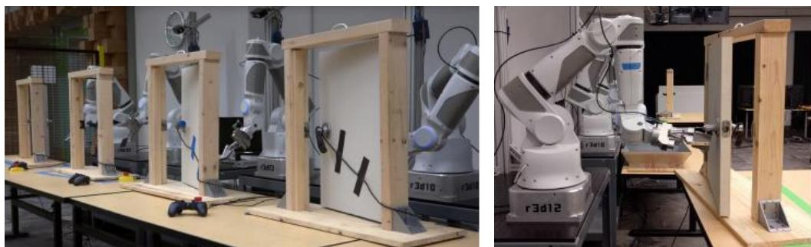  
图 1-1 多机械臂异步训练去学习开门动作  
Fig. 1-1 Multiple manipulators are trained asynchronously to learn the door opening skill

前向状态转移模型除了参考最优控制从而精准建模的方式外，还可以用概率模型来拟合。Lioutikov 等人[6]在随机最优控制（SOC）的基础上，放宽强化学习的贪婪因子，从数据中估计系统动力学模型，应用在基于模型的强化学习中。Abbeel 等人[7]在 GPS方法的基础上，将策略探索和前向状态转移模型都用高斯分布来替代，构建在未知动态下的线性高斯控制器。该控制器可以在 GPS 框架内训练复杂的神经网络策略，能让机器人在部分观测的环境中有效行动。Yahya 等人[8]在GPS 的基础上，提出异步分布式指导性策略搜索（ADGPS）方法。ADGPS 由局部策略与全局策略构成，其中局部策略生成样本数据，全局策略对数据库进行采样并训练策略网络。训练过程利用KL散度约束局部策略的轨迹奖励期望，然后在多个局部策略里选择一个KL散度最小值作为全局最优策略。该方法使用了4台机械臂对不同位姿的门进行协同训练，如图1-1 所示。通过神经网络参数上传和反复试错，最后让机械臂学会完成开关门任务。

无模型强化学习算法不考虑前向状态转移模型的作用，智能体与环境相互独立。智能体需要跟环境直接交互，采集到大量轨迹数据并从中获取来自环境的奖励函数后，智能体才能更新动作策略。无模型强化学习算法主要分为基于值函数的方法、基于策略函数的方法和二者结合的混合方法这3类方法，如图1-2 所示。

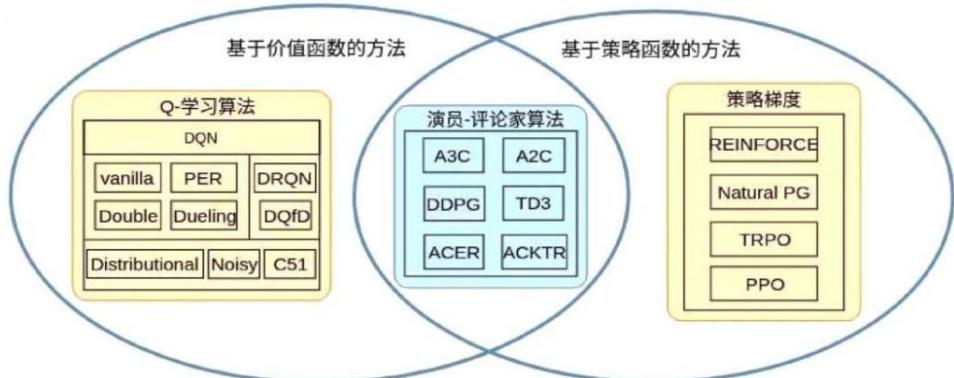  
图 1-2 无模型强化学习算法分类  
Fig. 1-2 Classification of model-free reinforcement learning algorithm

## （1） 基于值函数的无模型强化学习算法

基于值函数的无模型强化学习算法通过更新值函数，使策略收敛到最优策略。Sutton等人[9]提出时序差分（TD）学习，并证明在具有马尔可夫性的系统中，在学习率绝对递减的条件下 TD 算法必收敛。TD 学习结合了蒙特卡罗估计和动态规划的思想，一方面能在系统模型未知的情况下学习值函数，另一方面利用状态转移的马尔可夫性实现值函数的迭代更新。Watkins 等人[10]在TD 学习基础上，通过迭代更新状态-动作值函数，提出了 Q 学习（Q-learning）方法并给出其收敛性证明。在一定条件下采用贪心策略更新值函数的方式，就能保证 Q学习方法收敛。Q学习方法是最经典的无模型强化学习算法。

Mnih 等人[11]将 Q 学习方法与神经网络结合，提出深度 Q 网络（DQN）算法。DQN 算法用一个多层全连接层网络（MLP）代替Q 函数，通过贝尔曼方程对 Q 网络进行更新迭代。

因为 DQN算法在算法更新的每一步都取Q网络的最大值并迭代，所以会导致Q网络的估值过大。Wang 等人[12]针对 Q 网络的估值过大的问题，提出竞争深度 Q 网络（DuelingDQN）算法。该算法以DQN 为基础，分离Q函数与动作分量，把MLP 最后一层的输出拆分成两个输出，让原始Q 函数叠加其他的动作分量，从而去更新所有动作的 Q 函数。Hausknecht 等人[13]采取另一种方法，在 DQN 的基础上，把 MLP 的最后一层神经网络替换为长短期记忆递归神经网络（LSTM），构建深度循环Q网络（DRQN）算法来解决Q网络的估值过大的问题。

（2） 基于策略函数的无模型强化学习算法

基于策略函数的无模型强化学习算法利用梯度下降法更新策略参数，进而使智能体所采取的动作策略获得最大奖励。Kakade 等人[14]直接构建一个策略神经网络，提出策略梯度（PG）算法。PG算法首先获得所选动作的概率值，通过计算优势函数的最大似然函数，优化的策略网络参数。Schulman 等人[15]假设策略网络服从一个分布，提出置信区间策略优化（TRPO）算法。智能体所采取的动作就是从这个分布采样得到，策略网络的优化，就是不断更新优化出一个合适的分布。通过对比前后策略的变化，并引入了KL 散度限制，构建策略网络的目标函数。Schulman 等人[16]简化TRPO的流程，提出近似策略优化（PPO）算法。PPO限制策略网络的更新幅度，通过引入一个切片机制，限制目标函数的上下限。PPO策略网路用一个高斯分布来近似，高斯分布的均值是由神经网络生成，而方差却采用固定值。Heess 等人[17]提出的异步近似策略优化（DPPO）算法是采用多线程并行计算 PPO 的算法。该算法将策略网络分为子网络和主网络，子网络负责采样状态、动作、轨迹等数据，主网络负责收集这些采样的数据并进行统一计算。

（3） 演员-评价家无模型强化学习算法

将基于值函数的方法与基于策略函数的方法结合起来，就是演员-评价家算法（Actor-Critic），简称 AC 算法。Lillicrap 等人[18]提出深度确定性策略梯度（DDPG）算法，实现了 DQN 在连续动作空间上的拓展。DDPG 的算法框架如下：在 DQN 主网络和目标网络的架构上添加了评论者网络，将神经网络数量扩充至 4个；主网络中值函数通过TD算法进行更新；策略函数根据值函数的Q值进行估计，通过策略梯度方法进行更新；目标网络利用指数平滑的方法在主网络参数基础上进行更新；在交互过程中为每个动作添加了噪声，以平衡动作策略的探索与利用过程。Fujimoto等人[19]在DDPG的基础上又增加2个神经网络，采取类似DoubleDQN 的技术，提出的孪生延迟DDPG（TD3）算法，合计 6 个神经网络。TD3 的改进如下：采用 2 个网络对 Q 值进行估计，提取其中较小的 Q 值来计算目标值，避免 Q 值被高估；降低目标网络的更新频率，减小估计误差；为动作添加截断的噪声，减小确定性策略的过拟合。Mnih 等人[20]提出了同步优势AC算法（A2C）和异步优势 AC 算法（A3C）。A2C 不依赖缓存器的反复采样，其子网络负责采样轨迹的数据，根据轨迹整体奖励计算每个线程的梯度，然后将线程梯度传回其主网络进行训练。A3C 中的各个子网络在计算每个线程的梯度后直接进行参数的更新。Haarnoja 在Q函数的基础上叠加一个交叉熵，构建soft-Q 函数，该方法为柔性Q学习[21]（SQL），在这个定义上拓展AC 算法，为柔性动作评价[22]（SAC）算法。SAC算法应用在四足机器人和机器臂操控任务中，都取得了稳定的控制效果。

## 1.2.2 模仿学习研究现状

模仿学习（IL）是指通过观察其他智能体的行为，然后学习重现的一种学习方式，其灵感来源于人类或动物日常获取技能的方式。机器人通过模仿学习能够较快地掌握技能，避免人工示教过程中繁琐的动作编程。Argall 等人[23]介绍了在模仿学习环节中示教者、问题空间、策略提取等相关内容，并对模仿学习的研究进行了分类。模仿学习主要分为两类：行为克隆和逆向强化学习。行为克隆采用监督学习方法，近似地模仿示教样本的序列轨迹，从而实现策略的学习；逆向强化学习是从专家演示的示教样本中评估出奖励函数，从而引导机器人学习动作策略。

行为克隆（BC）尝试最小化智能体与示教样本之间的动作差异，把模仿学习任务转换成聚类任务或者数学回归。Figueroa 等人[24]提出 Beta 过程隐马尔科夫模型（BP-HMM），该方法通过马尔科夫模型提取高斯模型的相似性，然后对相似动作进行评估并聚类，从而让机械臂学会了擀面饼的动作，如图 1-3(a)所示。2015 年，Yaskawa机器人公司发布了 Motoman-MH24 工业机械臂，并组织该机械臂与剑道高手町井勋进行“挥刀斩”对决[25]。工作人员在町井勋身上安装了数个动作捕捉器，在三维虚拟场景下分析町井勋舞刀时人体骨架的变化和手部运动轨迹，从而机械臂通过模仿学习掌握挥舞武士刀的技能，如图 1-3(b)所示。演示过程中，机械臂模仿町井勋对草席进行了不同角度和方向的挥斩，即使是豆荚这类细小目标物也能利用水平斩一劈两半。

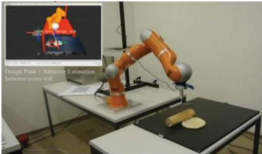  
(a)机械械学习擀面饼

  
(b)机械臂学习“挥刀斩”  
图 1-3 行为克隆学习方法  
Fig. 1-3 Behavior cloning learning methods

行为克隆的学习方法需要大量的示教样本数据和人工标记工作，在面对新环境或新任务时，则需要重新采集更多的示教样本数据。Google 团队和 OpenAI 团队提出，机器人应该学会在极少量的示教样本数据下学习。Google Brain 团队 Sermanet 等人[26]提出一种无监督生成奖励函数的模仿学习方法，机器人通过视觉能够从少量示教样本的动作序列中识别任务的关键步骤，并自动识别关键步骤中的特征，由此生成奖励函数，最终指导机器人进一步训练。该方法使用了 ImageNet 训练后的图像识别模型，生成奖励函数后，引导机器人学习开门动作，然后用图像信息评估奖励函数，如图1-4(a)所示。这个过程让机器人开门的成功率从 10%提升到 100%。2017 年，OpenAI 团队 Finn 等人[27]在模仿学习方法上进行了改进，提出元模仿学习方法，使机器人仅通过一次演示即可获得新技能。该方法以原始图像信息作为输入，用较少的示教样本数据生成奖励，并进行任务训练。最终，在仿真平台和真实的机器人平台上，分别验证了从单视觉演示中端到端学习新任务的能力。

逆向强化学习（IRL）起源于学徒学习，相比于基于奖励而探索出策略的强化学习，逆向强化学习是根据已有的专家策略探索出奖励的过程。早期的 IRL 算法在逆最优控制的基础上进行结构修改，用于解决模仿学习过程中的非凸优化问题。Wulfmeier 等人[28]提出最大熵逆向强化学习（MaxEnt-IRL）算法。该方法在探索性和稳健性方面给 IRL算法提供了改进的思路，使其在面对模型和估计错误时往往是稳健的，并通过获取不同的行为来改善探索。MaxEnt-IRL 根据不同的特征向量构建智能体与环境的状态，奖励函数就是这些特征向量的线性组合，如图 1-4(b)。假定专家演示的策略是最优的策略，通过反复优化迭代，使探索出来的策略逼近专家演示的策略。MaxEnt-IRL 有两个缺陷：没有定义一个统一的成本函数，不同的成本函数却会导致相同的行为；需要大量迭代次数的内循环，去匹配前向过程。Krishnan 等人[29]通过观察专家演示的状态序列，构建一个二次项的奖励模型，提出滑动窗口逆向强化学习（SWIRL）。SWIRL 将前向状态转移模型转换成一个椭圆区域，并在该椭圆区域进行策略优化。

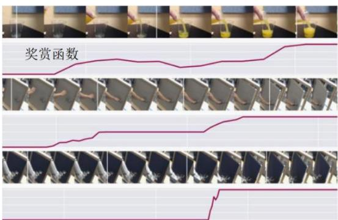  
(a)无监督模型构建奖励

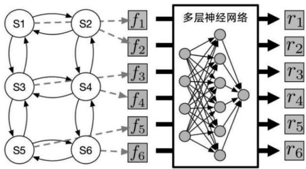  
(b)MaxEntIRL 分离状态特征向量构建奖励  
图 1-4根据示教样本构建奖励的方法  
Fig. 1-4 Construct rewards based on demonstration samples

针对逆向强化学习在机械臂应用领域的应用，Eysenbach 等人[30]根据机械臂多动作学习的应用，提出了后验推理策略改善（HIPI）算法。通过专家演示的方式采集包含推、拉、擦等多个动作的先验数据，然后运用IRL 去推断智能体的意图，最后对数据进行分类再标签，引入到动作策略的更新中。Finn 等人[31]沿用MaxEnt-IRL 对轨迹概率的定义，基于机械臂操控的应用，提出了指导性成本学习（GCL）算法。该方法用神经网络构建成本函数，解决在高维连续动态系统中，学习成本函数的困难性。GCL 被应用在机械臂倒水任务中，如图1-5 所示，输入是图片中水杯的视觉位置，以及夹具相对于目标位置的姿势和速度，输出对应的奖励。实验验证，GCL 能有效训练机械臂模仿人类行为完成指定任务。Ho 等人[32]在 GCL 的基础上，提出生成式对抗模仿学习（GAIL）算法。该方法可以处理高维的连续的状态-动作空间，以及随机策略的优化，从示教样本中直接学习策略而无需人为构建奖励函数，从而指导动作策略的更新。

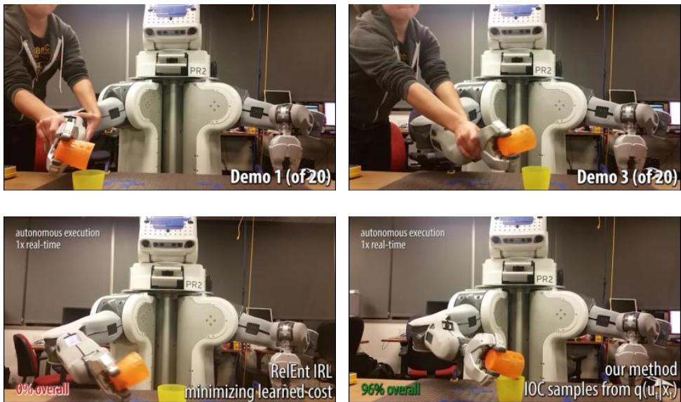  
图 1-5人类示教到机械臂自主执行倒水任务  
Fig. 1-5 Human demo and perform the task of pouring autonomously

在模仿智能体连续动作学习的应用上，Peng 等人[33]提出 DeepMimic 算法。研究人员首先采集人类诸如行走、跑步、跳跃等示教动作，然后将这些示教动作按顺序拼接成一个可以循环播放的示教动作序列。DeepMimic 计算人形机器人每个状态下的奖励，并参照示教动作序列训练动作策略。其中奖励函数由来自位置、速度、末端、重心等分量奖励构成，且各奖励权重作为超参数进行人为设定。Escontrela 等人[34]针对机械狗的连续行走及避障的控制提出了对抗性动作先验（AMP）算法。AMP 将奖励函数分成2 块：基于任务导向的奖励和基于演示数据的动作切片的奖励。研究人员首先收集狗的动作切片，并输入到示教样本集中，然后采用稀疏奖励的方式来训练判别器。如果动作策略生成出来的动作像狗，那么奖励+1，否则-1，由此判断模仿学习是否成功。Vollenweider等人[35]将AMP 算法应用于四足轮式机器人操作，奖励函数也采用复合奖励的形式，不同的是基于演示数据的动作切片的奖励是指数的形式。

## 1.2.3 机械臂抓取控制研究现状

在自然环境中，人类可以轻松抓取各种可抓的物体，但对机械臂而言，抓取控制一直是近几十年来的重大挑战之一。抓取过程可分为两步：抓取检测和抓取执行。其中抓取检测是通过计算或学习得到可行的抓取方案，抓取执行是控制机械臂实现抓取方案，因此机械臂抓取控制的方法可分为不包含抓取执行的抓取检测方法和端到端的抓取方法。抓取检测方法可分为基于解析方法的抓取检测和基于数据驱动的抓取检测这两种方法[36]；端到端抓取方法可分为基于强化学习的抓取、基于模仿学习的抓取和基于迁移学习的抓取这三种主要方法[37]。具体分类如图 1-6 所示。

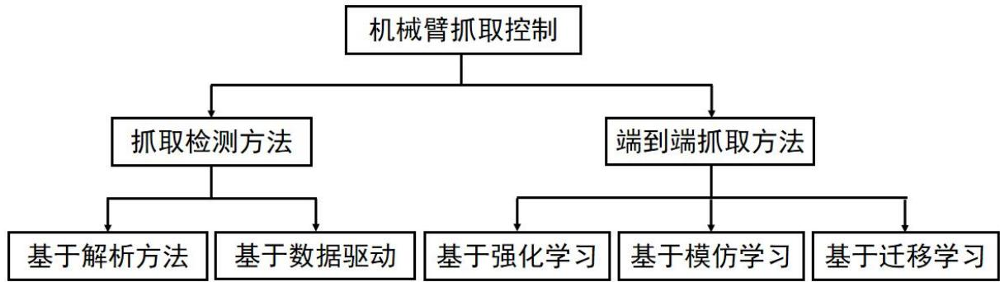  
图 1-6 机械臂抓取方法分类  
Fig. 1-6 Classification of grasping methods of the manipulator

基于解析方法的抓取检测并建立灵巧、稳定、平衡且具备一定动态特性的机械臂抓取模型，旨在通过求解抓取检测问题的解析解，得到合适的抓取位姿[38]。在给定精确的物体形状和机械臂运动学模型后，解析方法可看作是一个约束优化问题。贺道坤等人[39]根据机械臂与物件接触间的几何约束关系，分析气动关节曲率和控制关节内压之间的线性关系，构建控制关节内压的机械臂柔性抓取控制。Li 等人[40]针对具有三根硬手指和有摩擦点接触的机械人手，基于接触力模型以及几何分析，将三维抓取问题转换为二维平面抓取问题，实现机械臂带动机械人手抓取控制。然而，基于解析方法的抓取检测方法存在两个缺点：

（1）需要对抓取任务建模，不适应用于新的抓取任务与抓取目标；

（2）计算复杂，计算成本随约束条件数量的增多而显著增加。

基于数据驱动的抓取检测方法获得目标的抓取位姿，对未知物体的抓取具有一定的泛化性。目标的抓取位姿可用基于结构化的抓取表达替代，例如抓取点、抓取矩形。Saxena等人[41]通过监督学习方法训练，从同一物体多个角度的合成图像中学习抓取点，解决了同一物体多图像中抓取点的对应问题。该方法不对目标进行三维重建工作，却在完成未知物体的抓取任务时存在高达 87.5%的成功率。王勇等人[42]基于 CenterNet 提出一种改进的抓取检测模型，解决在机械臂的抓取检测中准确寻找抓取框中心点的问题。

Lenz等人[43]应用深度学习方法解决包含物体的场景的RGB-D 视图中抓取检测的问题，该方法使用两个级联的深度网络分两步得到最优抓取矩形。基于数据驱动的抓取检测方法存在两个缺点：

（1）依赖大量手动标注的数据集，成本较高；

（2）需要额外的运动规划或控制系统来完成抓取操作。

基于强化学习的端到端抓取方法，除了按照强化学习研究现状构建机械臂的控制规则外，还存在强化学习与其他方法结合的抓取控制方法。Kalashnikov 等人[44]提出了一个可扩展的基于自监督视觉的强化学习框架QT-Opt，该方法在7 台机械臂上收集58 万次抓取数据，去训练一个超过120万个参数的深度神经网络。在执行机械臂抓取任务时，对看不见的物体的抓取成功率达到96%。该强化学习框架能够自主学习机械臂抓取策略、探测物体并找到最有效的抓取方式。Zhong 等人[45]根据机械臂无碰撞路径规划的要求，设计了结合强化学习与传统控制论的混合控制算法。该算法结合DDPG算法与逆运动学方程，目的是在机械臂探索阶段使用强化学习算法，随着探索的进行，逐渐提升反运动学所得速度的权重。基于强化学习的端到端抓取方法存在如下挑战：

（1）在高维度环境中，学习任务的状态、动作随其变量的增加成指数级增长，需要更大的计算量和存储空间；

（2）实体机器臂训练代价过大，训练过程中硬件的损坏、人力成本都是巨大的花销，硬件上的差异和延迟也会导致结果不理想；

（3）建立一个精确的强化学习模型需要满足很多现实环境的条件；

（4）难以定义一个好的奖励函数。

基于模仿学习的端到端抓取方法，除了按照模仿学习研究现状构建机械臂的控制规则外，还与编程示教相互结合的方法。编程示教方法是机器臂获取运动技能最普遍的方式，其根据机器臂需要完成的任务内容，预先编辑动作序列。编程示教方法分为离线编程示教和在线编程示教两种形式，其中离线编程示教就是在仿真软件中构建整个工作场景的三维模型，生成机器臂的运动轨迹，通过仿真测试和调整轨迹，最后传输给现实环境中的机器臂。在线编程示教即操作人员通过示教器或者手柄，手动控制机器人的关节运动，令机器人运动到预定的位置并记录，最后传递到现实环境中的机器臂的控制器。其中拖动示教[46]是在机器人关节或者末端安装力矩传感器，机器臂会跟随操作者拖动的方向而动作，从而实现在线编程示教。部分机械人示教方法如图 1-7 所示。编程示教方法存在如下不足：

（1）只能在结构化环境中机械式重复预先编辑好的动作序列，对环境感知能力差；（2）适用于稳定性和精度要求高的任务场景，难以在变化的工作环境中作业。

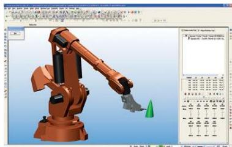  
(a)离线编程示教

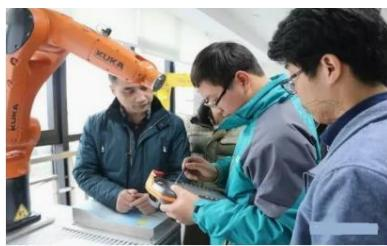  
(b)在线编程示教

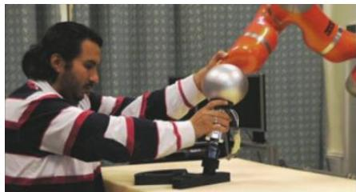  
(c)拖动示教  
图 1-7 编程示教方法  
Fig. 1-7 Programming teaching methods

基于迁移学习的端到端抓取方法，往往根据迁移学习的算法搭建机械臂的控制规则。例如，Rahmatizadeh 等人[47]根据长短期记忆递归神经网络（LSTM）和混合密度网络（MDN）对机械臂手爪进行抓取控制。该方法结合模仿学习和迁移学习，先利用 3 层LSTM 收集示教样本并进行仿真训练，然后根据输出动作概率的对数似然更新 MDN并优化动作策略，最后将训练好的动作策略迁移到现实环境中。

## 1.3 本文主要研究内容及章节安排

本文基于强化学习的机械臂抓取控制算法，针对强化学习算法探索效率低、算法收敛不确定、奖励函数引导机械臂学习能力差等问题，基于编程示教方法，结合模仿学习的模仿性好、适应力强等特点，采集耗时最短的示教样本，再将示教样本转换成强化学习所对应的奖励函数，从而提高强化学习的学习能力。本文主要研究内容如下：

（1）改善编程示教方法中的抓取控制规则，构建关于机械臂状态数据的多元正态分布模型，提出了一种基于概率模型的模仿学习算法 RFSI。在仿真实验中，验证了示教数据优化的效果。

（2）以GAIL 和SAC 为模板，通过构建复合奖励函数与二元变量损失函数，提出了一种基于奖励与策略双优化的机械臂抓取控制算法 $\mathrm { H R - G A I L } _ { \circ }$ 。在 Pybullet 仿真环境中实验，与 GAIL+SAC 方法对比，验证了本文所提算法对抓取训练效果的提升。

（3）结合本文中提出的 RFSI 算法与 HR-GAIL 算法，设计了基于 Pybullet 仿真平台与PyTorch 框架的机械臂抓取仿真系统。验证了本文所提算法的可行性。

本文章节结构如下，如图 1-8 所示。

第一章，绪论。从研究背景及意义，国内外对强化学习、模仿学习、机械臂抓取控制的研究现状这几个方面进行分析，并介绍本文的主要工作及章节结构。

第二章，强化学习与模仿学习理论。分别介绍有关强化学习与模仿学习的理论、公式推导与常用算法框架。

第三章，基于模仿学习方法的示教轨迹优化。介绍了示教轨迹优化框架，获取示教数据方法，示教轨迹优化过程，以及实验与分析。

第四章，基于奖励与策略双优化的机械臂抓取控制算法。介绍了机械臂抓取控制框架，机械臂抓取控制算法的推导和设计，以及实验与分析。

第五章，机械臂抓取仿真系统。结合本文中算法，设计了一个机械臂抓取仿真系统，详细介绍了该系统中的各个模块，并对系统软件进行了测试。

第六章，对本文研究内容进行总结与展望。

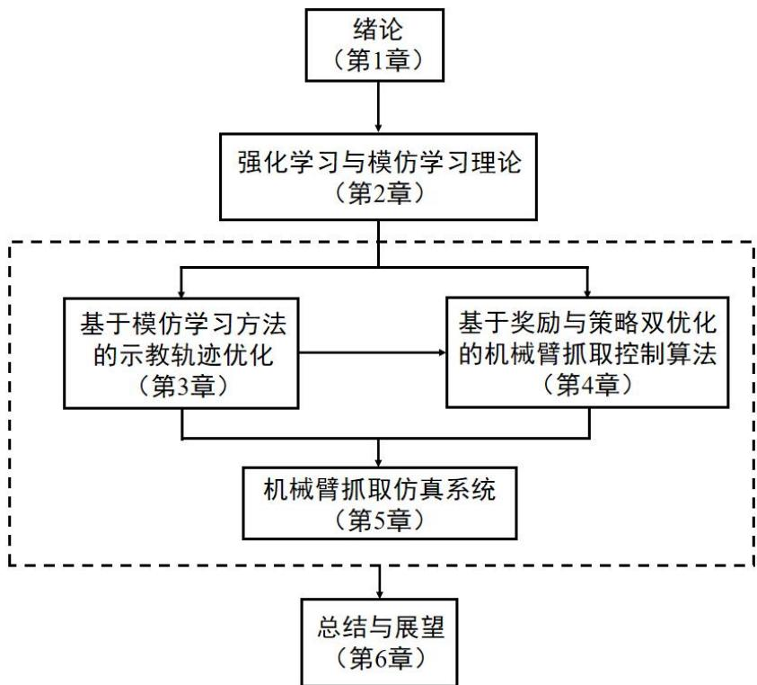  
图 1-8 本文结构图  
Fig. 1-8 Organization chart of this thesis

## 第2 章 强化学习与模仿学习理论

## 2.1 引言

强化学习是从环境状态到智能体动作映射的机器学习算法，每一次状态的变化都会收获一个奖励函数，并将所有的奖励按照时间顺序累加后构成累计奖励。随着状态变化次数的增加以及可能采取动作的随机性，累计奖励的变化将变得尤为复杂，这也让动作策略的更新过程变得不确定。模仿学习通过挖掘专家演示的示教样本的规律来探索最优策略，通过模仿学习与强化学习相结合，混合的算法能够根据专家演示的示教样本逆向推导出强化学习算法所需的奖励函数。本章通过对强化学习与模仿学习进行简述，目的是为了更好地量化累计奖励对强化学习算法的影响、细化动作策略如何进行梯度更新、以及构造模仿学习生成的奖励函数等过程。

## 2.2 强化学习理论

## 2.2.1 马尔科夫过程

强化学习问题通常被定义为马尔科夫过程[48]（MDP）。马尔可夫决策过程指的是具有马尔可夫性的随机决策过程，该决策过程的下一状态只与当前状态和所采取的动作有关，而与之前的状态、动作无关。因此，马尔科夫过程最主要的性质就是无后效性，即过去所有的信息都已经被保存到了现在的状态，基于现在就可以预测未来。马尔科夫过程通常由一个包含着状态、动作、状态转移概率、奖励的元组 $( \mathcal { S } , \mathcal { A } , p , r )$ 组成。

�表示状态空间， $\boldsymbol { s } _ { t } \in \mathcal { S }$ 表示智能体在�时刻的状态。

�表示动作空间， $a _ { t } \in \mathcal A$ 表示智能体在�时刻所采取的动作。

$p$ 为状态转移概率，表示在状态 $s _ { t }$ 和动作 $a _ { t }$ 情况下选择下一个状态 $s _ { t + 1 }$ 的概率密度。状态的转移概率 $p _ { \pi _ { \theta } } ( s _ { t } )$ 和状态-动作对的转移概率 $p _ { \pi _ { \theta } } ( s _ { t } , a _ { t } )$ 都由动作策略 $\pi _ { \boldsymbol { \theta } } ( a _ { t } | \boldsymbol { s } _ { t } )$ 来决定，动作策略 $\pi _ { \theta } ( a _ { t } | s _ { t } )$ 是状态 $s _ { t }$ 到动作 $a _ { t }$ 的映射。

�为奖励，表示在某一状态 $s _ { t }$ 下完成某个动作 $a _ { t }$ 获得的奖励值，是环境评判智能体的状态或动作是否满足预期的效果，是构成强化学习评价体系的重要组成部分。该奖励函数可以人为设定，也可以通过函数近似器进行计算。

在智能体与环境交互的过程中，智能体通过不断地试错，考虑当前状态下所有能采取的动作的可能性，预测所有动作能抵达的新状态，评估所采取动作的奖励值，进而实现若干步决策以收获最大的累计奖励。图2-1 将马尔科夫过程进行了可视化，展现了状态与动作之间的转移过程，以及智能体获得奖励的过程。

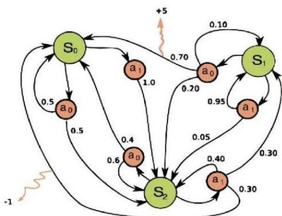  
图 2-1马尔科夫决策过程  
Fig. 2-1 Markov decision process

## 2.2.2 强化学习的值函数

强化学习的值函数是状态或状态-动作二元组的函数, 用于智能体估计当前状态或在当前状态下某动作的好坏，即累计奖励的大小。如果仅考虑状态作用下的值函数，国内外学者统一用 $V ( s _ { t } )$ 来表示；如果考虑状态-动作对的作用，该值函数则用 $Q ( s _ { t } , a _ { t } )$ 表示。

基于值的强化学习算法的目标，是计算从初始状态到终止状态的累计奖励的最大值。这个累计奖励，就是强化学习的目标函数，如公式（2-1）所示。其中 $^ { \mathrm { { 1 } } } { \boldsymbol { r } } _ { k } .$ 是当前时刻下的奖励，�是衰减因子，用来削弱未来奖励对当前状态的影响。通过最大化该目标函数，就能得到预期的动作策略 $\pi ( a _ { t } | s _ { t } )$ ，即通过该动作策略，智能体能收获最大的累计奖励。

$$
L = \sum_ {k = t + 1} ^ {\infty} \gamma^ {k - t - 1} r _ {k}\tag{2-1}
$$

当累计奖励是关于状态的函数时，从当前时刻�的状态到终止状态的累积奖励和，就是值函数中 $V ( s _ { t } )$ 的定义式，如公式（2-2）所 $\overline { { \overline { { \mathbf { \Omega } } } } }$ 。其中 $r ( s _ { t } )$ 是对当前状态 $s _ { t }$ 的奖励。

$$
V (s _ {t}) = \sum_ {T = t} ^ {\infty} \gamma^ {T} r (s _ {T})\tag{2-2}
$$

当前时刻�的状态 $s _ { t }$ 下会产生多个可能的动作，如果在下一状态 $s _ { t + 1 }$ 的 $V ( s _ { t + 1 } )$ 的基础上，再叠加当前动作 $a _ { t }$ 的奖励� $( s _ { t } , a _ { t } )$ ，就得出值函数中 $\mathbb { Q } ( s _ { t } , a _ { t } )$ 的结构，如公式（2-3）

所示。简言之， $Q ( s _ { t } , a _ { t } )$ 表示智能体在当前状态 $s _ { t }$ 下执行动作 $a _ { t }$ 所能获得的累积奖励。

$$
Q (s _ {t}, a _ {t}) = \sum_ {T = t} ^ {\infty} \gamma^ {T} r (s _ {T}, a _ {T}) = r (s _ {t}, a _ {t}) + V (s _ {t + 1})\tag{2-3}
$$

如果用下一个状态-动作对的累积奖励的最大值max $Q ( s _ { t + 1 } , a _ { t + 1 } )$ 来替代公式（2-3）中的 $V ( s _ { t + 1 } )$ ，就得到了基于贝尔曼等式推断的 Q 函数，如公式（2-4）所示。该等式通过循环迭代，就能很好地估计强化学习算法的值函数。Q 学习、DQN、DRQN等算法就是基于Q函数的贝尔曼等式推导出来的强化学习算法。

$$
Q (s _ {t}, a _ {t}) = r (s _ {T}, a _ {T}) + \max Q (s _ {t + 1}, a _ {t + 1})
$$

（2-4）

## 2.2.3 强化学习的策略更新

当累计奖励能够用 Q函数通过循环迭代的方式计算出来后，强化学习的策略更新所对应的目标函数就得以成功构建。基于策略的强化学习算法直接根据参数为θ的策略网络采样的动作概率 $\pi _ { \boldsymbol { \theta } } ( a _ { t } | \boldsymbol { s } _ { t } )$ 构建目标函数。如果某一动作使得Q 函数的值变大，强化学习的策略更新过程就会增加该动作出现的概率，反之，则减少该动作出现的概率。

PG的目标函数如公式（2-5）所示，其中 $A _ { t }$ 是优势函数，表示 $Q ( s _ { t } , a _ { t } )$ 与 $V ( s _ { t } )$ 的差值。 $V ( s _ { t } )$ 除了表示累计奖励外，还能表 $\overline { { \operatorname { J i n } } } Q ( s _ { t } , a _ { t } )$ 在动作空间 $\mathcal { A }$ 上的期望值。如果某动作 $a _ { t }$ 所对应的 $Q ( s _ { t } , a _ { t } )$ 比 $V ( s _ { t } )$ 高时，此时优势函数 $A _ { t }$ 为正数，智能体就应该选择该正数 $A _ { t }$ 所对应的动作。因此，PG算法会提高正数 $A _ { t }$ 所对应的动作概率 $\cdot \pi _ { \theta } ( a _ { t } | s _ { t } )$ ，从而不断提高累计奖励的值。

$$
L _ {\pi} ^ {P G} (\theta) = E _ {t \sim \pi_ {\theta} (a _ {t} | s _ {t})} [ \log \pi_ {\theta} (a _ {t} | s _ {t}) A _ {t} ]\tag{2-5}
$$

因为 PG算法的学习率较难确定，所以 PG算法在实际表现中存在不足。当学习率过小时，策略更新速度较慢，需要极长的时间更新参数�，收敛速度难以得到保障；当学习率过大时，策略网络在学习过程中容易产生震荡，造成策略更新过程的不稳定。TRPO通过在线学习的方式，限制同一批次的数据在新旧两种策略网络预测分布的 KL散度，从而避免新旧策略网络差异过大而导致策略更新的不稳定。通过对比不同参数�与 $\theta o l d$ 下的策略网络所采样的动作概率 $\pi ( a _ { t } | s _ { t } )$ ，TRPO替换PG算法中的 $\log \pi _ { \theta } ( s _ { t } | a _ { t } )$ 其目标函数的构建如公式（2-6）所示。其中参数 $\mathbf { \nabla } \cdot { \beta } .$ 是关于KL 散度的拉格朗日算子。在策略更新过程中，该KL 散度用于限制参数为�的策略网络训练不稳定的情况。

$$
L _ {\pi} ^ {T R P O} (\theta) = E _ {t \sim \pi_ {\theta o l d} (a _ {t} | s _ {t})} \{\frac {\pi_ {\theta} (a _ {t} | s _ {t})}{\pi_ {\theta o l d} (a _ {t} | s _ {t})} A _ {t} - \beta D _ {\mathrm{KL}} [ \pi_ {\theta o l d} (\cdot | s _ {t}) | | \pi_ {\theta} (\cdot | s _ {t}) ] \}\tag{2-6}
$$

PPO-Clip[49]在 TRPO的基础上，简化强化学习更新过程中对策略网络进行约束的部分，采用一种简易的切片方法替换掉了原来的KL 散度，在保证相同的运算效果条件下，有效降低了更新过程所需的算力需求。PPO-Clip 的目标函数如公式（2-7）所示。引入相对简单的切片（clip）方式，限制策略更新的幅度过大。

$$
L _ {\pi} ^ {P P O} (\theta) = E _ {t \sim \pi_ {\theta o l d} (a _ {t} | s _ {t})} [ \min (\frac {\pi_ {\theta} (a _ {t} | s _ {t})}{\pi_ {\theta o l d} (a _ {t} | s _ {t})} A _ {t}, \mathrm{clip} (\frac {\pi_ {\theta} (a _ {t} | s _ {t})}{\pi_ {\theta o l d} (a _ {t} | s _ {t})}, 1 - \epsilon , 1 + \epsilon) A _ {t}) ]\tag{2-7}
$$

PPO-Clip的切片原理如图2-2 所示，横坐标�表示原奖励，纵坐标�'表示调整后的奖励， $\epsilon { \mathrm { , } }$ 是一个超参数，是人为设定的切片阈值。当优势函数 $A _ { t }$ 为正数时，即某动作 $\scriptstyle a _ { t }$ 所对应的 $Q ( s _ { t } , a _ { t } )$ 比 $V ( s _ { t } )$ 高时，智能体应在该动作所对应的策略梯度方向上增大学习效果。同时，为了防止学习率过大而导致策略更新的不稳定，PPO将学习率限制在1+�以内。当优势函数 $\cdot A _ { t }$ 为负数时，即动作 $\cdot a _ { t } .$ 所对应的 $Q ( s _ { t } , a _ { t } )$ 比 $V ( s _ { t } )$ 低时，智能体应该避免在该动作所对应的策略梯度方向上更新。如图2-2 所示，如果智能体在 $A _ { t } < 0$ 的条件下错误地估计出很大的原奖励�，PPO不限制学习率，将原奖励调整为足够大的负数，实现抑制更新的作用。

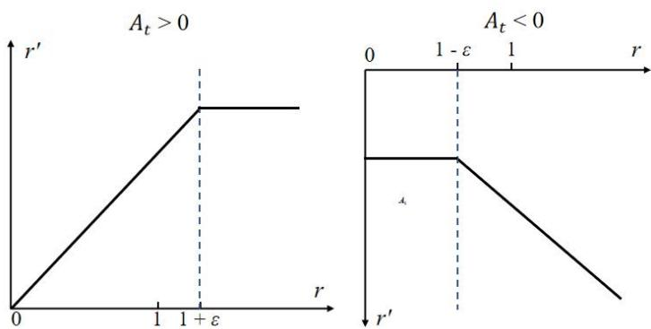  
图 2-2 PPO-Clip 的切片原理  
Fig. 2-2 Clip schematic for PPO-Clip

## 2.2.4 演员-评论家强化学习算法

以TRPO为代表的基于策略的强化学习算法，较好地解决了因学习率不确定而导致的不稳定问题，使智能体在连续动作空间上获得了较好的性能。但是基于策略的强化学习算法无法像DQN方法一样进行单步更新，因而学习速度较慢。演员-评论家强化学习

（AC 算法）将两种强化学习方法进行融合，其中，演员部分对应策略网络，采用策略更新方式；评论部分对应评论网络，采用值函数方法对策略网络所选取的动作策略进行Q值估计。

目前比较通用AC算法是DDPG，该算法在连续动作空间中选择一个确定的值来作为输出的动作。这个想法看似将连续空间的问题简化为离散空间的问题，然而，其本质是在策略网络必须服从一个高斯分布的条件下，用该分布的均值来作为动作的输出。其策略网络的更新是在公式（2-5）的基础上改进而来的，由于选择一个固定动作，给定状态下的动作概率 $\pi _ { \theta } ( a _ { t } | s _ { t } )$ 为1，其他动作的选择概率为0。此时 $V ( s _ { t } )$ 约等于 $Q ( s _ { t } , \pi _ { t } )$ 因此该算法的基于贝尔曼等式的迭代不需要 $V ( s _ { t } )$ 的参与，策略网络�直接根据评论网络$Q ( s _ { t } , \pi _ { t } )$ 进行更新，其目标函数如公式（2-8）所示。

$$
\begin{array}{r l} & L _ {Q} ^ {D D P G} = [ r (s _ {t}, \pi_ {t}) + Q ^ {t a r g e t} (s _ {t + 1}, \pi^ {t a r g e t} _ {t + 1}) ] - Q (s _ {t}, \pi_ {t}) \\ & L _ {\pi} ^ {D D P G} = - Q (s _ {t}, \pi_ {t}) \end{array}\tag{2-8}
$$

DDPG主动降低了动作选择空间的维度，削弱了AC 算法中策略更新的功能，相对应地增加了对值函数估计器的计算要求。如果状态-动作对 $\left( s _ { t } , a _ { t } \right) , \left( s _ { t + 1 } , a _ { t + 1 } \right)$ 在计算Q值时共用一个Q网络，会导致算法整体鲁棒性差，因此参考DQN类算法的思路，固定下一个状态的值函数 $Q ( s _ { t + 1 } , a _ { t + 1 } )$ ，记作作target Q网络，如公式（2-9）所示。�表示更新率，其值通常较小，让 target Q 网络以较小的幅度更新。因为 target Q 网络的更新幅度相比 Q 网络的更新幅度小，算法更新主要由 Q 网络提供，所以会提高算法整体鲁棒性。

$$
Q ^ {t a r g e t} (s _ {t}, a _ {t}) = (1 - \lambda) Q (s _ {t}, a _ {t}) + \lambda Q ^ {t a r g e t} (s _ {t}, a _ {t})\tag{2-9}
$$

因为 DDPG 的输出动作唯一，所以 DDPG 的鲁棒性很差。SQL 在无模型强化学习算法上执行熵最大化的策略更新，从而提高智能体的探索能力和完成任务的稳健性。SQL在Q 函数的基础上叠加一个熵值 $\pi _ { \theta } ( a _ { t } | s _ { t } ) \mathrm { l o g } \pi _ { \theta } ( a _ { t } | s _ { t } )$ ，并参考AC 算法框架，构建SAC算法。SAC算法重新构建值函数，所以评论网络是由 $V _ { \psi } ( s _ { t } )$ 和 $Q _ { \phi } ( s _ { t } , a _ { t } )$ 相互迭代构成，分别如公式（2-10）和公式（2-11）所示。

$$
{\cal L} _ {V _ {\Psi}} ^ {S A C} = V _ {\Psi} (s _ {t}) - E _ {a _ {t} \sim \pi_ {\theta}} [ Q _ {\phi} (s _ {t}, a _ {t}) - \log \pi_ {\theta} (a _ {t} | s _ {t}) ]\tag{2-10}
$$

$$
{\cal L} _ {Q _ {\phi}} ^ {S A C} = Q _ {\phi} (s _ {t}, a _ {t}) - [ r (s _ {t}, \pi_ {t}) + V _ {\psi} (s _ {t + 1}) ]\tag{2-11}
$$

策略网络的目标函数如公式（2-12）所示。其中 $Z _ { \phi } ( s _ { t } )$ 是一个边缘分布，是同一状态 $s _ { t }$ 下各种不同动作 $a _ { t }$ 的 $Q ( s _ { t } , a _ { t } )$ 在动作 $a _ { t }$ 上的积分，其作用是归一化分布，在求导过程中并不会影响策略网络的梯度更新。 $ { \varepsilon } _ { t }$ 服从正态分布N，由此生成动作 $a _ { t } = f _ { \theta } ( \varepsilon _ { t } ; s _ { t } )$ 。�是决定熵项与奖励的相对重要性的参数，其大小决定了动作策略更新过程中的随机程度。

$$
\begin{array}{r l} & L _ {\pi_ {\theta}} ^ {S A C} = D _ {K L} [ \pi_ {\theta} (\cdot | s _ {t}) | | \frac {\exp (Q _ {\phi} (s _ {t} , \cdot))}{Z _ {\phi} (s _ {t})} ] \\ & \quad \approx - E _ {\varepsilon_ {t} \sim N} [ \alpha \mathrm{log} \pi_ {\theta} (f _ {\theta} (\varepsilon_ {t}; s _ {t}) | s _ {t}) - Q _ {\phi} (s _ {t}, f _ {\theta} (\varepsilon_ {t}; s _ {t})) ] \end{array}\tag{2-12}
$$

SAC的目标函数不同于普通的 AC 算法，但当参数�无线趋近于 0的时候，其策略网络的目标函数就同 DDPG 一样。如果将SAC 的目标函数推广到无限时域问题，就需要引入折扣因子�来保证期望奖励之和是有限的。

## 2.3 模仿学习理论

## 2.3.1 示教样本的构成

模仿学习通过分析专家演示的示教样本，量化智能体的模仿能力，转换成强化学习所对应的奖励函数。专家演示的示教样本是由一条条轨迹序列构成的。轨迹序列按照时间顺序，从初始状态 $s _ { 0 }$ 开始，经由动作策略所产生的动作 $a _ { 0 }$ 后，达到新的状态 $s _ { 1 }$ ，然后在该动作策略的持续作用下，不断生成新的动作 $a _ { t }$ 和新的状态 $s _ { t + 1 }$ ，最终经过�次迭代后，抵达终止状态 $s _ { T }$ 。轨迹序列将这些状态 $s _ { t }$ 和动作 $a _ { t }$ 按照时间顺序进行排列，如公式（2-13）所示。其中 $\tau _ { j }$ 表示第�条轨迹序列。

$$
\tau_ {j} = [ s _ {0}, a _ {0}, s _ {1}, \ldots , s _ {t}, a _ {t}, s _ {t + 1}, \ldots , a _ {T - 1}, s _ {T} ]\tag{2-13}
$$

示教样本是根据专家设计的动作策略而进行批量采集的轨迹序列。如果该动作策略是需要搭载模仿学习算法后训练得出，由该动作策略所采集的轨迹序列，被称为采样样本。

## 2.3.2 模仿学习的成本函数

模仿学习的成本函数表示模仿能力的好坏，成本函数越小越好；而强化学习的奖励函数表示环境对状态是否满足设计者预期效果的评价，奖励函数越大越好。如果设计者预期效果就是模仿能力的好坏，则成本函数与奖励函数互为相反数。

模仿学习通过构建关于轨迹序列的成本函数 ${ \bf \ddot { } } c _ { \eta } ( \tau _ { j } )$ 来评判采样样本对示教样本的相似程度，即成本函数先根据示教样本进行训练，然后根据训练好的成本函数评估采样样本。如果采样样本的轨迹序列与示教样本的相似度越高，该轨迹序列的成本函数值就越小。在训练成本函数的过程中，因为轨迹序列的信息过长，国内外学者用每一个时刻�下的状态-动作所对应成本函数 $c _ { \eta } ( s _ { t } , a _ { t } )$ 的和来表示关于轨迹序列的成本函数，如公式（2-14）所示。

$$
c _ {\eta} (\tau_ {j}) = \sum_ {t} c _ {\eta} (s _ {t}, a _ {t})\tag{2-14}
$$

模仿学习的最后步骤，要从采样样本中挑选出与示教样本最相似的轨迹序列，即挑选出成本函数值最小的轨迹序列。因为采样样本的轨迹序列是相互独立的，所以能够构建关于采样样本的轨迹分布，并通过对轨迹分布的采样，挑选出与示教样本最相似的轨迹序列。对轨迹分布采样的轨迹概率 $p ( \tau _ { j } )$ 如公式（2-15）所示，其中�是边缘函数，即关于轨迹序列的成本函数的指数和，即 $\mathrm { e x p } ( - c _ { \eta } ( \tau _ { j } ) )$ 。

$$
p (\tau_ {j}) = \frac {1}{Z} \mathrm{exp} (- c _ {\eta} (\tau_ {j}))\tag{2-15}
$$

构建轨迹分布的方法能够协调模仿学习过程中的准确性与探索性，通过增加成本函数值小的轨迹概率从而提高模仿学习效果，同时成本函数值不高的轨迹序列也能当做探索过程被采样出来。如果用参数为�的神经网络表示轨迹概率 $p ( \tau _ { j } | \omega )$ ，则该参数�的最优值可用轨迹概率的最大似然函数求解，如公式（2-16）所示。

$$
\omega^ {*} = \operatorname{argmax} \sum \log p (\tau_ {j} | \omega)\tag{2-16}
$$

## 2.3.3 逆向强化学习算法

因为成本函数没有给出通用的表达式，所以很多逆向强化学习算法用神经网络对该成本函数进行简化和替代。MaxEnt-IRL[50]假设成本函数是由许多特征向量 $\phi ( s _ { t } , a _ { t } )$ 线性构成的，且要求每个特征向量都有一个对应的特征向量权重�，使成本函数的构造如公

式（2-17）所示。其中函数 $| g \rangle$ 表示线性函数。

$$
c _ {\eta} (s _ {t}, a _ {t}) = c _ {\omega} (s _ {t}, a _ {t}) = \omega^ {\mathrm{T}} \phi (s _ {t}, a _ {t}) = g (\phi , \omega)\tag{2-17}
$$

在工程应用中，智能体能够挑选关键的特征向量来作为构造成本函数的依据。这种特征向量的表现形式往往伴随着深度神经网络的融合，即成本函数可以表示成多级神经网络串联，即 $g ( \phi , \omega _ { 1 } , \omega _ { 2 } , \ldots , \omega _ { n } )$

GCL 是一个构建在概率论上的MaxEnt-IRL 框架，通过构建并优化一个关于成本函数�的轨迹分布，使用最大似然估计，最大化示教样本的轨迹概率。GCL 采用非线性参数构建成本函数，其目标函数如公式（2-18）所示。其中�表示边缘分布，引用了一个关于轨迹序列的后向轨迹分布 $q ( \tau _ { j } )$ 进行构造。

$$
\begin{array}{r l} & L _ {c} ^ {G C L} (\eta) = \frac {1}{N} \sum_ {\tau_ {i} \in \mathcal {D} _ {d e m o}} c _ {\eta} (\tau_ {i}) + \log Z \\ & \quad \approx \frac {1}{N} \sum_ {\tau_ {i} \in \mathcal {D} _ {d e m o}} c _ {\eta} (\tau_ {i}) + \log \frac {1}{M} \sum_ {\tau_ {j} \in \mathcal {D} _ {s a m p l e}} \frac {\exp (- c _ {\eta} (\tau_ {j}))}{q (\tau_ {j})} \end{array}\tag{2-18}
$$

后向轨迹分布 $q ( \tau _ { j } )$ 满足高斯分布，常被应用在基于模型的强化学习算法中。后向轨迹分布 $q ( \tau _ { j } )$ 根据GPS 迭代进行更新，并采用 $\mathrm { L O R } ^ { [ 5 1 ] }$ 方式进行后向传播过程，且优化在动作策略时满足强化学习KL 散度限制。

GCL 的训练流程如下：后向轨迹分布先产生大量的采样样本用于成本函数�和边缘分布�的更新，然后再对后向轨迹分布 $q .$ 进行更新，为下一次成本函数�的迭代产生新的采样样本。因为 GCL 设计之初是和基于模型的强化学习算法相结合的，所以在更新处理边缘分布�的过程就是拟合时变的前向状态转移模型的过程。如图 2-3 所示，GCL 应用在机械臂抓取并摆盘的任务中，输入是图片中盘子的视觉位置、夹具位姿、夹具速度；通过后向轨迹分布 $\dot { \boldsymbol { q } _ { I } }$ 产生的采样样本，结合示教样本训练成本函数�，最后根据成本函数�的轨迹分布训练后向轨迹分布 $\mathbf { \dot { \boldsymbol { q } } }$ ，从而输出对应的机械臂抓取动作。

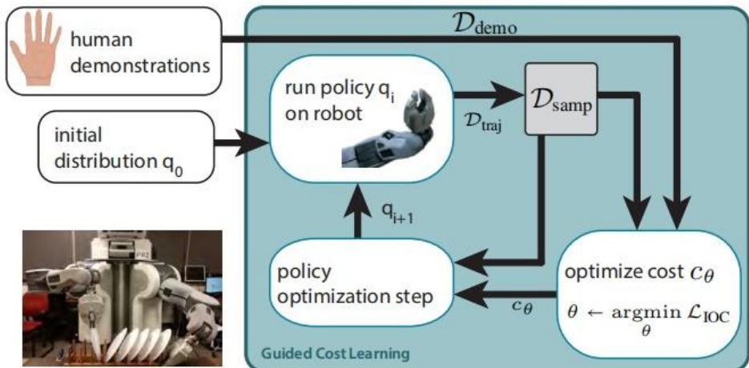  
图 2-3 引入逆向强化学习算法训练机械臂抓取并摆盘的任务  
Fig. 2-3 The IRL algorithm is introduced to train the manipulator to grasp and swing the disk

## 2.3.4 鉴别器的构造方法

GAN-GCL[52]根据轨迹序列 $\tau _ { j }$ 与示教样本的相似程度，参考GAN[53]方法，构建一个判别器�，从而得到模仿学习的成本函数。基于参数�的判别器 $D _ { \eta } ( \tau _ { j } )$ 的等式如公式（2-19）所示。其中�是成本函数的近似器。

$$
D _ {\eta} (\tau_ {j}) = \frac {\exp (f _ {\eta} (\tau_ {j}))}{\exp (f _ {\eta} (\tau_ {j})) + \pi_ {\theta} (\tau_ {j})}\tag{2-19}
$$

对判别器�的更新迭代，就是对成本函数进行更新迭代，即GAN-GCL 所探究的成本函数就是判别器�本身。和GCL 一样，通过对边缘分布�进行更新，实现对动作策略$\pi _ { \theta } ( \tau _ { j } )$ 的更新。GAN-GCL 通过对动作策略�与判别器�的循环更新，实现对智能体的控制。

根据轨迹序列 $\tau _ { j }$ 进行估计的判别器�，会导致判别器�的轨迹分布呈现过高的方差，从而导致很差的模仿学习效果。因此，判别器�也可以通过状态-动作对 $( s _ { t } , a _ { t } )$ 所对应的成本函数进行估计。对抗逆向强化学习算法[54]（AIRL）根据当前状态-动作对 $( s _ { t } , a _ { t } )$ 和下一个状态 $s _ { t + 1 }$ 的信息构建判别器�，从而得到模仿学习的成本函数。基于参数�,�的判别器 $D _ { \eta , \phi } ( s _ { t } , a _ { t } , s _ { t + 1 } )$ 的等式如公式（2-20）所示；成本函数 $\mathcal { f } _ { \eta , \phi }$ 的构造等式如公式（2-21）所示。

$$
D _ {\eta , \phi} (s _ {t}, a _ {t}, s _ {t + 1}) = \frac {\exp (f _ {\eta , \phi} (s _ {t} , a _ {t} , s _ {t + 1}))}{\exp (f _ {\eta , \phi} (s _ {t} , a _ {t} , s _ {t + 1})) + \pi_ {\theta} (a _ {t} | s _ {t})}\tag{2-20}
$$

$$
f _ {\eta , \phi} (s _ {t}, a _ {t}, s _ {t + 1}) = g _ {\eta} (s _ {t}, a _ {t}) + \gamma h _ {\phi} (s _ {t + 1}) - h _ {\phi} (s _ {t})\tag{2-21}
$$

其中 $g _ { \eta }$ 是奖励近似器函数， $h _ { \phi }$ 是塑造选项， $\gamma .$ 对应强化学习中折扣因子。 $g _ { \eta } ( s _ { t } , a _ { t } ) +$ $\gamma h _ { \phi } ( s _ { t + 1 } )$ 可以视为强化学习中的 $Q ( s _ { t } , a _ { t } ) , h _ { \phi } ( s _ { t } )$ 可以视为强化学习中的 $V ( s _ { t } )$ 。因为优势函数 $A _ { t }$ 等于 $Q ( s _ { t } , a _ { t } )$ 与 $V ( s _ { t } )$ 的差值，所以 $f _ { \eta , \phi } ( s _ { t } , a _ { t } , s _ { t + 1 } )$ 可以视为强化学习的优势函数$A ( s _ { t } , a _ { t } )$

AIRL 是参照强化学习的值函数来构建模仿学习的成本函数。判别器�的本质是对比成本函数�与动作策略�之间的相关关系，当动作策略在示教样本的作用下训练后，判别器�的值越大，表示采样样本与示教样本的差距越大；判别器�的值越小，模仿效果就越好。为了协调模仿学习过程中的准确性与探索性，判别器�不应过大或过小。

AIRL 的训练过程是让鉴别器 $D$ 与动作策略π相互对抗的过程。动作策略�的目标是生成与示教样本相似的采样样本，而鉴别器�的目标是区分采样样本与示教样本。这两个目标相互对抗，使得动作策略π不断优化自己的生成能力，同时鉴别器�也不断优化自己的鉴别能力。鉴别器�的目标函数如公式（2-22）所示。

$$
L _ {\eta , \phi} = \log D _ {\eta , \phi} (s _ {t}, a _ {t}, s _ {t + 1}) - \log (1 - D _ {\eta , \phi} (s _ {t}, a _ {t}, s _ {t + 1}))\tag{2-22}
$$

## 2.4 本章小结

本章分别对强化学习与模仿学习进行简述。在强化学习方面，首先介绍了马尔科夫过程，由此处状态-动作对与奖励的关系，介绍了强化学习的值函数的分类与应用。然后介绍强化学习的更新过程，引出强化学习的策略更新。最后结合值函数与策略更新的应用，介绍目前常用的几种演员-评论家强化学习算法。在模仿学习方面，首先介绍了示教样本的构成，随后量化模仿学习的模仿能力，提出模仿学习的成本函数。根据模仿学习通过示教样本训练成本函数的过程，介绍逆向强化学习算法。最后在目前常用的几种逆向强化学习算法上总结出鉴别器的构造方法。上述内容结合理论分析与公式推导，为下文机械臂抓取控制中强化学习与模仿学习的应用提供了理论支撑。

## 第 3 章 基于模仿学习方法的示教轨迹优化

## 3.1 引言

示教轨迹广泛应用于机器臂控制任务中，在固定任务中能保障机器臂的抓取精度和完成任务的效率。编程示教方法是产生示教轨迹最普遍的方法，然而该方法还存在对不同任务的适应性差、难以实现高精度的运动控制以及编程调试频繁等问题。为了有效并快速地生成示教轨迹，国内外学者结合运动学分析，利用传感器进行编程示教[55]；也有学者利用混合高斯模型对轨迹示教数据进行建模[56]，进而生成示教轨迹。随着图像处理技术和模仿学习技术的提高，面向任务级示教的图像交互示教[57]，或者结合模仿学习对机器人的快速编程[58, 59]，也能指导机械臂快速学习相关的运动技能。

本章基于如何获取机械臂抓取任务的示教数据的问题，提出了一种基于概率模型的模仿学习方法，通过对编程示教所生成的示教数据进行处理，进而获取更优质的示教轨迹。具体研究内容总结如下：

（1）根据机械臂的几何结构，构建机械臂的运动学模型。通过定义控制规则来实现机械臂的运动，对生成的运动轨迹进行筛选后，保存为示教数据。

（2）提出一种基于概率模型的模仿学习算法RFSI，对示教数据进行处理，构建关于机械臂状态数据的多元正态分布模型，得到基于模仿学习的机械臂控制器。

（3）训练机械臂控制器在相同抓取任务上进行探索，从而生成抓取精度高、完成任务耗时更短的示教数据。

（4）在Python 环境中，构建基于 PyTorch 框架的控制器进行仿真训练和实验，对比示教数据在应用RFSI算法前后的变化，验证本章节方法的有效性。

## 3.2 示教轨迹优化框架

机械臂模仿学习框架由示教数据获取模块和机械臂仿真模块构成。示教数据获取模块采用离线编程示教方法进行构建，即先对机械臂运动学建模，然后加载抓取控制规则生成机械臂状态数据，最后经过轨迹筛选机制得到示教数据。机械臂控制器的训练需要示教数据和探索数据的共同作用，在模仿学习算法 RFSI 的作用下，不断训练控制器，实现对示教数据的模仿。最后，由机械臂控制器产生的机械臂状态数据，同样会经过轨迹筛选，将符合要求的运动轨迹保存到示教数据中，实现对示教数据进一步的优化及扩充。示教轨迹优化框架如图3-1 所示。

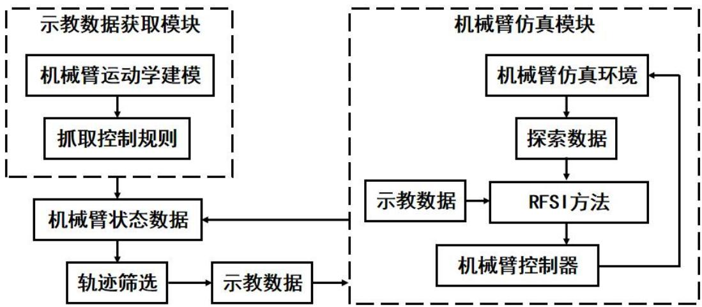  
图 3-1示教轨迹优化框架  
Figure 3-1 Trajectory optimization framework

## 3.3 获取示教数据

## 3.3.1 机械臂运动学建模

机械臂运动学建模是将串联机械臂的各个关节角度和末端执行器的位置与姿态等信息表示成数学模型的过程。

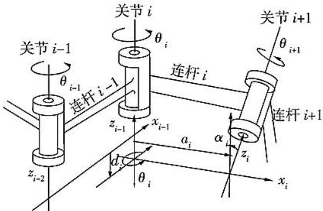  
图 3-2 机械臂各部分的节点和连线示意图  
Fig. 3-2 The node and connection diagram of each part of the manipulator

如图 3-2 所示，首先建立笛卡尔坐标系，根据机械臂各部分的位置和方向关系，得到机械臂各部分的节点和各部分间的连线信息；然后根据节点间的距离和连线间的夹角构建机械臂的几何模型；最后推导出机械臂末端执行器的位置和姿态，即运动学方程的变换矩阵。

根据 D-H模型方法[60]，从坐标系�到坐标系�−1的变换矩阵 $T _ { i - 1 } ^ { i }$ 由公式（3-1）构成。其中， $R o t ( x _ { i } , \alpha _ { i } )$ 表示坐标系绕 $x _ { i }$ 轴旋转绕 $\alpha _ { i }$ 角度的基本旋转变换矩阵， $T r a n s ( x _ { i } , a _ { i } )$ 表示坐标系沿着 $x _ { i }$ 轴平移 $a _ { i }$ 距离的基本平移变换矩阵。参数 $a _ { i }$ ， $d _ { i }$ ， $\alpha _ { i }$ ， $\theta _ { i }$ 介绍如下：

$a _ { i }$ 是坐标轴 $z _ { i - 1 }$ 与坐标轴 $z _ { i }$ 沿着坐标轴 $x _ { i - 1 }$ 的有向距离；

$d _ { i }$ 是坐标轴 $x _ { i - 1 }$ 与坐标轴 $x _ { i }$ 沿着坐标轴 $z _ { i - 1 }$ 的有向距离；

$\alpha _ { i }$ 是坐标轴 $z _ { i - 1 }$ 与坐标轴 $z _ { i }$ 的夹角；

$\theta _ { i }$ 是坐标轴 $x _ { i - 1 }$ 与坐标轴 $x _ { i }$ 的夹角；

$$
\begin{array}{r} T _ {i - 1} ^ {i} = R o t (z _ {i - 1}, \theta_ {i}) T r a n s (z _ {i - 1}, d _ {i}) T r a n s (x _ {i}, a _ {i}) R o t (x _ {i}, \alpha_ {i}) \\ = \left[ \begin{array}{c c c c} c o s   \theta_ {i} & - s i n   \theta_ {i} c o s   \alpha_ {i} & s i n   \theta_ {i} s i n   \alpha_ {i} & a _ {i} c o s   \theta_ {i} \\ s i n   \theta_ {i} & c o s   \theta_ {i} s i n   \alpha_ {i} & - c o s   \theta_ {i} s i n   \alpha_ {i} & a _ {i} s i n   \theta_ {i} \\ 0 & s i n   \alpha_ {i} & c o s   \alpha_ {i} & d _ {i} \\ 0 & 0 & 0 & 1 \end{array} \right] \end{array}\tag{3-1}
$$

得到每个连杆的变换矩阵后，通过链式法则即可得出末端执行器（end 坐标系）相对于基座（0坐标系）的齐次变换矩阵 $T _ { 0 } ^ { e n d }$ 。以7 自由度机械臂为例， $T _ { 0 } ^ { e n d }$ 如公式（3-2）所示。

$$
T _ {0} ^ {e n d} = T _ {0} ^ {1} T _ {1} ^ {2} T _ {2} ^ {3} T _ {3} ^ {4} T _ {4} ^ {5} T _ {5} ^ {6} T _ {6} ^ {e n d} = \left[ \begin{array}{c c c c} n _ {x} & o _ {x} & a _ {x} & p _ {x} \\ n _ {y} & o _ {y} & a _ {y} & p _ {y} \\ n _ {z} & o _ {z} & a _ {z} & p _ {z} \\ 0 & 0 & 0 & 1 \end{array} \right]\tag{3-2}
$$

$\left[ n _ { x } ~ n _ { y } ~ n _ { z } \right] ^ { \mathrm { T } }$ 是末端执行器坐标系的�轴相对于基座坐标系中的单位方向向量；

$\left[ o _ { x } \ o _ { y } \ o _ { z } \right] ^ { \mathrm { T } }$ 是末端执行器坐标系的�轴相对于基座坐标系中的单位方向向量；

$\left[ a _ { x } ~ a _ { y } ~ a _ { z } \right] ^ { \mathrm { T } }$ 是末端执行器坐标系的�轴相对于基座坐标系中的单位方向向量；

$\left[ p _ { x } \ p _ { y } \ p _ { z } \right] ^ { \mathrm { { T } } }$ 是末端执行器坐标系的原点在基座坐标系的位置。

通过获得末端执行器的位姿 $P _ { \mathrm { { e } } }$ ，即可根据 $T _ { 0 } ^ { e n d }$ ，逆向求得第�个关节的角度值 $\theta ^ { ( k ) }$ 该方法称为逆运动学方法。

机械臂状态数据 $s _ { t }$ 由每时刻�各关节的角度值构成，如公式（3-3）所示。

$$
s _ {t} = [ \theta_ {t} ^ {(1)}, \theta_ {t} ^ {(2)}, \theta_ {t} ^ {(3)}, \theta_ {t} ^ {(4)}, \theta_ {t} ^ {(5)}, \theta_ {t} ^ {(6)}, \theta_ {t} ^ {(7)} ] ^ {\mathrm{T}}\tag{3-3}
$$

## 3.3.2 抓取控制规则

无论是结合传感器的编程示教[61]，还是与图像交互示教[62]，都需要计算末端执行器与抓取目标之间的欧式距离来控制末端执行器是否执行抓取动作。这些方法定义了一个随时间变化的欧式距离 $d _ { t } ^ { g }$ ，如公式（3-4）所示。

$$
d _ {t} ^ {g} = \| P _ {e} - P _ {c} \| _ {2}\tag{3-4}
$$

其中 $P _ { \mathrm { c } }$ 是抓取目标的位姿， $P _ { \mathrm { ~ e ~ } }$ 是末端执行器的位姿。

在使用离线编程示教方法时，当 $d _ { t + 1 } ^ { g } < d _ { t } ^ { g }$ 时，表明末端执行器正在不停地靠近抓取目标，以末端手爪为例，此时末端手爪应保持开启的状态。当 $d _ { t + 1 } ^ { g } > d _ { t } ^ { g }$ 时，表明末端执行器开始远离抓取目标，此时应该判定让手爪执行抓取动作。然而，在机械臂控制过程中，欧式距离 $d _ { t }$ 的判定会因为噪音扰动而忽高忽低，从而使得末端手爪的开合非常不稳定。

本节将�时刻前�次的数据都提取出来与 $d _ { t } ^ { g }$ 进行对比，取代之前的方法。通过与一段时间内的欧式距离对比，能有效地降低噪音扰动对抓取控制的影响。更改后的判定公式如公式（3-5）所示。

$$
d _ {t} ^ {g} > \frac {1}{n - 1} \sum_ {i = t - n} ^ {n - 1} d _ {i} ^ {g}\tag{3-5}
$$

其中， $d _ { i } ^ { g }$ 是第�时刻下的末端执行器与抓取目标的欧式距离，�是所选之前数据的个数。其中参数不宜过大，否则会导致抓取控制失效，本章节令�等于 30。因此，当 $d _ { t } ^ { g }$ 比前�次的欧式距离都大时，则判定让手爪执行抓取动作。

## 3.3.3 轨迹筛选

如图 3-3，所示机械臂完成抓取任务而生成的运动轨迹，是末端执行器对抓取目标实施抓取操作后移动至任务目标的过程。运动轨迹的生成通过逆运动学方法实现，然而逆运动学方法在求逆解的过程中可能同时存在多个解，这会导致采用逆运动学方法的控制过程可能出现较大的误差。因此，需要对采用逆运动学方法而生成的运动轨迹进行筛

选。

本节以抓取控制任务的完成程度为导向，分别计算任务目标到末端执行器、抓取目标的欧式距离，从而构建筛选机制 $d _ { t } ^ { t }$ ，如公式（3-6）所示。

$$
d _ {t} ^ {t} = \| P _ {t} - P _ {e} \| _ {2} + \| P _ {t} - P _ {c} \| _ {2}\tag{3-6}
$$

其中 $P _ { t }$ 是任务目标的位姿， $P _ { \mathrm { c } }$ 是抓取目标的位姿， $P _ { \mathrm { ~ e ~ } }$ 是末端执行器的位姿。

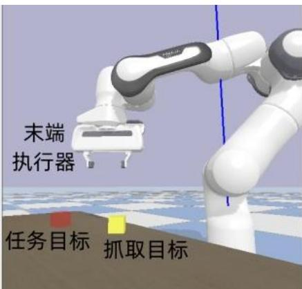  
图 3-3 机械臂实施抓取操作示意图  
Fig. 3-3 Schematic diagram of the manipulator grasping operation

本节根据轨迹终止时刻的欧式距离 $\dot { a } _ { t } ^ { t }$ 值，判断轨迹数据是否能作为示教数据进行保存。当终止时刻的 $\mathbf { \nabla } d _ { t } ^ { t }$ 值小于一个阈值，对应的轨迹序列�就能作为示教数据进行保存。轨迹序列�是机械臂状态数据 $s _ { t }$ 按照时间顺序排列的数组，如公式（3-7）所示。

$$
\tau = [ s _ {0}, s _ {1}, \ldots , s _ {t}, s _ {t + 1}, \ldots , s _ {T} ]\tag{3-7}
$$

## 3.4 基于模仿学习方法的轨迹优化

## 3.4.1 设置成本函数

模仿学习通过构建成本函数来评估探索数据对示教数据的相似程度。本章节采用固定的成本函数形式来对探索数据进行评估与约束。结合公式（3-4）和公式（3-6），每个时刻�下的模仿学习的成本函数 $c _ { t }$ 如公式（3-8）所示。 $d _ { t } ^ { g }$ 是来自于抓取控制（grasp）的评判指标， $d _ { t } ^ { t }$ 是来自于任务目标导向（task）的评价指标。

$$
c _ {t} = d _ {t} ^ {g} + d _ {t} ^ {t}\tag{3-8}
$$

根据示教数据与探索数据之间的差异，由示教数据（demo）计算得到的成本函数的值，本章定义为示教成本 $c _ { t } ^ { d }$ ，其中时刻�对应示教数据中轨迹序列的时刻；由探索数据（explore）计算得到的成本函数的值，本章定义为探索成本 $\cdot c _ { t ^ { e } } ^ { e }$ ，其中时刻 $\mid t ^ { e }$ 对应探索数据中轨迹序列的时刻。

## 3.4.2 递归遗忘采样模仿算法

递归遗忘采样模仿（Recursive Forget Sampling Imitation, RFSI）算法根据轨迹序列拟合出时变的多元正态分布模型，通过对该分布进行采样，依照采样的值引导动作输出的模仿学习算法。RFSI算法流程如下：

第一步：对比当前时刻 $t ^ { e }$ 点上探索数据的探索成本 $c _ { t ^ { e } } ^ { e }$ ，与示教数据上每一时刻�的示教成本 $c _ { t } ^ { d }$ 的大小关系，计算 $c _ { t ^ { e } } ^ { e }$ 与 $c _ { t } ^ { d }$ 差别最小的示教时刻点�∗，如公式（3-9）所示。

$$
\begin{array}{l} t ^ {*} = \arg \min _ {t} (| c _ {t} ^ {d} - c _ {t ^ {e}} ^ {e} |) \\ t ^ {*} = \left\{ \begin{array}{l l} t ^ {*} & t ^ {*} > t ^ {e} \\ t ^ {e} & t ^ {*} <   t ^ {e} \end{array} \right. \end{array}\tag{3-9}
$$

第二步：在当前探索时刻 $t ^ { e }$ ，经由公式（3-9）的裁剪机制，将示教数据裁剪成多个轨迹序列 $\tau ^ { ( t ^ { e } ) }$ ， $t ^ { * }$ 作为 $\tau ^ { ( t ^ { e } ) }$ 的初始时刻点，如公式（3-10）所示。

$$
\tau^ {(t ^ {e})} = [ s _ {t ^ {*}}, s _ {t ^ {*} + 1}, \ldots , s _ {T} ]\tag{3-10}
$$

第三步：在当前探索时刻 $t ^ { e }$ ，根据多个轨迹序列 $\tau ^ { ( t ^ { e } ) }$ 计算示教数据内各关节角度值$\theta _ { t } ^ { ( k ) }$ 的样本均值 $\mathbf { \nabla } _ { \mu } ( k )$ 与样本标准差 $S ^ { ( k ) }$ ，如公式（3-11）所示。

$$
\begin{array}{c} {\mu^ {(k)} = \frac {1}{T - t ^ {*}} \sum_ {t = t ^ {*}} ^ {T - t ^ {*}} \theta_ {t} ^ {(k)}} \\ {S ^ {(k)} = \sqrt {\frac {1}{T - t ^ {*} - 1} \sum_ {t = t ^ {*}} ^ {T - t ^ {*}} \left(\theta_ {t} ^ {(k)} - \mu^ {(k)}\right) ^ {2}}} \end{array}\tag{3-11}
$$

第四步：根据轨迹序列 $\tau ^ { ( t ^ { e } ) }$ 拟合出的多元正态分布模型，其中的每个随机变量都服从正态分布，因此第�个关节的角度值 $\theta ^ { ( k ) }$ 都服从正态分布，如公式（3-12）所示。

$$
\theta^ {(k)} \sim N \big (\mu^ {(k)}, (S ^ {(k)}) ^ {2} \big)\tag{3-12}
$$

因此，下一个探索时刻 $t ^ { e } + 1$ 下的机械臂状态 $\boldsymbol { s } _ { t ^ { e } + 1 }$ ，即在 $t ^ { e } + 1$ 时刻下第�个关节的角度值 $\theta _ { t ^ { e } + 1 } ^ { ( k ) }$ 从公式（3-12）的多元正态分布中采样获得，如公式（3-13）所示。

$$
\theta_ {t ^ {e} + 1} ^ {(k)} \sim N \big (\mu^ {(k)}, (S ^ {(k)}) ^ {2} \big)\tag{3-13}
$$

综上所述，本节RFSI算法流程如图3-4所示。

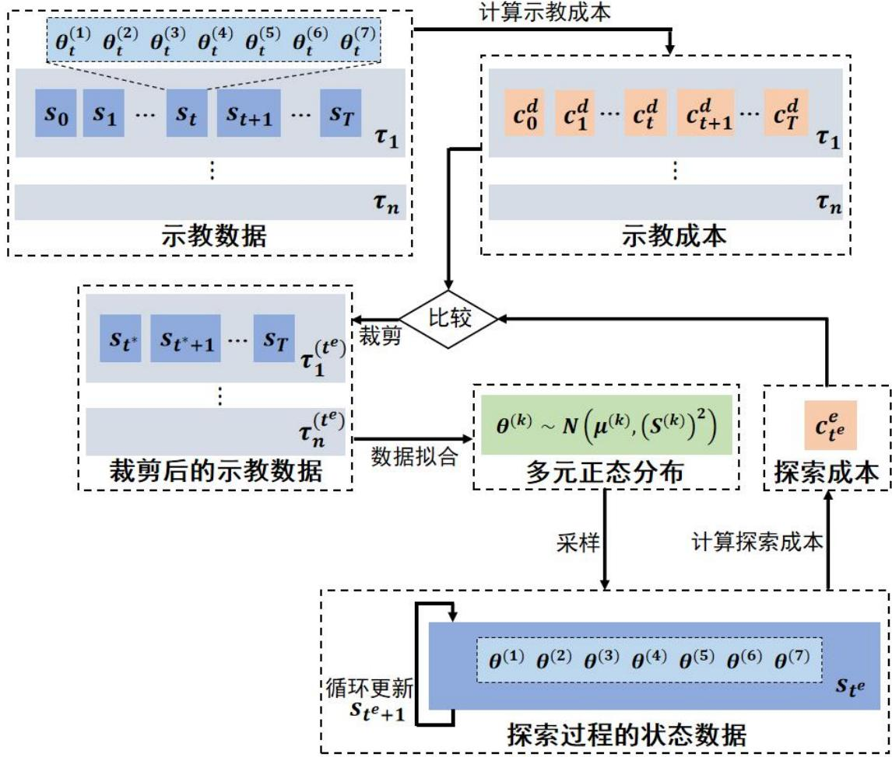  
图 3-4 RFSI 算法流程图  
Fig. 3-4 Flow chart of RFSI algorithm

探索数据 $S _ { \mathrm { t } ^ { \mathrm { e } } }$ 经过与示教数据的比较后，得到了关于下一时刻探索数据 $\boldsymbol { s } _ { t ^ { e } + 1 }$ 的多元正态分布，通过循环更新 $\boldsymbol { s } _ { t ^ { e } + 1 }$ ，继续对下一探索时刻生成对应的多元正态分布，从而实现对示教数据的模仿。

## 3.4.3 设计机械臂控制器

每一时刻的所生成的探索数据，都需要大量的示教数据作为先验知识，通过计算当前时刻的探索成本 $c _ { t ^ { e } } ^ { e }$ 与示教数据上每时刻的示教成本��之间的差值，裁剪示教数据，从而获得下一时刻的探索数据 $s _ { t ^ { e } + 1 }$ 所对应的多元正态分布。为了节约计算的复杂性，同时保留多次循环更新后产生的先验知识，本节采用多层全连接神经网络来构建机械臂控制器，其网络结构如图3-5 所示。

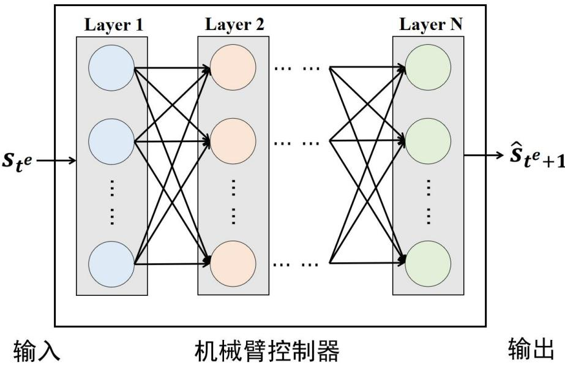  
图 3-5 机械臂控制器的设计  
Fig. 3-5 The design of manipulator controller

控制器输入当前时刻的探索数据 $\boldsymbol { s } _ { t ^ { e } }$ ，输出下一时刻探索数据的估计值 $\widehat { s } _ { t ^ { e } + 1 }$ 。控制器的损失函数如公式（3-14）所示。

$$
L = \frac {1}{2} \| s _ {t ^ {e} + 1} - \hat {s} _ {t ^ {e} + 1} \| _ {2} ^ {2}\tag{3-14}
$$

其中， $s _ { t ^ { e } + 1 }$ 是经过RFSI算法所得的探索数据的真实值。通过计算由估值 $\widehat { s } _ { t ^ { e } + 1 }$ 与 $\boldsymbol { s } _ { t ^ { e } + 1 }$ 的差所构建的损失函数，从而实现对控制器的更新。

最后，将训练好的控制器应用在同一任务的探索，并经过与之前相同的筛选机制，将符合要求的运动轨迹保存到示教数据中，实现对示教数据进一步的优化及扩充。

## 3.5 实验与分析

## 3.5.1 配置仿真环境

本章节所使用的硬件设备为 LAPTOP -4KUQUNRQ，内置的 GPU 芯片的型号为GeForce RTX 2080 Ti，处理器是 Intel(R) Core(TM) i5-6200U CPU @ 2.30GHz，内存为16GB。操作系统为 win10 版本。仿真软件为 Python3.6，物理仿真驱动为 Pybullet3.1.7。

通过对 Franka Emika Panda 机械臂运动学建模，求得齐次变换矩阵 $. T _ { 0 } ^ { e n d }$ 。Panda 机械臂D-H参数如表1所示：

表 3-1Panda 机械臂 D-H 参数  
Tab.3-1 Denavit-Hartenberg parameters of Panda arm

<table><tr><td>坐标系</td><td> $a_i/(m)$ </td><td> $\alpha_i/(rad)$ </td><td> $\theta_i/(rad)$ </td><td> $d_i/(m)$ </td></tr><tr><td>0-1</td><td>0.0</td><td>0.0°</td><td>q1</td><td>0.333</td></tr><tr><td>1-2</td><td>0.0</td><td>-90.0°</td><td>q2</td><td>0.0</td></tr><tr><td>2-3</td><td>0.0</td><td>90.0°</td><td>q3</td><td>0.316</td></tr><tr><td>3-4</td><td>0.0825</td><td>90.0°</td><td>q4</td><td>0.0</td></tr><tr><td>4-5</td><td>-0.0825</td><td>-90.0°</td><td>q5</td><td>0.384</td></tr><tr><td>5-6</td><td>0.0</td><td>90.0°</td><td>q6</td><td>0.0</td></tr><tr><td>6-7</td><td>0.088</td><td>90.0°</td><td>q7</td><td>0.107</td></tr></table>

机械臂控制器由 3层全连接层构成，输入维度为 7，输出维度为 7，每层隐含层的神经元个数为64，每层隐含层的激活函数是relu 函数，采用adam 优化器进行训练，学习率为 0.003。

## 3.5.2 仿真实验

通过固定目标物块的位姿与任务目标的位姿，实现示教数据的采集，如图3-6所示。

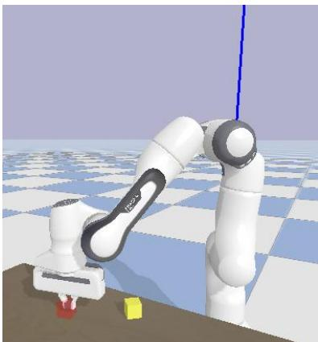  
(a)未抓取效果

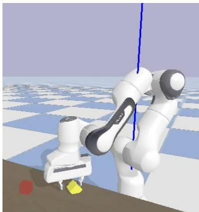  
(b)抓取失败效果

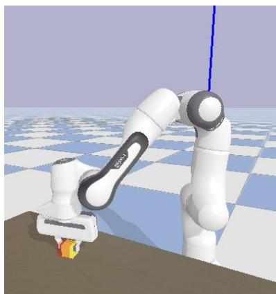  
图 3-6 获取示教数据过程  
(c)抓取成功效果  
Fig. 3-6 The design of manipulator controller

获取抓取成功的运动轨迹，如图3-6 (c)所示，将之保存并记录在示教数据中。根据这些示教数据，调用RFSI算法训练机械臂控制器。机械臂控制器实验设计如下：

对示教数据中的轨迹序列个数采样，采样数设定为60；对每条轨迹序列中的机械臂状态数据进行采样，采样数设定为80；设定训练机械臂控制器的循环迭代次数，训练次数设定为 300。

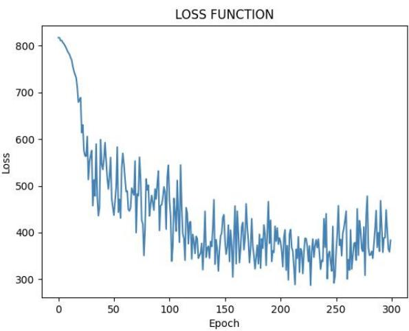  
图 3-7 控制器损失函数变化图  
Fig. 3-7 Diagram of the controller loss function

经过多次实验，训练控制器的损失函数变化如图3-7 所示。损失函数一开始快速下降，随后在数值 350附近震荡，但随后损失函数的值并没有直接收敛到0。为了进一步减少损失函数，通过调整神经网络的超参数，能让其损失函数值降至200以下，但是实际仿真的效果非常不好，会导致数据过拟合，并出现误抓取的情况。因此，本节实验将损失函数的阈值设定在 300，低于该阈值后，停止对控制器的训练。

此外，本文还探究了不同循环迭代步数对控制器模仿性能的影响，如表3-2 所示。

表 3-2 不同循环迭代步数区间的实验效果  
Tab. 3-2 Experimental results of different iterative step intervals

<table><tr><td>循环迭代步数/次</td><td>实验效果说明</td></tr><tr><td>200-300</td><td>机械臂快速定位到目标物块,抓取后进行移动</td></tr><tr><td>300-500</td><td>机械臂抓取目标物块后,在任务目标附近震荡</td></tr><tr><td>500-800</td><td>关节速度逐渐趋于0,机械臂随机小幅震荡并缓慢静止</td></tr></table>

实验将循环迭代总步数设定在800，通过观察分段实验的效果，最终确定循环迭代

次数为300。同时由该表得出结论，对相同任务目标的抓取实现，控制器只能根据现有的示教数据进行学习，需要搭载其他算法扩展其探索能力。

## 3.5.3 实验效果分析

将训练好的机械臂控制器重新导入仿真环境，并对相同的目标物块执行抓取控制，应用RFSI算法前后的抓取效果如图3-8所示。

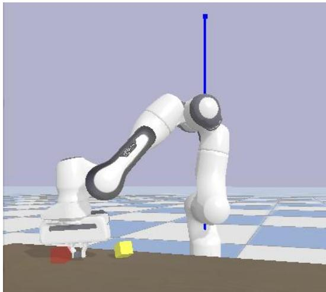  
(a)应用算法前的抓取效果

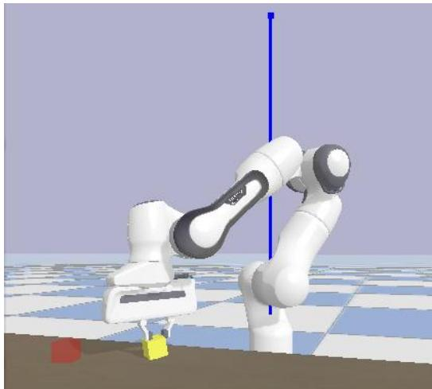  
(b)应用算法后的抓取效果  
图 3-8应用 RFSI 算法前后的抓取效果  
Fig. 3-8 The grasping effect before and after applying RFSI algorithm

应用算法前的抓取效果如图3-8(a)所示，对应于运用逆运动学求取运动轨迹的方法。如仿真结果所示，机械臂往往未触碰物块，就直接挪动到目标位置。应用 RFSI 算法后的抓取效果如图 3-8(b)所示，因为控制器收集了所有抓取成功的运动轨迹，并通过了裁剪处理，所以机械臂能快速并精准地抓取物块，再往目标位置移动。

应用 RFSI算法前后抓取定位效果，如图3-9所示。

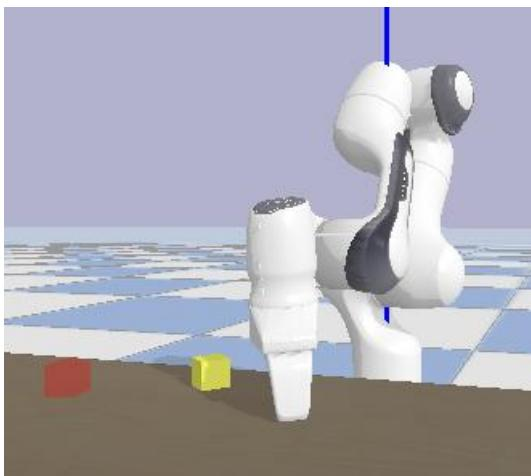  
(a)应用算法前定位效果正视图

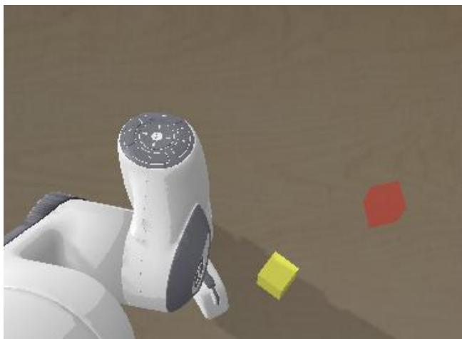  
(b)应用算法前定位效果俯视图

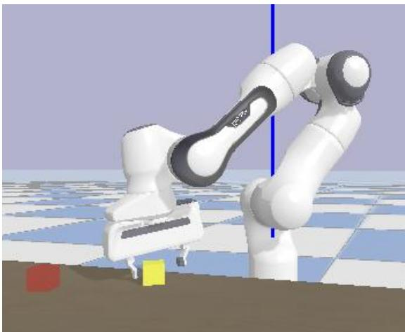  
(c)应用算法后定位效果正视图

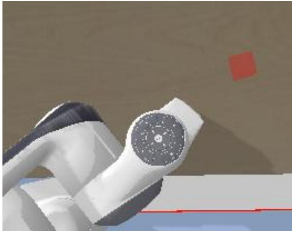  
(d)应用算法后定位效果俯视图  
图 3-9应用 RFSI 算法前后抓取定位效果  
Fig. 3-9 The positioning effect before and after applying RFSI algorithm

应用算法前定位效果如图 3-9(a)和图 3-9(b)所示，对应于运用逆运动学求取运动轨迹的方法。如仿真结果所示，机械臂各关节角的动作输出不精确，导致末端执行器与抓取目标的定位失准。应用 RFSI 算法后定位效果如图3-9(c)和图 3-9(d)所示，机械臂控制器生成的动作贴合演示数据的位姿，而且末端手爪牢牢锁定物块目标。

根据机械臂抓取并移动物块的应用场景，对同一抓取任务设置了 1000 次实验，从而对比基于逆运动学的编程示教方法与本章节 RFSI 算法完成抓取任务的成功率，其结果如表3-3所示。

表 3-3 不同示教方法完成抓取任务的成功率  
Tab. 3-3 The success rate of fetching task by different teaching methods

<table><tr><td>方法</td><td>测试事件数/次</td><td>成功率/%</td></tr><tr><td>编程示教方法</td><td>1000</td><td>26</td></tr><tr><td>RFSI 算法</td><td>1000</td><td>94</td></tr></table>

RFSI算法改进效果如表 3-3，只要给出一组生成的示教数据，就能根据RFSI 算法实现对示教数据的优化。

## 3.6 本章小结

本章针对示教数据获取过程中不准确的问题，提出了一种基于概率模型的模仿学习方法 RFSI，并将其应用于示教轨迹优化。本章方法改变了编程示教方法中的抓取控制规则，采用逆运动学方法生成并筛选出示教数据；结合示教数据、示教成本、探索成本，生成关于机械臂状态数据的多元正态分布模型，并构建机械臂控制器；通过控制器再次生成运动轨迹，从而实现示教轨迹优化；轨迹优化效果在Pybullet 仿真环境中验证。本章所采集的优质示教数据，将用于指导下一章强化学习算法的训练。

## 第4 章 基于奖励与策略双优化的机械臂抓取控制算法

## 4.1 引言

随着社会的高速发展，人们需要对机械臂进行精准地控制，从而辅助或替代人类完成各种困难、危险、多样的任务，通过将强化学习技术与机械臂控制技术相结合，机械臂的控制器可以直接建立由传感器获取的环境状态与机械臂执行动作之间的映射关系，实现端到端的控制。然而，强化学习在高效训练高自由度工业机械臂上的应用仍然存在一些问题，即由无效动作导致的训练周期过长、算法收敛不确定、抓取任务成功率低等问题。为了解决强化学习训练效果不佳的问题，目前国内外学者普遍采用以下两类方法对该问题进行优化。

第一类方法是通过对强化学习算法的泛用性进一步优化，以实现减少无效动作目的。这一类方法的核心思想是通过引入概率论、构建神经网络、改变算法结构等方法，大幅度减少无效动作带来的影响，但是该方法并不能根除无效动作的出现。

第二类方法将强化学习与模仿学习相结合，由先验数据对强化学习进行约束，以实现稳定运行目的。该类方法的优点是利用轨迹优化中存在的可行解来作为强化学习的约束，但是泛化性相较于第一类方法较差。

本章节针对两种方法各自存在的缺陷，提出一种新的算法，先通过第二类方法来训练，再引入第一类方法来提高机械臂抓取控制器的鲁棒性，具体研究内容总结如下：

（1）提出了一种基于奖励与策略双优化的机械臂抓取控制算法HR-GAIL，在控制算法训练阶段，同时更新奖励梯度与策略梯度从而实现双优化过程。

（2）构建基于强化学习框架的机械臂控制器，并根据策略梯度优化方式更新控制器算法。构建基于模仿分量与任务分量的复合奖励函数，用于奖励梯度的更新。复合奖励函数应用在强化学习的训练阶段，在保证控制器的稳定性前提下提高其鲁棒性。

（3）在 Pybullet 仿真环境中批量生成示教数据，并进行仿真训练和实验，与GAIL+SAC 方法对比，验证本章节方法有效性。

## 4.2 机械臂抓取控制框架

机械臂抓取控制系统由传感器、控制器、执行器和被控对象组成。控制器由强化学习算法的策略网络表示，执行器由机械臂的关节电机和手爪电机构成，被控对象即目标工件，传感器即环境内置的传感器，环境包含机械臂、目标工件和内置传感器。这些组成部分之间的关系如图 4-1所示。具体控制流程如下：通过环境内置的传感器识别当前的状态，从而得到控制器的输入值。经过控制器处理后，输出动作指令从而改变机械臂关节电机和手爪电机的力矩值，实现对被控对象的控制。当机械臂实施对目标工件的抓取任务后，机械臂与目标工件的位姿信息都发生了变化，从而导致整个环境发生改变，传感器识别新状态后继续输入到控制器中，从而进行下一循环的控制。

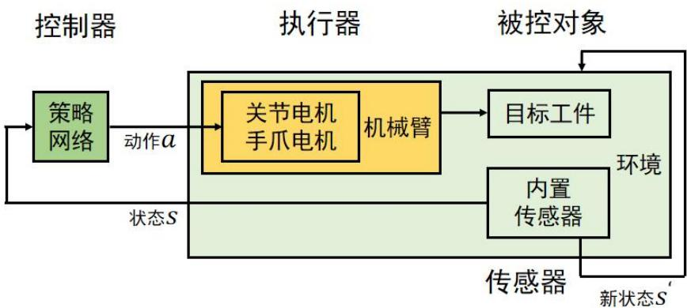  
图 4-1 机械臂抓取控制框架  
Fig. 4-1 The control frame of the manipulator

## 4.3 机械臂抓取控制算法

## 4.3.1 机械臂控制器的设计

机械臂控制器的设计，参考SAC的框架，仅提取SAC的策略网络作为控制器。SAC强化学习算法由策略网络与评价网络构成。策略网络 $\cdot \pi _ { \theta }$ 服从一个概率分布，动作�在给定状态�下通过对策略网络的采样获得。同时，生成动作�的概率受策略网络本身的影响较大。在给定状态�下，如果策略网络的概率分布发生变化，原动作�的采样概率会发生变化。评价网络 $Q _ { \phi } ( s _ { t } , a _ { t } )$ 是由当前状态到末端状态时的奖励累计和构成，也是用来优化策略网络 $\pi _ { \theta }$ 的重要指标。 $Q _ { \phi } ( s _ { t } , a _ { t } )$ 的贝尔曼方程如公式（4-1）所示：

$$
Q _ {\phi} (s _ {t}, a _ {t}) = - r (s _ {t}, a _ {t}) - E _ {a _ {t + 1} \sim \pi_ {\theta}} [ Q _ {\phi} (s _ {t + 1}, a _ {t + 1}) - \log \pi_ {\theta} (a _ {t} | s _ {t}) ]\tag{4-1}
$$

策略网络由多层全连接神经网络构成，在输入状态�信息后，在神经网络的输出端分别得到对应动作�的均值与方差，并由此构建多元正态分布模型。通过对该多元正态分布进行采样，在机械臂控制器的输出端得到采样动作 $a$ 与该采样动作的概率值 $p .$ 。机械臂控制器的设计如图 4-2所示。

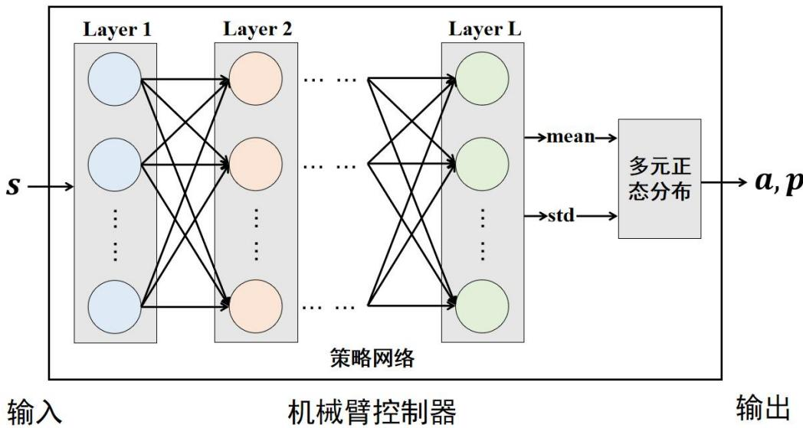  
图 4-2 机械臂控制器的设计  
Fig. 4-2 The design of manipulator controller

控制系统的执行机构是FrankaEmikaPanda 机械臂，该机械臂有7个关节电机，末端执行器上安装了2指手爪，如图4-3 所示。

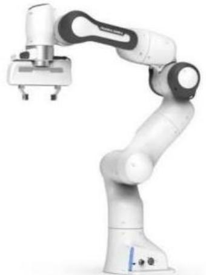  
图 4-3Franka Emika Panda 机械臂  
Fig. 4-3 Franka Emika Panda manipulator

每一时刻�下的状态 $s _ { t }$ 由7个关节角以及手爪2指上的平移位置构成，如公式（4-2）所示。

$$
s _ {t} = [ \theta_ {1}, \theta_ {2}, \theta_ {3}, \theta_ {4}, \theta_ {5}, \theta_ {6}, \theta_ {7}, d _ {1}, d _ {2} ] ^ {\mathrm{T}}\tag{4-2}
$$

每一时刻�下的动作 $a _ { t }$ 由7个关节角速度以及手爪2指所施加的力构成，如公式（4-3）所示。

$$
a _ {t} = [ \dot {\theta} _ {1}, \dot {\theta} _ {2}, \dot {\theta} _ {3}, \dot {\theta} _ {4}, \dot {\theta} _ {5}, \dot {\theta} _ {6}, \dot {\theta} _ {7}, M _ {1}, M _ {2} ] ^ {\mathrm{T}}\tag{4-3}
$$

其中机械臂的手爪与被控对象直接交 $\underline { { \mathcal { F } } }$ ，被控对象对力矩控制的精度要求较高，因此，机械臂控制器输出手爪对应部分的动作指令是施加在被控对象的力矩值。

动作概率 $\cdot p _ { t }$ 是策略网络�在状态 $s _ { \mathrm { t } }$ 所采样动作 $a _ { t }$ 的动作概率 $\pi ( a _ { t } | s _ { t } )$ ，如公式（4-4）所示。

$$
p _ {t} = \pi (a _ {t} | s _ {t})\tag{4-4}
$$

## 4.3.2 复合奖励函数的构成

奖励函数是评价强化学习效果的重要指标。本章节算法参考DeepMimic 算法构建复合奖励函数，即每个奖励函数的分量都是由当前分量与示教数据的差的2范数构成。在求取2范数的自然指数后，才将各奖励函数的分量进行加权求和。

本章的复合奖励函数由任务分量��和模仿分量��共同构成。任务分量��的构建如公式（4-5）所示。

$$
r _ {t} ^ {t} = - \left\| P _ {e} - P _ {c} \right\| _ {2} - \alpha \| P _ {e} - P _ {t} \| _ {2} - \beta \| P _ {t} - P _ {c} \| _ {2}\tag{4-5}
$$

其中 $P _ { \mathrm { e } }$ 是机械臂末端手爪的位姿， $P _ { \mathrm { c } }$ 是目标物块的位姿， $P _ { \mathrm { { t } } }$ 是目标位置的位姿。 $\alpha$ $\beta$ 是权重系数，这里分别设定为 6和12。

模仿分量 $\cdot r _ { t } ^ { i }$ 的构建如公式（4-6）所示。

$$
\begin{array}{r l} & {r _ {t} ^ {i} = \log D _ {\pi} (s _ {t}, a _ {t}) = \log \left[ \frac {\exp (f _ {\eta} (s _ {t} , a _ {t}))}{\exp (f _ {\eta} (s _ {t} , a _ {t})) + \pi (a _ {t} | s _ {t})} \right]} \\ & {\qquad = \log \bigl [ \mathrm{sigmoid} \bigl (f _ {\eta} (s _ {t}, a _ {t}) - \log \pi (a _ {t} | s _ {t}) \bigr) \bigr ]} \end{array}\tag{4-6}
$$

其中 $D _ { \pi }$ 是鉴别器，sigmoid(�)的表达式为 $[ 1 + \exp ( - x ) ] ^ { - 1 }$ ， $f _ { \eta }$ 是鉴别器网络，$\pi ( \boldsymbol { a } _ { t } | \boldsymbol { s } _ { t } )$ 是动作概率。

鉴别器网络 $f _ { \eta }$ 的网络结构如图 4-4 所示。在输入状态�和动作�的信息后，在神经网络的输出端得到鉴别器�的值。

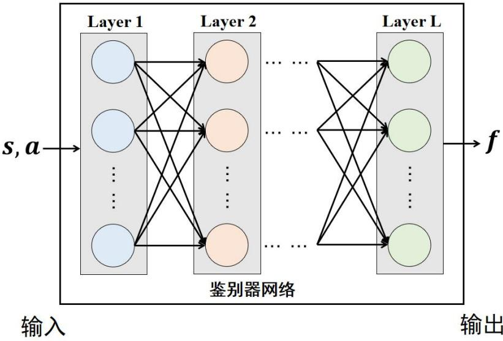  
图 4-4 鉴别器网络结构  
Fig. 4-4 Discriminator network structure

任务分量 $\boldsymbol { r } _ { t } ^ { t }$ 是单步的奖励，模仿分量 $\mathbf { \nabla } \cdot \mathbf { r } _ { t } ^ { i }$ 根据 GAIL 的推论，是累计的奖励，为了确保复合奖励函数的值域与 $\mathsf { i } r _ { t } ^ { i }$ 的值域一样，都落在(0,1)的区间内。本章节算法将二者进行加权求和再对数化，如公式（4-7）所示：

$$
Q = \log \bigl [ \gamma D _ {\pi_ {\theta}} (s _ {t}, a _ {t}) + (1 - \gamma) \exp (\sum_ {t} ^ {T} r _ {t} ^ {t}) \bigr ]\tag{4-7}
$$

其中 $\mid Q \rangle$ 是复合奖励函数，表示从当前时刻�到末端时刻�的累计奖励，参数 $\cdot \gamma$ 是模仿分量的权重，这里设定为 0.7。

## 4.3.3 二元变量损失函数

本章节提出一种名为 HR-GAIL 的优化算法，该算法在模仿学习 GAIL 的基础上结合混合奖励（Hybird Reward）对SAC 的策略网络进行优化，任务导向性强，能同时更新奖励梯度与策略梯度实现双优化。HR-GAIL 先确保示教样本和采样样本之间的分歧最小化，进而学习奖励函数和策略网络。奖励函数和策略网络的复合映射如公式（4-8）所示：

$$
R L \circ I R L _ {\psi} (\pi_ {E}) = \arg \max _ {r} \min _ {\pi} \bigl [ - \psi (r) - H (\pi) + E _ {\pi} r (s, a) - E _ {\pi_ {E}} r (s, a) \bigr ]\tag{4-8}
$$

其中�是控制器的执行策略， $\pi _ { E }$ 是示教演示的执行策略， $H ( \pi )$ 表示熵， $r ( s , a )$ 是奖励函数， $E _ { \pi } r ( s , a )$ 是在�分布上对奖励r所求的期望， ${ \cal E } _ { \pi _ { E } } r ( s , a )$ 是在 $\cdot \pi _ { E }$ 分布上的期望， $\psi$ 是归一化函数， $\psi$ 的表达式[32]如公式（4-9）所示。

$$
\begin{array}{c} \psi (r) = E _ {\pi_ {E}} \bigl \{- r + \phi [ - \phi^ {- 1} (- r) ] \bigr \} \\ \phi = - \log D \end{array}\tag{4-9}
$$

HR-GAIL分别构建基于策略网络 $\cdot \pi _ { \theta }$ 的采样鉴别器 $D _ { \pi _ { \theta } }$ 和基于示教轨迹的示教鉴别器$D _ { \pi _ { E } }$ ，各自的表达式如公式（4-10）所示。

$$
\begin{array}{c} D _ {\pi_ {\theta}} (s _ {t}, a _ {t}) = \text {sigmoid} \bigl (f _ {\eta} (s _ {t}, a _ {t}) - \log \pi_ {\theta} (a _ {t} | s _ {t}) \bigr) \\ D _ {\pi_ {E}} (s _ {t}, a _ {t}) = \text {sigmoid} \bigl (- f _ {\eta} (s _ {t}, a _ {t}) \bigr) \end{array}\tag{4-10}
$$

对采样鉴别器 $D _ { \pi _ { \theta } }$ 来说，HR-GAIL 在鉴别器网络 $f _ { \eta }$ 的基础上叠加偏置项 $\log \pi _ { \theta } ( a _ { t } | s _ { t } )$ 目的是增加鉴别器网络 $f _ { \eta }$ 的鲁棒性，再经过函数sigmoid函数处理，得到采样鉴别器 $D _ { \pi _ { \theta } }$ 的值。该方法同样应用在示教鉴别器 $D _ { \pi _ { E } }$ ，其中示教动作概率 $\pi _ { E } ( a _ { t } | s _ { t } )$ 是确定的，故其值取1，则 $\log \pi _ { E } ( a _ { t } | s _ { t } )$ 的值取0。

联立公式（4-7），公式（4-8），公式（4-9）和公式（4-10），二元变量的损失函数如公式（4-11）所示：

$$
L (\pi_ {\theta}, f _ {\eta}) = - \lambda H (\pi_ {\theta}) + E _ {\pi_ {\theta}} Q + E _ {\pi_ {E}} \mathrm{log} D _ {\pi_ {E}} (s _ {t}, a _ {t})\tag{4-11}
$$

其中� $\in ( 0 , 1 )$ ，是熵的正则项，这里设定为 0.2。在二元变量损失函数的基础上，分别对参数 $\cdot \eta ^ { \cdot }$ 和参数�求偏导数，如公式（4-12）和公式（4-13）所示：

$$
\nabla_ {\eta} L (\pi_ {\theta}, f _ {\eta}) = E _ {\pi_ {\theta}} \big [ \gamma \nabla_ {\eta} \mathrm{log} D _ {\pi_ {\theta}} (s, a) \big ] + E _ {\pi_ {E}} \big [ \nabla_ {\eta} \mathrm{log} D _ {\pi_ {E}} (s, a) \big ]\tag{4-12}
$$

$$
\nabla_ {\theta} L (\pi_ {\theta}, f _ {\eta}) = - \lambda \nabla_ {\theta} H (\pi_ {\theta}) + E _ {\pi_ {\theta}} \big [ \gamma \nabla_ {\theta} \mathrm{log} D _ {\pi_ {\theta}} (s, a) \big ]\tag{4-13}
$$

## 4.3.4 机械臂控制器的训练

机械臂控制器的训练如图 4-5 所示。控制器是参数为�的策略网络，根据状态�，输出动作�与动作概率 $p$ 。动作 $\mathbf { \chi } _ { a \prime }$ 作用在机械臂上并在环境交互，得到新状态�，然后再进行下一步循环。每一次交互都会把 $s , a , p$ 保存在数据缓存器的采样轨迹分区。

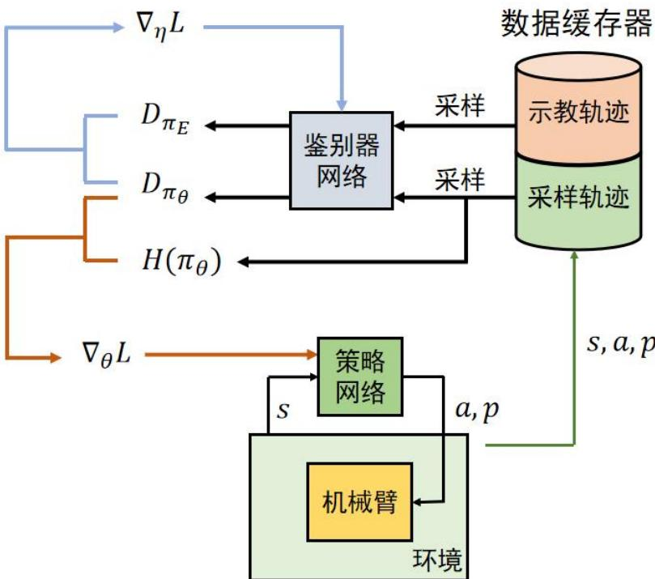  
图 4-5 机械臂控制器的训练  
Fig. 4-5 Training of manipulator controller

在控制器的训练阶段，从数据缓存器中采样批量数据，根据公式（4-11）的损失函数，计算关于 $\theta$ 的策略梯度，实现对策略网络 $\pi _ { \theta }$ 的参数更新。策略网络 $\pi _ { \theta }$ 的损失函数包含公式（4-7）的复合奖励函数，其中复合奖励函数的模仿分量 $\cdot r _ { t } ^ { i }$ 由鉴别器网络 $f _ { \eta }$ 构成，因此在策略梯度更新之前需要对鉴别器网络 $f _ { \eta }$ 的梯度进行更新。

鉴别器网络的梯度即为奖励梯度，在奖励梯度更新过程中，分别从数据缓存器的示教轨迹和采样轨迹中采样，根据公式（4-11）的损失函数，计算关于�的梯度，实现对复合奖励函数的模仿分量 $\mathbf { \nabla } \cdot \mathbf { r } _ { t } ^ { i }$ 进行更新。在对复合奖励函数求偏导的过程中，奖励梯度与策略梯度都不受任务分量 $\cdot r _ { t } ^ { t }$ 的影响，故 HR-GAIL 的策略梯度和奖励梯度都只考虑模仿分量 $\mathbf { \nabla } \cdot \mathbf { r } _ { t } ^ { i }$ 的影响。

综上所述，机械臂抓取控制器训练过程的伪代码如算法4-1所示。

算法 4-1 机械臂抓取控制器训练过程  
Algorithm 4-1 Training process of manipulator grasping controller

算法：机械臂抓取控制器训练过程
输入：最大迭代次数 $t_{max}$ ，数据缓存器B，鉴别器网络 $f_{\eta}$ 
输出：策略网络 $\pi_{\theta}$ 
程序开始
1. 从B中分别对示教轨迹和采样轨迹采样
2. for 每一次迭代
3. while  $t &lt; t_{max}$ 
4. 获取状态 $s_{t}$ 
5. 由控制器 $\pi_{\theta}$ 采样出 $a_{t}, p_{t}$ 
6. 根据公式（4-10），计算 $D_{\pi_{\theta}}(s_{t}, a_{t})$ 和 $D_{\pi_{E}}(s_{t}, a_{t})$ 
7. 仿真出 $s_{t+1}$ 
8.  $\{(s_{t}, a_{t}, p_{t})\}_{i=0}^{t_{max}}$ 保存到B
9. end while
10. 根据公式（4-12），计算奖励梯度更新 $f_{\eta}$ 
11. 根据公式（4-13），计算策略梯度更新 $\pi_{\theta}$ 
12. end for
程序结束

## 4.4 实验与分析

## 4.4.1 配置仿真环境

本系统所使用的硬件设备为 LAPTOP -4KUQUNRQ，内置的 GPU 芯片的型号为GeForce RTX 2080 Ti，处理器是 Intel(R) Core(TM) i5-6200U CPU @ 2.30GHz，内存为16GB。本系统根据本地电脑调试或网联服务器调试，分为win10操作系统版本或者Linux版本。使用的仿真软件为 Python3.6，物理仿真驱动为 Pybullet3.1.7，调用基于

PyTorch1.5.1+cpu 和 PyTorch1.5.1+cuda 框架的神经网络算法。

基于 Pybullet 引擎构建的机械臂模型仿真系统，如图 4-6 所示。机械臂模型仿真系统包括FrankaEmikaPanda 机械臂的 URDF模型，分拣台，目标物块，目标位置，控制滑块。针对机械臂抓取并移动物块的应用场景进行仿真。

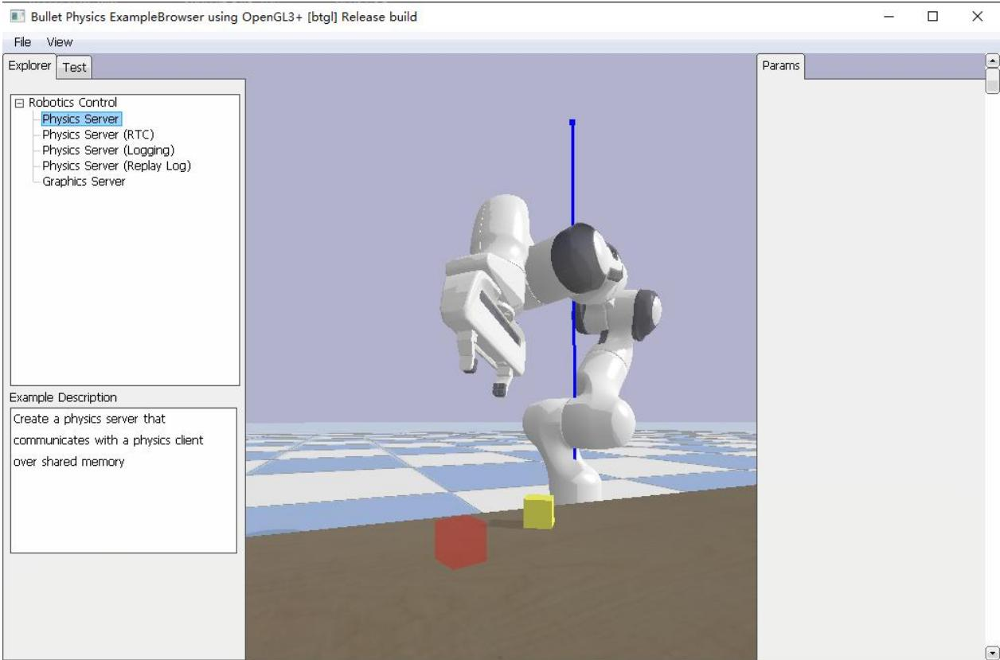  
图 4-6 机械臂模型仿真系统  
Fig. 4-6 Manipulator model simulation system

HR-GAIL 算法中的策略网络由3层全连接层构成，输入维度为9，输出维度为9，每层隐含层的神经元个数为64，每层隐含层的激活函数是relu 函数，采用adam 优化器进行训练，学习率为0.004。

HR-GAIL 算法中的鉴别器网络由3层全连接层构成，输入维度为18，输出维度为1，每层隐含层的神经元个数为 64，每层隐含层的激活函数是 tanh 函数，采用 adam 优化器进行训练，学习率为0.002。

## 4.4.2 批量生成示教数据

在Pybullet 引擎中导入Panda 机械臂、目标物块、目标位置等信息，并结合第 3章的所训练的机械臂控制器，批量生成示教样本数据，用于更新鉴别器网络。

生成示教数据的流程图如图4-7 所示。具体示教数据的生成过程如下：

第一步：根据逆运动学方程、机械臂末端手爪位姿与物块位姿的差值，计算下一个状态机械臂各关节的角度值，同时判断手爪是否抓取到物块；

第二步：根据逆运动学方程、机械臂末端手爪位姿与目标位置的差值，计算下一个状态机械臂各关节的角度值，同时判断物块是否抵达目标；

第三步：从备选运动轨迹中，筛选出物块抵达目标位置所对应的轨迹数据并保存。

第四步：改变物块初始位姿与目标初始位置，重新采集轨迹数据并保存，达到缓存数据池的上限后，停止示教数据的生成。其中缓存数据池的上限设定为2000条。

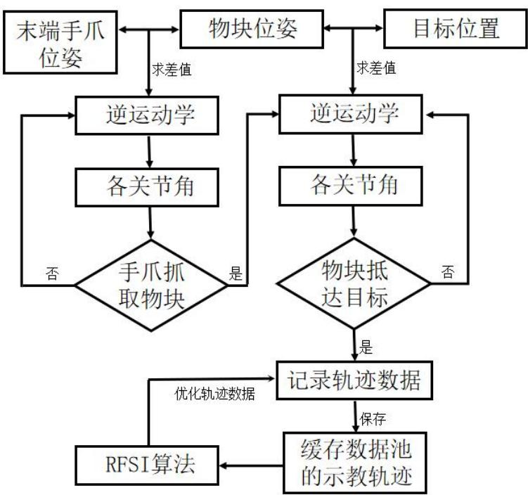  
图 4-7 生成示教数据的流程图  
Fig. 4-7 Flow chart for generation of demo data

## 4.4.3 对比实验

根据数据缓存器里的示教数据以及采样数据分别计算各自的鉴别器数值，经过 300次迭代训练，对比 GAIL 与 HR-GAIL 鉴别器损失值，如图 4-8 所示。图 4-8(a)是 GAIL的鉴别器损失值随迭代步数变化图，图4-8(b)是GAIL 的示教鉴别器（demo 折线）与采样鉴别器（sample折线）损失变化图，二者数值之和对应图4-8(a)所示的损失值。图4-8(c)是HR-GAIL 的鉴别器损失值随迭代步数变化图，图4-8(d)是HR-GAIL 的示教鉴别器与采样鉴别器损失变化图，二者数值之和对应图4-8(c)所示的损失值。

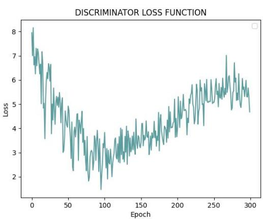  
(a)GAIL 鉴别器损失值变化图

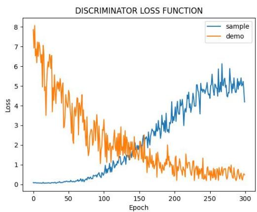  
(b)GAIL 示教鉴别器与采样鉴别器损失变化图

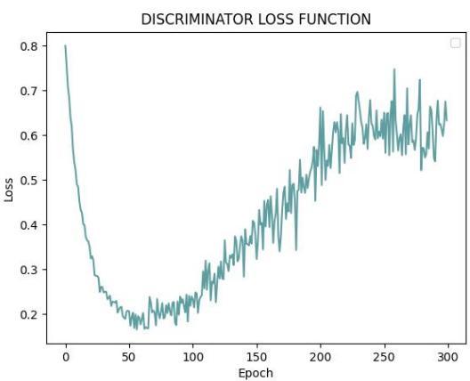  
(c)HR-GAIL 鉴别器值损失变化图

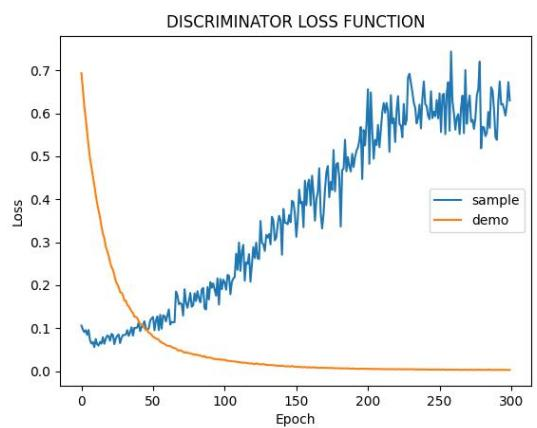  
(d)HR-GAIL 示教鉴别器与采样鉴别器损失变化图  
图 4-8 GAIL 与 HR-GAIL 鉴别器损失值对比图  
Fig. 4-8 Comparison of loss values of GAIL and HR-GAIL discriminators

从图 4-8(a)和图 4-8(c)都能观察到，鉴别器损失值先增大后保持稳定，HR-GAIL 的鉴别器损失值比 GAIL 的更小。此外，从图 4-8(b)和图 4-8(d)能观察到，示教鉴别器损失值都在不断减少，而 HR-GAIL 的示教鉴别器损失值震荡幅度小，收敛速度更快；采样鉴别器损失值先增大后保持稳定，而 HR-GAIL 的采样鉴别器损失值比 GAIL 更快地达到稳定状态。

任务分量奖励函数反映机械臂抓取任务完成情况，其随迭代步数变化如图4-9所示。

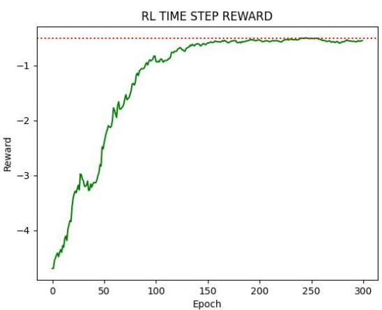  
图 4-9 任务分量奖励随迭代步数变化图  
Fig. 4-9 Graph of task component reward over time

根据公式（4-7），任务分量是由多个差值的 2 范数构成，所以最终时刻的奖励值趋于 0，考虑误差的存在，图 4-9 收敛至-0.5 左右，且在 150 步左右收敛至最大值。复合奖励函数的模仿分量与任务分量的累计值相关。随着训练的持续，奖励值不断增大，最佳的任务分量累计奖励约为-300。

HR-GAIL 方法与GAIL+SAC 方法的任务分量累计奖励对比图如图4-10 所示。

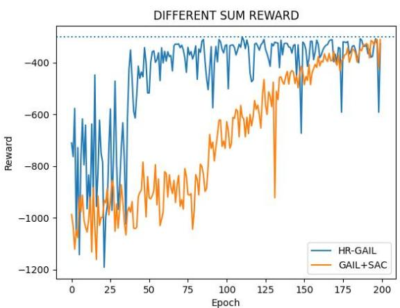  
图 4-10 任务分量累计奖励对比图  
Fig. 4-10 A comparison of sum rewards for task components

HR-GAIL 是在 GAIL 和 SAC 的基础上进行改进的算法，通过与 GAIL+SAC 方法对比，验证HR-GAIL 所设计控制器的优势。由于GAIL+SAC 没有复合奖励奖励，所以仅对比各自算法完成仿真任务所对应的累计奖励。根据图4-10 中数据显示，HR-GAIL 在50步左右就达到了最大累计奖励，而原方法在160步左右才到达最优，在高效训练机械臂的方面上提现了本算法的优越性。

## 4.4.4 机械臂抓取任务测试

基于 HR-GAIL 算法构建的机械臂控制器在 Pybullet 仿真环境中进行测试，该机械臂控制器能准确指导Panda机械臂完成接近物块、抓取物块、挪动目标等步骤。如图4-11所示。

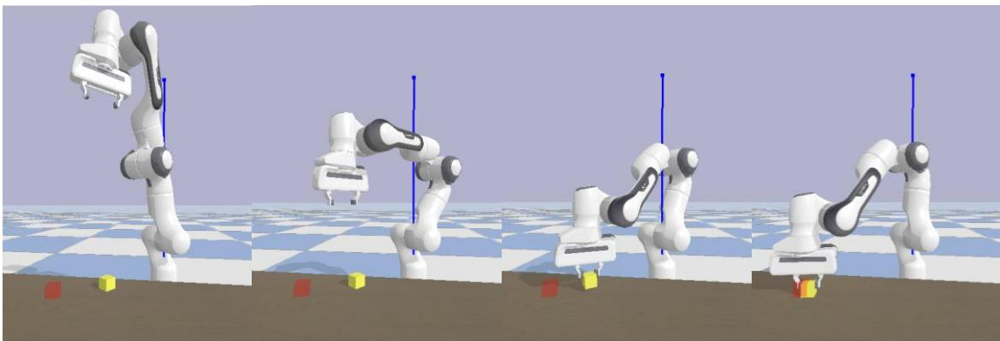  
图 4-11机械臂仿真测试效果图  
Fig. 4-11 The simulation test effect of the manipulator

按照机械臂抓取并移动物块的应用场景，设置 10 组实验对比分析 HR-GAIL 与GAIL+SAC 的训练时间，其结果如表 4-1 所示。HR-GAIL 方法的训练时间比 GAIL+SAC的训练时间缩短11%。

表 4-1 不同方法的训练时间  
Tab. 4-1 Training time of different methods

<table><tr><td>方法</td><td>测试事件数/个</td><td>训练时间/h</td></tr><tr><td>HR-GAIL</td><td>10</td><td>1.5</td></tr><tr><td>GAIL+SAC</td><td>10</td><td>1.7</td></tr></table>

## 4.5 本章小结

本章节以 GAIL 和 SAC 为基础进行推论，提出了一种基于奖励与策略双优化的机械臂抓取控制算法 HR-GAIL，用于解决强化学习在机械臂抓取任务中训练周期长的问题。该方法变换二元变量损失函数中的鉴别器形式，并融合复合奖励函数，在策略梯度与奖励梯度交替优化的过程中，实现对机械臂抓取控制器的更新优化。算法效果在Pybullet 仿真环境中验证，相比 GAIL+SAC 方法，HR-GAIL 在 50 步左右就达到了最大累计奖励。复合奖励函数的构建，更好地训练策略网络，使得控制器收敛速度快，让Panda机械臂完成抓取任务训练的时间有效缩短。

## 第 5 章 机械臂抓取仿真系统

## 5.1 引言

本章以第 3、4 章所提及的 RFSI 算法和 HR-GAIL 算法为基础，在 Pybullet 仿真平台上，设计了机械臂抓取仿真系统。通过对仿真环境现状分析，总结系统设计的目的，并根据模仿学习与强化学习算法框架，将机械臂抓取仿真系统设计成一个集成的软件。同时，对仿真系统的每个模块在设计流程、功能原理方面进行了介绍，最后对仿真系统进行了测试运行。

## 5.2 设计目的及现状分析

目前主流的机器人控制算法大都在仿真平台进行预训练，以便将算法烧录到机器人的硬件系统之前，实现对控制算法的调试和优化。这种做法有如下几个优点：

（1）仿真系统易于搭建模型，只要导入相应格式的模型，无论是机械臂本体，还是交互的环境与被控对象，都能快速导入物理仿真平台中。

（2）仿真系统成本低廉，可改造性强，降低在现实世界中进行实验所需要投入的资金、人力和物力资源，同时降低风险和不可控因素的影响。

（3）仿真系统可以模拟不同的方案和决策结果，并对各种可能的影响进行分析和评估，尤其适合强化学习算法可能与交互环境产生破坏的应用场景。

（4）在仿真环境中不同学科领域的专家可以更快捷地合作，促进学科交叉和合作。

目前常用的机器人仿真环境有 Gazebo、Mujoco、PyRep/RL Bench、Pybullet Gym。Gazebo 作为历史最悠久的仿真环境，拥有很多的开源模型，但是并没有针对强化学习的 SDK。虽然 PyRep/RL Bench 有面向强化学习的 SDK，但 PyRep/RL Bench 只支持使用 Lua 语言进行开发。Mujoco 是当前最流行的机械臂强化学习仿真环境之一，它包括Atari 游戏仿真，连续控制环境仿真，文本游戏开发，而且也支持 urdf和sdf这些传统的机械臂模型，唯一的缺陷是经济成本过高，很多开发者功能需要单独进行购买。PyTorch是由Facebook开源的神经网络框架，专门针对GPU 加速的深度神经网络编程。其包含一个经典的对多维矩阵数据进行操作的张量库，在机器学习和其他数学密集型应用有广

泛应用。

Pybullet 是一种专门为面向 Python 用户而开发的仿真环境，与 Mujoco 一样都是基于 Bullet 引擎开发的仿真环境，非常方便用户做项目移植。Pybullet 提供了强化学习训练的编程 API，能让用户快速上手，同时也支持URDF、SDF和MJDF 这些传统的模型文件，可以较为方便的构建或移植机械臂的物理模型。因此本文从成本性、便利性的角度考虑，选择Pybullet 作为机械臂仿真环境。

与Tensorflow的静态计算图不同，PyTorch 的计算图是动态的，可以根据计算需要实时改变计算图。在许多评测中，PyTorch 的速度表现胜过TensorFlow、Keras 等框架。在运行同样的算法时，使用PyTorch 实现的项目比用其他框架实现的项目速度更快。

## 5.3 系统模块设计及说明

机械臂抓取仿真系统由5个模块构成，分别是操作界面、示教数据生成模块、奖励生成模块、模仿学习训练模块和强化学习训练模块，如图5-1 所示。这些模块都是基于Pybullet 仿真平台以及基于PyTorch 框架搭建的，用户在操作界面指定系统的仿真任务，操作界面对其他模块进行控制和调用。

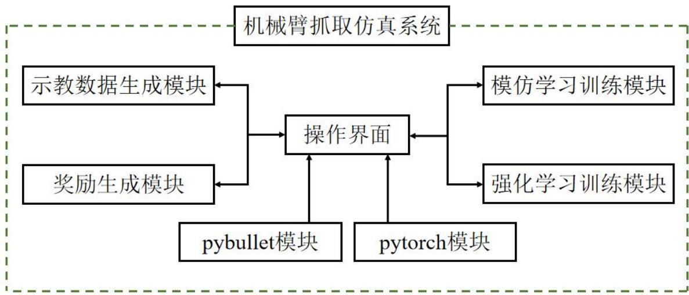  
图 5-1 系统各模块结构图  
Fig. 5-1 Structure diagram of each module of the system

## 5.3.1 操作界面

操作界面是一个整体的程序窗口，包含菜单栏、工具栏、传感器界面、仿真界面、控制按钮等模块，引导用户进行导入模型、选择算法、加载模型训练等操作。在导入模型的操作上，用户可以自行构建并导入机械臂模型，如图5-2 所示。在选择算法的操作上，通过按键选择，运行本文所提及的RFSI算法或HR-GAIL 算法。在加载模型训练的操作上，通过程序后端的引导，生成示教数据并将数据缓存到程序后端，根据所加载的不同算法，自动从数据缓存中调用诸如轨迹状态、动作、奖励、概率等信息，进而训练算法模型。

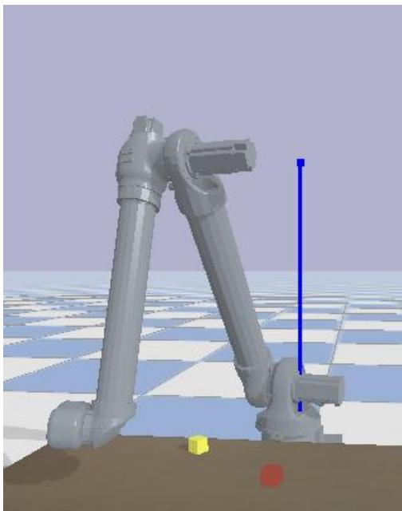

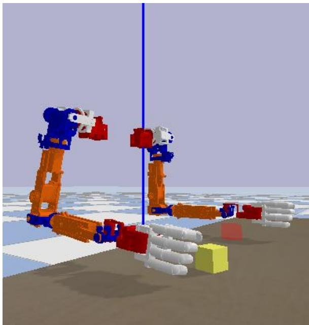  
图 5-2 在 Pybullet 平台构建并导入各种机械臂模型  
Fig. 5-2 Build and import various manipulator models on the Pybullet platform

## 5.3.2 示教数据生成模块

示教数据生成模块对应本文编程示教的功能。该模块运行流程如下：

第一步：通过在Pybullet 的物理仿真平台上导入机械臂的URDF模型，完成对机械臂运动学建模。URDF 模型包含机械臂各连杆与连杆间的物理信息，提取这些信息就可以构建运动学的齐次变换矩阵，通过逆运动学求解，获得各时刻对应各关节的角度值。

第二步：根据逆运动学方程，判断机械臂末端执行器是否抓取到物块，物块是否抵达目标位置，进而从备选运动轨迹中，筛选出物块抵达目标所对应的轨迹数据并保存。

第三步：改变物块初始位姿与目标初始位置，重新采集轨迹数据并保存，达到缓存数据池的上限后，停止示教数据的生成。

## 5.3.3 奖励生成模块

奖励生成模块内置在仿真系统的程序后端，根据用户在操作界面选择不同的算法，分别对应本文RFSI算法的成本函数，或者HR-GAIL 算法的复合奖励函数。

RFSI算法的成本函数需要调用Pybullet 的物理仿真平台的内置传感器，识别机械臂末端执行器、目标物块、目标位置的位姿，从而构建示教成本与探索成本。

HR-GAIL 算法的复合奖励函数需要示教数据和基于策略函数近似器生成的样本轨迹数据。示教数据直接继承示教数据生成模块所生成的轨迹数据。样本轨迹数据需要与强化学习训练模块进行交互后获得。

## 5.3.4 模仿学习训练模块

模仿学习训练模块对应本文RFSI算法的训练流程。该模块运行流程如下：

第一步：初始化算法模型后，开始训练循环。获取示教数据、机械臂各关节的角度值，以及与奖励生成模块交互获取示教成本、探索成本。

第二步：分析及处理采集好的示教数据，生成基于PyTorch 框架的多元正态分布模型，指导机械臂控制器生成探索数据。筛选探索轨迹数据并保存到示教数据。

第三步：重新获取示教数据、各关节的角度值、示教成本、探索成本等信息，循环训练控制器算法，直到循环至最大迭代次数后，停止RFSI算法训练过程。

## 5.3.5 强化学习训练模块

强化学习训练模块对应本文HR-GAIL 算法的训练流程。该模块运行流程如下：

第一步：初始化算法模型后，开始训练循环。获取状态和动作信息，与奖励生成模块交互获取复合奖励信息。

第二步：根据二元变量的损失函数，更新基于PyTorch 框架的策略网络。

第三步：根据二元变量的损失函数，更新基于PyTorch 框架的鉴别器网络。

第四步：重新获取状态、动作、复合奖励等信息，循环训练，直到循环至最大迭代次数后，停止HR-GAIL 算法训练过程。

## 5.4 仿真系统测试

运行机械臂抓取仿真系统，可视化测试结果，如图5-3 所示。

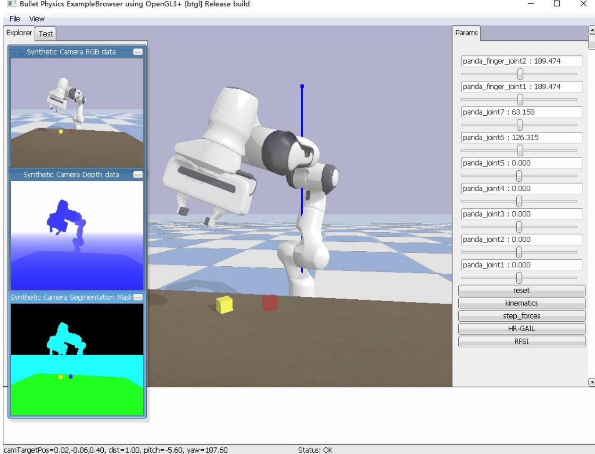  
camTargetPos=0.02,-0.06,0.40, dist=1.00, pitch=-5.60, yaw=187.60

图 5-3仿真系统测试可视化

Fig. 5-3 Simulation system test visualization

操作界面的左侧放置了三张小图，从上到下分别是 RGB 图像，深度图像，分割图像，对应不同的传感器界面。

操作界面的右侧，是针对Pybullet 的 API进行开发的交互界面，其中9个滑块分别对应各关节的速度值。在滑动滑块的时候，相对应地机械臂会在仿真系统中进行运动，逆向操作时，滑块会根据仿真结果自行移动。

复位按钮（reset）：清除训练过程中系统的缓存数据，重置初始状态。

动力学按钮（kinematics）：通过逆动力学计算手爪到物块的各关节的角度值，并将该角度值分段处理，实现机械臂逐渐接近物块的控制过程。触发此按钮后，系统调用示教数据生成模块，开始生成并保存示教数据。

阶段力矩按钮（step\_forces）：在程序后端对数据进行分段处理，通过给关节施加力矩的方式，控制机械臂逐渐接近并抓取物块的操作按钮。

HR-GAIL 按钮（HR-GAIL）：触发此按钮后，系统调用强化学习训练模块，开始对HR-GAIL 算法框架中的策略网络和鉴别器网络进行训练，同时指导机械臂控制器的训练。

RFSI按钮（RFSI）：触发此按钮后，系统调用模仿学习训练模块，开始运行RFSI算法，优化示教数据，指导机械臂控制器的训练。

## 5.5 本章小结

本章对仿真平台的应用价值和现状进行分析，在Pybullet 仿真平台上设计了机械臂抓取仿真系统，同时搭载了基于PyTorch 框架的本文算法。该系统由操作界面、示教数据生成模块、奖励生成模块、模仿学习训练模块和强化学习训练模块构成。通过对机械臂抓取仿真系统的测试，确保其能稳定地运行。

## 第6 章 总结与展望

## 6.1 全文总结

本文对机械臂的抓取控制进行深入研究，总结了国内外对强化学习、模仿学习、机械臂抓取控制的研究现状，分析了强化学习中马尔科夫过程、值函数、策略更新等内容，对比了模仿学习中生成示教样本、构建成本函数、构建鉴别器等的方法。针对强化学习算法探索效率低、算法收敛不确定、奖励函数引导机械臂学习能力差等问题，本文基于编程示教方法，结合模仿学习的模仿性好、适应力强等特点，采集耗时最短的示教样本，再将示教样本转换成强化学习所对应的奖励函数，探索了强化学习与模仿学习结合的机械臂抓取控制方法。本文的研究内容与创新点在如下：

（1）在获取示教数据的过程中，本文改变离线编程示教方法中抓取控制的规则，并采用逆运动学方法大量生成运动轨迹，最后根据抓取控制任务的完成程度为导向，筛选出示教数据。

（2）为了解决编程示教对不同的机械臂抓取任务适应性差的问题，本文提出了一种基于概率模型的模仿学习算法 RFSI。结合示教数据、示教成本、探索成本，生成关于机械臂状态数据的多元正态分布模型。根据在该多元正态分布上采样出的状态数据，指导机械臂进行抓取控制，最终实现对示教数据的优化。

（3）为了解决强化学习在机械臂抓取任务中训练周期长的问题，本文以模仿学习中 GAIL 算法为基础，结合强化学习 SAC 算法进行推论，提出了一种基于奖励与策略双优化的机械臂抓取控制算法 HR-GAIL。该方法变换二元变量损失函数中的鉴别器形式，并融合复合奖励函数，在策略梯度与奖励梯度交替优化的过程中，实现对机械臂抓取控制器的更新优化。

（4）结合本文中提出的 RFSI 算法与 HR-GAIL 算法，创建了基于 Pybullet 仿真平台与PyTorch 框架的机械臂抓取仿真系统。该系统由操作界面、示教数据生成模块、奖励生成模块、模仿学习训练模块和强化学习训练模块构成。通过对机械臂抓取仿真系统的测试，确保其能稳定地运行。

## 6.2 未来工作展望

本文通过模仿学习处理优质的示教数据，将其换成强化学习所对应的奖励函数，从而指导强化学习的训练过程，使得机械臂抓取控制过程更加稳定，训练速度更快。但是由于实际工作环境的多样性和复杂性，还是有很多没有考虑到的情况，这些都有待进一步完善，具体内容为以下几个方面：

（1）本文采用逆运动学方法大量生成示教数据，然而这种方法计算复杂度高，且机械臂面临的不确定性的情况非常频繁。针对这一问题，希望在之后的工作中找到更好的算法，进而稳定且便捷地生成示教数据。

（2）本文通过裁剪轨迹序列，从而寻找探索成本与示教轨迹序列上最接近的示教成本所在的时刻，并将之作为新的轨迹序列的起点。虽然这种方法能让控制器快速地进行模仿学习，但是不能保证所裁剪的起点是唯一存在的，故该方法不能保证模仿学习的稳定性。针对这个问题，如何筛选所裁剪示教轨迹序列的起点，仍是未来工作的一项挑战。

（3）本文通过模仿学习将示教数据转换成强化学习所对应的奖励函数，依然存在着稀疏性，即在复杂任务环境里该奖励函数就无法充分指导强化学习的训练。因此，稀疏奖励指导强化学习的训练过程，仍是强化学习应用的难点。

（4）本文机械臂控制器的输入是各关节的角度值，输出是各关节的速度值、力矩值。虽然有利于控制器的快速设计，但不适用于复杂的应用环境。因此，能够设计出接受多维信息输入的控制器，是未来一个重要的研究方向。

（5）本文在仿真环境中导入的目标物块模型简单，而在实际的应用场景中，抓取目标和障碍物的形状、质量、位姿是多种多样的，因此，本系统所提供的仿真环境相比真实的应用场景，复杂度上还远远不够。

（6）本文在仿真环境中验证了所提算法的有效性，而在实际工程环境中，机械臂控制过程会面临很多不确定性因素，因此，如何将仿真成功的算法迁移到实际工程环境中的不同型号的机械臂中，仍是未来的一项重要工作。

## 参考文献

[1] 计时鸣, 黄希欢. 工业机器人技术的发展与应用综述[J]. 机电工程, 2015,32(01):1-13.

[2] Kober J, Bagnell J A, Peters J. Reinforcement learning in robotics: A survey[J]. The International Journal of Robotics Research, 2013, 32(11): 1238-1274.

[3] Li W, Todorov E. Iterative linear quadratic regulator design for nonlinear biological movement systems[C]//ICINCO. 2004 (1): 222-229.

[4] Tassa Y, Erez T, Todorov E. Synthesis and stabilization of complex behaviors through online trajectory optimization[C]//2012 IEEE/RSJ International Conference on Intelligent Robots and Systems. IEEE, 2012: 4906-4913.

[5] Levine S, Koltun V. Guided policy search[C]//International conference on machine learning. PMLR, 2013: 1-9.

[6] Lioutikov R, Paraschos A, Peters J, et al. Sample-based informationl-theoretic stochastic optimal control[C]//2014 IEEE International Conference on Robotics and Automation (ICRA). IEEE, 2014: 3896-3902.

[7] Levine S, Abbeel P. Learning neural network policies with guided policy search under unknown dynamics[J]. Advances in neural information processing systems, 2014, 27:1071-1079.

[8] Yahya A, Li A, Kalakrishnan M, et al. Collective robot reinforcement learning with distributed asynchronous guided policy search[C]//2017 IEEE/RSJ International Conference on Intelligent Robots and Systems (IROS). IEEE, 2017: 79-86.

[9] SUTTON R S. Learning to predict by the methods of temporal differences [J]. Machine learning, 1998, 3(1): 9-44.

[10]WATKINS C J, DAYAN P. Q-learning [J]. Machine learning, 1992, 8(3): 279-92.

[11] Mnih V, Kavukcuoglu K, Silver D, et al. Playing atari with deep reinforcement learning[J]. arXiv preprint arXiv:1312.5602, 2013:1-9.

[12]Wang Z, Schaul T, Hessel M, et al. Dueling network architectures for deep reinforcement

learning[C]//International conference on machine learning. PMLR, 2016: 1995-2003.

[13]Hausknecht M, Stone P. Deep recurrent q-learning for partially observable mdps[C]//2015 aaai fall symposium series. 2015:29-37.

[14]Kakade S M. A natural policy gradient[J]. Advances in neural information processing systems, 2001, 14:1-12.

[15]Schulman J, Levine S, Abbeel P, et al. Trust region policy optimization[C]//International conference on machine learning. PMLR, 2015: 1889-1897.

[16]Schulman J, Wolski F, Dhariwal P, et al. Proximal policy optimization algorithms[J]. arXiv preprint arXiv:1707.06347, 2017:1-12.

[17]Heess N, TB D, Sriram S, et al. Emergence of locomotion behaviours in rich environments[J]. arXiv preprint arXiv:1707.02286, 2017.

[18]Lillicrap T P, Hunt J J, Pritzel A, et al. Continuous control with deep reinforcement learning[J]. arXiv preprint arXiv:1509.02971, 2015.

[19]Fujimoto S, Hoof H, Meger D. Addressing function approximation error in actor-critic methods[C]//International conference on machine learning. PMLR, 2018: 1587-1596.

[20]Mnih V, Badia A P, Mirza M, et al. Asynchronous methods for deep reinforcement learning[C]//International conference on machine learning. PMLR, 2016: 1928-1937.

[21]Haarnoja T, Tang H, Abbeel P, et al. Reinforcement learning with deep energy-based policies[C]//International conference on machine learning. PMLR, 2017: 1352-1361.

[22]Haarnoja T, Zhou A, Abbeel P, et al. Soft actor-critic: Off-policy maximum entropy deep reinforcement learning with a stochastic actor[C]//International conference on machine learning. PMLR, 2018: 1861-1870.

[23]Argall B D, Chernova S, Veloso M, et al. A survey of robot learning from demonstration[J]. Robotics and autonomous systems, 2009, 57(5): 469-483.

[24]Figueroa N, Ureche A L P, Billard A. Learning complex sequential tasks from demonstration: A pizza dough rolling case study[C]//2016 11th ACM/IEEE International Conference on Human-Robot Interaction (HRI). Ieee, 2016: 611-612.

[25]安川电机. YASKAWA BUSHIDO PROJECT / industrial robot vs sword master. [2015,

06, 04], https://www.youtube.com/watch?v=O3XyDLbaUmU.

[26]Sermanet P, Lynch C, Hsu J, et al. Time-contrastive networks: Self-supervised learning from multi-view observation[C]//2017 IEEE Conference on Computer Vision and Pattern Recognition Workshops (CVPRW). IEEE, 2017: 486-487.

[27]Finn C, Yu T, Zhang T, et al. One-shot visual imitation learning via meta-learning[C]//Conference on robot learning. PMLR, 2017: 357-368.

[28]Wulfmeier M, Ondruska P, Posner I. Maximum entropy deep inverse reinforcement learning[J]. arXiv preprint arXiv:1507.04888, 2015.

[29]Krishnan S, Garg A, Liaw R, et al. SWIRL: A sequential windowed inverse reinforcement learning algorithm for robot tasks with delayed rewards[J]. The international journal of robotics research, 2019, 38(2-3): 126-145.

[30]Eysenbach B, Geng X, Levine S, et al. Rewriting history with inverse rl: Hindsight inference for policy improvement[J]. Advances in neural information processing systems, 2020, 33: 14783-14795.

[31]Finn C, Levine S, Abbeel P. Guided cost learning: Deep inverse optimal control via policy optimization[C]//International conference on machine learning. PMLR, 2016: 49-58.

[32]Ho J, Ermon S. Generative adversarial imitation learning[J]. Advances in neural information processing systems, 2016, 29:4572–4580.

[33]Peng X B, Abbeel P, Levine S, et al. Deepmimic: Example-guided deep reinforcement learning of physics-based character skills[J]. ACM Transactions On Graphics (TOG), 2018, 37(4): 1-14.

[34]Escontrela A, Peng X B, Yu W, et al. Adversarial motion priors make good substitutes for complex reward functions[C]//2022 IEEE/RSJ International Conference on Intelligent Robots and Systems (IROS). IEEE, 2022: 25-32.

[35]Vollenweider E, Bjelonic M, Klemm V, et al. Advanced Skills through Multiple Adversarial Motion Priors in Reinforcement Learning[J]. arXiv preprint arXiv:2203.14912, 2022.

[36]BOHG J, MORALES A, ASFOUR T, et al. Data-driven grasp synthesis—a survey [J]. IEEE Transactions on robotics, 2013, 30(2): 289-309.

[37]Xie Z W, Zhang Q, Jiang Z N, et al. Robot learning from demonstration for path planning: a review[J]. Science China Technological Sciences, 2020, 63(8): 1325-1334.

[38]顾海巍. 机器人灵巧手的物体触摸识别及自适应抓取研究[D]. 哈尔滨工业大学,2017.

[39]贺道坤,李明.机械臂气动关节柔性抓取操控[J].机械科学与技术,2023,42(02):198-202.

[40]LI J-W, LIU H, CAI H-G. On computing three-finger force-closure grasps of 2-D and 3-D objects [J]. IEEE Transactions on Robotics and Automation, 2003, 19(1): 155-61.

[41]Saxena A, Driemeyer J, Ng A Y. Robotic grasping of novel objects using vision[J]. The International Journal of Robotics Research, 2008, 27(2): 157-173.

[42]王勇,陈荟西,冯雨齐.基于改进 CenterNet 的机械臂抓取检测[J].中南大学学报(自然科学版),2021,52(09):3242-3250.

[43]Lenz I, Lee H, Saxena A. Deep learning for detecting robotic grasps[J]. The International Journal of Robotics Research, 2015, 34(4-5): 705-724.

[44]Kalashnikov D, Irpan A, Pastor P, et al. Scalable deep reinforcement learning for vision-based robotic manipulation[C]//Conference on Robot Learning. PMLR, 2018: 651-673.

[45]Zhong J, Wang T, Cheng L. Collision-free path planning for welding manipulator via hybrid algorithm of deep reinforcement learning and inverse kinematics[J]. Complex & Intelligent Systems, 2021: 1-14.

[46]Nemec B, Ude A. Robot skill acquisition by demonstration and explorative learning [J].Mechanisms and Machine Science, 2014, 20: 163-175.

[47]Rahmatizadeh R, Abolghasemi P, Behal A, et al. From virtual demonstration to real-world manipulation using LSTM and MDN[C]//Proceedings of the AAAI Conference on Artificial Intelligence. 2018, 32(1):6524-6531.

[48]Ziebart B D. Modeling purposeful adaptive behavior with the principle of maximum causal entropy[M]. Carnegie Mellon University, 2010:1255-1262.

[49]Schulman J, Wolski F, Dhariwal P, et al. Proximal policy optimization algorithms[J]. arXiv preprint arXiv:1707.06347, 2017.

[50]Wulfmeier M, Ondruska P, Posner I. Maximum entropy deep inverse reinforcement learning[J]. arXiv preprint arXiv:1507.04888, 2015.

[51]Tassa Y, Erez T, Todorov E. Synthesis and stabilization of complex behaviors through online trajectory optimization[C]//2012 IEEE/RSJ International Conference on Intelligent Robots and Systems. IEEE, 2012: 4906-4913.

[52]Finn C, Christiano P, Abbeel P, et al. A connection between generative adversarial networks, inverse reinforcement learning, and energy-based models[J]. arXiv preprint arXiv:1611.03852, 2016.

[53]GOODFELLOW J, JEAN A, MEHDI M, et al. Generative adversarial nets[C]//DAVID F. Proceedings of the 27th international conference on neural information processing systems. Montreal, Canada: MIT, 2014: 2672-2680.

[54]Fu J, Luo K, Levine S. Learning robust rewards with adversarial inverse reinforcement learning[J]. arXiv preprint arXiv:1710.11248, 2017.

[55]傅海涛. 基于交互外设示教的机器人任务轨迹学习研究[D].南昌大学,2021.

[56]姬光飞. 基于体感人机交互的仿人服务机器人增强示教学习技术研究[D].东北大学,2017.

[57]卢彬鹏. 基于模仿学习和强化学习的机械臂运动技能获取[D].大连理工大学,2019.

[58]段双达. 人机协作中的运动生成与任务识别[D].广东工业大学,2019.

[59]Duan S, Chen L, Wu H, et al. Dynamic Interaction Probabilistic Movement Primitives[C]//2019 IEEE International Conference on Real-time Computing and Robotics (RCAR). IEEE, 2019: 98-105.

[60]Denavit J, Hartenberg R S. A kinematic notation for lower-pair mechanisms based on matrices[J]. 1955,22: 215-221.

[61]Wan D, Cheng H, Ji G, et al. Non-horizontal ricochetal brachiation motion planning and control for two-link Bio-primate robot[C]//2015 IEEE International Conference on Robotics and Biomimetics (ROBIO). IEEE, 2015: 19-24.

[62]Zuo G, Lu J, Pan T. Sparse Reward Based Manipulator Motion Planning by Using High Speed Learning from Demonstrations[C]//2018 IEEE International Conference on Robotics and Biomimetics (ROBIO). IEEE, 2018: 518-523.