单位代码： 10293 密 级：

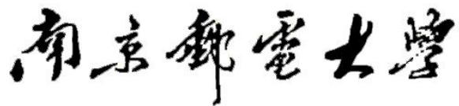

# 硕 士 学 位 论 文

## 论文题目： 基于强化学习和元学习的机械臂抓取方法研究

学 号 1019051206

姓 名 李茂捷

导 师 徐国政

学 科 专 业 仪器科学与技术

研 究 方 向 机器人技能学习

申请学位类别 工学硕士

论文提交日期 二零二二年六月

# Research on manipulator grasping method based on reinforcement learning and meta-learning

# Thesis Submitted to Nanjing University of Posts and Telecommunications for the Degree of Master of Engineering

By Li Maojie Supervisor: Prof. Xu Guozheng June 2022

## 摘要

机械臂在工业和服务领域有着广泛的应用，抓取是机械臂的重要技能，也是机器人学习领域的研究热点。基于深度强化学习的抓取方法能够通过自主学习完成端到端抓取，但此类方法存在学习效率低的问题。针对深度强化学习在机械臂抓取中存在的问题，本文提出了一种基于强化学习与元学习的机械臂抓取方法，从增加正向奖励、学习归纳偏置、降低任务复杂度三个方面提高学习效率。本文主要研究内容如下：

（1）利用深度确定性策略梯度算法（Deep Deterministic Policy Gradient, DDPG）和稀疏奖励函数训练机械臂学习接近、抓握、放置三个抓取操作中的基本技能以及二维平面抓取技能，并引入后视经验回放算法（Hindsight experience replay，HER）增大轨迹数据中正向奖励的密度，解决稀疏奖励带来的学习效率低及不可学习的问题，显著提升了策略收敛速度和性能。

（2）针对新的接近技能需要重新学习而导致学习效率低的问题，利用元Q学习方法（MetaQ-learning，MQL）从相关的接近任务中学习出有效的归纳偏置，并将习得的归纳偏置应用于新接近技能的学习中，使得达到同样的收敛性能所需样本量仅为之前的 23%，消融实验表明获取轨迹上下文变量是学习归纳偏置的关键。

（3）通过将抓取任务分解为接近、抓握、放置三个子任务，降低任务复杂度，然后对高层策略和低层策略进行分层、独立学习，在抓取子任务的低层策略已习得的基础上，利用异步优势 Actor-Critic 算法（Asynchronous Advantage Actor-Critic，A3C）学习高层策略用于编排子任务执行顺序。实验表明通过分层训练策略，解决了端到端训练所存在的不可学习的问题，且抓取策略的成功率优于二维平面抓取策略。

关键词: 机械臂抓取，深度强化学习，稀疏奖励，元学习，分层强化学习

## Abstract

Manipulator has a wide range of applications in industry and services. Grasping is an important skill of manipulator and a research hotspot in the field of robotics learning. The grasping methods based on deep reinforcement learning can complete end-to-end grasping through autonomous learning, but such methods have the problem of low learning efficiency.. Aiming at the problems existing in deep reinforcement learning in manipulator grasping, this paper proposes a manipulator grasping method based on deep reinforcement learning and meta-learning, which includes three aspects: increasing positive reward, learning induction bias, and reducing task complexity to improve learning efficiency. The main research contents of this paper are as follows:

(1) Use Deep Deterministic Policy Gradient (DDPG) and sparse reward function to train a manipulator to learn three basic skills in grasping of approaching, grabbing, and placing, as well as 2D planar grasp, and introduce the Hindsight experience replay (HER) algorithm to increase the density of positive rewards in trajectory, solve the problem of low learning efficiency and nonlearning caused by sparse rewards, and significantly improve policy convergence speed and performance.

(2) Aiming at the problem of low learning efficiency due to the need to relearn new approach skills, use Meta Q-learning (MQL) to learn effective inductive biases from related approaching tasks, and apply the learned inductive biases to new approaching tasks. The sample size required to achieve the same convergence performance is only 23% of the previous one, and ablation experiments show that obtaining the trajectory context variables is the key to learning the inductive bias.

(3) By decomposing the grasping task into three sub-tasks of approaching, grabbing, and placing, the task complexity is reduced, and both the high-level policy and the low-level policy are learned hierarchically and independently. On the basis of the learned low-level policies for grasping subtasks, the Asynchronous Advantage Actor-Critic (A3C) algorithm is used to learn high-level policy for choreographing the execution order of subtasks. Experiments show that the problem of non-learning of end-to-end training is solved through the hierarchical training strategy, and the success rate of the grasping strategy is better than that of the 2D planar grasp strategy.

Key words: manipulator grasping, deep reinforcement learning, sparse reward, meta-learning, hierarchical reinforcement learning

## 目录

专用术语注释表....VII
第一章 绪论....1
1.1 课题背景及研究意义....1
1.2 国内外研究现状....2
1.2.1 强化学习研究现状....2
1.2.2 元学习研究现状....5
1.2.3 机械臂抓取方法研究现状....7
1.3 研究内容与篇章结构....12
第二章 基于深度强化学习的机械臂基本技能学习方法....15
2.1 引言....15
2.2 深度强化学习理论....15
2.2.1 马尔可夫决策过程....15
2.2.2 泛化策略迭代....17
2.2.3 深度确定性策略梯度算法....19
2.2.4 后视经验回放算法....20
2.3 基于DDPG和HER的机械臂技能学习方法....22
2.3.1 算法设计....22
2.3.2 网络结构....23
2.4 仿真环境及任务设置....24
2.4.1 MuJoCo物理引擎与Gym工具箱....24
2.4.2 机械臂操作任务设置....25
2.5 仿真实验及结果分析....29
2.5.1 指定姿态的接近技能学习....30
2.5.2 抓握技能学习....34
2.5.3 放置技能学习....35
2.5.4 二维平面抓取技能学习....36
2.6 本章小结....37
第三章 基于元Q学习的机械臂接近技能学习方法....38
3.1 引言....38
3.2 相关理论....38
3.2.1 归纳偏置....38
3.2.2 元强化学习....39
3.2.3 重要性采样与有效样本量....41
3.3 元Q学习方法....42
3.3.1 元训练....44
3.3.2 迁移....44
3.4 仿真实验及结果分析....46
3.4.1 实验设置....46
3.4.2 仿真结果....47
3.5 本章小结....50
第四章 基于任务分解的机械臂6自由度抓取方法....51
4.1 引言....51
4.2 相关理论....51
4.2.1 分层强化学习....51

4.2.2 异步优势 Actor-Critic 算法....54
4.2.3 分层控制结构....56
4.3 抓取方法....57
4.3.1 高层指导者学习方法....57
4.4 任务设置及仿真结果分析....57
4.4.1 6 自由度抓取任务设置....57
4.4.2 仿真结果....59
4.5 本章小结....61
第五章 总结与展望....63
5.1 工作总结....63
5.2 未来展望....64
参考文献....65
附录 1 攻读硕士学位期间撰写的论文....69
附录 2 攻读硕士学位期间申请的专利....70
附录 3 攻读硕士学位期间参加的科研项目....71
致谢....72

## 专用术语注释表

## 符号说明：

## 缩略词说明：

<table><tr><td>DRL</td><td>deep reinforcement learning</td><td>深度强化学习</td></tr><tr><td>DDPG</td><td>Deep Deterministic Policy Gradient</td><td>深度确定性策略梯度</td></tr><tr><td>HER</td><td>Hindsight experience replay</td><td>后视经验回放</td></tr><tr><td>MQL</td><td>Meat Q-learning</td><td>元Q学习</td></tr><tr><td>A3C</td><td>Asynchronous Advantage Actor-Critic</td><td>异步优势Actor-Critic算法</td></tr></table>

## 第一章 绪论

## 课题背景及研究意义

机器人技术融合了机械工程、电子信息、自动化、计算机科学等多个学科，机器人的制造与应用是衡量一个国家科技创新和高端制造业水平的重要标志。国家“十四五”规划纲要明确指出，推动制造业优化升级，深入实施智能制造，推动包括机器人在内的高端制造产业创新发展。《中国机器人产业发展报告》提到2016-2021年全球机器人市场规模的平均增长率约为 11.5%，2021 年工业机器人市场规模达到 144.9 亿美元，服务机器人 125.2 亿美元。机器人产业的发展呈现良好势头。

机械臂是现今最常用的机器人之一。在传统的工业领域，机械臂通常被用于分拣、喷涂等简单工作，现在走向了更加广泛的应用场景如医院[1]、外太空[2]、家庭[3]。抓取操作是机械臂主要技能，随着社会的高速发展，人们对机械臂抓取操作的要求也日益提高，期望其能够辅助乃至替代人类完成各种困难、多样的任务。不同于工作场景简单、运动轨迹固定的传统工业抓取任务，应用于家庭、医院的服务机器人面对的环境更加复杂，抓取目标的形状、位姿不定。传统的机械臂抓取方法依赖专家根据环境模型和目标物的几何特征进行人工编程，此类方法虽然能够实现较高的抓取精度与成功率，但智能化程度较低，只能完成特定的抓取任务，难以应对变化的环境或未知物体。基于学习的抓取方法主要是从专家演示中学习运动特征并复现专家演示，或从大量人工标注的数据中学习目标物的抓取姿态，此类方法对数据的依赖十分严重，无法实现自主学习。

人类能够轻松、灵活地控制手臂完成各种复杂、多变的操作任务，大脑的决策能力在其中发挥重大的作用。因此能处理复杂抓取任务的智能机器人，除了必须具备精准的感知系统和灵活的运动系统，还需要有智能的决策系统，能够像人类大脑一样处理感知信息并选择合适的动作。近十年深度强化学习（Deep Reinforcement Learning, DRL）飞速发展，为机器人学习领域带来了许多改变，促进了许多智能抓取方法的诞生。深度强化学习方法同时具备强大的特征提取能力和决策能力，可以从底层感知信息中自主学习出操作策略，与人类的学习方式十分相似，被认为是通往通用人工智能的可能路径。然而所有的深度强化学习方法相比人类的学习方法还有巨大的不足，最突出的便是学习时间长、学习效率低，因此提高基于深度强化学习的抓取方法的学习效率具有重要理论和现实意义。

本文以机械臂的 6 自由度抓取任务为研究内容，利用深度强化学习算法学习运动策略，并在多个方面提高深度强化学习算法在抓取任务中的学习效率。本文的研究工作对于提高机械臂抓取的智能程度具有重要意义。

## 国内外研究现状

## 1.2.1 强化学习研究现状

强化学习研究如何智能体从与环境的交互中进行学习的问题，其与监督学习、无监督学习是机器学习的三个主要学习范式。监督学习是监督者向学习器提供带标签的数据集，然后学习器从中学到推理或泛化能力；无监督学习是学习器从未标注的数据集中，学习数据的规律或内在结构。与其他两类方法相比，强化学习更接近人和动物学习的本质：通过与环境互动进行学习。强化学习与两门学科紧密相关：其灵感源于心理学的行为主义理论，可追溯到巴普洛夫的条件反射实验，因此在心理学中强化学习也被称为条件反射学习；数学中的离散优化和图论为强化学习提供了规范的数学形式，动力系统的最优控制理论被用于解决强化学习问题。从上世纪80年代末开始，强化学习相关的数学基础研究相继取得突破性进展，使其成为机器学习领域的一大研究热点，广泛应用于机器人控制[4, 5]、自动驾驶[6, 7]、组合优化[8, 9]、金融交易[10, 11]、游戏竞技[12]等领域。

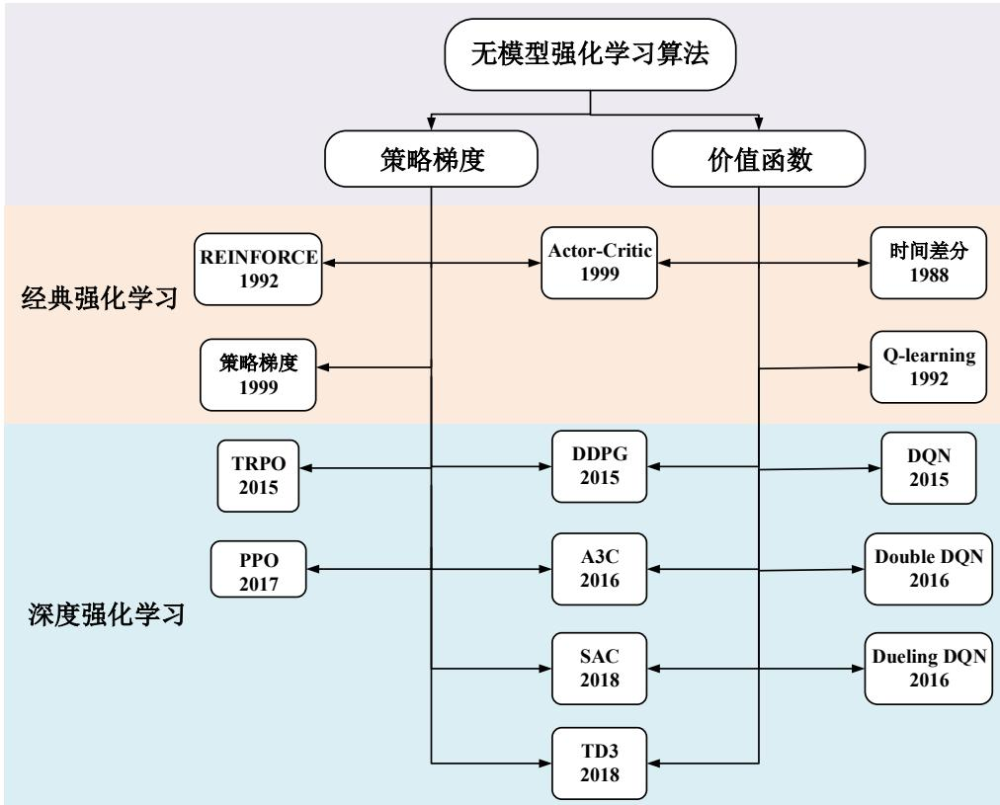  
图 1.1 无模型强化学习算法

根据学习方式的不同强化学习主要分为两类：第一是基于值函数的强化学习方法，第二是基于策略梯度的强化学习方法。基于值函数的方法通过更新值函数，使策略收敛到最优策略，该方法也称为表格型解法。Sutton[13]提出时序差分（Temporal Difference，TD）学习，并证明对于具有马尔可夫性的系统，学习率绝对递减的条件下，TD算法必收敛。TD学习是强化学习中最主要的方法之一，结合了蒙特卡罗估计和动态规划的思想，一方面能在系统模型未知的情况下学习值函数；另一方面利用状态转移的马尔可夫性，实现值函数的迭代更新。基于 TD 学习提出的值函数更新方法，Watkins 等人[14]通过迭代更新状态-动作值函数，提出了Q学习（Q-learning）并给出收敛性证明。Q学习也被称为离线TD学习，在一定条件下只需采用贪心策略更新值函数即可保证收敛，是最有效的模型无关的经典强化学习算法。Tesauro[15]利用 TD（�）算法和神经网络研发了TD-Gammon 西洋双陆棋程序，是第一款成功的人工智能博弈系统，其中经过30万场比赛训练的程序TDG 1.0 与职业玩家对战，平均每场比赛只落后0.25分。

基于策略梯度的方法直接利用梯度下降更新策略参数，进而使获得的奖励最大。Williams等人[16]提出的REINFORCE算法利用随机梯度下降逐步提升策略性能，根据动作所带来的累计奖励计算出权重，然后赋予动作对应的梯度不同权重，鼓励智能体选择可带来更大累计奖励的动作。Sutton 等人[17]提出的策略梯度算法，修改了 REINFORCE 的权重计算方式，将累计奖励改为动作的 Q值，降低了梯度估计的方差。Konda等人[18]提出基于策略梯度和价值函数的 Actor-Critic 算法，在策略函数的基础上加入值函数，学习过程中同时更新两个函数。Actor-Critic 算法同时具备两类强化学习方法的优点：既能快速选择最优动作，又能进行单步更新。

深度学习的发展对强化学习产生了重大影响，深度网络可以方便地提取出高维数据的低维特征。研究者通过将归纳偏置设计到深度网络架构中，与强化学习方法相结合，开辟了深度强化学习这一领域，很好地解决了表格型解法的维度灾难问题，也推动了许多基于策略梯度的算法的发展。

许多研究者将 Q 学习拓展至深度强化学习领域。Mnih 等人[19]基于卷积神经网络和 Q 学习提出深度 Q学习（Deep Q-learning），该方法使用卷积网络拟合值函数，并引入经验回放机制既减小数据相关性，也提高了数据使用效率。深度 Q学习是第一个直接从高维视觉输入中学习控制策略的模型，在 6 款 Atari 2600 游戏上表现优于之前所有方法，在其中 3 款游戏上超过人类专家水平。随后 Mnih 等人又提出 DQN（Deep Q-network）[20]，在深度 Q 学习的基础上加入一个目标网络，代替原网络生成Q学习的目标值，使目标值不受最新参数影响，大大减少了训练中发散和震荡的情况。DQN 达到当时算法的最优性能，在 49 款 Atari 2600 游戏中分数与专业玩家相当。针对DQN存在的一些问题，其他研究者陆续提出对DQN的改进。

考虑到环境、函数近似等原因，DQN 包括 Q 学习计算出的 Q 值往往带有噪声，计算目标值时用到最大化算子 max 导致 Q 值包含最大噪声，因此目标值被过估计。针对过估计的问题，Hasselt 等人[21]提出的Double DQN，使用两个具有不同参数的Q网络分别进行估计Q值和选择动作，去除了两个过程的噪声之间的相关性。Wang 等人[22]提出名为 Dueling DQN 的新网络结构，其将Q值分解为与动作无关的状态值和与状态和动作相关的优势函数之和，实现状态值与Q值的解耦，可以估计出更准确的值函数，获得更加鲁棒的学习效果。文献[23]提到TD误差可以用来衡量学习的提升效果，为有效利用经验池样本，Schaul 等人[24]提出的优先经验回放（Prioritized experience replay，PER），优先从经验池中选取 TD 误差更大的样本，在与传统DQN中的竞技中，融合 PER技术的DQN获得41胜8负的成绩。

策略梯度方面最优秀的深度强化学习算法是 Schulman 等人提出的信赖域策略优化算法（Trust Region Policy Optimization，TRPO）[25]和近端策略优化（Proximal Policy Optimization,PPO）[26]。已有的基于策略梯度的方法如 REINFORCE 存在更新步长难确定的问题，一方面是由于一阶梯度无法提供奖励函数曲面的曲度，另一方面相同的参数空间更新幅度会带来不同的策略空间更新幅度，导致步长对稳定性影响巨大。Schulman 借鉴 Kakade 等人[27]提出的保守策略迭代算法（conservative policy iteration），将目标函数分解为更新前策略的目标函数与新旧策略回报差，并添加了新旧策略 KL 散度作为约束对策略进行保守的改进，使回报函数绝对递增。TRPO的计算复杂度高，需要对KL散度期望的Hessian矩阵的逆求解，即使简化逆矩阵的计算，为满足约束也需要多步共轭梯度算法。PPO 使用了两种简单有效的方法达到策略的保守改进，PPO 的正则化版本 PPO-Penalty 将策略的 KL 散度转化为回报函数正则化项，并根据KL散度大小动态放缩正则化项系数；PPO的截断版本PPO-Clip先将新旧策略比值截断在某个范围内，保证新旧策略的相似性，选择截断前后目标函数最小值作为学习的目标函数，即可控制新旧策略的更新范围目标函数，又能最大化目标函数。

研究者将 DQN 与 Actor-Critic 算法结合取得了巨大的成功。Lillicrap 等[28]提出的深度确定性策略梯度算法，实现了DQN在连续动作空间上的拓展。DDPG在DQN主网络加目标网络的架构上添加了评论者网络，将网络数量扩充至 4 个；主网络中值函数通过时间差分方法进行更新；策略函数利用值函数的估计，通过策略梯度方法进行更新；目标网络利用指数平滑的方法在主网络参数基础上进行更新。DDPG 得到的是确定性策略，为平衡策略的探索与利用（Exploration and Exploitation），在交互过程中为每个动作添加了噪声。Fujimoto 等人[29]提出的孪生延迟 DDPG（Twin Delayed Deep Deterministic Policy Gradient，TD3）对 DDPG 作出了三点改进：针对目标值过估计问题，TD3 采取类似 Double DQN 的技术，引入第二个 Q网络，使用其中较小的Q值计算目标值；降低目标网络的更新频率，减小估计误差；为动作添加截断的噪声，减小确定性策略的过拟合。针对智能体面对具有稀疏奖励的任务存在的无法学习的问题，Andrychowicz[30]提出了后视经验回放算法，通过为轨迹数据添加目标状态并修改奖励信号，引导智能体在失败的经验中学习并完成任务。文献中结合 HER 后的 DDPG，在 Fetch 机械臂操作任务中的表现较之前有显著提升，HER 具有较好的灵活性可与所有的离线策略方法结合。一些研究者[31, 32]从另一个角度发展强化学习：鼓励智能体进行探索并完成任务。基于鼓励探索这个想法，柔性策略迭代算法（Soft Policy Iteration）将强化学习目标由累计奖励改为加上最大熵正则化的奖励奖励，其与泛化策略迭代类似，分为柔性策略评估和柔性策略提高两步。Haarnoja等人[33]证明柔性策略迭代能够收敛到最优解并提出了柔性Actor-Critic算法（Soft Actor-Critic，SAC），将其应用于四足机器人和机器人灵巧手，取得了最先进的控制效果。为加快学习速率，Mnih 等人[34]提出了同步优势 Actor-Critic 算法（SynchronousAdvantage Actor-Critic，A2C）和异步优势 Actor-Critic 算法（Asynchronous Advantage Actor-Critic，A3C），在 Actor-Critic 算法的基础上引入并行计算，利用多个分节点与环境交互采集轨迹数据，主节点利用数据更新网络参数，每个节点都包含行动者与批判者。在A2C 中分节点只收集数据，梯度在主节点中计算；在A3C 中各个分节点在计算梯度后直接更新参数。

## 1.2.2 元学习研究现状

人们渴望构建具有一般人类水平的智能机器人，能在各种环境中执行任务。在过去的10年中深度学习的相关研究取得了重大突破，在计算机视觉、自然语言处理领域出现了颠覆性的技术，但未给智能机器人领域带来革命性变化。一个关键的原因是由于机器人所处的环境存在巨大的多样性，无法提供足够的监督信息，因此具有自我学习能力与强泛化性能的元学习成为发展通用机器人的关键技术[35]。

元学习即学会学习（learning to learn），其目的是设计出一种新的学习范式，在这种学习范式下智能体只需要少量样本即可学习新的技能，因此当前元学习多用于解决小样本学习问题，目前进展较多的元学习方法主要有基于度量学习的方法、基于强泛化性的初始参数的方法和基于优化器的方法。

基于度量的学习方法目的在于提取任务数据的内在特征。Snell 等人[36]提出原型网络模型，该模型假设在数据的特征空间中每个不同的类别都有一个原型点，数据与某个原型点之间的距离越小，代表数据属于该类别的概率越大。原型网络主要是通过最大化正确分类的对数概率学习出一个度量函数，该度量函数可计算数据属于各类别的概率。原型网络模型比当时其他的元学习方法更简单、直观，在Omniglot 和miniImageNet 数据集上的小样本甚至是零样本分类任务上达到最优性能。Finn 等人[37]提出的模型无关元学习（Model-Agnostic Meta-Learning，MAML）方法旨在搜索出强泛化性的模型初始参数，其侧重于找出模型中对新任务目标函数敏感的参数，在面对新任务时对这些参数进行小幅度的更新便可带来很大的性能提升，进而减少对新任务样本的需求。MAML最大优点是优秀的开放性和灵活性，几乎可用于分类、回归、决策等所有基于梯度下降的学习任务。在小样本数据构成的性能曲面上直接使用随机梯度下降效果往往很差，基于优化器的方法可学习出一个准确的优化算法，代表工作是Ravi 等人[38]提出的基于长短期记忆网络（Long Short-Term Memory，LSTM）的元学习模型，该方法利用 LSTM 计算出比梯度下降更好的参数，每一个参数都对应一个 LSTM 但更新规则一样，所有的LSTM 之间共享参数。

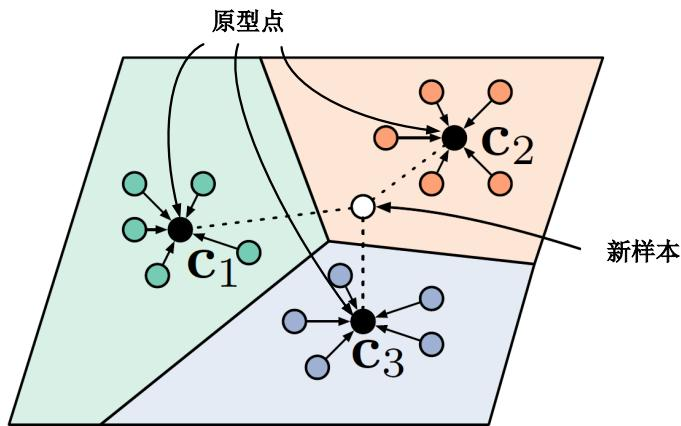  
图 1.2 原型网络小样本分类

元学习在机器人学习上最成功的应用应属于 Abbeel 团队提出的元模仿学习（Meta-imitation learning，MIL）。首先是 Duan 等人[39]提出的单样本模仿学习方法（One-Shot ImitationLearning），该方法将元学习框架应用在模仿学习上，控制机械臂完成一些相似的堆叠物块任务。单样本模仿学习的主要思想是利用相关任务集的多个演示训练出一个单样本模仿函数（One-Shot Imitator），该函数可从新任务的一个演示学到有效策略，在面对新任务时只需获取一个专家演示和当前观测就可以输出动作完成任务。在 Duan 的基础上，Finn 等人[40]做出了几点改进：首先使用MAML作为元学习方法，其次引入“双头”结构的网络用于计算MAML中内外循环的两个不同的目标函数，最后演示数据的形式改成相机输入且不单独抽取出演示中的动作信息。引入MAML后训练的演示数量显著减少，并且验证了从视觉输入学习策略的能力。Yu 等人[41]在前两个工作的基础上实现了机器人从人类演示视频中学习技能，其中训练阶段的相关任务演示是人类和机器人两种操作视频，测试阶段的新任务演示是人类操作视频。该方法通过元学习解决人与机器人之间的域适应问题，在真实机械臂的推动和放置任务上具有很好的模仿能力。

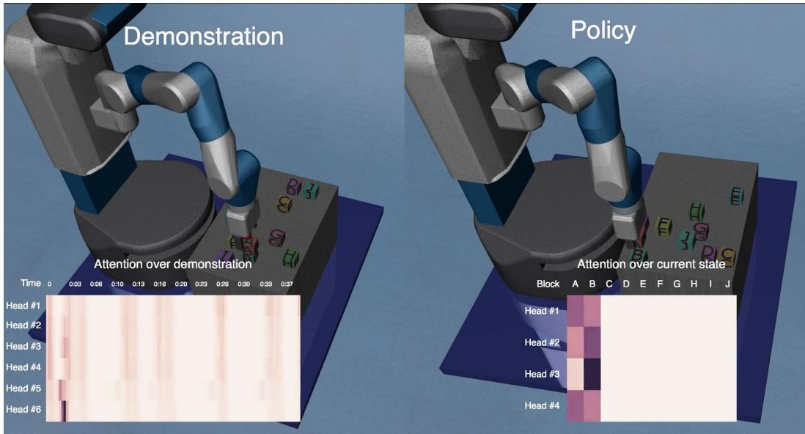  
图 1.3 基于元模仿学习的堆叠物块任务[39]

## 1.2.3 机械臂抓取方法研究现状

在多样、变化的环境中，人类可以轻松抓取各种可抓的物体，但对机械臂而言抓取一直是近几十年来的重大挑战之一。完成一次成功的抓取需要考虑任务定义，环境的不确定因素，物体的几何形状、接触特征和质量分布等诸多变量。抓取过程可分为两步：抓取检测和抓取执行，抓取检测表示通过计算或学习得到可行的抓取方案，抓取执行即控制机械臂实现抓取方案，因此机械臂抓取方法可分为不包含抓取执行的抓取检测方法和端到端的抓取方法。

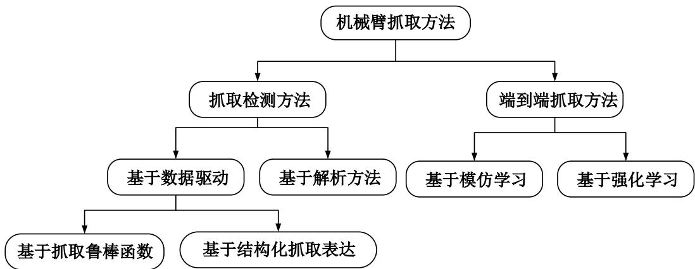  
图 1.4 机械臂抓取方法分类

通常抓取检测方法可分为基于解析方法的抓取检测和基于数据驱动的抓取检测[42]。本文主要关注基于数据驱动的方法，重点分析该类方法的研究现状。解析方法即建立具有灵巧性、稳定性、平衡性和一定动态特性的机械臂力封闭抓取[43]，旨在通过求解抓取检测问题的解析解，得到合适的抓取位姿。在给定精确的物体形状和机械臂运动学模型后，解析方法可看作是一个约束优化问题。对于简单形状的物体，一般采用线性规划的方法求解。Liu[44]将n根手指的三维抓取问题转化为线性规划问题，求出第 n 根手指满足力封闭条件的点，并将求解算法直接应用于三维无摩擦抓取和二维抓取。对于形状复杂的物体线性规划方法具有巨大的计算量，Li 提出一种计算三指力封闭抓取的几何方法用于任意物体的二维和三维抓取，该方法在将三维抓取问题简化为二维平面抓取问题，极大提升了计算速度[45]。在已求出多个满足力封闭的抓取点的基础上，可通过比较抓取质量（grasp quality）找到其中的最优抓取点，Roa 等人[46]总结出多种抓取质量标准。

基于解析方法的抓取检测存在两个缺点：一是需要对抓取任务建模，不适应用于新的抓取任务与抓取目标；二是计算复杂度高，计算成本随约束条件数量的增多而显著增加。为提高抓取方法的适应性、降低计算复杂度，研究者在抓取问题中以数据集的形式引入已有的抓取经验，提出各式各样的基于数据驱动的抓取检测方法，此类方法在已有经验中学习从而提升自身性能，因此也被称为基于学习的抓取检测方法。基于学习的抓取检测方法的研究主要集中于抓取位姿估计上。根据算法学习内容的不同，基于学习的抓取检测方法可分为基于结构化抓取表达（Grasp Representation）的方法和基于抓取鲁棒函数的方法。

抓取表达代表目标的抓取位姿，常见的结构化抓取表达有抓取点、抓取矩形。Saxena 等人[47]利用监督学习方法从一个物体多个角度的合成图像中学习出抓取点，并学习出关于可能抓取点的概率模型，解决了同一物体的多个图像中抓取点的对应问题。该方法不对目标进行三维重建工作，在未知物体上抓取成功率为 87.5%。抓取点只能表示物体的抓取位置，不包含夹爪或手指的张开宽度和方向。Jiang等人[48]选择抓取点、抓取方向和抓取开口宽度组成的7 维向量作为抓取表达，仍采用监督学习的方法学习出评价函数，并用其对可能的抓取表达进行排序进而得到最优抓取位姿，通过对评价函数进行增量计算将几千万个可能的抓取表达缩减到100个，极大降低了排序过程的计算量。Lenz等人[49]将7维的抓取表达简化为5维的抓取矩形形式，并首次将深度学习应用到抓取检测中摆脱对人工设计特征的依赖。该方法使用两个级联的深度网络分两步得到最优抓取矩形，第一级网络提取少量特征，从图像中得到大量可能的抓取矩形；第二级网络可提取大量特征，从上一级网络的输出中找到最佳抓取矩形；从此基于抓取矩形的深度学习方法成为抓取检测领域的热点。Redmon 等人[50]利用卷积神经网络（Convolutional Neural Network，CNN）实现准确、实时的抓取检测方法，该方法在康奈尔抓取数据集上准确率高于最优模型[49]14 个百分点，在 GPU 上计算速度达 13 帧/秒。Ainetter等人[51]结合语义分割和抓取检测提出基于CNN的端到端的架构，该方法在康奈尔抓取数据集准确率为98.2%，为目前该数据集上的最优模型。

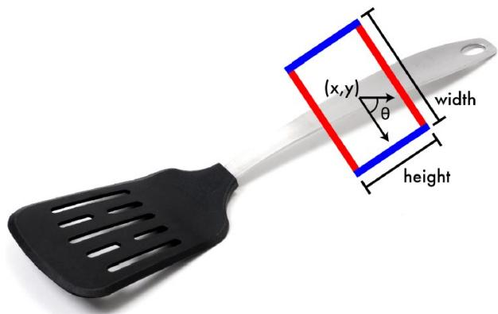  
图 1.5 5 维抓取表达[50]

抓取鲁棒函数以图像或点云等视觉数据为输入，输出视觉数据的某一区域的抓取成功概率或抓取鲁棒性，通常利用 CNN拟合鲁棒函数。基于抓取鲁棒函数的方法的思想是学习得到一个鲁棒函数，利用函数输出选择抓取位姿，该领域最有代表性的工作是Mahler等人提出的Dex-Net 系列。Mahler 等人[52]公开了 Dex-Net1.0 算法及数据集，数据集包含 1 万个三维物体模型和250万个抓取位姿及抓取位姿对应的鲁棒性。Dex-Net 1.0算法以力封闭概率为抓取质量的指标，利用多臂赌博机模型的采样方法生成候选抓取位姿然后预测它们的力封闭概率，最后选择概率最大的抓取位姿。为了减少机器人采集数据的时间，Dex-Net 2.0[53]在 Dex-Net1.0数据集的基础上加入 650万个合成点云和抓取位姿及对应的鲁棒性，并构建一个抓取质量卷积神经网络（GQ-CNN）用来预测点云的抓取鲁棒性，然后对网络进行离线训练。该方法使用ABB YuMi 对40个常见的家用物品进行抓取实验成功率达94%，网络输出准确率为99%。Dex-Net 3.0[54]主要研究具有真空夹爪机器人的抓取问题并提出新数据集，该数据集包含 280万个点云数据及吸取式抓取试验。Dex-Net 4.0[55]属于鲁棒函数与强化学习的结合，将抓取问题视为部分可观测马尔可夫决策过程（partially observable Markov decision process，POMDP）利用强化学习训练得到抓取策略，奖励为GQ-CNN预测的成功概率。实验中机器人同时配备真空夹爪和平行夹爪，并分别为两个夹爪训练抓取策略使得机器人在抓取过程中可动态选择成功率较高的夹爪。机器人每小时可抓取 300 个物体，成功率为 95%，其中失败实验多来自抓取表面透明或可发生形变的物体。

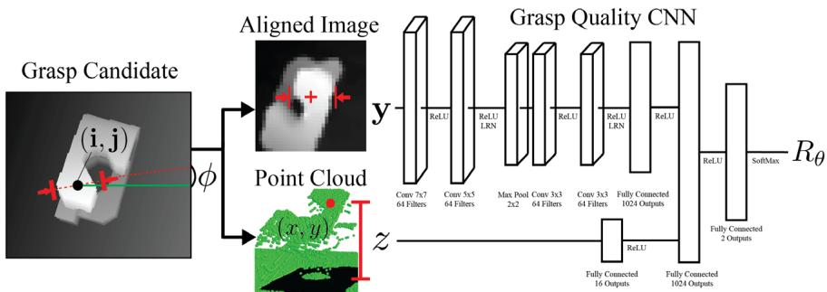  
图 1.6 抓取质量卷积神经网络[53]

基于数据驱动的抓取检测方法可获得目标的抓取位姿，对未知物体的抓取具有一定的泛化性，但该类方法一方面依赖大量手动标注的数据集，成本较高，另一方面应用于抓取场景中需要额外的运动规划、控制系统来完成抓取操作。端到端的抓取方法不计算抓取位姿，而是关注于抓取行为本身，以完成任务为目的进行高层次的学习进而获取抓取技能，根据是否需要示教样本可分为模仿学习（Imitation Learning，IL）和强化学习两种。

模仿学习又称示教学习（Learning from demonstration，LfD）是一种重要的机器人技能学习方法，能够以相对直接的方式将人类的技能迁移至机器人中[56]。从演示中学习是一种通用的技能学习方法，提供技能所对应任务的专家演示，机器人就有可能学会这项技能，因此模仿学习不止应用于机械臂抓取任务，还应用于机器人击球甚至是手术[57]等复杂操作任务中。一种基于运动轨迹的模仿学习的思想是从少量的专家示教样本中提取出运动特征，然后将该特征泛化到新的情形，常见的提取运动特征的算法有：高斯混合模型（Gaussian mixture model，GMM）、隐（半）马尔可夫模型（Hidden (Semi-)MarkovModel，HMM/HSMM）、动态运动基元（Dynamic Movement Primitives，DMPs）。Alexander 等人[58]利用数据手套进行抓取示教并收集其中运动和力数据，然后先后利用 HMM 对示教数据进行编码提取特征和进行回归计算生成轨迹数据，执行抓取操作。李重阳等人[59]通过力反馈手柄生成 3 组末端轨迹数据，然后利用高斯过程算法构建运动模型，最后根据当前环境状态信息计算出期望轨迹的概率分布完成空间机械臂操作任务。Martinez 等人[60]采用 GMM 学习多条示教轨迹的概率模型，然后基于高斯混合回归（Gaussian mixture regression，GMR）算法生成末端轨迹。该方法对同一任务需要进行多次示教，当需要学习的任务较多时工作量庞大。仝勋伟[61]结合DMPs 和DDPG提出一种快速、可靠的机器人技能学习方法，该方法利用 DMPs 模型模仿专家示教运动轨迹并根据工作环境对轨迹进行泛化，然后利用泛化后的轨迹减小DDPG的探索空间，最后学会拾放和搬运等操作技能。

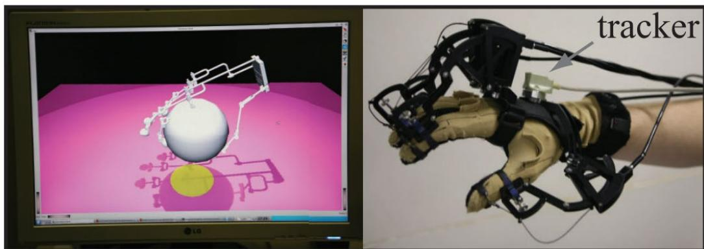  
图 1.7 利用数据手套收集专家演示[58]  
以上模仿学习方法将抓取等操作视为轨迹规划问题，侧重学习示教轨迹的运动特征并对

轨迹进行泛化，而模仿学习的其他方法如行为克隆（Behavior cloning，BC）、逆强化学习（Inversereinforcement learning，IRL）将抓取等操作看作是决策问题，目的是从示教轨迹中学习出策略。BC 本质上是监督学习方法，学习示教轨迹的状态和动作的函数关系即行动策略。Florence 等人[62]提出基于能量函数的隐式行为克隆（Implicit Behavioral Cloning）方法，该方法不学习状态与动作间的函数关系，而是学习状态-动作对的能量函数，选择执行能量函数值最低的动作。与传统 BC 相比，隐式 BC 在 1 毫米精度的现实插孔任务上的成功率要高一个数量级，并且对人类干扰具有高鲁棒性。Finn 等人[63]提出一种引导式成本学习（Guided Cost Learning）方法，该方法本质上是利用逆强化学习从演示中获得非线性奖励函数同时学习出行动策略，在摆盘子和倒水两个任务上的成功率分别达到 100%和84.7%。

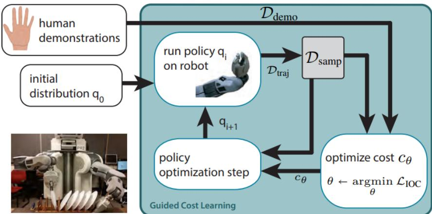  
图 1.8 引导式成本学习示意图[63]

上述所有基于学习的抓取方法都属于监督学习，必须提供人工标注的数据集，对新环境和未知目标物的适应性取决于数据集的多样性。强化学习摆脱了对数据集的依赖，允许机器人自己收集数据进行学习，且可以随着环境和物体的改变继续学习、改进行动策略。深度学习的发展使得强化学习可以从高维的传感器感知信息中学习行动策略，实现端到端的操作。几乎所有的深度强化学习算法都可用于机械臂抓取任务中，这里主要介绍具有代表性的工作。针对杂乱摆放的物体的抓取任务，Zeng等人[64]提出了以互助方式学习推动和抓取的框架，该框架利用深度相机采集信息，基于 DQN 训练机械臂学习推动与抓取的协同操作即推开物体便于后续抓取。针对非刚体目标的抓取，Tsurumine 等[65]基于动态策略编码提出了两种 DPN和DDPN两种算法，利用平稳更新策略和深度网络提高了算法的样本效率，最终使用少量样本完成了折叠手帕和衣服等任务。Kalashnikov等人[66]提出名为QT-Opt分布式异步训练框架，利用DQN学习基于视觉的闭环控制策略，实现了仅依靠单个RGB 相机对未知物体的抓取成功率为 96%。QT-Opt 框架表现很好但缺点也较为明显，需要使用 58 万次真实机械臂抓取尝试和 6 个工作节点进行训练，仅收集离线数据就需要 7 台机械臂连续工作 4 个月。Yahya 等人[67]提出了跨机器人分布式训练系统，在真实环境中同时训练 4 台机械臂学习相似的开门任务，机械臂之间共享经验池数据和全局策略，实验表明跨机器人分布式训练在策略泛化性、数据利用率、训练速度都显著优于单个机器人训练方案。Andrychowicz等[30]提出HER算法，通过增大正向奖励的密度，很好地解决了稀疏奖励带来的不可学习问题，在机械臂抓取、滑碰、推动等任务上带来显著的性能提升。

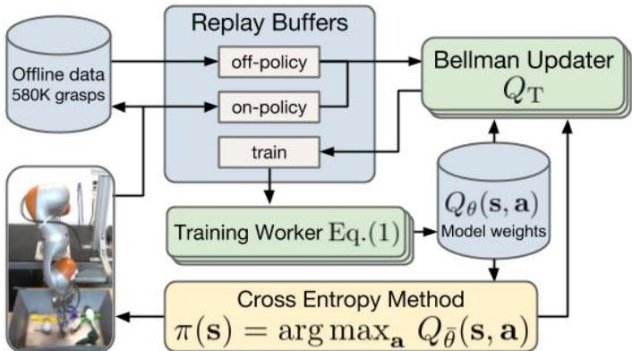  
图 1.9 QT-Opt 框架[66]

## 研究内容与组织结构

本文以 Jaco2 机械臂抓取技能学习为研究背景，针对深度强化学习方法在 6 自由度抓取任务中学习效率低的问题，提出了一种基于强化学习与元学习的机械臂抓取方法，主要研究内容如下：

## （1）仿真环境搭建

在 MuJoCo仿真器中搭建了Jaco2机械臂的操作任务环境，并利用Gym 工具箱对接近、抓握、放置、二维平面抓取、6自由度抓取任务的马尔可夫决策过程进行建模。

## （2）利用结合HER的DDPG学习机械臂基本操作技能

由于 6自由度抓取任务具有执行周期长、复杂度高的特点，难以直接利用深度强化学习方法进行端到端学习，因此选择将抓取任务分解为接近、抓握、放置三个子任务，控制机械臂依次完成子任务进而完成抓取操作。利用DDPG学习接近、抓握、放置三个子技能，为6自由度抓取技能的学习打下基础；学习二维平面抓取技能，为与6自由度抓取方法进行抓取效果对比。在学习过程中DDPG存在样本效率低甚至是不可学习的问题，针对该问题引入HER算法，通过增大正向奖励密度引导机械臂进行探索、学习。

## （3）利用元Q学习方法学习接近任务中的归纳偏置

各接近任务之间具有很高的相似性，而深度强化学习方法忽略了这些任务的相似性，从头学习每个接近任务的策略，这是此类方法学习效率低的一个重要原因。为进一步提高学习效率，提出基于元Q学习的技能学习方法，然后利用该方法从相关接近任务中学习出有效的归纳偏置，并在新接近任务中测试归纳偏置的有效性，最后通过消融实验分析该方法中三个关键技术对学习效率的影响。

## （4）分层训练机械臂学习6自由度抓取技能

对抓取任务进行层次分解，降低任务复杂度；然后在接近、抓握、放置三个底层策略已训练的基础上，利用A3C 方法学习高层策略，用于编排子任务执行顺序；最后对多种物体进行抓取实验，比较6自由度抓取和二维平面抓取方法的优劣。

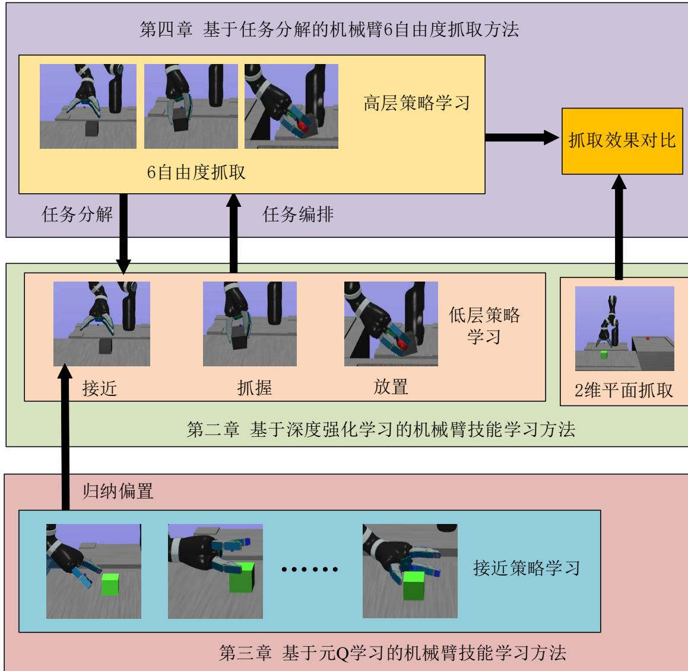  
图 1.10 本文主要研究内容

围绕上述研究内容，文章的篇章结构如下：

第一章为绪论，主要介绍了本课题的研究背景及意义，总结了强化学习和元学习两方面的研究进展，以及对现有的机械臂抓取方法进行分类、介绍，并针对现有抓取方法存在的问题，提出本文研究内容。

第二章为机械臂基本技能的学习。首先详细介绍了深度强化学习的基础理论以及结合HER的DDPG算法；然后搭建 Jaco2的操作环境，给出接近、抓握、放置、二维平面抓取等任务的定义；最后利用结合HER的DDPG算法训练机械臂学习以上四种操作技能，并对DDPG、结合HER的DDPG两种算法和稀疏、密集两种奖励函数进行组合，在每个学习任务中对每种组合开展实验，验证HER在提高学习效率方面的有效性。

第三章利用元Q学习进一步提高接近任务中的学习效率。首先依次介绍了与学习效率密切相关的归纳偏置的概念、元强化学习理论、元Q学习方法，然后在元Q学习方法的框架中，使用结合HER的DDPG学习新的接近技能，最后通过消融实验分析元 Q学习中各个关键技术的对学习效率的影响。

第四章为基于任务分解的6自由度抓取技能学习。首先介绍了分层强化学习理论及A3C算法，然后介绍了抓取任务中的分层控制结构和高层策略得到学习方法，最后在多种物体上进行实验，比较6自由度抓取和二维平面抓取方法的优劣。

第五章为本文的总结以及课题研究内容的展望。

## 第二章 基于深度强化学习的机械臂基本技能学习方法

## 引言

传统的机械臂技能学习方法侧重解决操作任务中的某个技术难点，而端到端的技能学习方法能够从原始的传感器感知信息学习行动策略，不需要额外的运动控制系统。已有的机械臂 6D 空间抓取方法通常是利用监督学习方法获取抓取位姿，但无法推断出未知物体的抓取位姿，而深度强化学习不依赖人工标注数据集，能够实现端到端的自主学习。6自由度抓取任务的动作空间维度较高，探索困难，很难实现端到端的学习。因此将抓取任务分解为多个子任务，先学习子任务技能如接近、抓握、放置。

在机器人学习领域 DDPG是一种常见的深度强化学习方法，在许多操作任务中都取得了成功。针对多样的机械臂操作任务设计出通用的奖励函数显然不可行，因此通常采用稀疏奖励作为激励信号引导智能体进行学习，然而伴随而来的是样本效率低甚至是不可学习的问题。考虑到不可学习的原因是轨迹数据过于缺少正向奖励，本章引入 HER算法增大正向奖励的密度，解决不可学习的问题。

本章提出了结合 HER 的 DDPG 技能学习方法，然后介绍机械臂抓取的相关技能的学习任务和用于后文进行对比的相对简单的 2 维平面抓取任务，最后将学习方法应用于上述技能学习任务中，并开展相关实验验证结合 HER 的 DDPG 算法在机械臂技能学习任务中的有效性。除了二维平面抓取任务，本文所有实验中行动策略输出的动作均为机械臂关节角的变化量，实现了对机械臂运动的关节级控制，无需额外的运动规划与控制系统。

## 深度强化学习理论

## 2.2.1 马尔可夫决策过程

在与环境的互动过程中，智能体不断试错（trial and error），从而学会面对某些场景应该采取怎样的动作以便带来更高的收益。互动过程如图 2.1所示。在某时刻t智能体获取环境的信息，信息在智能体内部表征为状态 $\pmb { s } _ { t }$ ；然后智能体根据一定的策略对状态做出反应，执行动作 $\pmb { a } _ { t }$ ；环境因动作发生改变，并反馈给智能体奖励信号 $r _ { t }$ 。智能体从开始到结束的整个互动过程称为回合或幕（episode），一个回合内智能体与环境互动次数可以是有限次T，也可以是无限次，期间产生的状态、动作、奖励序列为轨迹（trajectory）：

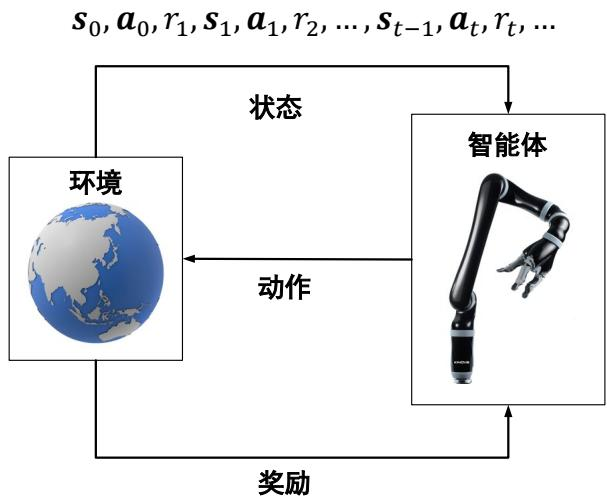  
图 2.1 马尔可夫决策过程

(2.1)

该互动过程可用马尔可夫决策过程形式化，一个MDP可由五元组 $< \mathcal { S } , \mathcal { A } , P , \mathcal { R } , \gamma >$ 表示，其中为状态空间，另外初始时刻的状态分布记为 $| p _ { 0 } ( \pmb { s } )$ 。为智能体动作空间。 $P \colon \mathcal { S } \times \mathcal { A } \times$ � → [0,1]为状态转移函数，�准确描述了MDP 的动态特性，也被称为环境的动力学模型。可用概率分布表示状态转移函数如式(2.2)：

$$
p (\boldsymbol {s} ^ {\prime} | \boldsymbol {s}, \boldsymbol {a}) = P r (\boldsymbol {s} _ {t + 1} = \boldsymbol {s} ^ {\prime} | \boldsymbol {s} _ {t} = \boldsymbol {s}, \boldsymbol {a} _ {t} = \boldsymbol {a})\tag{2.2}
$$

其表示因智能体做出动作 $\mathbf { a } _ { \mathrm { : } }$ ，状态由�转移到 $| \pmb { s } ^ { \prime }$ 的概率。�为奖励函数， $R _ { { \pmb a } } ( { \pmb s } ^ { \prime } , { \pmb s } )$ 或 $R _ { \pmb { a } } ( \pmb { s } )$ 表示智能体获得的奖励。 $\gamma \in [ 0 , 1 ]$ 为折扣因子。互动过程中，智能体依靠策略�选择所要执行的动作，策略定义为状态-动作对到概率空间的映射，用概率分布表示为�: ${ \mathcal { S } } \times { \mathcal { A } }  [ 0 , 1 ]$ ，记智能体在状态为 $\pmb { \vert s }$ 的条件下，选择动作 ${ \bf \dot { a } }$ 的概率为：

$$
\pi (\pmb {a} | \pmb {s}) = P r (\pmb {a} _ {t} = \pmb {a} | \pmb {s} _ {t} = \pmb {s})\tag{2.3}
$$

为后文叙述方便，定义 $\pmb { a } = \pi ( \pmb { s } )$ 。在策略 $\pi ^ { \cdot }$ 下的智能体在互动过程中取得的长期累计奖励定义为：

$$
R _ {\pi} = \mathbb {E} _ {\pi} [ \sum_ {t = 0} ^ {\infty} \gamma^ {t} r _ {t} ]\tag{2.4}
$$

大多数强化学习算法都通过学习值函数（Value Function）来得到最优策略[68]。值函数是状态或状态-动作二元组的函数, 用于估计当前状态或在当前状态下某动作的好坏，即长期累积奖励的大小。定义时刻t后的智能体长期累积奖励为：

$$
G _ {t} = \sum_ {k = t + 1} ^ {\infty} \gamma^ {k - t - 1} r _ {k}\tag{2.5}
$$

根据自变量的不同，有状态值函数 $V _ { \pi }$ 和状态-动作值函数 $Q _ { \pi }$ ，数学定义为：

$$
\begin{array}{r} V _ {\pi} (\pmb {s}) = \mathbb {E} _ {\pi} [ G _ {t} | \pmb {s} = \pmb {s} ] \\ Q _ {\pi} (\pmb {s}, \pmb {a}) = \mathbb {E} _ {\pi} [ G _ {t} | \pmb {s} _ {t} = \pmb {s}, \pmb {a} _ {t} = \pmb {a} ] \end{array}\tag{2.6}
$$

分别表示智能体在当前状态�下的长期累积奖励和在�下执行动作 ${ \bf \dot { a } } , { \bf \dot { a } } ,$ 所能获得的长期累积奖励。

因为状态值函数与状态-动作值函数具有以下关系：

$$
V _ {\pi} (\boldsymbol {s}) = \mathbb {E} _ {\boldsymbol {a} \sim \pi (\cdot | \boldsymbol {s})} [ Q _ {\pi} (\boldsymbol {s}, \boldsymbol {a}) ]\tag{2.7}
$$

强化学习算法都需要考虑动作带来的影响，后文中值函数默认为 $\scriptstyle { | Q _ { \pi } }$ 。MDP 具有马尔可夫性，因此值函数具有独特的递归性质。对任意策略�和任意状态�，�的值函数可由其后继状态�′的值函数求得，两者之间的递归关系满足贝尔曼等式（Bellman Equation）[69]:

$$
\begin{array}{r l} {Q _ {\pi} (\textbf {s}, \textbf {a})} & {= \mathbb {E} _ {\textbf {s ^ {\prime}} \sim p (\cdot | \textbf {s}, \textbf {a})} [ R _ {\textbf {a}} (\textbf {s ^ {\prime}}, \textbf {s}) + \gamma \mathbb {E} _ {\textbf {a ^ {\prime}} \sim \pi (| \textbf {s ^ {\prime}})} [ Q _ {\pi} (\textbf {s ^ {\prime}}, \textbf {a ^ {\prime}}) ]} \\ & {= \sum_ {\textbf {s ^ {\prime}} \in \mathcal {S}} P _ {\textbf {a}} (\textbf {s}, \textbf {s ^ {\prime}}) [ R _ {\textbf {a}} (\textbf {s ^ {\prime}}, \textbf {s}) + \gamma \sum_ {\textbf {a ^ {\prime}} \in \mathcal {A}} \pi (\textbf {s ^ {\prime}}, \textbf {a ^ {\prime}}) Q _ {\pi} (\textbf {s ^ {\prime}}, \textbf {a ^ {\prime}}) ]} \end{array}\tag{2.8}
$$

## 2.2.2 泛化策略迭代

最优策略使智能体在当前环境下获得最大的长期累积奖励，定义最优策略 $\pi ^ { * }$ 为：

$$
\pi^ {*} = \operatorname * {a r g m a x} _ {\pi} R _ {\pi} = \mathbb {E} _ {\boldsymbol {s} \sim p _ {0} (\cdot)} [ \mathbb {E} _ {\boldsymbol {a} \sim \pi (\cdot | \boldsymbol {s})} [ Q _ {\pi} (\boldsymbol {s}, \boldsymbol {a}) ] ]\tag{2.9}
$$

与最优策略 $\pi ^ { * }$ 对应的值函数称为最优值函数，定义为：

$$
Q ^ {*} (\boldsymbol {s}, \boldsymbol {a}) = \max _ {\pi} Q _ {\pi} (\boldsymbol {s}, \boldsymbol {a})\tag{2.10}
$$

虽然对于同一个 MDP，可能存在多个最优策略，但根据最优值函数的定义可知最优值函数唯一。对于确定的最优值函数，通过式(2.9)与式(2.10)可得最优策略。

$$
\pi^ {*} = \underset {\pi} {\operatorname{argmax}} Q ^ {*} (\pmb {s}, \pmb {a})\tag{2.11}
$$

因此获取最优策略等价于学习最优值函数，经典强化学习以及深度强化学习都利用泛化策略迭代（GeneralizedPolicy Iteration）的思想获取最优策略。策略迭代包含两个交替的过程：策略评估（Policy Evaluation）和策略改进（Policy Improvement）。

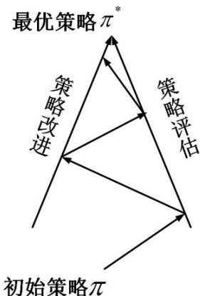  
图 2.2 泛化策略迭代过程

策略评估是利用当前策略学习值函数，即对当前策略进行估计；策略改进指根据当前学到的值函数，改进当前的策略。若�′是�改进后的策略，有：

$$
\forall \boldsymbol {s} \in \mathcal {S} \colon Q _ {\pi} (\boldsymbol {s}, \pi (\boldsymbol {s})) \leq Q _ {\pi} (\boldsymbol {s}, \pi^ {'} (\boldsymbol {s}))\tag{2.12}
$$

当环境模型可以由马尔可夫决策过程完备描述，即系统的动力模型已知时（model-based），可用动态规划（Dynamic Programming，DP）方法求出最优策略。此时利用式(2.8)评估策略，可学得当前策略下的状态-动作值函数 $Q _ { \pi }$ ；由式(2.11)知，根据 $Q _ { \pi }$ 执行贪心动作，可得改进后的策略 $\cdot \pi ^ { ' }$ ，具体如式(2.13)所示：

$$
\pi^ {'} (\boldsymbol {s}) = \underset {\boldsymbol {a}} {\operatorname{argmax}} Q _ {\pi} (\boldsymbol {s}, \boldsymbol {a})\tag{2.13}
$$

在现实的强化学习任务中，环境的动力学模型、奖励函数通常不可知（model-free），以上所述的策略评估过程不可进行。这时可用蒙特卡罗估计（Monte-Carlo Estimation）和时间差分学习法进行泛化策略迭代。

因系统的状态转移概率未知，长期累积奖励的期望值不可求。利用蒙特卡罗估计通过多次采样，然后求取长期累积奖励的均值近似代替期望，这种进行策略评估的方法称为蒙特卡罗强化学习。该方法要求采样次数有限，因此常用于有限步强化学习任务中。由式(2.11)得，最优策略更易由最优状态-动作值函数得到，因此蒙特卡罗估计的对象一般为 $Q _ { \pi }$ 。具体地，对于 $Q _ { \pi } ( s , \pmb { a } )$ 的估计，先收集一组包含状态-动作对 $( \pmb { s } , \pmb { a } )$ 的回合，计算每个回合里每次经过 $( \pmb { s } , \pmb { a } )$ 后的累积奖励�，利用式(2.14)可计算出 $Q _ { \pi } ( s , \pmb { a } )$ 的估计值：

$$
Q _ {\pi} (\pmb {s}, \pmb {a}) = \frac {1}{N} \sum_ {i = 1} ^ {N} G _ {i}\tag{2.14}
$$

蒙特卡罗方法利用均值来近似值函数的期望，该方法存在样本需求大、稳定性差的问题，尤其在计算某个回合中状态-动作对 $( \pmb { s } , \pmb { a } )$ 的累积奖励时，需要遍历至该回合终止状态，计算效率难以接受。考虑到每个回合内状态转移具有马尔可夫性，时序差分学习结合了已知模型的动态规划方法和未知模型的蒙特卡罗方法的思想，实现了高效的无模型学习。时间差分使用目标值和估计值在相邻时间步上的差异值学习值函数，利用自举法从当前得到的奖励和对后继状态的估计值构造出值函数的目标，实现了值函数的单步更新，更新方式为：

$$
V _ {\pi} (\boldsymbol {s}) \leftarrow V _ {\pi} (\boldsymbol {s}) + \alpha [ R _ {\boldsymbol {a}} (\boldsymbol {s} ^ {\prime}, \boldsymbol {s}) + \gamma V _ {\pi} (\boldsymbol {s} ^ {\prime}) - V _ {\pi} (\boldsymbol {s}) ]\tag{2.15}
$$

其中差异值 $R _ { \pmb { a } } ( \pmb { s } ^ { \prime } , \pmb { s } ) + \gamma V _ { \pi } ( \pmb { s } ^ { \prime } ) - V _ { \pi } ( \pmb { s } )$ 称为单步 TD 误差。在泛化策略迭代过程中，智能体利用行动策略进行互动，收集数据；利用数据对目标策略进行评估与改进。为学习出最优策略，强化学习面对“探索”与“利用”的矛盾，过度探索导致智能体学习速度慢，过度利用使智能体学不到最优策略。考虑到探索的必要性，用来收集数据的行动策略在生成动作时，必须具有一定的随机性；而最终要使用的目标策略则为最大化累积奖励，应当为贪心策略。行动策略和目标策略相同的学习方法，称为在线策略算法（On-policy），不同则为离线策略算法（Off-policy）。 $\mathrm { Q } \mathrm { - }$ 学习算法是经典时序差分算法，值函数的学习方式如式(2.16)

$$
Q _ {\pi} (\boldsymbol {s}, \boldsymbol {a}) \leftarrow Q _ {\pi} (\boldsymbol {s}, \boldsymbol {a}) + \alpha [ R _ {\boldsymbol {a}} (\boldsymbol {s} ^ {\prime}, \boldsymbol {s}) + \gamma \max _ {\boldsymbol {a} ^ {\prime}} Q _ {\pi} (\boldsymbol {s} ^ {\prime}, \boldsymbol {a} ^ {\prime}) - Q _ {\pi} (\boldsymbol {s}, \boldsymbol {a}) ]\tag{2.16}
$$

可以看出，在对目标策略的评估过程中，下一时刻的动作 $\mathbf { \bar { \mathbf { a } } ^ { \prime } }$ 采取了最优动作，而非行动策略的输出动作，因此其目标策略为贪心策略， $\mathrm { Q }$ 学习也被称为离线TD算法。

## 2.2.3 深度确定性策略梯度算法

经典强化学习中认为行动策略与目标策略不同的方法即为离线策略方法，此类方法使用重要性采样（importance sampling）对轨迹数据的累计奖励进行加权。在 TRPO 与 PPO 中，重要性采样所使用的是更新前后两个策略，而非任意两个策略，因此它们仍被认为是在线策略方法，该类方法使用策略的累积回报作为目标函数，通过增大较优动作的概率实现策略改进。一般认为具有经验回放机制的方法为离线策略方法，如 DQN、DDPG、SAC，此类方法旨在学习出准确的值函数，利用贪心方式从值函数中学习处改进后的策略。

DDPG 是常用的离线策略方法，学习过程中不断重复采集数据和更新参数两个步骤。DDPG借鉴了DQN的两个优点，使得更新过程更加平稳：一是引入经验回访机制，将具有马尔可夫性的轨迹数据分割为经验形式的数据，降低了数据的相关性；二是目标值由额外的目标网络生成，使得目标值的计算不受最新网络参数的影响。DDPG同时具有Actor-Critic结构和 DQN 中的目标网络，因此包含 4 个网络：主策略网络 $\boldsymbol { \mu }$ 、主值网络�、目标策略网络 $\mathrm { { \dot { r } } } \mu ^ { \prime }$ 与目标值网络 $Q ^ { \prime }$ 。主策略网络负责与环境互动收集轨迹数据如式(2.1)所示，并以经验$( \pmb { s } _ { t } , \pmb { a } _ { t } , r _ { t } , \pmb { s } _ { t + 1 } )$ 的形式随机存储在经验池中，其中为平衡探索与利用，会给网络输出的动作添加噪声，噪声一般选用与时间相关的O-U噪声或具有时间不变性的高斯噪声。主值网络是值函数�的近似，通过最小化当前批量样本的均方 TD 误差更新网络参数，损失函数如式(2.17)所示：

$$
L = \frac {1}{N} \sum_ {i} (y _ {i} - Q (\pmb {s} _ {i}, \pmb {a} _ {i} | \theta^ {Q})) ^ {2}\tag{2.17}
$$

其中 $y _ { i }$ 为目标值网络计算得到的目标值，计算目标值 $y _ { i }$ 需要目标策略网络 $\cdot \mu ^ { \prime }$ 向目标值网络 $Q ^ { \prime }$ 提供动作，如式(2.18)所示：

$$
y _ {i} = r _ {i} + \gamma Q ^ {\prime} (\pmb {s} _ {i + 1}, \mu^ {\prime} (\pmb {s} _ {i + 1} | \theta^ {\mu^ {\prime}}) | \theta^ {Q ^ {\prime}})\tag{2.18}
$$

目标值由额外引入的目标网络计算，优点是由于目标网络参数更新较为缓慢，使得目标值不受最新的参数影响，减少了学习中发散与震荡的现象。主策略网络利用策略梯度方式更新，回报函数�定义为经验池数据�值的期望如式(2.19)：

$$
J = \mathbb {E} _ {\pmb {s} _ {t} \sim \rho^ {\beta}} [ Q (\pmb {s}, \pmb {a} | \theta^ {Q}) ] | _ {\pmb {s} = \pmb {s} _ {t}, \pmb {a} = \mu (\pmb {s} _ {t} | \theta^ {\mu})}\tag{2.19}
$$

其中 $\rho ^ { \beta }$ 代表经验池的数据分布，利用小批量样本的平均值来近似期望，通过链式法则求出回报函数对主策略网络参数的梯度，梯度如式所示(2.20)：

$$
\nabla_ {\theta^ {\mu}} J \approx \frac {1}{N} \sum_ {i} \nabla_ {\mathbf {a}} Q (\mathbf {\delta s}, \mathbf {a} | \theta^ {Q}) | _ {s = s _ {i}, \mathbf {a} = \mu (s _ {i})} \nabla_ {\theta^ {\mu}} \mu (\mathbf {s} | \theta^ {\mu}) | _ {s = s _ {i}}\tag{2.20}
$$

主策略网络和主值网络都通过梯度下降法更新参数，只是两者的损失函数不同，而目标网络的参数有两种更新方式，一种是每在主网络更新若干次后直接复制主网络（硬更新）；另一种是使用指数衰减平均（软更新）与主网络同步。软更新方式如式(2.21)：

$$
\theta^ {Q ^ {\prime}} \leftarrow \tau \theta^ {Q} + (1 - \tau) \theta^ {Q ^ {\prime}}
$$

$$
\theta^ {\mu^ {\prime}} \leftarrow \tau \theta^ {\mu} + (1 - \tau) \theta^ {\mu^ {\prime}}\tag{2.21}
$$

## 2.2.4 后视经验回放算法

奖励函数是MDP 定义的重要组成部分，可认为是对各种动作的排序。奖励是环境对智能体行为的反馈信号，是引导智能体做出正确的动作以完成任务的唯一信息，因此奖励函数设计的优劣决定智能体能否学到最优行为策略。设计出适合任务的奖励函数需要该领域的先验知识，在非结构化环境中很难将足够的先验知识融入到奖励函数中。一个简单的设计思路是采取稀疏奖励，奖励值取为 0 或-1，规定智能体只有到达成功状态时才可获得零奖励，其他状态下只得到负奖励。然而稀疏奖励包含的信息十分有限，若只接收到负奖励，则智能体认为所有动作无“好坏”之分，不能从互动中获取有效反馈从而只能进行随机探索。

<table><tr><td>状态空间</td><td>{0,1}</td><td>{0,1}</td><td>{0,1}</td><td>{0,1}</td><td>{0,1}</td><td>{0,1}</td><td>{0,1}</td><td>{0,1}</td><td>{0,1}</td></tr></table>

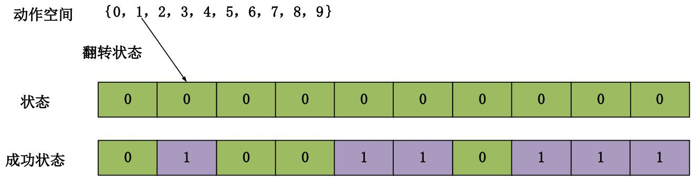  
图 2.3 位数为 10的位翻转任务

稀疏奖励往往带来学习困难甚至不可学习的问题，文献[30]以具有离散环境空间与动作的位翻转（Bit-flipping）任务为例子解释探索困难的问题：位数增大至 12，学习难度显著上升；对于位数大于 15的任务，由于状态空间巨大智能体无法完成任务。

HER有效地解决了稀疏奖励的问题，其主要思想是设置学习目标并增大正向奖励的密度，处理目标的方式与通用价值函数逼近器（Universal Value Function Approximators， UVFA）[70]相似，即把目标看作是状态的一部分并将值函数泛化到目标空间。在一次交互过程中虽然智能体没有到达成功状态，但将此次轨迹的所有状态当作是任务的目标，则可认为智能体学会完成这些目标的方法，给予智能体正向奖励可促进其学习。该方法可视为隐式的课程学习，通过给予正向奖励引导智能体学会完成简单的目标，而后再逐渐提高目标的复杂度，如此智能体能够在失败的探索经历中学习，使得没有成功完成任务的轨迹数据也可以在学习中发挥作用。具体做法是根据目标选择策略为经验池中每个样本的状态计算出相应的目标，并修改样本的奖励。

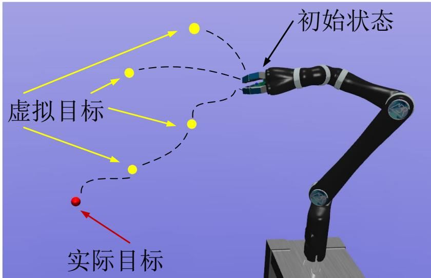  
图 2.4 基于后视经验回放的机械臂操作学习示意图

目标一般是状态的全部或部分属性，对于状态 $\mathbf { \Delta } \mathbf { s } _ { t }$ ，目标选择策略有4种分别为：

（1） future策略：从状态 $\pmb { s } _ { t }$ 所在的轨迹序列中，随机选取k个满足 $t < i < T$ 的状态 $\mathbf { \sigma } _ { \pmb { s } _ { i } }$ 作为目标集合�。

（2） final 策略：从状态 $\mathbf { s } _ { t }$ 所在的轨迹序列中选择终止状态 ${ \bf s } _ { T }$ 作为目标 $\mathbf { \nabla } _ { \mathbf { \pmb { g } } }$ 。

（3） episode 策略：从状态 $\mathbf { \Delta } \mathbf { s } _ { t }$ 所在的轨迹序列中，随机选取 k个状态作为目标集合�。

（4） random 策略：从所有轨迹中随机选取k个状态作为目标集合�。

实践中常用的目标选择策略是 future 策略和 final 策略，然后利用式(2.22)计算为每个目标计算相应的奖励

$$
\boldsymbol {r} _ {t} = [ \pmb {s} _ {t + 1} = \pmb {g} ]\tag{2.22}
$$

表示当状态 $\pmb { s } _ { t + 1 }$ 的整体或部分属性与目标相同时奖励 $r _ { t }$ 设为 1，反之设为 0，最后将形如$( { \pmb S } _ { t } | | { \pmb g } , { \pmb a } _ { t } , r _ { t } , { \pmb S } _ { t + 1 } | | { \pmb g } )$ 的经验添加到经验池中。HER只是修改了经验池数据结构，增大了状态的维度，因此可与任何离线策略强化学习算法结合。

## 基于 DDPG和 HER的机械臂技能学习方法

## 2.3.1 算法设计

DDPG是经典深度强化学习算法，在具有连续动作空间的决策任务中取得了成功的应用，但面对一些复杂的技能学习任务因无法设计合适的奖励函数，其学习效果大打折扣。本节将 DDPG与HER相结合，解决稀疏奖励的不可学习问题。

HER只通过改变经验池中数据的状态和奖励，增大了正向奖励的密度，具体地是在利用DDPG的主策略网络采集完轨迹数据后，先将轨迹数据重组为经验形式的数据，然后利用目标选择策略修改其中的状态和奖励，最后将经验存放在经验池中。实际工作中为减小内存需求，HER实施方式会有所不同，一般经验池中存放的仍是轨迹，只有在采集小批量数据更新网络或归一化器（normalizer）时才使用目标选择策略。结合HER的DDPG算法伪代码如算法 1所示。

算法1 结合 HER 的 DDPG 算法

1. 随机初始化主值网络 $Q(s, a|\theta^{Q})$ 和主策略网络 $\mu(s|\theta^{\mu})$ 
直接复制主网络参数对目标网络进行初始化 $\theta^{Q'} \leftarrow \theta^{Q}, \theta^{\mu'} \leftarrow \theta^{\mu}$ 
初始化经验池
2. for episode = 1, M do
3. 初始化噪声过程N
4. 采集初始状态数据 $s_{0}$ 
5. for t = 1, T do
6. 选择动作 $a_{t} = \mu(s_{t}|\theta^{\mu}) + N_{t}$ 
7. 执行动作 $a_{t}$，获得奖励 $r_{t}$ 和新状态 $s_{t+1}$ 
8. end for
9. 将当前收集到的轨迹存放在经验池中 $&lt;s_{0}, a_{0}, r_{1}, s_{1}, a_{1}, r_{2}, ..., s_{T}&gt;$ 
10. 从经验池中选择小批量经验数据，形如 $(s_{i}, a_{i}, r_{i}, s_{i+1})$ 
11. 利用 future 策略为经验数据计算目标与奖励，得到经验 $(s_{i}\|g, a_{i}, r_{i}', s_{i+1}\|g)$ 
12. 利用式(2.18)计算目标值
13. 利用式(2.17)计算损失，最小化该损失更新主值网络
14. 利用式(2.20)更新主策略网络

## 15. 利用式(2.21)更新目标网络

## 16. end for

算法结构图如图 2.5所示。为加速数据采集，实验中利用多个子进程只与环境交互采集数据，主进程从经验池中采集小批量数据然后计算梯度、更新网络参数，并同步更新子进程的网络参数。

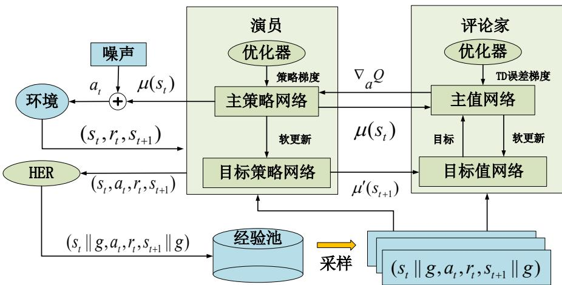  
图 2.5 结合 HER 的 DDPG 算法

## 2.3.2 网络结构

DDPG有两种不同的网络：策略网络与值网络。策略网络输入为状态，输出为动作；值网络输入为状态-动作对，输出为一维的Q值；由于引入了HER，状态变为状态-目标对。本节实验所涉及的状态信息基本都是机械臂和目标物等的状态信息，因此网络结构只包含全连接层，除策略网络的输出层的激活函数为双曲正切函数，将动作值映射到-1与1之间，其余各层激活函数均采用修正线性单元（Rectified Linear Unit，ReLU）。策略网络与值网络的网络结构如表2.1与表2.2所示。

表 2.1 策略网络结构

<table><tr><td>名称</td><td>形状</td><td>激活函数</td></tr><tr><td>全连接层1</td><td>(状态和动作维度之和,256)</td><td>ReLU</td></tr><tr><td>全连接层2</td><td>(256,256)</td><td>ReLU</td></tr><tr><td>全连接层3</td><td>(256,256)</td><td>ReLU</td></tr><tr><td>输出层</td><td>(256,动作维度)</td><td>Tanh</td></tr><tr><td colspan="3">表2.2值网络结构</td></tr><tr><td>名称</td><td>形状</td><td>激活函数</td></tr><tr><td>全连接层1</td><td>(状态、目标和动作维度之和,256)</td><td>ReLU</td></tr></table>

续表 2.2

<table><tr><td>全连接层2</td><td>(256, 256)</td><td>ReLU</td></tr><tr><td>全连接层3</td><td>(256, 256)</td><td>ReLU</td></tr><tr><td>输出层</td><td>(256, 1)</td><td>无</td></tr></table>

## 仿真环境及任务设置

为验证上节所述算法在机械臂技能学习任务中的有效性，本节利用 Kinova Jaco2 机械臂为实验对象在 MuJoCo（Multi-Joint dynamics with Contact）仿真环境中进行技能学习实验。该机械臂包含 6 个旋转关节，和 3 根手指共 12 个自由度，仿真实验包含指定姿态的接近、抓握、放置和二维平面抓取等四个技能学习任务。

## 2.4.1 MuJoCo 物理引擎与 Gym 工具箱

本文所有机器人操作实验使用 MuJoCo 物理引擎进行仿真模拟。最初 MuJoCo 由华盛顿大学的研究者Emo Todorov等人[71]开发用于多关节动力学的接触模拟，其能够准确获取接触对象的形变特征，具有准确、可移植性高两大优点，随后发展为通用模拟器，不仅是在机器人社区使用的模拟器，还广泛应用于图形学、生物力学、动画电影等需要快速、精准模拟的领域。与 Bullet、Havok、ODE 和 Phys 等基于模型的机器人仿真工具相比，MujoCo 在与机器人相关的受限系统上是最快和最准确的，并且能够在更大的时间步长内实现稳定抓取。MuJoCo 使用 XML 格式的文件定义仿真模型，用户可以轻松读懂和修改模型。更重要的是，2021年MuJoCo被DeepMind公司收购并开源，开发者可免费使用。

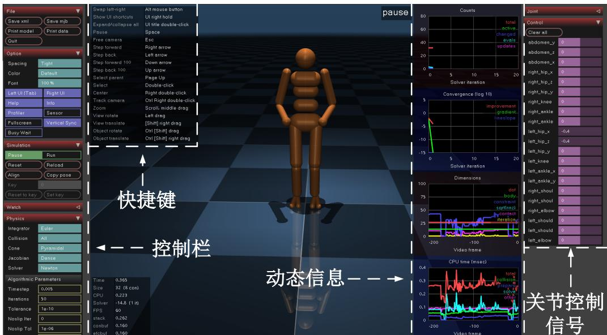  
图 2.6 MuJoCo 仿真界面

为消除强化学习算法缺乏标准的问题，Gym 是OpenAI创建的开源 python库，用于开发和对比强化学习算法，并得到绝大多数的强化学习研究与开发人员的支持。作为主流的强化学习算法验证平台，Gym 包含许多经典强化学习控制任务的环境，如倒立摆等经典环境、Atari2600游戏环境、人形机器人仿真环境，都可用于强化学习算法效果检验和对比，而研究者只需要关注算法实现。

Gym 对状态、动作等数据的类型和维度进行规范化处理，还提供了统一的接口，便于研究人员实现各种控制任务。其中的核心接口函数“step”模拟智能体与环境的交互过程，该函数输入参数只有一个动作向量，利用物理引擎和自定义的奖励函数，计算并返回转移后的状态、奖励值以及辅助信息。在编写好自定义的强化学习环境文件后，还需要将该环境注册到Gym中便于统一运行。另外在自定义环境中加入新的参数，可以实现对某个任务分布的抽样，如图 2.7所示，通过参数“quat”运行特定姿态的接近任务环境。

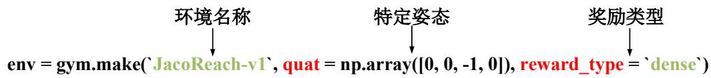  
图 2.7 接近任务环境运行实例

## 2.4.2 机械臂操作任务设置

从 MDP 角度出发，利用 Gym 实现一项无模型控制任务，用户需规定状态空间、动作空间、奖励函数，环境动力学由仿真器决定，折扣因子视为超参数。MuJoCo中可获取的信息主要有：机械臂各部位及虚拟点的笛卡尔位置、速度、加速度，机械臂各关节的关节角、关节角速度、关节力矩，物体表面或内部的传感器数据，相机获取的 RGB 图、深度图、点云等。用户通过对执行器发出控制信号控制机械臂关节进行转动或平移。本文的学习任务所依赖的状态和动作信息各有不同但均选自表 2.3，为简化任务复杂度，三根手指视为一个整体，其运动只用单个控制信号控制，因此手指的开合程度、开合速度、开合程度改变量均为一维。本文所有实验均以 X-Y-Z 顺序的欧拉角或 W-X-Y-Z顺序的的四元数描述姿态。

表 2.3任务状态和动作信息

<table><tr><td>符号</td><td>意义</td><td>维度</td><td>单位</td></tr><tr><td>p</td><td>末端位置</td><td>3</td><td>米</td></tr><tr><td>rot</td><td>末端姿态</td><td>3</td><td>弧度</td></tr><tr><td>v</td><td>末端速度</td><td>3</td><td>米/秒</td></tr><tr><td>p&#x27;</td><td>目标点位置</td><td>3</td><td>米</td></tr><tr><td>rot&#x27;</td><td>目标姿态</td><td>3</td><td>弧度</td></tr></table>

## 续表 2.3

<table><tr><td> $p_r$ </td><td>目标物到末端的相对位置</td><td>3</td><td>米</td></tr><tr><td> $s_f$ </td><td>手指开合程度</td><td>1</td><td>无单位</td></tr><tr><td> $v_f$ </td><td>手指开合速度</td><td>1</td><td>/秒</td></tr><tr><td> $p''$ </td><td>物体位置</td><td>3</td><td>米</td></tr><tr><td> $rot''$ </td><td>物体姿态</td><td>3</td><td>弧度</td></tr><tr><td> $v'$ </td><td>物体速度</td><td>3</td><td>米/秒</td></tr><tr><td> $\omega'$ </td><td>物体角速度</td><td>3</td><td>弧度/秒</td></tr><tr><td>shape</td><td>物体形状信息</td><td>3</td><td>米</td></tr><tr><td> $\Delta\theta$ </td><td>手臂关节角改变量</td><td>6</td><td>弧度</td></tr><tr><td> $\Delta s_f$ </td><td>手指开合程度改变量</td><td>1</td><td>无单位</td></tr><tr><td> $\Delta p$ </td><td>末端笛卡尔空间进动量</td><td>3</td><td>米</td></tr></table>

## 指定姿态的接近任务

为保证机械臂能够以某个未知的抓取姿态运动至目标物附近，本节设计了如图 2.8 所示的仿真任务，训练机械臂学会以指定姿态抵达目标点，半径 0.3 米红色球形代表目标点生成区域，手指与手掌之间的蓝色虚拟点代表末端位置。 机械臂初始关节角为(0.00，2.92，1.25，4.21，1.40，0.00)，考虑到任务定义，状态选择与任务相关的空间位置与姿态信息及其一阶梯度信息具体记作 $( \pmb { p } , \pmb { r o t } , \pmb { v } , \pmb { p ^ { \prime } } , \pmb { r o t } ^ { \prime } )$ 共15维。忽略手指的存在只考虑末端的位姿，动作选择 $\mathbf { \nabla } \cdot \Delta \pmb { \theta }$

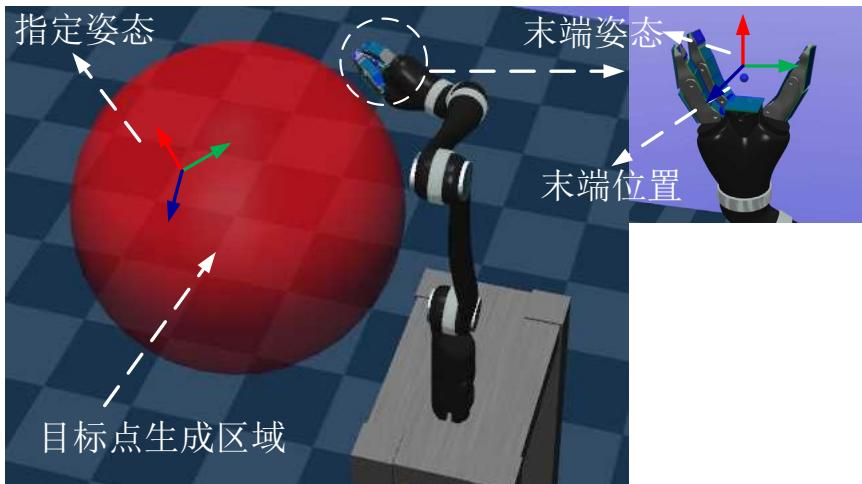  
图 2.8 接近任务仿真环境

奖励函数分为稀疏和密集两种，分别如式(2.23)和式(2.24)所示。

$$
R = \left\{ \begin{array}{l l} 0 & \left\| \boldsymbol {p} - \boldsymbol {p} ^ {\prime} \right\| _ {2} <   0. 0 3 \text {   and   } \left\| \boldsymbol {r o t} - \boldsymbol {r o t} ^ {\prime} \right\| _ {1} <   0. 2 6 \\ - 1 & \text { otherwise } \end{array} \right.\tag{2.23}
$$

$$
R = - (\left\| \pmb {p} - \pmb {p} ^ {\prime} \right\| _ {2} + \left\| \pmb {r o t} - \pmb {r o t} ^ {\prime} \right\| _ {1})\tag{2.24}
$$

具有稀疏奖励函数的抵达任务以是否成功作为奖励信号，式(2.23)表示成功完成接近任务的条件是机械臂末端与目标点欧式距离小于0.03米且末端姿态（欧拉角形式）与指定姿态的曼哈顿距离小于 0.26弧度 $( 1 5 ^ { \circ } )$ ），在这里只关注抵达目标点时的末端姿态，不为中间过程的运动情况添加约束。具有密集奖励函数的抵达任务，以末端与目标的空间位置距离和姿态距离之和的相反数作为奖励。在HER算法中，目标信息不必包含全部的状态信息，该任务中只需要选择末端和目标的位置和姿态。任务最大决策步数为 50，即一个回合的轨迹长度T。

## 抓握任务

在抓取过程中，抓握动作发生在机械臂末端抵达抓取点之后，成功的抓握应该达到力封闭。因此定义抓握动作为机械臂稳定抓住平面上的物体，然后将物体运送至平面上方某处并保持物体不脱离手指。建立的抓握任务仿真环境如图 2.9，边长为 6 厘米的方块随机出现在边长为 0.2 米的区域内，目标位置为目标物中心正上方 5 厘米的平面。最开始机械臂位于物体附近10厘米处且夹爪处于张开状态，机械臂需要学会将抓住物体然后将其抬高至离桌面8厘米处，并在回合结束前保持物体中心距桌面距离在 6\~10厘米内。

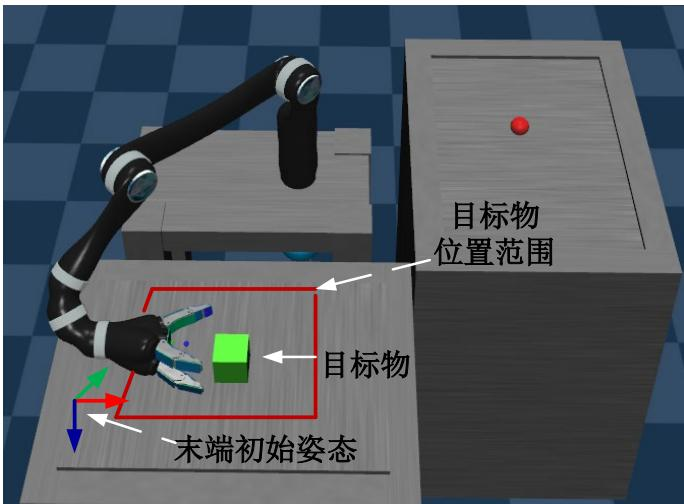  
图 2.9 抓握任务仿真环境

抓握任务主要关注夹爪和目标物的状态，因此状态信息为 $( p , r o t , v , p ^ { \prime } , r o t ^ { \prime } , p ^ { \prime } , r o t ^ { \prime } , s h a p e )$ 共20 维，动作 $( \Delta \pmb { \theta } , \Delta s _ { f } )$ 共7维，目标信息选择物块位置的z坐标。机械臂的抓握姿态受所学得的接近技能影响，另外不对抓握动作完成后的末端姿态作特别要求。因此奖励函数有稀疏与密集两种如式(2.25)所示，只关注运动过程中物块与桌面的距离不考虑末端姿态，其中 $^ { \dag } { \pmb p } _ { z } ^ { \prime \prime }$ 为物块位置z坐标； ${ \pmb p } _ { z } ^ { \prime }$ 为目标位置z坐标，取固定值。

$$
\begin{array}{l} R = \left\{ \begin{array}{c c} 0 & \left\| \boldsymbol {p} _ {z} ^ {\prime \prime} - \boldsymbol {p} _ {z} ^ {\prime} \right\| _ {2} <   0. 0 2 \\ - 1 & \text {otherwise} \end{array} \right. \\ R = - \left\| \boldsymbol {p} _ {z} ^ {\prime \prime} - \boldsymbol {p} _ {z} ^ {\prime} \right\| _ {2} \end{array}\tag{2.25}
$$

## 放置任务

放置指机械臂在抓住目标物后将其运送到目标位置的操作，本文不考虑抓取的下游任务，因此放置任务不对抵达时的末端姿态做出约束。放置任务的仿真环境如图2.10所示，以抓握任务的成功状态为机械臂和目标物的初始状态，因此机械臂的初始姿态是未知的，每次初始化环境需要随机选择初始姿态；机械臂另一侧边长 20厘米的方形区域为放置区域，目标点随机出现在放置区域上方的 6厘米处。

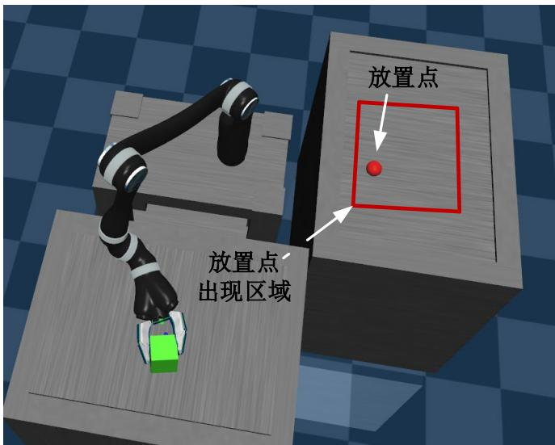  
图 2.10 放置任务仿真环境

放置任务中假设机械臂成功完成抓握任务，只需要完成放置操作，因此该任务与不指定姿态的接近任务相似，不考虑手指动作信息选择 $: \Delta \pmb { \theta } :$ ；状态信息需要包含目标物的状态，为$( \pmb { p } , \pmb { r o t } , \pmb { v } , \pmb { p ^ { \prime } } , \pmb { r o t } ^ { \prime } , \pmb { p ^ { \prime } } , \pmb { r o t } ^ { \prime } , \pmb { s h a p e } )$ 共24维。基于任务定义，奖励函数以物块和目标点位置为自变量，如式(2.26)所示。

$$
\begin{array}{l} R = \left\{ \begin{array}{l l} 0 & \left\| \boldsymbol {p} ^ {\prime \prime} - \boldsymbol {p} ^ {\prime} \right\| _ {2} <   0. 0 5 \\ - 1 & \text {otherwise} \end{array} \right. \\ R = - \left\| \boldsymbol {p} ^ {\prime \prime} - \boldsymbol {p} ^ {\prime} \right\| _ {2} \end{array}\tag{2.26}
$$

## 二维平面抓取任务

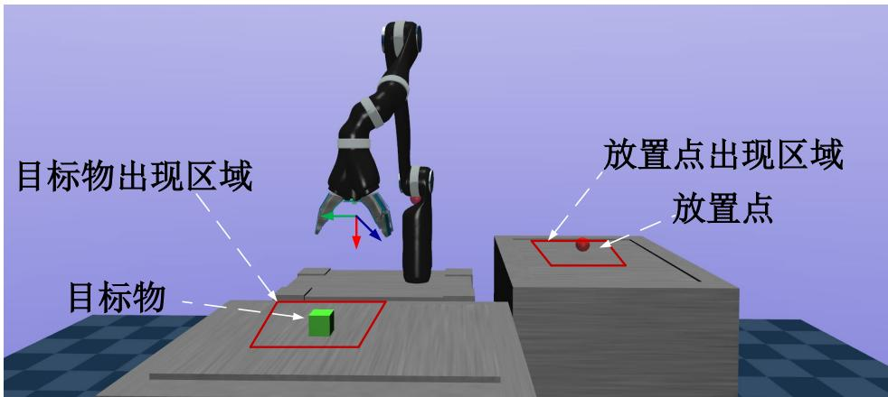  
图 2.11 二维平面抓取任务仿真环境

二维平面抓取是一种通用抓取方法，指抓取过程中夹具方向垂直于目标物所在平面，可用于抓取大多数物体。为训练机械臂学习平面抓取技能，建立的仿真环境如图2.9所示，机械

臂需要学会抓取方块并将其运送到在放置点。

图中机械臂初始关节角为（-1.47，3.65，1.38，-0.27，1.01，2.98），且运动过程中手掌部分始终竖直向下，物体随机出现在边长为 0.2 米的方形区域，放置点随机出现在另一个边长为0.2米的方形区域上方。状态 $( \pmb { p } , \pmb { v } , \pmb { p } ^ { \prime } , \pmb { p } _ { r } , s _ { f } , v _ { f } , \pmb { p } ^ { \prime } , \pmb { r } \pmb { o } t ^ { \prime } , \pmb { v } ^ { \prime } , \pmb { \omega } ^ { \prime } , s \pmb { h } \pmb { a } \pmb { p } e )$ 维度为29。动作选为末端笛卡尔空间进动量 $\Delta \pmb { p } .$ 和手指开合程度改变量 $\cdot \Delta s _ { f }$ ，维度为4。奖励函数采取稀疏和密集两种形式，如式(2.27)所示。

$$
\begin{array}{l} R = \left\{ \begin{array}{l l} 0 & \left\| \boldsymbol {p} ^ {\prime \prime} - \boldsymbol {p} ^ {\prime} \right\| _ {2} <   0. 0 5 \\ - 1 & \text { otherwise } \end{array} \right. \\ R = - \left\| \boldsymbol {p} ^ {\prime \prime} - \boldsymbol {p} ^ {\prime} \right\| _ {2} \end{array}\tag{2.27}
$$

二维平面抓取是否成功取决于目标物到放置点的距离，因此两种形式的奖励都是该距离的函数，其中稀疏奖励的距离阈值为 5 厘米，即物块与放置点之间距离小于 5 厘米视为成功状态完成任务。

## 仿真实验及结果分析

本节中利用任务成功率衡量学习效果，结合 HER 的 DDPG 算法部分超参数如表 2.4 所示。为减小训练过程中各方面的不确定性带来的误差，本文进行了重复实验。若无特别说明本文实验结果均由 4 次独立实验结果求均值得到，即不改变实验超参数设置采取 4 个不同的随机种子进行独立实验；图中的曲线表示实验结果均值，曲线周围颜色相同的阴影表示该结果的一倍方差。

除接近任务外，所有任务中的目标物有正方体、长方体、圆柱、瓶子四种，正方体边长6厘米；长方体边长分别为6 厘米、6厘米、15 厘米；圆柱半径为3厘米，高15厘米；瓶子半径6厘米，高 18厘米。

表 2.4 结合 HER 的 DDPG 超参数设置

<table><tr><td>名称</td><td>意义</td><td>数值</td></tr><tr><td>n_batches</td><td>每回合网络更新次数</td><td>40</td></tr><tr><td>n_workers</td><td>并行工作节点数</td><td>16</td></tr><tr><td>buffer_size</td><td>经验池大小</td><td> $5 \times 10^{6}$ </td></tr><tr><td>batch_size</td><td>采样批量大小</td><td>256</td></tr><tr><td>replay_strategy</td><td>目标选择策略</td><td>future</td></tr><tr><td>n_goals</td><td>目标数</td><td>4</td></tr></table>

续表 2.4

<table><tr><td>action_12</td><td>动作正则项系数</td><td>1</td></tr><tr><td>τ</td><td>软更新系数</td><td>0.95</td></tr><tr><td>γ</td><td>奖励折扣因子</td><td>0.98</td></tr></table>

## 2.5.1 指定姿态的接近技能学习

为验证结合 HER 的 DDPG 算法在学习接近技能学习任务中的效果，考虑到目标生成区域在机械臂“左边”（以图 2.8 接近任务仿真环境所示视角为参考系），因此本节中学习5个特殊姿态的接近技能，选择表 2.5所示六个具有代表性的接近任务进行仿真实验，并分析HER算法和不同形式的奖励函数对学习效果的影响。其中任务 1 不指定姿态，机械臂末端与目标点距离小于0.03米即视为成功完成任务；任务1\~5指定的姿态到世界坐标原点的姿态的旋转角度均为 $| \frac { \pi } { 2 } |$ 的整数倍。仿真环境中任务 1\~5指定的机械臂末端姿态如图 2.12所示。

表 2.5 接近任务设置

<table><tr><td>任务编号</td><td>欧拉角</td><td>四元数</td></tr><tr><td>0</td><td>任意</td><td>任意</td></tr><tr><td>1</td><td>(0,0,0)</td><td>(1,0,0,0)</td></tr><tr><td>2</td><td>(3.14,0,3.14)</td><td>(0,0,-1,0)</td></tr><tr><td>3</td><td>(-3.14,1.57,0)</td><td>(0,-0.707,0,-0.707)</td></tr><tr><td>4</td><td>(-3.14,-1.57,0)</td><td>(0,-0.707,0,0.707)</td></tr><tr><td>5</td><td>(1.57,0,1.57)</td><td>(0.5,0.5,-0.5,0.5)</td></tr></table>

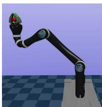  
任务1

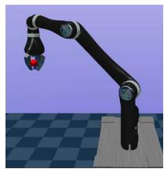  
任务2

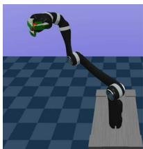  
任务3

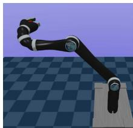  
任务4

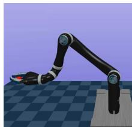  
任务5  
图 2.12 接近任务目标姿态

图 2.13 和图 2.14 分别为结合 HER 前后的 DDPG 在接近任务中的学习效果。从图 2.13可以看出在指定姿态的接近技能学习任务（任务1\~5）中DDPG存在不可学习的问题，在100轮的训练中成功率始终为0，4次独立实验中均不能探索到成功状态；任务0较为简单，最多经过17轮的训练成功率稳定为100%，且成功率的方差始终小于0.06，表明DDPG算法在该任务中的有效性和稳定性。后续实验表明对于指定姿态的接近任务，经过 200 轮的训练每个

任务的成功率依然为0。

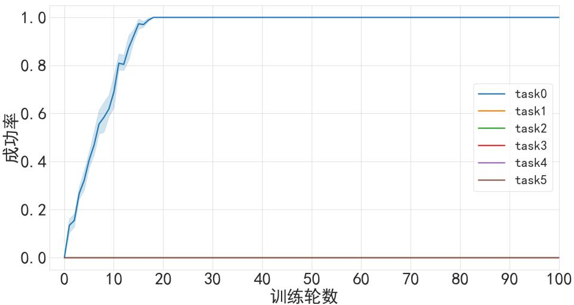  
图 2.13 接近任务中DDPG 学习效果

图 2.14表明在奖励稀疏的情况下，结合HER的DDPG可使机械臂学会较为复杂的接近技能，因此增大正向奖励密度是一种引导机械臂探索的有效方法。定义训练轮数为80\~100时的成功率为模型的稳定成功率，在所有任务中至多经过40轮的训练模型性能便趋于稳定，所有任务的稳定成功率在68%以上。另外还可看出，HER在简单任务中仍发挥重要作用，引入HER后只需经过1轮的训练平均成功率达到66%，继续进行3轮的训练成功率稳定在100%。

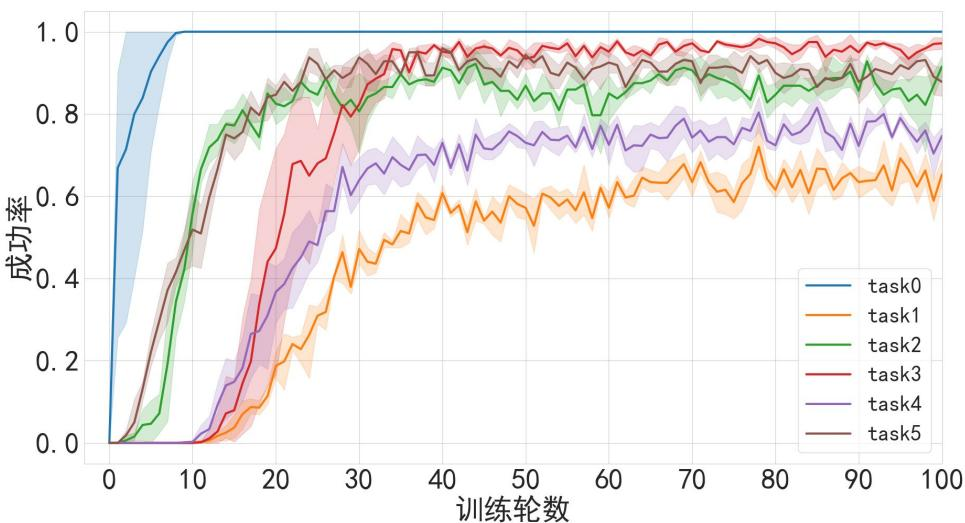  
图 2.14 接近任务中结合HER的DDPG 学习效果

由图 2.14可知任务1稳定成功率为68%显著低于任务2、3、5，通过分析末端的运动情况，发现存在两种可能的失败原因：一种是目标在指定姿态的可达空间外，另一种是在50步内机械臂无法到达。两种失败运动轨迹中的姿态与位置相对距离如图 2.15所示，当目标点在可达空间外，位置相对距离有所减小，但在姿态方面存在较大相对距离，并且姿态相对距离无减小趋势；当目标点在一个回合内不可达时，两种相对距离均大幅下降且有继续下降趋势。针对上述两种可能的失败原因，相应地分别对任务做出两点改变：增大任务回合长度T至100；

缩小目标位置范围，将目标生成区域半径缩小为0.2米。

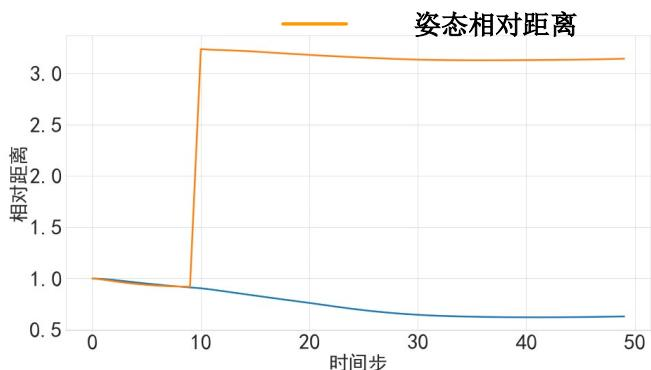  
（a）目标点在可达空间外

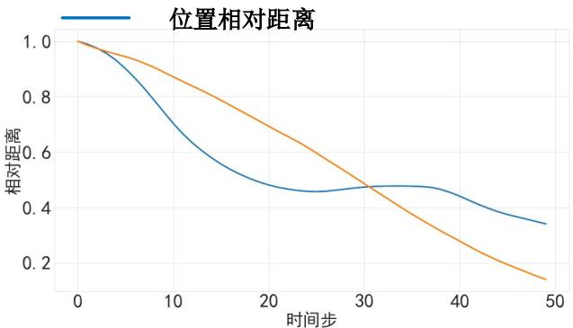  
（b）目标点在一个回合内不可达  
图 2.15 失败运动轨迹中的姿态与位置相对距离

结合 HER 的 DDPG 在新任务下的学习效果如图 2.16 所示，增大决策步数至 100，机械臂提前 3 轮的训练时间探索到成功状态，稳定成功率由 68 提高至 83%；缩小目标位置范围，稳定成功率提高至 92%。由此可见上述两种改变都对机械臂接近技能的学习情况有较大改变，其中增大回合长度等效增大机械臂的搜索深度，有助于提高机械臂在一个回合内探索到成功状态的概率；缩小目标位置范围，去除了一部分不可达点，增大可达目标点出现概率，但本质上机械臂并未学习到更优的接近策略。

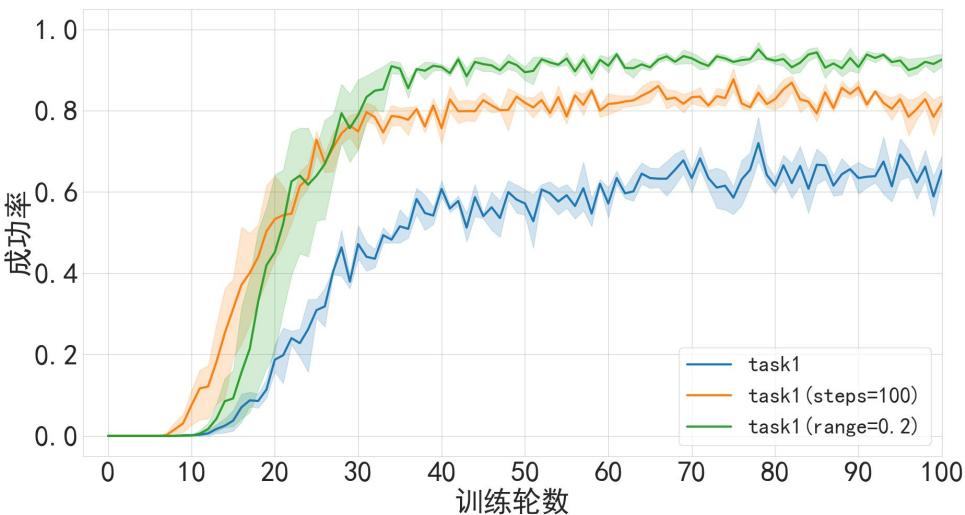  
图 2.16 增大回合长度与缩小目标位置范围任务1学习效果

为检验算法和奖励形式对机械臂接近技能学习效果的影响，通过搭配不同算法和奖励函数，进行了四次不同实验。图 2.17展示了各实验中的技能学习综合效果，这里采取任务1\~5的平均成功率代表学习的综合效果，实验中只采用一个随机数种子，曲线周围的阴影表示任务本身带来的方差，实验表明除了不可学习的情况（仅用DDPG和稀疏奖励函数），各个接近任务的成功率相差较大（曲线周围的阴影部分面积较大）。在四组实验中结合HER的DDPG和稀疏奖励函数的组合（绿色曲线）的综合效果最好，稳定成功率达到80%，远高于其他方法。包含密集奖励函数的两组实验（蓝色和橙色曲线）表明HER也能在具有密集奖励函数的任务中提升学习效果，说明即使在只关注位姿差异的接近任务中，选择位姿差异的相反数作为奖励函数并非最佳做法。

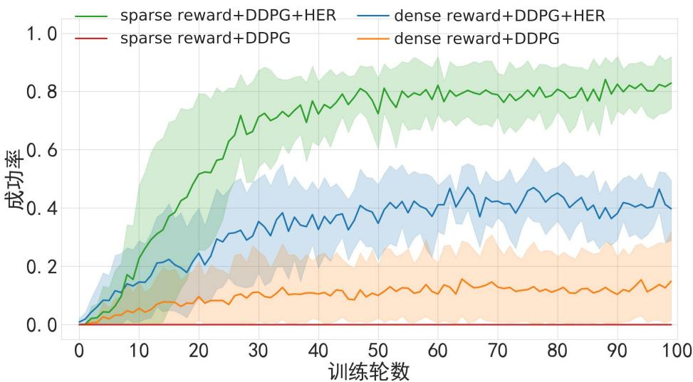  
图 2.17 不同算法和奖励形式的学习综合效果

各接近任务中机械臂的运动情况如图 2.18所示。

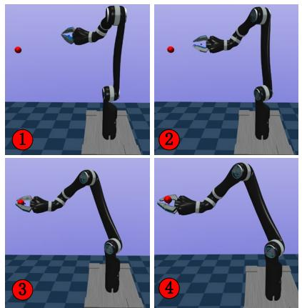  
(a)任务0

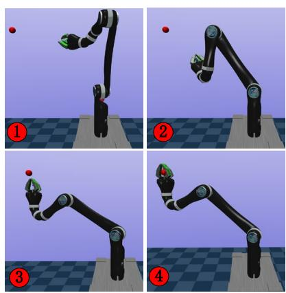  
(b)任务1

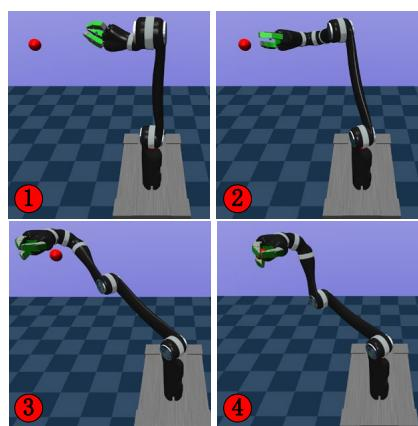  
(c)任务2

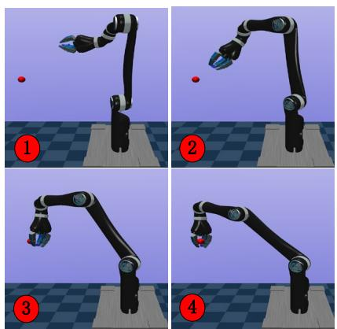  
(d)任务3

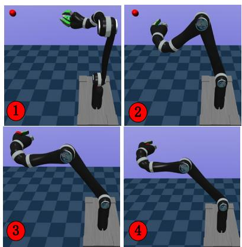  
(e)任务4  
图 2.18 接近任务中机械臂运动过程

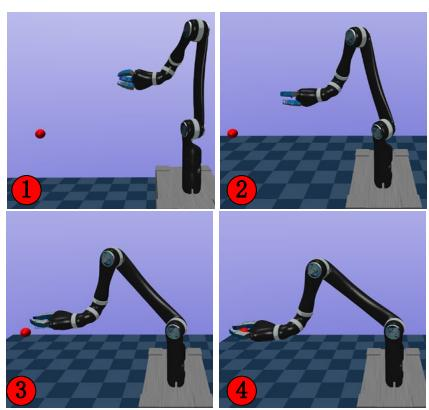  
(f)任务5

## 2.5.2 抓握技能学习

机械臂末端只有在位于目标物附近才有可能抓取物体，因此本节考虑的抓握任务有四个记为抓握任务 1\~4，其姿态分别与接近任务 2\~5 对应。图 2.19 展示了结合 HER 的 DDPG 在固定初始姿态的抓握任务中学习效果，经过 12 轮的训练所有任务中的成功率均在 90%以上，最高达到 96%。在四个抓取任务中的算法的收敛速度和稳定性能相差不大，可以认为各抓取任务的复杂程度相当。另外抓取任务的训练并不需要太多的探索，经过 1 轮训练就可以达到成功状态；与接近任务相比，抓取任务虽然动作空间维度更高，但成功状态与初始状态之间的距离较小，机械臂更容易探索到成功状态。

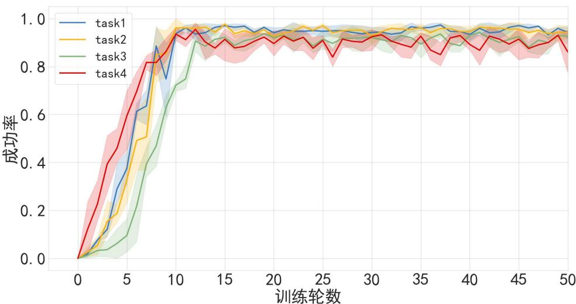  
图 2.19 固定姿态的抓握任务中结合HER的DDPG 学习效果

从稳定成功率和收敛速率上看，初始姿态固定的抓握任务与不指定姿态的接近任务难度相当，为提高抓握技能模型对初始姿态的泛化性，从一定区间内随机选择初始姿态进行抓握技能训练。初始姿态选择为 $( 2 . 3 6 + \theta _ { r } , \ \theta _ { p } , \ - 2 . 3 6 + \theta _ { y } )$ ），其中欧拉角（2.36，0，-2.36）所表示的姿态介于接近任务 2、3、5 指定的姿态之间， $\theta _ { r }$ $\theta _ { p }$ 、 $\theta _ { y }$ 为服从 $\left[ - \frac { \pi } { 3 } , \frac { \pi } { 3 } \right]$ 之间均匀分布的变量。

图2.20为各种组合算法在随机初始姿态的抓握任务中的学习效果。对比姿态固定的抓握任务，可以看出初始姿态的不确定性显著提升了抓握难度，稳定成功率由 90%\~96%降至75%，模型收敛的训练轮数由12增加到34。稀疏奖励和HER的组合是四种组合中表现最优的方法，除了收敛速率最快、稳定成功率最高，从图中还可以看出该组合的学习曲线（蓝色）最平稳且周围的阴影面积最小，由此证明该方法使DDPG的训练过程更加稳定。其他算法的学习效果反映，HER在具有稀疏和密集两种形式奖励的任务中都发挥了性能提升作用，这一点在接近任务的实验中也有所体现。不同的是抓握任务中稀疏奖励没有带来不可学习的问题，说明抓握任务比接近任务简单，稀疏奖励也能够引导机械臂探索到成功状态。

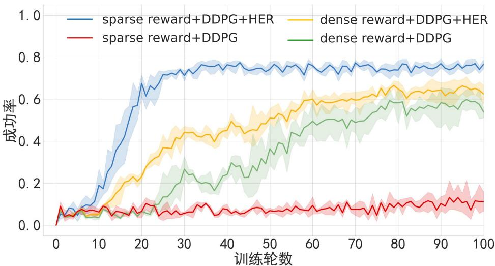  
图 2.20 随机初始姿态的抓握任务学习效果对比

各抓握任务中机械臂的运动情况如图 2.21所示。

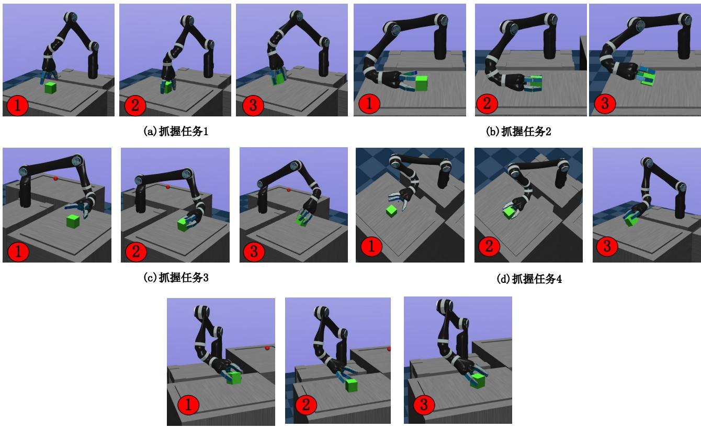  
(e)随机姿态抓握任务  
图 2.21 抓握任务中机械臂运动情况

## 2.5.3 放置技能学习

放置任务不考虑手指的运动和末端姿态，机械臂的运动情况与任意姿态的接近任务类似，但难度却大于任意姿态的接近任务，这是因为一方面机械臂的初始姿态有很大的随机性；另一方面奖励函数的自变量为目标物的位置而非末端位置，每次机械臂抓握住物体，末端与目标物的相对位置并非总是一样的，导致对机械臂来说奖励信号也具有一定的随机性。

图 2.22展示了各组合的算法在放置任务中的学习效果，学习效果的优劣情况与接近和抓握任务类似，效果最好的实验是HER与稀疏奖励的组合，模型经过 41轮的训练后开始收敛，稳定成功率为 84%。由于姿态和奖励的不确定性使得稀疏奖励下的放置任务存在不可学习的问题。放置任务中的两种不同初始姿态的机械臂运动情况如图2.23所示

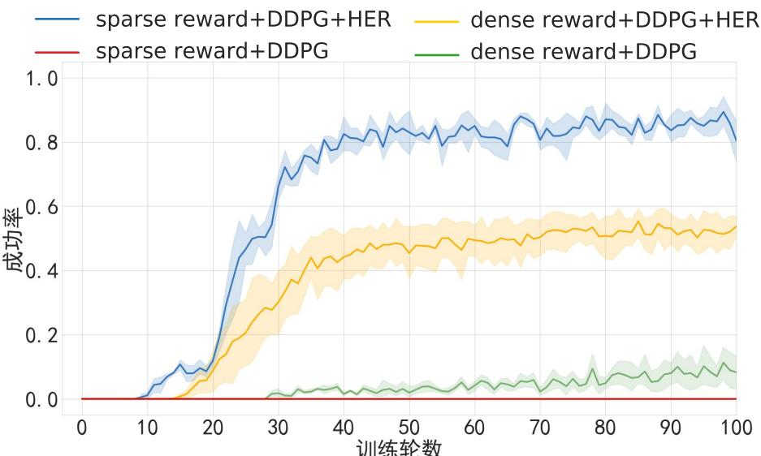

图 2.22 放置任务学习效果对比  
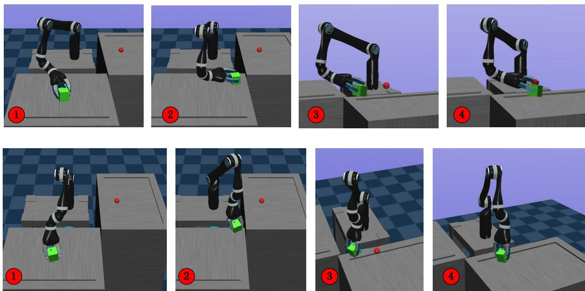  
图 2.23 放置任务中机械臂运动情况

## 2.5.4 二维平面抓取技能学习

抓取为复杂操作技能，虽然二维平面抓取任务中动作维度只有 4 维，但目标物和放置点相距较远，在学习初期需要进行大量的探索才能有一次成功。为减小抓取难度，增大学习初期的成功率，实验中将机械臂末端初始位置设置在物块中心周围12厘米处。

图 2.24展示了各种组合的算法在二维平面抓取任务中的学习效果，可以看出效果最好的实验仍然是 HER 与稀疏奖励的组合，只需要 35 轮训练成功率便稳定在 67%左右。其他组合中模型经过 100 轮的训练成功率最高为 40%左右且性能均未收敛，成功率有上升趋势但上升速率比较缓慢。由于抓取任务复杂度较高，奖励为稀疏形式时存在不可学习的问题。

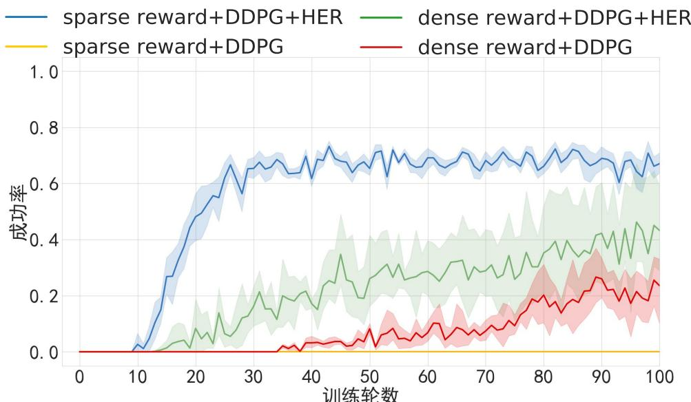

图 2.24 二维平面抓取任务学习效果对比  
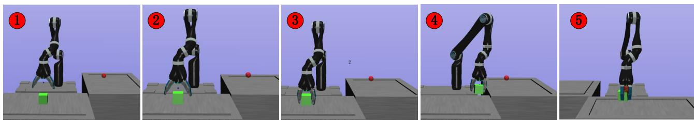  
图 2.25 二维平面抓取任务中机械臂运动情况

## 本章小结

本章提出了结合 HER 和 DDPG 的端到端的机械臂技能学习方法，并将其应用于接近、抓握和放置等任务，实现了对机械臂的关节级控制；另外添加姿态约束，将该方法应用于二维平面抓取任务，完成对方块的抓取操作。本章所提出的方法使用DDPG学习各操作任务中的行为策略，然后通过HER为采集到的轨迹数据增加目标和奖励，解决了稀疏奖励带来的一些问题。实验表明HER有效解决了指定姿态的接近任务中的不可学习的问题，并在其他学习任务中均明显提高 DDPG 的收敛速度和收敛性能。所有任务中模型均在 30 轮训练内收敛，成功率在 60%以上。通过将本文所用的算法与不同形式的奖励函数组合在一起，分别在各任务中进行了四组实验，结果表明HER与稀疏奖励的组合学习效果最好。另外本章所有实验表明HER在包含密集奖励的任务中仍能发挥作用。

## 第三章 基于元 Q学习的机械臂接近技能学习方法

## 引言

深度强化学习方法都存在泛化性差和样本效率低的问题，泛化性指学习后得到的模型在新环境或新任务中的适应能力，样本效率用来衡量强化学习算法使智能体的策略达到目标性能所需要的数据量。虽然强化学习不依赖人工标注数据集，但智能体为提升策略需要进行大量的试错，自身采集轨迹数据的成本不可忽视。

上一章各个任务的训练中智能体每轮需要与环境互动8万次，对于指定姿态的接近任务，要经过 40轮的训练才能获得收敛模型。对于6自由度抓取任务，机械臂需要能够以不同姿态接近物体，每个指定姿态的接近任务都有特定的一个奖励函数，并且不同的奖励函数对应不同的价值函数和策略，因此每个接近策略的学习过程必然相互独立。考虑到接近任务之间只有奖励函数有所不同，可以利用元学习方法先从相似接近任务中学习归纳偏置，然后将其应用到新接近任务的学习中进而提升样本效率，从而不必从头学习新接近策略。上一章实验表明抓握与放置操作都可由一个策略控制机械臂完成，考虑到学习难度和任务相似性，所以本章不对抓握与放置任务的归纳偏置进行学习。

本章首先介绍元强化学习相关理论，然后提出基于 MQL 的技能学习方法，并将该方法应用于接近技能的学习中，最后在仿真环境中验证 MQL 对学习效率的提升，并利用消融实验研究 MQL各关键技术对学习效率的影响。

## 相关理论

## 3.2.1 归纳偏置

机器学习的目标是学习出一个可以对未见过的数据做出准确预测的模型，每个模型对应于假设空间中的一个假设，而算法负责在这个假设空间中找到最合适的假设。通常假设空间中存在多个假设在训练集上表现最优，其中的两个不同假设必然会在某个数据上做出不同的预测。一个有效的机器学习算法应该输出确定、一致的结果，因此必须在多个假设中间选出一个在测试集上表现最优的假设，归纳偏置（inductive bias）就是算法在选择假设时的一种准则或“偏好”。它可以理解为从机器学习问题的线索中归纳出一定的规则，然后用这些规则对问题的解做一定的约束，从而可以起到选择最优解的作用。模型在测试集上的表现是未知的，由“没有免费的午餐”定理（No Free Lunch Theorem）可知这些模型在测试集上的期望性能是相同的，因此一个有效的机器学习算法必定有与问题对应的归纳偏置。归纳偏置在机器学习模型泛化到看不见的数据的能力中起着重要作用，正确的强归纳偏置可以使得模型参数收敛到全局最优值，而弱归纳偏置会导致模型陷入局部最优。

归纳偏置在机器学习中随处可见，可以是自然科学研究中最基本的准则如奥卡姆剃刀（Occam’s razor）；也可以是特殊的网络结构，例如针对图片中相邻的像素具有某种联系而这种联系具有空间不变性，CNN为此设计的共享卷积核；针对序列数据在顺序上具有某种联系而这种联系具有时间不变性，循环神经网络（Recurrent Neural Network，RNN）设计的共享的隐藏层；还可以是对问题的归纳，如支持向量机（Support Vector Machine，SVM）假设越好的分类器应该具有越大的类别边界距离，k近邻算法认为（k-nearest neighbor，k-NN）认为距离越近的两个样本点属于同一类别的概率越大。图 3.1中A和B 两个超平面都可以将两类数据分开，在训练集上准确率都达到 100%，但超平面A 与最近样本点的距离 $d _ { A }$ 较大，所以认为超平面A在未知样本中的分类效果优于B。

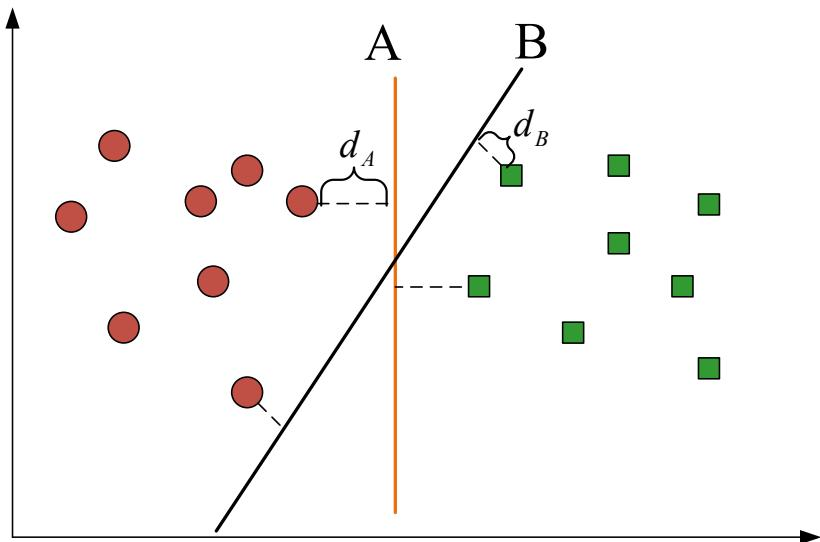  
图 3.1 支持向量机归纳偏置示意图

## 3.2.2 元强化学习

机器学习模型的性能取决于其参数，模型参数根据训练数据集和算法计算得到，通常对于稍复杂的任务找到最合适的模型并搜索出最佳的模型参数需要使用大量数据进行训练。元学习方法有助于找到适合任务的模型并优化对模型参数的搜索过程，这样可以使用更少的时间和计算资源使机器学会做出更好的预测或决策。元学习并非一个具体的学习方法，而是一种学习、训练范式，可用于不同的机器学习模型如计算机视觉、自然语言处理、强化学习等。

传统的机器学习是从训练数据集 $\mathcal { D }$ 中学习出一个预测模型，如式(3.1)

$$
\hat {y} = f (x; \theta)\tag{3.1}
$$

其中 $f$ 为预测模型，其参数为 $\boldsymbol { \theta }$ ，输入为测试集样本 $x _ { \circ }$ 参数 $_ { \theta }$ 利用所选算法和训练集样本得到，计算方法如式(3.2)

$$
\theta^ {*} = \operatorname * {a r g m a x} _ {\theta} \mathcal {L} (\mathcal {D}; \theta , w)\tag{3.2}
$$

$\mathcal { L }$ 为目标函数， $w _ { . }$ 为算法的归纳偏置，机器学习方法泛化性差的原因是每次面对新任务时需要从头开始学习，即重新指定或沿用之前的归纳偏置 $. w$ 并随机初始化参数�。在强化学习中f为策略网络， $\mathcal { L } _ { \mathcal { L } }$ 为累计奖励期望。从任务角度看，元学习目的是在元训练（meta-training）阶段学习出相似任务中有益的元知识即归纳偏置，并将归纳偏置用于元测试（meta-testing）阶段。学习过程可用式(3.3)隐式地表达

$$
w ^ {*} = \operatorname * {a r g m a x} _ {w} \underset {\mathcal {T} \sim p (\mathcal {T})} {\mathbb {E}} \mathcal {L} (\mathcal {D}; w)\tag{3.3}
$$

其中 ${ ^ { 1 } \mathcal { T } } = \{ { \mathcal { D } } , { \mathcal { L } } \}$ 定义为任务，由与该任务相关的数据集和目标函数组成， $p ( \mathcal T )$ 为训练集任务组成的任务分布，因此元学习也可理解为对归纳偏置的学习。

深度强化学习样本效率低主要有两个原因：一是为避免灾难性遗忘深度网络的训练必须逐步、缓慢进行，二是因为弱归纳偏置导致假设空间太大[72]。把元学习应用于强化学习领域的方法统称为元强化学习，目的是在一组相关任务中建立更好的归纳偏置，使得策略在新任务中能够快速改进、适应。目前尚无统一的相关任务的定义，实践中通常假设相关任务服从同一问题空间上的某个任务分布，任务本身为该分布的一个样本[73]。从马尔可夫决策过程角度看，一般认为若两个任务属于同一任务分布，则它们具有相同的状态和动作空间，而奖励函数或状态转移函数不同但服从某个分布。在元强化学习中任务、MDP 与环境是对应的。

元强化学习框架包含两类学习算法：元学习器（meta learner）和基学习器（baselearner）。基学习器负责在单个特定任务下学习策略，并将所学策略在该任务下的表现反馈给元学习器；元学习器根据反馈效果，从相关任务中学习出有益的归纳偏置；以上两个过程都在元训练过程中完成。新任务与元训练任务属于同一任务分布，所以元强化学习认为在元训练任务中学习到的归纳偏置可在新任务中发挥出好的学习效果，因此元强化学习的目标是最大化所得的归纳偏置在相关任务中的平均性能。如式(3.4)所示

$$
\begin{array}{l} \theta^ {*} = \underset {\theta} {\operatorname{argmax}} \sum_ {i = 1} ^ {n} \log P (\mathcal {D} _ {i} ^ {t s} | \phi_ {i}) \\ \mathrm{s.t.} \phi_ {i} = f _ {\theta} (\mathcal {D} _ {i} ^ {t r}) \mathrm{foreachtask} i \end{array}\tag{3.4}
$$

其中 $\theta .$ 和 $| \phi \cdot $ 分别是基学习器和元学习器的参数， $\mathcal { D } _ { i } ^ { t r }$ 和 $\mathcal { D } _ { i } ^ { t s }$ 分别是第 i 个元训练任务的训练集和测试集数据， $\log P \left( \mathcal { D } _ { i } | \phi _ { i } \right)$ 表示基学习器在当前任务测试集中的学习效果， $f _ { \theta } ( \mathcal { D } _ { i } ^ { t r } )$ 表示基学习器在当前任务训练集的学习过程。

记在元训练任务 $k$ 中基学习器的目标函数为 $\mathcal { L } _ { m e t a } ^ { k } ( \theta )$ ，以此衡量基学习器在任务k中的学习效果，参数�的具体形式取决于元学习算法的优化过程，属于元学习算法的归纳偏置的显式表达。例如在MAML中基学习器的目标函数如式(3.5)

$$
\mathcal {L} _ {m e t a} ^ {k} (\theta) = \mathcal {L} ^ {k} (\theta + \alpha \nabla_ {\theta} \mathcal {L} ^ {k} (\theta))\tag{3.5}
$$

其中 $\mathcal { L } _ { m e t a } ^ { k }$ 和 $\textstyle { \mathrm { I } } { \mathcal { L } } ^ { k }$ 代表的目标函数形式相同，可以是式(2.17)所示的均方TD误差或 PPO中的重要性采样后的优势函数。MAML不看重基学习器的当前学习效果，而是希望能够提高一次梯度更新后的模型性能，也表明MAML有其独特的归纳偏置。元训练过程的目标函数一般为训练集任务的目标函数之和即多任务目标，如式(3.6)所示

$$
J (\theta) = \frac {1}{n} \sum_ {k = 1} ^ {n} \mathcal {L} _ {m e t a} ^ {k} (\theta)\tag{3.6}
$$

## 3.2.3 重要性采样与有效样本量

机器学习的目的是对服从某概率分布的数据的特征进行推断，然而实践中大多数的概率模型很难得到精确的推断，只得转向计算近似解。在推断过程中，经常需要求函数在某个概率分布函数下的期望，对于定义已知、积分困难的概率分布函数，常使用蒙特卡罗抽样法近似计算出积分结果。根据大数定律，随着样本数量的增加，抽样得到的样本均值越来越接近总体均值，方差也会越来越小。假设随机变量 x 服从概率分布 $p ( x )$ $f ( x )$ 为随机变量 x 的某个统计量，从 $p ( x )$ 直接采样的得到样本集 $\{ x _ { 1 } , x _ { 2 } , \cdots , x _ { N } \}$ ，利用式(3.7)可估计出 $f ( x )$ 的期望

$$
\begin{array}{r} \mathbb {E} _ {x \sim p (x)} [ f (x) ] = \int p (x) f (x) d x \\ \approx \frac {1}{N} \sum_ {i = 1} ^ {N} f (x _ {i}) \end{array}\tag{3.7}
$$

重要性采样法是一种常见的蒙特卡罗抽样法，常用于在线策略强化学习方法的策略评估中，如近端策略优化。对于式(3.7)，若 $p ( x )$ 为均匀分布或正态分布等常见分布，可直接对其进行采样；若概率分布函数形式复杂，可选择一个简单的辅助概率分布函数 $\mathbf { \boldsymbol { q } } ( { \boldsymbol { x } } )$ ，然后对 $q ( x )$ 采样得样本集 $\{ x _ { 1 } , x _ { 2 } , \cdots , x _ { N } \}$ ，利用式(3.8)间接求得 $f ( x )$ 的期望

$$
\begin{array}{r l} & {\mathbb {E} _ {x \sim p (x)} [ f (x) ] = \int q (x) \frac {p (x)}{q (x)} f (x) d x} \\ & {\approx \frac {1}{N} \sum_ {i = 1} ^ {N} (\frac {p (x _ {i})}{q (x _ {i})} f (x _ {i}))} \end{array}\tag{3.8}
$$

记式(3.7)和式(3.8)的估计值分别为�̄和�̃，利用重要性采样计算得到的近似期望�̃是目标期望的无偏估计，但重要性采样估计值�̃的方差往往比直接采样估计值�̄大，实践中一般用方差代表估计方法的精度。

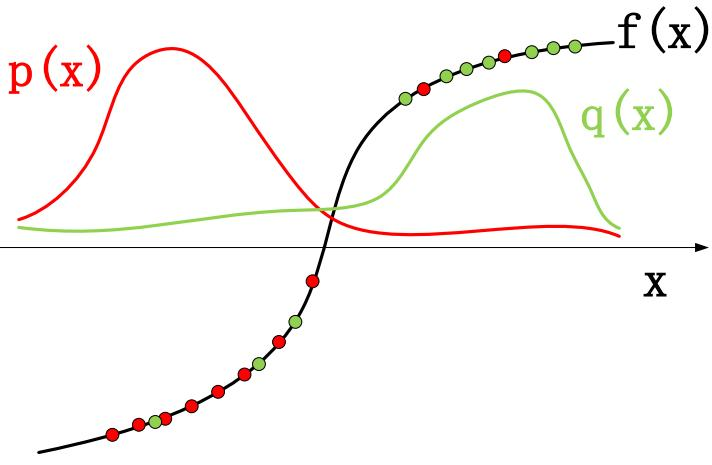  
图 3.2 不同分布下的采样

有效样本量（effective sample size，ESS）是衡量重要性采样方法精度的一个重要指标，ESS 定义为N个直接采样估计值的方差与重要性采样估计值的方差之比，如式(3.9)所示

$$
E S S = N \frac {V a r (\bar {I})}{V a r (\tilde {I})}\tag{3.9}
$$

式(3.9)不可解，一般利用式(3.10)求出 ESS 的估计值

$$
\begin{array}{l} \widetilde {E S S} = (\sum_ {i = 1} ^ {N} w (x _ {i})) ^ {2} / \sum_ {i = 1} ^ {N} w (x _ {i}) ^ {2} \\ w (x _ {i}) = \frac {p (x _ {i})}{q (x _ {i})} \end{array}\tag{3.10}
$$

其中 ${ } ^ { \mathfrak { I } } w ( x _ { i } )$ 是重要性权重， $x _ { i }$ 从简单分布 $q ( x )$ 采样得到。有效样本量越大 $( E S S < N )$ 说明引入的简单分布 $q ( x )$ 越接近目标分布 $p ( x )$ ，重要性采样估计带来的影响越小即估计精度越高。

## 元 Q学习方法

针对现有深度强化学习方法存在的样本效率低的问题，Fakoor 等人[74]提出元 Q 学习算法，该算法是一种基于强泛化性的初始参数的元学习方法，旨在从相关任务中学习出有效的模型初始参数，可与任何离线策略强化学习算法结合。MQL具有优化过程简单和样本利用率高两个优点，主要思想源自三个方面：第一，训练过程中给出表征轨迹的上下文变量，经典强化学习算法 Q-learning 可达到最先进的元强化学习算法的性能；第二，从大量的相关任务中学习是元强化学习的一大特点，在当前元强化学习基准环境中，最大化训练集任务的平均奖励即多任务目标，便已足够有效地训练出强化学习的策略；第三，离线策略强化学习算法可以重复使用经验池中的数据更新策略，这些数据由其他策略收集而得。图 3.3 表示在四个标准元强化学习测试任务中，结合轨迹上下文变量和TD3算法（TD3-context）在测试任务上的表现与最好的元强化学习算法PEARL[75]性能相当。

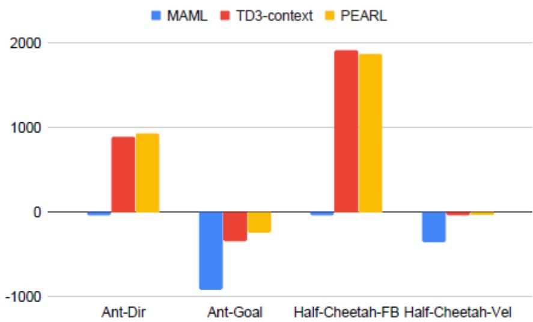  
图 3.3 TD3-context 与元强化学习算法效果对比[74]

针对以上三个想法，MQL有三个特征：第一，基学习器与环境互动收集轨迹，利用 RNN提取出轨迹中每个状态的上下文变量，并将其与状态级联作为状态的部分属性；第二，不对基学习器的目标函数进行任何改变，且元训练目标采用简单的多任务目标；第三，在元测试阶段重复使用元训练阶段产生的数据。MQL 包含前后两个过程：学习归纳偏置的元训练过程和学习新任务的行动策略的迁移过程。

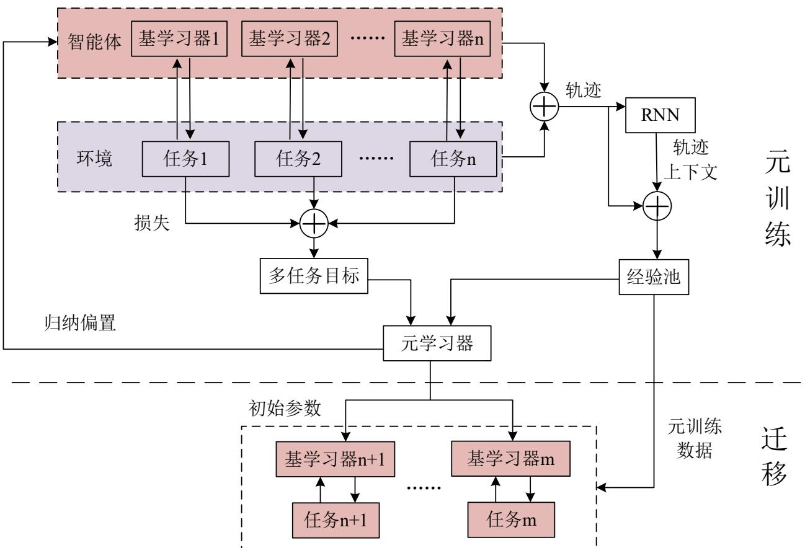  
图 3.4 元Q学习方法

## 3.3.1 元训练

本章提出的基于MQL的学习方法中基学习器为结合HER的DDPG，通过最大化所有任务的平均奖励来学习出有效的归纳偏置，因此元训练阶段使用多任务目标作为优化对象，并且不对各任务的基学习器参数进行特定的优化。元训练损失函数如式(3.11)所示

$$
J ^ {m e t a} (\theta) = \frac {1}{n} \sum_ {k = 1} ^ {n} \underset {\tau \sim \mathcal {D} ^ {k}} {\mathbb {E}} [ (y _ {i} ^ {k} - Q (\pmb {s} _ {i} ^ {k}, \pmb {a} _ {i} ^ {k} | \theta^ {Q})) ^ {2} ]\tag{3.11}
$$

其中 ${ \mathfrak { i } } { \mathcal { D } } ^ { k }$ 是元训练任务k的经验区数据，实践中采用小批量数据的均值近似代替该期望。

元强化学习问题中的相关任务具有不同的奖励函数或状态转移函数，因此每个相关任务可以用部分可观察马尔可夫过程（partially-observable MDP，POMDP）描述。从任务角度看元强化学习目的是学习新任务独有的“同一性”（identity），任务的“同一性”一般认为是部分可观察马尔可夫过程的潜在变量。任务的轨迹是 POMDP 的一个样本，因此 MQL 利用循环神经网络计算轨迹的上下文变量作为该任务的潜在变量。具体地利用将经验按顺序输入值RNN中，得到的隐状态 $z _ { t }$ 作为时刻t的轨迹上下文，如式(3.12)所示

$$
\mathbf {z} _ {t} = f (\mathbf {z} _ {t - 1}, \mathbf {s} _ {t} \| \mathbf {a} _ {t} \| r _ {t})\tag{3.12}
$$

考虑到功能和计算复杂度，这里使用简单的门控循环单元（gated recurrent unit，GRU）计算隐状态 $\mathbf { z } _ { t }$ ， $\mathbf { z } _ { t }$ 与状态、动作、奖励有关。在基学习器的训练中隐状态 $\mathbf { z } _ { t }$ 视为状态 $\pmb { s } _ { t }$ 的一部分，相应地值函数和策略函数表达式改为 $Q ( s _ { t } , \mathbf { z } _ { t } , \mathbf { \pmb { a } } _ { t } \vert \theta ^ { Q } )$ 和 $\lvert \mu ( s _ { t } , z _ { t } \lvert \boldsymbol { \theta ^ { \mu } } )$ o

MQL 的元训练过程旨在提供具有强泛化性的模型初始参数，得到元训练模型参数 $\theta ^ { m e t a }$ 和经验区数据��� �。

## 3.3.2 迁移

为得到新任务的最优行动策略，还需要在元训练模型参数 $\theta ^ { m e t a }$ 的基础上继续采集轨迹数据 $\mathcal { D } ^ { n e w }$ 进行训练，这一过程称为迁移。元训练模型参数 $\theta ^ { m e t a }$ 已学得任务的归纳偏置，具有一定的泛化性，对新数据的需求要比随机初始化的参数要小得多。为进一步减小对新数据的需求MQL充分利用离线策略强化学习方法的优势，在迁移过程中重复使用旧数据 $\mathcal { D } ^ { m e t a }$ 进行训练。新任务的轨迹数据 $\mathcal { D } ^ { n e w }$ 与元训练任务数据 $\mathcal { D } ^ { m e t a }$ 属于不同分布，直接使用旧数据用于计算梯度存在协变量偏移（covariate shift）偏移的问题，使训练过程变得不稳定。MQL使用重要性采样和添加正则项两项技术减小协变量偏移对训练过程的影响。迁移过程的目标函数如式(3.13)所示

$$
J ^ {n e w} (\theta) = \underset {\tau \sim D ^ {n e w}} {\mathbb {E}} [ \mathcal {L} ^ {n e w} (\theta) ] + \underset {\tau \sim D ^ {m e t a}} {\mathbb {E}} [ w (\tau) \mathcal {L} ^ {n e w} (\theta) ] + \lambda \| \theta - \theta^ {m e t a} \| _ {2} ^ {2}\tag{3.13}
$$

其中 $\mathcal { L } ^ { n e w } ( \theta )$ 为新任务的损失函数，形式与元训练中相同仍为均方 TD 误差； $w ( \tau )$ 为重要性权重，是小批量数据的函数。目标函数第一项用于新任务下模型参数的离线策略更新，第二项用于参数的加权更新，第三项为自动调整的正则项，可防止策略在更新过程中发生退化。

迁移过程首先是采集新任务数据进行训练，这一步不必进行太多训练。然后利用旧数据继续训练模型，并使用重要性采样保证利用新旧数据计算的目标函数的期望相等，如式(3.14)所示

$$
\underset {\tau \sim \mathcal {D} ^ {n e w}} {\mathbb {E}} [ \mathcal {L} ^ {n e w} (\theta) ] = \underset {\tau \sim \mathcal {D} ^ {m e t a}} {\mathbb {E}} [ w (\tau) \mathcal {L} ^ {n e w} (\theta) ]\tag{3.14}
$$

由于新旧数据的分布均未知，传统的重要性采样无法进行，这里采用倾向性得分作为重要性权重 $w ( \tau )$ 。对于小批量数据中的某个样本x，其倾向性得分定义为该样本属于新任务的概率与属于元训练任务的概率的比值，显然可用逻辑回归模型计算倾向性得分，如式(3.15)所示

$$
\beta (x; w) = P (x \in \mathcal {D} ^ {n e w}) / P (x \in \mathcal {D} ^ {m e t a}) = e ^ {- w ^ {* T} x}\tag{3.15}
$$

从 $\mathcal { D } ^ { n e w }$ 和 $\mathcal { D } ^ { m e t a }$ 中抽取样本，设置标签为-1 和 1，可用式(3.16)求得逻辑回归模型参数 w

$$
w ^ {*} = \min _ {w} \sum_ {(x, y)} \log (1 + e ^ {- w ^ {T} x}) + c \| w \| ^ {2}\tag{3.16}
$$

重要性采样不可避免带来方差变大，因此引入正则项限制策略的距离。若策略距离较大，则需要增大正则项系数；同时策略距离大也说明新旧数据的分布差别大，重要性采样的作用明显即其带来的方差较大；所以 MQL 为动态调整正则项，采取归一化有效采样量作为正则项系数。归一化有效采样量定义如式(3.17)所示，其中N为数据的batch size。

$$
\begin{array}{l} \widehat {E S S} = \frac {(\sum_ {i = 1} ^ {N} \beta (x _ {i} ; w)) ^ {2}}{N \sum_ {i = 1} ^ {N} \beta (x _ {i} ; w) ^ {2}} \\ \lambda = 1 - \widehat {E S S} \end{array}\tag{3.17}
$$

重要性采样后的目标函数为

$$
J (\theta) = \underset {\tau \sim \mathcal {D} ^ {m e t a}} {E} [ \beta (\tau ; w) \mathcal {L} ^ {n e w} (\theta) ] + (1 - \widehat {E S S}) \| \theta - \theta^ {m e t a} \| _ {2} ^ {2}\tag{3.18}
$$

本章提出的基于 MQL的技能学习方法伪代码如算法2所示。

算法 2 基于 MQL 的技能学习方法
1. 输入：相关任务分布  $p(T)$ 
// 元训练
2. 初始化经验池 $D^{meta}$ 
3. 初始化DDPG网络参数 $\theta=(\theta^{Q},\theta^{\mu},\theta^{Q'},\theta^{\mu'})$

4. 构建元训练任务集，根据式(3.11)创建多任务目标
5. while not done do
6. 任务抽样 $T_{i} \sim p(T)$ 
// 基学习器的学习过程
7. 利用主策略网络收集轨迹数据
8. 利用 HER 为轨迹状态添加目标和奖励
9. 利用 GRU 计算上下文变量
10. 从 $D^{meta}$ 中采集小批量经验 $(s_{t}||g,z_{t},a_{t},r_{t},s_{t+1}||g)$ 
11. 利用梯度下降减小多任务目标，更新参数 $\theta$ 
12. end while
13.  $\theta^{meta} \leftarrow \theta$ 
// 迁移
14. 初始化经验池 $D^{new}$ ，选取新任务 $T^{new} \sim p(T)$ 
15. 创建新任务目标函数 $L^{new}(\theta)$ 
16. 重复基学习器的学习过程，目标函数为 $L^{new}(\theta)$ ，数据存入 $D^{new}$ 
17. 从抽取数据，利用式(3.16)计算逻辑回归模型参数
18. while not done do
19. 从中采集小批量数据，利用式(3.18)计算当前数据的损失
20. 更新参数 $\theta$ 
21. end while
22. 返回参数 $\theta$

## 仿真实验及结果分析

## 3.4.1 实验设置

本节以元训练模型 $\theta ^ { m e t a }$ 在新任务中的迁移效果验证 MQL 学习归纳偏置的有效性。Langley提出三个指标评价算法或模型的迁移效果：初始性能、收敛性能、学习速率[76]，如图3.5所示。本节中初始性能为未经过迁移训练的元训练模型在新任务上的表现，一定程度上可代表模型的泛化性。收敛性能为第二章定义的在新任务上的稳定成功率，代表模型最终性能。在新任务上的学习速率是评价元强化学习方法性能坏的重要指标，一般定义为模型达到设定的期望性能所需的训练步数或数据量，或使用一定数量的训练数据进行训练模型所能达到的性能。学习速率直接反映元强化学习方法学得的归纳偏置的好坏，本节中其定义为达到期望性能的训练轮数。

  
图 3.5 迁移效果评价指标

本章实验中MQL的基学习器是上一章所述的结合HER的DDPG。元Q学习算法部分超参数设置如表 3.1所示，DDPG和HER有关超参数与上一章保持一致。迁移过程中选择 20个新任务作为测试任务以减小不确定性，因此本节实验的各曲线均对应一次独立实验。本节所有实验均采用模型在测试任务集的平均成功率衡量算法迁移效果。

表 3.1MQL部分超参数设置

<table><tr><td>符号</td><td>意义</td><td>数值</td></tr><tr><td>tr_tasks</td><td>元训练任务数</td><td>100</td></tr><tr><td>ad_tasks</td><td>迁移任务数</td><td>20</td></tr><tr><td>buffer_size</td><td>每个任务经验池大小</td><td> $1 \times 10^6$ </td></tr><tr><td>batch_size</td><td>采样批量大小</td><td>256</td></tr><tr><td>len_cxt</td><td>上下文变量维度</td><td>10</td></tr><tr><td>n_pos</td><td>从  $D^{meta}$  采集样本数</td><td>200</td></tr><tr><td>n_neg</td><td>从  $D^{new}$  采集样本数</td><td>200</td></tr></table>

## 3.4.2 仿真结果

图 3.6 MQL 与 DDPG 迁移效果对比展示了 MQL 对 DDPG 在模型泛化性和样本效率的提升，实验中分别测试了元训练步数分别为300万、200万、100 万的MQL和随机初始化的DDPG 在测试任务集上迁移效果，可看出 MQL 对 DDPG 的迁移效果有明显提升。在初始性能方面，三种 MQL 和 DDPG 平均成功率分别为 13.13%、8.75%、6.25%、0.00%。模型性能趋于稳定时，平均成功率分别达到 83.09%、81.06%、82.38%、68.02%。设置期望性能为 DDPG的稳定成功率 68.02%，算法达到期望性能需要进行训练的轮数分别为 9、11、15、39。随着元训练步数的增加，元训练模型在初始性能和收敛速度上有所增大；当元训练步数达到 100万，继续进行元训练对稳定成功率无明显提升。由该实验可得结合MQL特有的学习方式后，DDPG在新任务中未进行迁移训练的成功率提高了13.13%，稳定成功率提高了15.07%，达到同样的收敛性能时所需样本量为之前的23.08%。

  
图 3.6 MQL 与 DDPG 迁移效果对比

相比于普通的迁移方法，MQL引入了获取轨迹上下文、重复利用旧数据、动态调整正则项系数三个技术。为进一步分析 MQL 对 DDPG 的改进机制，研究上下文变量、倾向得分、归一化有效采样量三个变量对迁移过程的影响，本节进行了以下三组消融实验：一、删除 MQL网络中的 GRU，丢弃DDPG输入中的轨迹上下文变量；二、将倾向得分设为 0，在迁移过程中不使用旧数据训练模型；三、设置正则项系数为 0和0.5。消融实验中皆采用元训练步数为300 万的 MQL 和 DDPG 作为实验组。

  
图 3.7 轨迹上下文变量对迁移效果的影响

从图 3.7 可以看出，去除轨迹上下文变量算法的初始性能和学习速率有明显下降，收敛性能略有下降，主要原因是轨迹上下文变量表征任务的“同一性”，与模型的泛化性强烈相关。

因此轨迹上下文变量是算法的关键之处，正如前文提到的：已知轨迹上下文变量，Q 学习与现有的元强化学习算法性能相当。

图 3.8可以看出倾向得分作用于迁移过程，对模型初始性能无影响，将倾向得分设为0，,模型的学习速率和收敛性能有明显下降。倾向得分代表旧数据的使用，一方面利用旧数据进行训练可弥补策略探索能力的不足，避免出现陷入局部最优的情况，进而提升收敛性能；另一方面旧数据的规模远大于新数据中，旧数据提供的梯度信息更准确，避免学习过程中的发散情况，提高了学习速率。

  
图 3.8 倾向分数对迁移效果的影响

图 3.9 显示归一化有效采样量主要影响收敛性能和学习速率，使用当前小批量数据的有效采样量来控制策略参数之间的距离，该距离决定加权后旧数据的方差，对学习过程的稳定性至关重要。可以看出过小的惩罚项 $( \lambda = 0 . 5 )$ 会使策略失效，成功率甚至低于结合HER的DDPG。

  
图 3.9 归一化有效采样量对迁移效果的影响

实验具体数据如表 3.2，其中期望性能采用DDPG的稳定成功率68.02%，学习速率为首次达到期望性能所需训练轮数。

表 3.2接近技能学习任务对比实验效果

<table><tr><td>算法</td><td>初始性能</td><td>收敛性能</td><td>学习速率</td></tr><tr><td>MQL(300万步)</td><td>13.13%</td><td>83.09%</td><td>9</td></tr><tr><td>MQL(200万步)</td><td>8.75%</td><td>81.06%</td><td>11</td></tr><tr><td>MQL(100万步)</td><td>6.25%</td><td>82.38%</td><td>15</td></tr><tr><td>DDPG+HER</td><td>0.00%</td><td>68.02%</td><td>39</td></tr><tr><td>MQL(without GRU)</td><td>3.37%</td><td>78.71%</td><td>22</td></tr><tr><td>MQL( $\beta = 0$ )</td><td>13.13%</td><td>74.76%</td><td>17</td></tr><tr><td>MQL( $\lambda = 0$ )</td><td>13.13%</td><td>59.86%</td><td>&gt;100</td></tr><tr><td>MQL( $\lambda = 0.5$ )</td><td>13.13%</td><td>71.60%</td><td>22</td></tr></table>

## 本章小结

在指定姿态的接近技能的学习任务中，针对结合 HER 的 DDPG 所存在的泛化性差和样本效率低的问题，本章提出了基于元Q学习的机械臂技能学习方法，通过仿真实验验证MQL在提升泛化性和样本效率方面的有效性，此外还通过消融实验分析了 MQL 内部一些技术在学习过程中的作用。实验表明引入 MQL 后，DDPG 在测试任务中未进行迁移训练的成功率提高了 13.13%，稳定成功率提高了 15.07%，达到同样的收敛性能时所需样本量为之前的23.08%。后续的消融实验表明获取轨迹上下文变量是 MQL 的关键，重复利用旧数据和动态调整正则项系数对DDPG的学习速率和收敛性能影响较大。

## 第四章 基于任务分解的机械臂 6自由度抓取方法

## 引言

前两章介绍了一些与抓取相关的基本技能的学习任务并提出了学习方法，实验证明了结合 HER 的 DDPG 在这些学习任务中的有效性。另一方面在指定姿态的接近技能学习中，若没有合适的奖励函数或 HER 的帮助，在一定时间内 DDPG 完全不能提升智能体的探索能力和决策能力。对于一些奖励稀疏、执行周期长、复杂度高的学习任务，利用现有的DRL方法进行端到端的训练往往存在无法学习、过拟合、可解释性差等问题，可见DRL方法存在一定的局限性。因此对于复杂任务的学习，需要借鉴“分而治之”的思想降低任务复杂度，将复杂问题分解为简单的多个子问题。

本章将抓取任务分解为接近、抓握和放置三个子任务，使用分层强化学习方法（Hierarchical Reinforcement Learning，HRL）对机械臂的运动进行分层控制，其中低层策略输出机械臂的动作，高层策略编排低层策略的执行顺序。

## 相关理论

## 4.2.1 分层强化学习

人类行为往往具有层次结构，对于简单的开门动作大脑不会直接发出一串对肌肉的控制信号，而是自动将该动作分解为抓住把手、旋转把手和拉开门三个子动作，只有在执行基本子动作这一层面才会计算控制信号。分层强化学习具有多层控制的能力，其思想与人类解决任务的方法论极为相似。DRL 将复杂的任务视为长期规划问题并将其分解成多个短期问题，然后把长期和短期问题分离到不同的策略层级，最后由低到高依次解决各层问题。HRL研究较多的方向是选项框架（Options Framework）、封建制强化学习（Feudal Reinforcement Learning，FRL）和 MAXQ 值函数分解（MAXQ value function decomposition）。

选项（option）是动作在时域上的扩展，可以看作是一段连续时间上的动作序列。最早由Sutton 等人[77]创建了选项的概念，其认为半马尔可夫决策过程（Semi-Markov Decision Process,SMDP）是具有固定选项的MDP。选项包含策略�、终止条件�(�)和初始状态集合�三个部分，其中终止条件�:� → [0,1]表示当前选项在状态�结束的概率、初始状态集合 ${ \mathrm { \cdot } } I \subseteq { \mathcal { S } }$ 表示选项开始的状态 $\mathbf { \delta } _ { \mathbf { { s } } _ { 0 } }$ 集合，终止条件和初始状态集合用来判断选项的结束与开始，策略是选项的执行器。特殊地，当对任意状态�，�都有 $\beta ( \pmb { s } ) = 1$ 时，选项退化为一个动作，此时选项框架等于普通的强化学习方法。具有选项框架的HRL算法具有两层决策结构：底层由各个选项组成，负责为智能体选择动作；顶层是一个选项策略，负责在决策开始时刻或选项终止时选择新的选项用于底层决策。选项框架还可以与 Actor-Critic 相结合得到 Option-Critic 框架[78]，如图 4.1所示。该框架用函数拟合底层选项及其终止条件，并使用策略梯度的方法更新函数参数。一方面不需要额外的内在奖励或子目标，实现了端到端的算法；另一方面从数据中学习出有意义的选项，使得选项的语义更明确。

  
图 4.1 Option-Critic 结构[78]

## 封建强化学习

封建强化学习的特点是封建等级结构，其中每一层的各个智能体或管理者为它们的下级管理者设置目标、奖励。封建强化学习不像选项框架那样在时间上对问题进行分解，而是通过为底层管理者制定明确目标来在状态空间分解问题。封建制强化学习有两个重要原则：奖励隐藏和信息隐藏。奖励隐藏表示管理者的下级完全服从管理者的指令，即使该指令不一定能让管理者的上级满意；信息隐藏指不同层级的管理者都不知道对方被分配了什么样的任务。封建制网络（Feudal Networks，FuNs）[79]就是这种解耦学习方式与神经网络的结合，它可以自动发现子目标且满足奖励隐藏和信息隐藏的条件。如图 4.2 所示 FuNs 是模块化的封建强化学习神经网络，其内部包含管理者（Manager）和工作者（Worker）两个模块，管理者负责为工作者设定一个目标，工作者通过内在奖励信号学习如何达到目标。网络通过目标将内部两个模块连在一起，如此在学习过程中很容易导致目标由分层标志退化为内部隐变量，进而失去分层控制的优势。为实现解耦学习，FuNs 采取阻断两模块间梯度的后向传播的方法，分别利用值函数和累积奖励对管理者和工作者进行训练。

  
图 4.2 封建制网络框架[79]

## MAXQ值函数分解

Dietterich 等人[80]提出一种基于 MAXQ 值函数分解的分层强化学习方法，其主要思想是把待解决任务的马尔可夫决策过程 M按照树状结构分解成一组子任务 $\{ M _ { 0 } , M _ { 1 } , \cdots , M _ { n } \}$ ，其中$M _ { 0 }$ 是根子任务即待解决任务M 每个子任务 $M _ { i }$ 都包含一个三元组 $< T _ { i } , A _ { i } , R _ { i } > , ~ T _ { i }$ 为子任务的终止断言（termination predicate），将状态空间分解为活动状态和终止状态， $T _ { i } ( s )$ 用来判断当前状态�是否为终止状态，运行至终止状态视为成功解决该子任务。 $A _ { i }$ 是解决子任务 $M _ { i }$ 的一系列动作，这些动作可以是任务M动作空间中的动作，也可以是某个子任务。 $R _ { i } ( \pmb { s } ^ { \prime } | \pmb { s } , \pmb { a } )$ 是子任务内部的伪奖励函数，定义了转移到每个终止状态 $\mathbf { \dot { s } } ^ { \prime }$ 的奖励值，代表各个终止状态对解决子任务的重要程度。每个子任务 $M _ { i }$ 都有对应策略 $\pi _ { i }$ ，任务 M 的分层策略�是子任务策略的集合$\{ \pi _ { 0 } , \pi _ { 1 } , \cdots , \pi _ { n } \}$ 。出租车问题的任务结构图如图 4.3所示。

  
图 4.3 出租车问题任务结构

该任务中司机需要从某处出发到达乘客位置并将乘客送到目的点，动作空间有六个动作：上车、下车以及向东西南北四个方向行驶。首先根任务代表出租车问题由接人和送人两个子任务组成；进一步地接人包含上车和行驶两个动作，送人则包含行驶和下车两个动作；行驶既是一个动作，也是一个子任务，包含向东西南北四个方向行驶等四个动作。

MAXQ 值函数分解的核心内容是将值函数扩展至子任务空间，并把状态-动作值函数分解为状态值函数和完成函数（completion function）之和，如式(4.1)所示。

$$
Q ^ {\pi} (i, \boldsymbol {s}, \boldsymbol {a}) = V ^ {\pi} (\boldsymbol {s}, \boldsymbol {a}) + C ^ {\pi} (i, \boldsymbol {s}, \boldsymbol {a})\tag{4.1}
$$

针对智能体在子任务i 中面对状态�执行动作�这一操作， $Q ^ { \pi } ( i , s , \pmb { a } )$ 表示执行该操作后按照策略 $\pi _ { i }$ 推理直到转到终止状态的期望累计奖励， $V ^ { \pi } ( s , { \pmb a } )$ 表示执行该操作得到的奖励，完成函数$C ^ { \pi } ( i , \pmb { s } , \pmb { a } )$ 表示执行该操作后直到完成子任务i 的折扣累计奖励。

## 4.2.2 异步优势 Actor-Critic 算法

文献[34]提出的同步优势 Actor-Critic 算法（A2C）和异步优势 Actor-Critic 算法（A3C）都是Actor-Critic算法的改进，在其基础上进行引入了并行计算的设计。异步优势Actor-Critic 算法有两大特点：具有 Actor-Critic架构、异步更新全局网络参数。Actor-Critic算法框架如图 4.4所示，其包含行动者（Actor）和批判者（Critic）两个网络模块，行动者即智能体的策略，批判者为状态-动作值函数。训练过程中，行动者生成动作控制智能体与环境交互，并以批判者计算的 Q 值作为自己的目标函数，利用策略梯度更新参数如式(2.20)；批判者负责策略评估，以小批量数据的均方 TD误差如式(2.17)或优势函数为目标函数，利用梯度下降更新参数。

  
图 4.4 Actor-Critic 框架图

A2C内部有Master和Worker两类计算节点，Master节点维护全局行动者和全局批判者，通过协调器与Worker 节点交换参数、梯度等信息；Worker节点负责控制智能体与环境交互，收集轨迹数据。A2C 算法中参数同步更新，首先各个Worker节点收集采集轨迹数据并算梯度信息，接着协调器收集各个Worker节点的发来的梯度信息并更新全局网络参数，然后将参数发送给各个 Worker节点，最后所有的 Worker节点更新网络参数。

  
图 4.5 A3C 基本框架

A3C 是 A2C 的异步版本如图 4.5 所示，每个 Worker 节点都可直接更新全局行动者和全局批判者，因此Master 节点不需要等待收集完全部梯度信息，计算效率更高。虽然单个 Worker节点计算出的梯度信息与全局梯度信息存在不一致，但有研究表明异步更新的方式不仅可以加速学习，还可以为随机梯度下降（Stochastic Gradient Descent, SGD）增加与动量（Momentum）类似的效果，减少出现局部最优的情况。A3C 伪代码如算法 3所示。

算法3 异步优势 Actor-Critic 算法
Master:
超参数：步长 $\eta_{\psi}$ 和 $\eta_{\theta}$ 、当前策略函数 $\pi_{\theta}$ 、价值函数 $V_{\psi}^{\pi_{\theta}}$ 。
输入：梯度 $g_{\psi}, g_{\theta}$ 。
1. 更新网络参数 $\psi = \psi - \eta_{\psi} g_{\psi}; \theta = \theta + \eta_{\theta} g_{\theta}$
2. 返回网络 $(V_{\psi}^{\pi_{\theta}}, \pi_{\theta})$
Worker:
超参数：奖励折扣因子 $\gamma$，轨迹长度 L。
输入：策略函数 $\pi_{\theta}$ 、价值函数 $V_{\psi}^{\pi_{\theta}}$ 。
1. 初始化梯度 $(g_{\theta}, g_{\psi}) = (0, 0)$
1. for k=1, 2, ……, do
2. 更新参数 $(\theta, \psi) = \text{Master}(g_{\theta}, g_{\psi})$
3. 执行 L 步策略，保存经验数据 $\{s_t, a_t, r_t, s_{t+1}\}$
4. 估计优势函数 $\widehat{A_t} = r_t + \gamma V_{\psi}^{\pi_{\theta}}(s_{t+1}) - V_{\psi}^{\pi_{\theta}}(s_t)$
5. 计算策略网络目标函数 $J(\theta) = \sum_t \log \pi_{\theta}(a_t | s_t) \widehat{A_t}$

6. 计算值函数网络目标函数 $J_{V_{\psi}^{\pi_{\theta}}}(\psi)=\widehat{A_{t}}^{2}$ 
7. 计算梯度 $(g_{\theta}, g_{\psi}) = (\nabla J(\theta), \nabla J_{V_{\psi}^{\pi_{\theta}}}(\psi))$ 
8. end for
9. 返回梯度 $(g_{\theta}, g_{\psi})$

## 4.2.3 分层控制结构

将抓取任务分解为接近、抓握和放置三个子任务的方法来源于文献[81, 82]，文献提出的方法利用两层的控制结构控制 Fetch 机械臂完成二维平面抓取任务，针对高层根任务和每个低层子任务各学习出一个行动策略，其中低层策略称为低层子任务专家（Low-level SubtaskExperts，LSE）,高层策略为高层指导者（High-Level Choreographer，HLC）。虽然二维平面抓取任务复杂度不高，但利用任务分解的方法进行训练，样本效率依然得到了较大提升。

  
图 4.6 控制结构

基于任务分解的机械臂抓取方法中的分层控制结构如图 4.6 所示，在某个时间段初始时刻高层策略根据当前环境状态选择低层策略，并根据选择的动作设置目标，输出的动作为低层策略被选择的概率和目标，并且只在执行完一个低层策略后才与环境进行交互；高层策略输出的动作将某个低层策略激活，机械臂选择对应的策略执行。6 自由度抓取任务的状态和动作空间较大，成功完成抓取任务的关键是找到合适的抓取姿态，而抓取姿态因目标物形状、位姿而异，因此接近子任务需要由多个接近策略完成，各接近策略控制机械臂末端以某个姿态到达目标物附近。第二章的实验表明，对于末端初始姿态一定范围内在随机出现的抓握任务和放置任务，只用一个策略用于控制仍有较高的成功率，因此抓握与放置子任务中都只由一个策略完成。

## 抓取方法

## 4.3.1 高层指导者学习方法

通过前两章的工作得到了接近、抓握和放置三个任务的控制策略，为完成高层的抓取任务，需要按照合适的顺序选择子任务策略执行。本节内容主要是在低层策略已训练完的基础上，对高层策略进行学习。高层指导者的训练方法选择异步优势Actor-Critic算法，原因有二点：一、高层指导者输出的是离散动作；二、具有 Actor-Critic 方法既能快速选择最优动作，又能进行单步更新。为提高样本效率并减小样本方差，采用广义优势估计器（generalizedadvantage estimator，GAE）代替 A3C 中的优势函数，如式(4.2)所示

$$
\widehat {A} _ {t} ^ {G A E} = \sum_ {i = 1} ^ {\infty} \sum_ {i = 1} ^ {\infty} (\gamma \lambda) ^ {i} (r _ {t} + \gamma V (\pmb {s} _ {t + i + 1}) - V (\pmb {s} _ {t + i}))\tag{4.2}
$$

其中�为超参数控制 $\widehat { \mathsf { A } _ { t } } ^ { G A E }$ 和优势函数之间的距离。考虑到高层指导者的功能是编排低层策略的执行顺序，当前要选择的策略并非仅与上一次执行的策略有关，而是与本回合历史策略有关，因此在全连接层之后添加一层长短期记忆网络用以保存轨迹记忆。

高层策略的网络结构如表 4.1 所示，行动者和批判者共用特征提取的网络层。全连接层所用的激活函数为指数线性单元（Exponential Linear Unit,ELU），具有许多优点如处处可微、训练更快、无梯度爆炸和消失等，其表达式如下。

$$
E L U (x) = \left\{ \begin{array}{c c} e ^ {x} - 1 & x <   0 \\ x & x \geq 0 \end{array} \right.\tag{4.3}
$$

表 4.1 高层策略网络结构

<table><tr><td>名称</td><td>形状</td><td>激活函数</td></tr><tr><td>全连接层1</td><td>(状态与目标维度之和,256)</td><td>ELU</td></tr><tr><td>全连接层2</td><td>(256,256)</td><td>ELU</td></tr><tr><td>LSTM</td><td>(256,32)</td><td>Tanh</td></tr><tr><td>行动者网络输出层</td><td>(32,动作维度)</td><td>Softmax</td></tr><tr><td>批判者网络输出层</td><td>(32,1)</td><td>无</td></tr></table>

## 任务设置及仿真结果分析

## 4.4.1 6 自由度抓取任务设置

6 自由度抓取指夹具可以从不同方向和不同抓取点抓取物体，任务仿真环境如图 4.7，机械臂末端初始姿态与接近任务相同，目标物与放置点的出现范围、成功条件、状态信息均与二维平面抓取任务相同。在高层策略的训练任务中只使用稀疏奖励，动作信息选择手臂关节角改变量Δ�和手指开合程度改变量 $\Delta s _ { f }$ 共7维。

  
图 4.76自由度抓取任务仿真环境

为减小抓握难度选择如图 4.8所示6种姿态作为接近子任务的低层策略，原因有二：一、接近任务中，末端从图 4.7 所示的初始姿态到这 6 种姿态成功率较高；二、抓握任务中末端初始姿态为 $( - 2 . 3 6 + \theta _ { r } , \ \theta _ { p } , \ 2 . 3 6 + \theta _ { y } )$ ），与这6种姿态比较接近。各接近运动中末端相对于物块的前进方向如图 4.9 所示。所有接近策略均由第三章提出的基于 MQL 的方法训练得到，抓握和放置策略由第二章中提出的结合HER的DDPG训练得到。

图 4.8 抓取任务中的接近姿态  
  
图 4.9 各接近姿态中末端相对目标的前进方向

## 4.4.2 仿真结果

高层指导者的训练方法为 A3C，为方便与结合 HER 的 DDPG 方法对比，学习效果曲线的横坐标采用机械臂与环境的交互次数，在前两章的实验中每轮训练内机械臂与环境交互100回合，共交互 8 万次。本节选择两组接近任务子策略进行实验，一组选择图 4.8 中前 3 个子策略记为任务1，另一组选择全部6个子策略记为任务2。

  
图 4.10 分层训练与端到端训练效果对比

6 自由度抓取任务中的分层训练和端到端训练过程中的抓取成功率如图 4.10所示，其中蓝色曲线代表任务 1 中高层策略的训练效果，训练步数在 1064 万至 1564 万之间；黄色曲线为任务 2的训练效果，训练步数在1400 万步到1900万步之间。不考虑低层策略的训练时间，在任务 1中策略在训练初期经过25万步的训练才在测试过程中成功抓取目标，经过135万步的训练达到收敛，收敛后的稳定成功率为38%；在任务 2中策略需要经过35万步的训练才能在测试过程中成功抓取目标，收敛所需的训练步数为 255 万，稳定成功率为 52%。另外利用第二章提出的结合 HER 的 DDPG 方法对 6 自由度抓取策略进行端到端训练，在 3200 万步（400轮）内抓取成功率始终为0。考虑到任务1、2中低层策略的训练步数分别为1064万和1400万，本节提出的分层训练方法能够使策略在1089万步的训练后成功抓取目标，经过1199万步的训练达到收敛。比较任务 1 和任务 2，更多的接近姿态增大了高层策略的探索空间，训练初期的成功率变低，但也增大了抓取成功的可能性，提高了抓取的稳定成功率。因此对于6自由度抓取任务，实验表明先分解抓取任务，然后分别对高层和低层策略独立进行训练，可以有效解决端到端训练的不可学习的问题。

表 4.2 所示为二维平面抓取和 6 自由度抓取对各物体的成功率，其中二维平面抓取策略由结合 HER 的 DDPG 通过端到端训练得到。可以看出两种抓取方法对于正方体和长方体的抓取成功率显著高于圆柱和瓶子，原因是夹具形状扁平，抓握时其与正方体和长方体的接触面积更大，目标不易发生滑动。而对圆柱和瓶子的抓取成功率低的原因是该类物体满足力封闭的抓取点少，这一现象在二维平面抓取中更为明显。对比二维平面抓取和 6 自由度抓取这两种抓取方法，可以看出二维平面抓取方法适合抓取不包含曲面的正方体和长方体，其中对于正方体的抓取成功率甚至高于任务 1 中的抓取方法。原因是夹具垂直向下的抓取方法对于抓取正方体足够有效，并且整个抓取过程中末端姿态不变，接近和抓握两个动作之间的衔接更容易。任务 2 中的 6 自由度抓取方法对四种物体的抓取成功率都优于二维平面抓取，其优势在对圆柱等较长物体的抓取中更加明显，因为圆柱等的抓取点多分布于中部。

表 4.2 各抓取方法性能对比

<table><tr><td rowspan="2">抓取方法</td><td rowspan="2">训练步数(万)</td><td colspan="4">成功率</td></tr><tr><td>正方体</td><td>长方体</td><td>圆柱</td><td>瓶子</td></tr><tr><td>二维平面抓取</td><td>280</td><td>68%</td><td>45%</td><td>5%</td><td>2%</td></tr><tr><td>6自由度抓取(任务1)</td><td>1199</td><td>62%</td><td>50%</td><td>25%</td><td>22%</td></tr><tr><td>6自由度抓取(任务2)</td><td>1655</td><td>75%</td><td>63%</td><td>35%</td><td>33%</td></tr><tr><td>6自由度抓取(端到端)</td><td>3200</td><td>0</td><td>0</td><td>0</td><td>0</td></tr></table>

表 4.2 中的抓取成功率较低均不超过 80%，原因有二：一，机械臂手指虽然有两个旋转关节，但形状扁平，抓取过程中其与圆柱和瓶子的接触面积小，造成抓握和放置操作成功率低；二，抓取策略的输出动作为关节角改变量，机械臂面对同样或相似的抓取场景可能会有不同抓取结果。输入相近或相同的状态，策略输出的动作在关节空间上相近，但各关节角的细微改变会带来笛卡尔空间中末端位姿的较大改变，另外仿真环境中还存在计算的不确定性，导致有不同抓取结果。

6 自由度抓取任务中的机械臂运动情况如图 4.11 所示，接近、抓握和放置三个子动作均由两张子图展示。实验中发现在执行抓握动作中目标物会受到明显的推动，偶尔会出现推倒目标物的情况，对长方体等较高物体的抓取成功率有很大影响。图4.12为抓取过程中末端和目标物的轨迹图，各子图中虚线圆圈内的曲线为抓握过程中的轨迹，放大如右上方的两条曲线所示。

图 4.116自由度抓取任务机械臂运动情况  
  
长方体

  
方块

  
圆柱

  
瓶子  
图 4.12 6自由度抓取末端与目标物轨迹

## 本章小结

由于 6 自由度抓取任务执行周期长、复杂度高，利用深度强化学习方法进行端到端的训练会存在不可学习的问题。针对该问题，本章将抓取任务分解为接近、抓握和放置三个子任务，利用高、低层策略控制机械臂完成抓取操作，其中低层策略负责完成子任务，高层策略负责编排子任务的执行顺序。低层策略已由前两章提出的方法训练完，本章利用A3C 算法训练高层策略，实验表明任务分解和分层训练的方法有效解决了不可学习的问题，学习到的 6自由度抓取策略对形状弯曲物体的抓取成功率远大于二维平面抓取。

## 第五章 总结与展望

## 工作总结

本文以 Jaco2 机械臂抓取技能学习为研究背景，针对深度强化学习方法在 6 自由度抓取任务中学习效率低的问题，本文提出了一种基于强化学习与元学习的机械臂抓取方法，主要研究内容总结如下：

## （1）仿真环境搭建

本文实验均在仿真环境中完成。在 MuJoCo 仿真器中搭建了 Jaco2 机械臂的操作任务环境，并利用 Gym 工具箱对接近、抓握、放置、二维平面抓取、6自由度抓取等任务的马尔可夫决策过程进行建模。

## （2）利用结合HER的DDPG学习机械臂基本操作技能

由于 6 自由度抓取任务具有执行周期长、复杂度高的特点，难以直接利用深度强化学习方法进行端到端学习，因此选择将抓取任务分解为接近、抓握、放置三个子任务，控制机械臂按一定顺序完成子任务进而完成抓取操作。利用DDPG学习机械臂的接近、抓握、放置这三个 6 自由度抓取的子技能以及二维平面抓取技能，学习过程中存在样本效率低甚至是不可学习的问题，针对该问题引入了HER算法以增大正向奖励密度，引导机械臂学习这四种操作技能。实验证明无论奖励函数是密集还是稀疏形式，在上述的操作任务中 HER均能有效解决DDPG所存在的问题。

## （3）利用MQL学习接近任务中的归纳偏置

各接近任务之间具有很高的相似性，而深度强化学习方法忽略了这种相似性，从头学习每个接近任务的策略，这是学习效率低的主要原因之一。为进一步提高学习效率，提出基于元Q学习的技能学习方法，然后利用该方法从相关接近任务中学习出有效的归纳偏置，提高了新接近任务中的学习效率。实验证明元Q学习方法学习出的归纳偏置，在初始性能、收敛性能、收敛速率三方面为 DDPG 带来明显提升，消融实验表明获取轨迹上下文变量是 MQL的关键。

## （4）分层训练机械臂学习6自由度抓取技能

对抓取任务进行层次分解降低任务复杂度；然后独立训练高、低层策略，其中低层策略已由前面所述的结合 HER的DDPG方法学习得到，用于编排子任务执行顺序的高层策略由

A3C 方法学习得到。实验证明分层训练有效解决端到端训练方法的不可学习的问题，且由该方法训练得到的抓取策略在多种物体上的抓取成功率高于二维平面抓取方法。

## 未来展望

本文主要研究了机械臂 6 自由度抓取技能的学习问题，取得了一些成果，但还存在一些问题需要进行后续研究，主要有以下几个方面：

（1）抓取任务一般有着各种各样的下游任务，这些任务可能对目标物放置的姿态有所要求，本文没有对放置技能的终止姿态做出约束，本文提出的抓取方法在实际的应用中可能受到限制。

（2）本文提出的抓取方法所涉及的状态信息只包含机械臂和物体的位姿、速度等信息，为考虑物体的形状、表面纹理和硬度，面对一些形状不规则、柔软的物体可能成功率会降低。

（3）本文将抓取任务分解为接近、抓握、放置三个子任务，如果结合自适应的任务分解方法，本文提出的学习方法可应用于其他复杂技能的学习之中。

## 参考文献

[1] 李光林, 郑悦, 吴新宇, 等. 医疗康复机器人研究进展及趋势 [J]. 中国科学院院刊, 2015, 30(6): 793-802.

[2] BEYER A, GRUNWALD G, HEUMOS M, et al. Caesar: Space robotics technology for assembly, maintenance, and repair; proceedings of the Proceedings of the International Astronautical Congress, IAC, F, 2018 [C].

[3] 赵雅婷, 赵韩, 梁昌勇, 等. 养老服务机器人现状及其发展建议 [J]. 机械工程学报, 2020, 55(23): 13-24.

[4] RAJESWARAN A, KUMAR V, GUPTA A, et al. Learning complex dexterous manipulation with deep reinforcement learning and demonstrations [J]. arXiv preprint arXiv:170910087, 2017.

[5] HOU Z, DONG H, ZHANG K, et al. Knowledge-driven deep deterministic policy gradient for robotic multiple pegin-hole assembly tasks; proceedings of the 2018 IEEE International Conference on Robotics and Biomimetics (ROBIO), F, 2018 [C]. IEEE.

[6] DUAN J, LI S E, GUAN Y, et al. Hierarchical reinforcement learning for self-driving decision-making without reliance on labelled driving data [J]. IET Intelligent Transport Systems, 2020, 14(5): 297-305.

[7] KOCH W, MANCUSO R, WEST R, et al. Reinforcement learning for UAV attitude control [J]. ACM Transactions on Cyber-Physical Systems, 2019, 3(2): 1-21.

[8] BELLO I, PHAM H, LE Q V, et al. Neural combinatorial optimization with reinforcement learning [J]. arXiv preprint arXiv:161109940, 2016.

[9] BARRETT T, CLEMENTS W, FOERSTER J, et al. Exploratory combinatorial optimization with reinforcemen learning; proceedings of the Proceedings of the AAAI Conference on Artificial Intelligence, F, 2020 [C].

[10] GUéANT O, MANZIUK I. Deep reinforcement learning for market making in corporate bonds: beating the curse of dimensionality [J]. Applied Mathematical Finance, 2019, 26(5): 387-452.

[11] CHARPENTIER A, ELIE R, REMLINGER C. Reinforcement learning in economics and finance [J]. Computational Economics, 2021: 1-38.

[12] SILVER D, HUANG A, MADDISON C J, et al. Mastering the game of Go with deep neural networks and tree search [J]. nature, 2016, 529(7587): 484-9.

[13] SUTTON R S. Learning to predict by the methods of temporal differences [J]. Machine learning, 1988, 3(1): 9-44.

[14] WATKINS C J, DAYAN P. Q-learning [J]. Machine learning, 1992, 8(3): 279-92.

[15]TESAURO G. Practical issues in temporal difference learning [J]. Advances in neural information processing systems, 1991, 4.

[16] WILLIAMS R J. Simple statistical gradient-following algorithms for connectionist reinforcement learning [J]. Machine learning, 1992, 8(3): 229-56.

[17] SUTTON R S, MCALLESTER D, SINGH S, et al. Policy gradient methods for reinforcement learning with function approximation [J]. Advances in neural information processing systems, 1999, 12.

[18] KONDA V, TSITSIKLIS J. Actor-critic algorithms [J]. Advances in neural information processing systems, 1999, 12.

[19] MNIH V, KAVUKCUOGLU K, SILVER D, et al. Playing atari with deep reinforcement learning [J]. arXiv preprint arXiv:13125602, 2013.

[20] MNIH V, KAVUKCUOGLU K, SILVER D, et al. Human-level control through deep reinforcement learning [J]. nature, 2015, 518(7540): 529-33.

[21] VAN HASSELT H, GUEZ A, SILVER D. Deep reinforcement learning with double q-learning; proceedings of the Proceedings of the AAAI conference on artificial intelligence, F, 2016 [C].

[22] WANG Z, SCHAUL T, HESSEL M, et al. Dueling network architectures for deep reinforcement learning; proceedings of the International conference on machine learning, F, 2016 [C]. PMLR.

[23] ANDRE D, FRIEDMAN N, PARR R. Generalized prioritized sweeping [J]. Advances in Neural Information Processing Systems, 1997, 10.

[24] SCHAUL T, QUAN J, ANTONOGLOU I, et al. Prioritized experience replay [J]. arXiv preprint arXiv:151105952,

2015.

[25] SCHULMAN J, LEVINE S, ABBEEL P, et al. Trust region policy optimization; proceedings of the International conference on machine learning, F, 2015 [C]. PMLR.

[26] SCHULMAN J, WOLSKI F, DHARIWAL P, et al. Proximal policy optimization algorithms [J]. arXiv preprint arXiv:170706347, 2017.

[27] KAKADE S, LANGFORD J. Approximately optimal approximate reinforcement learning; proceedings of the In Proc 19th International Conference on Machine Learning, F, 2002 [C]. Citeseer.

[28] LILLICRAP T P, HUNT J J, PRITZEL A, et al. Continuous control with deep reinforcement learning [J]. arXiv preprint arXiv:150902971, 2015.

[29] FUJIMOTO S, HOOF H, MEGER D. Addressing function approximation error in actor-critic methods; proceedings of the International conference on machine learning, F, 2018 [C]. PMLR.

[30] ANDRYCHOWICZ M, WOLSKI F, RAY A, et al. Hindsight experience replay [J]. Advances in neural information processing systems, 2017, 30.

[31] LEVINE S, KOLTUN V. Guided policy search; proceedings of the International conference on machine learning, F, 2013 [C]. PMLR.

[32] HAARNOJA T, TANG H, ABBEEL P, et al. Reinforcement learning with deep energy-based policies; proceedings of the International Conference on Machine Learning, F, 2017 [C]. PMLR.

[33] HAARNOJA T, ZHOU A, HARTIKAINEN K, et al. Soft actor-critic algorithms and applications [J]. arXiv preprint arXiv:181205905, 2018.

[34] MNIH V, BADIA A P, MIRZA M, et al. Asynchronous methods for deep reinforcement learning; proceedings of the International conference on machine learning, F, 2016 [C]. PMLR.

[35] 李凡长, 刘洋, 吴鹏翔, 等. 元学习研究综述 [J]. 计算机学报, 2021, 44(02): 422-46

[36] SNELL J, SWERSKY K, ZEMEL R. Prototypical networks for few-shot learning [J]. Advances in neural information processing systems, 2017, 30.

[37] FINN C, ABBEEL P, LEVINE S. Model-agnostic meta-learning for fast adaptation of deep networks; proceedings of the International conference on machine learning, F, 2017 [C]. PMLR.

[38] RAVI S, LAROCHELLE H. Optimization as a model for few-shot learning [J]. 2016.

[39] DUAN Y, ANDRYCHOWICZ M, STADIE B, et al. One-shot imitation learning [J]. Advances in neural information processing systems, 2017, 30.

[40] FINN C, YU T, ZHANG T, et al. One-shot visual imitation learning via meta-learning; proceedings of the Conference on robot learning, F, 2017 [C]. PMLR.

[41] YU T, FINN C, XIE A, et al. One-shot imitation from observing humans via domain-adaptive meta-learning [J]. arXiv preprint arXiv:180201557, 2018.

[42] BOHG J, MORALES A, ASFOUR T, et al. Data-driven grasp synthesis—a survey [J]. IEEE Transactions on robotics, 2013, 30(2): 289-309.

[43]顾海巍. 机器人灵巧手的物体触摸识别及自适应抓取研究 [D]; 哈尔滨工业大学, 2017.

[44] LIU Y-H. Qualitative test and force optimization of 3-D frictional form-closure grasps using linear programming [J]. IEEE Transactions on Robotics and Automation, 1999, 15(1): 163-73.

[45] LI J-W, LIU H, CAI H-G. On computing three-finger force-closure grasps of 2-D and 3-D objects [J]. IEEE Transactions on Robotics and Automation, 2003, 19(1): 155-61.

[46] ROA M A, SUáREZ R. Grasp quality measures: review and performance [J]. Autonomous robots, 2015, 38(1): 65- 88.

[47] SAXENA A, DRIEMEYER J, KEARNS J, et al. Robotic grasping of novel objects [J]. Advances in neural information processing systems, 2006, 19.

[48] JIANG Y, MOSESON S, SAXENA A. Efficient grasping from rgbd images: Learning using a new rectangle representation; proceedings of the 2011 IEEE International conference on robotics and automation, F, 2011 [C]. IEEE.

[49] LENZ I, LEE H, SAXENA A. Deep learning for detecting robotic grasps [J]. The International Journal of Robotics Research, 2015, 34(4-5): 705-24.

[50] REDMON J, ANGELOVA A. Real-time grasp detection using convolutional neural networks; proceedings of the 2015 IEEE international conference on robotics and automation (ICRA), F, 2015 [C]. IEEE.

[51] AINETTER S, FRAUNDORFER F. End-to-end trainable deep neural network for robotic grasp detection and semantic segmentation from rgb; proceedings of the 2021 IEEE International Conference on Robotics and Automation (ICRA), F, 2021 [C]. IEEE.

[52] MAHLER J, POKORNY F T, HOU B, et al. Dex-net 1.0: A cloud-based network of 3d objects for robust grasp planning using a multi-armed bandit model with correlated rewards; proceedings of the 2016 IEEE international conference on robotics and automation (ICRA), F, 2016 [C]. IEEE.

[53] MAHLER J, LIANG J, NIYAZ S, et al. Dex-net 2.0: Deep learning to plan robust grasps with synthetic point clouds and analytic grasp metrics [J]. arXiv preprint arXiv:170309312, 2017.

[54] MAHLER J, MATL M, LIU X, et al. Dex-net 3.0: Computing robust vacuum suction grasp targets in point clouds using a new analytic model and deep learning; proceedings of the 2018 IEEE International Conference on robotics and automation (ICRA), F, 2018 [C]. IEEE.

[55] MAHLER J, MATL M, SATISH V, et al. Learning ambidextrous robot grasping policies [J]. Science Robotics, 2019, 4(26): eaau4984.

[56] 黄艳龙, 徐德, 谭民. 机器人运动轨迹的模仿学习综述 [J]. 自动化学报, 2022, 48(2): 315-34.

[57] OSA T, SUGITA N, MITSUISHI M. Online trajectory planning and force control for automation of surgical tasks [J]. IEEE Transactions on Automation Science and Engineering, 2017, 15(2): 675-91.

[58] SCHMIDTS A M, LEE D, PEER A. Imitation learning of human grasping skills from motion and force data; proceedings of the 2011 IEEE/RSJ International Conference on Intelligent Robots and Systems, F, 2011 [C]. IEEE.

[59]李重阳, 蒋再男, 刘宏, 等. 面向空间机械臂操作任务的模仿学习策略 [J]. 哈尔滨工业大学学报, 2020, 52(6):111-8.

[60] MARTINEZ C, TAVAKOLI M. Learning and reproduction of therapist’s semi-periodic motions during robotic rehabilitation [J]. Robotica, 2020, 38(2): 337-49.

[61]仝勋伟. 基于视觉示教的机器人任务学习方法研究 [D]; 哈尔滨工业大学, 2020.

[62] FLORENCE P, LYNCH C, ZENG A, et al. Implicit behavioral cloning; proceedings of the Conference on Robot Learning, F, 2022 [C]. PMLR.

[63] FINN C, LEVINE S, ABBEEL P. Guided cost learning: Deep inverse optimal control via policy optimization; proceedings of the International conference on machine learning, F, 2016 [C]. PMLR.

[64] ZENG A, SONG S, WELKER S, et al. Learning synergies between pushing and grasping with self-supervised deep reinforcement learning; proceedings of the 2018 IEEE/RSJ International Conference on Intelligent Robots and Systems (IROS), F, 2018 [C]. IEEE.

[65] TSURUMINE Y, CUI Y, UCHIBE E, et al. Deep reinforcement learning with smooth policy update: Application to robotic cloth manipulation [J]. Robotics and Autonomous Systems, 2019, 112: 72-83.

[66] KALASHNIKOV D, IRPAN A, PASTOR P, et al. Scalable deep reinforcement learning for vision-based robotic manipulation; proceedings of the Conference on Robot Learning, F, 2018 [C]. PMLR.

[67] YAHYA A, LI A, KALAKRISHNAN M, et al. Collective robot reinforcement learning with distributed asynchronous guided policy search; proceedings of the 2017 IEEE/RSJ International Conference on Intelligent Robots and Systems (IROS), F, 2017 [C]. IEEE.

[68]杨尚东. 基于任务先验的强化学习探索研究 [D]; 南京大学, 2019.

[69] BELLMAN R. Dynamic programming [J]. Science, 1966, 153(3731): 34-7.

[70] SCHAUL T, HORGAN D, GREGOR K, et al. Universal value function approximators; proceedings of the International conference on machine learning, F, 2015 [C]. PMLR.

[71] TODOROV E, EREZ T, TASSA Y. Mujoco: A physics engine for model-based control; proceedings of the 2012

IEEE/RSJ international conference on intelligent robots and systems, F, 2012 [C]. IEEE.

[72] BOTVINICK M, RITTER S, WANG J X, et al. Reinforcement learning, fast and slow [J]. Trends in cognitive sciences, 2019, 23(5): 408-22.

[73]谭晓阳, 张哲. 元强化学习综述 [J]. 南京航空航天大学学报, 2021, 53(05): 653-63.

[74] FAKOOR R, CHAUDHARI P, SOATTO S, et al. Meta-q-learning [J]. arXiv preprint arXiv:191000125, 2019.

[75] RAKELLY K, ZHOU A, FINN C, et al. Efficient off-policy meta-reinforcement learning via probabilistic context variables; proceedings of the International conference on machine learning, F, 2019 [C]. PMLR.

[76] LANGLEY P. Transfer of knowledge in cognitive systems; proceedings of the Talk, workshop on Structural Knowledge Transfer for Machine Learning at the Twenty-Third International Conference on Machine Learning, F, 2006 [C].

[77] SUTTON R S, PRECUP D, SINGH S. Between MDPs and semi-MDPs: A framework for temporal abstraction in reinforcement learning [J]. Artificial intelligence, 1999, 112(1-2): 181-211.

[78] BACON P-L, HARB J, PRECUP D. The option-critic architecture; proceedings of the Proceedings of the AAAI Conference on Artificial Intelligence, F, 2017 [C].

[79] VEZHNEVETS A S, OSINDERO S, SCHAUL T, et al. Feudal networks for hierarchical reinforcement learning; proceedings of the International Conference on Machine Learning, F, 2017 [C]. PMLR.

[80] DIETTERICH T G. Hierarchical reinforcement learning with the MAXQ value function decomposition [J]. Journal of artificial intelligence research, 2000, 13: 227-303.

[81] MARZARI L, PORE A, DALL'ALBA D, et al. Towards Hierarchical Task Decomposition using Deep Reinforcement Learning for Pick and Place Subtasks; proceedings of the 2021 20th International Conference on Advanced Robotics (ICAR), F, 2021 [C]. IEEE.

[82]PORE A, ARAGON-CAMARASA G. On simple reactive neural networks for behaviour-based reinforcement learning; proceedings of the 2020 IEEE International Conference on Robotics and Automation (ICRA), F, 2020 [C]. IEEE.

## 附录 1 攻读硕士学位期间撰写的论文

[1] 李茂捷，徐国政（\*），高翔，谭彩铭，基于元 Q 学习与 DDPG 的机械臂接近技能学习方法，南京邮电大学学报（自然科学版），录用，北大中文核心期刊。

## 附录 2 攻读硕士学位期间申请的专利

[1] 徐国政，李茂捷，刘元归，高翔，王强，陈盛. 一种基于离线策略强化学习的机械臂控制方法和系统，202210525911.0，2022.5.16。

## 附录 3 攻读硕士学位期间参加的科研项目

（1） 江苏省重点研发项目，基于力觉交互的肩关节康复机器人关键技术与样机研制（BE2015071）

（2） 江苏省产学研合作项目，面向智慧健康养老的智能轮椅机械臂系统开发，(BY2021299)

## 致谢

首先感谢研究生这三年耐心指导我的徐国政教授，本文的研究工作是在徐老师的悉心指导下完成的，在论文选题、开题、中期答辩的各个阶段，徐老师都给予我许多宝贵的意见。徐老师治学严谨、学识渊博、工作认真，指引了我学习和生活的方向。课题组的高翔教授、朱老师、陈老师、王老师、谭老师在我学习中也提供了许多帮助。再次对徐老师表达我衷心的感谢！

其次感谢我的奶奶、父母和兄长等家人和亲戚，在他们的爱护下我得以无忧无虑的生活、成长。十一年前升入县城的高中，开始第一次离开家人自己独立生活，我才发现在那之前一直是他们帮我挡住生活的风雨。在外省求学的多年里一遇到不顺心的事或是一阵忙碌完后，我就不自觉地想回到家乡的那个小镇，继续过以前的快乐生活。特别感谢我的兄长，从小到大在各方面给予我庇护，总是把好东西留给我，承受着本该落在我身上的处罚。“海棠虽好不吟诗”，现在回想起来我倒觉得十分惭愧，从小到大从未对他们吐出过一个谢字，只能借此机会用“笔”书写对家人的感谢。

感谢 525 的刘元归、陶幸、束长宏、许锐、孙长伟、范希明六位同门，这三年你们在学习、求职、生活方面给予了我莫大的帮助。感谢胡文泽、景宏杨、李朝等本科好友给我的鼓励和支持。感谢罗贯中、杨德昌、尾田、荒木等文艺工作者以及 B 站 UP 主木鱼水心，他们创作出的优秀作品占据了我大部分的娱乐时间，为我的精神生活增添了许多色彩。

感谢三年来帮助、支持我的所有人！