# 工程硕士专业学位研究生学位（毕业）论文(应用研究)

# 基于深度学习与模仿学习的机械臂抓取方法研究

工 程 领 域 ： 控制工程

研 究 方 向 ： 控制工程

研 究 生 姓 名 ： 曾元仑

指 导 教 师 、 职 称： 陈丹、副教授

协 助 导 师 、 职 称：

所 在 学 院 ： 电气工程与自动化学院

答 辩 委 员 会 主 席 ：

二〇二三年四月

# 基于深度学习与模仿学习的机械臂抓取方法研究

## 摘要

伴随着人类生产生活中对劳动力需求的增加，越来越多的机器人开始为人们提供服务，其中机械臂的应用最为广泛。随着机器人工作场景的增加，机械臂在进行抓取操作过程中经常面对复杂、多变的环境，因此对机械臂抓取方法的研究正朝着智能化方向发展。为满足机械臂智能化抓取的需求，本文研究主要针对两方面展开：一是结合机器视觉与深度学习技术研究机械臂的智能化抓取识别和位姿检测；二是研究机械臂的行为学习方式，让机械臂在具备感知能力的条件下通过模仿学习的方式获取抓取操作技能。论文的主要研究内容包括：

1、在目标识别方面，采用基于深度学习的 Mask R-CNN网络作为抓取目标识别算法，并对 Mask R-CNN 的网络架构进行分析。最后使用自建的本地数据集对网络进行训练测试，测试结果表明该模型能够准确识别物体的类别信息。

2、为实现抓取目标的快速位姿检测，提出改进的 Grasp Detection网络作为目标抓取位姿检测网络。即用轻量级的卷积神经网络 ShuffleNet v2 结合区域建议网络（RPN）来生成图像中物体的可抓取候选区域，对比使用ResNet-50进行特征提取的原网络拥有更轻量的网络结构，能够实现更快速地抓取检测。将Mask R-CNN 网络输出的图像识别结果输入该网络可快速高效地得到已识别物体的可抓取框像素坐标和旋转角。最后网络在康奈尔数据集以及本地数据集上进行训练测试，测试结果表明改进后的 Grasp Detection 网络对比原网络与其他检测模型在保证了检测准确率的同时，还能满足抓取检测的实时性。

3、通过模仿学习方法进行机械臂抓取操作学习，提出一种结合改进 GraspDetection 网络与高斯过程混合模型的机械臂抓取方法。该方法基于高斯过程混合模型构建从图像坐标系的目标物体位姿信息到机械臂关节角度的映射关系，避免了传统抓取中相机标定繁琐与机器人运动学求逆难的问题。为了在示教行为学习中能更准确描述物体位姿与抓取动作的映射关系，示教过程中使用改进的 Grasp Detection 网络获得目标物体位姿与对应机械臂的抓取关节角度构建示教数据，然后对高斯过程混合模型进行参数估计。最后在仿真实验中研究高斯过程混合模型的预测效果。

4、在机械臂抓取系统中，对基于深度学习的目标识别和抓取检测模型与基于模仿学习的机器人抓取方法进行验证，通过抓取实验验证了检测模型与模仿学习策略的有效性。

关键词：深度学习；目标识别；抓取检测；模仿学习；高斯过程

# Research on Robotic Arm Grasping Methods Based on Deep Learning and Imitation Learning

## Abstract

Along with the increasing demand for labor in human production life, more and more robots have started to provide services for people, among which robotic arms are the most widely used. With the increase in robot work scenarios, robotic arms often face complex and variable environments in grasping operations. Therefore, the research on robotic arm grasping methods is developing in the direction of intelligence. To achieve the demand for intelligent grasping by robotic arms, the research in this paper focuses on two aspects: First, combining machine vision and deep learning technology to study the intelligent grasping detection and position detection of robotic arms; Second, research on the behavioral learning mode of the robotic arm, so that the robotic arm has the perception capability to acquire the grasping operation skills by imitation learning. The main research of the paper includes:

1. In target detection, the Mask R-CNN network based on deep learning is used as the algorithm for grasping target detection, and the network architecture of Mask R-CNN is analyzed. Finally, the network was trained and tested using a self-built local dataset, and the test results showed that the model could accurately identify the class information of objects.

2. To achieve fast pose detection of grasping targets, the improved Grasp Detection network is proposed as the target grasping pose detection network. The lightweight convolutional neural network ShuffleNet v2 combined with the region proposal network (RPN) is used to generate graspable candidate regions of objects in images, which has a lighter network structure than the original network using ResNet-50 for feature extraction and enables faster grasp detection. The image recognition results from the Mask R-CNN network are fed into the network to efficiently obtain the pixel coordinates and rotation angle of the graspable frame of the recognized object. Finally, the network is trained and tested on the Cornell dataset as well as the local dataset, and the test results show that the improved Grasp Detection network can meet the real-time performance of grasp detection while ensuring the detection accuracy compared with the original network and other detection models.

3. A robotic arm grasping operation learning by imitation learning method is proposed. A robotic arm grasping method combining improved Grasp Detection network and the mixture of Gaussian processes model is proposed. The method is based on the mixture of Gaussian processes model to construct the relationship between the mapping of the target object pose information from the image coordinate system to the robot arm joint angle, which avoids the problems of cumbersome camera calibration and difficult robot inversion in traditional grasping. To describe the mapping relationship between object pose and grasping action more accurately in the demonstration behavior learning, a modified Grasp Detection network is used to obtain the target object pose and the corresponding grasping joint angle of the robot arm to construct the demonstration data, and then a Gaussian process mixture model is used for parameter estimation. Finally, the prediction effect of the mixture of Gaussian processes model is investigated in simulation experiments.

4. The detection model of target identification and grasping based on deep learning and the robot grasping method based on imitation learning are verified in the robotic arm grasping system, and the effectiveness of the detection model and the imitation learning strategy is verified through the grasping experiment.

Key words: Deep learning; Target detection; Grasp detection; Imitation learning; Gaussian process

## 目 录

第一章 绪论....1
1.1 研究背景与意义....1
1.2 国内外研究现状....2
1.2.1 目标识别国内外研究现状....2
1.2.2 抓取检测国内外研究现状....4
1.2.3 机器人模仿学习国内外研究现状....5
1.3 论文的研究内容及章节安排....7
1.3.1 研究内容....7
1.3.2 章节安排....7
第二章 基于视觉的机械臂抓取系统设计....9
2.1 机械臂抓取系统组成....9
2.1.1 机械臂抓取过程分析....9
2.1.2 硬件平台设计....10
2.2 机器人结构参数与运动学分析....10
2.2.1 机器人的结构参数....10
2.2.2 机器人的运动学分析....11
2.3 像素坐标到世界坐标转换....15
2.4 本章小结....17
第三章 基于 Mask R-CNN 的目标识别算法....18
3.1 常见的目标检测算法....18
3.2 卷积神经网络原理....19
3.3 Mask R-CNN 目标识别网络....21
3.3.1 Mask R-CNN 网络框架....21
3.3.2 特征提取网络....21
3.3.3 RPN 区域建议网络....24
3.3.4 ROI Align 层....25
3.3.5 全连接层与 Mask 分支....27
3.4 模型训练与结果分析....28
3.4.1 数据集选择与制作....28
3.4.2 训练参数与结果分析....29
3.5 本章小结....30
第四章 基于改进 Grasp Detection 网络的目标抓取位姿检测方法...31
4.1 常用抓取检测分析....31
4.2 基于改进 Grasp Detection 网络的抓取检测方法.....32

4.2.1 改进的 Grasp Detection 网络结构 …… 32
4.2.2 ShuffleNet v2 特征提取网络介绍 …… 32
4.2.3 抓取区域候选网络 …… 34
4.2.4 抓取框角度分类区间 …… 34
4.2.5 抓取位姿预测 …… 35
4.3 模型训练与结果分析 …… 36
4.3.1 数据集选择与制作 …… 36
4.3.2 训练参数设定 …… 38
4.3.3 实验评估与结果分析 …… 38
4.4 本章小结 …… 40
第五章 基于高斯过程混合模型的机械臂抓取方法 …… 41
5.1 高斯过程混合模型的原理与参数设计 …… 41
5.1.1 高斯过程混合模型的原理 …… 41
5.1.2 高斯过程混合模型的构建及参数估计 …… 44
5.2 基于高斯过程混合模型的机械臂抓取方法 …… 47
5.2.1 基于模仿学习策略的机器人控制 …… 47
5.2.2 基于高斯过程混合模型的机械臂模仿学习 …… 47
5.2.3 结合抓取检测与高斯过程混合模型的机械臂抓取方式 …… 48
5.3 实验与结果分析 …… 50
5.4 本章小结 …… 54
第六章 机械臂抓取实验 …… 55
6.1 抓取系统框架 …… 55
6.2 视觉系统标定实验 …… 56
6.2.1 相机内参标定 …… 56
6.2.2 相机外参标定 …… 58
6.3 机械臂抓取实验 …… 60
6.3.1 基于深度学习的机械臂抓取方法实验 …… 60
6.3.2 基于高斯过程混合的机械臂抓取方法实验 …… 62
6.4 本章小结 …… 64
总结与展望 …… 65
参考文献 …… 67

## 第一章 绪论

## 1.1 研究背景与意义

随着全球化以及经济社会的快速发展，单纯以人工劳动力为主的生产方式已经无法适应当代社会日益丰富的物质生活[1]。为此，以智能机器人为代表的人工智能技术已经成为解决劳动力短缺，提高生产效率的重要方法。在我国，特别是随着老龄化趋势的加快，已经失去人口增长红利，因此采用机器人代替人类生产生活已经变得愈发重要[2]。在国务院印发的《中国制造 2025》以及“十四五”规划中，已经将机器人技术发展作为引领产业数字化、智能化发展的重要载体和关键装备。作为人类生产生活的重要工具和应对人口老龄化的得力帮手，机器人在未来将持续帮助产业结构升级，提升人民生活品质，推动中国实现全面现代化。

目前，越来越多的机器人开始为人类提供服务，各类机器人已经被运用在人类的生产生活中，如家庭、工厂、国防以及外太空探索等领域[3]，如图 1-1所示。在机器人应用过程中，机械臂抓取是最常用到的操作。随着机器人在生产生活中的广泛使用，机械臂在进行抓取操作过程中也面临更复杂和动态的环境，因此对机械臂的抓取操作要求正在朝着智能化方向发展[4]。然而，许多机械臂在使用时只能按照预定编程或者手动操控进行抓取操作，重复地完成一些固定动作，在面对变化、复杂的目标时，无法进行自主选择操作[5]。针对此问题，研究者致力于机器人的智能化发展，希望赋予机器人能在不同环境中进行自主选择操作的能力。目前对于机器人智能化抓取的研究主要集中在两点：一是对于机器视觉系统结合深度学习技术的研究，提高机械臂在操作过程中对环境的感知能力[6]。二是对于机器人行为学习的研究，通过学习的方式让机械臂获取操作技能，让其能够根据状态环境进行自主决策控制[7]。

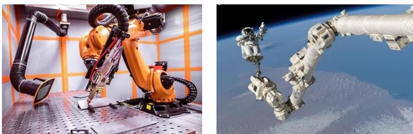  
图1-1机器人应用场景

在基于视觉的机械臂抓取操作中，视觉系统赋予了机器人类似“人眼”的功能。通过图像传感器以及图像处理技术能让机器人感知到外界环境，令其能对物体进行一些智能化的操作[8]。随着深度学习的兴起，目前在计算机视觉领域主要采用基于深度学习的图像算法实现图像目标检测、分类。相较于传统图像处理方法依赖手动特征设计从而缺乏灵活性的做法，采用基于深度学习的目标检测算法通过深度卷积神经网络（Convolutional Neural Networks, CNNs）对图像进行特征提取，所提取的抽象特征鲁棒性更强，泛化能力更好[9]。因此结合深度学习的检测算法用在机械臂的抓取检测环节具有十分重要的意义。具备良好的检测能力能够极大地提高机器人对于环境的感知能力，使机器人能在复杂动态的场景下进行抓取操作。

在具有良好感知能力条件下的机器人在操作技能学习过程中，涉及到众多机器学习方法。其中主要有两种，一种是基于强化学习的方法，另一种是基于示教模仿学习的方法。然而现阶段中，将强化学习算法应用在现实世界的机器人操作技能学习中还是较为困难。因为强化学习的本质是智能体通过与环境不断的交互，并获得回报的过程[10]。这种通过交互式的机器人学习方法，需要大量的数据，且还需不断调整合适的回报函数，不适用于实际使用。为此，采用模仿学习方法进行机器人操作技能学习，是目前更为常用的方法。模仿学习方法通过选择合适的机器学习算法，在训练过程中使用专家的示教样本进行学习，并且无需设定准确的汇报函数，更适用于实际应用中[11]。机器人通过机器学习算法模仿专家行为，能够迅速学习到操作技能，学习效率相对于强化学习要更高，能够适用于多数机器人的操作技能学习。模仿学习使得机器人可以从示教演示过程中学习操作技能，能够满足多数机器人的应用场景。通过模仿学习的方式赋予机器人操作技能对于实现机器人行为学习十分具有意义。

本文以基于深度学习的图像检测技术与机器人操作技能学习为研究对象，展开对基于深度学习的目标识别网络、目标抓取检测网络和机械臂模仿学习方法的研究。通过提高机械臂抓取过程中的感知能力以及操作技能的学习能力，推动机械臂智能化抓取的发展。

## 1.2 国内外研究现状

## 1.2.1 目标识别国内外研究现状

目标识别主要是对图像或视频流中的待检测目标进行识别检测，是计算机视觉研究中的重点内容。早期目标识别方法的主要内容为：特征设计、分类器选择、候选框生成。在图像识别过程中首先进行图像特征的设计，用来体现识别物体的特征。根据不同场景通常选用不同的特征，常用特征有定向梯度变化的HOG特征[12]、考虑局部纹理的 LBP特征[13]、高维度尺度不变的特征SHIF[14]等。分类器设计用于判断样本所属分类，常用分类器有SVM[15]、贝叶斯网络[16]等。候选框生成用于对识别物体进行定位，早期主要选择滑动窗口的方法生成候选框，但该方法耗费的时间太长并且易于产生多余窗口。后采用选择性搜索（Selective Search） [17]或二值化梯度（Binarized Normal Gradient） [18]的方法来提高计算效率。从早期图像识别技术的内容来看，可以发现图像处理过程比较依赖人工设计，且需要掌握扎实的专业知识和经过复杂的调参过程才能较为精确地完成目标识别，这种方法无法适用于复杂多变的环境。

随着深度学习技术的兴起以及计算机运算能力的大幅提升，目前基于深度学习的目标识别方法因其准确性、灵活性被更广泛地使用。特别在 2012 年，Krizhevsky 等人提出的深度卷积神经网络 AlexNet 在 ImageNet 图像大赛上取得优异的图像分类表现[19]，让研究者开始相信深度学习技术的有效性。自那以后，在深度学习技术的帮助下，目标识别算法的研究取得了飞跃性的进展[20]。

在深度学习的浪潮下，2014 年 Girshick 等人提出了基于候选区域的卷积神经网络 R-CNN[21]，该算法在 VOC2012 图像识别比赛中取得优异成绩，证明了深度学习的强大能力，并且开创了两阶段识别算法的先河。在这基础上，何凯明等人提出了 SPPNet[22]，该网络引入了空间金字塔池化改进了 R-CNN 网络，提升了目标检测的速度。2015 年，Girshick 等人结合 R-CNN 的优势，提出了Fast R-CNN[23]，该网络引入感兴趣区域池化，并联合训练卷积神经网络、分类器以及边界框回归模型，在提高了检测精度的同时，大大提升了检测速度。2016 年，Ren 等人提出了 Faster R-CNN[24]，在 Fast R-CNN 的基础上引入了区域建议网络（Region Proposal Networks, RPN），并在结构上将所有网络整合到一起，使得网络的检测精度和效率得到了提升。到此为止，目标识别的发展在深度学习的帮助下，已经取得了突破性的进展。特别是特征金字塔网络（FeaturePyramid Network, FPN）[25]的提出，让特征提取网络能够提取更丰富的图像语义信息。在此基础上，Fast R-CNN 的检测效果得到了进一步的提升，并发展出了能够同时识别物体并实现图像分割检测的 MaskR-CNN网络[26]。

此外，常用识别算法中还有单阶段识别算法，代表性有 YOLO 算法[27]、SSD 算法[28]、RetinNet 网络[29]等。YOLO 算法的核心思想是直接把物体检测问题当回归问题处理，用一个卷积神经网络直接从输入图像中预测物体的边界框和类别概率，从而达到比两阶段识别算法更快速的检测。SSD 算法原理与YOLO 类似，只是在特征提取方面两者不同。SSD 算法中提取了不同尺度的特征图来用作检测，克服了 YOLO 算法在小物体检测上的不足与定位方面的不准。总的来说，单阶段的识别算法在识别速度上比两阶段算法要更快，但是对于机械臂抓取识别过程中更依赖的是准确性和鲁棒性。因此在识别算法的选择上还是选用更准确稳定的两阶段识别算法。

## 1.2.2 抓取检测国内外研究现状

对目标进行抓取检测，主要是为了给机械臂抓取提供有效抓取位姿信息，这就像是人在进行抓取时，需要使用眼睛来对物体进行识别定位一样。早期的机械臂抓取检测主要通过几何关系分析来进行目标物体的抓取检测。首先获得目标物体的三维信息，再根据物体与机械臂抓手之间的几何关系，通过运动学分析来对目标进行抓取[30]。采用这种方法进行抓取检测，比较依赖物体的三维信息，并且分析过程较为复杂，泛化性较差，只适合在较为固定的场景下使用。

在过去的十年中，深度学习帮助计算机视觉技术取得了非凡的成就。受此启发，研究者开始使用基于深度学习的目标检测技术来进行机器人抓取检测。如杜学丹等人提出了基于深度学习的机械臂抓取方法，该方法使用基于深度学习的目标检测算法进行抓取目标检测，得出目标的位置和类别，然后通过最优抓取位置分析得到可抓取点[31]。江都提出基于卷积神经网络针对机械臂抓取过程的触觉感知和视觉感知问题，提升机械臂对不同物体的自适应抓取能力[32]。

为满足于机械臂抓取的需求，目前针对图像中目标物体的抓取检测需要完成对目标可抓取区域的位姿确定。康奈尔大学的 Lenz 等人提出了一个由两个深度网络构成的级联式网络进行抓取检测[33]。通过第一阶段网络剔除一些无用的候选抓取区域，第二阶段对第一阶段的结果进行优化，最终得到较好的抓取结果。文献[33]还提出了一种广泛用于图像中目标物体可抓取区域的表示方法，并且模型训练所使用康奈尔数据集[34]成为了目前抓取检测研究中常用的公共数据集。近年来，在 Lenz 等人使用滑动窗口方法和深度神经网络对图像进行目标抓取检测的启发下，Redmon 和 Depierre 选择了更加复杂和深层的 AlexNet 和ResNet-50 卷积神经网络作为图像特征提取网络[35],[36]。两者通过回归的方法直接预测图像内物体的抓取坐标，提高了物体抓取位姿检测的准确率，但是实时性还有待提高。

目前，许多抓取检测方法在处理图像的时候速度较慢，原因在于生成候选抓取框的过程中采用滑动窗口的方法，并且采用该方法生成的候选抓取框无法进行抓取姿态估计。因此，减少机器人检测抓取位置的时间和提高预测抓取位置的精度仍然是机器人研究中需要解决的问题。夏晶等人针对目标物体位置和姿态的检测问题，使用级联卷积神经网络建立一个位置-姿态由粗到细位姿快速检测方法[37]。其中针对抓取姿态角度检测的问题，文献[37]提出一种 Angle-Net模型来精细估计抓取角度，该模型能够帮助机械臂进行平面抓取位姿的快速检测。Chu 等人在 Faster R-CNN 网络[24]的启发下，提出了 Grasp Detection 网络[38]。该网络采用 RPN 生成候选抓取区域，通过回归方法预测抓取框位置与分类方法确定抓取框旋转角度，并在 ResNet[39]上进行图像的特征提取和结果预测，最终在抓取检测的测试中表现出良好的效果。

通过以上抓取检测算法分析可以看出，目前在对图像中目标物体进行抓取检测时，主流做法是分别对物体的位置和位姿进行检测，得出物体的抓取位姿信息。并且为了满足机械臂最优抓取的需要，在研究检测算法的过程中还需要保证算法的准确性和快速性。

## 1.2.3 机器人模仿学习国内外研究现状

在机械臂的发展历程中，主要经历了的三个阶段：第一阶段的机械臂主要是遵循人为规划的动作进行重复运动，这是一种开环式的控制结构，机械臂无法解决外界扰动的影响。目前这种机械臂常用于流水工作中，如物体搬运、电焊、喷漆等。第二阶段的机械臂在使用上，增加了感知功能，如触觉、视觉等，机械臂可以进行一定的反馈控制，通过对外界环境的感知，进行自身的控制运动[40]。此时机械臂的发展开始慢慢朝向智能化发展，开始将机械臂具有的各类传感器信息融入机器人控制算法，图像处理算法等[41]。第三阶段的机械臂发展是在机械臂拥有良好感知能力的基础上，增加了机械臂的智能控制模块，目的是希望机械臂能根据环境状态变化进行自主决策控制[42]。这种机械臂能够通过操作技能学习，获取从环境状态到行为动作的控制策略，从而使机械臂具有一定的自主控制能力，是目前机器人技术领域的重要研究对象。

目前，机器人的学习方法主要包括深度强化学习和模仿学习。深度强化学习是机器人进行智能决策、控制的重要方法。但机器人使用强化学习方法学习一项新的操作技能时，往往需要大量的数据训练与不断调整回报函数[43]，因此难以将其应用于实际的机器人操作技能学习中。为解决这个问题，人们提出了模仿学习，从示教行为中学习机器人的控制策略，构建一个从状态环境到机械臂动作的端到端映射模型[44]。

模仿学习的本质是通过观察其他智能体的行为，然后进行行为模仿[45]。这是从人类日常获取技能的方式来源的灵感，研究者希望机器人能够从模仿中快速进行操作技能学习。根据人类“观察”行为的启发，基于视觉下的模仿学习算法是目前的研究热点。通过视觉系统不仅可以快速获取环境信息，还可以通过视觉传感器快速获取示教数据，使示教过程中能够采集到更丰富的信息，提高模仿学习算法的泛化性[46]。特别是深度学习在图像技术上的应用，使得机械臂在基于视觉的物体识别定位、示教动作分析上拥有了更好效果。模仿学习过程，一般是对控制策略进行训练学习，令智能体从示教数据中学习状态-动作对应的控制策略。传统的模仿学习中，机械臂根据示教或者遥操作来学习控制运动，这种方式的缺点在于只能重复简单的动作，无法适应变化的环境。随着机器学习理论发展的成熟，解决模仿机械臂的控制方式也逐渐采取学习的方式。Takeda 等人基于隐马尔科夫模型（Hidden Semi-Markov Models, HSMMs）解决机器人模仿学习问题，通过示教数据训练，模型能够令机器人对行为进行动作再现[47]。但是这种方法主要通过一系列离散的动作状态转换来描述轨迹，这对机器人研究过程中的机器人本体以及传感器要求较高，没有普遍适应性。于建均等人提出了基于高斯混合模型（Gaussian Mixture Model, GMM）以及高斯混合回归（Gaussian Mixture Regression, GMR）来复现机器人的示教动作[48]，使用多个高斯分布来拟合机械臂不同阶段的控制轨迹，能够实现连续平滑的机器人控制。Gams 等人提出使用动态运动基元（Dynamic Movement Primitives, DMPs）来保证生成平稳连续的示教轨迹[49]，DMPs 方法可以生成任意轨迹的机械臂运动状态，用来进行机械臂轨迹学习，但是由于它是随机性的，因此在使用过程中的稳定性不佳。为了能够解决示教数据收集难的问题，文献[50]选择在仿真中进行机器人示教学习，将收集到的示教数据用来训练长短期记忆递归神经网络（Long Short Term Memory, LSTM），成功复现了机器人的操作。Zhang 等人通过相机采集的示教数据来学习训练控制策略，结果表明模仿学习直接学习从图像中的像素坐标映射到动作状态是可行的[51]。但在行为模仿过程中，还是存在模仿学习中的经常面临的问题，由于样本数量的不够，智能体无法学习到完整的操作。

近年来，国内也开始重视对机器人操作技能学习的研究。中科院自动化所的刘乃军等人对基于机器人操作技能学习进行了综述，提出了基于示教的模仿学习方法是机器人操作技能学习中的重要部分[3]。目前在国内研究中，高霄提出了一种基于模仿学习的多模态任务表达和学习方法，通过采集示教数据，建立表达人类多模态操作技能的概率统计模型，用于规划机械臂的运动、力和刚度等[52]。陈友东等人选择了合适的机器学习算法作为控制策略，并结合图像检测算法收集机械臂的示教数据对控制策略进行训练，构建了从目标物体位姿到机械臂关节空间的映射，可实现机械臂的快速部署和自适应抓取[53]。

总的来说，通过模仿学习的方法可以使机器人进行操作技能学习，但同时机器人的模仿学习也面对着一些挑战，如示教数据收集、学习算法选用、训练样本不够等问题。因此，关于如何收集示教数据与设计泛化性强、高鲁棒性的模仿学习算法是目前机器人模仿学习领域的研究重点。

## 1.3 论文的研究内容及章节安排

## 1.3.1 研究内容

本文针对机械臂抓取方法的研究主要从机器人的视觉感知抓取与抓取操作技能学习展开。针对基于视觉的机器人抓取操作过程中需要的识别和抓取检测需求，采用了基于深度学习的目标识别算法与目标位姿检测算法。针对抓取操作技能学习，采用机器学习算法作为模仿学习策略进行机械臂抓取技能学习，并结合抓取检测算法收集示教数据，然后对模仿学习策略进行训练。最后在机械臂抓取系统中对上述研究进行机械臂抓取实验验证。

## 1.3.2 章节安排

本论文的章节安排如下：

第一章 绪论：本章主要介绍了本文研究相关的理论背景以及意义，其次分别介绍目标识别、抓取检测、机器人模仿学习的国内外研究现状，最后介绍了本文的主要研究内容以及章节安排。

第二章 基于视觉的机械臂抓取系统：本章介绍了基于ABB机器人的机械臂抓取系统的组成，然后在 D-H 参数法的建模中进行了机械臂运动学分析，最后介绍了机械臂在基于视觉抓取过程中涉及到的物体坐标转换。

第三章 基于 Mask R-CNN 的目标识别算法：本章首先介绍了常见的目标检测算法以及卷积神经网络的原理。采用基于深度学习的 Mask R-CNN 网络作为抓取目标识别算法，并对 Mask R-CNN 的网络架构进行分析。最后使用 Kinect2.0 深度相机收集图片数据集，根据公共数据集的格式构建本地数据集对 MaskR-CNN网络展开训练以及测试。

第四章 基于改进 Grasp Detection 网络的目标抓取位姿检测方法：本章首先介绍了常见的抓取检测算法，提出基于改进 Grasp Detection 网络的目标抓取位姿检测方法，并介绍了该网络的各部分结构。最后使用康奈尔数据集以及自建本地数据集对网络进行训练以及测试，并在测试集上与原网络和其他检测模型进行了检测效果、检测速度的比较。

第五章 基于高斯过程混合模型的机械臂抓取方法：本章主要研究内容是采用高斯过程混合模型作为机器人模仿学习的控制策略。首先介绍了高斯过程混合模型的原理、构建以及参数估计方法。然后采用基于高斯过程混合模型的机械臂抓取方法，并介绍了其学习、训练和预测过程。该方法结合抓取检测网络构建从图像坐标系的目标物体位姿信息到机械臂关节角度的映射关系。最后在仿真实验中进行模型可行性验证，以及预测效果分析。

第六章 机械臂抓取实验：本章首先介绍了机械臂抓取实验的系统框架。然后对基于深度学习的抓取目标检测模型以及基于高斯过程混合模型的机械臂抓取方法进行抓取实验验证，实验包括：视觉系统的标定实验，以及物体抓取实验。

总结与展望：本章主要对全文的工作以及研究进行了总结，然后提出了论文研究过程中的不足以及未来研究的展望。

## 第二章 基于视觉的机械臂抓取系统设计

搭建机械臂抓取系统是研究机械臂抓取方法的基础。基于视觉的机械臂抓取系统是目前常用的机械臂抓取系统，机械臂在视觉系统的帮助下可以获得目标物体的位姿信息，从而进行抓取操作。本章根据基于视觉抓取过程中的需求，采用 Kinect 2.0 深度相机与 ABB 机器人搭建机械臂抓取系统，以满足抓取实验的需要。

## 2.1 机械臂抓取系统组成

## 2.1.1 机械臂抓取过程分析

机械臂在实际应用中经常面对种类和姿态不确定的目标物体，这在机械臂抓取操作中造成了较大的困扰。因此面对操作过程中可能出现的复杂环境，目前通常采用基于视觉帮助下的机械臂抓取方式。具体抓取过程为：第一步，使用相机获取目标物体的图像信息。第二步，通过目标检测算法快速准确地识别出物体的种类与位姿，再将从图片中得到的物体位姿通过坐标变换得到物体基于机械臂基座标的世界坐标。第三步，在获得目标物体的世界坐标后，通过机械臂的运动学分析获得机械臂的抓取关节角度进行抓取操作。因此，一个完整机械臂抓取系统主要由三部分组成如图2-1所示，包括：目标物体的图像获取、目标检测与定位、以及机械臂控制。

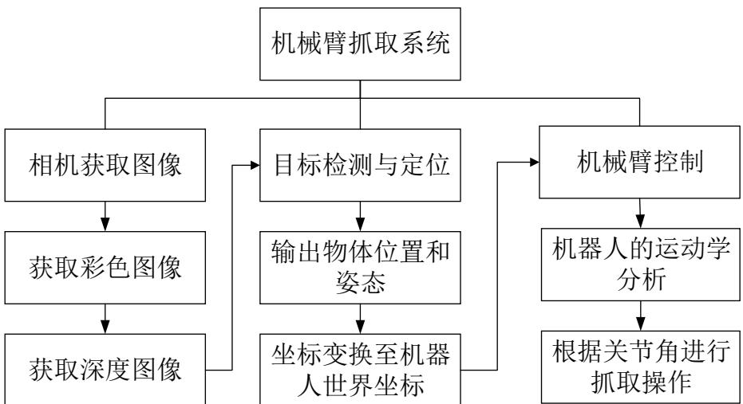  
图2-1机械臂抓取系统结构图

## 2.1.2 硬件平台设计

根据抓取操作的需求，机械臂抓取平台的硬件组成如图2-2所示，主要包括相机、计算机、机械臂本体。相机选用Kinect2.0深度相机，该相机是由微软公司所推出，除了能够获取 RGB图像外还可测得物体的深度信息，因此在机械臂物体抓取场景中得到了广泛的应用。计算机选择配置有GTX1080TI独立显卡，独立显卡所带有的 GPU 能够满足需基于深度学习的目标检测算法在训练需要用到的算力。机械臂选用ABB公司的六自由度工业机器人，ABB工业机器人的优点在于精度高、稳定性好，因此广泛应用于日常生活与生产当中。

  
Kinect 2.0 深度相机

  
计算机  
图 2-2 机械臂抓取系统硬件图

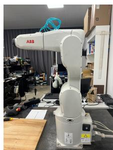  
ABB 机器人

## 2.2 机器人结构参数与运动学分析

## 2.2.1 机器人的结构参数

本文机械臂抓取系统使用的机器人平台是 ABB 公司的 IRB-1200 工业机器人，该机器人是六自由度机器人，拥有六个关节角。实物如图2-3所示，它的具体各项参数如表2-1和表2-2所示。

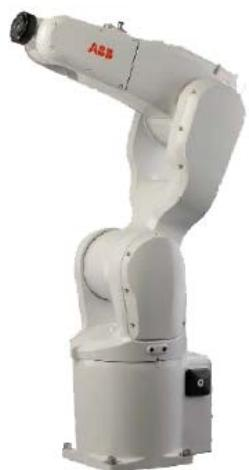  
图 2-3 ABB-IRB-1200 工业机器人

表 2-1 IRB-1200机器人性能参数

<table><tr><td>项目</td><td>指标</td></tr><tr><td>负载能力</td><td>7kg</td></tr><tr><td>末端重复定位精度</td><td>0.02mm</td></tr><tr><td>工作范围</td><td>703mm</td></tr><tr><td>高度</td><td>869mm</td></tr><tr><td>TCP最大速度</td><td>8m/s</td></tr><tr><td>TCP最大加速度</td><td> $35m/s^2$ </td></tr><tr><td>底盘大小</td><td> $210mm \times 210mm$ </td></tr><tr><td>重量</td><td>52kg</td></tr></table>

表 2-2 IRB-1200机器人运动参数

<table><tr><td>关节</td><td>运动范围</td><td>最大速度</td></tr><tr><td>关节1</td><td>-170°~170°</td><td>288°/s</td></tr><tr><td>关节2</td><td>-100°~130°</td><td>240°/s</td></tr><tr><td>关节3</td><td>-200°~70°</td><td>300°/s</td></tr><tr><td>关节4</td><td>-270°~270°</td><td>400°/s</td></tr><tr><td>关节5</td><td>-130°~130°</td><td>400°/s</td></tr><tr><td>关节6</td><td>-360°~360°</td><td>600°/s</td></tr></table>

## 2.2.2 机器人的运动学分析

关于机器人的运动控制分为正运动和逆运动，通过正逆运动学分析，可以帮助使用者能够很直观的了解机器人的运动控制状态。其中，通过机器人正运动可以使用机器人的各个关节变量来计算机械臂末端执行器在世界坐标系中的位置和姿态。通过机器人的正运动，只要给定一组机械臂的关节角度，就可以准确计算得出机器人末端执行器在世界坐标当中的位姿。而逆运动学相反，逆运动分析是通过机器人末端执行器在世界坐标系中的位置和姿态计算得出机械臂的各个关节角度。运动学分析过程中，逆运动学分析涉及非线性方程组的求解，因此可能会出现多种解甚至无解的情况，所以逆运动学分析在机器人运动分析过程中是个较难的问题。

## 2.2.2.1 正运动学分析

进行正运动分析时，首先对 ABB机器人进行建模，本章采用D-H参数法对机器人进行建模。D-H参数法是一种建立机器人关节坐标系之间坐标变换矩阵的方法[54]，通过D-H参数法建模可以直观体现出机器人的末端位置相对于机器人基座标的坐标变化关系。

采用D-H参数进行IRB-1200机器人建模，首先需要得到机器人的各个关节之间的参数，分别为 $\theta _ { \mathrm { i } } \setminus \ d _ { i } \ \setminus \ \alpha _ { i } \setminus \ a _ { i } \circ \ \theta _ { \mathrm { i } }$ 和 $d _ { i }$ 表示关节i与关节i−1的之间的状态， $\alpha _ { i }$ 和 $a _ { i }$ 表示关节i本身的状态。由这些D-H参数可以建立相邻关节之间

的坐标系变换矩阵 $^ { i - 1 } T$ ：

$$
{ } _ { i } ^ { i - 1 } T = \operatorname{Trans} ( 0 , 0 , d _ { i } ) \cdot \operatorname{Rot} ( Z _ { i } , \theta _ { i } ) \cdot \operatorname{Trans} ( a _ { i } , 0 , 0 ) \cdot \operatorname{Rot} ( X _ { i } , \alpha _ { i } )\tag{2-1}
$$

如图 2-4 所示的D-H坐标系，式(2-1)中 $R o t ( Z _ { \mathrm { i } } , \theta _ { i } )$ 表示为绕 $Z _ { i }$ 轴旋转了 $\theta _ { \mathrm { i } }$ 角度， $T r a n s ( 0 , 0 , d _ { i } )$ 表示沿 $Z _ { i }$ 轴平移了 $d _ { i }$ 单位， $R o t ( Z _ { \mathrm { i } } , \theta _ { i } )$ 表示绕 $X _ { i }$ 轴旋转了 $\alpha _ { i }$ 角度， $T r a n s ( a _ { i } , 0 , 0 )$ 表示沿 $X _ { i }$ 轴平移了 $a _ { i }$ 单位。通过计算可得式(2-2)。

$$
{ } _ { i } ^ { i - 1 } T = \left[ \begin{array} { c c c c } \cos \theta _ { i } & - \sin \theta _ { i } \cdot \cos \alpha _ { i } & \sin \theta _ { i } \cdot \sin \alpha _ { i } & a _ { i } \cdot \cos \theta _ { i } \\ \sin \theta _ { i } & \cos \theta _ { i } \cdot \cos \alpha _ { i } & - \cos \theta _ { i } \cdot \sin \alpha _ { i } & a _ { i } \cdot \sin \theta _ { i } \\ 0 & \sin \alpha _ { i } & \cos \alpha _ { i } & d _ { i } \\ 0 & 0 & 0 & 1 \end{array} \right]\tag{2-2}
$$

通过D-H参数法，可得到从机器人基坐标到末端夹持器坐标的转换关系。IRB-1200机器人中各个关节的D-H 坐标系如图 2-4 所示。IRB-1200机器人的D-H参数如表2-3所示，其中单位为mm。

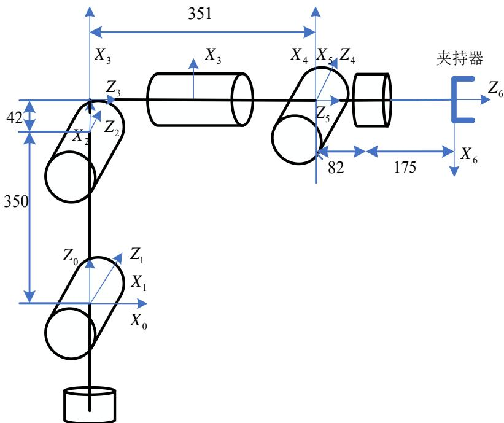  
图 2-4 IRB-1200机器人 D-H 坐标系

表 2-3 IRB-1200 机器人 D-H 参数

<table><tr><td>关节号</td><td> $d_i$ </td><td> $\theta_i$ </td><td> $a_i$ </td><td> $\alpha_i$ </td></tr><tr><td>1</td><td>0</td><td> $\theta_1$ </td><td>0</td><td>-90°</td></tr><tr><td>2</td><td>0</td><td> $\theta_2 - 90^\circ$ </td><td>350</td><td>0</td></tr><tr><td>3</td><td>0</td><td> $\theta_3$ </td><td>42</td><td>-90°</td></tr><tr><td>4</td><td>351</td><td> $\theta_4$ </td><td>0</td><td>90°</td></tr><tr><td>5</td><td>0</td><td> $\theta_5$ </td><td>0</td><td>-90°</td></tr><tr><td>6</td><td>257</td><td> $\theta_6 + 180^\circ$ </td><td>0</td><td>0</td></tr></table>

如式(2-3)所示，结合机器人D-H参数带入式(2-2)，可以得出机器人各个关节的坐标变换矩阵。其中为了使公式简洁，将 $\cos \theta _ { 1 }$ 简写为 $c _ { 1 }$ ， $\sin \theta _ { 1 }$ 简写为 $s _ { 1 }$ 。

$$
{ } _ { 1 } ^ { 0 } T = \left[ \begin{array} { c c c c } c _ { 1 } & 0 & - s _ { 1 } & 0 \\ s _ { 1 } & 0 & c _ { 1 } & 0 \\ 0 & - 1 & 0 & 0 \\ 0 & 0 & 0 & 1 \end{array} \right] \quad { } _ { 2 } ^ { 1 } T = \left[ \begin{array} { c c c c } s _ { 2 } & c _ { 2 } & 0 & 3 5 0 s _ { 2 } \\ - c _ { 2 } & s _ { 2 } & 0 & - 3 5 0 c _ { 2 } \\ 0 & 0 & 1 & 0 \\ 0 & 0 & 0 & 1 \end{array} \right]
$$

$$
{ } _ { 3 } ^ { 2 } T = \left[ \begin{array} { c c c c } c _ { 3 } & 0 & - s _ { 3 } & 4 2 c _ { 3 } \\ s _ { 3 } & 0 & c _ { 3 } & 4 2 s _ { 3 } \\ 0 & - 1 & 0 & 0 \\ 0 & 0 & 0 & 1 \end{array} \right] { } _ { 4 } ^ { 3 } T = \left[ \begin{array} { c c c c } c _ { 4 } & 0 & - s _ { 4 } & 0 \\ s _ { 4 } & 0 & - c _ { 4 } & 0 \\ 0 & 1 & 0 & 3 5 1 \\ 0 & 0 & 0 & 1 \end{array} \right]\tag{2-3}
$$

$$
{ } _ { 5 } ^ { 4 } T = \left[ \begin{array} { c c c c } c _ { 5 } & 0 & - s _ { 5 } & 0 \\ s _ { 5 } & 0 & c _ { 5 } & 0 \\ 0 & - 1 & 0 & 0 \\ 0 & 0 & 0 & 1 \end{array} \right] \quad { } _ { 6 } ^ { 5 } T = \left[ \begin{array} { c c c c } - c _ { 6 } & s _ { 6 } & 0 & 0 \\ s _ { 6 } & - c _ { 6 } & 0 & 0 \\ 0 & 0 & 1 & 2 5 7 \\ 0 & 0 & 0 & 1 \end{array} \right]
$$

将式(2-3)中的各个矩阵相乘，可得出机器人正运动学变换矩阵，如式(2-4)所示。通过该变换矩阵计算，可得到机器人末端夹持器相对于机器人基座标的坐标变换关系。

$$
{ } _ { 6 } ^ { 0 } T = { } _ { 1 } ^ { 0 } T \cdot { } _ { 2 } ^ { 1 } T \cdot { } _ { 3 } ^ { 2 } T \cdot { } _ { 4 } ^ { 3 } T \cdot { } _ { 5 } ^ { 4 } T \cdot { } _ { 6 } ^ { 5 } T = \left[ \begin{array} { c c c c } n _ { x } & o _ { x } & a _ { x } & p _ { x } \\ n _ { y } & o _ { y } & a _ { y } & p _ { y } \\ n _ { z } & o _ { z } & a _ { z } & p _ { z } \\ 0 & 0 & 0 & 1 \end{array} \right]\tag{2-4}
$$

其中，n、o、 $a$ 表示机械臂末端相对于基座标的旋转关系， $p$ 表示机械臂末端相对于基座标的平移关系，这些值由式(2-3)中的坐标系变换矩阵计算得来。

## 2.2.2.2 逆运动学分析

机器人的逆运动学分析是利用机器人末端位姿参数得出机器人各个关节角度的过程。对于六自由度的机器人进行逆运动学分析较为复杂，进行分析计算后可能会得到多组解。针对IRB-1200机器人的逆运动学分析，本章采用反变换法进行逆运动学求解。

## （1）求解 $\theta _ { 1 }$

在式(2-4)两边同时左乘上 $\stackrel { 0 } { \phantom { + } } T ^ { - 1 }$ 得到如下等式(2-5)：

$$
{ } _ { 1 } ^ { 0 } T ^ { - 1 } \cdot { } _ { 6 } ^ { 0 } T = { } _ { 2 } ^ { 1 } T \cdot { } _ { 3 } ^ { 2 } T \cdot { } _ { 4 } ^ { 3 } T \cdot { } _ { 5 } ^ { 4 } T \cdot { } _ { 6 } ^ { 5 } T\tag{2-5}
$$

定义 $( i , j ) _ { L } , ( i , j ) _ { R }$ 分别代表矩阵中的第i行、第 j 列元素，根据式(2-5)两边矩阵相对应的元素 $( 3 , 3 ) _ { L } \setminus ( 4 , 4 ) _ { R }$ 联立可得关于 $\theta _ { 1 }$ 的方程，解得：

$$
\theta_ {1} = \arctan 2 \left(d _ {6} a _ {y} - p _ {y}, d _ {6} a _ {x} - p _ {x}\right)\tag{2-6}
$$

## （2）求解 $\theta _ { 2 }$ 和 $\theta _ { 3 }$

在式(2-4)两边同时左乘上 $\stackrel { 5 } { 6 } T ^ { - 1 }$ 得到如下等式(2-7)：

$$
{ } _ { 6 } ^ { 0 } T \cdot { } _ { 6 } ^ { 5 } T ^ { - 1 } = { } _ { 1 } ^ { 0 } T \cdot { } _ { 2 } ^ { 1 } T \cdot { } _ { 3 } ^ { 2 } T \cdot { } _ { 4 } ^ { 3 } T \cdot { } _ { 5 } ^ { 4 } T\tag{2-7}
$$

由式(2-7)两端的元素 $( 1 , 4 ) _ { \scriptscriptstyle L } = ( 1 , 4 ) _ { \scriptscriptstyle R } , ( 2 , 4 ) _ { \scriptscriptstyle L } = ( 2 , 4 ) _ { \scriptscriptstyle R } , ( 3 , 4 ) _ { \scriptscriptstyle L } = ( 3 , 4 ) _ { \scriptscriptstyle R }$ 联立后可先求得 $\theta _ { 3 }$ ：

$$
\theta_ {3} = \arctan 2 (a _ {3}, d _ {4}) - \arctan 2 (k, \pm \sqrt {a _ {3} ^ {2} + d _ {4} ^ {2} - k ^ {2}})\tag{2-8}
$$

式(2-8)中的k 值为：

$$
k = \left[ p _ {x} ^ {2} + p _ {y} ^ {2} + p _ {z} ^ {2} - 2 d _ {6} \left(p _ {x} a _ {x} + p _ {y} a _ {y} + p _ {z} a _ {z}\right) + a _ {1} ^ {2} + d _ {6} ^ {2} - d _ {2} ^ {2} - a _ {3} ^ {2} - a _ {4} ^ {2} + 2 a _ {6} d _ {1} \right] / p _ {2}
$$

由式(2-7)可求得 $\theta _ { 2 }$ ：

$$
\theta_ {2} = \arctan 2 (a _ {3} c _ {3} - d _ {4} s _ {3} + a _ {2}, d _ {4} c _ {3} + a _ {3} s _ {3}) - \arctan 2 (\lambda , \pm \sqrt {1 - \lambda^ {2}})\tag{2-9}
$$

式(2-9)中 2 21 6 3 3 4 3 2 4 3 3 3( ) / ( ) ( )z z = − − p d a d a c d s a d c a s − + + + 。

## （3）求解 $\theta _ { 4 }$

在式(2-4)两边同时左乘上 ${ } _ { 3 } ^ { 2 } T ^ { - 1 } \cdot { } _ { 2 } ^ { 1 } T ^ { - 1 } \cdot { } _ { 1 } ^ { 0 } T ^ { - 1 }$ 得到如下等式(2-10)：

$$
{ } _ { 3 } ^ { 2 } T ^ { - 1 } \cdot { } _ { 2 } ^ { 1 } T ^ { - 1 } \cdot { } _ { 1 } ^ { 0 } T ^ { - 1 } \cdot { } _ { 6 } ^ { 0 } T = { } _ { 4 } ^ { 3 } T \cdot { } _ { 5 } ^ { 4 } T \cdot { } _ { 6 } ^ { 5 } T\tag{2-10}
$$

由式(2-10)中的 $( 1 , 3 ) _ { \scriptscriptstyle L } = ( 1 , 3 ) _ { \scriptscriptstyle R } , ( 2 , 3 ) _ { \scriptscriptstyle L } = ( 2 , 3 ) _ { \scriptscriptstyle R }$ 联立可得：

$$
\theta_ {4} = \arctan 2 \left(a _ {y} c _ {1} - a _ {x} s _ {1}, - a _ {x} c _ {2 3} - a _ {x} c _ {1} s _ {2 3} - a _ {y} s _ {1} s _ {2 3}\right)\tag{2-11}
$$

## （4）求解 $\theta _ { 5 }$

由式(2-10)中的 $( 3 , 3 ) _ { \cal L } = ( 3 , 3 ) _ { \cal R }$ 可得：

$$
\theta_ {5} = a \tan (\pm \sqrt {1 - \left(a _ {y} c _ {2 3} s _ {1} + a _ {z} s _ {2 3} + a _ {x} c _ {2 3} c _ {1}\right) ^ {2}}, - a _ {y} c _ {2 3} s _ {1} - a _ {z} s _ {2 3} - a _ {x} c _ {2 3} c _ {1})\tag{2-12}
$$

## （5）求解 $\theta _ { 6 }$

由式(2-10) $\mp \left( 3 , 1 \right) _ { L } = \left( 3 , 1 \right) _ { R } , \left( 3 , 2 \right) _ { L } = \left( 3 , 2 \right) _ { R }$ 联立可得：

$$
\theta_ {6} = a \tan 2 \left(- o _ {y} s _ {1} c _ {2 3} - o _ {z} s _ {2 3} - o _ {x} c _ {1} c _ {2 3}, n _ {y} s _ {1} c _ {2 3} + n _ {z} s _ {2 3} + c _ {1} n _ {x} s _ {1} c _ {2 3}\right)
$$

(2-13)

通过一系列计算，可以通过机械臂末端的位置姿态信息反推得到机械臂的各个关节变量，完成机器人逆运动分析的求解。需要注意的是，在机械臂逆运动分析过程中，可能会出现多解甚至奇异解的情况。在实际操作中，应当根据操作环境选择距离当前位置最近一组的关节角作为逆运动求解角度。

## 2.3 像素坐标到世界坐标转换

目前在机械臂抓取操作当中，主要用到的是基于视觉抓取。在视觉抓取过程中，采用相机获取目标物体信息涉及四种坐标表示，分别为像素坐标、图像坐标、相机坐标以及世界坐标。各个坐标系可在相机的针孔成像模型[55]中表示，如图2-5所示。

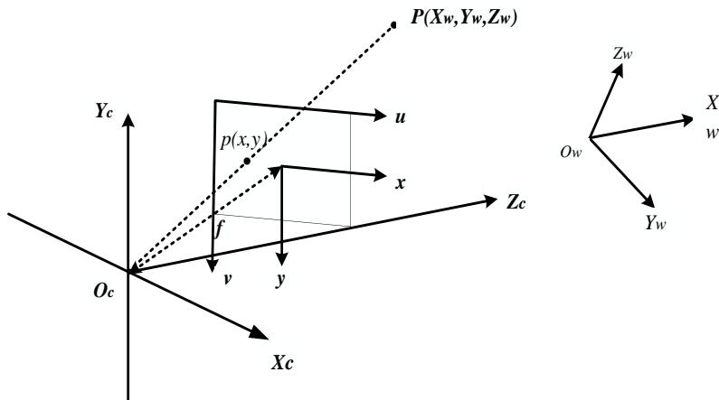  
图2-5 相机针孔成像模型

如图 2-5 所示， $O _ { w } - X _ { w } Y _ { w } Z _ { w }$ 表示世界坐标系，该坐标系描述的是物体存在于空间当中的位置和姿态。在机械臂操作过程中，通常选用机械臂的基座为世界坐标系的基座标。而 $O _ { c } - X _ { c } Y _ { c } Z _ { c }$ 表示相机坐标系，原点为相机光心。 $O - x y$ 为图像坐标系，表示物体在成像平面中的位置，一般以图像的中心为原点。$O - u \nu$ 为像素坐标系，表示物体在图像中的像素位置，一般选用图像的左上角顶点作为原点。在图2-5中，P点为三维世界中的一点，其在世界坐标系中的坐标为 $( X _ { _ w } , Y _ { _ w } , Z _ { _ w } )$ ，相机坐标系中的坐标为 $( X _ { c } , Y _ { c } , Z _ { c } )$ 。p点表示点P在图像中的位置，在像素坐标系的坐标为 $( u , \nu )$ ，在图像坐标系的坐标为 $( x , y )$ 。由成像原理可知，像素坐标系和图像坐标系处于同一个平面内，两坐标系是线性变化关系，关系如图2-6所示。

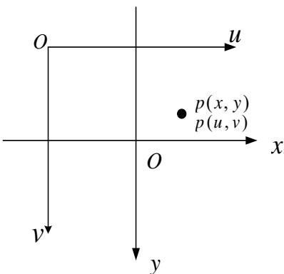  
图2-6图像坐标系与像素坐标系

如图 2-6 所示，p点在图像坐标系中的( , )x y 和像素坐标系中的( , )u v 满足式(2-14)，其中像素坐标系的每个像素的尺寸为 $d x ^ { * } d y$ ，单位为mm， $( u _ { 0 } , \nu _ { 0 } )$ 代表$O - x y$ 坐标系相对于 $O - u \nu$ 相对位置。由像素坐标转换到图像坐标的变换矩阵如式(2-15)所示。

$$
\left\{ \begin{array}{l} u = \frac {x}{d x} + u _ {0} \\ v = \frac {y}{d y} + v _ {0} \end{array} \right.\tag{2-14}
$$

$$
\left[ \begin{array}{l} u \\ v \\ 1 \end{array} \right] = \left[ \begin{array}{c c c} \frac {1}{d x} & 0 & u _ {0} \\ 0 & \frac {1}{d y} & v _ {0} \\ 0 & 0 & 1 \end{array} \right] \left[ \begin{array}{l} x \\ y \\ 1 \end{array} \right]\tag{2-15}
$$

由图2-5可知，从图像坐标系到相机空间三维坐标系的转换可通过三角形的相似变换得出，变换关系如式(2-16)所示。由图像坐标到相机坐标的变换矩阵如式(2-17)所示，其中f为相机的焦距， $Z _ { c }$ 为相机光心到物体的距离。

$$
\left\{ \begin{array}{l} x = f \frac {X _ {C}}{Z _ {C}} \\ y = f \frac {Y _ {C}}{Z _ {C}} \end{array} \right.\tag{2-16}
$$

$$
Z _ {c} \left[ \begin{array}{l} u \\ v \\ 1 \end{array} \right] = \left[ \begin{array}{l l l} \frac {f}{d x} & 0 & u _ {0} \\ 0 & \frac {f}{d y} & v _ {0} \\ 0 & 0 & 1 \end{array} \right] \left[ \begin{array}{l} X _ {c} \\ Y _ {c} \\ Z _ {c} \end{array} \right]\tag{2-17}
$$

如图2-5所示，世界坐标系与相机坐标系之间的转换为旋转平移关系。由此相机坐标系与世界坐标系之间转换关系如式(2-18)所示，其中R为 $3 \times 3$ 旋转矩阵，T为3 1 平移向量。

$$
\left[ \begin{array}{c} X _ {c c} \\ Y _ {c c} \\ Z _ {c c} \\ 1 \end{array} \right] = \left[ \begin{array}{c c} R & T \\ o & 1 \end{array} \right] \left[ \begin{array}{c} X _ {w} \\ Y _ {w} \\ Z _ {w} \\ 1 \end{array} \right]\tag{2-18}
$$

最终结合式(2-15)，(2-17)，(2-18)可得像素坐标到世界坐标的转换关系式为：

$$
Z _ {C} \left[ \begin{array}{c} u \\ v \\ 1 \end{array} \right] = \left[ \begin{array}{c c c} f _ {x} & 0 & u _ {0} \\ 0 & f _ {y} & v _ {0} \\ 0 & 0 & 1 \end{array} \right] \left[ \begin{array}{c c} R & T \\ o & 1 \end{array} \right] \left[ \begin{array}{c} X _ {W} \\ Y _ {W} \\ Z _ {W} \\ 1 \end{array} \right] = M _ {1} M _ {2} \left[ \begin{array}{c} X _ {W} \\ Y _ {W} \\ Z _ {W} \\ 1 \end{array} \right]\tag{2-19}
$$

其中， $M _ { 1 }$ 为相机的内参矩阵，由相机的结构参数决定，可通过相机标定获得； $M _ { 2 }$ 为相机的外参矩阵，由相机与机器人的手眼关系决定，可通过手眼标定获得旋转矩阵R与平移向量T； $Z _ { C }$ 为点到相机成像平面的距离，可由深度图像中的深度信息来获取。通过式(2-19)的转换，可以将图像上的像素坐标转到世界坐标系，得到物体在世界坐标中的位置。

## 2.4 本章小结

本章建立了基于视觉的机械臂抓取系统，并介绍了各部分硬件选择。然后根据所选 ABB-IRB-1200 机器人的结构参数，利用 D-H 参数法对 ABB-IRB-1200机器人进行建模，并进行了机器人的正逆运动学分析。最后根据针孔成像模型推导了从图像的像素坐标到世界坐标的转换关系，以满足基于视觉抓取的需要。

## 第三章 基于 MaskR-CNN的目标识别算法

在基于视觉的机械臂抓取过程中，进行目标识别检测是帮助机器人实现高效率、高精准抓取的前提。本章节介绍了常见的一些目标识别算法与卷积神经网络的原理，并选用 Mask R-CNN 网络进行抓取目标识别算法的研究，最后在机械臂抓取场景中对模型进行训练测试。

## 3.1 常见的目标检测算法

深度学习相关的目标检测与识别算法主要可以分为两种：一种是以通过生成候选区域的来进行检测的两阶段识别方法，如 R-CNN、Fast R-CNN、FasterR-CNN 等，其原理是先对图像生成一定数量的候选区域，然后再对候选区域进行进一步筛选生成检测结果。另一种是采用端到端的方式以求一次性获取检测物体的类别和位置的 2 阶段识别算法，如 YOLO 系列网络、SSD 系列网络。单阶段识别算法相较于两阶段识别算法在检测速度上有优势，但是检测效果会较低一些。

目前，两阶段识别算法中，最常用到的是 Faster R-CNN。该算法先通过特征提取网络（Backbone）生成特征图，再引入区域候选网络（Region ProposalNetworks, RPN）产生感兴趣区域（Region of Interest, ROI）。RPN 作用在于将特征图上的像素点映射到原图上，并以该点为中心生成不同比例与大小的候选框，再通过 RPN 网络中的两个全连接层进行候选框评分和边界回归。后经过非极大化抑制（Non-Maximum Suppression, NMS）去冗余之后，按照分数选择一定数量的回归框作为最终的 ROI。最后，将这些不同比例和大小的 ROI 通过 ROIPooling 层固定为相同尺寸然后再输入到全连接网络中进行结果预测。Faster R-CNN算法结合两阶段识别算法的优势与RPN，实现了精准且快速的检测功能。

Mask R-CNN 是在 Faster R-CNN 的基础上提出的目标识别算法，区别在于Mask R-CNN 增加了一个 Mask 分支用来实现目标的实例分割的功能。此外，Mask R-CNN 的一大改进是将特征金字塔网络（Feature Pyramid Networks, FPN）添加到特征提取网络中与使用ROIAlign替代 ROI Poling。FPN通过融合特征提取网络的多层特征，能够保留不同层次的特征，有利于小物体的识别。ROIAlign 在重映射特征图时，采用双线性插值法进行计算保留了浮点数，能够保留更多的输入特征，实现更精准的预测。

## 3.2 卷积神经网络原理

目前在目标识别领域，主要采用以深度卷积神经网络为主的检测方法，该方法可以提取更加丰富的图像特征信息，满足目标检测的需求。一般情况下卷积神经网络的组成包括：卷积层、池化层、还有激活函数。在一些深层网络中还会包含批量规范化层（Batch Normalization, BN）[39]和 Concat 层[56]。

原图  
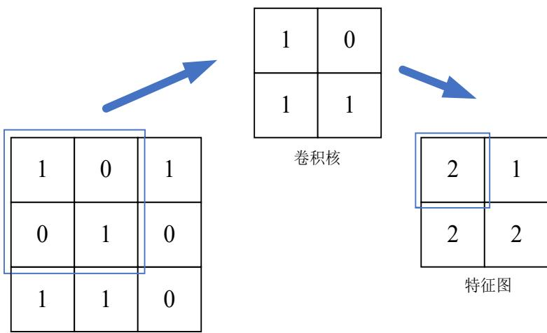  
图3-1卷积计算原理

在卷积神经网络中，卷积层和池化层是核心，其主要功能对图像进行特征提取。卷积层的具体操作是用一个卷积核在图像上进行卷积计算。以图 3-1 为例，使用一个2×2的卷积核对3×3的原图进行卷积操作，其中卷积操作的步长stride为1，边缘填充 padding为0，卷积操作的计算公式如式(3-1)所示。

$$
a _ {i, j} = \sum_ {m = 0} ^ {b - 1} \sum_ {n = 0} ^ {c - 1} \omega_ {m, n} \bullet x _ {i + m, j + n}\tag{3-1}
$$

其中，a 表示经过卷积操作后新的特征图中第i 行与第 j 列的特征值； $a _ { i , j }$ $\omega _ { { \scriptscriptstyle m } , n }$ 表示卷积核中第m行与第n列的权重；x 表示卷积操作前的原图中第i行 $x _ { i , j }$ 与第j列的特征值；b，c 代表卷积核的行数和列数。需要注意的是，卷积操作一般是从特征图的左上方开始，然后以设定步长开始向右进行卷积操作，依次从第一行到最后一行，直到整张图片完成卷积操作。

池化层的作用在于一方面可以降低特征的维度，减少模型计算的复杂度；另一方面可以去除掉不需要的冗余特征，提取主要特征。通常使用的池化方法分两种：最大池化和平均池化。如图 3-2 所示，对 44 大小的原图进行池化操作，选择区域大小为 22，步长 stride=2。最大池化操作为在对应区域保留最大特征值，平均池化操作为在对应区域保留平均特征值。

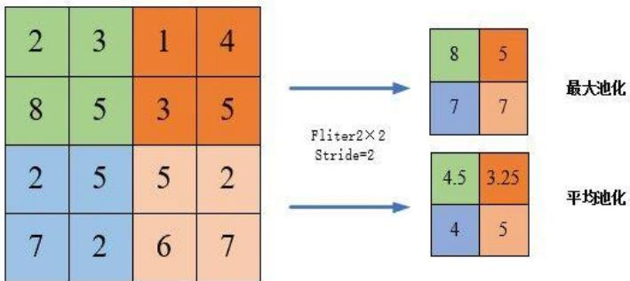  
图3-2 两种池化操作原理

卷积操作中主要进行的是线性操作，为了提高神经网络的表达能力，通常在卷积操作后引入激活函数来加入非线性因素。在神经网络中常用的激活函数有 Sigmoid 函数与ReLU 函数，公式如式(3-2)，(3-3)所示：

$$
\operatorname{Sigmoid} (x) = \frac {1}{1 + e ^ {- x}}\tag{3-2}
$$

$$
\operatorname{Re} L U (x) = \left\{ \begin{array}{l} x, x \geq 0 \\ 0, x <   0 \end{array} \right.\tag{3-3}
$$

Sigmoid 函数的可视化曲线如图 3-3(a)所示，函数的输出则被限制在(0,1)区间内，当函数的输入靠近原点的时变化率比较大，远离原点时变化率趋于平缓。因此Sigmoid 函数的缺点在于当输入偏离原点时，函数的变化梯度比较小，会导致网络训练速度较慢。所以一般情况下选择ReLU函数作为激活函数。如图 3-3(b)所示，当输入小于零时，ReLU函数不会被激活。当输入大于 0 时，ReLU函数将被激活，并且保持一定的梯度，不会因为输入变化而失去梯度。因此为了加快网络训练的收敛速度，通常选择使用ReLU函数。

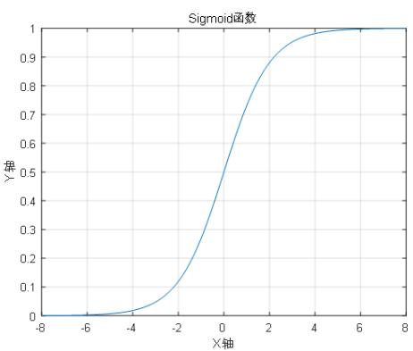  
(a) Sigmoid 函数

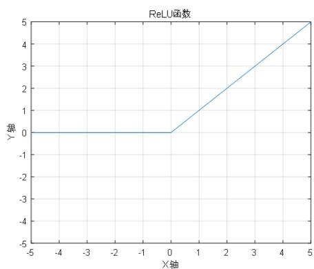  
(b) Re LU 函数  
图 3-3 Sigmoid 函数与ReLU 函数曲线图

批量规范化方法（BN）是一种常用的深度网络训练方法。当 BN 在使用时，通过规范化手段对网络层中一个批量的数据进行归一化处理，这样使得激活函数的输入能够分布在比较敏感的区域，避免梯度的消失。因此该方法的作用在于加快网络训练速度并防止出现梯度爆炸或者消失的现象，并且不需要理会解决过拟合问题的 Drop out操作以及 L2正则项参数的选择问题。

Concat 层通常是对两个或以上的特征图进行拼接操作。一般情况下，特征图主要有四个维度W(宽)×H(高)×C(通道)×N(数量)，Concat就是按照在通道或者数量维度上进行拼接。在特征图进行 Concat 操作的时候，需要注意的是必须保证除了拼接维度以外的其他维度必须一致。

## 3.3 Mask R-CNN 目标识别网络

为了在机械臂抓取过程中能够有效的识别物体种类信息，保证机械臂抓取的准确性。本章选择采用 Mask R-CNN 网络来进行机械臂抓取目标的识别算法。

## 3.3.1 Mask R-CNN 网络框架

Mask R-CNN网络框架如图3-4所示。首先使用特征提取网络生成特征图，然后通过区域候选网络（Region Proposal Networks, RPN）生成一定数量的感兴趣区域（Region of Interest，ROI），再使用 ROI Align 将 ROI 转换为固定尺寸的特征映射回特征图上。最后通过Mask分支，边界框回归和分类得到最终预测的实例分割图片、边界框和物体类别。下面将介绍 Mask R-CNN 网络的各个部分，主要包括：特征提取网络、RPN 网络、ROI Align 层以及全连接层与 Mask 分支。

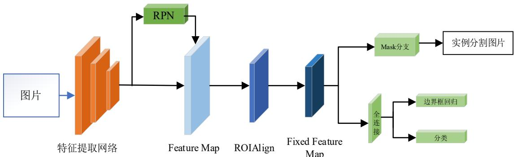  
图 3-4 Mask R-CNN 网络框图

## 3.3.2 特征提取网络

特征提取网主要由深度卷积神经网络构成，通常用于提取图片中的特征信息。常用网络模型有 ZF[57]、 $\mathrm { V G G } 1 6 ^ { [ 5 8 ] }$ 、ResNet[39]等。目前在特征提取网络当中最广泛使用的是 ResNet 网络，该网络优点在于引入残差网络结构解决了卷积神经网络太深容易造成梯度爆炸和消失的问题，并且还使用了 BN 操作加速了训练。因此 ResNet网络被广泛应用于许多深度学习算法的特征提取网络。

目前常用的ResNet主要有深度为18、34、50、101、152这5种，而组成网络的残差结构主要有两种。如图 3-5 所示，左边主要使用于较浅的网络，如ResNet-18/34；右边主要使用于针对较深的网络，如 ResNet-50/101/152。利用残差结构能够在保持网络深度的同时防止网络性能发生退化，保证网络的特征提取能力。本章采用ResNet-50作为特征提取网络的骨干网络，其网络结构如表3-1所示，整个网络由卷积层、残差结构和全连接构成。网络被用于特征提取时，主要使用的是Conv1-Conv5部分，网络的浮点运算次数（FLOPs）为 $3 . 8 \times 1 0 ^ { 9 }$ 0

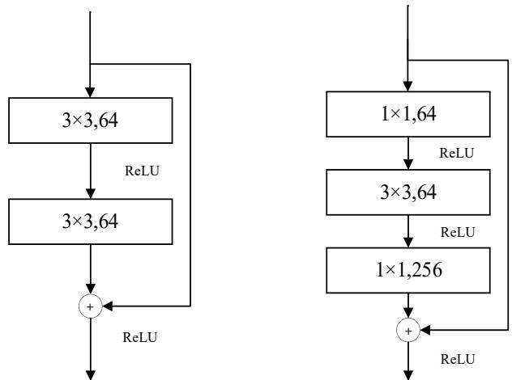  
图 3-5残差结构图

表 3-1 ResNet-50 网络结构

<table><tr><td>隐含层名</td><td>输出尺寸</td><td>网络结构</td><td>残差结构重复次数</td></tr><tr><td>Conv1</td><td>112×112</td><td>7×7, stride=23×3, Maxpool, stride=2</td><td></td></tr><tr><td>Conv2</td><td>56×56</td><td> $\begin{bmatrix} 1 \times 1,64 \\ 3 \times 3,64 \\ 1 \times 1,256 \end{bmatrix}$ </td><td>3</td></tr><tr><td>Conv3</td><td>28×28</td><td> $\begin{bmatrix} 1 \times 1,128 \\ 3 \times 3,128 \\ 1 \times 1,512 \end{bmatrix}$ </td><td>4</td></tr><tr><td>Conv4</td><td>14×14</td><td> $\begin{bmatrix} 1 \times 1,256 \\ 3 \times 3,1024 \\ 1 \times 1,1024 \end{bmatrix}$ </td><td>6</td></tr><tr><td>Conv5</td><td>7×7</td><td> $\begin{bmatrix} 1 \times 1,512 \\ 3 \times 3,512 \\ 1 \times 1,2048 \end{bmatrix}$ </td><td>3</td></tr><tr><td>FC</td><td>1×1</td><td>Average pool1000-d,  $f_c$ , Softmax</td><td></td></tr></table>

一般为了让网络能够识别更多物体类别，往往都会采用比较深层的网络。但加深网络使得图像特征的分辨率逐渐降低，会丢失较为细微的像素信息，不能保证网络能准确获得物体的位置和细节信息。为了解决上述情况，在特征提取网络中加入了特征金字塔结构（FPN），将特征提取过程的深层特征与浅层特征融合起来输入到 RPN 网络来生成不同规格的候选框，以保证获得物体准确的边界框和语义信息，完整的特征提取网络如图3-6所示。

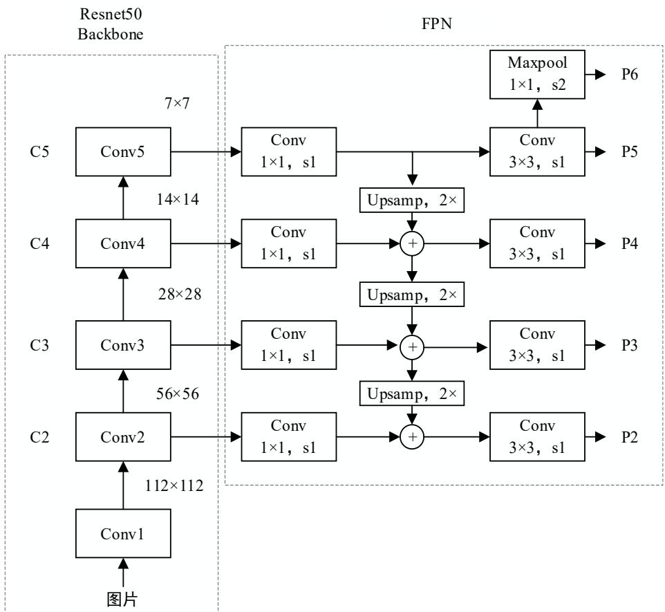  
图3-6 特征提取网络结构

如图 3-6 所示，C1\~C5代表了ResNet-50在每一层输出的特征图，然后通过一个 1×1 的卷积操作将每层输出的特征图转换成相同的通道数。再分别对C5\~C3的特征图采用两倍的上采样操作，将更高层的特征图转换到与上一层特征层相同的大小，然后进行矩阵相加操作。最后特征提取网络的输出特征图为经过特征融合以后的P2\~P5以及经过最大池化操作的P6。其中P2作为较底层的特征层，能够保留更多的底层信息，更适预测小型的目标，因此在以 P2特征层输入 RPN 网络当中，会生成较小尺寸的候选框。而对于较高层的 P3-P6，会依次生成更大尺寸的候选框。特征网络输出的所有特征图将共用一个 RPN，目的是为了减少网络参数，提升训练的速度。将FPN网络与ResNet相结合，可以在特征图中保留更多的图像特征信息，提高网络的检测性能。

## 3.3.3 RPN 区域建议网络

RPN 是 Mask R-CNN 模型中生成区域候选框的模块。如图 3-7 所示，其原理是先在特征图上用一个3 3 卷积核进行滑动窗口操作，再将卷积核的中心等比例映射回原图上并设为一个锚点，然后以锚点为中心生成不同比例和尺寸的锚框。当卷积核在特征图全部运算完一遍后，会得到一系列的候选框和一个多维特征向量。由于在特征提取网络中添加了 FPN 结构，因此会生成多个层次特征图 P2-P6。RPN 将根据不同层次特征图对应生成不同大小的锚框，若每个特征点生成N个锚框，那么特征图对应将生成W×H×N个锚框。

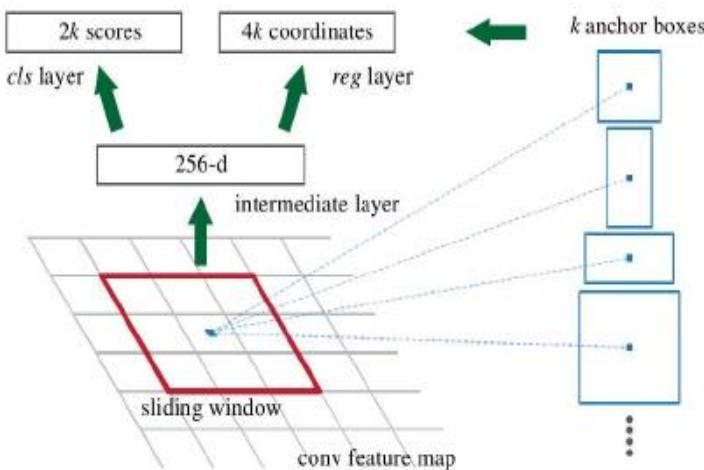  
图 3-7 RPN 网络结构图[24]

对于RPN生成的多维特征向量，将分别通过两个1×1的卷积层后输入全连接层生成锚框的类别信息和边界回归信息。其中类别信息有两个参数，用于区分锚框属于前景还是背景；边界参数四个参数组成，代表了锚框的边界信息。最后，由 RPN 网络生成的候选区域参数由前景概率和边界参数组成。由于在这过程中会生成较多的锚框，会形成很多的重叠部分，最终会采用非极大值抑制的方式进行筛选，生成最终的 ROI。

RPN 网络作为整个网络的重要组成，是 Mask R-CNN 需要训练的部分。其损失函数主要由两部分组成，一是分类层中的分类损失，通常使用交叉熵损失来进行计算；另一部分是回归层中的回归损失，通常使用 Smooth L1 损失进行计算。为了能够合理利用计算资源，在训练过程中通常还会进行进一步地筛选锚框，根据预测框的与样本真实的框进行交并比（IoU）计算，将样本主要分类两类。一类是 IoU大于 0.7的正样本，另一类是小于 0.3的负样本，其余剩下作为无关样本。需要注意的是，当正样本数量不够训练的时候，会在 IoU小于 0.7的样本中选择IoU较高样本补充进正样本当中，用来保证训练的准确性。IoU计算如图 3-8所示。

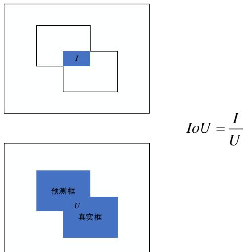  
图 3-8 IoU 计算原理

RPN中，分类层中的损失函数计算公式为：

$$
R P N \_ c l s \_ l o s s = \frac {1}{N _ {c l s}} \sum_ {i} L _ {c l s} (p _ {i}, p _ {i} ^ {*})\tag{3-4}
$$

其中， $N _ { c l s }$ 表示所有锚框的个数， p 表示第i个锚框对应是前景的概率； $p _ { i }$ $\boldsymbol { p } _ { i } ^ { * }$ 表示第i个锚框为正样本还是负样本的标签，为正样本时， $\boldsymbol { p } _ { i } ^ { * } = 1$ ，负样本时${ p } _ { i } ^ { * } = 0$ 。 $L _ { c l s } ( p _ { i } , p _ { i } ^ { * } )$ 为交叉熵损失，计算公式为：

$$
L _ {c l s} \left(p _ {i}, p _ {i} ^ {*}\right) = - \left(p _ {i} ^ {*} \log p _ {i} + \left(1 - p _ {i} ^ {*}\right) \log \left(1 - p _ {i}\right)\right)\tag{3-5}
$$

RPN中，回归层中的损失函数计算公式为：

$$
R P N \_ r e g \_ l o s s = \frac {1}{N _ {r e g}} \sum_ {i} p _ {i} ^ {*} L _ {r e g} (t _ {i}, t _ {i} ^ {*})\tag{3-6}
$$

其中， $N _ { r e g }$ 为正样本数量， $t _ { i }$ 表示第i个锚框的边界回归信息， $t _ { i } ^ { * }$ 表示该锚框相对于真实框的偏移量， $L _ { r e g } ( t _ { i } , t _ { i } ^ { * } )$ 为smooth L1损失，其公式为：

$$
L _ {r e g} \left(t _ {i}, t _ {i} ^ {*}\right) = \left\{ \begin{array}{l l} 0. 5 \cdot \left(t _ {i} - t _ {i} ^ {*}\right) ^ {2} & i f \left| t _ {i} - t _ {i} ^ {*} \right| \leq 1 \\ \left| t _ {i} - t _ {i} ^ {*} \right| - 0. 5 & o t h e r w i s e \end{array} \right.\tag{3-7}
$$

最终 RPN的总损失函数为：

$$
R P N \_ l o s s = R P N \_ c l s \_ l o s s + R P N \_ r e g \_ l o s s\tag{3-8}
$$

## 3.3.4 ROI Align 层

如图 3-9所示，ROI Align层的作用在于将原图上不同尺寸大小的 ROI特征转换成相同大小后映射到特征图上的对应位置，然后在进行池化操作。具体的操作如图3-9所示，根据ROI在原图中的对应位置，在特征图上对在P2-P6生成不同种类的 ROI 进行等比例的映射。对映射得到的区域进行等比划分成大小相等的子区域，在每块子区域的中心位置选择若干个点特征值作为该子区域的特征。最后对映射得到的特征区域进行池化操作后，得到输出特征。

特征图  
原图  
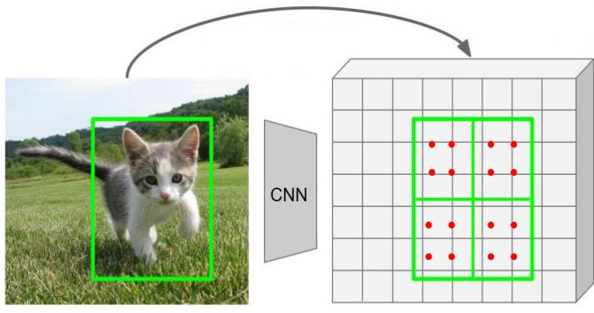  
图 3-9 ROI Align 过程示意图

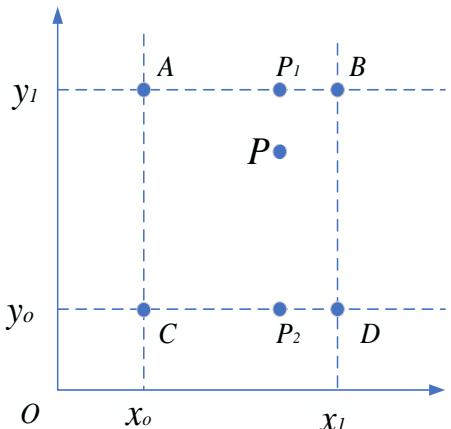  
图3-10 双线性插值计算

特征图上子区域的中心位置特征值计算主要通过双线性插值的计算得到。通常在映射过程中，中心点的位置不会刚好落在已知特征值的点上，因此会选取靠近中心点最近的四个特征值采用双线性插值的方法计算中心点坐标。计算原理如图 3-10 所示，已知中心点 $P \big ( x _ { c } , y _ { c } \big )$ 四周的点 A，B，C，D 坐标分别为$( x _ { 0 } , y _ { 0 } ) , ( x _ { 0 } , y _ { 1 } ) , ( x _ { 1 } , y _ { 0 } ) , ( x _ { 1 } , y _ { 1 } )$ ，特征值计算公式为 $f ( x , y )$ ，P 点特征值计算过程如下：

首先分别通过线性插值计算 $P _ { 1 }$ 和 $P _ { 2 }$ 特征：

$$
\left\{ \begin{array}{l} f (P _ {1}) = \frac {x _ {1} - x _ {c}}{x _ {1} - x _ {0}} f (A) + \frac {x _ {c} - x _ {0}}{x _ {1} - x _ {0}} f (B) \\ f (P _ {2}) = \frac {x _ {1} - x _ {c}}{x _ {1} - x _ {0}} f (\mathrm{C}) + \frac {x _ {c} - x _ {0}}{x _ {1} - x _ {0}} f (\mathrm{D}) \end{array} \right.\tag{3-9}
$$

再通过线性插值计算可以得到P点特征为：

$$
f (P) = \frac {y _ {1} - y _ {c}}{y _ {1} - y _ {0}} f (P _ {2}) + \frac {y _ {c} - y _ {0}}{y _ {1} - y _ {0}} f (P _ {1})\tag{3-10}
$$

## 3.3.5 全连接层与 Mask 分支

ROI输入 ROI Align层后将会生成一个特征图，经 Mask R-CNN网络最后的全连接层以及Mask分支后，网络将会输出最终的预测结果。结果包括物体的类别，边界信息与图像分割结果。在物体分类和边界回归分支当中，会将特征图经两次卷积操作后输入两个全连接层，一个负责分类预测，一个负责边界回归预测。在类别预测中将会输出每个类别对应的分数，边界回归预测中会输出每个识别物体所对应的位置参数。在网络训练过程中，会对全连接层中的两个预测分支损失进行训练，分类损失计算采用多分类问题中常用的Softmax交叉熵损失，损失计算公式为：

$$
\text { Mask } \_ c l s \_ l o s s = \frac {1}{N _ {c l s} ^ {\prime}} \sum_ {i} L _ {c l s} (p, u)\tag{3-11}
$$

其中， $N _ { c l s } ^ { \prime }$ 是训练过程中生成的ROI数量， $p$ 是代表分类器预测的概率，u对应目标真实类别标签， $L _ { \mathit { c l s } }$ 计算公式为：

$$
L _ {c l s} (p, u) = - u \log p\tag{3-12}
$$

边界回归分支的损失函数为：

$$
\text { Mask } \_ r e g \_ l o s s = \frac {1}{N _ {r e g} ^ {\prime}} \sum_ {i} L _ {r e g} \left(\beta_ {i}, \beta_ {i} ^ {*}\right)\tag{3-13}
$$

其中 $N _ { r e g } ^ { \prime }$ 代表最终分类正确的 ROI数量， $L _ { r e g } ( \beta _ { i } , \beta _ { i } ^ { * } )$ 与 RPN 损失计算中的式(3-7)一样。

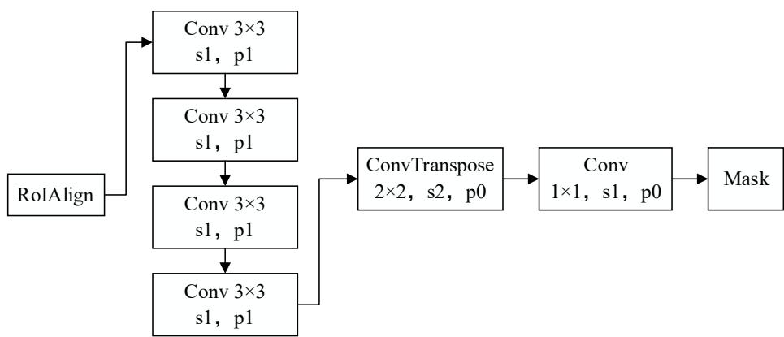  
图 3-11 Mask 分支网络结

Mask R-CNN网络的Mask分支用于生成图像分割结果。如图3-11所示，网络的预测分支中使用了一个全卷积的网络来预测物体生成的识别物体的分割结果。在 Mask 分支的训练过程，损失函数Mask\_loss采用平均二值交叉熵损失，通过预测蒙版与真实蒙版之间的像素点信息做 sigmoid的二分类损失计算。

## 3.4 模型训练与结果分析

## 3.4.1 数据集选择与制作

在 Mask R-CNN网络的训练过程中，通常采用 COCO2014作为默认数据集来对模型进行训练。COCO2014 作为目标检测网络当中常用到的数据集包括了80 个类别物体以及每个种类都有丰富的图片和语义分割图像，能够提供给网络优质的训练样本。在机器人抓取操作中，面临的工作场景比较固定，且抓取操作中经常面对的是操作工具与生活用品。因此为了满足抓取需要，在实验过程中，按照COCO2014数据集的格式制作了本地数据集。

在数据集制作过程中，首先确定了物体类别，主要选择了工作生活中常见的物体。最终选择了以下物品：[剪刀、螺丝刀、钳子、吸锡器、扳手、胶棒、笔、订书机、香蕉、鼠标、牙刷、牙膏、充电器、勺子、鞋子、水瓶、胶水、刷子、插排、螺丝]等常见的物品。然后使用 Kinect 2.0 深度相机对这些物品进行的拍摄。拍摄过程中，收集单种或多种物体以不同角度在操作台上的彩色图像，每个种类选择2-3个实物作为拍摄对象。最终一共收集了800张图像作为本地数据集，数据集中保证每种物体出现的频率相近。

在数据集标注过程中，为生成训练过程需要的标签和Mask分支的蒙版，分别使用图像标注工具Labelme与飞桨公司推出的EIseg标注分割软件进行图像标注。Labelme 可标注检测模型训练过程中需要用的类别信息，以 yaml 格式保存下。而 EIseg可以标注用于 Mask训练的用到的蒙版信息，以 png格式保存下来。在训练过程中所使用的标注信息，如图3-12所示。

269\_pseudo.png  
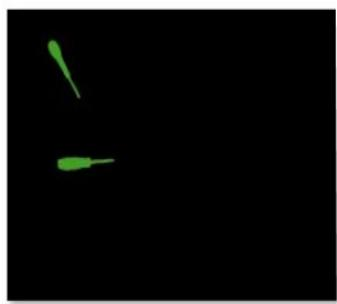

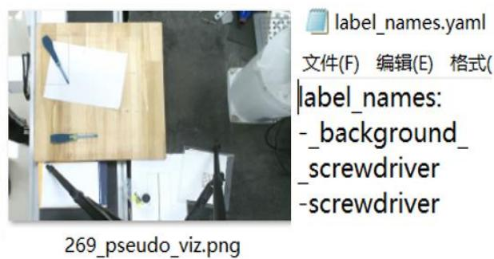  
图3-12数据集样式

## 3.4.2 训练参数与结果分析

在训练过程中，使用本地数据集对模型进行训练。在本地数据集中选择 10%作为验证集，剩下的作为训练集进行训练。本次识别网络在 Pytorch实现框架上进行搭建，为了避免过拟合训练，学习过程使用 Pytorch 官方提供的预训练ResNet-50。本次训练是在单个 GTX1080Ti进行的，其中在 Pyhon环境中分别安装了 Cuda=11.1、Pytorch=1.11 等依赖库。

在训练过程中，网络训练的初始学习率设为 0.005,，batch\_size 设为 4，epoch设为 20。RPN网络的NMS操作将单张图片的最大 ROI数量设置为了 200。在训练中采取整个网络的联合训练，总的损失函数为：

$$
\begin{array}{r l} \text {Loss} & = R P N \_ l o s s + M a s k \_ c l s \_ l o s s \\ & + M a s k \_ r e g \_ l o s s + M a s k \_ l o s s \end{array}\tag{3-14}
$$

在网络经过20个epoch的训练后最终模型训练的损失变化如图3-13所示。

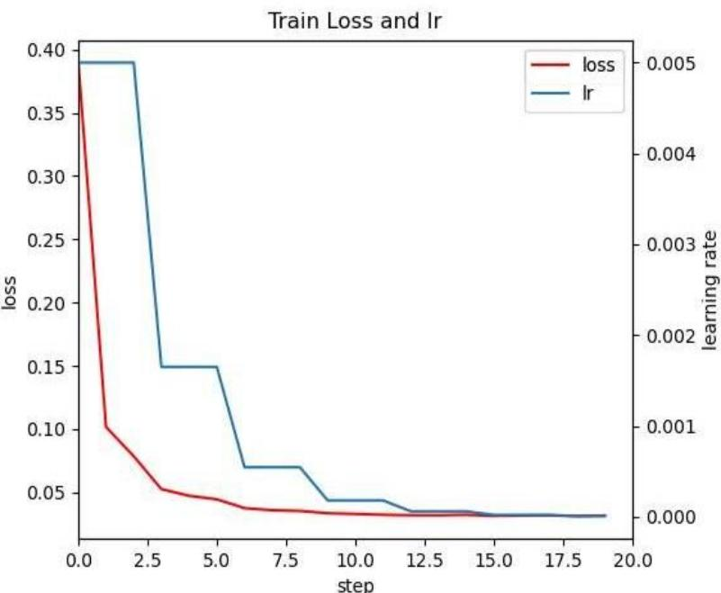  
图3-13 损失函数变换曲线

在机械臂操作台上使用相机随机收集一些工具的图片作为测试图片，然后将其输入训练完成的识别模型中对物体的类别、位置以及图像分割结果进行识别检测。测试结果如图 3-14 所示，可以看出物体分割效果良好，并且能准确识别物体的种类以及大致的位置，通过多张图片测试得出的平均预测时间为 0.2s左右，能够满足机器人工作中识别的需要。

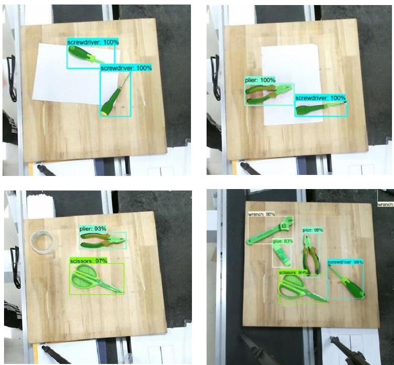  
图3-14 图片识别测试结果

## 3.5 本章小结

本章采用 Mask R-CNN 网络作为机械臂的抓取识别方法，并分析了其网络结构框架与损失函数的计算。最后使用在机械臂工作场景中收集的本地数据集对 Mask R-CNN 网络进行训练测试，测试结果表明该网络能够有效识别抓取过程中目标的信息。

## 第四章 基于改进 Grasp Detection 网络的目标抓取位姿检测方法

在机械臂抓取检测过程中，进行目标识别检测只是完整检测过程的一步。要进行准确的抓取目标检测，还需对识别得到的目标物体进行抓取位姿的检测，包括可抓取区域位置和抓取姿态的检测[59]。本章主要对目前常见机器人抓取位姿检测方法进行分析，提出了改进的 Grasp Detection 网络进行目标抓取位姿检测研究，最后在在康奈尔数据集与本地数据集下进行抓取检测方法效果验证。

## 4.1 常用抓取检测分析

目前关于抓取目标位姿检测方法主要分为两类，一类是基于物体三维模型信息来估计物体的抓取位置和姿态。如基于点云信息的抓取姿态估计算法，使用3D神经网络PointNet进行抓取姿态估计，这种方法依赖于物体的点云信息易受光照、遮挡等因素影响[60]。另一类是基于RGB图像抓取，将抓取目标位姿检测问题转化为目标检测问题，选择在2D平面进行检测抓取位姿。在抓取操作过程中，为了能从给定目标图像中获得满足抓取的物体位姿信息，文献[33]提出了使图像平面中的定向矩形框来表示潜在的抓取位置，其表述为：

$$
g = (x, y, \omega , h, \theta)\tag{4-1}
$$

其中， $( x , y )$ 表示抓取框中心位置像素坐标， $( \omega , h )$ 代表宽度和高度。 $\theta$ 是抓取框相对于水平方向夹角。图4-1是这种五维抓取矩形框的表现方式，在实际抓取过程中， $\omega$ 通常根据机械臂末端爪手的长度设定， 根据机械臂末端爪手打开的最大宽度设定。在机械臂抓取过程中，最经常采用的是垂直于物体上方的顶抓和垂直物体侧面的侧抓。这种抓取表达方式虽然没有得到物体完整的三维世界的位置和方向，但利用这种间接表示方式得到的物体位置信息，可以满足机器人实际抓取需求。这种五维表示使抓取检测的问题类似于计算机视觉中的目标检测问题，区别在于增加了一个用于表示抓取方向的参数。

传统位置检测方法根据二值化的图像计算物体重心作为抓取位置，但是可抓取位置不在重心处的物体甚多，此方法只使用在形状规则的简单物体上，灵活性较差。近十年内，深度学习范式的巨大成功，尤其是在计算机视觉方面的巨大成功，大大激发了研究者使用卷积神经网络来解决抓取检测的问题。它的关键优势在于能够自我学习大量标记和未标记的数据特征形成网络模型，并且无需手动设计特征空间，已成为视觉识别领域最好的学习方法[61]。Chu 等人在

Faster R-CNN 网络的启发下，提出了 Grasp Detection 网络。该网络使用 ResNet作为特征提取网络结合 RPN 中生成候选抓取区域，最后通过分类方法来预测抓取框旋转角，能够有效预测目标物体的可抓取框。

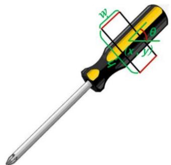  
图4-1 五维抓取框的表示图

## 4.2 基于改进 Grasp Detection 网络的抓取检测方法

## 4.2.1 改进的 Grasp Detection 网络结构

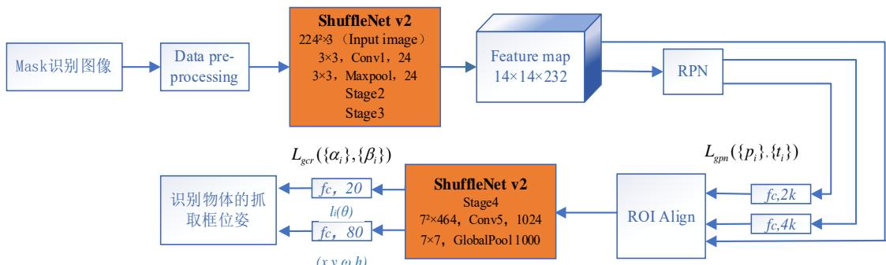  
图 4-2 改进的 Grasp Detection 网络结构

本章提出基于深度学习的改进 Grasp Detection 网络作为抓取位姿检测方法，将 Mask R-CNN 网络输出的图像识别结果输入该网络可得到已识别物体的可抓取位置的位姿信息。如式(4-1)所示，位姿信息包括抓取框的中心像素坐标和旋转角度。改进的 Grasp Detection 网络采用轻量化卷积神经网络 ShuffleNet v2[56]结合 RPN 网络进行位姿的检测和定位，整体网络模型结构如图 4-2 所示。相比原网络，采用ShuffleNet v2网作为特征提取网络对比ResNet-50网络在保持网络深度的同时，减少模型计算量和模型大小，能够有效提高了抓取检测的速度。

## 4.2.2 ShuffleNet v2 特征提取网络介绍

改进的 Grasp Detection 网络采用 ShuffleNet v2 作为特征提取网络。在结构上 ShuffleNet v2与 ResNet相似，主要由三个模块、卷积层和池化层组成，但两者在构成模块的结构上有很大不同。如表 4-1所示，ShuffleNet v2中除了包含单独卷积层和池化层外图，包含了三个 Stage模块，每个模块主要由 ShuffleNet v2特有的块堆叠而成，网络的浮点运算次数（FLOPs）为 81.46 10 。

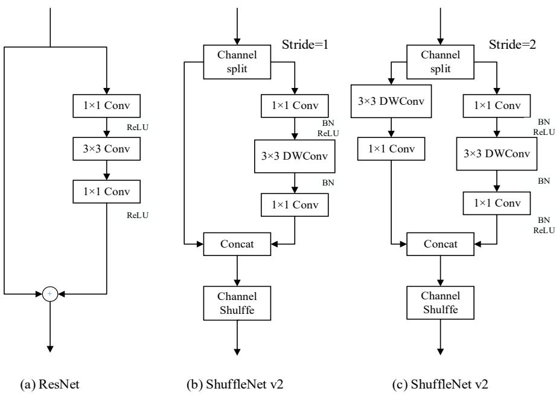  
图 4-3 ResNet 与 ShuffleNet v2 模块

如图 4-3 所示，与 ResNet 中的残差块结构相比，ShuffleNet v2 的块结构首先是增加了一个通道分离（Channel Split）的操作，将通道数分为数量相同的两个通道输入，该做操目的为了最小化内存访问成本，提高网络运行效率。

当采用 stride=1的操作时，如图 4-3(b)所示，一部分进行卷积操作，另一部分不进行操作，最后两部分进行拼接（Concat）操作。当采用 stride=2操作时，如图4-3(c)所示，两部分都需要经过卷积操作后进行拼接操作。两者使用的卷积操作为1×1卷积与3×3深度可分离卷积（DW卷积）[62]连接。采用3×3DW卷积可以在保持网络深度的同时，可以有效减少计算的参数量。为增加网络的非线性特征，在每个 1×1卷积后增加了一个 ReLU激活函数。并且 3×3DW卷积后还增加了批归一化（BN）操作，使得整个网络的训练速度和收敛速度大大加快。最后在两部分信息进行拼接后，再进行 Channel Shuffle 操作，保证不同通道上的信息进行流动。否则，左端那路的一半通道信息将一直进行到后面都没有通过卷积层。

ShuffleNet v2 作为特征提取网络引入了通道分离操作、深度可分离卷积操作和 Channel Shuffle 操作，在保证卷积神经网络保持一定深度的情况下，大大减少了网络计算参数，提高了网络的计算速度。并且最后通过 Channel Shuffle操作保持网络当中信息的流通，保证网络对图像的特征提取能力。

表 4-1 ShuffleNet v2 网络结构

<table><tr><td>隐含层名</td><td>输出尺寸</td><td>卷积核大小</td><td>步距</td><td>结构重复次数</td><td>输出通道数</td></tr><tr><td>Image</td><td>224×224</td><td></td><td></td><td></td><td>3</td></tr><tr><td>Convl</td><td>112×112</td><td>3×3</td><td>2</td><td></td><td>24</td></tr><tr><td>MaxPool</td><td>56×56</td><td>3×3</td><td>2</td><td></td><td></td></tr><tr><td rowspan="2">Stage2</td><td>28×28</td><td></td><td>2</td><td>1</td><td rowspan="2">116</td></tr><tr><td>28×28</td><td></td><td>1</td><td>3</td></tr><tr><td rowspan="2">Stage3</td><td>14×14</td><td></td><td>2</td><td>1</td><td rowspan="2">232</td></tr><tr><td>14×14</td><td></td><td>1</td><td>7</td></tr><tr><td rowspan="2">Stage4</td><td>7×7</td><td></td><td>2</td><td>1</td><td rowspan="2">464</td></tr><tr><td>7×7</td><td></td><td>1</td><td>3</td></tr><tr><td>Conv5</td><td>7×7</td><td>1×1</td><td>1</td><td></td><td>1024</td></tr><tr><td>GlobalPool</td><td>1×1</td><td>7×7</td><td></td><td></td><td>1000</td></tr><tr><td>FC</td><td></td><td></td><td></td><td></td><td>1000</td></tr></table>

## 4.2.3 抓取区域候选网络

本章网络使用的候选抓取区域，与第三章中的 RPN 原理相同。如图 4-2 所示，RPN作用在 ShuffleNet v2的 Stage3之后的特征图上，用于生成候选抓取区域。RPN的输入为 ShuffleNet v2中 Stage3输出的特征图，输出为多维特征与一系列候选抓取区域。对于 RPN 生成的多维特征向量，将输入全连接层生成候选框的类别信息和边界回归信息，而候选抓取区域结果输入 ROIAlign层。

在本章抓取检测网络的 RPN网络中，定义区域抓取候选网络损失函数为：

$$
\begin{array}{c} L _ {g p n} (\{p _ {i} \}, \{t _ {i} \}) = \frac {1}{N _ {g p \_ c l s}} \sum_ {i} L _ {g p \_ c l s} (p _ {i}, p _ {i} ^ {*}) \\ + \lambda_ {1} \frac {1}{N _ {g p \_ r e g}} \sum_ {i} p _ {i} ^ {*} L _ {g p \_ r e g} (t _ {i}, t _ {i} ^ {*}) \end{array}\tag{4-2}
$$

其中， $p _ { i }$ 表示第i 个候选框的类别概率， ${ p } _ { i } ^ { * } = 0$ 表示不存在候选框，${ p } _ { i } ^ { * } = 1$ 表示存在候选框； $t _ { i }$ 表示第i个候选框的位置参数； $t _ { i } ^ { * }$ 表示实际抓取框的坐标向量； $L _ { g p \_ c l s }$ 是交叉熵损失函数； $L _ { g p \_ r e g }$ 是回归损失函数； $N _ { g p \_ c l s }$ 和$N _ { g p \_ r e g }$ 表示归一化参数； $\lambda _ { \mathrm { 1 } }$ 表示归一化平衡权重。

## 4.2.4 抓取框角度分类区间

如图4-5所示，机器人常用的顶抓或侧抓方式，其末端夹持器的抓取姿态通常垂直与操作台，因此抓取姿态角通常可直接抓取框与水平方向的夹角表示。对于早先的一些基于深度学习的预测回归方法，文献[35],[36]通过直接将 RGB图像输入网络中回归预测五维抓取表示 $g = ( x , y , \omega , h , \theta )$ 。然而，结果表明在平面物体姿态角度的预测上，结果并不是很好。

因此在抓取框预测操作上，GraspDetection网络采用将抓取框坐标采用回归方式预测，姿态角度采用分类方式预测。将图像中目标物体的抓取框角度均分为若干个相等角度区间，每个角度区间作为一个分类情况。并且除了预测抓取角度的类别，还增加了一个无法抓取角度分类，用于表示图像内无抓取目标表示。若没有一个角度分类器输出的分数高于无法抓取类，那么抓取建议就被认为是不正确。所以类的总数为 $C = R + 1$ ，用 $\{ ( l _ { i } , \theta _ { i } ) , i \in \{ 0 , 1 , 2 , . . . , n \} \}$ 表示第i 抓取配置与角度 $\theta _ { i }$ 有关。每个标签 $l _ { i }$ 都对应着一个角度 $\theta _ { i }$ ，对于没有可能的方向的情况（即该区域不可抓取），输出标签为 $l _ { i } = 0$ ，没有相关的方向。考虑机械臂的爪手末端是两端平行且对称的，所以将抓取框的旋转角区间设定在[0,180]之间。本文采取R=18，旋转角度划分为 18个区间，每个区间角度为 $1 0 ^ { \circ }$ ，因此总标签一共为19个。如图 4-4所示，抓取姿态角度一共分为 18个类别其姿态角度的字符标签 angle1～angle18。

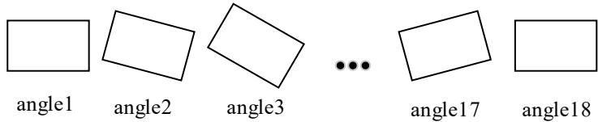

图4-4抓取框旋转角度分类标签  
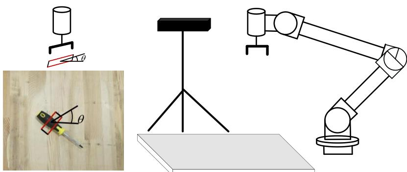  
图4-5 机械臂顶抓作业示例

## 4.2.5 抓取位姿预测

在 RPN 生成候选区域之后的下一个阶段目的在于确定抓取框的最终位置和角度。在这一阶段将抓取框的角度预测作为分类任务，将区域候选抓取框转化为非定向抓取边界框。如图 4-2所示，将 ROI Align层集成到 ShuffleNet v2当中，使其能够与ShuffleNet v2共享卷积层。ROIAlign层堆叠了已生成抓取候选框的所有特征，然后将其馈送到两个相邻全连接层，用分类预测抓取框角度和回归预测边界框位置。令 $\alpha _ { i }$ 表示在第 $l _ { i }$ 类的概率， $\beta _ { i }$ 表示相应的预测抓取边界框。定义端到端的边框回归分类损失函数为：

$$
\begin{array}{l} L _ {g c r} (\{\alpha_ {i} \}, \{\beta_ {i} \}) = \frac {1}{N _ {g c r \_ c l s}} \sum_ {i} L _ {g c r \_ c l s} (\alpha_ {i}, \alpha_ {i} ^ {*}) \\ + \lambda_ {2} \frac {1}{N _ {g c r \_ r e g}} \sum_ {i} L _ {g c r \_ r e g} (\beta_ {i}, \beta_ {i} ^ {*}) \end{array}\tag{4-3}
$$

其中， $\boldsymbol { \alpha } _ { i } ^ { * } = 0$ 表示不是抓取框的情况， $\alpha _ { i } ^ { * } = 1$ 表示是抓取框的情况； $\beta _ { i }$ 表示预测抓取框位置， $\boldsymbol { \beta } _ { i } ^ { * }$ 表示 $\boldsymbol { \alpha } _ { i } ^ { * }$ 所对应实际抓取框的 4 维坐标向量； $L _ { g c r \_ c l s }$ 和$L _ { g c r \_ r e g }$ 分别表示分类损失函数和边界框回归损失函数 $N _ { g c r \_ c l s }$ 和 $N _ { g c r \_ r e g }$ 表示归一化参数； $\lambda _ { 2 }$ 表示归一化平衡权重。因此结合抓取区域候选网络的损失函数，可得总网络的损失函数为；

$$
L _ {t o t a l} = L _ {g p n} + L _ {g c r}\tag{4-4}
$$

在预测抓取框过程中，需要注意的是 Grasp Detection 网络的一阶段使用RPN 网络生成整个图像的候选抓取位置区域，此时的候选框是处于水平位置的。如图4-6所示，完整的网络训练完成后，经过二阶段的回归与分类预测获得抓取框的坐标参数和旋转角度 ，最终的抓取框通过网络输出的候选抓取框旋转 $\theta$ 角度得到。

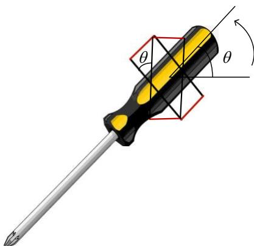  
图4-6 抓取框旋转示意图

## 4.3 模型训练与结果分析

## 4.3.1 数据集选择与制作

本章模型的训练集采用康奈尔数据集与本地数据集。官方提供的康奈尔数据集包含了 244 个不同的物体，共有 885 张图像组成，每个物体都有几张不同姿态角度的图像，每张图片都有标注上可抓取的真实标签。在康奈尔数据集中每张图片只包含一种物体，因此还按照康奈尔数据集的格式收集了一个单对象或多对象的本地数据集用来训练模型在多对象抓取情况表现，选用物体与 MaskR-CNN 网络所用的数据集一致。最终一共收集了 500 张图像作为本地数据集，数据集中保证每种物体出现的频率相近。

本地数据集按照康奈尔数据集的图片标准，使用 Kinect2.0 深度相机对每组物体在不同的方向或姿势下拍摄几张图像，并使用 Labelme 图像标注工具按照康奈尔数据集标签格式对图片进行标注，如图4-7所示。需要注意的是标注中使用矩形框尽量标出所有能够提供抓取的部分，并且统一标注抓取框的大小。

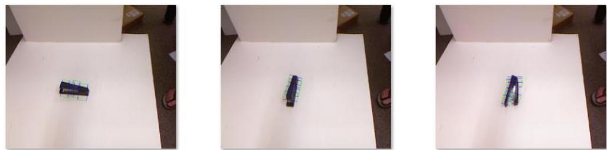  
图4-7数据集标注示例

标注过程中先对图像中物体的实际抓取框进行标注，标注文件包含每个抓取框的 4 个坐标及标签信息，四个坐标为 $\beta _ { i } = ( x _ { i } , y _ { i } ) , i = 1 , 2 , 3 , 4$ ，完整的坐标矩阵表示为：

$$
\beta = \left[ \begin{array}{c c} \beta_ {1} & \beta_ {1} \\ \beta_ {3} & \beta_ {4} \end{array} \right]\tag{4-5}
$$

由于分类预测需要用到抓取框的旋转角度标签，由已知的坐标信息计算得到相对于水平方向旋转角度 $\theta$ 为：

$$
\theta = \arctan \frac {\left(y _ {1} - y _ {2}\right)}{\left(x _ {1} - x _ {2}\right)}\tag{4-6}
$$

由于在分类角度的划分中，得到的是以 $1 0 ^ { \circ }$ 为间隔的旋转角，因此最终 $\theta$ 通过四舍五入进行取整。如图4-6所示，最终的抓取框位置由预测得到的候选框进行逆时针旋转才能得到，因此需要将标注得到的实际抓取框坐标进行顺时针旋转得到训练所需要的候选框坐标，旋转矩阵M为：

$$
M = \left[ \begin{array}{c c} \cos \theta & - \sin \theta \\ \sin \theta & \cos \theta \end{array} \right]\tag{4-7}
$$

根据旋转矩阵M可得训练所需要的候选框坐标矩阵 $\beta ^ { \prime }$ 为：

$$
\beta^ {\prime} = M \beta\tag{4-8}
$$

最终为满足网络训练过程所需，根据康奈尔数据集中的标注文件格式，选

择 $\beta ^ { \prime }$ 中的 $\beta _ { 1 } ^ { \prime }$ 与 $\beta _ { 4 } ^ { \prime }$ 以及θ作为训练所用的标注信息。

## 4.3.2 训练参数设定

将训练数据送入网络训练之前，对数据集进行一些数据增强的预处理操作。先以图像中心进行裁剪，然后对裁剪完的图像进行随机方向旋转或在水平竖直方向进行平移。预处理为每个图像生成若干个增强数据。最后将图像大小调整为 224x224 大小以适应 ShuffleNet v2 架构的输入。

在训练过程中，数据集中选择 10%作为验证集，剩下的作为训练集进行训练。为了加快网络收敛速度，选用预训练的 ShuffleNet v2 进行模型训练，并在单个GTX1080Ti上对整个网络进行10个epoch的端到端训练。模型训练的初始学习率设为0.001，每5000次迭代后将学习率除以 10。其中在 Pyhon 环境中分别安装了 Cuda=11.1、Pytorch=1.11 等依赖库。

## 4.3.3 实验评估与结果分析

在使用测试集判断抓取矩形框是否满足实际抓取需求时，需要评估抓取框参数的可抓取性。如果符合以下两种指标，将说明预测矩形框是满足实际抓取情况的。设预测抓取矩形框的四维位置参数 $\left( x , y , \omega , h \right)$ 为g ，实际抓取矩形框 $g _ { p }$ 为 $g _ { t }$ ，对应的姿态角度为 $g _ { p } \left( \theta \right)$ 和 $g _ { t } \left( \theta \right)$ ，则两个指标为：

（1）预测抓取 $g _ { p } \left( \theta \right)$ 和真实角度 $g _ { t } \left( \theta \right)$ 之间的角度差在30◦以内。

（2）预测抓取 $g _ { p }$ 和实际抓取 $g _ { t }$ 的雅克比指数大于 0.25。雅克比指数为：

$$
\left| \frac {g _ {p} \cap g _ {t}}{g _ {p} \cup g _ {t}} \right| > 0. 2 5\tag{4-9}
$$

如果预测抓取框与真实抓取框之间的角度差小于 $3 0 ^ { \circ }$ ，并且预测抓取框与真实抓取框的雅各比指数小大于 0.25，则说明该抓取框满足抓取要求[63]。雅各比指数类似于目标检测中的交叉联合阈值（IoU）。实验证明当预测抓取框的角度正确时，只需要与实际抓取框值与实际抓取框的雅克比指数达到 0.25 以上就能够满足抓取的。

表4-2模型测试对比

<table><tr><td>模型</td><td>检测精度/%</td><td>单张检测速度/s</td></tr><tr><td>Lenz[33]</td><td>73.9</td><td>14</td></tr><tr><td>Rendom[35]</td><td>88.2</td><td>0.33</td></tr><tr><td>Depierre[36]</td><td>85.74</td><td>0.36</td></tr><tr><td>Ours: ResNet-50</td><td>91.64</td><td>0.21</td></tr><tr><td>Ous</td><td>91.12</td><td>0.065</td></tr></table>

在单个 GTX1080 Ti上对训练完成的网络模型进行测试，并与其他预测模型的结果进行比较，得出表 4-2。在测试过程中，对于单一目标和多目标图像都进行了测试。根据前面提到的评估指标，本文提出的抓取位姿检测模型的检测精度能够达到90%以上，单张图片的检测时间不超过 0.07s。

在测试过程中，本文的抓取检测模型对于单张图片处理速度平均不超过0.07s，已经可以满足机器人实时检测的标准。同时还训练测试了特征提取网络为 ResNet-50 的原网络模型，对于单张图片的检测时间大约为 0.21s。原网络对比采用 ShuffleNet v2 的改进网络相比准确率略高一点，但改进网络拥有更快的检测速度。原因在于 ShuffleNet v2 拥有更轻量的网络模型，在计算过程中ShuffleNet v2 的 Flops（浮点运算次数）为 $1 . 4 6 \times 1 0 ^ { 8 }$ 而 ResNet-50 为 $3 . 8 \times 1 0 ^ { 9 }$ ，后者大约是前者的26倍。通过实验比较，可以得出采用基于ShuffleNet v2的检测模型对于抓取检测更加满足实时性的要求，并且模型的计算量和大小对比ResNet具有更大的优势。

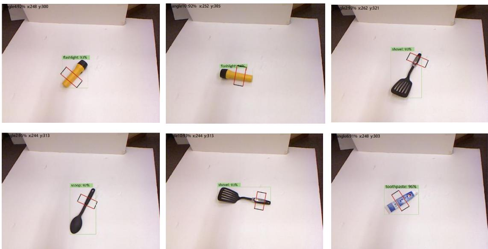  
图4-8单抓取目标的单个预测输出

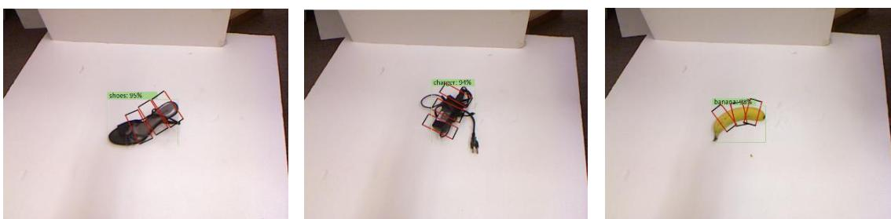  
图4-9单抓取目标的多个预测输出

图4-8为本章目标抓取位姿检测模型输出的单目标单抓取框结果，在图像中给出了已识别物体的抓取框，并在图片上标注抓取目标的姿态角度标签、置信度以及抓取框中心位置。图4-8中给出了三种情况下的单目标结果预测，同物体不同姿态下抓取位置预测，不同物体相同姿态下抓取位置预测，以及不同种物体不同种姿态下抓取位置预测。在机器人进行目标抓取检测与定位过程中，物体往往会存在多个位置都能进行抓取的情况。图4-9是单个物体出现多个抓取情况的预测。

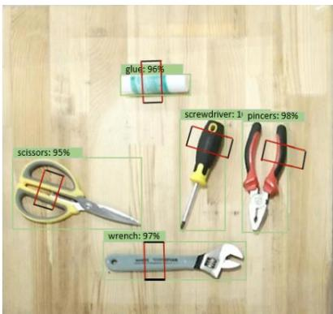  
(a)多抓取目标的单预测输出

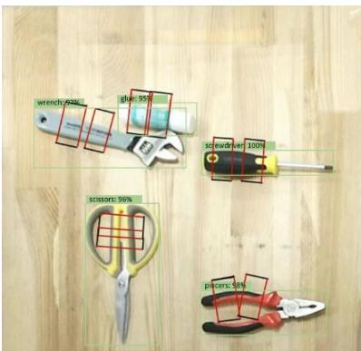  
(b)多抓取目标的多预测输出  
图4-10 多抓取目标的预测输出

在机器人实际操作中还会遇到同一图像中出现多种目标需要进行抓取的情况，对于多目标抓取检测结果如图 4-10 所示。当遇到多目标时，对每个目标的单抓取框预测如图 4-10(a)所示。当遇到多目标时，对每个目标进行多抓取框预测如图 4-10(b)所示。

## 4.4 本章小结

本章的主要研究内容是在机械臂抓取系统中需要使用到的目标抓取位姿检测算法。根据机械臂抓取操作中常用的顶抓方式，提出改进的 Grasp Detection网络作为抓取检测模型，并介绍网络的结构和损失函数计算。该网络用轻量级的卷积神经网络 ShuffleNet v2 结合区域建议网络（RPN）来生成图像中物体的可抓取候选区域。将 Mask R-CNN 网络输出的图像识别结果输入该网络快速高效地得到已识别物体可抓取框的像素坐标和旋转角，得到满足机械臂垂直抓取的旋转角度与位置，并且还能对单个物体输出多个可抓取框信息，可提供机械臂更多抓取选择。最后在本地数据上利用设定好训练参数对模型展开训练与验证，测试结果表明改进后的 Grasp Detection 网络对比原网络与其他检测模型在保证了检测准确率的同时，还能满足抓取检测的实时性。

## 第五章 基于高斯过程混合模型的机械臂抓取方法

在传统机械臂操作方法中，主要通过视觉检测以及坐标变换来操作机械臂进行抓取，但是在实际应用中容易面临标定繁琐、求逆困难的情况。选择合适的学习方式，能够为机械臂提供有效的抓取控制策略，如通过强化学习或模仿学习方法，让机器人进行操作技能学习。模仿学习通过学习其他智能体的行为来进行决策。与强化学习相比，无需大量训练数据和寻找合适的回报函数，能够以更小代价进行机器人行为的学习。模仿学习通过示教数据来进行监督学习，示教数据中包含了学习过程所用的特征和标签[64]。其中，示教数据可选择示教学习过程中机械臂的动作信息以及目标物体的状态（如位置、几何信息等）。在本章中，选择了使用高斯过程混合（Mixture of Gaussian Processes, MGP）模型作为机械臂的模仿学习策略，结合改进 Grasp Detection 网络的目标位姿检测方法构建从图像坐标系的目标物体位姿信息到机械臂关节角度的映射关系。

## 5.1 高斯过程混合模型的原理与参数设计

## 5.1.1 高斯过程混合模型的原理

高斯过程混合模型的核心部分是高斯过程模型[65]（Gaussian Process Model,后面简称 GP 模型），这是重要的随机过程之一，是在对贝叶斯神经网络的研究过程逐渐发展起来的一种新的机器学习方法。GP 模型是在高斯分布的基础上衍生而来的，高斯分布又可称为正态分布，是统计学中的常用到的一种概率分布。将一维高斯分布推广到多变量中就得到了高斯网络，将多变量推广到多维，就得到高斯过程。高斯过程是定义在连续域（时间/空间）上的多个高维随机变量所组成的随机过程，高斯过程模型的数学定义如下：

如图 5-1 所示，设 $\left\{ X ( t ) , t \in T \right\}$ 是定义在空间上的随机过程。对于连续域上的序列X t( )，若 $\forall n \in N ^ { + }$ $t _ { 1 } , t _ { 2 } , . . . , t _ { n } \in T$ ，有 $\left\{ X ( t _ { 1 } ) , X ( t _ { 2 } ) , . . . , X ( t _ { n } ) \right\}$ 服从高斯分布，则 $\left\{ X ( t ) , t \in T \right\}$ 是一个高斯过程。对于高斯分布而言，通常由均值向量和协方差矩阵决定其分布。但高斯过程是定义连续域 T 上的随机过程，因此一个完整的高斯过程通常由它的均值函数和协方差函数确定，其表达方式通常如下：

$$
X (t) \sim G P (m (t), k (t, t ^ {\prime}))\tag{5-1}
$$

其中m t( )表示均值函数，返回各维度的均值； $k ( t , t ^ { \prime } )$ 表示协方差函数，也被称为核函数，返回两个向量各个维度之间的协方差矩阵。

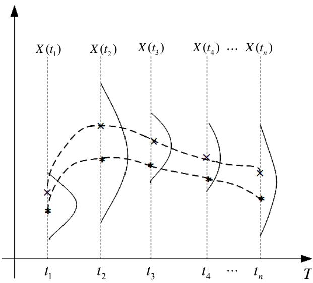  
图5-1高斯过程示例

近年来GP模型在机器学习领域得到了广泛应用，主要有以下几个优点：一、GP 模型是统计机器学习算法的一个基本框架。许多机器学习方法，如 SVM、径向基函数（RBF）、卡尔曼滤波器等，都可以用特殊形式下的 GP 模型实现[66]。二、GP 模型将核机器学习方法与贝叶斯网络相结合，一方面可以有效提高对小样本预测问题性能，另一方面通过引入核方法克服了维数灾难和非线性问题处理难的问题[67]。三、GP模型的拥有先验知识的导入，无需依赖大量训练数据。四、GP 模型应用场景广，可以进行分类、回归预测，并且还能延展至更广阔的应用领域，如图像处理、音频处理、控制算法等[68]。

GP 模型尽管在使用过程中有以上优势，但也存在不足。其主要体现在不能很好描述较为分散的样本集，并且在模型参数学习时较为耗时，最终难以拟合出较为满意的结果。为此，Tresp结合混合模型提出了高斯过程混合（Mixture ofGaussian Processes, MGP）来解决上述问题[69]。MGP 模型是在 GP 模型的基础上引入混合模型，将样本集划分为若干个子样本集，然后分别在子样本集上使用对应 GP模型进行描述。该模型解决了单个 GP模型无法准确映射较大复杂样本的难题。

在本章中，采用高斯混合模型（Gaussian Mixture Model, GMM），该模型是一种经典混合模型[70]。GMM 模型使用多个高斯分布的组合叠加来刻画数据分布，可以将数据划分为不同的样本子区间。

从混合模型定义来看，设 $X = ( x _ { 1 } , x _ { 2 } , x _ { 3 } , . . , x _ { n } )$ 为可观测样本数据，引入隐参量 z 表示样本X 中的 $x _ { n }$ 属于模型中各个高斯分布的概率，这是一个离散的随机变量。假设有K个高斯分量，则隐参量z需满以下条件：

$$
\sum_ {i = 1} ^ {K} p (z = i) = 1\tag{5-2}
$$

作为一个生成式模型，高斯混合模型通过隐参量 z 的分布来生成样本，用概率图表示为：

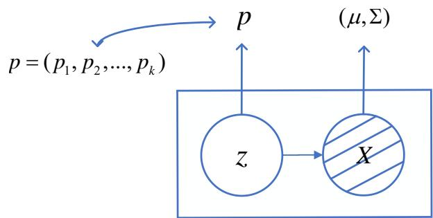  
图 5-2 GMM模型概率图

根据图5-2中的概率图，对于GMM模型的概率密度函数p x( )为：

$$
\begin{array}{r l} p (x) & = \sum_ {z} p (x, z) = \sum_ {k = 1} ^ {K} p (x, z = k) \\ & = \sum_ {k = 1} ^ {K} p (z = k) p (x \mid z = k) \end{array}\tag{5-3}
$$

最终表达式可写为：

$$
p (x) = \sum_ {k = 1} ^ {K} p _ {k} N (x \mid \mu_ {k}, \Sigma_ {k})\tag{5-4}
$$

其中，K 为高斯分量个数， $N ( x | \mu _ { k } , \Sigma _ { k } )$ 代表第k个高斯模型的概率密度函数， $p _ { k }$ 代表第k个高斯模型的先验概率。

MGP 模型通过结合混合模型解决了单个高斯过程模型不能很好地描述多模态（样本可被分为多簇，每簇来自于不同的分布）样本集以及难于刻画样本集输出在不同输入区域的波动性差异问题。因此当MGP模型作为机器人模仿学习策略时，有如下特点：

（1）对于非线性模型的映射能力强，结合混合模型以后能够更好的刻画的进行样本输入到输出之间的映射关系，经过样本训练能够得到较好的拟合输入输出之间的关系。

（2）容错性较强，当通过示教数据进行模型训练后，输入测试样本能够得在较小的误差内得到预测结果。

（3）泛化能力强，当样本较为分散的时候，通过混合模型的样本划分，可以在好的利用样本训练对应样本区域 GP模型。

MGP 模型作为模仿学习的行为表征模型具有以上优势，可以满足机械臂系统行为的模仿学习研究。在模仿学习任务中，MGP 模型可以通过示教数据学习目标物体信息到机械臂关节量间的映射关系，这种映射关系即为模仿学习策略。

## 5.1.2 高斯过程混合模型的构建及参数估计

MGP 模型在进行学习预测的过程采用硬分类预测[69]。即学习结束后训练样本所属分量参数已确定，按 GMM 模型中的最大后验概率准则将测试样本分配给相应的分量，再基于每个分量所对应GP模型即可获得预测结果。在这过程中，主要由 GMM模型与 GP模型共同决定。其中，GMM模型的作用在于将样本集划分为小的区域，然后在各自划分区域内的样本进行对应的GP模型描述，从而进行结果预测。对此，对 MGP 模型的构建设计包括对 GMM 模型与 GP 模型的参数设定，初始化以及学习。

GMM模型是一种有限混合模型，该模型的每个分量都可以用一个高斯分布来表示，数据可以由多个高斯分布通过线性组合表示。假设有一个 $N { \times } d$ 数据集$\{ x _ { i } \} , i = 1 , 2 , 3 , . . . , N$ ，这些数据可以定义一个 GMM模型如下表达：

$$
\begin{array}{l} p (x \mid \lambda) = \sum_ {k = 1} ^ {K} \alpha_ {k} N (x \mid \mu_ {k}, \Sigma_ {k}) \\ = \sum_ {k = 1} ^ {K} \alpha_ {k} \frac {1}{\sqrt {(2 \pi) ^ {d} \det (\Sigma_ {k})}} \exp \left[ - \frac {1}{2} (x - \mu_ {k}) ^ {T} \Sigma_ {k} ^ {- 1} (x - \mu_ {k}) \right] ^ {(5 - 5)} \end{array}
$$

其中，K 表示 GMM 模型高斯分量的个数， $\alpha _ { k }$ 表示第 k 高斯分量的先验概率，且 $\sum ^ { K } \alpha _ { k } = 1 , \mu _ { k } , \Sigma _ { k }$ 分别代表了第k个高斯分量的均值向量和协方差矩阵。$\lambda = \{ \alpha _ { \boldsymbol { k } } , \mu _ { \boldsymbol { k } } , \Sigma _ { \boldsymbol { k } } \} , k = 1 , 2 , . . K$ 表示模型参数集合。其中参数 $\{ \alpha _ { k } , \mu _ { k } , \Sigma _ { k } , K \}$ 可通过学习训练得到，选择合适的参数，可以让模型的拥有更好预测效果。

在 GMM 模型参数学习训练过程中，主要用到期望最大算法（EM 算法），该算法主要用于解决具有隐参量的混合模型参数估计，是公认学习混合模型参数的有效方法[71]。在 GMM 模型的参数学习训练过程中，第一步，先对高斯分量的个数进行确定，在MGP模型中，K取值通常在3-5之间。第二步，通过EM算法进行参数 $\lambda = \{ \alpha _ { k } , \mu _ { k } , \Sigma _ { k } \}$ 的估计。

在GMM模型参数估计中，先将隐参量z 带入到模型的对数似然函数中，结合 Jensen 不等式简化似然函数[71]，最后根据贝叶斯准则可以推导隐参数的后验概率为：

$$
p (z = k \mid x _ {i}, \mu_ {k}, \Sigma_ {k}) = \frac {p \left(x _ {i} \mid z = k , \mu_ {k} , \Sigma_ {k}\right)}{\sum_ {k} p \left(x _ {i} \mid z = k , \mu_ {k} , \Sigma_ {k}\right)} = \frac {\alpha_ {k} N \left(x _ {i} \mid \mu_ {k} , \Sigma_ {k}\right)}{\sum_ {k} \alpha_ {k} N \left(x _ {i} \mid \mu_ {k} , \Sigma_ {k}\right)}\tag{5-6}
$$

于是定义：

$$
\omega_ {i, k} = \frac {\alpha_ {k} N (x _ {i} \mid \mu_ {k} , \Sigma_ {k})}{\sum_ {k} \alpha_ {k} N (x _ {i} \mid \mu_ {k} , \Sigma_ {k})}\tag{5-7}
$$

在 EM 算法迭代训练参数过程中需要进行极大似然估计，因此还需要定义目标函数Q，每次优化以这个函数作为优化目标。在 EM 算法中，通常设定目标函数Q如下：

$$
Q (\Theta , \Theta^ {t}) = \sum_ {i} \sum_ {k} \omega_ {i, k} ^ {t} \ln \frac {\alpha_ {k} N (x _ {i} \mid \mu_ {k} , \Sigma_ {k})}{\omega_ {i , k} ^ {t}}\tag{5-8}
$$

其中， $\Theta ^ { t }$ 代表t次迭代后的模型参数，使用 $\Theta ^ { t }$ 更新 $\omega _ { i , k }$ ，再带入 $Q ( \Theta , \Theta ^ { t } )$ 进行最大似然优化，可以得出t+1次迭代的参数 $\Theta ^ { t + 1 }$

EM算法迭代训练模型参数的具体步骤如下：在使用 EM算法进行 GMM模型参数迭代开始前，先初始化一组参数 $\Theta = \{ \alpha _ { k } , \mu _ { k } , \Sigma _ { k } \} , k = 1 , 2 , . . . , K$ ，接着开始在 E-step和 M-step中模型参数进行更新。

## （1）E-step：

E-step目标就是计算隐参数，对于N个样本 $\{ x _ { i } \} , i = 1 , 2 , 3 , . . . , N$ ，分别计算其属于每一种高斯模型的概率。在t轮迭代，可用当前的高斯参数 $\{ \alpha _ { k } , \mu _ { k } , \Sigma _ { k } \}$ 计算得到 $\omega _ { i , k } ^ { t }$ ：

$$
\omega_ {i, k} ^ {t} = \frac {\alpha_ {k} ^ {t} N (x _ {i} \mid \mu_ {k} ^ {t} , \Sigma_ {k} ^ {t})}{\sum_ {k} \alpha_ {k} ^ {t} N (x _ {i} \mid \mu_ {k} ^ {t} , \Sigma_ {k} ^ {t})}\tag{5-9}
$$

将每次迭代得到的 $\omega _ { i , k } ^ { t }$ 带入目标函数，可以得到GMM模型的目标函数为：

$$
\begin{array}{l} Q (\Theta , \Theta^ {t}) = \sum_ {i} \sum_ {k} \omega_ {i, k} ^ {t} \ln \frac {\alpha_ {k} N (x _ {i} \mid \mu_ {k} , \Sigma_ {k})}{\omega_ {i , k} ^ {t}} \\ = \sum_ {i} \sum_ {k} \omega_ {i, k} ^ {t} \ln \frac {\alpha_ {k}}{\sqrt {(2 \pi) ^ {d} \det (\Sigma_ {k})}} \exp \left[ - \frac {1}{2} (x _ {i} - \mu_ {k}) ^ {T} \Sigma_ {k} ^ {- 1} (x _ {i} - \mu_ {k}) \right] \end{array}\tag{5-10}
$$

## （2）M-step：

M-step 的任务就是使用当前 $\omega _ { i , k } ^ { t }$ 最大化目标函数，然后进行模型参数的估计，最大化公式如下：

$$
\Theta^ {t + 1} = \underset {\Theta} {\arg \max} Q (\Theta , \Theta^ {t})\tag{5-11}
$$

M-step 中首先更新 $\alpha _ { k }$ ，在 GMM 模型中 $\alpha _ { k }$ 的更新需要满足在所有分量中$\sum _ { i = 1 } ^ { K } \alpha _ { _ k } = 1$ 的条件，因此更新的表达如下：K

$$
\alpha_ {k} ^ {t + 1} = \underset {\alpha_ {k}} {\arg \max} \sum_ {i} \sum_ {k} \omega_ {i, k} ^ {t} \ln \alpha_ {k} \quad s. t. \sum_ {i = 1} ^ {K} \alpha_ {k} = 1\tag{5-12}
$$

通过目标函数对 $\boldsymbol { \alpha } _ { k } ^ { t }$ 求偏导，并带入t次的参量，就可以得到 $\boldsymbol { \alpha } _ { k } ^ { t + 1 }$ ：

$$
\alpha_ {k} ^ {t + 1} = \frac {\sum_ {i} \omega_ {i , k} ^ {t}}{N}\tag{5-13}
$$

更新 $\mu _ { k } , \Sigma _ { k }$ ，没有前者的条件限制，可直接得到更新的表达式如下：

$$
\begin{array}{l} \mu_ {k} ^ {t + 1} = \underset {\mu_ {k}} {\arg \max} Q (\Theta , \Theta^ {t}) \\ \Sigma_ {k} ^ {t + 1} = \underset {\Sigma_ {k}} {\arg \max} Q (\Theta , \Theta^ {t}) \end{array}\tag{5-14}
$$

通过目标函数对 $\mu _ { k } ^ { t }$ 、 $\Sigma _ { k } ^ { t }$ 求偏导，并带入t次的参量，就可以得到 $\boldsymbol { \mu } _ { k } ^ { t + 1 } , \boldsymbol { \Sigma } _ { k } ^ { t + 1 }$

$$
\mu_ {k} ^ {t + 1} = \frac {\sum_ {i} \omega_ {i , k} ^ {t} x _ {i}}{\sum_ {i} \omega_ {i , k} ^ {t}}, \Sigma_ {k} ^ {t + 1} = \frac {\sum_ {i} \omega_ {i , k} ^ {t} \left(x _ {i} - \mu_ {k} ^ {t + 1}\right) ^ {T} \left(x _ {i} - \mu_ {k} ^ {t + 1}\right)}{\sum_ {i} \omega_ {i , k} ^ {t}}\tag{5-15}
$$

在 EM 算法迭代训练 GMM 模型的参数过程中，初始值是通过 K-means 算法随机生成，将初始化参数 $\Theta = \{ \alpha _ { k } , \mu _ { k } , \Sigma _ { k } \}$ 带入 E-step 和 M-step，即式(5-9)\~(5-15)进行迭代计算参数。在目标函数还未达到最大之前，EM 算法会一直迭代，直到不在发生变化时跳出迭代循环，最终得到的参数为模型确定参数。

在对GMM模型训练参数确定后，还需对GP模型的参数进行确定。采用经过GMM模型划分完后的样本，对GP模型进行训练确定参数。对于一个样本集合 $X = \{ x _ { 1 } , x _ { 2 } , x _ { 3 } , . . . , x _ { n } \}$ 结合式(5-1)，GP模型在数学上定义如下：

$$
Y = \left[ y _ {1}, y _ {2}, y _ {3}, \dots , y _ {n} \right] \sim N (m (X), K (X, X ^ {\prime}) + \sigma^ {2} I)\tag{5-16}
$$

其中，m X( )是均值函数， $K ( X , X ^ { ' } )$ 是协方差函数。在 GP 模型参数选择中，通常设置均值函数 $m ( X ) = 0$ 。协方差函数选用核函数，常用核函数选则 SE 核函数，函数定义为：

$$
K (x _ {i}, x _ {j}) = l ^ {2} \exp (- 0. 5 f ^ {2} \left\| x _ {i} - x _ {j} \right\| ^ {2})\tag{5-17}
$$

由式(5-16)与式(5-17)可知，确定一个GP模型需要确定的参数 $\theta = \{ l , f , \sigma \}$ 在 GP 模型训练中，通常使用极大似然估计（MLE）来进行参数估计[72]，通过最大化边缘对数似然（Marginal Log-likelihood）来找到最优的参数。

在进行参数学习确定之后，对测试输入 $x ^ { * }$ 的输出预测 $y ^ { * }$ 为：

$$
y ^ {*} = K \left(x ^ {*}, X\right) \left[ K \left(X, X ^ {\prime}\right) + \sigma^ {2} I \right] ^ {- 1} Y\tag{5-18}
$$

其中， $Y = [ y _ { 1 } , y _ { 2 } , y _ { 3 } , . . . , y _ { n } ]$ 为训练样本的输出， $K ( x ^ { * } , X )$ 为预测样本 $x ^ { * }$ 与$X = \{ x _ { 1 } , x _ { 2 } , x _ { 3 } , . . . , x _ { n } \}$ 的协方差矩阵， $K ( X , X ^ { ' } ) { = } [ K ( x _ { i } , x _ { j } ) ] _ { n \times n }$

在 MGP 模型构建中，主要工作内容是对 GMM 模型和 GP 模型参数的确定。在 MGP模型训练过程中，在样本数据支持下通过 EM算法和极大似然估计确定模型参数的选择，本节主要介绍了模型的原理以及参数训练估计方法。

## 5.2 基于高斯过程混合模型的机械臂抓取方法

## 5.2.1 基于模仿学习策略的机器人控制

机器人传统控制方式主要采用人工编程的形式进行控制，这需要提前人工编写程序来控制机器人的自主控制，这样往往具有一定挑战，并且费时费力。而从示教中学习机器人控制方式，是一种比较有效的解决方法，模仿学习的基础是基于示教进行。在模仿学习任务过程中，根据专家示教数据可以高效地学习控制动作，通过学习示教动作可以无需进行机器人编程就能够使机器人进行运动控制[64]。

一般情况下，机器人的模仿学习过程中需要选择一个合适的学习算法，然后通过学习算法从示教数据中学习控制策略[73]。通常模仿学习的过程为：一、收集示教数据，数据通常以（状态-动作对）表示，这里选择收集目标物体状态与机械臂相应动作信息。二、以示教数据作为训练样本对学习策略进行监督训练学习。三、最后根据收集的测试数据对策略进行评估。在本章中，选则 MGP模型作为机器人的模仿学习策略，示教数据的状态目标物体的位姿信息，动作为机械臂抓取关节角。MGP 模型通过示教数据学习状态输入和动作输出之间的关系，得到一种输入到输出的映射关系，这种关系就是模仿学习过程中所学习的控制策略。

## 5.2.2 基于高斯过程混合模型的机械臂模仿学习

在机器人的模仿学习过程，选择合适的算法确定模仿学习控制策略能够更好的从样本中学习输入到输出端的映射函数。在选择模型的过程中发现GP模型能够有效拟合一些高维度的非线性映射问题。但是在进行从图像中的目标物体位姿到机械臂关节量的映射时，无法拟合出较为精确的结果。原因在于机械臂操作的工作中，物体往往可能存在于一定大小的工作区域内，样本集会较为分散，目标物体的位姿信息与机械臂的关节量之间的映射关系更为复杂，因此单高斯过程模型无法进行精准映射。针对这种情况，本章采用MGP模型作为机械臂模仿学习控制策略，该模型的思路采用“分而治之”的想法。首先根据示教数据中目标物体的位置信息，使用 GMM 模型对在工作区域内分散的示教样本集进行划分。划分完的每个子区域内的样本服从一个高斯过程，这样每个高斯过程模型只用涉及到子区域内的样本数据进行训练学习，能够更好的拟合变量间的映射关系，从而提高模型预测的准确性。

通过示教数据训练MGP模型的控制策略，构建从图像坐标系的目标物体位姿信息到机械臂关节角度的映射关系。该方法结合了示教抓取快速部署和基于视觉抓取的优点，可通过从图像中的物体信息得到机械臂关节的预测，避免了传统抓取方式中标定繁琐与求逆困难的问题。整个基于高斯过程混合模型的机械臂模仿学习过程如图5-3所示。

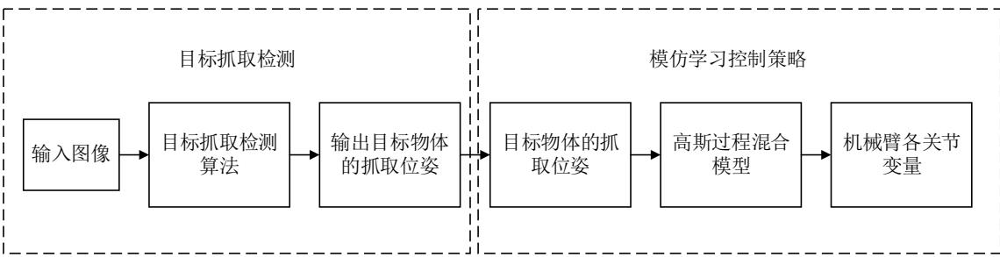  
图5-3模仿学习过程

如图5-3所示，此抓取方法主要包括目标抓取检测与模仿学习控制策略。首先使用相机获取目标物体的彩色图像，然后使用抓取检测算法获取目标物体的抓取位姿。最后根据检测算法输出的目标物体位姿，输入经示教数据训练得的高斯过程模型预测机械臂的抓取关节角度。

## 5.2.3 结合抓取检测与高斯过程混合模型的机械臂抓取方式

基于 MGP 模型的抓取方法是将抓取位姿检测算法得出物体位姿输入 MGP模型，然后预测机械臂抓取对应的关节角度。为了获得目标物体准确的抓取位姿从而保证预测过程中的准确性，本文采用改进的 Grasp Detection 网络作为抓取检测方法。基于 MGP 模型的抓取方法如图 5-3所示，先将物体图像输入检测网络获得目标的抓取位姿 $( x , y , \theta )$ ），然后将目标抓取位置的像素坐标 $( x , y )$ 输入MGP 模型，预测得到机械臂的前五个关节角度 $( \theta _ { 1 } , \theta _ { 2 } , \theta _ { 3 } , \theta _ { 4 } , \theta _ { 5 } )$ 。机械臂末端夹持器的旋转角度 $\theta _ { 6 }$ 直接由抓取检测网络输出的抓取旋转角决定。

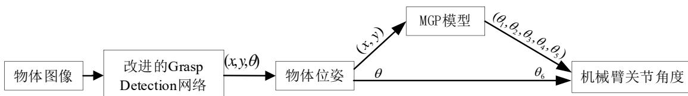  
图5-4 基于MGP模型的抓取方法

在使用高斯过程混合模型作为机械臂抓取控制策略过程中，主要分为三个阶段：学习阶段，训练阶段，预测阶段。

学习阶段，如图5-5通过人工拖动示教的方法操控机械臂对目标物体进行抓取，然后记录下抓取过程的示教数据，包括物体的图像信息以及对应的机械臂关节角。将物体的图像信息输入改进的 Grasp Detection 网络输出物体的位姿信息 $o = ( x , y , \theta )$ ，其中 $( x , y )$ 为目标物体位置的像素坐标， 为末端夹持器的旋转姿态。最终作为MGP模型训练样本的示教数据由物体在图像的位置信息与对应抓取动作的机械臂关节角度构成。收集示教数据过程中，在操作台上以随机位置和姿态摆放物体。

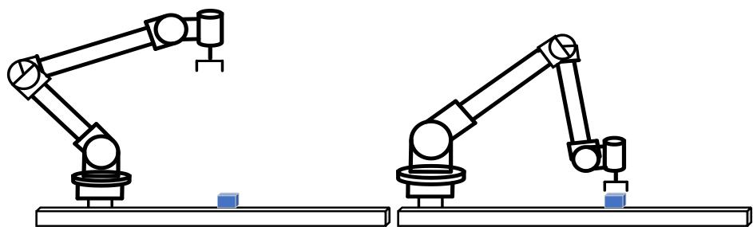  
图 5-5 示教过程

训练阶段，先记训练样本 $\boldsymbol { x } _ { i } = \left[ o _ { i } ^ { T } , r _ { i } ^ { T } \right]$ ， $o _ { i }$ 为输入表示物体的抓取位置坐标，$r _ { i }$ 为输出表示的机械臂关节角度。在 MGP 模型中，训练样本中的输入 $o _ { i } ^ { T }$ 服从GMM模型，样本的生成概率为：

$$
p \left(o _ {i} ^ {T}\right) = \sum_ {k = 1} ^ {k} p (k) p \left(o _ {i} ^ {T} \mid k\right) = \sum_ {k = 1} ^ {k} p (k) N \left(o _ {i} ^ {T} \mid \mu_ {k}, \Sigma_ {k}\right)\tag{5-19}
$$

其中，k代表高斯分量的数量， $p ( k )$ 代表样本来自第 个高斯分量的概率，每个高斯分量的分布由各自对应的均值向量和方差矩阵 $\textstyle \mu _ { k } , \Sigma _ { k }$ 决定。

在MGP模型训练中，先采用5.2节提到的EM算法对GMM模型进行参数训练。训练过程中，先对模型参数进行初始化，然后根据 EM 算法对模型参数进行迭代估计，直到 EM 算法停止迭代后得到 GMM 模型的参数估计，最终将样本划分为k个子集。在 GMM模型完成训练后，再对每个高斯分量对应的 GP模型进行训练。训练中使用每个子集中的样本进行对应 GP 模型的训练。利用 5.2节提到的极大似然估计（MLE）对 GP 模型进行参数估计，通过最大边缘对数似然寻找最优参数，确认GP模型的均值函数和核函数。

预测阶段，MGP 模型经过训练可进行机械臂关节角的回归预测，在 5.2 节中已经介绍，MGP 模型预测规则采用的是硬分类预测方式。即先按 GMM 模型的最大后验概率准则将测试样本分配给相应的高斯分量，再基于该分量所对应的 GP模型的预测规则即可获得预测结果。如图 5-6所示，具体过程为：先获取目标物体图像信息，输入目标抓取位姿检测网络得到目标的位姿信息；然后在计算该位置属于 GMM 模型中每个分量的后验概率 $p ( k | o ^ { n e w } )$ ，接着选出后验概率最大高斯分量，并使用该分量对应的 GP模型对关节角度进行预测。

由GMM模型的概率公式可知计算测试位姿 $o ^ { n e w }$ 在第k个高斯分量的最大后

验概率 $k ^ { * }$ 计算公式为：

$$
p (k \mid o ^ {n e w}) \propto p (k) p (o ^ {n e w} \mid k)\tag{5-20}
$$

$$
k ^ {*} = \underset {k} {\arg \max} p (k \mid o ^ {n e w})\tag{5-21}
$$

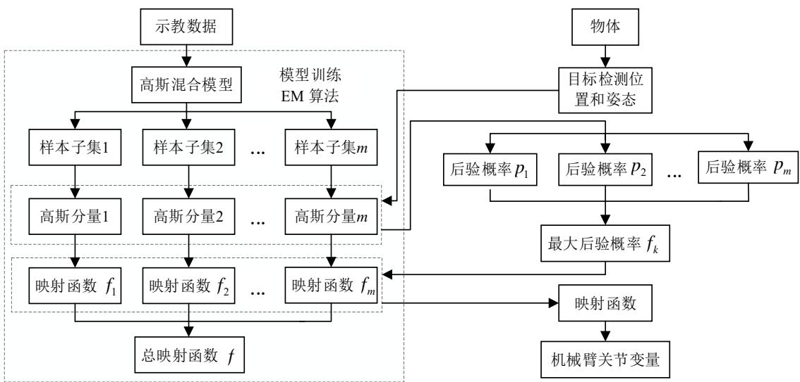  
图5-6MGP模型预测流程

## 5.3 实验与结果分析

为验证基于 MGP 模型的机械臂抓取方法有效性，选择在Matlab 2020a的机器人工具箱（Robotics Toolbox 9.10）上进行了机械臂仿真实验。主要研究模型对机械臂在平面上物体抓取的预测效果。实验过程中分析样本数量，高斯分量个数对模型预测效果的影响，并比较不同建模方法的抓取效果。仿真实验的具体过程为：

（1）根据第二章中 ABB 机械臂的 D-H 参数在工具箱中进行机械臂建模，如图5-7所示。

（2）在机械臂的操作空间中选择500mm 500mm 的操作区域，并在该区域平面内任意生成物体，记录物体的位置信息 $p$ 。

（3）根据工具箱提供的示教工具操作机械臂到达抓取物体的位置，并记录此时机械臂姿态，并记录机械臂关节角度 $q$ 。

（4）将目标物体的位置信息 $p$ 与对应机械臂抓取关节角度去 $q$ 构成示教训练样本 $X = [ p _ { i } , q _ { i } ] , i = 1 , 2 , 3 , . . . , N$ 0

（5）利用随机生成的 $N$ 个训练样本对 MGP 模型展开训练。首先根据样本的位置信息将样本划分为k 个子样本，然后使用每个子样本中的示教样本训练对应的GP模型。

（6）对训练完成的 MGP 模型进行测试，在工作区域内随机生成测试的抓取物体位置 $p ^ { t }$ 。将测试样例的位置输入MGP模型中，首先计算该位置属于各高斯分量下的生成后验概率，然后选出最大后验概率所对应的高斯分量，利用其对应的GP模型预测关节角 $q ^ { t }$ 。

（7）最后将预测得到机械臂关节角度通过正运动学计算末端的抓取位姿$p ^ { p r e }$ ，并与物体实际处于的位姿 $p ^ { t }$ 进行对比，计算两者误差。

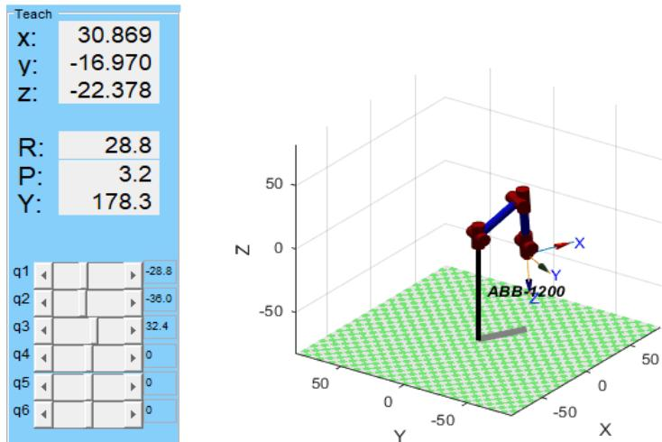

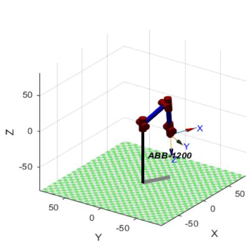  
图5-7机器人仿真模型

在模型测试过程中，由观测得到的物体位姿通过MGP模型预测得到机械臂关节角度进行抓取过程中，必定会有预测误差。本次仿真实验只考虑抓取的位置误差。在这里，将执行抓取后的机械臂末端位置与物体的实际位置之间的误差作为测试过程中的抓取误差。在仿真过程中，将抓取误差定义为测试过程中样本集的实际位置 $p ^ { t }$ 与模型预测关节角度得出的位置 $p ^ { p r e }$ 的均方根误差：

$$
E = \sqrt {\frac {1}{n} \sum_ {i = 1} ^ {n} (p _ {(i)} ^ {t} - p _ {(i)} ^ {p r e}) ^ {2}}\tag{5-22}
$$

其中， $i = 1 , 2 , 3 , . . . , n$ 代表对应的位置分量序号。通常在机械臂抓取过程中都会存在一定固定误差，这种误差决定了抓取过程中能够允许的最大误差，这里将其称之为误差容限。在机械臂抓取过程中，当抓取物差在误差容限内时，被认为能够成功进行抓取。

本次在仿真实验过程，首先测试了MGP模型的预测有效性，即在给定误差容限下的抓取成功率。训练过程中，MGP 模型的高斯分量数一般取3 5，本次实验训练中设置为 3，并用收集的 80 个示教训练样本对模型进行训练。先根据样本的位置信息将样本划分为 3 个子样本，然后使用每个子样本中的示教训练样本对应的 GP 模型。最后采用 50 个测试样本进行测试，在不同误差容限内的抓取成功率如图 5-8所示。在一定的误差容限内，通过 MGP 模型可以预测得到机械臂关节角度并对物体进行抓取，抓取成功率能达到 90%以上。在确定模型的可行后，还测试了样本数量、高斯分量个数对模型的预测效果的影响以及将MGP模型与其他模型进行对比实验。

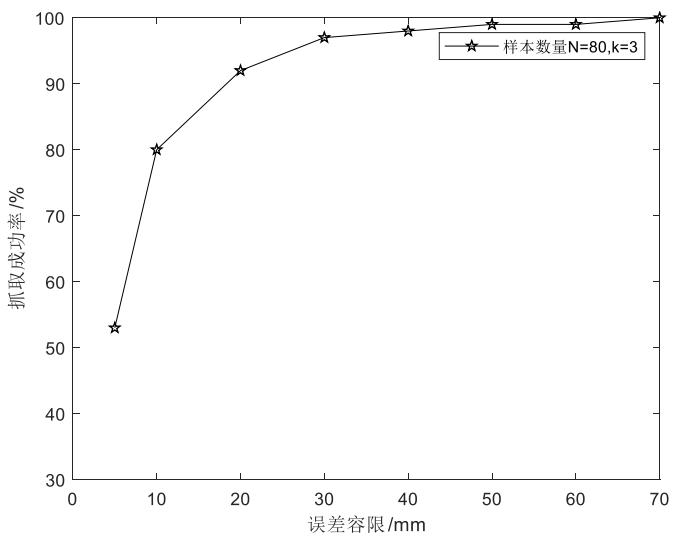  
图5-8MGP模型预测结果

为了研究训练样本数量对模型预测效果的影响，在高斯分量为 3 的情况下，采用训练样本数量 $N = 4 0 , 6 0 , 8 0 , 1 0 0 , 1 2 0 , 1 4 0$ 对模型进行训练。并对训练完模型进行测试，测试样例为 50 个，其结果如图 5-9 所示。仿真实验结果表明，当样本数量较少的时候，增加样本数量对预测效果的较大，当样本数量达到一定数量以后，增加训练样本数对结果影响并不显著。原因在于MGP模型在一定数量的训练样本完成对数据的高斯先验假设后，就能完成模型的训练学习，不需要使用大量的数据进行模型参数训练。

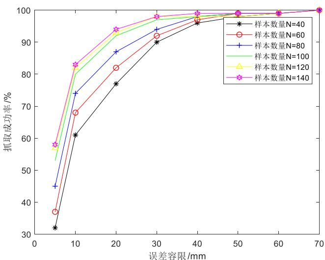  
图 5-9不同样本数量对 MGP模型影响

为测试不同数量的高斯分量对模型预测效果的影响，将训练样本数定为 80，分别对将高斯分量的个数k为 1-5个的高斯混合模型进行训练。并对训练完模型进行测试，测试样例为50个，其结果如图5-10所示。仿真实验结果表明，MGP模型对比单GP模型的预测效果有很明显的提升。通过增加高斯分量的个数，提高了模型的预测效果，但是在高斯分量的个数达到 3 以后，再继续增加高斯分量，预测效果没有明显的变化。

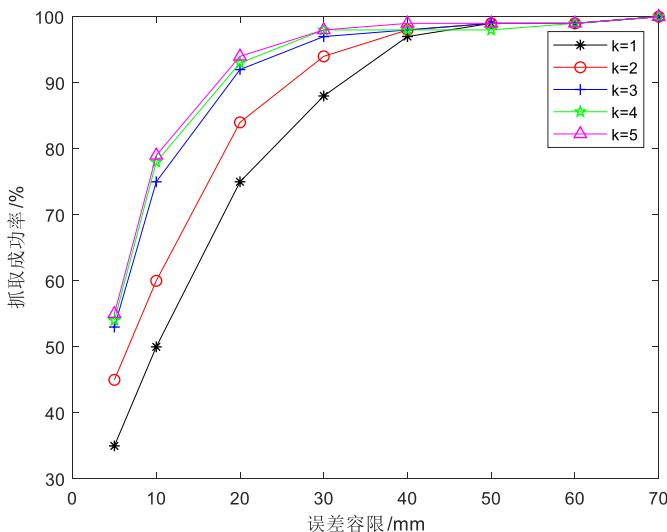  
图5-10高斯分量个数对 MGP模型影响

最后，还采用不同模型进行预测，并将模型预测结果与MGP模型的预测结果进行比较。在实验中，采用了 BP 神经网络模型与 MGP 模型以及单 GP 模型进行对比。所用 BP 神经网络包含三层（输入、隐藏、输出），其中激活函数采用sigmoid函数。输入层的为抓取物体的位姿参数，输出层为机械臂的关节角，隐藏层神经元数量设置为12个。在实验过程中，首先设置训练样本数为80，并对三种模型都进行了训练。另外在样本数充足的情况下，用样本量为 140对 BP神经网络模型进行训练，最后各个模型的预测结果如图5-11所示。

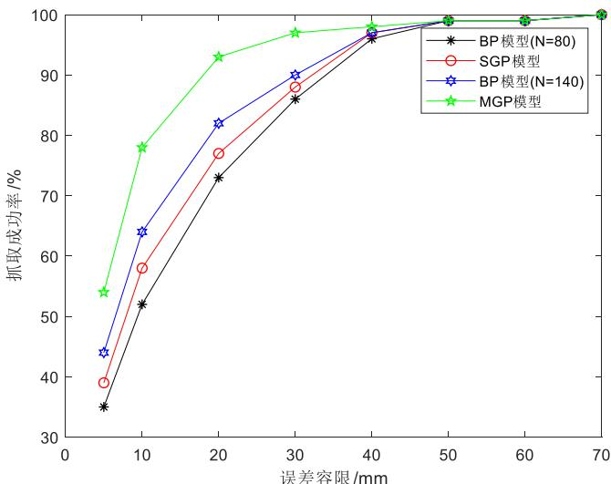  
图5-11BP模型与 MGP模型预测结果对比

采用 BP 神经网络模型、SGP 模型，MGP 模型的目的都是对从物体位姿到机械臂关节角的一个映射。仿真实验结果表明，SGP 模型近似映射的范围有限，预测效果与 MGP 模型相比较差。BP 神经网络模型在样本数与 MGP 模型相同时，预测效果不如后者。在对BP模型增加训练样本后可以发现，其预测效果好于单 GP 模型，但是还是不如 MGP 模型。原因在于 MGP 模型是先对样本进行了高斯先验的假设，再对模型进行训练。而神经网络缺乏对数据分布的先验假设，模型的参数是直接通过样本学习，训练样本数量对其影响较大。因此 MGP模型所需的训练样本量比神经网络少也能获得更好的预测结果。

## 5.4 本章小结

本章主要研究内容是基于高斯过程混合模型的机械臂模仿学习抓取方法。首先介绍了高斯过程混合模型的原理、构建以及参数估计方法。然后提出一种结合改进 Grasp Detection 网络与高斯过程混合模型的机械臂抓取方法。为了在示教行为学习中能更准确描述物体位姿与抓取动作的映射关系，示教过程中使用改进的 Grasp Detection 网络获得目标物体位姿与对应机械臂的抓取关节角度构建示教数据，然后对高斯过程混合模型进行参数估计。最后在仿真实验中进行MGP模型可行性验证，以及预测效果分析。试验结果表明，在一定误差容限中，该抓取方式能够实现目标物体的抓取定位，验证了该方法的有效性。

## 第六章 机械臂抓取实验

本次实验内容主要分为两个：一、基于深度学习的目标识别和目标抓取检测模型进行验证，根据目标检测模型预测的物体类别、位置和姿态信息在机器人系统中进行抓取实验。二、基于模仿学习的机械臂抓取方法进行验证，对采用高斯过程混合模型的模仿学习策略进行抓取实验。

## 6.1 抓取系统框架

本次抓取实验在本文第二章提出的机械臂抓取系统中进行。对基于深度学习的目标识别、目标抓取检测模型与基于高斯过程混合模型的机械臂抓取方法进行验证。两者都是基于视觉的抓取，前者需要完成视觉感知系统的相机内外参数标定，根据相机的内外参数将图像中像素坐标到世界坐标的转换，从而控制机器人进行抓取操作。后者需要在实验平台上收集示教数据对高斯过程混合模型进行参数训练，再对训练完模仿学习策略进行的抓取实验验证。抓取实验过程中，分别对不同的物体进行若干次抓取实验，验证本文所提出的检测模型性能与模仿学习策略可行性。

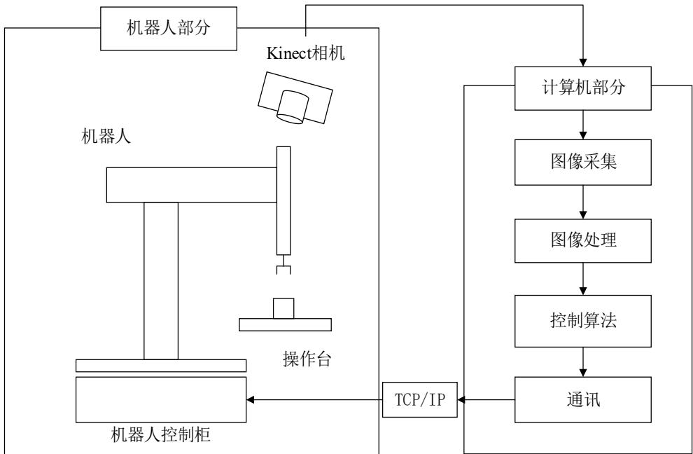  
图6-1机械臂抓取系统结构图

如图 6-1 所示，机械臂的抓取系统主要是在 ABB 机器人的基础上搭建的，包括机器人部分与计算机部分。机器人部分主要包括机器人本体、相机以及工作台；计算机部分包括图像采集、图像检测、以及机器人控制算法。在机器人操控中，首先通过相机获取物体图像，然后通过图像检测模型输出物体的位置的姿态信息，再通过一系列坐标变换或控制策略输出机械臂的关节量。机器人部分与计算机部分使用 Socket通讯，通过 TCP/IP网络协议在计算机与机器人控制柜之间进行控制命令传输。在计算机部分得到各个关节量后，通过 Socket 通讯将操控指令下发给机械臂。

## 6.2 视觉系统标定实验

根据2.4小结中的分析，将图片像素坐标系到世界坐标系的转换关系中，需要获得相机内参数与外参数进行计算。通过相机与机器人的标定实验获取的相机内参与手眼关系的外参，可将图像中的像素坐标转换到机器人的世界坐标，为机器人提供抓取。相机内参通常使用张正友标定法进行标定[74]，外参在手眼标定中获得。

## 6.2.1 相机内参标定

本实验中使用的相机是Kinect2.0深度相机。该相机由微软公司推出，可以同时获取三种图像，分别为彩色图像，深度图像和红外图像。Kinect 2.0 相机的优点在于可以通过获取物体的深度图像从而估计物体的深度信息。因此广泛应用于机械臂抓取实验或工作场景中。Kinect 2.0性能参数如表6-1所示。

表 6-1 Kinect 2.0 相机性能参数

<table><tr><td>性能</td><td>参数</td></tr><tr><td>视场范围</td><td>水平70°垂直60°</td></tr><tr><td>检测深度范围</td><td>0.8m-4.0m</td></tr><tr><td>传输帧率</td><td>30fps</td></tr><tr><td>彩色图像分辨率</td><td>1920*1080</td></tr><tr><td>深度图像分辨率</td><td>512*424</td></tr><tr><td>红外图像分辨率</td><td>512*424</td></tr></table>

相机内参是可唯一确定相机数学模型的参数矩阵，本次标定实验过程如下：

（1）先制作一张9×9×20cm规格的棋盘图，并将棋盘图贴在标定板上，以便于可以通过移动标定板获得不同角度下的棋盘格图片。

（2）如图6-2所示，使用相机收集36张彩色图像。在拍摄图像时，注意收集不同角度姿态下的棋盘格片，这样能保证计算出来的内外参数误差较小。

（3）通过 Matlab 中的 Camera Calibration Toolbox 工具箱进行相机内参计算，将拍摄好的彩色图像输入工具箱中。经常一系列处理，最终经过计算，可以在命令窗口看到相机的内参、以及标定误差和图像的中心坐标等。

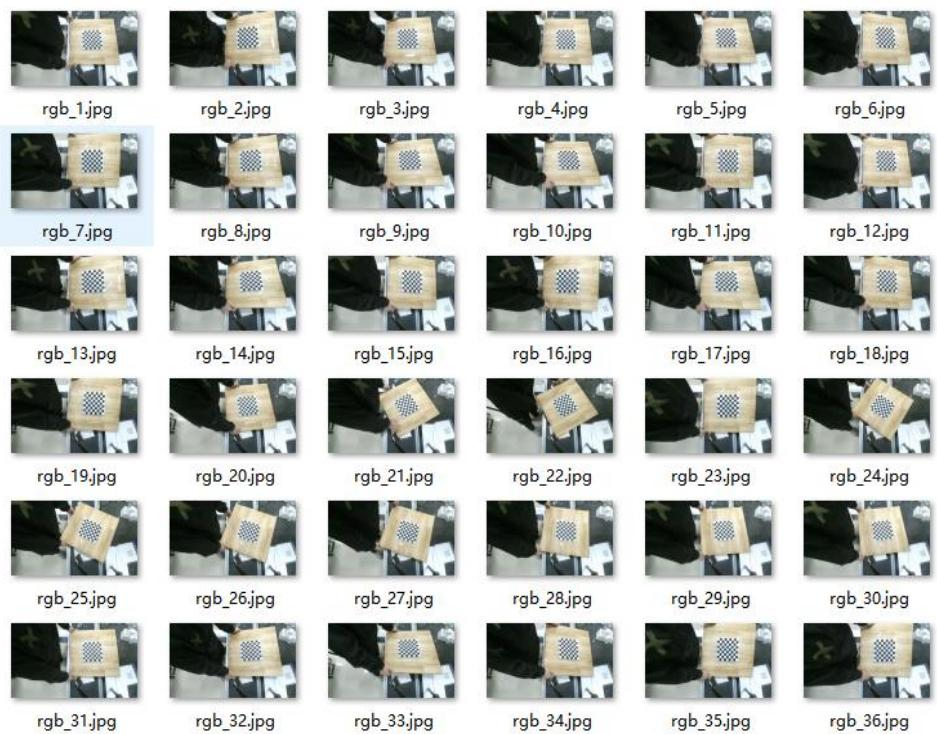  
图6-2相机采集的标定板图片

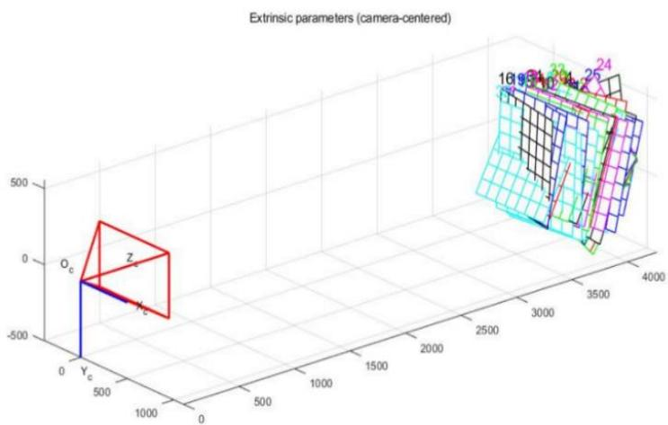  
图6-3 不同角度的标定板

如图6-3所示，拍摄的若干张不同角度图像，通过标定工具箱计算，得到平均角点误差为0.17像素的标定结果，内参矩阵如下所示：

$$
H _ {r g b} = \left[ \begin{array}{c c c} 1 1 6 0. 3 8 & 0 & 9 5 9. 5 0 \\ 0 & 1 0 6 2. 4 1 & 5 3 9. 5 0 \\ 0 & 0 & 1 \end{array} \right]\tag{6-1}
$$

根据式(2-17)，可得到像素坐标系到相机坐标系的转换关系如下：

$$
\left[ \begin{array}{c} X _ {c} \\ Y _ {c} \\ Z _ {c} \end{array} \right] = Z \cdot (H _ {r g b}) ^ {- 1} \cdot \left[ \begin{array}{c} u \\ v \\ 1 \end{array} \right]\tag{6-2}
$$

其中， $H _ { r g b }$ 为标定得到的内参矩阵，Z为物体到相机距离，可由 Kinect 2.0相机获取的图片深度信息得出。

## 6.2.2 相机外参标定

机器人的外参主要由机器人与相机的手眼关系决定。机器人与相机的手眼关系分为两种，一是眼在手上（eye-to-hand），二是眼在手外（eye-in-hand）。眼在手上时，相机固定在机械臂的末端位置上，在进行抓取操作过程中相机与机械臂的相对位置不发生改变。眼在手外时，相机固定在机械臂外，在进行抓取操作时相机相对于机械臂基座标的位置是不发生变化的。

本文采用眼在手外的关系，如图6-1所示，将相机固定在机器人外部，相机的成像平面与操作台平面平行。求解相机与机器人的手眼关系，是为了得到相机坐标系与机器人世界坐标系的转换关系，即求解相机外参。这里采用的标定的方法为：收集机器人世界坐标系的点与相机坐标系的点一一对应，然后利用最小二乘法求解两个坐标系之间的旋转平移关系。具体过程如下：

（1）将标定所用的棋盘格放置在机械臂操作台上，用 Kinect 2.0 深度相机获取棋盘格的彩色和深度图像。在彩色图像中选取 21 个点，这些点分布在棋盘格上如图 6-4 中所示，像素坐标与深度如表 6-2 所示。最后从图像中读取 21 个点的像素坐标和深度信息，通过式(6-2)转换到相机空间三维坐标系的坐标$P = ( p _ { 1 } , p _ { 2 } , . . . , p _ { 2 1 } )$

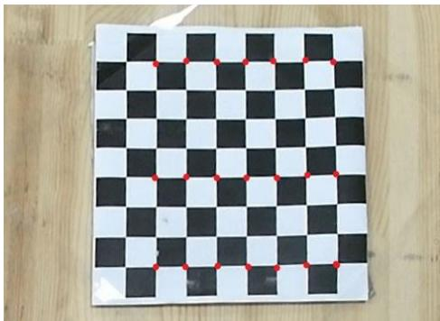  
图 6-4选取的像素

（2）采用手动模式操作机械臂，依次将机械臂末端的夹持器的中心移动至选定好的 21 个点上，并记录每个点所对应的机械臂末端世界坐标$\boldsymbol { Q } = ( q _ { 1 } , q _ { 2 } , . . . , q _ { 2 1 } )$ 如表6-3所示，单位为mm。

表6-2选取点的像素坐标与深度

<table><tr><td>序号</td><td>彩色图像坐标/像素</td><td>深度/mm</td></tr><tr><td>1</td><td>1278,474</td><td>739</td></tr><tr><td>2</td><td>1275,408</td><td>740</td></tr><tr><td>3</td><td>1269,346</td><td>741</td></tr><tr><td>4</td><td>1261,287</td><td>743</td></tr><tr><td>5</td><td>1247,473</td><td>739</td></tr><tr><td>6</td><td>1240,410</td><td>740</td></tr><tr><td>7</td><td>1234,347</td><td>740</td></tr><tr><td>8</td><td>1230,285</td><td>741</td></tr><tr><td>9</td><td>1211,474</td><td>739</td></tr><tr><td>10</td><td>1206,411</td><td>740</td></tr><tr><td>11</td><td>1202,350</td><td>741</td></tr><tr><td>12</td><td>1196,291</td><td>743</td></tr><tr><td>13</td><td>1180,476</td><td>739</td></tr><tr><td>14</td><td>1174,412</td><td>740</td></tr><tr><td>15</td><td>1168,351</td><td>741</td></tr><tr><td>16</td><td>1164,291</td><td>743</td></tr><tr><td>17</td><td>1150,472</td><td>739</td></tr><tr><td>18</td><td>1135,407</td><td>740</td></tr><tr><td>19</td><td>1121,347</td><td>741</td></tr><tr><td>20</td><td>1102,297</td><td>741</td></tr><tr><td>21</td><td>1082,402</td><td>740</td></tr></table>

表6-3 选取点的世界坐标

<table><tr><td>序号</td><td> $X_i$ </td><td> $Y_i$ </td><td> $Z_i$ </td></tr><tr><td>1</td><td>482.16</td><td>-54.07</td><td>-211.99</td></tr><tr><td>2</td><td>483.64</td><td>-16.88</td><td>-211.88</td></tr><tr><td>3</td><td>485.61</td><td>24.62</td><td>-211.44</td></tr><tr><td>4</td><td>486.44</td><td>65.77</td><td>-212.30</td></tr><tr><td>5</td><td>498.82</td><td>-59.41</td><td>-211.03</td></tr><tr><td>6</td><td>500.68</td><td>-18.35</td><td>-211.40</td></tr><tr><td>7</td><td>501.61</td><td>0.88</td><td>211.47</td></tr><tr><td>8</td><td>502.96</td><td>43.12</td><td>-211.42</td></tr><tr><td>9</td><td>516.01</td><td>59.69</td><td>-211.47</td></tr><tr><td>10</td><td>517.60</td><td>-18.91</td><td>-211.21</td></tr><tr><td>11</td><td>519.34</td><td>22.67</td><td>-211.82</td></tr><tr><td>12</td><td>520.06</td><td>62.94</td><td>-211.82</td></tr><tr><td>13</td><td>534.26</td><td>-58.03</td><td>-211.83</td></tr><tr><td>14</td><td>536.62</td><td>-16.77</td><td>-211.51</td></tr><tr><td>15</td><td>537.92</td><td>23.59</td><td>-211.51</td></tr><tr><td>16</td><td>539.27</td><td>65.50</td><td>-211.87</td></tr><tr><td>17</td><td>482.16</td><td>-54.07</td><td>-211.99</td></tr><tr><td>18</td><td>483.64</td><td>-16.88</td><td>-211.88</td></tr><tr><td>19</td><td>485.64</td><td>24.61</td><td>-211.44</td></tr><tr><td>20</td><td>486.44</td><td>65.77</td><td>-212.30</td></tr><tr><td>21</td><td>498.83</td><td>-59.41</td><td>-211.07</td></tr></table>

（3）相机坐标系与机械臂所在世界坐标系之间是一个刚体变换的关系，因此可以采用最小二乘法的方式来求解两者关系。求解过程中将最小二乘法问题转换为求解 SVD问题即矩阵的奇异值分解问题[75]，结果会得到一个关于两个坐标系之间的旋转平移矩阵( , )R T ，这就是所需要求解的相机外参。最小二乘法

公式如式(6-3)所示：

$$
(R, T) = \arg \min \sum_ {i - 1} ^ {N} \left\| (R p _ {i} + T) - q _ {i} \right\| ^ {2}\tag{6-3}
$$

最终手眼标定的外参为：

$$
H _ {r t} = \left[ \begin{array}{c c} R & T \\ 0 & 1 \end{array} \right] = \left[ \begin{array}{c c c c} 0. 0 7 7 4 & 0. 0 1 4 6 & 0. 9 9 6 8 & 8 7 2. 3 2 9 0 \\ - 0. 9 9 6 0 & - 0. 0 4 2 2 & 0. 0 7 8 0 & - 4 0 1. 8 3 3 3 \\ 0. 0 4 3 2 & - 0. 9 9 8 9 & 0. 0 1 1 5 & 9 7 9. 1 4 3 9 \\ 0 & 0 & 0 & 1 \end{array} \right]\tag{6-4}
$$

通过标定实验获得相机的内外参数后，结合式(2-19)，可将图像中的像素点坐标转换到世界坐标系。在标定结果测试中，通过将像素点坐标转换为世界坐标与实际世界坐标对比，由标定参数得出世界坐标误差在 3毫米以内。

## 6.3 机械臂抓取实验

## 6.3.1 基于深度学习的机械臂抓取方法实验

依据上述章节的分析研究内容，总结基于深度学习的目标识别与目标抓取检测模型抓取实验流程如下：

  
图6-5基于深度学习的机械臂抓取流程图

如图6-5所示，利用检测模型从图像中获取目标物体的类别和位姿信息，目标识别算法与抓取检测算法效果如下：

  
(a) 原图

  
(b) 目标识别结果

  
(c)目标分割结果

  
(d)抓取检测结果  
图6-6 待抓取物体检测结果

  
图6-7基于检测模型的机械臂抓取实验

如图6-6所示，通过识别和抓取检测网络，可以得到物体种类、可抓取框的位置和旋转角度。由相机的内外参数可将抓取检测网络输出的抓取框中心像素坐标变换到物体所在世界坐标系的位置。并结合抓取网络输出的物体抓取框旋转角可确定末端夹持器与抓取物体的旋转关系。在抓取实验过程，确定机械臂的抓取姿态采用顶抓姿势，机械臂末端垂直于操作平面。根据此时机械臂位姿存在的约束关系，结合物体的世界坐标与末端夹持器抓取旋转角度，可通过机械臂的逆运动分析可得到机械臂各个关节角进行抓取操作，实际抓取效果图 6-7所示。

根据实验流程对不同物体进行抓取实验，并对物体进行不同位置的多次检测与抓取，最后得出平均检测时间以及抓取准确率如表6-4和表 6-5。

表6-4抓取实验检测时间结果

<table><tr><td>实验物体</td><td>平均识别时间/s</td><td>平均抓取位姿检测时间/s</td></tr><tr><td>螺丝刀</td><td>0.192s</td><td>0.067s</td></tr><tr><td>扳手</td><td>0.196s</td><td>0.072s</td></tr><tr><td>剪刀</td><td>0.216s</td><td>0.069s</td></tr><tr><td>胶棒</td><td>0.185s</td><td>0.068s</td></tr><tr><td>钳子</td><td>0.212s</td><td>0.070s</td></tr></table>

表6-5抓取实验结果

<table><tr><td>实验物体</td><td>实验次数(成功次数/总次数)</td><td>抓取成功率(%)</td></tr><tr><td>螺丝刀</td><td>18/20</td><td>90</td></tr><tr><td>扳手</td><td>17/20</td><td>85</td></tr><tr><td>剪刀</td><td>15/20</td><td>75</td></tr><tr><td>胶棒</td><td>17/20</td><td>85</td></tr><tr><td>钳子</td><td>17/20</td><td>85</td></tr><tr><td>总计</td><td>84/100</td><td>84</td></tr></table>

由表 6-4和表 6-5可得，目标检测算法对抓取目标的平均识别时间约为 0.2s，平均抓取位姿检测时间约为 0.07s；在机械臂抓取系统上，对不同物体通过抓取检测网络获得位姿信息，进行抓取实验的平均抓取成功率在 84%左右。实验结果证明，本文的目标检测算法在能够实现快速的抓取识别和位姿识别，能够给机械臂提供有效的抓取位置。

## 6.3.2 基于高斯过程混合的机械臂抓取方法实验

依据上述章节的分析研究内容，总结基于高斯过程混合模型的机械臂抓取方法实验验证流程如下：

  
图6-8 基于模仿学习的机械臂抓取流程图

本文提出使用高斯过程混合模型作为模仿学习策略的机械臂抓取方法，该方法可通过目标物体的位姿信息预测机械臂抓取关节角，过程如图6-8所示。

  
图 6-9 示教过程

在模仿学习策略训练过程中，首先需要收集数据。示教过程如图6-9所示，将物体随机摆放在50cm 50cm 的操作台上，然后通过相机获取物体的图像输入抓取检测模型得到物体的位置和姿态信息。接着拖动机械臂对物体执行操作，记录各关节变量。示教数据由目标物体的位姿信息与机械臂对应抓取关节量组成。按照第五章仿真实验的经验以及模型训练，收集 80 组示教数据作为训练集，对MGP模型进行训练

根据图 6-8 所示实验流程，对于训练完毕的抓取方法进行多种物体抓取实验，抓取效果如图 6-10 所示。在实验过程，主要选用了五种常见用品，并对物体进行不同位置的多次抓取，抓取测试结果如表6-6所示

  
图6-10基于高斯过程混合模型的抓取实验

表6-6抓取测试结果

<table><tr><td>实验物体</td><td>实验次数(成功次数/总次数)</td><td>成功率(%)</td></tr><tr><td>螺丝刀</td><td>16/20</td><td>80</td></tr><tr><td>扳手</td><td>15/20</td><td>75</td></tr><tr><td>吸锡器</td><td>16/20</td><td>80</td></tr><tr><td>胶棒</td><td>16/20</td><td>80</td></tr><tr><td>钳子</td><td>15/20</td><td>75</td></tr><tr><td>总计</td><td>78/100</td><td>78</td></tr></table>

由表6-6可得，采用基于高斯过程混合模型作为模仿学习策略的机械臂抓取方法是可以实现抓取操作的，进行抓取实验的平均抓取成功率大概在 78%左右。对比 6.4.1 节中基于深度学习的传统机械臂抓取实验，抓取成功率还是较低。原因在于机械臂是个比较复杂的多变量系统，仅仅通过图像和关节量关系很难完整的拟合机械臂的抓取过程。但是对比传统机械臂抓取过程需要进行相机标定，坐标变换，逆运动学求解等复杂过程，采用基于模仿学习的抓取操作方法过程更为简洁。通过示教学习与模仿策略的学习就能够进行抓取操作，避免了进行标定实验和机器人逆运动学求解的问题，降低了对使用者的专业知识要求，有利于机械臂的广泛使用。

## 6.4 本章小结

本章对基于深度学习的目标识别和抓取检测模型与基于模仿学习的机械臂抓取方法进行抓取实验。首先进行了视觉系统的标定实验，在此基础上对基于深度学习的目标识别和抓取检测模型进行抓取实验，验证了检测模型的有效性。其次在机械臂抓取系统上验证了基于高斯过程混合的机械臂抓取方法可行性。

## 总结与展望

机械臂抓取操作是机器人最常使用到的操作技能，本文针对机械臂抓取方法研究主要从两个方面进行，一是研究机械臂进行抓取操作前的目标物体检测问题，使用基于深度学习的目标识别以及目标抓取检测模型进行抓取物体检测。二是研究机器人的技能学习方法，使用示教模仿学习的方法进行机械臂抓取操作技能的学习。本文的具体研究工作总结如下：

一、根据机械臂抓取实验的需要构建了基于 ABB机器人的机械臂抓取系统。然后在 D-H 参数法的建模中进行了机械臂运动学分析，最后介绍了机械臂在基于视觉抓取过程中涉及到的物体坐标转换。

二、在目标识别方面，采用基于深度学习的 Mask R-CNN 网络作为抓取目标识别算法，并分析介绍了网络各个模块的功能以及损失函数计算。最后使用Kinect 2.0 深度相机收集抓取操作中的物体图片构建本地数据集，并对 Mask R-CNN网络展开训练以及测试。测试结果表明识别模型的平均识别精度mAP能够达到0.9以上，平均预测时间约为0.2s。

三、为实现抓取目标的快速位姿检测，提出改进的 Grasp Detection 网络作为目标抓取位姿检测网络。即用轻量级的卷积神经网络 ShuffleNet v2 结合区域建议网络（RPN）来生成图像中物体的可抓取候选区域，对比使用ResNet-50进行特征提取的原网络中拥有更轻量的网络结构，能够实现更加快速的抓取检测。将 Mask R-CNN 网络输出的图像识别结果输入该网络可快速高效地得到已识别物体可抓取框的像素坐标和旋转角。最后检测模型在康奈尔数据集以及本地数据集上进行训练测试，在测试集上模型的检验精度能够达到 90%以上，平均预测时间在0.1s内。

四、通过模仿学习方法进行机械臂抓取操作学习，提出一种结合改进GraspDetection 网络与高斯过程混合模型的机械臂抓取方法。该方法基于高斯过程混合模型构建从图像坐标系的目标物体位姿信息到机械臂关节角度的映射关系，避免了传统抓取中相机标定繁琐与机器人求逆困难的问题。为了在示教行为学习中能更准确描述物体位姿与抓取动作的映射关系，示教过程中使用改进的Grasp Detection网络获得目标物体位姿与对应机械臂的抓取关节角度构建示教数据，然后对高斯过程混合模型进行参数估计。最后在仿真实验中分析了模型参数对于高斯过程混合模型的预测效果的影响。

五、在机械臂抓取系统中对基于深度学习的目标识别、抓取目标检测模型与基于模仿学习的机械臂抓取方法进行抓取实验。通过实验验证了检测模型以及模仿学习策略的有效性。

本文在基于深度学习与模仿学习的帮助下进行了机械臂抓取方法研究，并取得一些成果，可以帮助机械臂实现抓取操作。但是由于科研设施以及个人能力受限，本文在机械臂抓取方法的研究还需改进。本文在研究中的不足与展望，主要包括以下方面：

（1）在抓取目标位姿检测方面，本文采用的主要是针对图像中的物体位姿检测，该方法主要满足机械臂夹持器垂直于操作平面的抓取情况。而在日常生活中，物体并非都能使用这种方法进行抓取。因此针对这种情况，有必要结合目标物体的三维特征信息提出一种满足其他抓取姿态的抓取检测方式。

（2）本文使用模仿学习策略进行机械臂抓取操作技能学习只是构建从图像中的目标信息到机械臂关节量的映射，适合使用的场景范围较小，还需研究适合多场景使用的模仿学习策略来进行机械臂技能学习。

（3）单纯使用模仿学习机制作为机器人技能学习方法的效果是有限的，未来在机器人模仿学习的发展中应该融合其他机器学习方法。如通过将模仿学习与强化学习优势相结合，赋予机械臂更强的技能学习能力，使得机器人在复杂环境中具备更强的自主学习能力和决策能力。

## 参考文献

[1] 高春明, 于潇, 陈世坤. 人工智能对中国未来劳动力就业的影响——基于劳动力供给视角的分析[J]. 社会科学战线, 2020(10): 249-254.

[2] 李舒沁, 王灏晨. 人工智能对老龄化背景下制造业劳动力的影响——来自中国的证据[J].科学学与科学技术管理, 2021, 42(07): 3-17.

[3] 刘乃军, 鲁涛, 蔡莹皓, 等. 机器人操作技能学习方法综述[J]. 自动化学报, 2019, 45(03):458-470.

[4] Lv Q, Zhang R, Liu T, et al. A strategy transfer approach for intelligent human-robot collaborative assembly[J]. Computers & Industrial Engineering, 2022, 168: 108047.

[5] 夏群峰, 彭勇刚. 基于视觉的机器人抓取系统应用研究综述[J]. 机电工程, 2014, 31(06):697-701.

[6] Caldera S, Rassau A, Chai D. Review of deep learning methods in robotic grasp detection[J]. Multimodal Technologies and Interaction, 2018, 2(03): 57-81.

[7] Zhu X, Liang Y, Sun H, et al. Robot obstacle avoidance system using deep reinforcement learning[J]. Industrial Robot, 2022, 49(02): 301-310.

[8] 朱云, 凌志刚, 张雨强. 机器视觉技术研究进展及展望[J]. 图学学报, 2020, 41(06): 871-890.

[9] Sze V, Chen Y H, Yang T J, et al. Efficient processing of deep neural networks: A tutorial and survey[J]. Proceedings of the IEEE, 2017, 105(12): 2295-2329.

[10] Sutton R S, Barto A G. Reinforcement Learning: An Introduction[M]. MIT Press, 2018.

[11] Xie Z W, Zhang Q, Jiang Z N, et al. Robot learning from demonstration for path planning: A review[J]. Science China Technological Sciences, 2020, 63(08): 1325-1334.

[12] Dalal N, Triggs B. Histograms of oriented gradients for human detection[C]. 2005 IEEE Computer Society Conference on Computer Vision and Pattern Recognition. IEEE, 2005, 1: 886-893.

[13] Meena K, Suruliandi A. Local binary patterns and its variants for face recognition[C]. 2011 International Conference on Recent Trends in Information Technology (ICRTIT). IEEE, 2011: 782-786.

[14] Yan T W, Garcia-Molina H. SIFT: a tool for wide-area information dissemination[C]. Usenix Technical Conference. 1995: 177-186.

[15] Schuldt C, Laptev I, Caputo B. Recognizing human actions: A local SVM approach[C]. Proceedings of the 17th International Conference on Pattern Recognition. 2004, 3: 32-36.

[16] Langley P, Sage S. Induction of selective Bayesian classifiers[M]. Uncertainty Proceedings 1994. Morgan Kaufmann, 1994: 399-406.

[17] Uijlings J R, Sande K E, Gevers T, et al. Selective search for object recognition[J]. International Journal of Computer Vision, 2013, 104(02): 154-171.

[18] Cheng M, Zhang Z, Lin W Y, et al. BING: Binarized normed gradients for objectness estimation at 300fps[C]. Computer Vision & Pattern Recognition. 2014: 3286-3293.

[19] Krizhevsky A, Sutskever I, Hinton G. ImageNet classification with deep convolutional neura networks[J]. Communications of the ACM, 2012, 60: 84-90.

[20] Zou Z, Shi Z, Guo Y, et al. Object detection in 20 years: A survey[J]. Proceedings of the IEEE, 2023, 111(03): 257-276.

[21] Girshick R, Donahue J, Darrell T, et al. Rich feature hierarchies for accurate object detection and semantic segmentation[C]. Proceedings of the IEEE Conference on Computer Vision and Pattern Recognition. 2014: 580-587.

[22] He K, Zhang X, Ren S, et al. Spatial pyramid pooling in deep convolutional networks for visual recognition[J]. IEEE Transactions on Pattern Analysis and Machine Intelligence, 2015, 37(09): 1904-1916.

[23] Girshick R. Fast R-CNN [C]. Proceedings of the IEEE International Conference on Computer Vision. 2015: 1440-1448.

[24] Ren S, He K, Girshick R, et al. Faster R-CNN: Towards real-time object detection with region proposal networks[J]. IEEE Transactions on Pattern Analysis & Machine Intelligence, 2016, 39(6): 1137-1149.

[25] Lin T Y, Dollár P, Girshick R, et al. Feature pyramid networks for object detection[C]. Proceedings of the IEEE Conference on Computer Vision and Pattern Recognition. 2017: 2117- 2125.

[26] Bharati P, Pramanik A. Deep learning techniques—R-CNN to Mask R-CNN: A survey[J]. Computational Intelligence in Pattern Recognition: Proceedings of CIPR 2019, 2020: 657-668.

[27] Adibhatla V A, Chih H C, Hsu C, et al. Applying deep learning to defect detection in printed circuit boards via a newest model of you-only-look-once.[J]. Mathematical Biosciences and Engineering, 2021,18(04): 4411-4428.

[28] Biswas A. An automatic traffic density estimation using single shot detection (SSD) and mobilenet-SSD[J]. Physics and Chemistry of The Earth, 2019, 110: 176-184.

[29] Lin T Y, Goyal P, Girshick R, et al. Focal loss for dense object detection[J]. IEEE Transactions on Pattern Analysis & Machine Intelligence, 2020, 42(02): 318 -327.

[30] Dogar M R, Hsiao K, Ciocarlie M, et al. Physics-based grasp planning through clutter[M]. MIT Press: Cambridge, MA, USA, 2012.

[31] 杜学丹, 蔡莹皓, 鲁涛, 等. 一种基于深度学习的机械臂抓取方法[J]. 机器人, 2017, 39(06):820-828.

[32] 江都. 基于视觉和触觉感知的机械手自适应抓取研究[D]. 武汉科技大学,2022.

[33] Lenz I, Lee H, Saxena A. Deep learning for detecting robotic grasps[J]. The International Journal of Robotics Research, 2015, 34(04): 705-724.

[34] R. L. Lab, “Cornell Grasping Dataset,”http://pr.cs.cornell.edu/grasping/rect data/data.php, 2013, accessed: 2017-09-01.

[35] Redmon J, Angelova A. Real-time grasp detection using convolutional neural networks[C]. 2015 IEEE International Conference on Robotics and Automation (ICRA). IEEE, 2015: 1316- 1322.

[36] Depierre A, Dellandréa E, Chen L. Optimizing correlated graspability score and grasp regression for better grasp prediction[J]. arXiv preprint arXiv:2002.00872, 2020.

[37] 夏晶, 钱堃, 马旭东, 等. 基于级联卷积神经网络的机器人平面抓取位姿快速检测[J]. 机器人, 2018, 40(06): 794-802.

[38] Chu F J, Xu R, Patricio V. Real-world multiobject, multigrasp detection[J]. IEEE Robotics and Automation Letters, 2018, 3: 3355-3362.

[39] He K, Zhang X, Ren S, et al. Deep residual learning for image recognition[C]. Proceedings of The IEEE Conference on Computer Vision and Pattern Recognition. 2016: 770-778.

[40] 顾海巍. 机器人灵巧手的物体触摸识别及自适应抓取研究[D]. 哈尔滨工业大学,2017

[41] de Jesús Rubio J, Serrano J, Figueroa M, et al. Dynamic model with sensor and actuator for an articulated robotic arm[J]. Neural Computing and Applications, 2014, 24: 573-581.

[42] Hua J, Zeng L, Li G, et al. Learning for a robot: Deep reinforcement learning, imitation learning, transfer learning[J]. Sensors, 2021, 21(04): 1278-1299.

[43] Pfeiffer M, Shukla S, Turchetta M , et al. Reinforced imitation: Sample efficient deep reinforcement learning for map-less navigation by leveraging prior demonstrations[J]. IEEE Robotics & Automation Letters, 2018, 3(04): 4423-4430.

[44] Kroemer O, Niekum S, Konidaris G D. A review of robot learning for manipulation: Challenges, representations, and algorithms[J]. Journal of Machine Learning Research, 2021, 22(01): 1395-1476.

[45] Ugur E, Nagai Y, Sahin E, et al. Staged development of robot skills: Behavior formation, affordance learning and imitation with motionese[J]. IEEE Transactions on Autonomous Mental Development, 2015, 7(02): 119-139.

[46] Lukic L, Santos-Victor, José, Billard A. Learning robotic eye–arm–hand coordination from human demonstration: a coupled dynamical systems approach[J]. Biological Cybernetics, 2014, 108(02): 223-248.

[47] Takeda T, Hirata Y, Kosuge K. Dance step estimation method based on HMM for dance partner robot[J]. IEEE Transactions on Industrial Electronics, 2007, 54(02): 699-706.

[48] 于建均,郑逸加,阮晓钢,等.基于高斯混合模型的轨迹模仿学习表征参数优化[J].北京工业大学学报, 2017, 43(05): 719-728.

[49] Gams A, Nemec B, Ijspeert A J, et al. Coupling movement primitives: Interaction with the environment and bimanual tasks[J]. IEEE Transactions on Robotics, 2014, 30(4): 816-830

[50] Rahmatizadeh R, Abolghasemi P, Behal A, et al. Learning real manipulation tasks from virtual demonstrations using LSTM[J]. arXiv preprint arXiv:1603.03833, 2016.

[51] Zhang T, Mc Carthy Z, Jow O, et al. Deep imitation learning for complex manipulation tasks from virtual reality teleoperation[C]. 2018 IEEE International Conference on Robotics and Automation (ICRA). IEEE, 2018: 5628-5635.

[52] 高霄. 基于模仿学习的机械臂运动规划与柔顺控制研究[D].武汉大学,2021.

[53] 陈友东, 郭佳鑫, 陶永. 基于高斯过程的机器人自适应抓取策略[J]. 北京航空航天大学学报, 2017, 43(09): 1738-1745.

[54] 尼库. 机器人学导论: 分析, 控制及应用[M]. 电子工业出版社, 2013.

[55] 张展. 基于双目视觉的三维重建关键技术研究[D]. 中国科学院大学(中国科学院沈阳计算技术研究所), 2019.

[56] Ma N, Zhang X, Zheng H T, et al. Shufflenet v2: Practical guidelines for efficient cnn architecture design[C]. Proceedings of the European conference on computer vision (ECCV). 2018: 116-131.

[57] Zeiler M D, Fergus R. Visualizing and understanding convolutional networks[C]. Computer Vision–ECCV 2014: 13th European Conference. 2014: 818-833.

[58] Liu S, Deng W. Very deep convolutional neural network based image classification using small training sample size[C]. 2015 3rd IAPR Asian Conference on Pattern Recognition (ACPR). IEEE, 2015: 730-734.

[59] 张云洲, 李奇, 曹赫等. 基于多层级特征的机械臂单阶段抓取位姿检测[J]. 控制与决策,2021, 36(08): 1815-1824.

[60] 李秀智, 李家豪, 张祥银等. 基于深度学习的机器人最优抓取姿态检测方法[J]. 仪器仪表学报, 2020, 41(05): 108-117.

[61] 李正明, 章金龙. 基于深度学习的抓取目标姿态检测与定位[J]. 信息与控制, 2020, 49(02):147-153.

[62] Sandler M, Howard A, Zhu M, et al. Mobilenetv2: Inverted residuals and linear bottlenecks[C]. Proceedings of the IEEE Conference on Computer Vision and Pattern Recognition. 2018: 4510-4520.

[63] 肖贤鹏,胡莉,张静等.基于多尺度特征融合的抓取位姿估计[J].计算机工程与应用,2022,58(10): 172-177.

[64] Osa T, Pajarinen J, Neumann G, et al. An algorithmic perspective on imitation learning[J]. Foundations & Trends in Robotics, 2018, 7(01-02): 1-179.

[65] Williams C. Prediction with gaussian processes: from linear regression to linear prediction and beyond[J]. Springer Netherlands, 1998: 599-621

[66] 何志昆, 刘光斌, 赵曦晶等. 高斯过程回归方法综述[J]. 控制与决策, 2013, 28(08): 1121-1129.

[67] 汪廷华, 陈峻婷. 核函数的选择研究综述[J]. 计算机工程与设计, 2012, 33(03): 1181-1186.

[68] Deisenroth M P, Fox D, Rasmussen C E. Gaussian processes for data-efficient learning in robotics and control[J]. IEEE Transactions on Pattern Analysis and Machine Intelligence, 2013, 37(02): 408-423.

[69] 周亚同, 陈子一, 马尽文. 从高斯过程到高斯过程混合模型:研究与展望[J]. 信号处理, 2016,32(08): 960-972.

[70] 张会文, 张伟, 周维佳. 基于交叉熵优化的高斯混合模型运动编码[J]. 机器人, 2018, 40(04):569-576.

[71] Ng S K, Krishnan T, McLachlan G J. The EM algorithm[J]. Handbook of Computational Statistics: Concepts and Methods, 2012: 139-172.

[72] Burnaev E V, Panov M E, Zaytsev A A. Regression on the basis of nonstationary Gaussian processes with Bayesian regularization[J]. Journal of Communications Technology and Electronics, 2016, 61: 661-671.

[73] Rozo L, Jiménez P, Torras C. A robot learning from demonstration framework to perform force-based manipulation tasks[J]. Intelligent Service Robotics, 2013, 6(01): 33-51.

[74] 迟德霞, 王洋, 宁立群, 等. 张正友法的摄像机标定试验[J]. 中国农机化学报, 2015, 36(02):287-289.

[75] 邱泽霖. 基于目标检测与图像处理的机械臂抓取系统研究[D]. 广州大学,2021.