# 硕士研究生学位论文

# (全日制学术型硕士研究生)

# 题目： 基于深度强化学习和模仿学习的机械臂轨迹跟踪控制研究

姓 名： 胡锦涛

学 号： 221115202

学 院： 计算机科学与技术学院（软件学院、网络空间安全学院）

学科专业： 计算机科学与技术

研究方向： 深度强化学习、智能控制

导师姓名： 王福杰

〇二五 年 六 月

# Research on trajectory tracking control of robotic arm based on deep reinforcement learning and imitation learning

A Dissertation Submitted for the Degree of Master

Candidate：Hu Jintao

Supervisor：Prof. Wang Fujie

Speciality: Computer Science and Technology

Research field: Intelligent Computing

Dongguan University ofTechnology

Dongguan, China

分类号：TP391

学校代号：11819

学 号 ：2221115202

# 东莞理工学院学术型硕士研究生学位论文

# 基于深度强化学习和模仿学习的机械臂轨迹跟踪控制研究

作者姓名：胡锦涛

导师姓名、职称：王福杰 副教授

学科专业：计算机科学与技术

研究方向：智能计算

论文答辩日期：2025 年 5 月17 日

论文提交日期：2025 年 5 月16 日

答辩委员会成员：

主席： 陈平华

委员： 滕海、袁玉峰、陈晓涌、胡望

## 摘要

随着科学技术的不断进步，机械臂在工业制造、医疗、服务等领域的应用日益广泛。人们对机械臂的要求不仅限于精确的执行力，还包括在动态环境中对复杂任务的适应能力和实时轨迹跟踪能力。因此，如何提高机械臂在不确定环境中的控制精度和鲁棒性，成为了现代机器人技术中的一个重要研究方向。传统的轨迹跟踪控制方法往往依赖于对机械臂动力学模型的精确建模，然而在实际应用中，系统的复杂性和环境的动态变化使得这些方法难以有效应对各种未知因素。深度强化学习（DeepReinforcement Learning, DRL）作为一种基于数据驱动的学习方法，能够通过与环境的交互自主地优化控制策略，已被证明在解决复杂控制任务中具有巨大的潜力。因此，本文以强化学习算法为基底算法，在其基础上研究深度强化学习方法在机械臂跟踪控制中的问题，设计出在约束条件下的深度强化学习跟踪控制器。具体而言，本文在强化学习跟踪控制器、改进强化学习算法、机械臂动力学中关节角轨迹跟踪控制、机械臂运动学中末端执行器轨迹跟踪控制方面进行研究，具体研究内容如下：

（1）基于欧拉-拉格朗日方程建立机械臂的动力学和运动学模型，描述了机械臂基础环境，设计出经典的强化学习跟踪控制器，验证控制器在基础环境中的可行性。此外，本文设计了改进的深度强化学习框架，并应用于具有非线性约束和随机外力干扰的机械臂动力学模型轨迹跟踪控制应用。本文将机械臂的精确轨迹控制转化为强化学习的密集奖励问题，提出一种结合软演员-评论家（SoftActor-Critic, SAC）算法和集成随机网络蒸馏（Ensemble Random Network Distillation, ERND）的 DRL 方法来解决机器人机械手的跟踪控制问题。首先设计一个ERND模型，该模型由多个随机化参数的RND 模型的组成。每个 RND 模型通过学习目标特征和环境的预测特征来获得误差。由此产生的误差作为内部奖励，驱动机器人代理探索未知和不可预测的环境状态。集成模型通过对各个RND模型的内部奖励求和来获得总的内部奖励，从而获得更准确反映机械手在跟踪控制任务中的特点并提高控制性能的模型。其次，将SAC算法与ERND相结合，可以在输入饱和与关节角度受限的环境下实现更鲁棒的探索能力，从而能够更快地学习到有效的策略，提升机械臂跟踪控制任务的性能和效率。最后，仿真结果表明，通过SAC算法与ERND 的结合，机械臂跟踪控制任务在密集奖励问题中能够有效地完成。

（2）在上述的机械臂环境的基础上，本文基于动力学和运动学模型的机械臂，提出另一种改进的深度强化学习算法，来解决机械臂在任务空间中的轨迹跟踪控制问题。本文提出了一种基于生成对抗模仿学习（Generative adversarial imitation learning, GAIL）

和长短期记忆（Long Short-Term Memory, LSTM）的深度强化学习方法，用于解决具有饱和约束和随机干扰的机器人机械手的跟踪控制问题，而无需学习机械手的动力学和运动学模型。具体而言，它将力矩和关节角度限制在一定范围内。首先，为了应对训练过程中的不稳定性问题并获得稳定性策略，将SAC算法和LSTM 结合起来。通过采用专为机器人机械手系统设计的 LSTM 架构，可以更全面地捕捉和理解关节位置随时间的变化趋势，从而降低机器人机械手在跟踪控制任务训练过程中的不稳定性。其次，将SAC-LSTM 训练所获得的策略用作GAIL 的专家数据，以学习更好的控制策略。该SAC-LSTM-GAIL（SL-GAIL）算法不需要花时间探索未知环境，而是直接从稳定的专家数据中学习控制策略。最后通过仿真结果表明，所提出的SL-GAIL 算法能够有效的完成机器人末端执行器的跟踪任务，并且与其他算法相比，在有干扰的测试环境下表现出更优越的稳定性。

关键词：深度强化学习，机械臂，轨迹跟踪，集成网络随机蒸馏，生成对抗模仿学习，输入饱和

## ABSTRACT

With the continuous progress of science and technology, the application of robotic arms in industrial manufacturing, medical treatment, service and other fields is becoming more and more widespread. People's requirements for robotic arms are not only limited to precise execution, but also include the ability to adapt to complex tasks in dynamic environments and real-time trajectory tracking ability. Therefore, how to improve the control accuracy and robustness of robotic arms in uncertain environments has become an important research direction in modern robotics. Traditional trajectory tracking control methods often rely on accurate modeling of the robotic arm dynamics model, however, in practical applications, the complexity of the system and the dynamic changes of the environment make these methods difficult to effectively deal with various unknown factors. Deep Reinforcement Learning (DRL), as a data-driven learning method that can autonomously optimize the control strategy through interaction with the environment, has been shown to have great potential in solving complex control tasks. Therefore, this thesis takes the reinforcement learning algorithm as the base algorithm and studies the deep reinforcement learning method in robotic arm tracking control on its basis to design a deep reinforcement learning tracking controller under constraints. Specifically, this thesis conducts research in reinforcement learning tracking controller, improved reinforcement learning algorithm, joint angle trajectory tracking control in robotic arm dynamics, and end-effector trajectory tracking control in robotic arm kinematics, as follows:

(1) Based on the Euler-Lagrange equation, the dynamic and kinematic models of the manipulator are established, the basic environment of the manipulator is described, and a classic reinforcement learning tracking controller is designed to verify the feasibility of the controller in the basic environment. In addition, this thesis designs an improved deep reinforcement learning framework and applies it to the trajectory tracking control application of the manipulator dynamics model with nonlinear constraints and random external force interference. This thesis transforms the precise trajectory control of the manipulator into a dense reward problem of reinforcement learning, and proposes a DRL method that combines the Soft Actor-Critic (SAC) algorithm and the Ensemble Random Network Distillation (ERND) to solve the tracking control problem of the robot manipulator. First, an ERND model is designed, which consists of multiple RND models with randomized parameters. Each RND model obtains an error by learning the target features and the predicted features of the environment. The resulting error is used as an internal reward to drive the robot agent to explore unknown and unpredictable environmental states. The integrated model obtains the total internal reward by summing the internal rewards of each RND model, thereby obtaining a model that more accurately reflects the characteristics of the manipulator in the tracking control task and improves the control performance. Secondly, the combination of SAC algorithm and ERND can achieve more robust exploration capabilities in the environment of input saturation and joint angle restriction, so that effective strategies can be learned faster and the performance and efficiency of the manipulator tracking control task can be improved. Finally, the simulation results show that by combining the SAC algorithm with ERND, the manipulator tracking control task can be effectively completed in the dense reward problem.

(2) Based on the above robot arm environment, this thesis proposes another improved deep reinforcement learning algorithm based on the robot arm with dynamic and kinematic models to solve the trajectory tracking control problem of the robot arm in the task space. This thesis proposes a deep reinforcement learning method based on generative adversarial imitation learning (GAIL) and long short-term memory (LSTM) to solve the tracking control problem of a robot manipulator with saturation constraints and random interference without learning the dynamic and kinematic models of the manipulator. Specifically, it limits the torque and joint angle to a certain range. First, in order to deal with the instability problem during training and obtain a stability strategy, the SAC algorithm and LSTM are combined. By adopting the LSTM architecture designed for the robot manipulator system, the trend of the joint position over time can be more comprehensively captured and understood, thereby reducing the instability of the robot manipulator during the training process of the tracking control task. Secondly, the strategy obtained by SAC-LSTM training is used as expert data for GAIL to learn a better control strategy. The SAC-LSTM-GAIL (SL-GAIL) algorithm does not need to spend time exploring unknown environments, but directly learns control strategies from stable expert data. Finally, the simulation results show that the proposed SL-GAIL algorithm can effectively complete the tracking task of the robot end effector, and compared with other algorithms, it shows better stability in a test environment with interference.

KEY WORDS: Deep Reinforcement Learning, Robotic Arm, Trajectory Tracking, Integrated Network Random Distillation, Generative Adversarial Imitation Learning, Input Saturation

## 目 录

第一章 引言....1
1.1 课题研究背景及意义....1
1.2 国内外研究现状....2
1.2.1 深度强化学习研究现状....2
1.2.2 深度强化学习在机械臂跟踪控制中的研究现状....4
1.3 本课题主要研究内容和本文章组织架构....7
1.3.1 主要研究内容....7
1.3.2 文章组织架构....8
第二章 背景知识....10
2.1 机械臂位姿描述与坐标转换....10
2.2 机械臂运动学模型....11
2.3 机械臂动力学模型....13
2.4 强化学习基础理论....15
2.4.1 强化学习基本概念....15
2.4.2 基于模型与无模型的强化学习....18
2.4.3 在线学习与离线学习强化学习方法....18
第三章 基于深度强化学习的二自由度机械臂轨迹跟踪控制....20
3.1 引言....20
3.2 问题描述....20
3.3 传统 PID 控制器设计....21
3.4 基于强化学习的控制器设计....22
3.4.1 基于 PPO 算法的控制器设计....22
3.4.2 基于 SAC 算法的控制器设计....24
3.5 实验与分析....25
3.5.1 实验介绍与设计....25
3.5.2 实验结果及分析....26
3.6 本章小结....30
第四章 随机网络蒸馏在机械臂轨迹跟踪控制中的应用....31
4.1 引言....31
4.2 问题描述....32
4.3 基于 SAC 算法和集成随机网络蒸馏的控制器设计....32
4.3.1 网络随机蒸馏算法....32
4.3.2 集成网络随机蒸馏算法....33
4.3.3 基于 SAC 算法的集成网络随机蒸馏控制器....34

4.4 实验设计与介绍....35
4.5 实验结果与分析....36
4.5.1 强化学习控制器跟踪控制性能实验与分析....36
4.5.2 强化学习控制器跟踪控制抗干扰性能实验....38
4.5.3 强化学习控制训练性能实验与分析....41
4.6 本章小结....43
第五章 基于 SAC 和生成对抗模仿学习的机器人操作器轨迹跟踪控制....44
5.1 引言....44
5.2 问题描述....45
5.3 基于 SAC 和生成对抗模仿学习的机器人操作器轨迹跟踪控制....47
5.3.1 基于 SAC 和 LSTM 的深度强化学习算法设计....47
5.3.2 生成对抗模仿学习算法设计....48
5.4 实验设计与介绍....50
5.5 实验分析....51
5.5.1 强化学习训练性能实验....51
5.5.2 强化学习控制器控制性能实验....53
5.5.3 强化学习控制器控制抗干扰性能实验....56
5.6 本章小结....59
第六章 总结与展望....60
6.1 总结与创新点....60
6.2 展望....60
参考文献....62

## 第一章 引言

## 1.1 课题研究背景及意义

随着技术水平的提升，机械臂的使用场景正变得越来越多元化，比如工业制造、农业生产、医疗等领域[1-3]，社会体系的发展促使机械臂必须适应更高水平的技术和功能需求。在现代工业应用中，机械臂除了要确保运行可靠、操作安全以及精准控制外，还需具备自主决策与环境感知能力，以适应复杂多变的工作场景。在“工业 4.0”这一概念[4]的推动下，全球制造业正迎来新一轮变革。为了应对这一趋势，中国提出了符合国情的“中国制造 2025”[5]，以推动产业升级。在此背景下，工业机器人技术正经历技术性革命，推动制造业向自动化、智能化迈进。其中，机械臂作为智能工厂的关键设备，已成为国际科研竞争的重点领域。

在过去几十年中，涌现出许多优秀的机械臂控制方法。但是多数控制方法依赖于被控对象的精确建模。当机械臂运行参数发生变化或工作环境改变时，往往需要重新辨识系统参数并调整控制器，这在实际应用中带来了显著挑战。然而，随着计算机技术与人工智能的快速发展，机器学习和深度学习成为众多学者研究的对象。强化学习（Reinforcement Learning，RL）作为两者的结合，继承了深度学习的处理大规模数据的能力和机器学习的泛化能力的优点。因此，强化学习在许多应用领域都取得了很好的成果，比如在棋类游戏中战胜人类世界冠军的 AlphaGo、像 ChatGPT 的各种虚拟助手、汽车智能驾驶等。强化学习现在如此火热，越来越多的专家学者将其运用到机械臂控制中。针对机械臂多输入多输出的系统特性，基于RL 框架开发具备自主决策与学习能力的智能控制系统是课题的主要研究目标。在该RL 控制架构中，机械臂作为智能体通过算法优化其决策策略，这一过程依赖于与环境交互获得的奖励反馈机制。研究表明，在机器人控制领域，RL 方法已成为优化控制策略、提升系统性能的有效途径。通过RL 算法实现机械臂的运动控制，不仅能够增强其智能化水平，还能赋予系统自主学习特性。这种控制方式不仅简化了传统控制流程，还能显著提高系统的稳定性、实用性和控制精度[1]。因此，基于强化学习的机械臂自主控制策略研究对于推进机器人智能化发展具有重要的理论价值和实践意义。本研究针对机械臂系统，重点探讨了结合动力学模型与运动学特性的深度强化学习跟踪控制方法，研究课题将考虑以下三个方面：

1）构建机械臂高精度动力学模型，设计基于深度强化学习的智能控制器，通过算法优化和超参数调整提升控制精度与系统鲁棒性，实现复杂场景下的精准运动控制。

2）在深度强化学习框架中引入随机网络蒸馏（Random Network Distillation，RND）探索机制，通过内在奖励机制激励智能体主动探索未知状态空间，有效解决机械臂环境下的探索-利用困境，显著提升策略收敛速度与训练稳定性。

3）构建生成对抗模仿学习（Generative Adversarial Imitation Learning，GAIL）框架，利用已训练的强化学习控制器生成专家轨迹数据，通过判别器网络与生成器网络的对抗训练实现策略迁移，加速新控制策略的收敛过程并提升末端轨迹跟踪精度。

通过这些改进，机械臂将能够执行更复杂的控制任务，进一步推动人工智能在机械臂自动化产业的发展。

## 1.2 国内外研究现状

## 1.2.1 深度强化学习研究现状

强化学习的思想内核植根于心理学领域的行为强化理论[6]。Minsky 于1954年首次提出“强化”和“强化学习”的概念和术语。1956 年，Bellman 在其开创性工作中首次系统性地提出了动态规划理论框架，为后续最优控制理论的发展奠定了基础[7]。在时序差分算法的发展历程中，Michie 等学者于 1968 年率先应用蒙特卡洛方法[8]，随后Sutton 在1988 年提出了更具时效性的瞬时差分法[9]。这三种方法是最为经典的强化学习方法。动态规划方法的核心实现形式可分为策略迭代与价值迭代两类。策略迭代采用交替执行的策略评估（Policy Evaluation）与策略改进（Policy Improvement）的循环过程，直至策略收敛至最优解；而价值迭代则通过贝尔曼最优性原理（BellmanOptimalityPrinciple），将策略评估与改进过程统一为值函数的直接优化，从而高效求解最优策略。尽管两种方法在理论层面具有等效性，但由于动态规划要求精确的环境转移概率模型，其实际应用受到显著限制。相比之下，蒙特卡洛方法通过与环境交互获得的经验样本来估计价值函数，从而避免了动态规划中对完整环境模型的依赖，并通过价值函数优化直接求解最优策略。蒙特卡洛方法与动态规划方法的主要区别在于：前者通过与环境交互产生的样本数据直接估计价值函数，从而避免了动态规划对精确环境模型的依赖。这种基于采样的方法虽然实现简单且不需要预先知道状态转移概率，但由于依赖大量随机采样，存在计算效率较低、收敛速度慢的固有缺陷。在价值函数类强化学习算法中，瞬时差分法因其独特优势而获得广泛应用。该方法通过时序相邻状态的价值差异实现增量式更新，利用贝尔曼方程的思想进行策略优化。相较于动态规划法，瞬时差分法仅需观测实际转移的后续状态；而与蒙特卡洛法相比，瞬时差分法支持单步即时更新，无需等待完整采样轨迹。这种创新性的方法设计既继承了动态规划法的引导式更新机制，又融合了蒙特卡洛法的无模型特性，在保持较高计算效率的同时实现了模型无关学习，因而成为价值函数类算法中的典型代表[10]。策略搜索算法区别于基于价值函数的强化学习方法，其核心特征在于将策略参数化，即通过可调参数向量直接表征策略。相较于价值函数方法对状态-动作值函数的间接优化，策略搜索算法通过参数空间中的直接搜索实现策略优化，这一特性使其在高维连续动作空间的控制问题中展现出显著优势。在策略优化领域，策略参数的更新机制呈现多样化特征。当前主流的优化方法包括基于梯度下降的算法[11,12]、基于交叉熵优化的随机搜索方法[13]以及基于最优控制理论的方法[14]等。由于策略搜索算法允许在策略网络架构设计和参数初始化过程中有效地融入领域先验知识，并且其数学形式支持添加各类约束条件，因此相比于基于价值函数的强化学习算法，策略搜索算法在机器人领域应用更为广泛。

深度强化学习起源于 2013年，当时Mnih等学者[15]提出的深度Q网络（DQN）首次成功将深度神经网络与 Q学习算法相结合。该算法是深度学习与Q-Learning 算法结合的代表之作。之后， Mnih 团队[16]于 2015 年改进了 DQN 的不稳定性问题。该版本引入了估计Q值网络和目标Q值网络，通过两个网络计算Q值来优化损失函数，并在训练过程中定期使用估计网络的参数更新目标网络，以提高训练的稳定性。深度强化学习包括基于策略的方法和基于值函数的方法两类。基于策略方面，SuttonRS 等学者[17]提出了策略梯度（Policy Gradient, PG）算法, 该算法的核心特征在于直接输出动作选择概率分布，而非传统的确定动作值。这种概率输出机制使得算法能够更灵活地处理连续动作空间问题。DegrisT 等人[18]提出了 Actor-Critic算法框架，该框架通过将基于值函数的方法与基于策略的方法相结合，该框架由策略网络（Actor）和价值网络（Critic）组成，其中 Critic 网络通过评估状态价值来指导 Actor 网络的策略更新，实现了策略改进与价值评估的协同优化，显著提升了算法的学习效率和稳定性。LillicrapTP 等人[19]在 2015 年提出了深度确定性策略梯度（DDPG）算法，通过将 DQN 与Actor-Critic框架相融合，有效解决了连续动作空间中强化学习算法的收敛性问题，这一突破性进展显著提升了算法在连续动作空间控制任务中的表现和应用价值。Schulman J 等人[20]于 2017 年对 Actor-Critic 算法进行改进，在此基础上提出了近端策略优化（Proximal Policy Optimization, PPO）算法，该算法通过引入策略更新幅度的约束机制，有效控制了策略网络的参数更新步长，既保持了策略梯度方法的优势，又显著提升了算法训练的稳定性和样本利用效率。为克服 DDPG 算法存在的价值函数高估和策略更新不稳定等问题，Fujimoto S等学者[21]于2018年提出了双延迟深度确定性策略梯度（Twin Delayed Deep Deterministic Policy Gradient Algorithm, TD3）算法，该算法通过引入双重Q学习和延迟更新等机制显著提升了算法性能。同是2018年，HaarnojaT 团队[22]基于 DDPG 算法框架提出了柔性动作-评价（Soft Actor-Critic, SAC）算法，创新性地引入最大熵原理，使算法在探索与利用之间获得更好平衡，这两项重要工作共同推动了深度强化学习在连续控制领域的发展。目前，深度强化学习已在多个领域取得成功，如围棋、智能驾驶、人机对话、机器翻译和机器人控制。虽然深度强化学习取得了显着进展，但仍需要进一步研究以解决挑战和改进模型。

## 1.2.2 深度强化学习在机械臂跟踪控制中的研究现状

强化学习在机械臂的控制应用中与传统控制方法有所不同。强化学习方法采用基于评价函数的优化范式，与传统的分步骤指令式控制形成鲜明对比。该方法通过设计合理的奖励函数来量化机械臂在任务执行过程中的动作质量，使智能体能够通过与环境交互，最终渐进地学习到使折扣累积奖励期望值最大化的最优控制策略。在这种框架下，机械臂不再依赖预设的详细动作指令，而是通过反复试错和策略优化，自主发现完成任务的最有效动作序列。这种学习机制特别适用于复杂环境下难以精确建模的控制任务，为机械臂的智能控制提供了新的解决思路。Kukker和Sharma 等人[23,24]将模糊 Q-learning 算法应用在机械臂控制系统，有效解决了机械臂轨迹跟踪中的不确定性和非线性控制问题。Kim 等人[25]采用 SARSA 算法控制机械臂，使其末端执行器在固定目标点和随机目标点两种场景下均能实现精准定位控制。虽然Q-learning 和SARSA算法在部分任务中表现出色，但它们通常要求状态和动作空间必须离散化[1]。这种离散空间的假设严重制约了算法在连续状态-动作空间问题中的应用能力，特别是对于机械臂控制这类需要精细连续操作的任务。当面对高维连续控制问题时，传统表格型Q-learning 和SARSA方法会遭遇维度灾难，导致学习效率急剧下降，难以获得理想的控制效果。

对于机械臂跟踪任务这种连续环境中，使用深度强化学习来训练任务是非常有效的。Finn 等人[26]提出了一种基于深度预测模型的策略搜索方法，该方法通过模型预测控制框架对循环神经网络进行自主训练，消除了传统方法中所需的人工监督信号。在训练过程中，机械臂系统通过自主探索与环境交互，最终习得了将不同物体精准推至目标位置的控制策略；Levine 等学者[27]提出的引导式策略搜索算法通过大规模系统性实验验证，采用 14 台机械臂平台累计执行超过 80 万次抓取操作训练卷积神经网络策略，最终实现了对复杂不规则物体及未见过新物体的自适应抓取能力；Devin 等人[28]基于相对熵的策略搜索算法优化目标检测卷积神经网络，使机械臂系统仅需少量训练样本即可掌握物体搬运和倒水等复杂操作技能；HaarnojaT 等人[29]应用确定性策略梯度算法，通过在两种不同场景下训练，成功实现了机械臂控制策略的有效迁移与融合。该方法使机械臂能够自主整合不同场景下习得的操作经验，最终在新环境中顺利完成积木堆叠等复杂操作任务。Zhang J H等人[30]提出了一种无模型强化学习框架，该方法通过构建双深度神经网络架构实现从视觉输入到机械臂动作的直接映射。研究团队在仿真环境和真实场景中验证了该方法的有效性，成功使机械臂系统自主学会了从工作台抓取箱体并精准堆码至目标平台的操作策略。

在机械臂避障方面，JiaYS 等人[31]提出了一种基于深度强化学习的六自由度机械臂实时避障方法。该方法通过动态识别安全距离范围内的不可避障点，将其标记为新增障碍物并重新规划末端执行器运动轨迹，经过迭代优化后最终生成最优避障路径。Hou QT等人[32] 针对手术机械臂的高精度操作需求，创新性地采用DDPG 算法实现自主轨迹规划与动态避障。该方法通过深度强化学习框架，使机械臂能够在保持匀速运动的同时，智能规避障碍并精准抵达目标位置。Lin GC 等人[33]针对果园自动化采摘场景，提出了一种基于 DDPG算法的实时无碰撞路径规划方法。实验数据显示，该方法仅需 29 毫秒即可完成路径规划，且避障成功率高达 90.9%。WuYH 等人[34]在针对自由漂浮空间机械臂系统特有的强动态耦合特性（即末端执行器位姿同时受关节运动与基座姿态的复合影响），提出了一种无模型强化学习策略。该方法突破了传统方法对复杂动力学建模的依赖，通过在线学习机制实现了空间机械臂在固定目标和移动目标场景下的自主轨迹规划。实验验证表明，这种基于数据驱动的控制策略有效解决了多自由度空间机械臂（特别是双臂系统）在缺乏精确动力学模型情况下的运动控制难题。在人机协作领域，安全是生产过程中的重要问题，Liu Q等人[35]针对工业人机协作场景中的安全关键问题，创新性地提出了一种基于深度强化学习的实时避障运动规划方法。该方法将人机协作安全控制问题建模为马尔可夫决策过程，通过深度神经网络学习工业机器人的预测性避障策略。仿真实验表明，该算法能够使工业机器人自主掌握预期性安全行为，在保证作业效率的同时有效维护操作人员安全，为人机协作生产环境提供了可靠的安全保障解决方。Wang C 等人[36]提出了一种基于多任务强化学习框架，用于移动机械臂的动态目标跟踪与抓取控制。该研究采用动态轨迹作为训练集，实验数据表明系统可实现约0.1 米的跟踪精度和75%的动态目标抓取成功率。ZhangHX 等人[37]提出的Gaussian-DDPG算法创新性地融合了重要性加权自动编码器与深度强化学习框架，通过自主探索机制使机械臂能够动态调整抓取空间参数以适应不同工作环境。该算法利用高斯分布建模策略参数，并采用重要性加权机制优化学习过程，最终实现了机械臂在复杂场景下的自适应精准抓取。ZHENG Q 等人[38]提出一种改进的 PPO算法，将 PPO 与模型预测控制（Model predictive control，MPC）结合，采用 MPC 进行轨迹预测来设计控制器，改进的PPO算法进行轨迹跟踪，实验结果表明改进的PPO算法的收敛速度与原始的PPO算法相比提高了15.4%。F Sheng 等人[39]提出一种基于近端策略优化和时间反演方法的控制方法来解决该问题。该方法首先将蛇形机器人模型简化为二连杆模型；然后，利用时间反演的方法进行轨迹规划，得到参考轨迹；再采用基于近端策略优化的轨迹跟踪方法跟踪参考轨迹，控制蛇形机器人的尾部到达目标状态；然后设计了两种传统的非线性控制器作为对比。最后，收集并分析了一些实验结果，表明了该方法的优越性能。LeiW 等人[40]提出一种将SAC 算法与循环神经网络结合的方法，解决由单个图像输入引起的部分可观测马尔可夫决策过程（Partially

Observable Markov Decision Process，POMDP）问题。Li Y 等人[41]针对七自由度空间机械臂在动态在轨环境中的运动规划难题，创新性地引入深度强化学习框架。该方法通过设计特殊的奖励函数和状态表示，使机械臂能够在复杂空间条件下自主生成鲁棒性强的运动轨迹。Afzali, S.R 等人[42]提出一种新的改进收敛 DDPG（MCDDPG）算法，与传统的DDPG算法相比，该算法通过保存和复用先前Actor和critic网络的理想参数，在训练时间和模型稳定性方面表现出显著的提高。L. Qian 等人[43]本文提出了一种基于人体运动特性和深度强化学习的六自由度机械臂随动操作方法，使用SAC 算法和事后经验回放（Hindsight Experience Replay，HER）算法在模拟环境中训练机械臂。D. Jiang等人[44]提出一种用于在模拟环境中训练具有大量数据的神经网络模型，然后将模型转移到真实环境中。使用PPO算法在模拟器中训练智能体，并指定生成对抗模仿学习将模型转移到现实世界中。该算法可以指导双臂机器人在面对复杂的装配任务时很好地完成任务。C.Yang 等人[45]提出一种基于SAC 和随机网络蒸馏的方法训练最优策略，使用RND方法联合训练预测网络和固定网络。两个网络的输出值之间的差异作为环境的内部奖励。结果表明，SAC 算法与RND方法相结合，即使在稀疏奖励存在的情况下，也能控制连续体机械手快速捕获目标。尽管深度强化学习在机械臂控制领域取得了一些进展，但面对复杂控制问题，目前存在明显的不足之处。首先，现有算法通常需要大量训练回合才能获得合理的控制策略，这会限制机械臂在实际应用中的效率和实用性。其次，探索能力和平衡探索与利用之间的能力仍有改进的空间，特别是在处理复杂环境和任务时。最重要的是，在使用强化学习方法控制机械臂时，输出的力矩在整个训练回合中变化幅度较大，这对机械臂的训练安全性和稳定性构成了严重挑战。

与此同时，模仿学习（Imitation Learning, IL）作为另一类重要的智能控制方法，也被广泛应用于各类控制任务中。模仿学习通过学习专家演示的行为策略，跳过了强化学习中复杂的奖励设计与策略搜索过程，能在任务初期快速获取较优策略，尤其适用于高维动作空间问题。Liang W 等人[46]基于行为克隆（Behavior cloning, BC）算法，采用几何约束和历史约束来增强机器人的稳定性能，其中几何约束行为克隆用于几何约束预测姿势，历史约束行为克隆用于时间约束动作序列。WangY等人[47]利用混合轨迹和力学习框架，通过模仿学习生成高质量的轨迹，并通过强化学习有效地找到合适的机器人力控策略。Kidera S等人[48]提出了一种新的离线RL 算法，该算法将生成对抗网络中使用的判别器的约束添加到称为TD3+BC 的离线RL 方法中。使用3D 机器人控制仿真基准将所提出的方法与现有方法进行比较和验证。所提出的方法通过合并功能来缓解分布偏移，同时引入新的约束来实现不完全依赖于数据集质量的学习，从而解决了机器人智能体学习困难的问题。然而，大多数 BC 方法本质上是监督学习，严重依赖专家数据的质量与覆盖度，易受到状态分布偏移（Covariate Shift）问题的影响，一旦偏离专家演示轨迹，智能体往往无法恢复[49]。ChenT 等人[50]提出了一种重要性重新加权生成对抗模仿学习（WGAIL）算法，通过使用置信度分数来指示所演示轨迹的最优性，这可以促进 AUV 从不同级别的专家演示中学习控制策略。FuY 等人[51]提出了一种基于改进的好奇心模块的生成对抗模仿学习算法，ICM-GAIL 引入了一个内部奖励函数来促进对环境的积极探索，并引入了一个不确定性指标来纠正状态预测中的不准确之处。实验结果表明，ICM-GAIL 在 Mujoco 机器人控制任务中优于其他模仿学习算法。在本文中，选择 GAIL 算法来训练机械臂智能体。

## 1.3 本课题主要研究内容和本文章组织架构

## 1.3.1 主要研究内容

深度强化学习（Deep Reinforcement Learning, DRL）凭借其卓越的感知和决策能力，在解决复杂控制任务时展现出了巨大的潜力。通过智能体与环境的交互，DRL 可以实现控制策略的自主优化，从而避免对系统精确建模的依赖。然而，现有DRL 方法在机械臂轨迹跟踪控制中的应用依然面临一些挑战，例如奖励稀疏导致的训练效率低下、在状态空间复杂情况下的探索困难、以及关节输入饱和与外部扰动影响下的鲁棒性不足等问题。因此，针对这些问题，本文在传统强化学习算法的基础上，进一步研究并设计了改进的深度强化学习控制框架，以提升机械臂在轨迹跟踪控制任务中的性能与鲁棒性。

本文的主要研究内容包括以下几个方面：

首先，利用欧拉-拉格朗日方程建立了机械臂的动力学与运动学模型，构建了仿真基础环境。在此基础上，设计并实现了经典强化学习算法的轨迹跟踪控制器，验证了基础强化学习方法在已知动力学模型条件下实现机械臂轨迹跟踪控制的可行性。这为后续的改进算法研究提供了基础和实验平台。

针对强化学习在机械臂动力学模型的复杂轨迹跟踪任务，本文设计了一种融合SAC 算法和集成随机网络蒸馏（Ensemble Random Network Distillation, ERND）的深度强化学习方法。通过引入 ERND 模块，有效提升了强化学习算法在未知状态空间中的探索能力。ERND模型通过集成多个RND 子模型，将预测误差作为内在奖励，引导智能体高效探索环境，提高训练效率。结合 SAC 算法，本文提出的 SAC-ERND 算法在关节角受限和输入饱和的条件下，能够实现更鲁棒和高效的轨迹跟踪控制。仿真结果表明，该方法显著提升了机械臂在复杂轨迹跟踪任务中的学习速度和控制精度。

针对机械臂动力学和运动学模型不确定性大、外部扰动强以及复杂任务环境下鲁棒性不足的问题，本文进一步提出了一种基于 GAIL 和 LSTM 的深度强化学习控制方法。该方法在无需动力学和运动学模型的前提下，依然能够实现鲁棒的末端执行器轨迹跟踪控制。具体而言，首先通过结合SAC算法与LSTM 结构，提升控制策略对关节状态历史信息的利用能力，从而增强策略在动态环境下的稳定性。然后，将SAC-LSTM算法获得的稳定控制策略作为 GAIL 算法的专家演示数据，避免传统强化学习方法需要大量探索时间的问题，直接实现高效模仿学习。最终提出的 SAC-LSTM-GAIL（SL-GAIL）算法，在有扰动和饱和约束的环境下表现出更优越的稳定性和鲁棒性，仿真验证了该方法在末端执行器轨迹跟踪任务中的有效性和优越性。

## 1.3.2 文章组织架构

本文围绕具有输入输出约束与外部干扰的机械臂在不确定性系统中展开研究，实现机械臂的关节和末端执行器的轨迹跟踪控制。主要又六章组成，具体架构如图 1.1所示，每个章节的具体描述如下：

第一章为引言部分。首先，本章回顾了深度强化学习的起源及其核心概念，并探讨了机械臂及其轨迹跟踪任务的重要性。接着，本章总结了深度强化学习在机械臂轨迹跟踪领域的研究现状与发展趋势。最后，本章明确了本文的主要研究内容，并简要介绍了后续章节的结构安排。

第二章为背景知识。本章首先介绍了本文中所要用到的机械臂环境，包括机械臂的运动学和动力学模型；其次，本章介绍了深度强化学习的基本知识。

第三章是实现现有的深度强化学习的研究内容。本章将现有的深度强化学习算法应用到本文的无饱和与约束的机械臂环境中，将其设置成强化学习控制器，在进行训练后选择优秀的算法作为后续的基准算法，在后续章节中对其进行改进。

第四章是对深度强化学习算法的改进。本章基于第三章中所选出来的强化学习算法进行改进。首先在环境中加入输入和输出的饱和约束；然后本章介绍了随机网络蒸馏模型以及改进的集成随机网络蒸馏模型并将后者加入到选择的强化学习算法中；最后，通过训练与性能的实验对比，证明所改进算法的在本文的应用问题的先进性。

第五章是对深度强化学习算法的进一步改进。首先本章所采用的机械臂环境在原有的基础上加上了运动学模型，控制任务由原本的关节空间跟踪目标曲线变成任务空间的机械臂末端执行器跟踪目标曲线，任务难度增大。然后，本章针对该任务，在强化学习算法中加入了长短时记忆网络，以此来获得优秀的控制策略，并引入生成对抗模仿学习算法以及将该策略保存起来作为生成对抗模仿学习的专家数据，有了专家数据的知道，改进的强化学习算法可以训练出更优秀的控制策略。最后，通过实验设计，展示所改进算法的先进性。

第六章为总结和展望。本章首先梳理了本文中所做的工作和创新，然后指出研究中的不足并对该研究方向未来的研究方向进行了探讨。

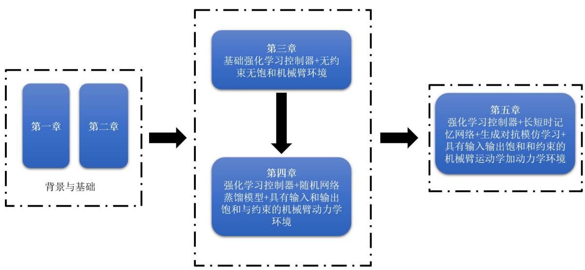  
图1.1 文章组织架构图

## 第二章 背景知识

本章主要介绍机械臂环境设计和强化学习的基础理论知识。本章将首先介绍机械臂建模的基本理论，重点阐述通过欧拉-拉格朗日方程对机械臂动力学进行建模的方法。同时，探讨运动学与动力学相结合的模型，分析其在机械臂轨迹控制中的应用。随后，介绍深度强化学习的基本原理和算法，这些知识点将为后续章节中算法框架的设计和优化提供必要的理论支持。

## 2.1 机械臂位姿描述与坐标转换

在机械臂的运动学分析中，空间坐标系的位姿描述及其转换关系构成核心理论基础。给定空间直角坐标系 ，空间中任意点的完整位姿描述包含位置和姿态两个要素，空间中点 $P _ { 1 }$ 的位置向量可定义为[52]：

$$
{ } ^ { A } \boldsymbol { P } = \left[ \begin{array} { c } P _ { x } \\ P _ { y } \\ P _ { z } \end{array} \right]\tag{2-1}
$$

其中， $P _ { x }$ $P _ { y }$ $P _ { z }$ 表示点 在坐标系 中的三维坐标。给定直角坐标系 $\{ B \}$ ，则点 $P _ { 1 }$ 相对于坐标系 $\{ B \}$ 的位置可以表示为 $^ B \pmb { P }$ ，则该点在坐标系 $\{ B \}$ 中的位置可以转换到坐标系$\{ A \}$ 中，具体如下：

$$
{ } ^ { A } \boldsymbol { P } = { } ^ { B } \boldsymbol { P } + { } ^ { A } \boldsymbol { P } _ { B }\tag{2-2}
$$

式中， ${ } ^ { A } { \pmb { P } } _ { B }$ 表示坐标系 相对于坐标系 的位置向量。当坐标系 与 原点重合时，坐标系 相对于坐标系 的旋转矩阵为 ${ \bf \Sigma } _ { B } ^ { A } R = [ { \bf \Sigma } ^ { A } x _ { B } , { \bf \Sigma } ^ { A } y _ { B } , { \bf \Sigma } ^ { A } z _ { B } ]$ ，其中 ${ } ^ { A } x _ { B }$ ${ } ^ { A } y _ { B }$ ${ } ^ { A } z _ { B }$ 表示单位正交列向量，并且满足： ${ } _ { B } ^ { A } R ^ { - 1 } = { } _ { B } ^ { A } R ^ { T } , \quad | { } _ { B } ^ { A } R | = 1$ 。齐次变换矩阵定义如下：

$$
T = \left[ \begin{array}{c c c c} & R & & P \\ 0 & 0 & 0 & 1 \end{array} \right]\tag{2-3}
$$

其中 $T \in \Re ^ { 4 \times 4 }$ $R \in \Re ^ { 3 \times 3 }$ 表示上述的旋转矩阵， $P \in \Re ^ { 3 \times 1 }$ 表示空间位置向量。同时齐次向量可表示为： $[ P ^ { T } \ 1 ] = [ P _ { x } , P _ { y } , P _ { z } , 1 ]$ ，其中 $P _ { x }$ $P _ { y }$ $P _ { z }$ 表示点 的空间位置。当空间点的运动仅包含平移分量时，其坐标变换可简化为两个坐标系间的原点位移关系。此时，两个坐标系保持姿态一致，其位姿转换可通过平移齐次变换矩阵精确描述：

$$
T _ {t r a c} (p) = \left[ \begin{array}{c c c c} 1 & 0 & 0 & P _ {x} \\ 0 & 1 & 0 & P _ {y} \\ 0 & 0 & 1 & P _ {z} \\ 0 & 1 & 0 & 1 \end{array} \right]\tag{2-4}
$$

当坐标系 与 之间位置平移和姿态旋转，其空间变换关系可通过旋转齐次变换矩阵完整描述。设两坐标系原点重合时，当坐标系 相对于坐标系 围绕某一坐标轴旋转 角度，其旋转矩阵可定义 $R ( k , \theta )$ ，其中 表示 方向的一个轴。由此推导出绕三个坐标轴的基本旋转变换矩阵：

$$
R (x, \theta) = \left[ \begin{array}{c c c c} 1 & 0 & 0 & 0 \\ 0 & \cos \theta & - \sin \theta & 0 \\ 0 & \sin \theta & \cos \theta & 0 \\ 0 & 1 & 0 & 1 \end{array} \right]\tag{2-5}
$$

$$
R (y, \theta) = \left[ \begin{array}{c c c c} \cos \theta & 0 & \sin \theta & 0 \\ 0 & 1 & 0 & 0 \\ - \sin \theta & 0 & \cos \theta & 0 \\ 0 & 0 & 0 & 1 \end{array} \right]\tag{2-6}
$$

$$
R (z, \theta) = \left[ \begin{array}{c c c c} \cos \theta & - \sin \theta & 0 & 0 \\ \sin \theta & \cos \theta & 0 & 0 \\ 0 & 0 & 1 & 0 \\ 0 & 0 & 0 & 1 \end{array} \right]\tag{2-7}
$$

则点在坐标系 中的位姿表示，可以通过其在 $\{ B \}$ 下的坐标，经过平移齐次变换和旋转齐次变换来得到。其数学表达为：

$$
\left[ \begin{array}{c} ^ {A} \boldsymbol {P} \\ 1 \end{array} \right] = \left[ \begin{array}{c c} _ {B} ^ {A} R & ^ {A} \boldsymbol {P} \\ 0 & 1 \end{array} \right] \left[ \begin{array}{c} ^ {B} \boldsymbol {P} \\ 1 \end{array} \right]\tag{2-8}
$$

通过式(2-8)可以实现同一点在不同坐标系的坐标变换。

## 2.2 机械臂运动学模型

机械臂本质上是由一系列刚性连杆通过运动副连接形成的空间开链机构，其运动特性通过各连杆的相对位移和转动实现，从而完成指定的空间操作任务。该系统的运动学建模可基于相邻连杆间的坐标变换关系建立。1956年，Denavit 和Hartenberg 提出的D-H 参数法[53]为机械臂运动学描述提供了标准化框架。该建模方法通过四个基本运动学参数精确描述各连杆间的相对位姿，并借助齐次变换矩阵的链式乘法，最终建立末端执行器在基坐标系中的位姿解析表达式。具体来说，对于N自由度机械臂系统，假设基座连杆编号为0，第 个连杆通过第 个关节与第 个连杆相连，定义连杆参数如下：

1) 连杆长度 $a _ { i }$ 表示沿 轴从 $z _ { i }$ 到 $z _ { i + 1 }$ 的平移距离；

2) 连杆扭角 $\alpha _ { i }$ 表示沿 ${ \Psi } _ { }$ 轴从 $z _ { i }$ 到 $z _ { i + 1 }$ 的旋转角度；

3) 连杆偏距 $d _ { i }$ 表示沿 轴从 $x _ { i }$ 到 $x _ { i + 1 }$ 的平移距离；

4) 关节角 $\theta _ { i }$ 表示沿 $\cdot z _ { i }$ 轴从 $x _ { i }$ 到 $x _ { i + 1 }$ 的旋转角度。

相邻连杆之间的坐标变换可以通过齐次变换矩阵表示，它由两个平移变换和两个旋转变换的组合得到：

1) 绕 $z _ { i }$ 轴转动角度 大小，可以得到旋转的坐标变换 $R ( z _ { i } , \theta _ { i } )$

2) 绕 $z _ { i }$ 轴平移 $d _ { i }$ 距离大小，可以得到平移的坐标变换 $T ( z _ { i } , d _ { i } )$

3) 绕 $x _ { i }$ 轴平移 $a _ { i }$ 距离大小，可以得到平移的坐标变换 $T ( x _ { i } , a _ { i } )$

4) 绕 $x _ { i }$ 轴转动角度 $\alpha _ { i }$ 大小，可以得到旋转的坐标变换 $R ( x _ { i } , \alpha _ { i } )$

综合以上，按照“从左到右”的原则，可以得到相邻连杆 与 $i + 1$ 之间的齐次变换矩阵$T _ { i } ^ { i + 1 }$

$$
T _ {i} ^ {i + 1} = \left[ \begin{array}{c c c c} \cos \theta_ {i} & - \sin \theta_ {i} \cos \alpha_ {i} & \sin \theta_ {i} & \alpha_ {i} \cos \theta_ {i} \\ \sin \theta_ {i} & \cos \theta_ {i} \cos \alpha_ {i} & - \cos \theta_ {i} \cos \alpha_ {i} & \alpha_ {i} \sin \theta_ {i} \\ 0 & \sin \theta_ {i} & \cos \theta_ {i} & d _ {i} \\ 0 & 0 & 0 & 1 \end{array} \right]\tag{2-9}
$$

对于一个 $N$ 自由度的机械臂，按照式(2-9)，通过将所有连杆的变换矩阵逐级相乘，可以得到末端执行器相对于基座的齐次变换矩阵：

$$
T _ {0} ^ {1} T _ {1} ^ {2} \dots T _ {N - 1} ^ {N}\tag{2-10}
$$

一般地说，在机器人系统中， $x ( t )$ 表示机械臂末端执行器相对于基座的坐标， $f ( q )$ 表示机械臂关节空间到任务空间的映射，即：

$$
\begin{array}{c} x (t) = T _ {0} ^ {N} (q _ {1}, q _ {2}, \dots q _ {N}) \\ = f (q) \\ = T _ {0} ^ {1} T _ {1} ^ {2} \dots T _ {N - 1} ^ {N} \end{array}\tag{2-11}
$$

式中 $\pmb q = [ q _ { 1 } , q _ { 2 } , . . . , q _ { N } ]$ 表示关节角向量。对式(2-11)中的 求导可得：

$$
\begin{array}{c} x (t) = \frac {\partial f (q)}{\partial q} \frac {\partial q}{\partial t} \\ = J (q) \dot {q} \end{array}\tag{2-12}
$$

其中 $^ { 1 } \dot { q }$ 代表关节角速度， $J ( q )$ 表示机器人机械臂系统的雅各比矩阵。至此，可以求出机械臂的运动学模型。

## 2.3 机械臂动力学模型

机械臂动力学建模是研究机械臂在不同工作状态下运动方程的过程，对于机械臂的控制、规划和仿真等应用具有重要意义。在建模过程中，有多种方法可供选择，常见的包括牛顿-欧拉法、拉格朗日法和凯恩法等典型建模范式。牛顿-欧拉法基于经典牛顿力学原理构建动力学方程，通过欧拉运动方程建立关节力矩与刚体质心加速度的显式关系，特别适用于分析惯性特性与驱动力矩的耦合作用。凯恩法创新性地引入广义速度变量替代传统广义坐标，有效消除了理想约束反力在动力学方程中的显式表达，这种参数化建模方式显著提升了计算效率，使其特别适合计算机数值求解的实现。

然而，在处理非完整系统和约束问题时，拉格朗日法具有天然优势。拉格朗日法基于能量守恒原理构建机械系统动力学模型，其核心在于通过系统动能对广义坐标及其时间导数的变分关系建立运动方程。拉格朗日法的符号计算过程较为简单，易于与控制算法、轨迹跟踪和路径规划等方法结合，极大地提高了模型建立的效率。因此，拉格朗日法被广泛应用于机械臂的动力学建模，成为机械臂控制系统的基础支持。

基于拉格朗日方法建立机械臂动力学模型时，首要步骤是计算各连杆的动能与势能表达式。为确定连杆上任意点的空间位置，可借助坐标系中的位置矢量进行数学描述。根据 D-H参数法定义的坐标系关系，通过相邻连杆间齐次变换矩阵的连续乘积运算，可构建一个从第0 个连杆到第 个连杆的变换矩阵 $^ { 0 } _ { i } T$ ，第 个连杆上的点在坐标系的矢量距离可以用 $x _ { i }$ 表示，则点相对于基座的坐标：

$$
x = \mathbf {\Phi} _ {i} ^ {0} T x _ {i}\tag{2-1}
$$

对式(2-1)求导可得：

$$
\dot {x} = \frac {\partial_ {i} ^ {0} T x _ {i}}{\partial q} \frac {\partial q}{\partial t} = \left(\sum_ {j = 1} ^ {i} \frac {\partial_ {i} ^ {0} T}{\partial q _ {j}} \dot {q} _ {j}\right) x _ {i}\tag{2-13}
$$

由式(2-2)可以得到该点在参考坐标系的速度。令 表示该点的质量，则它的动能 $E _ { i }$ 可以表示为：

$$
E _ {i} = \int \mathrm{d} E _ {i} = \frac {1}{2} \int \dot {x} \dot {x} ^ {\mathbf {T}} \mathrm{d} m = \frac {1}{2} \operatorname{trace} \left(\sum_ {j = 1} ^ {i} \sum_ {k = 1} ^ {i} \frac {\partial^ {0} T}{\partial q _ {j}} x _ {i} x _ {i} ^ {T} \frac {\partial \left(_ {i} ^ {0} T\right) ^ {\mathbf {T}}}{\partial q _ {k}} \dot {q} _ {j} \dot {q} _ {k}\right)\tag{2-14}
$$

则机械臂n个连杆的动能之和可以表示为：

$$
\begin{array}{l} E = \sum_ {i = 1} ^ {n} E _ {i} \\ \quad = \frac {1}{2} \sum_ {j = 1} ^ {n} \sum_ {k = 1} ^ {n} \left(\sum_ {i = \max (j, k)} ^ {n} \operatorname{trace} \left(\frac {\partial_ {i} ^ {0} T}{\partial q _ {j}} J _ {i} \frac {\partial^ {0} T) ^ {T}}{\partial q _ {k}}\right)\right) \dot {q} _ {j} \dot {q} _ {k} \\ \quad = \frac {1}{2} \dot {q} ^ {T} M (q) \dot {q} \end{array}\tag{2-15}
$$

式中 $M ( q )$ 表示机械臂的惯性矩阵，矩阵中的每个元素满足下式：

$$
\begin{array}{c} d _ {j k} = \sum_ {i = \max (\sigma_ {k})} ^ {n} \operatorname{trace} \left(\frac {\partial_ {i} ^ {0} T}{\partial q _ {j}} J _ {i} \frac {\partial \left(_ {i} ^ {0} T\right) ^ {\mathrm{T}}}{\partial q _ {k}}\right) \\ J _ {i} = \int x _ {i} x _ {i} ^ {\mathrm{T}} \sim \mathrm{d} m \end{array}\tag{2-16}
$$

结合式(2-3)和(2-4)，得到了机械臂各个连杆的动能之和。按照同样的方法，下面在相同的环境下可以得到机械臂的势能：

$$
K = \sum_ {i = 1} ^ {n} K _ {i} = \sum_ {i = 1} ^ {n} \int d K _ {i} = \sum_ {i = 1} ^ {n} \int m _ {i} g ^ {T}   _ {i} ^ {0} T x _ {i}\tag{2-17}
$$

定义拉格朗日函数：

$$
L (q _ {i}, \dot {q} _ {i}) = E - K\tag{2-18}
$$

将机械臂的动能总和(2-4)和势能总和(2-6)代入式(2-7)可得：

$$
L \left(q _ {i}, \dot {q} _ {i}\right) = \frac {1}{2} D (q) \dot {q} + \sum_ {i = 1} ^ {n} m _ {i} g ^ {T} _ {i} ^ {0} T x _ {i}\tag{2-19}
$$

对上述式(2-8)求 $\dot { \boldsymbol { q } } _ { i }$ 求偏导，可得：

$$
\begin{array}{c} \frac {\partial L}{\partial \dot {q} _ {j}} = \sum_ {k = 1} ^ {n} h _ {j k} \dot {q} _ {k} \\ \frac {d}{d t} \frac {\partial L}{\partial \dot {q} _ {j}} = \sum_ {k = 1} ^ {n} h _ {j k} \ddot {q} _ {k} + \sum_ {k = 1} ^ {n} \sum_ {i = 1} ^ {n} \frac {\partial h _ {j k}}{\partial q _ {i}} \dot {q} _ {i} \dot {q} _ {k} \\ \frac {\partial L}{\partial q _ {j}} = \frac {1}{2} \sum_ {i = 1} ^ {n} \sum_ {k = 1} ^ {n} \frac {\partial h _ {j k}}{\partial q _ {j}} \dot {q} _ {i} \dot {q} _ {k} - \frac {\partial V}{\partial q _ {j}} \end{array}\tag{2-20}
$$

根据式(2-9)的结果，拉格朗日方程式(2-8)可以重构为：

$$
\sum_ {k = 1} ^ {n} d _ {j k} \ddot {q} _ {k} + \sum_ {i = 1} ^ {n} \sum_ {k = 1} ^ {n} \left(\frac {\partial d _ {j k}}{\partial q _ {i}} - \frac {1}{2} \frac {\partial d _ {j k}}{\partial q _ {j}}\right) \dot {q} _ {i} \dot {q} _ {k} + \frac {\partial K}{\partial q _ {f}} = \tau_ {j}\tag{2-21}
$$

根据惯性矩阵的对称性质：

$$
\sum_ {i = 1} ^ {n} \sum_ {k = 1} ^ {n} \frac {\partial d _ {j k}}{\partial q _ {i}} \dot {q} _ {i} \dot {q} _ {k} = \frac {1}{2} \sum_ {i = 1} ^ {n} \sum_ {k = 1} ^ {n} \left(\frac {\partial d _ {j k}}{\partial q _ {i}} + \frac {\partial d _ {j k}}{\partial q _ {j}}\right) \dot {q} _ {i} \dot {q} _ {k}\tag{2-22}
$$

结合式(2-10)和式(2-11)可得：

$$
\begin{array}{c} \sum_ {i = 1} ^ {n} \sum_ {k = 1} ^ {n} \left(\frac {\partial d _ {j k}}{\partial q _ {i}} - \frac {1}{2} \frac {\partial d _ {j k}}{\partial q _ {j}}\right) \dot {q} _ {i} \dot {q} _ {k} = \sum_ {i = 1} ^ {N} \sum_ {k = 1} ^ {N} c _ {i k j} \dot {q} _ {i} \dot {q} _ {k} \\ c _ {i k j} = \frac {1}{2} \left[ \frac {\partial d _ {j k}}{\partial q _ {i}} + \frac {\partial d _ {j k}}{\partial q _ {k}} - \frac {\partial d _ {j k}}{\partial q _ {j}} \right] \end{array}\tag{2-23}
$$

式中， $c _ { i k j }$ 表示克里斯托弗尔符号，从式(2-12)中可知： $c _ { i k j } = c _ { i j k }$ 。将(2-10)与(2-11)代入式(2-12)，可得：

$$
\sum_ {k = 1} ^ {n} d _ {j k} \ddot {q} _ {k} + \sum_ {i = 1} ^ {n} \sum_ {k = 1} ^ {n} c _ {i j k} \dot {q} _ {i} \dot {q} _ {k} + g _ {j} (q _ {i}) = \tau_ {j}\tag{2-24}
$$

式中 $g _ { j } \left( q \right) = \frac { \partial K } { \partial \alpha }$ 。式(2-13)表示的是第 个关节的动力学模型，其紧凑集可表示为：

$$
M (\boldsymbol {q}) \ddot {\boldsymbol {q}} + C (\boldsymbol {q}, \dot {\boldsymbol {q}}) \dot {\boldsymbol {q}} + G (\boldsymbol {q}) = \boldsymbol {\tau}\tag{2-25}
$$

式中， $D ( q ) \in \Re ^ { n * n }$ 为正定对称的惯性矩阵， $C \left( q , \dot { q } \right) \in \Re ^ { n * n }$ 表示柯氏力与中心力矩阵，$G \left( q \right) \in \Re ^ { n * 1 }$ 表示重力矩阵， $\tau \in \Re ^ { n * 1 }$ 表示机械臂在无干扰和约束下的关节输入力矩。$C \left( q , \dot { q } \right)$ 矩阵中的每个元素可以按照以下公式求得：

$$
c _ {j k} = \sum_ {i = 1} ^ {n} c _ {i k j} \dot {q} _ {i} = \sum_ {i = 1} ^ {n} \frac {1}{2} \left[ \frac {\partial d _ {j k}}{\partial q _ {i}} + \frac {\partial d _ {j k}}{\partial q _ {k}} - \frac {\partial d _ {j k}}{\partial q _ {j}} \right] \dot {q} _ {i}\tag{2-26}
$$

此外，机械臂的动力学模型的性质可以总结如下：

性质 2.1：矩阵 $D ( q )$ 有界，即存在正常数 $\alpha _ { 1 }$ 和 $\alpha _ { 2 }$ ，使得：

$$
\alpha_ {1} \leqslant | D (q) | \leqslant \alpha_ {2}\tag{2-27}
$$

性质 2.2：当恰当选取矩阵 $C \left( q , \dot { q } \right)$ ，对于任意向量 $\gamma \in \Re ^ { n }$ ，可得：

$$
\gamma^ {T} \big (2 \dot {D} (q) - C (q, \dot {q}) \big) \gamma = 0\tag{2-28}
$$

性质 2.3：拉格朗日动力学方程式(2-14)的左侧可线性分解，将机械臂关节的变量与其他变量相分离，使得：

$$
M (q) \dot {\varpi} + C (q, \dot {q}) \varpi + G (q) = Y _ {d} (q, \dot {q}, \varpi , \dot {\varpi}) \Theta_ {d}\tag{2-29}
$$

其中， $Y _ { d } ( q , \dot { q } , \varpi , \dot { \varpi } )$ 表示动态回归矩阵， $\theta _ { d }$ 表示参数常量向量。

本文的研究都是基于强化学习实现，因此接下来介绍强化学习相关的基础知识。

## 2.4 强化学习基础理论

## 2.4.1 强化学习基本概念

强化学习是一种通过与环境互动来学习决策策略的机器学习方法。在强化学习中，智能体（Agent）通过在环境中执行动作（Action），并根据环境的反馈（奖励或惩罚）来优化其行为策略，以最大化长期累积的奖励[54]。强化学习与监督学习和无监督学习的主要区别在于，它不依赖于标注好的训练数据，而是通过与环境的交互获取经验，学习最优策略。

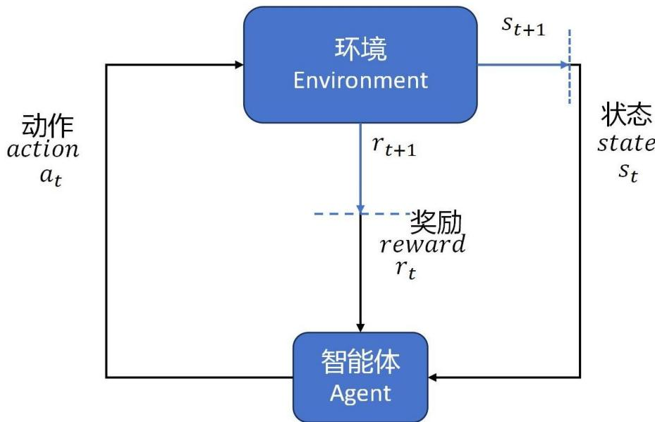  
图2.1 强化学习交互图

如图 2.1 所 $\overline { { \overline { { \mathbf { \Omega } } } } }$ ，强化学习问题通常建模为马尔可夫决策过程（Markov DecisionProcess, MDP），由五元组 $( S , A , P , R , \gamma )$ 组成。其中， $S = \{ s \}$ 代表了智能体在环境中会遇到的一组状态（State）集合， $A = \left\{ a \right\}$ 代表了智能体在每个状态下可以执行的一系列可能的动作（Action）集合， $P \left( s _ { t } , a _ { t } , s _ { t + 1 } \right) \sim p \left( s _ { t + 1 } \vert s _ { t } , a _ { t } \right)$ 代表了智能体根据当前状态执行动作再到下一个状态的概率分布， $R { : } s _ { t } \times a _ { t } \to r _ { t }$ 表示智能体在当前状态执行一个动作并转移到另一个状态获得的回报， $\gamma$ 表示折扣因子且 $0 < \gamma < 1$ ，它决定了即时奖励和未来奖励的重要性。在每个时间步的交互中，智能体首先处于某个状态 $s _ { t }$ ，并依据其模型等信息选择一个动作。环境根据当前状态和智能体的选择，通过转移概率确定下一状态，并向智能体提供相应的回报[55]。智能体根据收到的反馈更新自己的策略，然后继续进行下一轮的交互。这样，整个过程便形成了一个马尔可夫决策过程的交互链：

$$
\iota = \{s _ {0}, a _ {0}, r _ {0}, s _ {1}, a _ {1}, r _ {1}, \dots , s _ {T}, a _ {T}, r _ {T} \}\tag{2-30}
$$

代表在一个有限MDP 中的最大时间步。

综上所述，针对机械臂环境，本文定义强化学习的目标是构建一个策略 $\pi { \sim } p \left( a _ { t } | s _ { t } \right)$ 策略 $\pi$ 根据当前状态 $s _ { t } \in S$ 给出动作 $a _ { t } \in A$ 到下一状态 $s _ { t + 1 } \in S$ 的概率分布，最大化每一回合以及未来的积累回报，其定义如下：

$$
\pi^ {*} = \operatorname{argmax} _ {\pi} \mathbb {E} [ G _ {t} ] = \operatorname{argmax} _ {\pi} \mathbb {E} \left[ \sum_ {i = 0} ^ {T} \gamma^ {i} r _ {t + i} \right]\tag{2-31}
$$

其中 $G _ { t }$ 表示引入折扣 $\gamma$ 后，智能体选择动作 $a _ { t }$ 最大化长期积累折扣回报。在典型的有MDP 框架中，智能体与环境交互时遵循特定的生命周期：系统从预设的初始状态启动，通过状态转移不断演化，直至抵达终止状态或达到预设的最大交互步数 T。对于理论上具有无限时间跨度的 MDP 场景，通过引入取值在 0到 1之间的折扣因子γ，能够确保累积奖励的数学期望保持收敛，避免出现无穷大发散现象。这种机制的设计本质在于引导智能体建立渐进式的时间价值认知：优先重视即时动作产生的短期收益，同时以指数衰减的方式考虑未来潜在回报，使得距离当前时刻越远的时间节点对决策的影响权重呈现几何级数下降。

下面介绍强化学习的价值函数方程，价值函数用于评估在特定策略下，从某一状态或状态-动作对出发所能获得的未来回报的期望值。具体而言，状态价值函数 $V \pi ( S )$ 定义为在策略 $\pi$ 的指导下，从状态S开始，智能体未来可能获得的所有回报的折现总和：

$$
V _ {\pi} (s) = \mathbb {E} [ G _ {t} | s = s _ {t} ]\tag{2-32}
$$

同时，状态价值函数也可以用贝尔曼方程表示（Bellman equation）：

$$
V _ {\pi} (s) = \sum_ {a} \pi (s, a) \sum_ {s ^ {\prime}} P _ {s s ^ {\prime}} ^ {a} \left[ R _ {s s ^ {\prime}} ^ {a} + \gamma V _ {\pi} \left(s ^ {\prime}\right) \right]\tag{2-33}
$$

具体地说，智能体执行最佳策略 $\pi ^ { \gamma }$ 最佳动作 $\boldsymbol { a } ^ { \star }$ 得到状态价值函数的最大值，即最佳策略下的状态价值等价于智能体执行最佳动作的预期回报。最佳状态下的价值函数如下：

$$
V _ {\pi} ^ {\star} (s) = \max _ {a} \sum_ {s ^ {\prime}} P _ {s s ^ {\prime}} ^ {a} \left[ R _ {s s ^ {\prime}} ^ {a} + \gamma V _ {\pi} ^ {\star} \left(s ^ {\prime}\right) \right]\tag{2-34}
$$

同理，可以得到状态-动作价值函数 $Q _ { \pi } ( s , a )$ ，其代表在状态 下沿着策略 $\pi$ 执行动作 $^ { a }$ 后得到的预期回报：

$$
Q _ {\pi} (s, a) = \mathbb {E} \left[ G _ {t} | s = s _ {t}, a = a _ {t} \right]\tag{2-35}
$$

同样地，状态-动作价值函数 $Q _ { \pi } ( s , a )$ 也可以用贝尔曼方程表示：

$$
Q _ {\pi} (s, a) = \sum_ {s ^ {\prime}} P _ {s s ^ {\prime}} ^ {a} \left[ R _ {s s ^ {\prime}} ^ {a} + \gamma Q _ {\pi} \left(s ^ {\prime}, a ^ {\prime}\right) \right]\tag{2-36}
$$

进一步的，最优状态-动作价值函数可以表示为：

$$
Q _ {\pi} ^ {\star} (s, a) = \max _ {a} \sum_ {s ^ {\prime}} P _ {s s ^ {\prime}} ^ {a} \left[ R _ {s s ^ {\prime}} ^ {a} + \gamma Q _ {\pi} ^ {\star} \left(s ^ {\prime}, a ^ {\prime}\right) \right]\tag{2-37}
$$

这里的最优状态价值函数和最优动作价值函数是相对于某一策略而言的，即它们是在该最优策略下所得到的状态值函数或状态-动作价值函数。在任何状态或状态-动作对下，最优值都不低于其他策略所对应的值。因此，最优策略下的状态值函数或状态-动作价值函数被称为最优的。

## 2.4.2 基于模型与无模型的强化学习

强化学习算法可以大致分为两类：基于模型（Model-Based）强化学习和无模型（Model-Free）强化学习。它们在学习和决策过程中对环境的理解和使用方法有所不同，影响了算法的效率和适用场景。

基于模型的强化学习方法是通过学习环境的动态模型来进行决策和规划的。这类方法的核心思想是智能体不仅学习如何选择动作，还会尝试学习环境的转移概率函数（即从当前状态和动作到下一个状态的概率分布）以及奖励函数，从而可以在已知模型的帮助下进行决策。在基于模型的强化学习中，智能体会使用环境模型来模拟与环境的交互过程。模型通常包含两个部分：1.环境转移模型（Transition Model）：描述智能体采取某一动作后从一个状态转移到另一个状态的概率。2.奖励模型（RewardModel）：描述智能体在某一状态执行某个动作后所获得的奖励。基于这些模型，智能体可以通过规划方法（例如动态规划、蒙特卡洛树搜索等）来推导出最优的动作序列，从而优化其行为策略。基于模型的方法可以通过模拟和预演来生成经验，避免了真实环境中的大量试错，样本效率较高。此外，通过模型，智能体能够提前“预测”未来的状态和奖励，从而做出更合理的决策。但是，基于模型的方法学习环境的准确模型在许多实际问题中是非常困难的，尤其是在动态复杂的环境中，模型可能存在误差，导致决策失效。

与基于模型的强化学习方法不同，无模型强化学习方法不依赖于环境模型，而是直接从与环境的交互中学习如何选择最佳动作。这类方法通过智能体与环境的互动，不断调整策略，以最大化长期奖励。无模型强化学习算法通常关注两个主要问题：值函数和策略。无模型方法不使用环境的转移模型和奖励模型，而是通过与环境的交互不断调整自己的策略。常见的无模型强化学习方法包括 Q学习、策略梯度方法等。无模型方法的最大优点是可以在没有精确环境模型的情况下进行学习，适用于无法获取环境模型的场景。由于没有显式的模型学习过程，无模型方法通常实现起来比较简单，计算上也不需要额外的模型推理过程。但是无模型方法通常依赖大量的与环境的交互来学习最优策略，需要更多的经验数据，样本效率较低。此外，由于是通过不断试错来优化策略，学习过程可能较为缓慢，特别是在复杂环境下。

## 2.4.3 在线学习与离线学习强化学习方法

在强化学习中，策略是智能体做出决策的关键，决定了从某个状态出发时应该选择哪个动作。根据策略的使用方式，强化学习可以分为在线学习（On-Policy）和离线学习（Off-Policy）两种类型。

On-Policy 强化学习指的是智能体在学习过程中，使用的行为策略和目标策略是相同的，也就是说，智能体在执行动作时，学习的目标就是优化这个执行策略本身。换句话说，智能体根据当前策略与环境进行交互，并且该策略本身会随着学习的进行而不断调整。在On-Policy强化学习中，智能体采取的行动是通过当前的策略决定的，并且它的目标是通过直接优化这个策略，使其能够最大化长期的奖励。每次智能体与环境交互，收集到的数据都用于改善当前策略。由于策

略在整个学习过程中一直在执行，并且数据是基于当前策略收集的，所以智能体在探索过程中能够确保学习过程的稳定性。On-Policy 方法通常有较好的理论收敛性，尤其是在策略空间较小或者较简单的环境中。但是On-Policy 方法通常要求智能体在每一步交互中都依赖当前策略进行探索，这会导致智能体需要大量的经验数据才能进行有效的学习。此外，在一些情况下，基于当前策略的行为可能导致智能体陷入局部最优解，难以进行有效的探索。

Off-Policy 强化学习指的是智能体在学习过程中，行为策略与目标策略是不同的。也就是说，智能体可以使用一个策略来探索环境（行为策略），然后使用一个不同的策略来更新目标（目标策略）。这种方法的最大优势是能够从以前的经验中学习，无需依赖当前策略的执行。在 Off-Policy 强化学习中，智能体可以通过探索与当前策略不同的行为来收集数据。这使得 Off-Policy 方法能够更高效地利用历史数据，从而加速学习过程。目标是通过不断调整目标策略（而不是行为策略）来优化决策过程。Off-Policy 方法能够有效利用历史经验进行学习，因此相较于 On-Policy 方法，它可以更快地收敛。由于行为策略和目标策略是分离的，智能体可以通过更加多样化的行为来进行有效的探索，而不受目标策略的限制。但是由于行为策略和目标策略不同，可能会导致策略更新过程中不稳定，特别是在较为复杂的环境中。如果行为策略与目标策略之间的差异过大，学习过程可能变得困难，因为此时的数据可能无法很好地代表目标策略下的状态转移和奖励。

在本研究中，第四章和第五章都将选用无模型的 off-policy 算法 Soft Actor-Critic算法作为基准算法，在此基础上对算法进行改进。第四章在SAC 算法的基础上引入随机网络蒸馏模型来增强算法的探索能力，在面对机械臂跟踪控制的复杂任务时，能有效提高算法的训练能力和控制性能。第五章的控制任务有所变化，由第三章、第四章的二自由度的机械臂动力学模型转变为三自由度运动学再加上运动学模型，任务变得更加复杂。因此，第五章在 SAC算法的基础上，引入长短时记忆网络 LSTM 来改进算法的网络模型，再由改进的SAC-LSTM 算法训练出最优的控制策略。将最优策略作为生成对抗模仿学习GAIL 的专家数据，以此来训练出更好的控制策略。

## 第三章 基于深度强化学习的二自由度机械臂轨迹跟踪控制

本章主要介绍无模型方法的PPO和SAC 算法在机械臂轨迹跟踪控制方面的应用。

## 3.1 引言

随着机器人技术的快速发展，机械臂的应用场景日益复杂化。尽管传统控制方法在现有应用中表现优异，但其在处理未来高度非线性系统时仍存在明显不足，可能遭遇以下多重挑战[56,57]：

1) 环境建模困难。机械臂系统的动态特性往往难以准确建模，这限制了传统控制方法在实际应用中的效能。

2) 鲁棒性较低。传统控制方法在面对未建模动态时表现出较弱的鲁棒性，易受外界环境变化的干扰。

3) 控制器调参成本高。在复杂系统中，控制器参数的调优过程既繁琐又具挑战性，特别是在机械臂系统结构频繁变动的情况下，这一过程尤为困难。

强化学习作为一种不依赖环境模型的先进控制方法，能够有效弥补传统控制方法的局限性。本章首先定义了一个二自由度机械臂跟踪控制问题，设计传统的 PID 控制器进行控制。然后，本章定义了 SAC、PPO两种强化学习控制器方法来控制机械臂做轨迹跟踪控制任务。最后本章将传统 PID 控制器、深度强化学习控制器一起在机械臂环境中做轨迹跟踪控制对比，从强化学习的训练过程和控制器的控制性能评价算法，选择强化学习算法优秀的参数放在后续章节使用。

## 3.2 问题描述

本章中考虑一个如式(2-25)的二自由度机械臂动力学环境，在该环境中设计的状态空间包含关节实际角位置、实际角速度、关节目标角度与关节目标角速度，旨在为智能体提供完整的轨迹跟踪所需信息，具体定义如下：

$$
s = \left[ q, \dot {q}, q _ {d}, \dot {q} _ {d} \right]\tag{3-1}
$$

实际与目标角度的偏差提供了当前误差，角速度差异则反映了误差变化趋势，使强化学习算法既能修正瞬时位置误差，又能预判目标运动方向，从而动态调整控制策略。

考虑一个目标轨迹 $q _ { d } \left( t \right)$ ，通过每一个时间步实时输入的 ，计算微分方程得到实时的 $q ( t )$ ，使得跟踪误差 $e ( t ) = q ( t ) - q _ { d } ( t )$ 总是趋近于0。此外，对机械手关节施加饱和约束，以限制机械手跟踪目标曲线时的摆动幅度。限制如下：

$$
q _ {i} = \left\{ \begin{array}{l l} q _ {\min} & , \text {if} q _ {i} \leq q _ {\min} \\ q _ {i} & , \text {if} q _ {\min} <   q _ {i} <   q _ {\max}, i = 1, 2,..., n \\ q _ {\max} & , \text {if} q _ {i} \geq q _ {\max} \end{array} \right.\tag{3-2}
$$

其中，最大关节角度 $q _ { \mathrm { m a x } } = \pi$ ，最小关节角度 $q _ { \mathrm { m i n } } = - \pi$

## 3.3 传统PID控制器设计

传统PID 控制器示意图如图3.1 所示。PID 控制器可被表示为[58]：

$$
\boldsymbol {\tau} = K _ {p} e + K _ {d} \dot {e} + K _ {i} \int e d t\tag{3-3}
$$

假设 $q _ { d }$ 为常数值，因此式(3-3)可以改写为：

$$
D (\boldsymbol {q}) \left(\ddot {\boldsymbol {q}} _ {d} - \ddot {\boldsymbol {q}}\right) + C (\boldsymbol {q}, \dot {\boldsymbol {q}}) \left(\dot {\boldsymbol {q}} _ {d} - \dot {\boldsymbol {q}}\right) + K _ {p} e + K _ {d} \dot {e} + K _ {i} \int e d t = 0\tag{3-4}
$$

设李雅普诺夫函数为：

$$
V = \frac {1}{2} \dot {q} ^ {T} D (q) \dot {q} + \frac {1}{2} e ^ {T} K _ {p} e + \frac {1}{2} \left(\int e d t\right) ^ {T} K _ {i} \left(\int e d t\right)\tag{3-5}
$$

根据机械臂动力学中的 $D ( q )$ 以及 $K _ { p }$ 的正定性可知 一定是正定的，对其求微分可得：

$$
\dot {V} = \dot {q} ^ {T} D (q) \ddot {q} + \frac {1}{2} \dot {q} ^ {T} D (q) \dot {q} + e ^ {T} K _ {p} \dot {e} + \left(\int e d t\right) ^ {T} K _ {i} e\tag{3-6}
$$

结合性质2.2以及式(3-4)，则：

$$
\dot {V} = - \dot {q} ^ {T} K _ {d} \dot {q} \leqslant 0\tag{3-7}
$$

因此， $\dot { V }$ 是半正定的， $K _ { d }$ 是正定的。当 $\dot { V } = 0$ 时， $\dot { q } = 0$ ，根据上述的 $q _ { d }$ 为常数值可得 ${ \dot { q } } _ { d } = 0$ 所以 ${ \dot { e } } = 0$ ，进而 $\ddot { e } = 0$ ，因此根据式(3-4)可知 $K _ { p } e = 0$ ，所以 $e = 0$ 。所以 $( e , \dot { e } ) = ( 0 , 0 )$ 是机械臂全局跟踪控制的稳定平衡点。

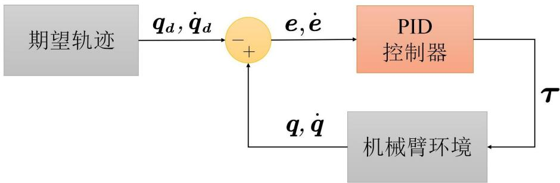  
图3.1 PID 控制器示意图

## 3.4 基于强化学习的控制器设计

强化学习控制器的基础流程图如图3.2 所示。本小节将介绍在线学习的无模型方法PPO算法和离线学习的无模型方法 SAC 算法的控制器设计，并说明这些强化学习控制器的训练方法。强化学习智能体的训练算法流程可见算法3.1。

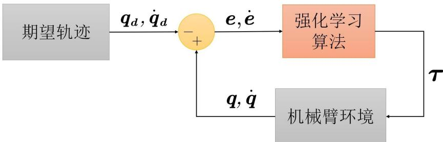

图3.2 强化学习控制器流程图

算法 3.1：基于强化学习的控制器训练算法

Input ( $\theta_{Actor}, \theta_{Critic}$ ) ← 初始化网络参数
buffer  $D_{env} \leftarrow \emptyset$ 
for 训练轮数 do
    repeat 每个时间步 do
    $a_t \sim \pi_{\theta_a}(a_t | s_t)$ 
    根据动作 $a_t$ 得到关节力矩 $\tau$ 和奖励 $r_t$ 
    根据式(3-1)可以得到 $s_{t+1}$ $D_{env} \leftarrow D_{env}\{(s_t, s_{t+1}, a_t, r_t)\}$ 
    if  $|D_{env}| &gt; N_{train}$  then
    采样 $N_{sample}$ 个 $d_{env} \in D_{env}$ 数据
    for 指定数量的 $d_{train} \in D_{env}^{sample}$ do
    if PPO：采用式(3-13)多频次更新智能体网络
    if SAC：采用式(3-17)(3-18)(3-19)更新智能体网络
    end for
    end if
until 当前回合结束
end for

## 3.4.1 基于 PPO 算法的控制器设计

PPO 算法引入了 TRPO（Trust Region Policy Optimization）中的思想，但通过简化来提高计算效率。TRPO提出通过限制策略更新的步幅来解决策略优化中的大幅度更新问题。PPO在此基础上提出了更加实用的方法，通过“裁剪”目标函数来实现相似的效果。PPO 的目标函数使用了概率变化比率 $r _ { t } ( \theta )$ 来衡量策略的变化。具体而言，假设当前策略为 $\pi _ { \theta }$ ，而旧策略为 $\pi _ { \theta _ { o l d } }$ ，那么概率变化比率 $r _ { t } ( \theta )$ 可以定义为[59]：

$$
r _ {t} (\theta) = \frac {\pi_ {\theta} (a _ {t} | s _ {t})}{\pi_ {\theta_ {o l d}} (a _ {t} | s _ {t})}\tag{3-8}
$$

其中， $\pi _ { \theta } \left( a _ { t } | s _ { t } \right)$ 是在当前策略在状态 $s _ { t }$ 下采取动作 $a _ { t }$ 的概率， $\pi _ { \theta _ { o l d } } ( a _ { t } | s _ { t } )$ 是在旧策略下的概率。该比率用于衡量新旧策略的差异，当 $\pi _ { \boldsymbol { \theta } } = \pi _ { \boldsymbol { \theta } _ { o l } }$ 时变化比率 $r _ { t } \left( \theta \right) = 1$ ，即没用变化。

根据TRPO方法，使智能体的目标函数最大化：

$$
L _ {\mathrm{CPI}} (\theta) = \hat {\mathbb {E}} _ {t} \left[ \frac {\pi_ {\theta} (a _ {t} \mid s _ {t})}{\pi_ {\theta_ {\mathrm{odt}}} (a _ {t} \mid s _ {t})} \hat {A} _ {t} \right] = \hat {\mathbb {E}} _ {t} \left[ r _ {t} (\theta) \hat {A} _ {t} \right]\tag{3-9}
$$

其中，CPI 指保守策略迭代（Conservative Policy Iteration）， $\hat { A } _ { t }$ 是时间步的优势函数。如果没由约束条件， $L _ { \mathrm { C P I } }$ 最大化将导致策略更新过大而引起训练时的波动，因此 PPO继续考虑修改目标函数。当前有两种修改方法，第一种是CLIP 裁剪法，第二种是KL散度惩罚。

首先第一种CLIP 裁剪法的损失函数定义如下：

$$
L _ {\mathrm{CLIP}} (\theta) = \hat {\mathbb {E}} _ {t} \left[ \min \left(r _ {t} (\theta) \hat {A} _ {t}, \operatorname{clip} \left(r _ {t} (\theta), 1 - \epsilon , 1 + \epsilon\right) \hat {A} _ {t}\right) \right]\tag{3-10}
$$

其中 $\epsilon$ 是裁剪的阈值，通常设定一个小值，比如0.1 或0.2，用于限制策略更新的大小。$\mathrm { c l i p } ( r _ { t } ( \theta ) , 1 - \epsilon , 1 + \epsilon )$ 对 $r _ { t } ( \theta )$ 进行裁剪，使其不超过阈值 $1 - \epsilon$ 到 $1 + \epsilon$ 的范围。这个目标函数的作用是，当 $r _ { t } ( \theta )$ 离 1 很远时，算法会通过裁剪来防止过大的策略更新，从而避免不稳定的训练过程。

第二种KL 散度惩罚方法中，智能体损失函数定义如下：

$$
L _ {\mathrm{KLPEN}} (\boldsymbol {\theta}) = \hat {\mathbb {E}} _ {t} \bigg [ \frac {\pi_ {\boldsymbol {\theta}} (a _ {t} | s _ {t})}{\pi_ {\theta_ {o l d}} (a _ {t} | s _ {t})} \hat {A} _ {t} - \beta \mathrm{KL} [ \pi_ {\theta_ {o l d}} (\cdot | s _ {t}), \pi_ {\boldsymbol {\theta}} (\cdot | s _ {t}) ] \bigg ]\tag{3-11}
$$

惩罚系数 $\lvert \beta$ 的自适应更新方法如下：

$$
\left\{ \begin{array}{l l} \beta \leftarrow \beta / 2 & d <   d _ {t a r g} / 1. 5 \\ \beta \leftarrow 2 \beta & d > 1. 5 d _ {t a r g} \end{array} \right.\tag{3-12}
$$

其中， $d = \mathrm { K L } \left[ \pi _ { \theta _ { o l d } } \left( \cdot \mid s _ { t } \right) , \pi _ { \theta } \left( \cdot \mid s _ { t } \right) \right]$ ，更新后的 $\mu$ 用于下一次的策略更新。在该方法下，式(3-12)中的参数 1.5 和 2 是启发式选择的，但算法对它们不敏感。 $\beta$ 的初始值是另一个超参数，在实际应用中它并不显得特别重要，因为算法在更新过程中会迅速对其进行调整。

现有研究表明，CLIP方法的训练效果更好。因此，在Actor-Critic架构中结合式(3-10)的方法更新：

$$
L _ {P P O} (\theta) = \hat {\mathbb {E}} \left\{L _ {C L I P} (\theta) - c _ {1} L _ {V F} (\theta) + c _ {2} S [ \pi_ {\theta} ] (s _ {t}) \right\}\tag{3-13}
$$

式中 $L _ { V F }$ 表示Critic网络的损失函数， $S [ \pi _ { \theta } ]$ 是熵奖励， $c _ { 1 } , c _ { 2 }$ 表示可变参数。 $L _ { C L I P } ( \theta )$ 用于更新Actor 网络，其中，优势函数 $\hat { A } _ { t }$ 采用广义优势估计方法计算：

$$
\begin{array}{c} \hat {A} _ {t} = \delta_ {t} + (\gamma \lambda) \delta_ {t + 1} + \dots + (\gamma \lambda) ^ {T - t + 1} \delta_ {T - 1} \\ \delta_ {t} = r _ {t} + \gamma V (s _ {t + 1}) - V (s _ {t}) \end{array}\tag{3-14}
$$

与AC 的更新方式不同，PPO 从收集数据中采用小批次（minibatch）的方式，在一次更新中对智能体进行多次更新。根据图 3.2 所示，实时力矩 由Actor 网络 $f _ { A c t o r } $ 输出，控制器设计如下[60]：

$$
\pmb {\tau} (t) = f _ {A c t o r} (\boldsymbol {s} _ {t})\tag{3-15}
$$

其中 $s _ { t } = \{ q , \dot { q } , q _ { d } , \dot { q } _ { d } \}$ O

## 3.4.2 基于 SAC 算法的控制器设计

SAC（SoftActor-Critic）算法基于最大熵强化学习框架，它的核心思想是通过最大化策略的熵来鼓励智能体在探索环境时保持不确定性，从而提高算法在复杂、动态连续环境下的鲁棒性和探索能力。通过引入最大熵目标，SAC 不仅优化期望回报，还最大化策略的熵，这样做能够使得学习过程中的动作选择更加多样化和鲁棒。SAC 在处理连续动作空间和高度复杂任务时表现较好，同时在提高稳健性和学习效率方面拥有显著优势。基于最大熵的最优策略表示如下[61,62]：

$$
\pi^ {\star} = \underset {\pi} {\operatorname{argmax}} \sum \mathbb {E} _ {(s _ {t}, a _ {t}) \sim \pi} [ r (s _ {t}, a _ {t}) + \alpha \mathcal {H} (\pi (\cdot | s _ {t})) ]\tag{3-16}
$$

其中， ${ \mathcal { H } } ( \pi \left( \mathbf { \theta } \cdot | s _ { t } \right) ) = - \sum \pi \left( a _ { t } | s _ { t } \right) \log \pi \left( a _ { t } | s _ { t } \right)$ 代表状态 $s _ { t }$ 下的策略熵， $\alpha$ 表示温度系数，决定熵项与奖励的相对重要性，以控制最优策略的随机性。

SAC 也是基于 AC 框架，并使用经验回放方法进行离策略更新。首先 Actor 网络的损失函数如下：

$$
J _ {\pi} (\phi) = \mathbb {E} _ {(s) \sim D} \left[ \mathbb {E} _ {a \sim \pi_ {\phi}} [ \alpha \log \pi_ {\phi} (a | s) - Q _ {\theta_ {i}} (s, a) ] \right]\tag{3-17}
$$

Actor 网络产生的动作也具有探索性。SAC 的探索方式是概率分布的重采样。重采样最后的线性变换输出可以提供多样的动作变化。

Critic 网络由两个 Q 网络和两个目标 Q 网络构成，在 Q 网络的更新时，选择所有目标Q网络中最小一个作为价值目标计算。这种方式类似于 PPO的保守更新思想，尽可能地减少因训练步伐过大产生的波动。最终的Q网络更新损失函数如下[63]：

$$
L _ {Q} (\theta_ {i}) = \mathbb {E} _ {(s, a, r, s ^ {\prime}, d) \sim D} \left[ \frac {1}{2} \left(Q _ {\theta_ {i}} (s, a) - y (r, s ^ {\prime}, d)\right) ^ {2} \right]\tag{3-18}
$$

其中 $y \left( r , s ^ { \prime } , d \right) = r + \gamma \bigg ( \operatorname* { m i n } _ { i = 1 , 2 } Q _ { \theta ^ { \prime } _ { i } } ( s ^ { \prime } , \tilde { a } ^ { \prime } ) - \alpha \log \pi _ { \phi } ( \tilde { a } ^ { \prime } | s ^ { \prime } ) \bigg )$ 。式(3-18)的梯度结果包含最大熵的更新，类似式(3-17)，表示如下：

$$
\nabla_ {\theta_ {i}} L \left(\theta_ {i}\right) = \nabla_ {\theta_ {i}} Q _ {\theta_ {i}} (s, a) \left[ \left(Q _ {\theta_ {i}} (s, a) - y \left(r, s ^ {\prime}, d\right)\right) ^ {2} \right]\tag{3-19}
$$

在 SAC 中，温度系数通过制定不同的最大熵强化学习目标来自动调节，其中熵被视为一种约束。通过这种自动优化，策略能够在探索过程中保持一定的不确定性，同时在明确定义的好坏状态下维持确定性。SAC 将问题转化为一个约束优化问题，目标是找到一个随机策略，在最大化期望回报的同时，满足最小期望熵的约束条件。

最后，结合图3.2 的控制器以及式(3-15)，将 $f _ { A c t o r } $ 改为 SAC 的 Actor 网络。

## 3.5 实验与分析

## 3.5.1 实验介绍与设计

为了验证算法的有效性并直观地对比每个控制器算法，本章的实验设计了一个二自由度机械臂。给每个关节角初始实时位置和期望实时位置，通过策略网络对每个关节输入力矩，控制机械臂的每个关节实时跟踪目标期望轨迹。

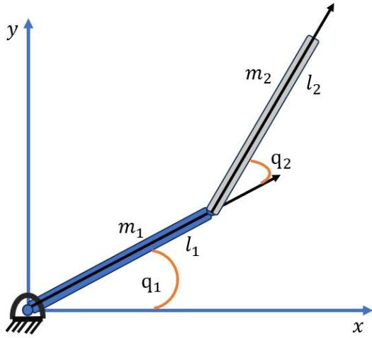  
图3.3 二自由度机械臂示意图

从图3.3 可以看出机械臂的连杆有两个参数，分别是连杆的长度以及杆的质量，下标数字表示不同关节连杆的标识。每个关节都有关节角 $q$ ，本文实验的任务和实验结果均与关节角有关。

本章实验的动力学方程(3-1)中，机械臂参数设置如下：

$$
M = \left( \begin{array}{c c} m _ {1 1} & m _ {1 1} \\ m _ {2 1} & m _ {2 2} \end{array} \right), C = \left( \begin{array}{c c} c _ {1 1} & c _ {1 1} \\ c _ {2 1} & c _ {2 2} \end{array} \right), G = \binom{g _ {1 1}}{g _ {2 1}}\tag{3-20}
$$

式中， $m _ { 1 1 } = ( m _ { 1 } + m _ { 2 } ) l _ { 1 } ^ { 2 } + m _ { 2 } l _ { 2 } ^ { 2 } + 2 m _ { 2 } l _ { 1 } l _ { 2 } \cos q _ { 2 } , m _ { 1 2 } = m _ { 2 } l _ { 2 } ^ { 2 } + m _ { 2 } l _ { 1 } l _ { 2 } \cos q _ { 2 } , m _ { 2 2 } = m _ { 2 } l _ { 2 } ^ { 2 }$ $\begin{array} { r } { m _ { 2 1 } = m _ { 2 } l _ { 2 } ^ { 2 } + m _ { 2 } l _ { 1 } l _ { 2 } \cos g _ { 2 } , c _ { 1 1 } = - 2 m _ { 2 } l _ { 1 } l _ { 2 } \sin g _ { 2 } \dot { q } _ { 2 } , c _ { 1 2 } = - m _ { 2 } l _ { 1 } l _ { 2 } \sin q _ { 2 } \dot { q } _ { 2 } , c _ { 2 1 } = m _ { 2 } l _ { 1 } l _ { 2 } \sin q _ { 2 } \dot { q } _ { 1 } } \end{array}$ $c _ { 2 2 } = 0 , g _ { 1 1 } = ( m _ { 1 } + m _ { 2 } ) g l _ { 1 } \sin q _ { 1 } + m _ { 2 } g l _ { 2 } \sin { ( q _ { 1 } + q _ { 2 } ) } , g _ { 2 1 } = m _ { 2 } g l _ { 2 } \sin { ( q _ { 1 } + q _ { 2 } ) }$ 。此外，机械臂的连杆长度 $l _ { 1 } = l _ { 2 } = 0 . 5 m$ ，连杆重量 $m _ { 1 } = m _ { 2 } = 0 . 5 k g$

为了比较传统控制器和强化学习控制器的效果，本章设计了两个实验。第一个实验评估控制性能，通过对比强化学习控制器和传统控制器在简单轨迹定点跟踪与曲线跟踪中的表现，分析控制误差。第二个实验关注强化学习训练的效果，通过对比强化学习方法训练的奖励曲线，评估它们的训练效率。经过训练调试，PPO、SAC 算法的参数设计以及控制器的参数设置如表3.1所示。智能体训练时的奖励函数为每个时间步的跟踪误差 的绝对值的负数，即 $\boldsymbol { r } _ { t } = - | \boldsymbol { e } _ { t } |$

表3.1 强化学习算法参数设置表

<table><tr><td>参数</td><td>SAC</td><td>PPO</td></tr><tr><td>actor_lr</td><td>3e-4</td><td>1e-3</td></tr><tr><td>critic_lr</td><td>3e-3</td><td>5e-4</td></tr><tr><td>gamma</td><td>0.99</td><td>0.99</td></tr><tr><td>lmbda</td><td>/</td><td>0.99</td></tr><tr><td>epochs</td><td>/</td><td>10</td></tr><tr><td>epsilon</td><td>/</td><td>0.2</td></tr><tr><td>episode</td><td>300</td><td>300</td></tr><tr><td>tau</td><td>0.005</td><td>/</td></tr><tr><td>batch_size</td><td>64</td><td>/</td></tr><tr><td>buffer_size</td><td>100K</td><td>/</td></tr><tr><td>minimal_size</td><td>1K</td><td>/</td></tr><tr><td>alpha_lr</td><td>3e-4</td><td>/</td></tr><tr><td>target_entropy</td><td>-2</td><td>/</td></tr></table>

在机械臂虚拟环境中，机械臂的初始状态设置为： $q _ { 1 } ( 0 ) = q _ { 2 } ( 0 ) = 0 , { \dot { q } } _ { 1 } ( 0 ) = { \dot { q } } _ { 2 } ( 0 ) = 0$ 机械臂关节角将要跟踪的目标曲线轨迹函数设置为： ${ { q } _ { d 1 } } ( t ) = 0 . 5 \mathrm { s i n } t$ $q _ { d 2 } \left( t \right) = 0 . 5 \cos t$ ；进而机械臂的目标跟踪速度为： ${ { \dot { q } } _ { d 1 } } \left( t \right) = 0 . 5 \cos { t }$ ， $\dot { q } _ { d 2 } ( t ) = - 0 . 5 \mathrm { s i n } t$ 。此外，每个回合的时间步长为3000步，每一步的固定时间限制为0.01秒，即环境中每一回合都拟合了机械臂在智能体训练中最多 30秒的轨迹跟踪信息。

## 3.5.2 实验结果及分析

首先展示的是强化学习的训练过程，如图 3.4 所示。图中是 SAC、PPO 两个强化学习算法学习过程中的奖励曲线。每个强化学习算法都训练相同的回合数，在机械臂环境中重复训练 4 次。图中的奖励曲线为 4 次训练的奖励平均值，阴影部分为奖励值的标准差。

从图3.4(a)中可以看出SAC 控制器在第50回合就能够更快地收敛，但在后续的训练过程中有些回合波动过大。PPO 控制器在第 110 回合左右开始收敛，但在收敛后训练的稳定性要优于SAC控制器。此外，从图3.4(b)、(c)可以看出PPO的奖励值的标准差和方差曲线的波动都小于SAC算法。这种现象的原因主要与两种算法的特性有关。SAC 作为一种基于最大熵的离线策略算法，其强探索性和离线学习机制使其在早期能够快速找到较优策略，但由于使用了历史数据和非确定性策略，Q 值估计的波动和策略的随机性会导致训练过程中出现较大的不稳定性。而PPO作为一种同策略算法，通过限制策略更新的幅度和采用保守的优化方式，虽然初期收敛较慢，但能够更稳定地利用当前策略的数据进行优化，从而在后期表现出更高的训练稳定性。因此，SAC在早期快速收敛但波动较大，而PPO虽然收敛较慢，但一旦收敛后表现更加稳定。

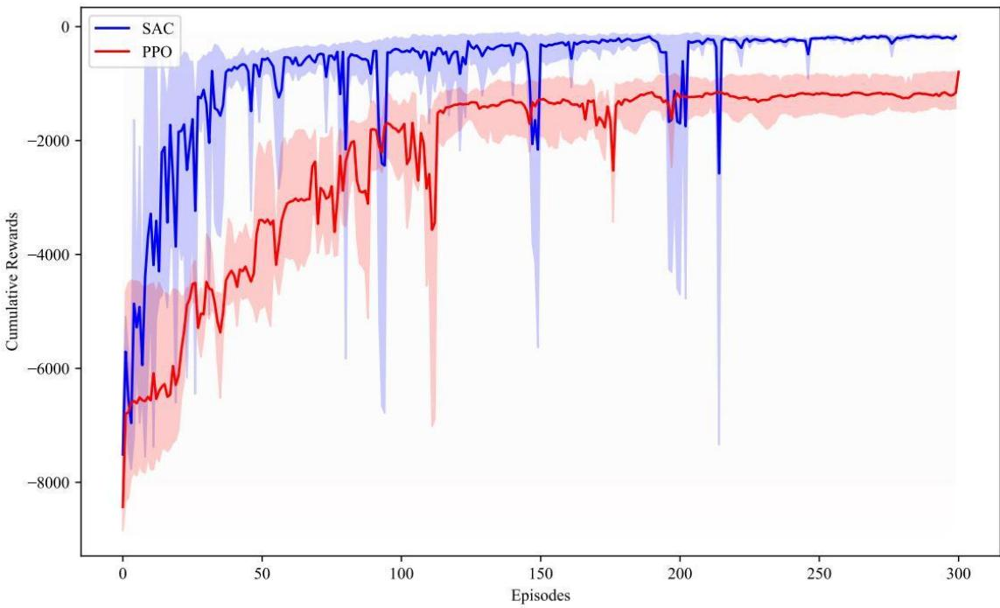

(a) 每回合累计奖励  
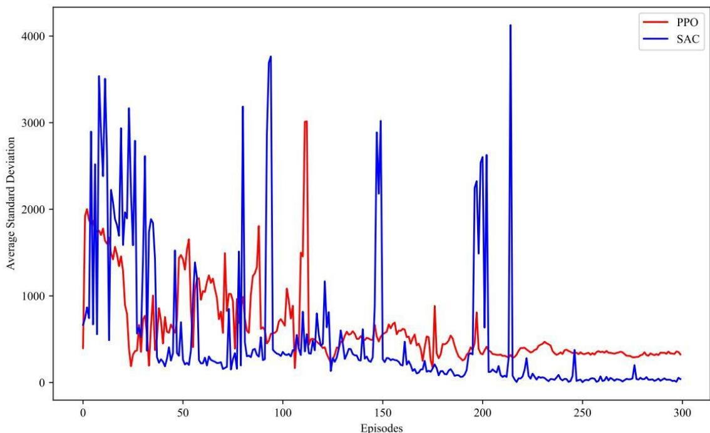  
(b) 累积奖励的标准差

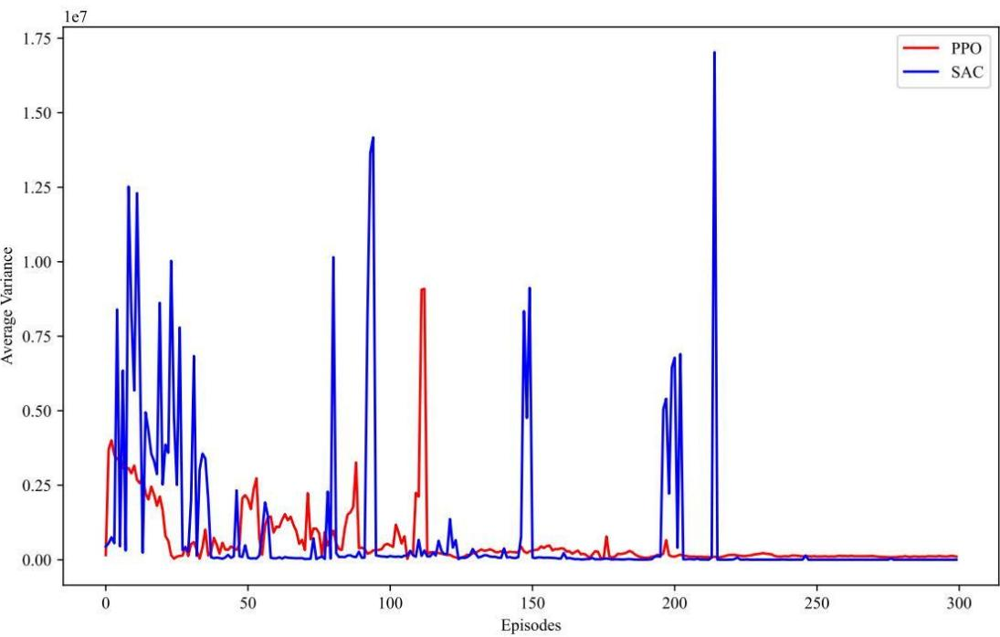  
(c) 累积奖励的方差  
图3.4 强化学习控制器训练曲线

图 3.5 展示了经过训练得到的最高奖励值的强化学习控制器的轨迹跟踪控制效果图。从图 3.5(a)和(b)的位置跟踪和(e)和(f)的速度跟踪上看到，所有的方法都能够跟踪轨迹的方向和速度的变化趋势，其中PID 控制器和SAC 控制器的跟踪效果要优于PPO控制器。进一步查看图3.5(c)(d)(g)(h)可以知道，SAC 控制器与PID 控制器的控制效果各有优势，但总体上SAC控制器的方法要略胜一点，而PPO的控制效果最差，这是训练不完全导致的。此外，从图3.5(i)(j)的力矩输入代价可以明显看出，尽管PPO控制器在轨迹跟踪的控制效果上也很好，但是其在初始时间段的力矩输入相比其他控制器代价更大且不稳定。

通过本章的实验对比，本文中的后续第四章和第五章都已 SAC 算法为基准，在此基础上改进强化学习算法。选择SAC 算法作为基准算法在后续更复杂的机械臂控制任务中进行算法改进是合理的，可以从以下几个方面具体说明：首先，SAC 算法在早期训练中表现出快速收敛的特性，这对于复杂任务中快速找到可行解非常重要，能够缩短初期的训练时间。其次，SAC 的最大熵框架使其具有较强的探索能力，这在复杂任务中尤为重要，因为复杂任务通常具有更大的状态空间和更多的局部最优解，强探索性有助于避免策略陷入次优解。此外，SAC 作为一种离线策略算法，能够复用历史数据，提高数据效率，这在复杂任务中尤其有价值，因为复杂任务通常需要更多的交互数据来学习有效的策略。因此，以SAC为基准算法，既能够利用其快速收敛和强探索性的优势，又为后续改进提供了明确的方向和空间，适合在更复杂的机械臂控制任务

中进一步优化和验证。

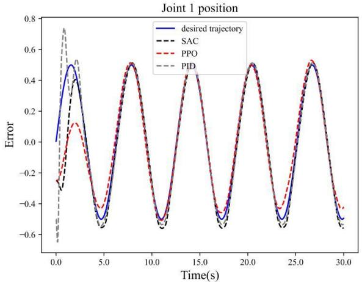  
(a) 关节1位置跟踪轨迹

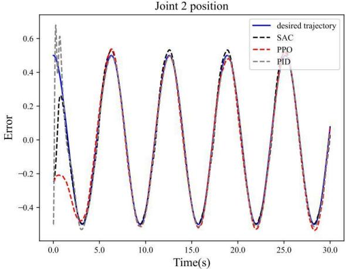  
(b) 关节2位置跟踪轨迹

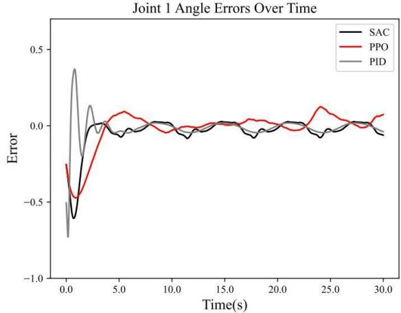  
(c) 关节1位置误差轨迹

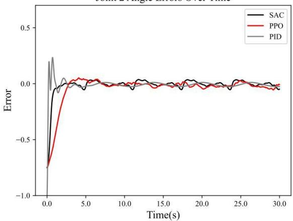  
(d) 关节2位置误差轨迹

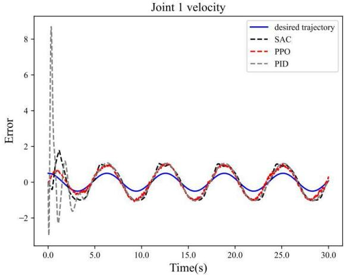  
(e) 关节1速度轨迹

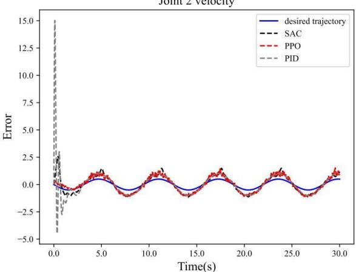  
(f) 关节2速度轨迹

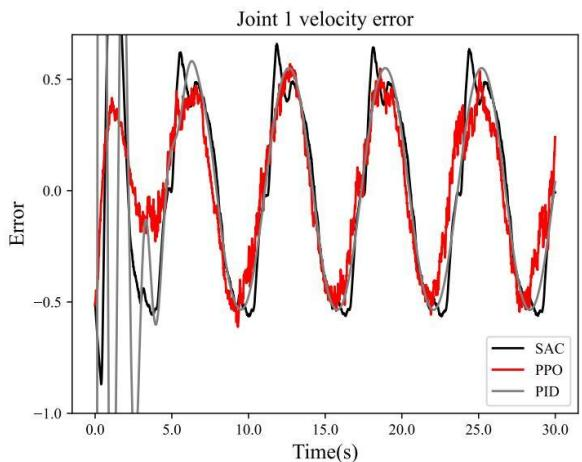  
(g) 关节1速度误差轨迹

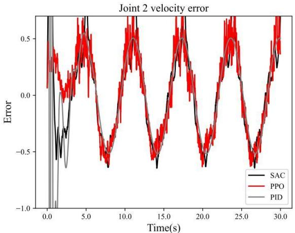  
(h) 关节2速度误差轨迹

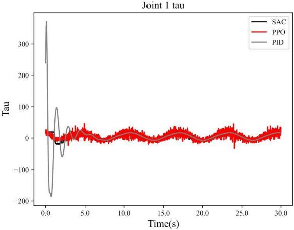  
(i) 关节0力矩变化

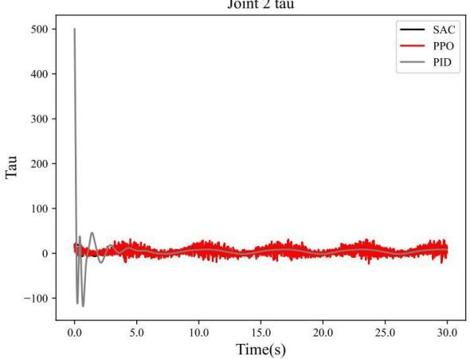  
(j) 关节1力矩变化  
图3.5 强化学习控制器机械臂数值模拟结果图

## 3.6 本章小结

本章讨论了经典的 PID 控制器和经典的强化学习算法在机械臂轨迹跟踪控制任务中的应用过程。本章首先定义了 PID 控制器，并且简单证明了该控制器在无干扰和约束的机械臂环境中执行轨迹跟踪控制任务的稳定性。然后，本章定义了 SAC、PPO这两种强化学习算法，并阐述怎样将它们设置成强化学习控制器。根据实验结果显示，强化学习控制器能够达到和传统PID 同等优秀的控制效果，其中SAC 算法的训练和控制性能都要优于 PPO算法，更适合本文中的机械臂环境。因此，在接下来的章节中，本文将继续使用SAC算法作为基准算法，在其基础上添加其他模块来增强算法的性能。

## 第四章 随机网络蒸馏在机械臂轨迹跟踪控制中的应用

上一章中主要将已有的算法运用到机械臂轨迹跟踪控制中，根据上一章的实验结果选取 SAC算法作为本章的基准算法。本章通过引入软演员-评论家（SAC）算法与集成随机网络蒸馏（ERND）机制相结合的方法，旨在提升机械臂在复杂任务中的跟踪性能与策略学习效率。具体内容包括ERND 模型的设计、内部奖励的构建方式，以及SAC算法在受限动作空间中的适应性改进。通过仿真实验验证了所提出方法在密集奖励场景下的有效性与鲁棒性，为机械臂智能控制提供了新的思路。

## 4.1 引言

强化学习通过在环境中训练智能体完成轨迹跟踪任务实现最大奖励回报，而不需要知道具体的机械臂模型。MFRL 可以完成更加灵活的任务，而不仅是像传统控制那样完成固定过程的编程任务。

KARGIN T C 等人[64]提出了一种 DRL 控制器来引导机器人到达目标位置，其中DDPG 算法用于训练控制策略。MAR 等人[65]介绍了一种用于仿生水下机器人(BUV)位置和姿态跟踪的DRL 控制算法，其中SAC算法用于通过与模拟BUV 交互来学习控制器。HUY等人[66]提出了一种基于核函数的RL 动力学模型算法来解决2-DoF 机械手的跟踪控制问题。尽管DRL 在跟踪控制问题中得到了深入研究，但大多数现有算法的探索效率较低。因此，需要大量的训练周期才能获得有效的控制策略。此外，大多数DRL 算法在训练机器人机械手执行跟踪控制任务时容易出现不稳定。

相反，内在的好奇心驱动的方法在增强DRL 的探索能力方面发挥着重要作用[67]。在[45]采用 RND方法与 SAC 算法相结合的方式控制机械手抓取目标。为了引导机器人寻找无碰撞路径，PANL 等人[68]提出了一种基于 DRL 和 RND的方法来训练端到端导航控制器。虽然使用RND模型可以有效提高跟踪控制任务中的控制性能，但是单一的RND 模型可能很难捕捉到复杂的机械手环境中更全面的环境特征。因此，本章采用ERND方法和SAC 算法结合，对具有扭矩饱和与关节约束的不确定机械手进行时变轨迹跟踪控制任务。本章的主要贡献和工作包括以下几点：

1）通过扩展上述参考文献[45]中RND模型的结果，本文提出了ERND模型。ERND收集了多个 RND 模型，并将各个 RND 模型的内部奖励信号相加，提供更全面的内部奖励，从而有效提升智能体的探索能力。

2）将 SAC 算法与 ERND相结合，提出一种 SAC-ERND 算法，利用 SAC 训练出更优的轨迹跟踪控制策略，利用 ERND 来增强 SAC 算法的探索能力。所提出的SAC-ERND算法有效地解决了具有扭矩和关节角度饱和的复杂机器人机械手环境下的

轨迹跟踪控制问题。

## 4.2 问题描述

本章中考虑一个二自由度机械臂动力学模型，该模型在式(2-25)的基础上加上干扰力矩，定义如下：

$$
M (\boldsymbol {q}) \ddot {\boldsymbol {q}} + C (\boldsymbol {q}, \dot {\boldsymbol {q}}) \dot {\boldsymbol {q}} + G (\boldsymbol {q}) = \boldsymbol {\tau} + \boldsymbol {\tau} _ {\mathrm{d}}\tag{4-1}
$$

力矩约束为：

$$
\tau_ {i} = \left\{ \begin{array}{l l} \tau_ {\min} & , \text {if} \tau_ {i} \leq \tau_ {\min} \\ \tau_ {i} & , \text {if} \tau_ {\min} <   \tau_ {i} <   \tau_ {\max}, i = 1, 2,..., n \\ \tau_ {\max} & , \text {if} \tau_ {i} \geq \tau_ {\max} \end{array} \right.\tag{4-2}
$$

限制之后控制器能输出的最大力矩 $\tau _ { \mathrm { m a x } } = 2 5$ ，最小力矩 $\tau _ { \mathrm { m i n } } = - 2 5$ C

此外， $\pmb { \tau _ { \mathrm { d } } }$ 为随机出现的干扰力矩，表示为：

$$
\tau_ {d} = \left\{ \begin{array}{l l} (r a n d (- 5, 5) r a n d (- 5, 5)) ^ {T} & a > 0. 8 \\ 0 & \text {else} \end{array} \right.\tag{4-3}
$$

其中 表示在区间[0.0,1.0)内均匀分布的随机变量。如果该值超过 0.80，则在系统输入信号中添加一个在（-5, 5）之间的非线性扰动项，这意味着扰动在每个时间步长上都有20%的概率发生。

本章中也对机械手关节施加饱和约束，以限制机械手跟踪目标曲线时的摆动幅度，约束条件与第三章中的一致，如式(3-2)所描述。

## 4.3 基于SAC算法和集成随机网络蒸馏的控制器设计

## 4.3.1 网络随机蒸馏算法

随机网络蒸馏是一种创新的无监督强化学习算法，其核心在于通过引入一个随机生成且固定的目标网络来驱动智能体的探索过程。RND 方法巧妙地设计了一个目标网络和一个预测网络，其中目标网络的权重在初始化时随机生成并保持不变，而预测网络则通过训练不断调整其参数，以最小化与目标网络输出之间的差异。这种差异不仅反映了预测网络的预测能力，还作为内部奖励信号，激励智能体探索环境中未被充分发现的状态，从而加速学习过程并提升策略的鲁棒性。在强化学习的框架下，RND 的核心思想是通过设计一种基于预测误差的内部奖励机制，鼓励智能体主动探索那些目标网络难以准确预测的状态。这种探索机制不仅能够有效避免智能体陷入局部最优解，还能在复杂环境中促进更高效的学习。具体来说，RND 通过以下两个方面对模型训练

做出贡献：

1）驱动探索：RND 通过内部奖励机制激励智能体探索环境中未被充分覆盖的状态。由于目标网络是随机生成且固定的，其输出对于智能体来说是未知的，因此智能体需要通过探索来学习如何准确预测这些输出。这种机制特别适用于稀疏奖励环境，能够显著提高智能体的探索效率。

2）防止局部最优：在传统的强化学习算法中，智能体容易陷入局部最优解，尤其是在奖励信号稀疏或复杂的环境中。RND通过引入基于预测误差的内部奖励，使得智能体在探索过程中不仅关注外部奖励，还关注自身预测能力的提升，从而有效避免了过早收敛到次优策略。

在 RND方法中，使用一个固定的目标网络 $\pmb { r } _ { t a r g e t }$ 和一个训练中的预测网络 $r _ { p r e d i c t }$ 。目标是最小化预测网络和随机网络之间的差异，即通过调整预测网络的参数，使得它能够更好地预测由随机网络生成的值。在强化学习的背景下，RND 的核心思想是通过奖励信号来鼓励智能体探索环境中未被发现的状态，从而加速学习过程。RND 对模型的训练有两方面的贡献：一是驱动探索，二是防止在探索过程中出现陷入局部最优解的情况。两种网络之间的差值作为强化学习训练时的内部奖励：

$$
r _ {R N D} = \left| r _ {t a r g e t} (s _ {t}) - r _ {p r e d i c e} (s _ {t}) \right| ^ {2}\tag{4-4}
$$

其中， $r _ { t a r g e t } \left( s _ { t } \right)$ 是随机生成的目标值， $r _ { p r e d i c t } ( s _ { t } )$ 是训练中的预测值。该预测误差 $r _ { R N D }$ 作为内部奖励，指导智能体的探索过程。这个内部奖励是基于目标特征和预测特征之间的差异来计算的，差异越大，奖励越小，反之亦然。这种设计鼓励模型在预测时尽可能接近目标特征，从而提高预测的准确性。通过激励代理探索目标网络难以准确预测的状态，RND可以促进高效学习并促进在复杂环境中的探索。

## 4.3.2 集成网络随机蒸馏算法

首先设计 RND 模型，每个 RND 模型的目标网络和预测网络由一个全连接层和一个输出层组成。为了获得更好的性能，两个网络的大小与SAC的actor 和critic 类似，网络层数相同[69]。目标网络的权重在初始化时随机生成，并且在训练过程中保持不变，以确保其稳定性和一致性。具体来说，对于给定的输入状态 $s _ { t + 1 }$ ，ERND 模型首先通过其内部的 RND模型进行前向传播，每个RND 模型会分别计算目标特征 $r _ { t a r g e t }$ 和预测特征 $r _ { p r e d i c t }$ 。这些特征是通过网络的层级结构逐层传递和变换得到的，反映了模型对当前状态的理解和预测。接下来，对于每个RND模型，根据公式(4-5)获得内部奖励 $r _ { R N D }$ 接下来，对每个内部奖励计算和，得到总和误差特征：

$$
r _ {R N D} ^ {t o t a l} = \sum_ {i = 1} ^ {N} r _ {R N D} ^ {i}\tag{4-5}
$$

这个总和误差特征可以用于进一步的分析和决策，例如在强化学习任务中作为额外的奖励信号，帮助模型更好地探索环境或优化策略。通过这种方式，ERND 模型不仅能够提供更准确的预测，还能通过内部奖励机制增强模型的探索能力和鲁棒性。

## 4.3.3 基于 SAC 算法的集成网络随机蒸馏控制器

在本章中，主要是将SAC 算法与 ERND相结合，构建了一种新的强化学习控制器，称为 SAC-ERND。SAC 算法的基本设置如第三章 3.4.1 节所述，其核心思想是通过最大化策略的熵来平衡探索与利用，从而在复杂环境中实现高效学习。为了进一步提升SAC算法的性能，特别是其收敛速度和训练稳定性，上述设计的ERND模型被引入SAC算法。在智能体训练过程中，奖励函数的设计至关重要。本节中采用每个时间步的跟踪误差的绝对值的负数作为外部奖励，具体定义如下：

$$
r _ {t} = - \omega | e _ {t} |\tag{4-6}
$$

其中， $\omega$ 是属于 之间的参数， $e _ { t }$ 表示当前时间步的跟踪误差。这种奖励函数的设计直接反映了智能体对目标轨迹的跟踪精度，误差越小，奖励越大，从而激励智能体优化其控制策略以最小化跟踪误差。本文将ERND模型获得的总内部奖励与SAC 算法获得的外部奖励的线性组合作为RL 算法训练的总奖励。总奖励定义如下：

$$
r _ {t o t a l} = - \omega | e _ {t} | + r _ {R N D}\tag{4-7}
$$

在上述文献[45]中，已经证明了 RND能够提升 SAC 算法在机械臂抓取目标物体任务中的探索能力。与其中的RND 模型不同，本文利用ERND 提供更全面的内部奖励，从而有效提升智能体的探索能力。原因是本文旨在跟踪时变曲线，智能体需要快速适应曲线的变化，而单一的RND 模型可能无法及时提供足够的内部奖励来引导智能体跟随曲线的变化。基于 SAC 的集成网络随机蒸馏算法（SAC-ERND）的示意图如图 4.1所示，算法训练流程如算法4.1所示。该架构包括以下几个关键组件：

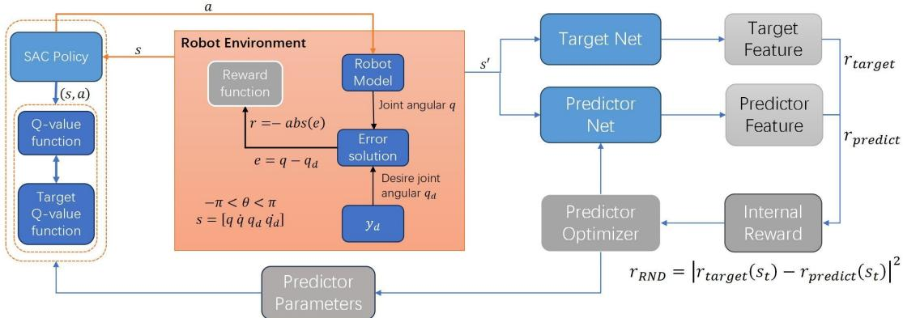  
图 4.1 SAC-ERND 算法流程图

1）SAC算法模块：负责策略优化和值函数估计，通过最大化策略的熵来平衡探索与利用。

2）集成RND模块：由多个RND模型组成，每个模型生成独立的内部奖励，最终通过集成方法综合这些奖励，提供更全面的探索信号。

3）奖励组合模块：将SAC 的外部奖励与集成RND的内部奖励进行线性组合，形成总奖励，用于指导智能体的学习和探索。

算法 4.1: SAC-ERND 控制器算法
Input ( $\theta_{Actor}, \theta_{Critic}$ ) ← 初始化网络参数
buffer  $D_{env} \leftarrow \varnothing$ 
Input ( $\theta_{target}, \theta_{predict}$ ) ← 初始化网络参数
Output 最优网络参数
for 训练轮数 do
    repeat 每个时间步 do
    观察当前状态  $s_t$  并选择动作  $a_t \sim \pi_{\theta_a}(a_t | s_t)$ 
    根据动作  $a_t$  得到关节力矩  $\tau$  和奖励  $r_t$ 
    计算 RND 内部奖励  $r_{RND}$ 
    计算 ERND 内部奖励  $r_{RND}^{total}$ 
    计算累计奖励  $r_{total}$ 
    根据式(3-1)可以得到  $s_{t+1}$ $D_{env} \leftarrow D_{env}\{(s_t, s_{t+1}, a_t, r_t)\}$ 
    if  $|D_{env}| &gt; N_{train}$  then
    采样  $N_{sample}$  个  $d_{env} \in D_{env}$  数据
    for 指定数量的  $d_{train} \in D_{env}^{sample}$  do
    采用式(3-16)(3-17)计算和更新 actor 网络参数
    采用式(3-18)(3-19)计算和更新 critic 网络参数
    end for
    end if
until 当前回合结束
end for

## 4.4 实验设计与介绍

本章的实验 4.2 节中的二自由度机械臂的仿真环境进行，来验证所改进的SAC-ERND算法的性能。选择SAC和SAC-RND 算法作为基准，基准算法的参数如表3.1 中的一致。本章在环境中加入了机械臂输入饱和与随机干扰，机械手的初始位置值定义为 $\begin{array} { r } { q _ { 1 } ( 0 ) = q _ { 2 } ( 0 ) = - 0 . 2 5 } \end{array}$ 和 $\dot { q } _ { 1 } ( 0 ) = \dot { q } _ { 2 } ( 0 ) = 0$ 。总步数为3000，每步的步长为0.01秒。期望轨迹 $y _ { d }$ 选择为：

$$
y _ {d} = \left[ \begin{array}{c c} y _ {d 1} & y _ {d 2} \end{array} \right] ^ {T} = \left[ \begin{array}{c c} 0. 5 \sin (t) & 0. 5 \cos (t) \end{array} \right] ^ {T}\tag{4-8}
$$

其中 $t \in ( 0 , t _ { l i m i t } )$ ，并且 $t _ { l i m i t } = 3 0 \mathrm { s }$ 是结束时间。

本章实验主要分为三个部分，以全面评估强化学习控制器的性能：

1）控制性能实验在无外界干扰的环境中，选择训练时奖励最高回合对应的模型，比较不同强化学习算法在轨迹跟踪任务中的控制精度和稳定性，以验证所改进算法的跟踪效果。

2）算法训练性能实验同样在无干扰环境下进行，主要对比不同算法的训练效率，包括收敛速度、奖励变化趋势等，从而评估改进算法在学习效率上的提升。

3）抗干扰性能实验也是选取训练过程中奖励最高回合对应的模型，在加入随机干扰的环境中测试强化学习控制器的鲁棒性，并通过分析不同算法在干扰条件下的轨迹跟踪误差，评估其对未知干扰的适应性。这样设置该实验是因为奖励最高回合的模型通常学习到了最优或次优策略，能够较好地执行轨迹跟踪任务，因此作为抗干扰实验的基准是合理的。此外，训练过程中没有考虑外力干扰，而在测试时施加干扰可以评估策略是否能够有效适应未见环境，体现模型的泛化能力。

## 4.5 实验结果与分析

## 4.5.1 强化学习控制器跟踪控制性能实验与分析

为了全面评估 SAC-ERND 控制器的控制性能，我们将其与传统的 SAC 算法以及SAC-RND 算法进行了对比实验。实验结果表明，SAC-ERND 在机器人机械手跟踪控制任务中表现出显著的优势，具体结果如图 4.2所示。图4.2（a）和（b）分别展示了两个关节的跟踪轨迹。从图中可以看出，SAC-ERND 算法能够更精确地跟踪目标轨迹，尤其是在目标轨迹发生快速变化时，SAC-ERND 表现出了更强的适应能力。相比之下，传统的 SAC算法和SAC-RND算法在跟踪快速变化轨迹时出现了明显的滞后和偏差。图4.2（c）和（d）分别描绘了两个关节的跟踪误差。SAC-ERND 算法的跟踪误差显著低于SAC和 SAC-RND算法，尤其是在高动态变化区域，SAC-ERND 的误差几乎可以忽略不计。这表明，SAC-ERND通过集成RND机制，能够更有效地捕捉环境的变化，从而快速调整控制策略以最小化跟踪误差。

图 4.2（e）和（f）展示了机器人机械手控制过程中的输入力矩。SAC-ERND 算法在实现高精度跟踪的同时，所需的输入力矩明显小于SAC 和SAC-RND算法。这不仅降低了能量消耗，还减少了机械系统的磨损，从而延长了设备的使用寿命。图4.2（g）和（h）显示了跟踪过程中的速度误差。SAC-ERND 算法的速度误差显著低于其他两种算法，尤其是在目标速度快速变化的情况下，SAC-ERND表现出了更强的稳定性和响应速度。这表明，SAC-ERND 通过集成 RND 机制，能够更有效地平衡控制精度和系统稳定性。为了进一步量化 SAC-ERND 的性能优势，本实验计算了跟踪误差绝对值（AAE）的平均值和力矩绝对值（AAT）的平均值，结果如表4.1所示。计算公式如下：

$$
\mathrm{AAE} = \frac {1}{T} \sum_ {i = 1} ^ {T} | e _ {i} | \quad i = 1, 2, \dots , n\tag{4-9}
$$

$$
\mathrm{AAT} = \frac {1}{T} \sum_ {i = 1} ^ {T} | \tau_ {i} | \quad i = 1, 2, \dots , n\tag{4-10}
$$

表4.1 不同算法的AAT和AAT的数值

<table><tr><td>关节\算法</td><td>SAC</td><td>SAC-RND</td><td>SAC-ERND</td></tr><tr><td>关节1</td><td></td><td></td><td></td></tr><tr><td>AAE</td><td>0.046</td><td>0.036</td><td>0.031</td></tr><tr><td>AAT</td><td>9.408</td><td>9.627</td><td>8.909</td></tr><tr><td>关节2</td><td></td><td></td><td></td></tr><tr><td>AAE</td><td>0.039</td><td>0.034</td><td>0.021</td></tr><tr><td>AAT</td><td>5.489</td><td>5.163</td><td>4.964</td></tr></table>

从表中可以看出，SAC-ERND 的 AAE 和 AAT 均显著低于 SAC 和 SAC-RND 算法。具体来说，SAC-ERND 的 AAE 比 SAC 降低了约 32%，比 SAC-RND 降低了 14%；AAT比 SAC 降低了 25%，比 SAC-RND 降低了 10%。这些数据充分证明了 SAC-ERND 在跟踪精度和能量效率方面的显著优势。

综上所述，SAC-ERND 算法通过将SAC与集成 RND相结合，在机器人机械手跟踪控制任务中表现出了卓越的性能。与传统的 SAC 算法和 SAC-RND 算法相比，SAC-ERND不仅能够以更小的输入力矩实现更精确的跟踪，还在高动态变化环境中表现出了更强的稳定性和适应性。这些优势使得SAC-ERND 在复杂控制任务中具有广泛的应用前景，为强化学习在实际工程中的应用提供了新的思路和方法。

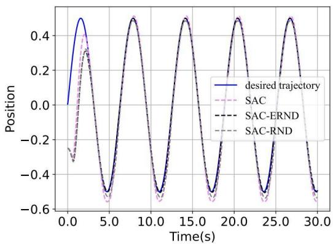  
(a) 关节1位置跟踪轨迹

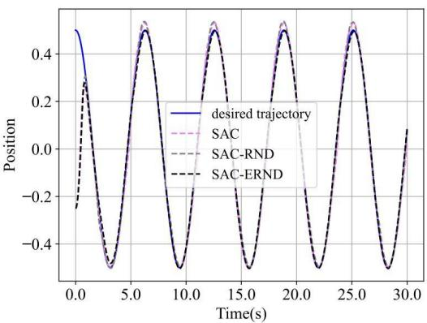  
(b) 关节2位置跟踪轨迹

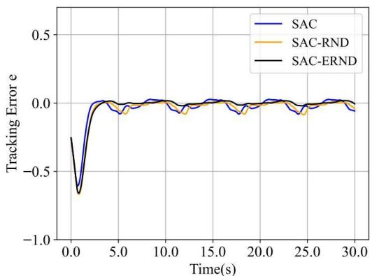  
(c) 关节1位置误差

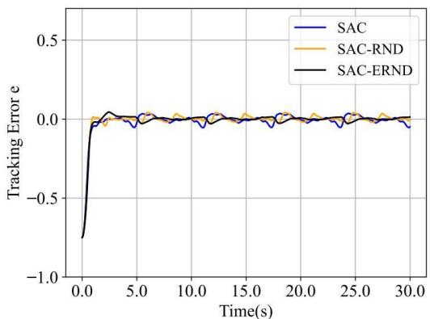  
(d) 关节2位置误差

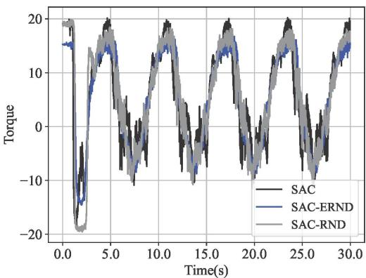  
(e) 关节1力矩变化

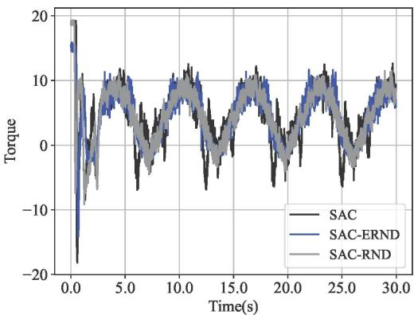  
(f) 关节2力矩变化

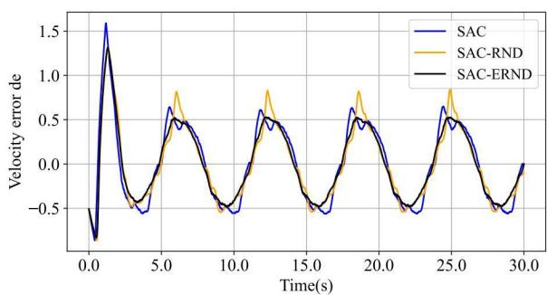  
(e) 关节1速度误差

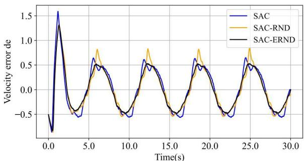  
(f) 关节2速度误差  
图4.2 强化学习控制器机械臂数值模拟结果图

## 4.5.2 强化学习控制器跟踪控制抗干扰性能实验

为了验证控制器的抗干扰能力，本小节实验选择了三种算法训练时奖励最高回合的模型在具有随机外力扰动的环境中进行测试，随机外力扰动如式(4-2)所示。实验结果表明，SAC-ERND在机械臂跟踪控制抗干扰任务中表现出显著的优势，具体结果如图4.3 所示。图 4.3(a)和(b)展示了控制器在带有干扰的环境中两个关节的跟踪轨迹。结果表明，三种算法均能在外力扰动下实现目标轨迹的跟踪，但 SAC-ERND 的跟踪轨迹与目标轨迹的吻合度最高，特别是在曲线的波峰和波谷等变化剧烈的区域。相比之下，SAC 和 SAC-RND 在受到扰动后的调整速度相对较慢，导致跟踪轨迹出现轻微滞后现象。图 4.3(c)和(d)进一步展示了跟踪误差情况。在第一个关节的跟踪任务中，SAC-ERND 的误差明显低于其他两种算法，而在第二个关节的跟踪任务中，SAC-ERND 的误差略低于 SAC 和 SAC-RND。这一现象可能与机械臂的强耦合特性有关，即某些关节的误差会相互影响，从而导致跟踪性能的微小差异。在控制输入方面，图 4.3(e)和(f)表明三种算法的输入力矩整体接近，但 SAC-ERND在实现高精度跟踪的同时，其输入力矩略小于SAC和SAC-RND。这意味着SAC-ERND 既能保持较高的跟踪精度，又能在一定程度上降低能量消耗和机械系统的磨损，从而延长设备的使用寿命。此外，图 4.3(g)和(h)展示了跟踪过程中的速度误差。结果显示，SAC-ERND的速度误差相较于其他两种算法有所降低，特别是在目标速度快速变化的情况下，其稳定性和响应速度更优。这表明SAC-ERND通过集成网络随机蒸馏机制，能够有效提升系统的动态响应能力和平衡控制精度与稳定性。

在本小节的实验中将对三种控制器在干扰环境（disturbed environment, DENV）和无干扰环境（disturbance-free environment, DFENV）的 AAE 与 AAT 进行对比，来展示SAC-ERND算法的优越性。具体如表 4.2所示和表4.3 所示。实验数据表明，SAC-ERND在抗干扰控制任务中展现出最优的综合性能。在干扰环境下，SAC-ERND的跟踪误差增幅最小（关节1仅增长30.3%，关节2仅增长4.6%），同时控制力矩增幅也最低（关节 1 仅增加 2.2%，关节 2 仅增加 4.7%），显著优于 SAC 和 SAC-RND 算法。相比之下，SAC 算法在干扰下的误差增幅最大（关节 1 高达 83.5%），而 SAC-RND 虽然表现优于 SAC，但在高动态干扰下仍需要更大的控制输入（关节2力矩增幅达22.2%）。

表4.2 两个环境下的AAE比较

<table><tr><td>关节\算法</td><td>SAC</td><td>SAC-RND</td><td>SAC-ERND</td></tr><tr><td colspan="4">关节1</td></tr><tr><td>DFENV</td><td>0.0533</td><td>0.0516</td><td>0.0386</td></tr><tr><td>DENV</td><td>0.0978</td><td>0.0721</td><td>0.0503</td></tr><tr><td colspan="4">关节2</td></tr><tr><td>DFENV</td><td>0.0287</td><td>0.0242</td><td>0.0216</td></tr><tr><td>DENV</td><td>0.0323</td><td>0.0278</td><td>0.0226</td></tr></table>

表4.3 两个环境下的AAT比较

<table><tr><td>关节\算法</td><td>SAC</td><td>SAC-RND</td><td>SAC-ERND</td></tr><tr><td colspan="4">关节1</td></tr><tr><td>DFENV</td><td>9.8513</td><td>9.1576</td><td>8.9068</td></tr><tr><td>DENV</td><td>10.217</td><td>10.043</td><td>9.0998</td></tr><tr><td colspan="4">关节2</td></tr><tr><td>DFENV</td><td>5.2331</td><td>4.9440</td><td>4.9717</td></tr><tr><td>DENV</td><td>5.8566</td><td>6.0425</td><td>5.2061</td></tr></table>

综上所述，SAC-ERND 结合了 SAC 算法的强大优化能力与 ERND 机制的环境适应性，使其在抗干扰任务中能够更稳健地应对外力扰动，提高跟踪精度并优化控制效率。尽管其相较于SAC和 SAC-RND 的提升幅度有限，但整体上仍表现出更好的抗干扰能力，为进一步优化控制策略提供了有价值的研究方向。

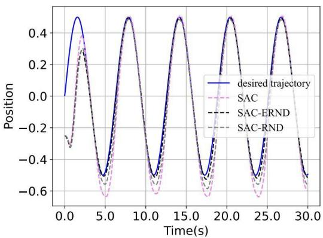  
(a) 关节1位置跟踪轨迹

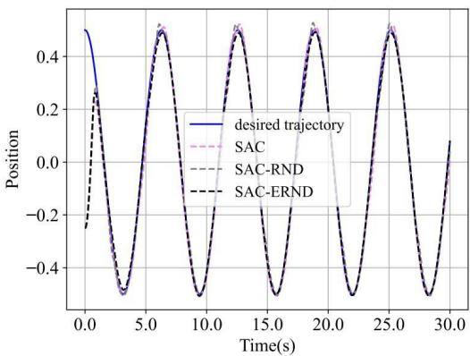  
(b) 关节2位置跟踪轨迹

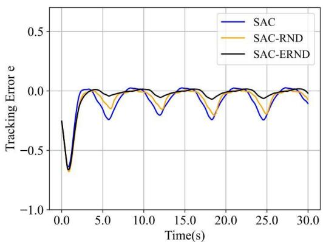  
(c) 关节1位置跟踪误差

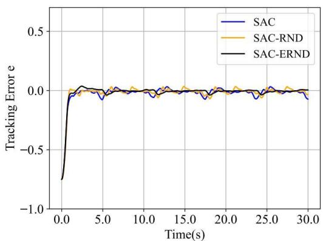  
(d) 关节2位置跟踪误差

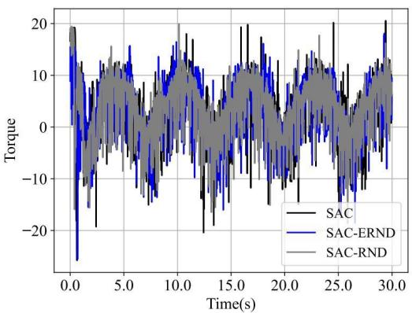  
(e) 关节1力矩变化

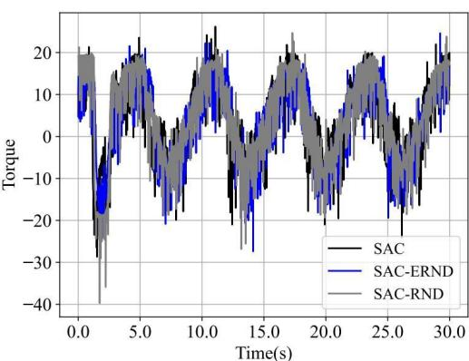  
(f) 关节2力矩变化

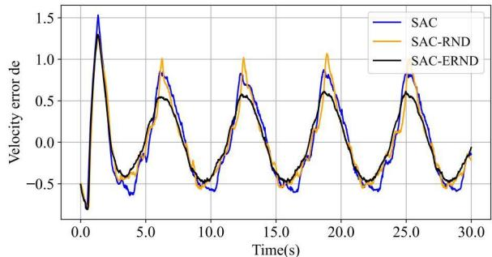  
(g) 关节1速度跟踪误差

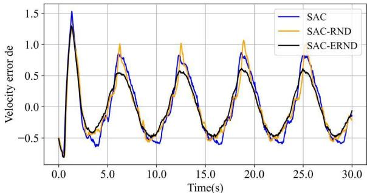  
(h) 关节2速度跟踪误差  
图4.3 强化学习控制器机械臂在干扰环境中的数值模拟结果图

## 4.5.3 强化学习控制训练性能实验与分析

通过消融实验验证ERND模型增强的效果。图4 给出了SAC-ERND 与基线算法的累积奖励曲线。结果表明，在控制 2-DoF 机械手跟踪目标曲线时，SAC 的奖励曲线在整个训练过程中波动较大，难以收敛。虽然 SAC-RND 算法最终收敛，但奖励曲线并不稳定。SAC-ERND算法收敛速度更快，收敛后的奖励曲线更稳定。结果表明，RND方法在机械手跟踪曲线的密集奖励问题中仍然发挥着重要的增强作用。此外，ERND模型提高了探索效率，增强了对时变曲线跟踪任务的适应性。

通过消融实验，我们系统地验证ERND模型在SAC-ERND算法中的增强效果。实验结果表明，ERND 模型不仅显著提升了算法的收敛速度和稳定性，还在复杂任务中表现出了更强的适应性和探索效率。以下是对实验结果的详细分析：

图 4.4 展示了 SAC-ERND 与基线算法（SAC 和 SAC-RND）在控制 2-DoF 机械手跟踪目标曲线任务中的累积奖励曲线。从图 4.4(a)中可以看出，SAC 算法的奖励曲线在整个训练过程中波动较大，且难以收敛。这表明，在缺乏有效探索机制的情况下，SAC算法难以在高动态变化的任务中找到稳定的优化方向，导致训练过程不稳定。与SAC相比，SAC-RND算法的奖励曲线最终能够收敛，但其收敛过程仍然存在较大的波动。这说明，尽管 RND机制在一定程度上提升了探索能力，但单一的 RND模型可能无法完全适应时变曲线的动态特性，导致训练稳定性不足。SAC-ERND算法的奖励曲线表现出显著的优越性。其收敛速度明显快于 SAC 和 SAC-RND，且收敛后的奖励曲线更加稳定。这表明，集成RND模型通过提供更全面的内部奖励，有效增强了智能体的探索能力，使其能够更快地适应环境变化并找到更优的控制策略。

实验结果表明，RND 方法在机械手跟踪曲线的密集奖励问题中仍然发挥着重要的增强作用。具体来说，RND通过引入内部奖励机制，激励智能体探索环境中未被充分覆盖的状态。这种机制在高动态变化的任务中尤为重要，能够有效避免智能体陷入局部最优解。在时变曲线跟踪任务中，目标轨迹的动态变化对智能体的适应能力提出了更高的要求。RND通过提供基于预测误差的内部奖励，帮助智能体快速感知环境变化

并调整策略，从而增强了任务的适应性。

与单一的RND模型相比，ERND模型在以下方面表现出了显著的优势：集成RND通过多个RND模型的组合，能够更准确地评估状态的新颖性，从而提供更全面的探索信号。这种设计使得智能体能够更高效地探索环境，避免遗漏重要的状态空间。集成RND通过综合多个模型的输出，减少了单一模型可能带来的噪声和不稳定性，从而提高了训练过程的稳定性和收敛速度。在时变曲线跟踪任务中，集成RND 能够更快速地适应目标轨迹的动态变化，从而显著提升了跟踪精度和控制性能。

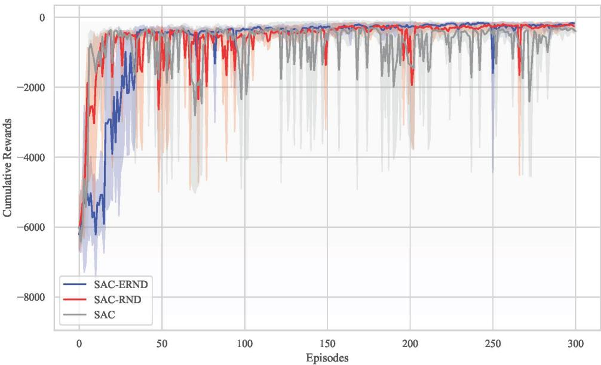

(a) 每回合累计奖励  
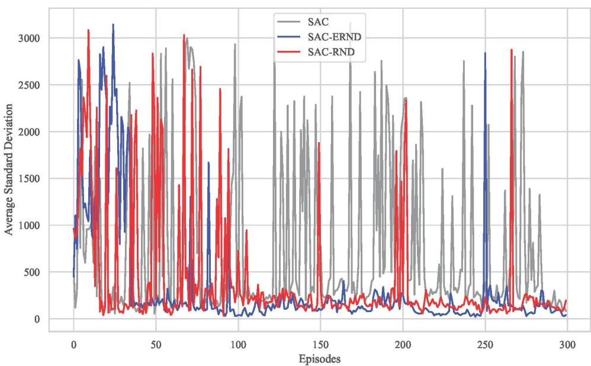  
(b) 累计奖励的标准差

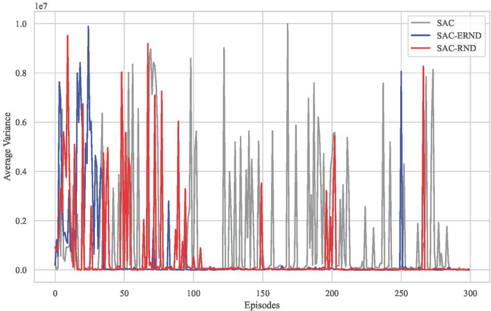  
(c) 累计奖励的方差  
图4.4 强化学习控制器训练曲线

## 4.6 本章小结

本章针对具有输入输出饱和与关节角度约束的机械臂跟踪控制问题，提出了一种SAC-ERND算法。在复杂的机械臂环境中，强化学习智能体往往难以探索出优异的控制策略。因此，本文提出了一种集成随机网络蒸馏（ERND）方法，并将其与 SAC 算法相结合，以提高机械臂智能体在执行跟踪控制任务时的探索能力。ERND 方法可以获得更全面的环境特征，促使机械臂智能体更主动地探索未知和不可预测的环境状态，从而在训练机械臂跟踪控制时获得更优的策略。此外，还证明了RND 可以有效解决时变曲线跟踪的密集奖励问题。在2-DOF 机械臂仿真环境中对所提算法进行了时变曲线跟踪任务的测试和训练，并与其他基线算法进行了比较。结果表明，在同等条件下，所提算法具有更优异的学习能力和控制能力。

## 第五章 基于 SAC 和生成对抗模仿学习的机器人操作器轨迹跟踪控制

在前两章中主要基于关节空间构建的简化环境实现了轨迹跟踪控制，但实际机械臂控制通常需在任务空间中应对更高维度的状态表示、更复杂的动力学约束以及随机扰动等挑战。本章基于任务空间构建新的机械臂控制环境，并引入 LSTM 实现对序列数据的精准建模，以提升在复杂轨迹变化下的控制稳定性。同时，为避免高维任务空间中效率低下的随机探索，采用GAIL 框架，从由SAC-LSTM 训练获得的专家数据中直接学习控制策略，提升学习效率与鲁棒性。实验验证了所提SL-GAIL 算法在任务空间轨迹跟踪任务中的有效性和优势。

## 5.1 引言

TRAN V P 等人[70]提出了一种模糊 Q-learing 网络用于解决不确定四旋翼系统(UQS) 的轨迹跟踪问题。LIU J 等人[71]将状态-动作-奖励-状态-动作 (SARSA) 算法用于实现 3-DoF 机械手末端执行器的随机目标点和固定目标点的定位。虽然 Q-learning和SARSA可以有效地解决典型的强化学任务，但它们不适用于连续空间。需要注意的是，轨迹跟踪控制问题通常涉及连续状态空间。因此，为了完成气动肌肉骨骼机器人的跟踪控制任务，XU H 等人[72]提出了一种基于模型的 RL(MBRL)方法。LI X 等人[73]引入了一种基于模型的离线 RL方法来增强控制性能，该方法与扭矩控制器相结合，实现机械手的跟踪控制。然而，与无模型 RL(MFRL)相比，基于模型的RL(MBRL)学习有效的控制策略更具挑战性。MFRL 算法不依赖于特定的环境模型，这使得它们能够在动态和不确定的环境中有效地执行控制任务。ZHANG S 等人[74]提出了一种基于LSTM 网络的分布 PPO算法来训练机械臂和移动机器人跟踪给定的轨迹。为了控制具有未知死区的 2-DoF 机械手以跟踪期望轨迹，HUY 等人[75]中采用了 Actor-Critic方法来实现。在[76]中，提出了一种利用 DRL 方法的端到端目标跟踪方法来解决自由浮动空间机械手 (FFSM)的控制复杂性。SONGD等人[77]探讨了使用欠驱动自主水面和水下航行器(UASUV)在未知环境中定位和跟踪涡流中心的挑战，其中结合了 SAC 算法和LSTM。虽然 MFRL 在跟踪控制任务中得到了广泛的研究，但大多数现有算法需要大量的训练周期才能得出合理的控制策略。

幸运的是，GAIL 目前已被广泛应用到深度强化学习中，解决了许多任务中训练耗时的问题[78]。GAIL 通过将逆强化学习（IRL）与生成对抗网络（Generative AdversarialNetworks，GANS）相结合[79,80]，直接从专家数据中学习最佳策略。JIANG D 等人[81]引入了一种基于 GAIL 的 DRL 方法来训练自主水下航行器 (AUV) 模拟专家路径。同样，CHAYSRIP等人[82]提出了一种用于无人水面航行器(USV)的GAIL 驱动导航系统，该系统学习了一种模仿专家轨迹的策略。

上述参考文献[81,82]中分别使用在线策略算法[83]PPO 和信赖域策略优化 TRPO[84]作为生成器。虽然在线策略算法稳定，但由于 GAIL 策略训练的样本效率代价高昂，因此很难学习到更优的控制策略。当机器人环境模型未知时，算法的探索能力至关重要。同时，离线策略方法表现出优越的样本效率，但其训练过程不稳定[85]。幸运的是，通过利用 LSTM 网络，可以很好地捕捉和理解关节位置随时间变化的模式，从而减轻机器人操纵器在跟踪控制任务训练过程中的不稳定性。因此，本文的主要重点是将 LSTM嵌入到 SAC算法中，并利用由此产生的SAC-LSTM 算法作为GAIL 训练的生成器。该方法旨在解决输入饱和与随机干扰下操纵器系统末端执行器的轨迹跟踪控制问题。主要贡献总结如下：

1) 受文献[77]的启发，引入LSTM 来增强操纵器末端执行器在跟踪目标轨迹时的稳定性。在轨迹跟踪控制过程中，操纵器的顺序状态被输入到 LSTM 层以产生隐藏状态。这些隐藏状态被处理以生成高斯动作参数。该方法有效地捕获了顺序依赖关系，从而提高了轨迹跟踪控制的鲁棒性和适应性。

2）上述文献[81,82]中，选择 on-policy 算法 PPO 作为 GAIL 的生成器，本文选择off-policy 算法 SAC 结合 LSTM 作为生成器，SAC-LSTM 训练出的策略作为专家数据，通过 GAIL 的训练，智能体直接从专家数据中学习控制策略，能够快速学习到优于专家数据的策略。

3）提出一种结合 SAC-LSTM 与GAIL 方法的SL-GAIL 算法，利用该算法训练机器人跟踪目标轨迹，减少不必要的探索，加速获得更优的控制策略，有助于提高机器人机械手末端执行器的轨迹跟踪效率和鲁棒性。

## 5.2 问题描述

在本章中的研究对象是基于Phantom Omni机器人的模型，该机器人是一个三自由度的机械手。在一般的机械臂系统中，根据式(2-25)可得到机械臂实时关节角度与关节速度，由此可机械臂末端位置向量与关节空间向量的关系，使用 $x ( t )$ 表示最后一个连杆的坐标， $f ( q )$ 表示关节空间至任务空间的映射，即：

$$
x (t) = f (q)\tag{5-1}
$$

式中， $q = [ q _ { 1 } , q _ { 2 } , . . . , q _ { n } ]$ 表示关节角向量。对式(5-1)求导可得：

$$
\dot {x} (t) = \frac {\partial f (q)}{\partial q} \frac {\partial q}{\partial t} = J (q) \dot {q}\tag{5-2}
$$

式中， $J ( q ) \in R ^ { n \times n }$ 为雅可比矩阵。根据正向运动学，末端执行器的笛卡尔坐标表示为[86]：

$$
\boldsymbol {x} (t) = \left[ \begin{array}{c} x \\ y \\ z \end{array} \right] = \left[ \begin{array}{c} \bigl (l _ {2} \cos (q _ {2}) + l _ {3} \cos (q _ {2} + q _ {3}) \bigr) \cos (q _ {1}) \\ \bigl (l _ {2} \cos (q _ {2}) + l _ {3} \cos (q _ {2} + q _ {3}) \bigr) \sin (q _ {1}) \\ l _ {2} \sin (q _ {2}) + l _ {3} \sin (q _ {2} + q _ {3}) \end{array} \right]\tag{5-3}
$$

此外，雅可比矩阵表示如下：

$$
J = \left[ \begin{array}{c c c} {- r s _ {1}} & {- z c _ {1}} & {- l _ {3} c _ {1} s _ {2 3}} \\ {r c _ {1}} & {- z s _ {1}} & {- l _ {3} s _ {1} s _ {2 3}} \\ {0} & {r} & {l _ {3} c _ {2 3}} \end{array} \right]\tag{5-4}
$$

其中， $r = \sqrt { x ^ { 2 } + y ^ { 2 } }$ 。根据式(5-2)和式(5-4)可得机械臂末端位置的速度 如下：

$$
\dot {\boldsymbol {x}} = \left[ \begin{array}{c} \dot {x} \\ \dot {y} \\ \dot {z} \end{array} \right] = \left[ \begin{array}{c c c} - r s _ {1} & - z c _ {1} & - l _ {3} c _ {1} s _ {2 3} \\ r c _ {1} & - z s _ {1} & - l _ {3} s _ {1} s _ {2 3} \\ 0 & r & l _ {3} c _ {2 3} \end{array} \right] \left[ \begin{array}{c} \dot {q} _ {1} \\ \dot {q} _ {2} \\ \dot {q} _ {3} \end{array} \right]\tag{5-5}
$$

机械臂运动学一般为非线性和高度耦合性，且机械臂系统参数不完全已知，导致建模存在不确定性。另外，本文通过对机械臂关节施加力矩来控制关节角度，从而使末端执行器跟踪任务空间中的时变曲线，这增加了控制过程的复杂性和难度。本章的控制目标是设计一种RL 轨迹跟踪控制器，旨在解决关节角度和力矩输入具有饱和约束的机械臂任务空间中的时变曲线跟踪控制问题。

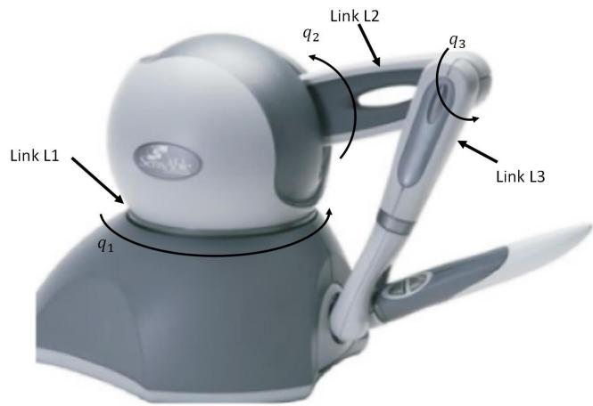  
(a) Phantom Omni 机器人实物图

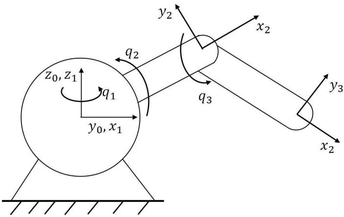  
(b) Phantom Omni 机器人分解示意图  
图 5.1 Phantom Omni 机器人示意图

## 5.3 基于SAC和生成对抗模仿学习的机器人操作器轨迹跟踪控制

## 5.3.1 基于 SAC 和 LSTM 的深度强化学习算法设计

LSTM 是一种能够捕捉长时间依赖关系的神经网络，特别适用于处理具有时间序列特征的任务。在SAC算法中引入LSTM，可以帮助智能体更好地处理时序数据，记住长期的历史信息，这对于某些任务（如轨迹跟踪、动态控制等）非常重要。LSTM 网络的核心在于它的单元状态（cell state）和隐藏状态（hiddenstate），并通过门控机制来控制信息的流动。LSTM 网络中的每个单元由三个组成部分组成：遗忘门、输入门和输出门。遗忘门控制应丢弃来自前一个单元状态的哪些信息。其定义如下:

$$
f _ {t} = \sigma (W _ {f} \cdot [ h _ {t - 1}, x _ {t} ] + b _ {f})\tag{5-6}
$$

输入门决定更新并存储在单元状态中的值。此过程分为两个部分：使用 tanh 函数创建候选值 $\hat { C } _ { t }$ ；输入门 $\mid \boldsymbol { \iota } _ { t }$ 控制此候选值被纳入单元状态的程度：

$$
\begin{array}{c} \iota_ {t} = \sigma (W _ {i} \cdot [ h _ {t - 1}, x _ {t} ] + b _ {i}) \\ \tilde {C} _ {t} = \tanh (W _ {C} \cdot [ h _ {t - 1}, x _ {t} ] + b _ {C}) \end{array}\tag{5-7}
$$

最后一个组成部分是输出门，它决定 LSTM 单元的输出。此门结合当前单元状态和输出门激活来产生最终隐藏状态：

$$
\begin{array}{c} o _ {t} = \sigma (W _ {o} \cdot [ h _ {t - 1}, x _ {t} ] + b _ {o}) \\ h _ {t} = o _ {t} \cdot \tanh (C _ {t}) \end{array}\tag{5-8}
$$

上面提到的 $\mid \sigma$ 是sigmoid函数， 和 代表权重矩阵和偏置项， $h _ { t - 1 }$ 是前一个隐藏状态，$x _ { t }$ 是当前输入， 表示连接操作， $\hat { C } _ { t }$ 是候选单元状态， $C _ { t }$ 是单元状态。这些门的相互作用使 LSTM 单元能够捕获长期依赖关系，从而有效地进行顺序数据处理。

在SAC算法中引入LSTM网络的方式通常是在策略网络和Q网络中使用LSTM来处理输入的状态信息。通过这种方式，LSTM 能够记住并利用时间序列中的长期依赖，从而增强强化学习过程中的决策能力。在策略网络中，LSTM 的隐藏状态可以作为智能体当前决策的一个重要输入。这样，LSTM 网络可以结合历史状态信息来生成当前时间步的动作策略。

$$
a _ {t} = \pi_ {\theta} (s _ {t}, h _ {t - 1})\tag{5-9}
$$

对于Q网络，可以将LSTM 网络的输出与当前的状态一起输入到Q网络中，以便捕捉时间依赖性和长期记忆。

$$
Q _ {\theta} (s _ {t}, a _ {t}, h _ {t - 1})\tag{5-10}
$$

在更新过程中，LSTM 网络会根据策略和 Q函数的反馈调整其内部状态，强化智能体对时序依赖的学习。通过反向传播，LSTM 的参数将被更新，以更好地适应任务中的时间模式。

## 5.3.2 生成对抗模仿学习算法设计

GAIL 通过结合最大熵逆强化学习的原理来增强传统的模仿学习。它将模仿学习与生成对抗网络 (GAN) 相结合，直接学习最佳策略，使代理的状态-动作对分布与专家轨迹的分布紧密匹配。在 GAIL 中，鉴别器的作用是区分代理生成的状态-动作对和专家生成的状态-动作对。同时，代表代理策略的生成器经过训练以生成鉴别器归类为专家的状态-动作对。此对抗过程旨在以下目标函数中找到鞍点 $\mathbf { \Xi } ( \pi , D \mathbf { \Xi } )$ [87]：

$$
\mathbb {E} _ {\pi} [ \log D ((s, a)) ] + \mathbb {E} _ {\pi_ {\mathrm{E}}} [ \log (1 - D (s, a)) ] - \lambda H (\pi)\tag{5-11}
$$

其中 $D \left( s , a \right)$ 表示GAIL 中的鉴别器， $\mathbb { E } _ { \pi } [ \log D \left( \left( s , a \right) \right) ]$ 是对代理策略的期望，鼓励生成器生成鉴别器分类为专家的状态-动作对。 $_ { \pi _ { 5 } } [ \log ( 1 - D ( s , a ) ) ]$ 是对专家策略的期望，确保鉴别器正确识别专家状态-动作对。 $H ( \pi ) \triangleq \mathbb { E } _ { \pi } { \big [ } - \log \pi ( a \mid s ) { \big ] }$ 表示策略 $\pi$ 的熵，它鼓励探索并防止策略崩溃为确定性行为。 是确定熵项在整体目标中重要性的加权参数。

GAIL 能够直接从专家演示数据中学习控制策略，从而有效解决了强化学习训练耗时的问题。SAC-LSTM 算法用作生成器来训练 $\mathrm { G A I L } .$ 。对于机器人机械手轨迹跟踪控制，SL-GAIL 的实现如图 5.2所示，算法训练流程如算法 5.1所示。GAIL 的判别器由一个全连接层和一个输出层组成，其中，状态和动作拼接成的状态-动作对作为判别器的输入，输出为 0到1之间的值。机械臂智能体使用当前策略 $\pi \left( a | s ; \theta _ { n o w } \right)$ 与环境交互，当前策略作为生成器，生成由状态-动作对组成的轨迹 $\Omega = [ s _ { 1 } , a _ { 1 } , s _ { 2 } , a _ { 2 } , . . . , s _ { n } , a _ { n } ]$ 。对于每个状态-动作对 $( s , a )$ ，判别器输出一个值 $D \left( s , a \right)$ ，来判断它是来自专家演示还是来自智能体的策略。在理想情况下，对于专家轨迹， $D \left( s , a \right)$ 应该接近 1，对于智能体生成的

轨迹， $D \left( s , a \right)$ 应该接近0。

生成器（智能体策略）使用 SAC-LSTM 算法进行训练，以生成与专家数据紧密匹配的状态-动作对，从而欺骗鉴别器。相反，鉴别器旨在区分专家和代理生成的轨迹。最终，生成器被训练以最大化 $\left. \left[ \log ( D ( s , a ) ) \right] \right.$ ，而鉴别器被训练以最小化E $\left. \mathrm { \cdot } \log ( D \left( s , a \right) ) \right] + \mathbb { E } _ { \pi _ { \mathtt { B } } } [ \log ( 1 - D \left( s , a \right) ) ]$ 。GAIL 使用替代奖励：

$$
r (s, a) = - \log (D (s, a))\tag{5-12}
$$

此替代奖励用于更新代理的策略。最终目标是学习最大化预期累积折现回报的最佳控制策略：

$$
\pi^ {\star} = \underset {\pi \in \Pi} {\operatorname{argmin}} E _ {\pi} [ r (s, a) ]\tag{5-13}
$$

其中 $E _ { \pi } [ r ( s , a ) ] \triangleq E [ \sum \gamma ^ { t } r ( s , a ) ]$ 表示根据策略 $\pi$ 生成的轨迹对折现收益的期望。这种方法确保策略的演变能够紧密模仿专家行为，同时有效应对机器人操纵器中的轨迹跟踪控制挑战。

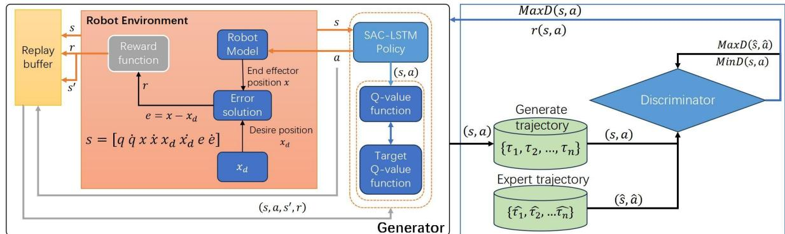  
图 5.2 SL-GAIL 算法示意图

算法 5.1: SL-GAIL 控制器算法
Input 专家数据 $D_{E}$ 
Input 策略网络参数 $\phi$，鉴别器网络参数 $\omega \leftarrow$ 初始化网络参数
Output 最优网络参数 $\phi^{*}$
for 训练轮数 do
    repeat 每个时间步 do
    从专家数据 $D_{E}$ 中采样
    根据当前策略 $\pi(a|s;\phi)$ 得到生成数据轨迹 $\Omega$
    for $\Omega$ 中每个 state-action 对 $(s,a)$ do
    计算鉴别器输出 $D(s,a)$
    通过式(5-12)计算代替奖励 $r(s,a)$
    end for
    使用式(5-11)更新参数 $\omega$
    使用式(5-13)更新参数 $\phi$
    until 当前回合结束
end for

## 5.4 实验设计与介绍

本章的实验采用 5.2 小节介绍的 Phantom Omni 机器人模型，该机器人是一个三自由度的机械手。在深度强化学习中，策略网络根据当前的输入状态确定输出动作。对于机械臂任务空间中的轨迹跟踪，机械臂的关节角度和末端执行器的位置至关重要。第三章和第四章的状态空间包括关节角度和关节角速度，可以描述机器人的内部状态，但不能直接反映机器人末端执行器的性能与目标之间的关系。因此，添加映射的末端执行器位置和速度以及目标位置和速度，可以提供关于末端执行器和目标轨迹的更多相关信息，从而帮助强化学习算法更准确地控制。此外，为了保证控制策略能够获得有效的跟踪控制，状态空间中必须存在轨迹跟踪的误差信息[88]。本文中，控制器的首要目标是根据机器人机械臂的实时状态信息确定适当的动作，以实现有效的跟踪控制。状态空间描述如下：

$$
s = [ q q x \dot {x} x _ {d} \dot {x} _ {d} e \dot {e} ] ^ {T}\tag{5-14}
$$

其中 和 分别为末端位置和末端位置处的速度。 $x _ { d }$ 和 ${ \dot { x } } _ { d }$ 分别为目标末端位置和目标末端位置处的速度。 $e = x - x _ { d }$ 表示跟踪误差， 为速度误差。

Phantom Omni机械臂的每个关节可摆动的幅度的范是不同的，具体为第一个关节$q _ { 1 } \in \left[ - \pi / 2 , \pi / 2 \right]$ ，第二个和第三个关节则是 $q _ { 2 , 3 } \in \left[ - \pi , \pi \right]$ 。在本章中，也对机械臂的输入力矩做了约束，具体约束与式(4-2)一致，其中，最大力矩 $\tau _ { \operatorname* { m a x } } = 5$ ，最小力矩 $\tau _ { \operatorname* { m i n } } = - 5$ 。

在强化学习任务中，奖励是衡量当前策略有效性的指标。在机械臂的轨迹跟踪任务中，跟踪误差 $e ( t )$ 是最受关注的变量。因此，奖励函数被设置为非线性形式。奖励函数公式为：

$$
r = \left(1 - \frac {1}{\exp (- \varsigma \cdot (\overline {{e}} - \epsilon))}\right)\tag{5-15}
$$

其中 $\varsigma$ 为敏感尺度，用于调整增加的速度，使得智能体在达到一定的绩效水平后能够快速获得奖励 为收益阈值，用于表示奖励的上下限[89]。本文中 $\varsigma = 2$ $\epsilon = 0 . 0 2$ 。

本章中的机械臂的正定对称的惯性矩阵 $M ( q )$ ，柯氏力与中心力矩阵 $C \left( q , \dot { q } \right)$ 表示，重力矩阵 $G ( q )$ 表示如下：

$$
\begin{array}{c} M (q) = \left[ \begin{array}{c c c} m _ {1 1} & 0 & 0 \\ 0 & m _ {2 2} & m _ {2 3} \\ 0 & m _ {3 2} & m _ {3 3} \end{array} \right], G (q) = \left[ \begin{array}{c} 0 \\ g k _ {5} c _ {2} + g k _ {6} c _ {2 3} \\ g k _ {6} c _ {2 3} \end{array} \right], \\ C (q, \dot {q}) = \left[ \begin{array}{c c c} - a _ {1} \dot {q} _ {2} & - a _ {1} \dot {q} _ {1} & - a _ {2} \dot {q} _ {1} \\ a _ {1} \dot {q} _ {1} & - a _ {3} \dot {q} _ {3} & - a _ {3} (\dot {q} _ {2} + \dot {q} _ {3}) \\ a _ {2} \dot {q} _ {1} & a _ {3} \dot {q} _ {2} & 0 \end{array} \right] \end{array}\tag{5-16}
$$

其中

$$
\left\{ \begin{array}{l} m _ {1 1} = k _ {1} + k _ {2} c _ {2} ^ {2} + k _ {3} c _ {2 3} ^ {2} + 2 k _ {4} c _ {2} c _ {2 3} \\ m _ {2 2} = k _ {2} + k _ {3} + 2 k _ {4} c _ {3} \\ m _ {2 3} = m _ {2 3} = k _ {3} + k _ {4} c _ {3} \\ m _ {3 3} = k _ {3} \\ a _ {1} = k _ {2} c _ {2} s _ {2} + k _ {3} c _ {2 3} s _ {2 3} + k _ {4} c _ {2 \times 2 3} \\ a _ {2} = k _ {3} c _ {2 3} s _ {2 3} + k _ {4} c _ {2} s _ {2 3} \\ a _ {3} = k _ {4} s _ {3}, s _ {i} = \sin (q _ {i}) \\ s _ {2 3} = \sin (q _ {2} + q _ {3}) \\ c _ {i} = \cos (q _ {i}) \\ c _ {2 3} = \cos (q _ {2} + q _ {3}) \\ c _ {2 \times 2 3} = \cos (2 q _ {2} + q _ {3}) \end{array} \right.\tag{5-17}
$$

其中， $k _ { i }$ 是转动惯量， $k _ { 1 } = 3 . 7 \times 1 0 ^ { - 3 } k g . m ^ { 2 } , k _ { 2 } = 7 \times 1 0 ^ { - 3 } k g . m ^ { 2 } , k _ { 3 } = 8 . 0 \times 1 0 ^ { - 3 } k g . m ^ { 2 }$ $k _ { 4 } = 0 . 4 \times 1 0 ^ { - 3 } k g . m ^ { 2 } , k _ { 5 } = 9 . 1 \times 1 0 ^ { - 3 } k g . m ^ { 2 } , k _ { 6 } = 5 . 2 \times 1 0 ^ { - 3 } k g . m ^ { 2 }$

本章的实验内容设计与第四章相同，在增加任务难度的背景下，进一步验证所提出算法在控制精度、训练效率和鲁棒性方面的改进。

## 5.5 实验分析

本节基于第二节中的仿真环境进行仿真实验，以检验本文所提方法的能力。选择SAC、SAC-LSTM 和 SAC-GAIL 算法作为基准来评估我们的 SL-GAIL 算法。同时，评估了四个控制器的抗干扰能力。初始状态值定义为 $q _ { 1 } ( 0 ) = - 0 . 3 \ , \quad q _ { 2 } ( 0 ) = 0 . 3$ 和$q _ { 3 } ( 0 ) = - 0 . 8$ 。总步数为 3000，每步的步长为 0.01 秒。在所有仿真实验中，目标轨迹 $x _ { d }$ 均选择为：

$$
\boldsymbol {x} _ {d} = \left[ \begin{array}{c} x \\ y \\ z \end{array} \right] = \left[ \begin{array}{c} 0. 1 \sin (t) + 0. 1 2 \\ 0. 1 \cos (t) + 0. 1 2 \\ 0. 1 \sin (t) \end{array} \right]\tag{5-18}
$$

## 5.5.1 强化学习训练性能实验

本次实验对比研究了 SAC-LSTM、SAC-GAIL 和 SAC-LSTM-GAIL（简称 SL-GAIL）三种算法在机器人机械手跟踪控制任务中的训练性能表现。实验通过监测训练过程中智能体的累积奖励值及其统计特性（标准差和方差）来评估算法的性能。从图5.2所示的实验结果可以看出，SL-GAIL 算法表现出最优的收敛特性。具体而言，SL-GAIL 智能体的累积奖励值在第20 回合左右即达到收敛状态，随后保持平稳的学习曲线。相比之下，SAC-LSTM 和SAC-GAIL 算法需要经过100 回合的训练才能达到收敛状态。在稳定性方面，SL-GAIL 的方差和标准差在第 100 回合后趋于稳定，而 SAC-LSTM 和

SAC-GAIL 的方差和标准差在整个训练过程中都表现出较大的波动性。值得注意的是，在三种算法中，SAC-LSTM 表现出相对较好的训练稳定性，这主要归功于LSTM 网络对时序依赖关系的建模能力。而SL-GAIL 算法则通过结合LSTM 和GAIL 的优势，在保持良好稳定性的同时显著提升了学习效率。具体来说，LSTM 结构增强了智能体对机械手运动轨迹的时序特征提取能力，而 GAIL 框架则通过模仿学习机制有效利用了专家示范数据，从而加速了策略优化过程。

基于以上实验结果，可以得出以下结论：在机器人机械手跟踪控制任务中，LSTM网络的引入显著增强了智能体学习的稳定性，这主要得益于其对时序信息的有效建模能力；而 GAIL 框架则通过模仿学习机制提高了学习效率，特别是在任务初期表现出明显的优势。因此，在实际应用中，可以根据具体任务需求选择合适的算法：对于需要快速部署的场景，SL-GAIL 可能是更好的选择；而在对稳定性和安全性要求较高的场景中，SAC-LSTM 可能更为合适。未来的研究方向可以探索将 LSTM 与GAIL 相结合的可能性，以期同时获得稳定性和效率的提升。

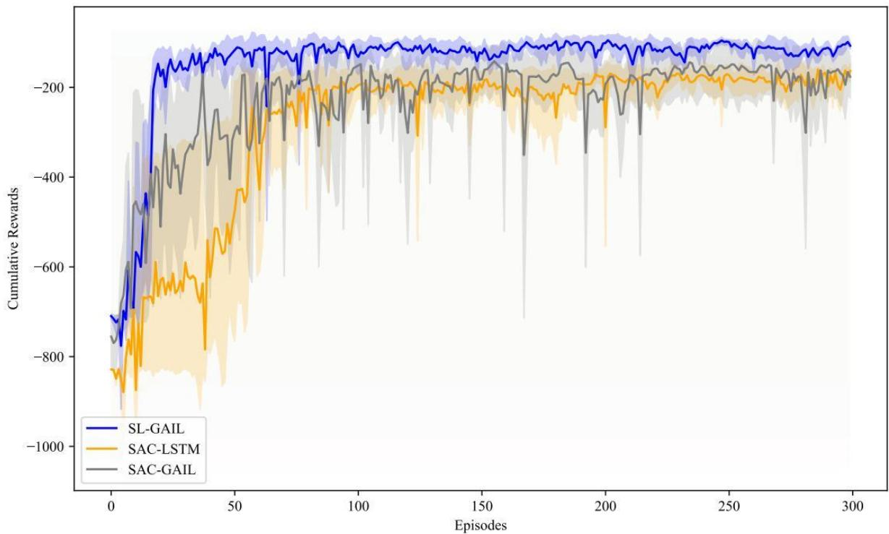  
(a) 每回合累积奖励

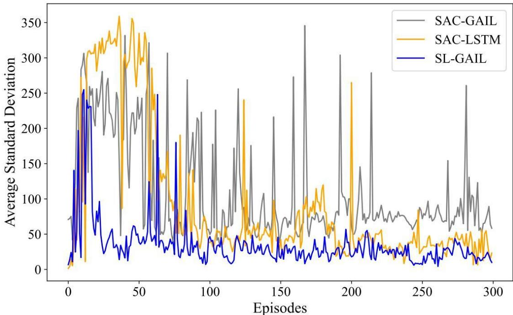

(b) 累积奖励的标准差  
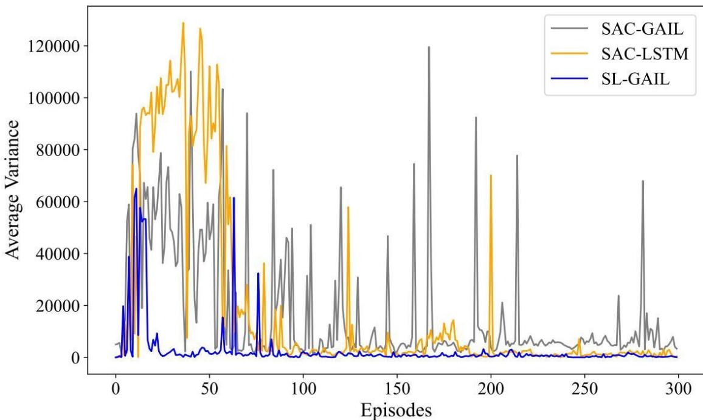  
(c) 累积奖励的方差  
图5.3 强化学习控制器训练曲线

## 5.5.2 强化学习控制器控制性能实验

本小节实验通过对比 SL-GAIL 与 SAC、SAC-LSTM 和 SAC-GAIL 在机器人机械手跟踪控制任务中的性能，进一步验证了 SL-GAIL 算法的优越性。实验根据末端执行器的跟踪轨迹、跟踪误差以及关节扭矩变化等多个维度进行了详细分析，结果如图5.3

所示。

图 5.3 (a)、(b) 和 (c) 分别展示了 SAC、SAC-GAIL、SAC-LSTM 和 SL-GAIL 在X、Y 和 Z 轴上的跟踪轨迹。从图中可以看出，SL-GAIL 的跟踪轨迹与目标轨迹的吻合度最高，尤其是在复杂动态环境下，SL-GAIL 表现出更强的适应能力。相比之下，SAC和SAC-GAIL 的跟踪轨迹在部分区域出现了明显的偏差，而SAC-LSTM 虽然表现优于 SAC 和 SAC-GAIL，但仍不及 SL-GAIL 的精度。

将 SL-GAIL 的跟踪控制性能与 SAC、SAC-LSTM 和 SAC-GAIL 进行比较。图 5.3显示了在控制任务的训练过程中使用 SAC、SAC-GAIL、SAC-LSTM 和 SL-GAIL 的末端执行器的跟踪轨迹、跟踪误差和扭矩变化。如图5.3(a)、(b)和(c)所示，显示了 SAC、SAC-GAIL、SAC-LSTM 和 SL-GAIL 代理在 X、Y 和 Z 轴上的轨迹。

图 5.3(d)、(e) 和 (f) 显示了末端执行器在X、Y和Z轴上的跟踪误差。实验结果表明，SL-GAIL 的跟踪误差显著低于其他三种算法。具体而言，SL-GAIL 在三个轴上的跟踪误差均保持在较低水平，且波动较小，表明其控制策略具有较高的鲁棒性和精度。相比之下，SAC和SAC-GAIL 的跟踪误差较大，尤其是在任务初期和动态变化较大的区域，误差波动较为明显。SAC-LSTM 的跟踪误差虽然优于 SAC 和SAC-GAIL，但仍高于 SL-GAIL。图 5.3 (g)、(h) 和 (i) 展示了关节扭矩的变化趋势。可以看出，SL-GAIL 在控制过程中所需的关节扭矩显著低于 SAC、SAC-GAIL 和 SAC-LSTM。这一结果表明，SL-GAIL 不仅能够实现更高的跟踪精度，还能以更低的能量消耗完成任务，这对于实际应用中的能效优化具有重要意义。

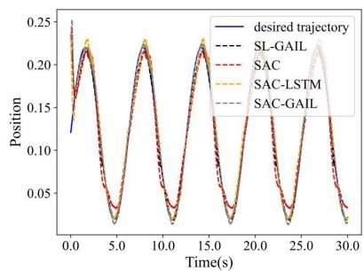  
(a) x方向位置跟踪轨迹

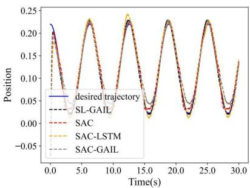  
(b)y方向位置跟踪轨迹

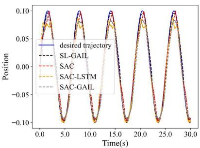  
(c) z方向位置跟踪轨迹

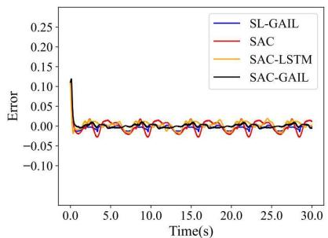  
(d) x方向位置跟踪误差

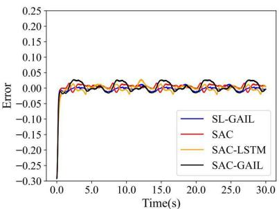  
(e) y 方向位置跟踪误差

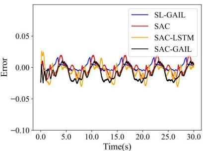  
(f) z 方向位置跟踪误差

  
(g) 关节 1 力矩变化

  
(h) 关节 2 力矩变化

  
(i) 关节 3 力矩变化  
图5.4 强化学习控制器机械臂数值模拟结果图

为了进一步量化算法的性能，实验计算了跟踪误差绝对值（AAE）、力矩绝对值（AAT）和均方根误差（RMSE），结果如表5.1所示。计算公式如下：

$$
\mathrm{RMSE} = \sqrt {\frac {1}{T} \sum_ {i = 1} ^ {T} e _ {i} ^ {2}} \quad i = 1, 2,..., n\tag{5-19}
$$

从表中可以看出，SL-GAIL 在 AAE、AAT 和 RMSE 三个指标上均优于其他算法，进一步验证了其在跟踪控制任务中的优越性能。

本小节实验结果表明，SL-GAIL 结合了 GAIL 和 LSTM 的优势，能够快速学习到超越稳定专家数据的策略，从而以较低的力矩要求实现优异的控制性能。具体而言：通过模仿学习机制，GAIL 显著提高了算法的学习效率，使其在任务初期能够快速收敛。LSTM 网络对时序依赖关系的建模能力增强了算法的稳定性，使其在复杂动态环境中表现出更高的鲁棒性。因此，SL-GAIL 在机器人机械手跟踪控制任务中展现出了显著的优势，不仅能够实现更高的跟踪精度，还能以更低的能量消耗完成任务。这一结果为未来在复杂控制任务中的应用提供了有力的理论支持和实践指导。

表 5.1 跟踪控制中的 AAE、AAT、RMSE 数值比较

<table><tr><td>方向\算法</td><td>SAC</td><td>SAC-GAIL</td><td>SAC-LSTM</td><td>SL-GAIL</td></tr><tr><td>X轴</td><td></td><td></td><td></td><td></td></tr><tr><td>AAE</td><td>0.0123</td><td>0.0044</td><td>0.0062</td><td>0.0058</td></tr><tr><td>AAT</td><td>3.5349</td><td>1.9642</td><td>2.2820</td><td>1.1057</td></tr><tr><td>RMSE</td><td>0.0158</td><td>0.0112</td><td>0.0110</td><td>0.0101</td></tr><tr><td>Y轴</td><td></td><td></td><td></td><td></td></tr><tr><td>AAE</td><td>0.0088</td><td>0.0123</td><td>0.0072</td><td>0.0066</td></tr><tr><td>AAT</td><td>3.4609</td><td>2.6186</td><td>1.8884</td><td>0.7469</td></tr><tr><td>RMSE</td><td>0.0206</td><td>0.0240</td><td>0.0213</td><td>0.01975</td></tr><tr><td>Z轴</td><td></td><td></td><td></td><td></td></tr><tr><td>AAE</td><td>0.0081</td><td>0.0081</td><td>0.0063</td><td>0.0038</td></tr><tr><td>AAT</td><td>2.9630</td><td>2.3313</td><td>0.9714</td><td>0.4388</td></tr><tr><td>RMSE</td><td>0.0099</td><td>0.0088</td><td>0.0116</td><td>0.0052</td></tr></table>

## 5.5.3 强化学习控制器控制抗干扰性能实验

本小节仿真实验对所提方法进行抗干扰测试，以验证其在不确定环境中的鲁棒性。实验设置与上述两小节实验相同，目标轨迹 $x _ { d }$ 保持不变，外部扰动 $\tau _ { d }$ 的设计如下：

$$
\tau_ {d} = \left\{ \begin{array}{l l} (5 \sin (t) & 5 \cos (t) & 5 \sin (t)) ^ {T} a > 0. 8 \\ 0 & \text {else} \end{array} \right.\tag{5-20}
$$

其中， $^ { a }$ 表示在区间[0.0,1.0)内均匀分布的随机变量。如果该值超过0.80，则在系统输入信号中添加非线性扰动项，这意味着扰动在每个时间步都有 20%的概率发生。非线性扰动项是由当前时间步的正弦和余弦值组成的三维列向量，乘以缩放因子（5）。通过引入随机扰动，可以测试控制器在不确定环境中的鲁棒性。此外，以正弦和余弦曲线的形式引入扰动可以模拟机械系统中的许多非线性效应，提高模型的准确性。

表5.2 两个环境下的AAE比较

<table><tr><td>方向\算法</td><td>SAC</td><td>SAC-GAIL</td><td>SAC-LSTM</td><td>SL-GAIL</td></tr><tr><td>X轴</td><td></td><td></td><td></td><td></td></tr><tr><td>DFENV</td><td>0.0123</td><td>0.0044</td><td>0.0062</td><td>0.0058</td></tr><tr><td>DENV</td><td>0.0176</td><td>0.0061</td><td>0.0098</td><td>0.0059</td></tr><tr><td>Y轴</td><td></td><td></td><td></td><td></td></tr><tr><td>DFENV</td><td>0.0088</td><td>0.0123</td><td>0.0072</td><td>0.0066</td></tr><tr><td>DENV</td><td>0.0137</td><td>0.0177</td><td>0.0118</td><td>0.0076</td></tr><tr><td>Z轴</td><td></td><td></td><td></td><td></td></tr><tr><td>DFENV</td><td>0.0081</td><td>0.0081</td><td>0.0063</td><td>0.0038</td></tr><tr><td>DENV</td><td>0.0099</td><td>0.0102</td><td>0..0098</td><td>0..0042</td></tr></table>

表5.3 两个环境下的RMSE比较

<table><tr><td>方向\算法</td><td>SAC</td><td>SAC-GAIL</td><td>SAC-LSTM</td><td>SL-GAIL</td></tr><tr><td>X轴</td><td></td><td></td><td></td><td></td></tr><tr><td>DFENV</td><td>0.0158</td><td>0.0112</td><td>0.0110</td><td>0.0101</td></tr><tr><td>DENV</td><td>0.0221</td><td>0.0123</td><td>0.0124</td><td>0.0102</td></tr><tr><td>Y轴</td><td></td><td></td><td></td><td></td></tr><tr><td>DFENV</td><td>0.0240</td><td>0.0213</td><td>0.0206</td><td>0.0196</td></tr><tr><td>DENV</td><td>0.0274</td><td>0.0234</td><td>0.0229</td><td>0.0197</td></tr><tr><td>Z轴</td><td></td><td></td><td></td><td></td></tr><tr><td>DFENV</td><td>0.0099</td><td>0.0088</td><td>0.0116</td><td>0.0049</td></tr><tr><td>DENV</td><td>0.0128</td><td>0.0124</td><td>0..0127</td><td>0..0052</td></tr></table>

为了评估 SL-GAIL 的抗干扰能力，实验对比了 SAC-LSTM、SAC-GAIL 和 SL-GAIL三种算法在无扰动环境（DFENV）和有扰动环境（DENV）下的表现。实验保存了三种算法在曲线跟踪任务中训练得到的最优控制策略，并将其与SL-GAIL 算法进行了对比。将三种对比算法的控制策略与 SL-GAIL 算法进行了比较。图 5.4 展示了四种算法在无扰动环境（DFENV）和有扰动环境（DENV）下的位置跟踪情况，其中图5.4(a)、（b）、（c）、（d）分别为 SAC、SAC-GAIL、SAC-LSTM、SL-GAIL 在两种环境下的轨迹跟踪图。值得注意的是，与其他三种算法相比，SL-GAIL 算法在两种环境下的位置跟踪变化很小。

图 5.5 展示了四种算法在 DENV 下的跟踪误差和力矩变化情况，可以看出使用SL-GAIL 的力矩仍然小于使用 SAC、SAC-LSTM 和 SAC-GAIL。图 5.6 展示了所有算法在 DFENV 和 DENV 下的 AAE 和 RMSE。在两种环境下测试的 SL-GAIL 的AAE 和 RMSE 几乎没有变化。但是，SAC、SAC-LSTM、SAC-GAIL 的 AEE 和 RMSE在两种环境下变化较大，两种环境下AAE 的变化如表5.2 所示，两种环境下 RMSE 的变化如表5.3所示。

  
(a) SAC 算法控制器两种环境跟踪对比

  
(b)SAC-GAIL 算法控制器两种环境跟踪对比

  
(c)SAC-LSTM 算法控制器两种环境跟踪对比

  
(d)SL-GAIL 算法控制器两种环境跟踪对比

图5.5 控制器在两种环境种的位置跟踪对比图  
  
(a) x 方向位置跟踪误差

  
(b) y方向位置跟踪误差

  
(f) z方向位置跟踪误差

  
(e) 关节 1 力矩变化

  
(f) 关节 2力矩变化

(g) 关节 3 力矩变化  
图5.6 控制器机械臂在干扰环境中的数值模拟结果图  

  
图5.7 两种环境下的AAE 和RMSE对比图

从本次实验可以看出，在机械臂环境下，在同样的关节角度约束和最大力矩限制下，本文提出的SL-GAIL控制器的抗干扰能力强于其他三种控制器，再次表明本文中GAIL和LSTM 对增强算法的鲁棒性起到了重要作用。

## 5.6 本章小结

本本章解决了Phantom Omni机械手末端执行器在任务空间中的轨迹跟踪难题。我们提出了SAC-LSTM 算法来增强控制系统的性能，特别是在适应时变轨迹方面。长短期记忆（LSTM）的集成使系统能够有效捕捉轨迹中的时间依赖性，从而提高控制器在动态环境中的鲁棒性和适应性。通过将 SAC-LSTM 与生成对抗模仿学习（GAIL）相结合，SL-GAIL 方法能够直接从专家演示中学习，显著提高策略学习的效率并减少训练时间。仿真结果表明，与基线算法相比，SL-GAIL 方法不仅实现了更快的学习，而且还增强了控制系统的鲁棒性。实验结果突出了将强化学习与模仿学习相结合来解决现实世界机器人控制问题的有效性，表明所提出的方法是解决机器人操作中时间敏感和高精度任务的有希望的解决方案。

## 第六章 总结与展望

## 6.1 总结与创新点

本文针对具有非线性饱和输入和关节约束的机械臂轨迹跟踪问题，设计了一系列基于深度强化学习控制方法，分别从运动学和动力学建模、强化学习控制器设计、强化学习算法改进等方面进行了深入探讨与系统实现。主要取得了以下几个方面的成果和创新点：

1）构建机械臂动力学与运动学模型，验证基础控制方法可行性：基于欧拉-拉格朗日方程，建立了完整的机械臂动力学与运动学建模流程，搭建了强化学习的基础环境。设计了一个经典的强化学习控制器用于验证控制策略在无干扰条件下的基础可行性，为后续算法的改进与扩展提供了实验平台和验证依据。

2）提出融合 ERND 的 SAC 轨迹跟踪控制方法，提升控制精度与鲁棒性：针对传统强化学习在复杂任务中收敛慢、探索能力弱的问题，本文提出一种结合 SoftActor-Critic（SAC）与集成随机网络蒸馏（Ensemble RND）的改进方法。所构建的 ERND模块通过多个RND模型构成的集成结构增强探索能力，以误差作为内部奖励信号，引导智能体更有效地探索潜在关键状态。实验表明，所提SAC-ERND 算法能在受限条件下显著提高轨迹控制性能，表现出更强的稳定性和适应性。

3）提出融合 LSTM 与GAIL 的无模型轨迹控制方法，适用于任务空间复杂控制问题：在无需显式建模机械臂动力学和运动学的前提下，本文设计了一种基于SAC-LSTM与GAIL 的SL-GAIL 方法。通过LSTM 对关节动作时序特征进行建模，提升控制器对状态动态变化的记忆能力。进一步利用 GAIL 从 LSTM 训练所得的稳定策略中进行模仿学习，实现无需探索的高效策略迁移，增强在受扰动环境中的稳定性与精度。仿真结果验证了该方法在复杂任务空间下具有更强的控制性能与稳定性。

## 6.2 展望

本文的强化学习及控制器在机械臂轨迹跟踪中的应用研究虽然取得了一定成果，但在算法与框架层面以及应用层面仍有许多研究方向值得进一步探讨。这些方向包括以下内容：

1）强化学习在机械臂应用中的安全性与实践性：在安全性方面，未来可以研究具有安全保障的强化学习方法，以确保智能体在探索过程中避免机械臂进入危险状态，同时让智能体学习如何主动防止危险状态的发生。在实践性方面，需要进一步解决模拟到现实（Sim-to-Real）的匹配问题，通过改进强化学习方法，减少智能体在模拟环境中学习的控制策略与实体机器人实际执行之间的误差，提升算法的实际应用价值。

2）强化多目标任务和复杂操作的控制能力：本文主要研究单一任务下的轨迹跟踪问题。未来可进一步拓展研究到多目标任务协同控制、多机械臂协作以及非结构化环境中的操作任务，结合语言指令或视觉感知，引入多模态学习和分层强化学习框架，实现对更复杂任务场景的适应与处理能力。

## 参考文献

[1] 卢普伟. 基于深度强化学习的机械臂自适应滑模鲁棒轨迹跟踪控制研究[D]. 广州: 广州大学,2022.

[2] 刘晓宇. 基于深度强化学习的空间机械臂抓捕理论与仿真技术研究[D]. 北京: 北京邮电大学,2022.

[3] 袁毓. 基于深度强化学习的水下机械臂运动控制方法[D]. 镇江: 江苏科技大学,2023.

[4] BROUM T, POÓR P, BASEL J. Role of Collaborative Robots in Industry 4.0 with Target on Education in Industrial Engineering[J]. Katedra pr\uumyslového inženỳrství: Západočeská univerzita Plzeň.

[5] 张璐. “中国制造 2025”背景下制造业转型升级路径选择[J]. 中国集体经济, 2021(4): 9-10.

[6] KAELBLING L P, LITTMAN M L, MOORE A W. Reinforcement Learning: A Survey[J]. Journal of Artificial Intelligence Research, 1996, 4: 237-285.

[7] BELLMAN R. DYNAMIC PROGRAMMING AND LAGRANGE MULTIPLIERS[J]. Proceedings of the National Academy of Sciences, 1956, 42(10): 767-769.

[8] MICHIE D, CHAMBERS R A. BOXES: An experiment in adaptive control[J]. Machine intelligence, 1968, 2(2): 137-152.

[9] SUTTON R S. Learning to predict by the methods of temporal differences[J]. Machine Learning, 1988, 3(1): 9-44.

[10]王超. 基于深度强化学习的机械臂卷积神经网络控制策略研究[D]. 哈尔滨: 哈尔滨工业大学,2018.

[11] PETERS J, SCHAAL S. Reinforcement learning of motor skills with policy gradients[J]. Neural Networks, 2008, 21(4): 682-697.

[12] DEISENROTH M, PILCO R C. A model-based and data-efficient approach to policy search[C]//Proceedings of the 28th International Conference on Machine Learning. 465-472.

[13] DENG L Y. The cross-entropy method: a unified approach to combinatorial optimization[J]. Monte-Carlo simulation, and machine learning, 2006.

[14] LEVINE S, KOLTUN V. Learning Complex Neural Network Policies with Trajectory Optimization[C]//Proceedings of the 31st International Conference on Machine Learning. PMLR, 2014: 829-837.

[15] MNIH V, KAVUKCUOGLU K, SILVER D, et al. Playing atari with deep reinforcement learning[J]. arXiv preprint arXiv:1312.5602, 2013.

[16] Human-level control through deep reinforcement learning | Nature[EB/OL]. [2025-03-19]. https://www.nature.com/articles/nature14236.

[17] SUTTON R S, MCALLESTER D, SINGH S, et al. Policy Gradient Methods for Reinforcement Learning with Function Approximation[C]//Advances in Neural Information Processing Systems: Vol. 12. MIT Press, 1999.

[18] DEGRIS T, WHITE M, SUTTON R S. Off-Policy Actor-Critic[A]. arXiv, 2013.

[19] LILLICRAP T P, HUNT J J, PRITZEL A, et al. Continuous control with deep reinforcement learning[A]. arXiv, 2019.

[20] SCHULMAN J, WOLSKI F, DHARIWAL P, et al. Proximal Policy Optimization Algorithms[A]. arXiv, 2017.

[21] FUJIMOTO S, HOOF H, MEGER D. Addressing Function Approximation Error in Actor-Critic Methods[C]//Proceedings of the 35th International Conference on Machine Learning. PMLR, 2018: 1587-1596.

[22] HAARNOJA T, ZHOU A, HARTIKAINEN K, et al. Soft Actor-Critic Algorithms and Applications[A]. arXiv, 2019.

[23] Kukker A, Sharma R. Stochastic genetic algorithm-assisted fuzzy q-learning for robotic manipulators[J]. Arabian Journal for Science and Engineering, 2021, 46(10): 9527-9539.

[24] R una, SHARMA R. A Lyapunov theory based adaptive fuzzy learning control for robotic manipulator[C]//2015 International Conference on Recent Developments in Control, Automation and Power Engineering (RDCAPE). 2015: 247-252.

[25] KIM W, KIM T, KIM H J, et al. Three-link planar arm control using reinforcement learning[C]//2017 14th International Conference on Ubiquitous Robots and Ambient Intelligence (URAI). 2017: 424-428.

[26] FINN C, LEVINE S. Deep visual foresight for planning robot motion[C]//2017 IEEE International Conference on Robotics and Automation (ICRA). 2017: 2786-2793.

[27] LEVINE S, PASTOR P, KRIZHEVSKY A, et al. Learning hand-eye coordination for robotic grasping with large-scale data collection. Int Symp on Experimental Robotics[Z]. 2016.

[28] DEVIN C, ABBEEL P, DARRELL T, et al. Deep Object-Centric Representations for Generalizable Robot Learning[C]//2018 IEEE International Conference on Robotics and Automation (ICRA). 2018: 7111-7118.

[29] HAARNOJA T, PONG V, ZHOU A, et al. Composable Deep Reinforcement Learning for Robotic Manipulation[C]//2018 IEEE International Conference on Robotics and Automation (ICRA). 2018: 6244-6251.

[30] ZHANG J, ZHANG W, SONG R, et al. Grasp for Stacking via Deep Reinforcement Learning[C]//2020 IEEE International Conference on Robotics and Automation (ICRA). 2020: 2543-2549.

[31] JIA Y, LI Y, XIN B, et al. Path Planning with Autonomous Obstacle Avoidance Using Reinforcement Learning for Six-axis Arms[C]//2020 IEEE International Conference on Networking, Sensing and Control (ICNSC). 2020: 1-6.

[32] HOU Q, GU C, WANG X, et al. Dynamic Trajectory Planning of a 7-DOF Surgical Robot Based on HER-DDPG Algorithm[C]//ASME 2021 International Mechanical Engineering Congress and Exposition. American Society of Mechanical Engineers Digital Collection, 2022.

[33] LIN G, ZHU L, LI J, et al. Collision-free path planning for a guava-harvesting robot based on recurrent deep reinforcement learning[J]. Computers and Electronics in Agriculture, 2021, 188: 106350.

[34] WU Y H, YU Z C, LI C Y, et al. Reinforcement learning in dual-arm trajectory planning for a free-floating space robot[J]. Aerospace Science and Technology, 2020, 98: 105657.

[35] LIU Q, LIU Z, XIONG B, et al. Deep reinforcement learning-based safe interaction for industrial human-robot collaboration using intrinsic reward function[J]. Advanced Engineering Informatics, 2021, 49: 101360.

[36] WANG C, ZHANG Q, WANG X, et al. Multi-Task Reinforcement Learning based Mobile Manipulation Control for Dynamic Object Tracking and Grasping[C]//2022 7th Asia-Pacific Conference on Intelligent Robot Systems (ACIRS). 2022: 34-40.

[37] Robot grasping method optimization using improved deep deterministic policy gradient algorithm of deep reinforcement learning | Review of Scientific Instruments | AIP Publishing[EB/OL]. [2025-03-20].

[38] ZHENG Q, PENG Z, ZHU P, et al. Robotic arm trajectory tracking method based on improved proximal policy optimization[J]. Proceedings of the Romanian Academy, Series A: Mathematics, Physics, Technical Sciences, Information Science, 2023, 24(3).

[39] SHENG F, GUO X, TANG C. A Control Method for a Hung-Up Snake Robot Based on Proximal Policy Optimization and the Time-Reversed Method[C]//2023 42nd Chinese Control Conference (CCC). 2023: 4892-4897.

[40] LEI W, SUN G. End-to-end active non-cooperative target tracking of free-floating space manipulators[J]. Transactions of the Institute of Measurement and Control, 2024, 46(2): 379-394.

[41] LI Y, LI D, ZHU W, et al. Constrained Motion Planning of 7-DOF Space Manipulator via Deep Reinforcement Learning Combined with Artificial Potential Field[J]. Aerospace, 2022, 9(3): 163.

[42] A Modified Convergence DDPG Algorithm for Robotic Manipulation | Neural Processing Letters[EB/OL]. [2025-03-20]. https://link.springer.com/article/10.1007/s11063-023-11393-z.

[43] QIAN L, DONG Z, LIN Q, et al. Intelligent Control Method of Robotic Arm Follow-Up Based on Reinforcement Learning[C]//2023 2nd International Symposium on Control Engineering and Robotics (ISCER). 2023: 48-55.

[44] JIANG D, WANG H, LU Y. Mastering the Complex Assembly Task With a Dual-Arm Robot: A Novel Reinforcement Learning Method[J]. IEEE Robotics & Automation Magazine, 2023, 30(2): 57-66.

[45] YANG C, YANG J, WANG X, et al. Control of Space Flexible Manipulator Using Soft Actor-Critic and Random Network Distillation[C]//2019 IEEE International Conference on Robotics and Biomimetics (ROBIO). 2019: 3019-3024.

[46] LIANG W, XIE J, WANG Z, et al. Constrained behavior cloning for robotic learning[A]. arXiv, 2024.

[47] WANG Y, BELTRAN-HERNANDEZ C C, WAN W, et al. An adaptive imitation learning framework for robotic complex contact-rich insertion tasks[J]. Frontiers in Robotics and AI, 2022, 8.

[48] KIDERA S, SHINTANI K, TSUNEDA T, et al. Combined constraint on behavior cloning and discriminator in offline reinforcement learning[J]. IEEE Access, 2024, 12: 19942-19951.

[49] ROSS S, GORDON G, BAGNELL D. A reduction of imitation learning and structured prediction to No-regret online learning[C]//Proceedings of the Fourteenth International Conference on Artificial

Intelligence and Statistics. JMLR Workshop and Conference Proceedings, 2011: 627-635.

[50] Imitation learning from imperfect demonstrations for AUV path tracking and obstacle avoidance[J]. Ocean Engineering, 2024, 298: 117287.

[51] FU Y, LIU Q, ZHANG X, et al. Generatice adversarial imitation learning algorithm based on improved curiosity module[C]//LIN Z, CHENG M M, HE R, et al. Pattern Recognition and Computer Vision. Singapore: Springer Nature, 2025: 435-447.

[52]王福杰. 具有输入输出约束的非标定视觉伺服机械臂智能控制研究[D]. 广东工业大学,2018.

[53] 约翰·J. 克雷格. 机器人学导论：mechanics and control[M]. 贠超, tran. 0 ed. 机械工业出版社,2018.

[54] 王琦, 杨毅远, 江季. Easy RL：强化学习教程[M]. 人民邮电出版社, 2022.

[55]王树森, 黎彧君, 张志华. 深度强化学习[M]. 人民邮电出版社, [2025].

[56] YANG Z, PENG J, LIU Y. Adaptive neural network force tracking impedance control for uncertain robotic manipulator based on nonlinear velocity observer[J]. Neurocomputing, 2019, 331: 263-280.

[57] Safe learning in robotics: from learning-based control to safe reinforcement learning | annual reviews[EB/OL]. [2025-03-25].

[58]刘金琨. 机器人控制系统的设计与 MATLAB 仿真[M]. 清华大学出版社, 2008.

[59] SCHULMAN J, WOLSKI F, DHARIWAL P, et al. Proximal policy optimization algorithms[A]. arXiv, 2017.

[60] HAN M, ZHANG L, WANG J, et al. Actor-critic reinforcement learning for control with stability guarantee[J]. IEEE Robotics and Automation Letters, 2020, 5(4): 6217-6224.

[61] HAARNOJA T, ZHOU A, ABBEEL P, et al. Soft actor-critic: off-policy maximum entropy deep reinforcement learning with a stochastic actor[C]//Proceedings of the 35th International Conference on Machine Learning. PMLR, 2018: 1861-1870.

[62] LI F, FU M, CHEN W, et al. Improving exploration in actor–critic with weakly pessimistic value estimation and optimistic policy optimization[J]. IEEE Transactions on Neural Networks and Learning Systems, 2024, 35(7): 8783-8796.

[63]李凡. 深度强化学习的关键技术研究[D]. 成都: 电子科技大学, 2023.

[64] KARGIN T C, KOŁOTA J. A Reinforcement Learning Approach for Continuum Robot Control[J]. Journal of Intelligent & Robotic Systems, 2023, 109(4): 77.

[65] MA R, WANG Y, TANG C, et al. Position and Attitude Tracking Control of a Biomimetic Underwater Vehicle via Deep Reinforcement Learning[J]. IEEE/ASME Transactions on Mechatronics, 2023, 28(5): 2810-2819.

[66] HU Y, WANG W, LIU H, et al. Reinforcement Learning Tracking Control for Robotic Manipulator With Kernel-Based Dynamic Model[J]. IEEE Transactions on Neural Networks and Learning Systems, 2020, 31(9): 3570-3578.

[67] BAHLOUL S N, MAHMOUDI Y. Rainbow-RND: a Value-based Algorithm Augmented with Intrinsic Curiosity[C]//2021 International Conference on Information Systems and Advanced Technologies (ICISAT). 2021: 1-5.

[68] PAN L, LI A, MA J, et al. Learning Navigation Policies for Mobile Robots in Deep Reinforcement

Learning with Random Network Distillation[C]//Proceedings of the 2021 5th International Conference on Innovation in Artificial Intelligence. New York, NY, USA: Association for Computing Machinery, 2021: 151-157.

[69] HUANG F, XU J, WU D, et al. A general motion controller based on deep reinforcement learning for an autonomous underwater vehicle with unknown disturbances[J]. Engineering Applications of Artificial Intelligence, 2023, 117: 105589.

[70] TRAN V P, MABROK M A, ANAVATTI S G, et al. Robust Fuzzy Q-Learning-Based Strictly Negative Imaginary Tracking Controllers for the Uncertain Quadrotor Systems[J]. IEEE Transactions on Cybernetics, 2023, 53(8): 5108-5120.

[71] LIU J, ZHOU Y, GAO J, et al. Visual Servoing Gain Tuning by Sarsa: an Application with a Manipulator[C]//Proceedings of the 2023 3rd International Conference on Robotics and Control Engineering. New York, NY, USA: Association for Computing Machinery, 2023: 103-107.

[72] XU H, FAN J, WANG Q. Model-Based Reinforcement Learning for Trajectory Tracking of Musculoskeletal Robots[C]//2023 IEEE International Instrumentation and Measurement Technology Conference (I2MTC). 2023: 01-06.

[73] LI X, SHANG W, CONG S. Offline Reinforcement Learning of Robotic Control Using Deep Kinematics and Dynamics[J]. IEEE/ASME Transactions on Mechatronics, 2024, 29(4): 2428-2439.

[74] ZHANG S, PANG Y, HU G. Trajectory-Tracking Control of Robotic System via Proximal Policy Optimization[C]//2019 IEEE International Conference on Cybernetics and Intelligent Systems (CIS) and IEEE Conference on Robotics, Automation and Mechatronics (RAM). 2019: 380-385.

[75] HU Y, SI B. A Reinforcement Learning Neural Network for Robotic Manipulator Control[J]. Neural Computation, 2018, 30(7): 1983-2004.

[76] End-to-end active non-cooperative target tracking of free-floating space manipulators - Wenxiao Lei, Guanghui Sun, 2024[EB/OL]. [2025-03-20].

[77] SONG D, GAN W, YAO P. Search and tracking strategy of autonomous surface underwater vehicle in oceanic eddies based on deep reinforcement learning[J]. Applied Soft Computing, 2023, 132: 109902.

[78] HO J, ERMON S. Generative Adversarial Imitation Learning[C]//Advances in Neural Information Processing Systems: Vol. 29. Curran Associates, Inc., 2016.

[79] NING G, LIANG H, ZHANG X, et al. Inverse-Reinforcement-Learning-Based Robotic Ultrasound Active Compliance Control in Uncertain Environments[J]. IEEE Transactions on Industrial Electronics, 2024, 71(2): 1686-1696.

[80] Generative adversarial networks | Communications of the ACM[EB/OL]. [2025-03-20]. https://dl.acm.org/doi/abs/10.1145/3422622.

[81] JIANG D, HUANG J, FANG Z, et al. Generative adversarial interactive imitation learning for path following of autonomous underwater vehicle[J]. Ocean Engineering, 2022, 260: 111971.

[82] CHAYSRI P, SPATHARIS C, BLEKAS K, et al. Unmanned surface vehicle navigation through generative adversarial imitation learning[J]. Ocean Engineering, 2023, 282: 114989.

[83] PECIOSKI D, GAVRILOSKI V, DOMAZETOVSKA S, et al. An overview of reinforcement learning techniques[C]//2023 12th Mediterranean Conference on Embedded Computing (MECO).

2023: 1-4.

[84] SCHULMAN J, LEVINE S, ABBEEL P, et al. Trust Region Policy Optimization[C]//Proceedings of the 32nd International Conference on Machine Learning. PMLR, 2015: 1889-1897.

[85] ZHOU Y, LU M, LIU X, et al. Distributional generative adversarial imitation learning with reproducing kernel generalization[J]. Neural Networks, 2023, 165: 43-59.

[86] FORBRIGGER S. Prediction-based haptic interfaces to improve transparency for complex virtual environments[J]. 2017.

[87] ZHANG L, LIU Q, HUANG Z, et al. Learning Unbiased Rewards with Mutual Information in Adversarial Imitation Learning[C]//ICASSP 2023 - 2023 IEEE International Conference on Acoustics, Speech and Signal Processing (ICASSP). 2023: 1-5.

[88] HUANG F, XU J, WU D, et al. A general motion controller based on deep reinforcement learning for an autonomous underwater vehicle with unknown disturbances[J]. Engineering Applications of Artificial Intelligence, 2023, 117: 105589.

[89] WANG T, WANG F, XIE Z, et al. Curiosity model policy optimization for robotic manipulator tracking control with input saturation in uncertain environment[J]. Frontiers in Neurorobotics, 2024, 18.

