学号： 221040105

学校代码： 10336

密级：

硕 士 学 位 论 文

（学术学位）

## 论文题目： 基于视觉语言模型与模仿学习的机械臂自主操作算法

作者姓名： 马晨龙

指导教师： 杨宇翔 教授

专业名称： 电子科学与技术

所在学院： 电子信息学院

完成时间： 2025 年 5 月

# 杭州电子科技大学硕士学位论文

# 基于视觉语言模型与模仿学习的机械臂自主操作算法

研 究 生： 马晨龙

指导教师： 杨宇翔 教授

2025 年 5 月

Dissertation Submitted to Hangzhou Dianzi University

for the Degree of Master

# Autonomous operation algorithm of robotic arm based on visual language model and imitation learning

Candidate: Chenlong Ma

Supervisor: Prof. Yuxiang Yang

May, 2025

## 摘要

机械臂作为先进制造和智能控制领域的核心执行部件，其自主操作在工业、物流、家庭服务等领域发挥着关键作用，覆盖高精度装配、物料搬运、自动化仓储分拣、家务协助等多样化任务。在机械臂自主操作任务中，传统方法依赖结构化环境的精确建模，通过预设几何特征和物理属性规划动作路径，难以根据自然语言指令适应复杂开放场景下的多任务需求。基于视觉语言模型的方法虽可解析自然语言指令并生成笛卡尔空间动作，但受逆运动学多解性影响，易出现关节超限或轨迹震荡问题；且现有方法在将语言指令和感知信息映射为动作时，未显式建模动力学约束，导致机械臂动作难以实现多模态分布。

针对上述问题，本文提出基于视觉语言模型与模仿学习的机械臂自主操作算法。该算法构建“语义解析-掩码分割-决策生成”三级级联架构。在语义解析阶段，借助视觉语言模型强大的跨模态理解能力，融合自然语言指令与视觉感知图像，精准识别任务目标物体及其特征，解耦指令语义并消除歧义。在掩码分割环节，利用掩码分割增强网络结合视觉语言模型输出嵌入信息，对目标物体进行精确掩码分割，提取语义和几何特征，为后续决策提供丰富信息。在决策生成层面，创新性融合模仿学习架构对示教数据的建模能力与扩散策略的多模态动作生成优势，通过学习专家示教数据，生成鲁棒且适应性强的关节轴角动作序列，规避逆运动学多解性问题，建立语言-视觉-动作闭环推理范式，实现机械臂自主操作。

为验证算法有效性，本文搭建了仿真和真实环境的机械臂桌面自主操作平台。针对桌面平台场景设计了 6 个机械臂自主操作任务，涵盖多种操作技能，以任务成功率、抓取成功率和放置成功率为评价指标评估算法性能。通过脚本策略和拖拽模式采集数据，利用掩码分割增强网络标注，构建高质量多模态数据集。本文在机械臂桌面自主操作平台中对 6个任务进行实验，验证了本文算法的机械臂自主操作性能。综合实验证明，本文方法实现了机械臂自主操作的能力，在 6个任务上平均成功率高达89.5%。与 Otco、OpenVLA 等方法对比优势明显。并分别在两个桌面任务上针对于本文设计的掩码分割增强网络和动态轨迹集成策略做消融实验，验证了所设计网络和策略的有效性。

关键词：视觉语言模型，模仿学习，掩码分割，机械臂自主操作

## ABSTRACT

Robotic arms are key in advanced manufacturing and intelligent control. Their autonomous operation is vital in industries like manufacturing and logistics, covering tasks like high-precision assembly. In autonomous operation, traditional methods relying on structured environment modeling can't meet complex multi-task needs from natural language instructions. Visual language model-based methods can parse instructions and generate actions in Cartesian space but often encounter joint limit exceedance or trajectory oscillation due to inverse kinematics' multiple solutions. Moreover, existing methods lack explicit dynamic constraint modeling for multi-modal action distribution of robotic arms.

To address these challenges, this thesis presents a robotic arm autonomous operation algorithm based on visual language models and imitation learning. It builds a three-level cascaded "semantic parsing-mask segmentation-decision generation" architecture. In semantic parsing, using cross-modal understanding of visual language models, it merges instructions and images to identify targets and features, decouple semantics, and eliminate ambiguities. During mask segmentation, an enhanced network combines with target features to segment targets and extract decision-making features. At the decision generation stage, it originally combines imitation learning's data-modeling and diffusion strategy's multi-modal action-generation. By learning from expert demonstrations, it creates robust joint axis angle action sequences to avoid inverse kinematics issues, forms a language-vision-action loop, and enables robotic arm autonomy.

To verify the algorithm's efficacy, a robotic arm desktop platform for autonomous operation in both simulated and real environments is constructed. . Six desktop tasks are designed, covering diverse operation skills. The algorithm's performance is evaluated by task, grasping, and placement success rates. Data is collected via scripting and dragging, then annotated with an enhanced mask segmentation network to generate high-quality multi-modal datasets. Experiments validate the algorithm's autonomous operation performance. With a 89.5% average success rate across six tasks, it outperforms methods like Otco and OpenVLA. Ablation experiments on two desktop tasks verify the effectiveness of the designed mask segmentation enhancement network and dynamic trajectory integration strategy.

Keywords: Visual Language Model, Imitation Learning, Mask Segmentation, Robotic Arm Autonomous Operation

## 中英文缩略词对照表

<table><tr><td>DL</td><td>Deep Learning</td><td>深度学习</td></tr><tr><td>DRL</td><td>Deep Reinforcement Learning</td><td>深度强化学习</td></tr><tr><td>VLM</td><td>Vision Language Model</td><td>视觉语言模型</td></tr><tr><td>VLA</td><td>Vision-Language-Action Model</td><td>视觉语言动作模型</td></tr><tr><td>FCN</td><td>Fully Convolutional Networks</td><td>全卷积网络</td></tr><tr><td>DDPM</td><td>Denoising Diffusion Probabilistic Models</td><td>去噪扩散概率模型</td></tr><tr><td>SAM</td><td>Segment Anything Model</td><td>任意分割模型</td></tr><tr><td>PVS</td><td>Promptable Visual Segmentation</td><td>可提示驱动分割</td></tr><tr><td>POMDPs</td><td>Partially Observable Markov Decision Processes</td><td>部分可观察的马尔可夫决策过程</td></tr><tr><td>ROS</td><td>Robot Operating System</td><td>机器人操作系统</td></tr></table>

## 目 录

1 绪论....1
1.1 课题研究背景及意义....1
1.2 国内外研究历史与现状....2
1.2.1 基于模仿学习的机械臂操作研究现状....2
1.2.2 基于 VLM 的分层机械臂操作架构研究现状....4
1.2.3 基于 VLA 的端到端机械臂操作研究现状....5
1.3 本文的主要创新与贡献....6
1.4 论文结构与安排....7
2 理论基础与关键技术....9
2.1 经典特征提取网络....9
2.1.1 ResNet 残差网络....9
2.1.2 Transformer 模型....10
2.2 语义分割技术....12
2.3 视觉语言模型技术....14
2.4 模仿学习算法....16
2.5 本章小结....19
3 基于视觉语言模型与模仿学习的机械臂自主操作算法....20
3.1 系统总体架构设计....20
3.2 基于 VLM 的任务目标特征提取框架....21
3.3 基于 Transformer 的掩码分割增强网络....22
3.4 基于 Diffusion 的模仿学习策略网络....24
3.5 本章小结....27
4 机械臂操作平台搭建与多模态数据集构建....28
4.1 机械臂硬件系统搭建....28
4.1.1 机械臂仿真环境选择....28
4.1.2 机械臂硬件平台集成....29
4.1.3 机械臂操作环境搭建....31
4.1.4 ROS 机械臂控制方案....31
4.2 多模态数据集构建....33
4.2.1 数据采集流程设计....33
4.2.2 掩码分割语义标注....34
4.3 本章小结....36
5 算法整体性能实验与分析....37
5.1 实验设计....37

5.1.1 实验平台与环境....37
5.1.2 实验设置与评价指标....39
5.2 仿真环境实验结果分析....40
5.3 消融实验结果分析....44
5.3.1 掩码分割增强网络对机械臂操作任务性能的提升....44
5.3.2 动态集成策略对机械臂操作任务性能的提升....45
5.4 真实环境实验结果分析....47
5.5 本章小节....49
6 总结与展望....50
6.1 本课题研究内容总结....50
6.2 展望....51
参考文献....52

## 1 绪论

## 1.1课题研究背景及意义

随着人工智能[1]与机器人技术[2]的蓬勃发展，机械臂领域[3]正经历着前所未有的深刻变革。其中，机械臂自主操作作为机械臂实现智能化应用的关键一环，其重要性在工业制造、物流仓储、医疗手术等众多领域日益凸显。国际机器人联合会（International Federation ofRobotics，IFR）在《World Robotics 2024》报告[4]中显示，2023 年工业机械臂全球安装量连续三年超50万台，存量达430 万台，服务机械臂市场也增长良好，新的专业、医疗、消费服务机械臂数量可观。这既体现机械臂技术在工业领域的广泛应用和强劲发展，也表明其正不断拓展应用领域，市场潜力巨大。而机械臂自主抓取技术，因在物流、医疗、家庭服务等领域的核心地位，被列为“十大颠覆性机械臂技术”之首。

尽管机械臂自主操作技术展现出巨大的发展潜力，然而机械臂抓取算法作为其关键技术，在很多方面仍存在问题。在传统控制方法[5-7]中，以RRT\*[8-10]运动规划为代表的传统方法高度依赖预定义环境模型，难以应对现实场景中的物体位移、光照变化及特殊物体等挑战，在复杂场景下决策精准度差、适应性弱，阻碍了机械臂在非结构化环境中的规模化应用。为此，基于深度学习（Deep Learning，DL）的机械臂抓取算法[11]成为研究热点，如Sundermeyer 等人[12]提出的 Contact-Grasp Net 算法，它利用深度神经网络[13]直接预测物体抓取位姿，在ACRONYM 数据集[14]上实现82%的泛化抓取成功率，为该领域带来新思路。然而，Contact-GraspNet 依赖大规模标注数据集离线训练，面对开放场景中物体的长尾分布时泛化性能欠佳。在亚马逊拣选挑战赛[15]（Amazon Picking Challenge，APC）中，基于深度学习[16]的抓取算法对未知物体测试的平均成功率仅 58%，表明该方法应对真实环境复杂性的能力不足，与实际应用需求存在较大差距。

在此背景下，深度强化学习[17]（Deep Reinforcement Learning，DRL）给机械臂抓取算法带来新契机。它能通过与环境持续交互优化策略，实现自适应决策。例如，Lillicrap 等人[18]提出DDPG算法，在模拟环境中让机械臂对未知物体的抓取成功率超80%，Meta-World基准测试[19]也证实其在多任务场景的潜力，单一策略可控制机械臂完成50种不同抓取任务，平均成功率达 72%。然而，基于DRL 的机械臂抓取算法缺乏语言信息，在处理复杂任务指令时，无法准确理解人类自然语言所表达的详细意图和多样化的任务目标，这极大地限制了其在需要灵活应变和理解复杂语义场景下的应用。

为突破 DRL 在机械臂操作任务中的困境，视觉语言模型[20-22]（Vision Language Model，VLM）带来新机遇。如图1.1为机械臂根据语言指令结合视觉观测图像完成自主操作任务。VLM 依靠强大语言能力和预训练优势涉足机械臂控制领域，改变传统依赖模式，摒弃“感知-规划-执行”串行架构，融合多模态感知优化与动作交互。在机械臂操作任务中，它能依据自然语言指令和视觉信息生成更合理动作规划，提升机械臂在复杂环境中的运作效率。例如，Vemprala 等人[23]利用 ChatGPT 探索机械臂应用新范式，构建了相关流程，开发了Prompt Craft 平台，并验证了其在多场景下解决机械臂任务的能力。Pan 等人[24]提出OmniManip 方法，该方法以任务目标为中心的交互指令作为空间约束，连接VLM 高级推理与机器人动作，构建双闭环、开放词汇的机器人操作系统，在多种操作任务中展现出强大的零样本泛化能力。然而，根据2024 年具身智能发展报告[25]显示，上述基于 VLM 的机械臂自主操作算法多是整合大模型的智能，缺乏自主生成意图能力，高度依赖人类优化数据和奖励函数，且构建感知到行动的认知映射困难，这阻碍了其迈向通用智能的进程。

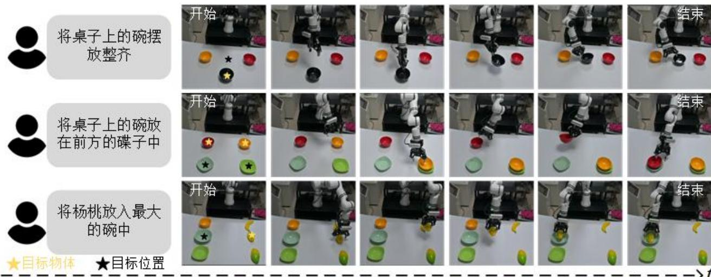  
图 1.1 基于视觉语言模型的机械臂自主操作任务示意图

针对上述挑战，本文提出基于视觉语言模型与模仿学习的机械臂自主操作算法框架，创新性地采用“语义解析-掩码分割-决策生成”三级级联架构突破传统端到端模型的不可解释性瓶颈，同时采用关节轴角动作直接驱动机械臂，避免了笛卡尔空间动作逆解的多解性问题。本系统首先通过视觉语言模型实现指令语义解析，采用跨模态注意力机制消除多目标语境下的指令歧义，生成语言指令和视觉观测的联合嵌入特征；其次，基于掩码分割增强网络，结合联合嵌入特征实现目标物体掩码分割；最后，在决策层设计了掩码增强模仿学习策略，创新融合模仿学习架构对示教数据的建模能力与扩散策略的多模态动作生成能力，构建具有扰动鲁棒性的机械臂轨迹生成模型，生成关节轴角动作驱动机械臂运动。本研究的核心贡献在于建立了视觉语言模型与模仿学习的闭环推理范式，同时使用关节轴角动作驱动机械臂运动，为破解非结构化环境下机械臂操作任务中的语义-动作联合推理难题提供了新思路。

## 1.2国内外研究历史与现状

## 1.2.1 基于模仿学习的机械臂操作研究现状

在机械臂研究领域，模仿学习算法[26-28]是机械臂控制领域的一个基本算法。研究人员提出生成对抗模仿学习[29-31]和基于策略优化的无模型模仿学习方法[32-34]，结合专家示教数据优化算法，提升算法性能与适应性，助力机械臂执行复杂任务。实际应用中，拓展算法应用于运动和操作控制任务，聚焦多模态数据融合、鲁棒性、适应性及可解释性研究，增强机械臂在复杂环境中的任务执行和学习评估能力，满足多样任务需求。

如图1.2 呈现的是基于模仿学习的机械臂操作框架，该框架旨在让模型借助专家的示范数据，习得对应的行为策略。早期，Zhao 等人[35]搭建了一种用于双手远程操作的低成本开源硬件系统（A Low-cost Open-source Hardware System for Bimanual Teleoperation，ALOHA），并创新性的提出 ACT（Action Chunking with Transformer）算法，采用动作分块和时间集成策略应对模仿学习误差累积，以条件变分自编码器建模动作序列学习人类行为。但受架构和原理限制，难以考量多因素对多模态动作分布的影响。随着研究的深入，Chi等人[36]提出Diffusion Policy 模型，将机械臂策略创新性地建模为去噪扩散概率模型[37]（DenoisingDiffusion Probabilistic Models，DDPM），通过学习动作分数函数的梯度并进行随机朗之万动力学采样，能够精准表达机械臂执行任务过程中的多模态动作分布。

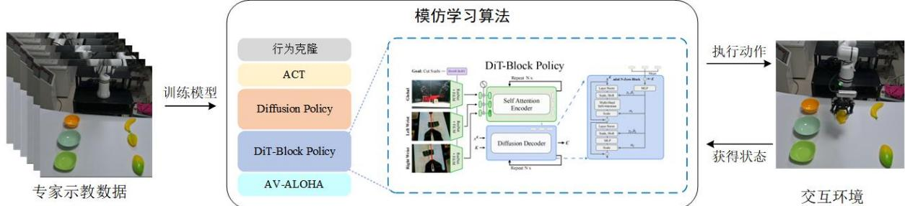  
图 1.2 机械臂模仿学习算法示意图

近年来，机械臂面临的环境与任务日益复杂多变，这要求机械臂兼具良好的移动性、灵巧操作能力以及更智能的环境感知和精准决策能力。为此，Fu 等人[38]通过选用 AgileXTracerAGV 为ALOHA 系统增添移动底座和全身遥操作接口，实现低成本、稳定且全身可遥操作以拓展应用场景。在此基础上，Zhao 等人[39]在ALOHA 系统上利用大规模数据，结合 Diffusion Policy 进一步提升机械臂的灵巧操作能力。为解决机械臂感知视野遮挡与受限问题，Chuang 等人[40]基于 ALOHA 系统进一步拓展，增设 7 自由度AV机械臂搭载立体摄像头寻找最佳观测视角，将主动视觉融入双臂机械臂系统。但主动视觉的引入增加了系统复杂性，控制架构上，需精确协调AV机械臂与机械臂主体动作，这对控制算法的设计和优化提出了更高要求。为此，Dasari 等人[41]提出 DiT-Block Policy 架构。此架构融合 Transformer骨干网络与生成建模，引入可扩展注意力模块捕捉复杂数据关联，结合ResNet 特征提取能力和FiLM 视觉编码机制，增强了模型对复杂环境信息的理解处理能力。上述方法主要解决从机械臂感知到决策的一系列问题。在感知层面，上述研究已采用多种技术增强机械臂对复杂环境的感知能力。然而，过往方法普遍存在对语言信息利用不足的情况，难以依据多样化的语言指令灵活切换任务模式。

针对这一问题，本研究设计了一系列桌面机械臂操作任务，使机械臂能够结合自身视觉观测与语言指令，明确任务目标，实现由语言指令和视觉观测共同驱动执行任务。在决策层面，现有方法未能充分考量机械臂动作决策的复杂性与动态性。例如，在多步动作执行时，常依赖固定模式，缺乏对动态环境的适应性，无法及时更新动作轨迹，致使机械臂面对环境变化时反应滞后。单步动作执行虽可利用当前视觉信息，但会出现动作序列不连贯的现象，严重影响任务执行的稳定性和准确性。尽管时间集成策略尝试解决这些问题，不过以往的时间集成策略因简单预设权重，难以契合不同任务和环境下的动作模式变化，容易产生不合理的动作组合，进而降低决策质量。鉴于此，本文在决策层面设计了动态轨迹集成策略。该策略通过考量不同时间步动作预测的相似性，动态分配权重，有效避免了不合理的动作聚合。这使得机械臂在决策过程中能够更好地融合各类信息，在复杂任务和动态环境中灵活做出决策，显著提升了任务执行的成功率与效率。

## 1.2.2 基于VLM的分层机械臂操作架构研究现状

随着机械臂任务日趋多样化，借助语言指令驱动机械臂执行任务成为必然趋势。为实现这一目标，研究人员基于VLM 开展创新，将多模态感知融合，把语言信息与视觉观测图像有机结合，优化了机械臂感知与动作的交互过程。VLM 通过大规模预训练，积累了海量语言知识和语义信息，具备强大的自然语言解析能力，能够精准理解自然语言指令，清晰把握任务目标和关键要素。在与视觉图像融合时，它能快速、准确地将语言描述与图像内容匹配，精准确定物体的位置、形状、姿态等目标特征信息。这一系列优势不仅大幅提升了机械臂对人类意图的理解精度，还显著增强了其在复杂环境中的任务执行能力，推动机械臂在更多领域发挥重要作用。

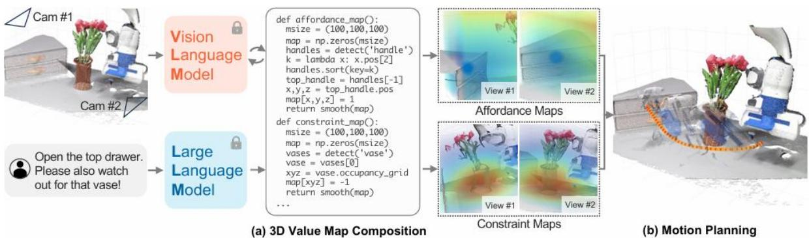  
图 1.3VoxPoser机械臂自主抓取算法框架

近年来，Huang 等人[42]提出利用大语言模型（Large Language Model，LLM）和 VLM合成3D 价值地图以规划机械臂操作轨迹的VoxPoser框架。如图1.3 所示，该框架基于VLM融合语言信息与视觉观测推理任务，以生成 Python 代码与 VLM 交互来转化知识，实现零样本和在线学习，提升机械臂操作任务性能。Xu等人[43]提出一种联合视觉、语言和动作的建模方法，用于解决杂乱环境下基于语言指令的抓取任务。该方法借助以目标对象为中心的表示和预训练模型提升样本效率，缩小模拟与现实的差距。但该方法对语言指令要求较为简单，且仅适用于抓取任务。为此，Li 等人[44]提出了适用于开放词汇机械臂抓取任务的OVGNet 统一视觉语言框架。该框架通过构建大规模的基准数据集，创新性地引入开放词汇学习理念，并精心设计了两个视觉语言匹配模块，有效提升了模型在视觉语言的理解能力。

Kapelyukh 等人[45]引入DALL-E-Bot 框架，将网络规模的扩散模型应用于机械臂领域。该框架能让机械臂推断物体的文本描述、生成目标图像，并依据图像重新排列物体。

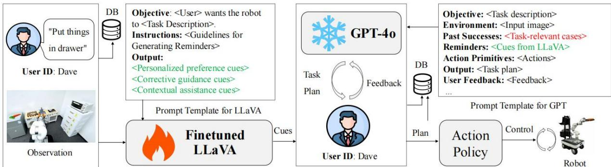  
图 1.4AlignBot 机械臂自主操作算法框架

在此基础上，Chen 等人[46]提出AlignBot 框架，如图1.4所示，该框架通过微调LLaVA模型优化家庭机器人基于VLM 的定制任务规划，使其更好地契合用户语言指令。这些方法优势突出，不仅大幅增强了机械臂对自然语言指令的理解与精准执行能力，使其能够从容应对更为复杂且丰富多样的任务场景；同时借助大规模预训练模型显著提升了模型的泛化性能，有效降低了对特定任务数据的依赖程度。然而，当前这些方法的研究重心大多放在如何巧妙地将 VLM 与机械臂任务深度融合上，对于机械臂在执行任务过程中关键的决策环节，包括决策机制、决策策略以及应对复杂场景时的决策优化等方面，缺乏足够深入且系统的研究。

为此，本研究基于VLM 对视觉观测图像进行解析，并结合语言指令，利用掩码分割增强网络对任务目标掩码进行精准分割，以此强化视觉特征，进而高效提取任务目标的特征信息。同时，基于模仿学习架构，利用变分自编码器结合扩散策略构建策略网络，生成具有多模态分布的关节轴角动作序列。针对输出动作轨迹的稳定性问题，精心设计动态轨迹集成策略，通过动态调整不同时刻的动作权重，实现轨迹的平滑操作，从而推理出最优动作。依托这些关键技术，实现机械臂运动策略的智能规划，致力于让机械臂的运动决策更加合理高效，最大程度地契合任务需求。

## 1.2.3 基于VLA 的端到端机械臂操作研究现状

在机械臂研究领域，视觉-语言-动作（Vision-Language-Action Model，VLA）模型的研究持续蓬勃发展。该模型聚焦于融合视觉、语言和动作三大关键要素，致力于使机械臂能够理解自然语言指令，精准感知周围环境，并依据视觉感知图像与自然语言指令执行相应动作，进而实现复杂任务的机械臂自主操作。这一显著进步赋予了机械臂在复杂环境中更强的适应能力，使其能够以更高的智能水平和执行效率，依据任务语言指令灵活行动，无需过多人工干预，极大地拓展了机械臂在实际应用中的潜在场景，显著提升了其应用价值。

在机械臂自主操作算法的持续探索中，Brohan 等人[47]提出 Robotics Transformer（RT-1）模型，以视觉信息和语言指令为输入来输出动作，为VLA 范式的机械臂操作算法发展奠定基础。然而，面对模糊语义、多义词汇等复杂语义及复杂场景时，RT-1 难以精准理解指令意图。为克服上述不足，Brohan 等人[48]在RT-1基础上创新，将机械臂动作表示为文本令牌，结合视觉语言特征微调预训练模型，使模型获得一定语义理解和推理能力。Team 等人[49]提出基于 Transformer 的开源通用机械臂策略 Octo 模型，经大规模多样的机械臂数据集预训练，支持灵活的任务与观察定义，能高效处理语言指令或目标图像任务，还可快速微调适应新的观察和动作空间，在多机械臂协作中能迅速适配不同机械臂特性与任务需求实现高效协同。Kim 等人[50]基于 Llama2[51]与 DinoV2[52]、SigLIP[53]融合视觉编码器，提出OpenVLA 模型。如图 1.5 所示。

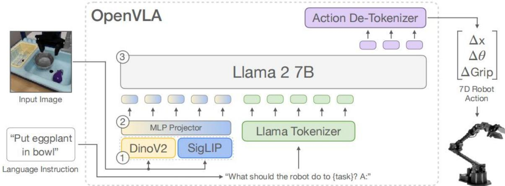  
图 1.5 OpenVLA 机械臂自主操作算法框架

在OpenVLA 模型取得进展之后，众多研究人员围绕VLA 模型展开了深入研究。其中，Li 等人[54]通过解耦视觉语言与动作，基于 VLM 的输出特征联合扩散策略生成动作序列。Wen 等人[55]基于扩散专家模块设计新型具身课程学习策略架构，通过大量数据学习通用运动技能，掌握复杂机械臂任务。Li 等人[56]基于 SAM2 分割网络与 Llama2 语言模型创新地提出了机械臂护士助手系统架构 RoboNurse-VLA，通过深度融合视觉语言特征推理机械臂动作。当前，VLA 算法在驱动机械臂任务领域已取得了显著成果，但现有方法仍存在一定缺陷。一方面，在语言指令与任务匹配时，复杂指令信息常使机械臂难以借助视觉观测准确匹配任务目标；另一方面，由于模型多以笛卡尔空间指示动作，在机械臂实际执行时会受逆运动学多解性影响，易出现关节超限或轨迹震荡问题，从而影响实际性能。

因此，本文提出了一种基于视觉语言模型与模仿学习的机械臂自主操作算法，通过VLM对语言指令和视觉观测特征联合编码，提取任务关键信息，精确匹配任务目标。利用变分自编码器生成机械臂动作序列，有效学习机械臂动作模式；同时，以关节轴角动作驱动机械臂运动，成功解决了机械臂逆解时轨迹不确定性的问题，大幅提升机械臂操作的稳定性。综合上述方法，本文算法能够在桌面平台任务中，依据任务指令驱动机械臂执行相应的动作，展现出良好的应用潜力。

## 1.3本文的主要创新与贡献

本文提出了一种基于视觉语言模型与模仿学习的机械臂自主操作算法，该算法聚焦于桌面平台任务场景，能够依据任务的语言指令，精准且自主地识别任务目标，并通过策略网络生成合理动作轨迹，从而驱动机械臂高效且准确地完成相应的桌面操作任务。具体而言，本文所提算法融合视觉语言模型与模仿学习，从多方面创新提升操作性能：其整体架构借视觉语言大模型，突破传统在复杂语义理解和目标定位上的局限；基于Transformer 的掩码分割增强网络，解决了常见分割网络的误分割等问题，提高目标分割精准度；基于Diffusion 的模仿学习策略网络，打破复杂环境下多模态动作生成困境；动态轨迹集成策略依任务、环境和机械臂状态动态规划轨迹。这些创新协同优化算法，全面增强了机械臂在复杂场景下的操作能力。本文主要的创新和贡献如下：

1. 提出了一种基于视觉语言模型与模仿学习的机械臂自主操作算法，通过视觉语言大模型深度融合任务语言指令与视觉观测图像精准生成任务目标特征，借助掩码分割增强网络，紧密结合任务目标特征生成任务目标掩码信息，并凭借策略网络精确预测动作轨迹，高效驱动机械臂完成任务，切实提升机械臂成功执行桌面任务的能力。

2. 提出了一种基于Transformer 的掩码分割增强网络，依托视觉语言大模型所生成的任务目标特征，借助掩码分割增强网络，精准生成任务目标的掩码特征，有效提升了系统在复杂桌面任务场景下的目标识别精度与定位准确性，显著增强了系统的环境适应能力。

3. 提出了一种基于Diffusion 的模仿学习策略网络，根据变分自编码器架构对专家演示数据进行建模，通过Transformer 对机械臂状态特征与经掩码增强的图像特征联合编码来生成联合嵌入特征，并利用Diffusion对生成的联合嵌入特征进行解码以生成机械臂动作序列，实现多模态动作分布，从而确保在多种复杂桌面任务场景下运动轨迹生成的精确性。

4. 设计了一种动态轨迹集成策略，紧密结合任务实时进展、环境变化和机械臂自身状态，借助历史与当前动作预测的相似性灵活调整轨迹规划，以确保机械臂更平滑高效地完成任务，避免碰撞，提升任务执行成功率与稳定性，展现出更强的环境适应性和任务执行能力。

## 1.4论文结构与安排

本文全文涵盖六个章节，以下是各章节的内容大致介绍：

第一章为绪论部分，首先简述机械臂操作任务在实际应用中的重要价值，点明传统方法的局限，由此引出基于视觉语言模型与模仿学习的机械臂自主操作算法的研究背景和意义。接着梳理国内外机械臂操作任务的研究现状，着重剖析三种不同研究范式的缺陷。最后概括本文的创新点、主要贡献，以及各章节的结构安排。

第二章深入探讨了机械臂自主操作任务关键技术实现。首先简要介绍深度学习的经典特征提取网络与语义分割技术，为机械臂感知理解奠定理论基础。随后聚焦基于视觉语言模型的机械臂任务，阐述视觉语言大模型的相关技术方法。接着依次阐述ACT 等模仿学习算法在机械臂领域的具体应用，着重讲解了Diffusion Policy 算法的技术路线。

第三章详细介绍本文提出的基于视觉语言模型与模仿学习的机械臂自主操作算法框架。首先介绍了系统的总体架构，着重强调各部分之间的协同机制。接着，介绍了基于VLM的目标特征提取框架设计流程；随后，深入探讨了本文提出的掩码分割增强网络结构。最后，重点讲述了本文提出的模仿学习策略网络，该网络借助模仿学习机制，结合目标特征掩码增强，助力机械臂学习合理操作策略，以完成桌面操作任务。

第四章着重阐述了基于机械臂操作系统（Robot Operating System, ROS）搭建桌面操作实验平台以及构建示教数据集的整个过程。首先，对主流仿真平台的特性予以剖析，全面权衡其优势与不足，与此同时，对实验所需的机械臂、夹爪、相机等硬件设备进行详尽说明，并凭借这些器件精心设计并成功搭建起一整套完整的机械臂操作平台。随后，深入解读了本文基于 ROS 的机械臂控制系统的运行原理。最后，细致入微地介绍了本文多模态示教数据集的采集构建流程，以及语义标注与增强的具体实施方法。

第五章着重对本文所提算法的综合性能展开了实验操作与深入剖析。首先，详细介绍了实验的设计方案，涵盖了测试与训练环境、具体实验任务的规划以及性能评价指标的定义等关键内容。紧接着，通过在仿真环境和真实环境中进行实验，对算法的性能进行了分析验证，着重探究了本系统在 6 个桌面任务中的实际表现与成效。最后，精心设计了消融实验，旨在深入研究掩码分割增强网络和动态轨迹集成策略对系统性能的具体影响，以此来充分验证掩码分割增强网络以及动态轨迹集成策略的有效性与可行性。

第六章对本课题进行了总结和未来展望。首先，对本研究的核心成果与关键发现进行了回顾，同时也阐明了研究过程中存在的局限因素。针对这些局限，规划出了未来的研究方向，包括对现有方法的改良优化以及拓展应用的覆盖领域，旨在助力机械臂自主操作领域实现更深入的发展。

## 2 理论基础与关键技术

在机械臂操作任务的研究中，深度学习理论与算法至关重要。深度学习基本理论、视觉语言模型、语义分割技术以及模仿学习算法，是构建高效智能的机械臂自主操作系统的基础。其中，深度学习基本理论为整个研究奠定了理论根基；VLM 在理解和处理视觉与语言信息融合方面发挥关键作用，助力机械臂解析复杂指令；语义分割算法通过精准识别和定位目标物体，为机械臂自主操作提供重要的感知支持；模仿学习算法则基于大量数据学习策略，实现从感知到动作的有效转化。这些技术共同为解决复杂场景下的机械臂自主操作任务提供了核心支撑，也为本文研究工作的后续设计提供了坚实的理论和技术基础。

## 2.1经典特征提取网络

## 2.1.1 ResNet 残差网络

残差网络[57]（Residual Network，ResNet）是深度学习领域的经典网络架构，如图 2.1所示。如 VGG[58]等传统的卷积神经网络[59]（Convolutional Neural Network,CNN）在加深网络层数时，由于梯度消失和梯度爆炸问题，导致模型难以训练，无法充分发挥深度网络的优势。ResNet 通过引入残差模块巧妙地解决了这一难题。具体而言，残差模块通过跳跃连接结构，使得网络将重点放在学习输入与预测输出之间的差值上，而非直接去学习复杂的完整映射关系。这样的设计使得模型更容易训练，并且能够学习到丰富的图像特征。

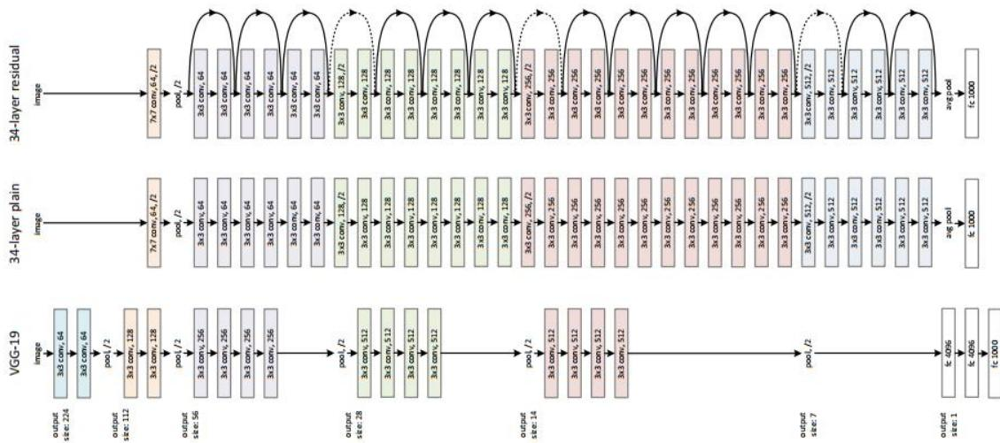  
图 2.1 ResNet 残差网络结构图

如图 2.2 所示为 ResNet 所设计的残差模块，从结构上看，定义网络要学习的映射为H(x)，传统网络直接对 H(x)进行学习，而 ResNet让网络学习残差函数 $F \left( x \right) = H \left( x \right) - x$ 最终输出为 $F \left( x \right) + x$ 。当H(x)接近恒等映射时，学习残差F(x)会更加容易，因为此时只需将的权重调整到接近零即可。在实际应用中，许多复杂的视觉任务并不需要网络学习完全全新的映射，而是在已有信息的基础上进行微调，残差学习的方式恰好适应了这一需求。

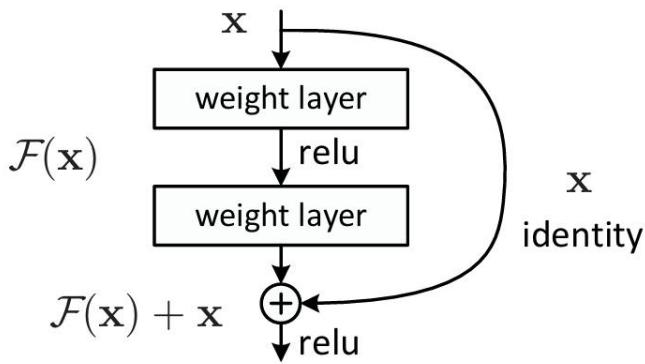  
图 2.2 残差模块示意图

在机械臂自主操作系统中，ResNet 常用于视觉特征提取。例如，在处理RGB图像时，它能够从图像的底层像素信息中逐步提取出颜色、纹理和形状等关键特征。从底层的像素级特征，如边缘和颜色分布，到中层的纹理模式，再到高层的物体形状和语义特征，ResNet都能进行有效的学习和表达。这些特征被转化为特征向量，为后续的任务提供坚实的数据基础，使得机械臂在决策时能够更准确地区分不同的目标物体，规划出更合理的动作序列。

## 2.1.2 Transformer 模型

Transformer[60]作为特征提取网络中的重要一员，凭借其摒弃传统循环结构、基于注意力机制构建的创新架构，在处理复杂多模态数据时优势尽显。它能够高效地捕捉数据中的关键信息，展现出强大的特征提取与融合能力。不仅如此，Transformer 在实现精准决策控制方面也发挥着不可替代的关键作用。在机械臂自主操作任务中，它能够依据提取到的多模态特征信息，进行综合分析与判断，助力机械臂做出最优决策，极大地提升了动作的准确性与效率。具体而言，Transformer 模型基于注意力机制的创新架构，使其在处理复杂多模态数据和实现精准决策控制方面蕴含着巨大潜力。

如图 2.3所示，Transformer 模型呈现出经典的编码器-解码器架构，这种架构在序列处理任务中应用广泛，是实现输入序列到输出序列转换的核心框架。模型的左侧部分为编码器，它由N个完全相同的层堆叠而成。每一层都包含两个至关重要的子层：多头自注意力机制和逐点全连接前馈网络。在数据处理流程中，输入序列首先进入嵌入层，在这里，输入的符号（如单词、像素特征等）会被转化为低维向量表示，这些向量携带了输入信息的初步特征。接着，位置编码被添加到嵌入向量中。由于 Transformer 本身不具备捕捉序列顺序信息的能力，位置编码就显得尤为重要，它通过特定的正弦和余弦函数计算得到，为模型提供了关于序列中元素位置的信息，使得模型能够区分不同位置的元素。其计算公式为：

$$
P E _ {(p o s, 2 i)} = \sin (p o s / 1 0 0 0 0 ^ {2 i / d _ {\mathrm{mod} e l}})\tag{2.1}
$$

$$
P E _ {(p o s, 2 i + 1)} = \cos (p o s / 1 0 0 0 0 ^ {2 i / d _ {\mathrm{mod} e l}})\tag{2.2}
$$

其中，pos代表位置，i表示维度。这样，位置编码与嵌入向量在维度上保持一致，二者相加后进入后续的子层处理。

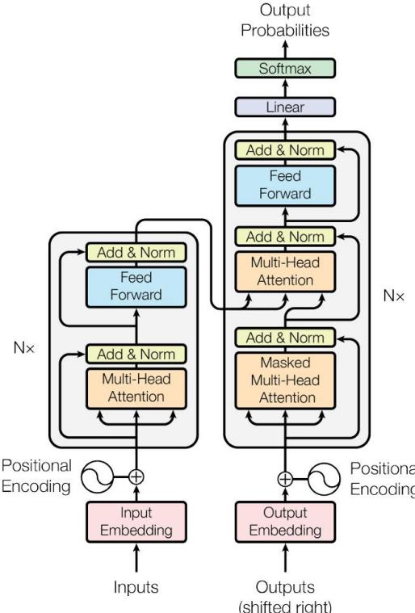  
图 2.3 Transformer 模型框架图

接着，数据进入多头自注意力机制。如图2.4右所示，多头注意力机制则是通过h个不同的注意力头并行执行上述计算过程，具体来说，先将查询、键和值分别用不同的线性投影进行h次线性变换，投影到 $d _ { k }$ 、 $d _ { k }$ 和 $d _ { \nu }$ 维度。在这些投影后的向量上分别执行注意力函数，得到 $d _ { u }$ 维的输出值。然后将这些输出值拼接起来，并再次投影，得到最终的输出。其计算公式为：

$$
\text { MultiHead } (Q, K, V) = \text { Concat } (\text { head } _ {1},..., \text { head } _ {h}) W ^ {O}\tag{2.3}
$$

$$
h e a d _ {i} = \text { Attention } (Q W _ {i} ^ {Q}, K W _ {i} ^ {K}, V W _ {i} ^ {V})\tag{2.4}
$$

其中， $W _ { i } ^ { \mathcal { Q } }$ $\boldsymbol { W } _ { i } ^ { K }$ $\boldsymbol { W } _ { i } ^ { V }$ 和 $W ^ { O }$ 是可学习的投影参数矩阵。多头注意力机制使得模型能从多个角度捕捉信息，同时关注输入序列不同位置和不同特征子空间的信息，增强了模型对复杂关系的理解能力。

图 2.4 左展示的缩放点积注意力是 Transformer 中注意力计算的基础方式。其输入包含维度为 $d _ { k }$ 的查询和键，以及维度为 $d _ { \nu }$ 的值。计算时，先将查询与所有键进行点积运算，再将每个点积结果除以 $\sqrt { d _ { k } }$ ，最后通过 Softmax 函数得到权重，以此对值进行加权求和得到输出，公式为：

$$
\text { Attention } (Q, K, V) = \text { softmax } ((Q K ^ {T}) / \sqrt {d _ {k}}) V\tag{2.5}
$$

之后，数据进入逐点全连接前馈网络。这个网络由两个线性变换和一个 ReLU 激活函数组成，对每个位置的输入分别进行相同的处理，公式为：

$$
F F N (x) = \max \left(0, x W _ {1} + b _ {1}\right) W _ {2} + b _ {2}\tag{2.6}
$$

其中， $W _ { 1 }$ 、 $W _ { 2 }$ 是线性变换的权重矩阵， $b _ { 1 }$ 、 $b _ { 2 }$ 是偏置向量。通过这种方式，网络能够进一步提取和增强特征，为后续的处理提供更具表达力的信息。

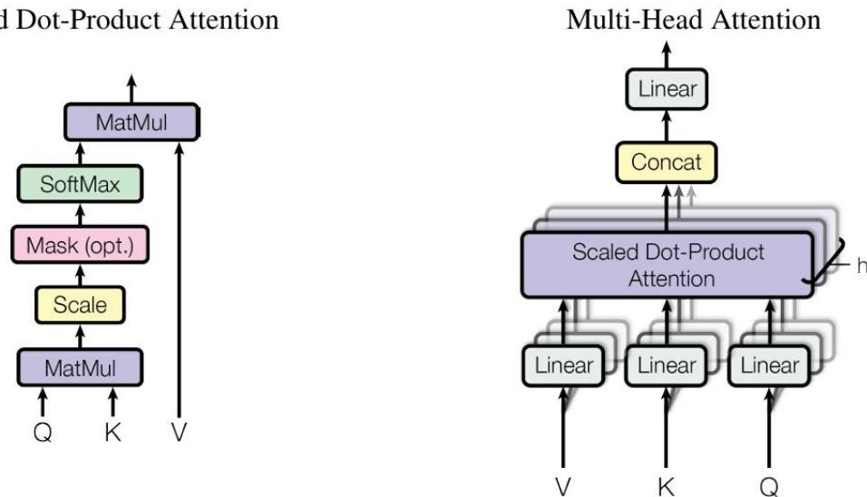  
图 2.4 点积注意力机制（左）；多头注意力机制（右）

## 2.2语义分割技术

语义分割是机械臂视觉感知的关键技术之一，其目的是将图像中的每个像素分类到相应的语义类别中，为机械臂提供精细的视觉感知信息，使其能够准确识别和定位目标物体。

早期的语义分割方法主要基于传统的计算机视觉技术，如基于区域生长[61]、边缘检测[62]和模板匹配[63]的方法。这些方法在简单场景下能够取得一定的效果，例如在背景简单、目标物体形状规则的场景中，基于区域生长的方法可以通过种子点的扩展来分割出目标区域。但在复杂场景下，由于物体形状的多样性、光照变化和遮挡等因素，性能往往受到限制。

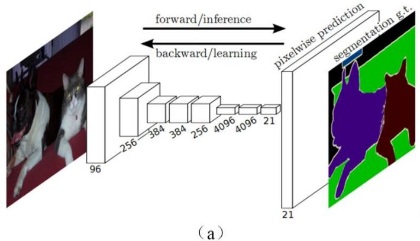

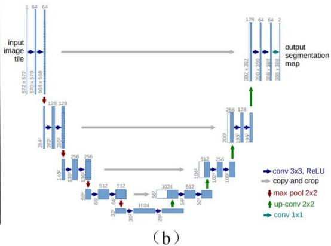  
图 2.5 语义分割算法：(a)FCN；(b)U-Net

随着深度学习发展，基于 CNN 的语义分割方法渐成主流。如图 2.5（a）所示，Long等人[64]提出全卷积网络（Fully Convolutional Networks，FCN），其将传统卷积神经网络的全连接层替换为卷积层，开创端到端语义分割新范式，实现图像逐像素分类，大幅提高分割效率，使模型能直接处理输入图像并输出结果。在此基础上，如图2.5（b）所示， $\mathrm { U } { - } \mathrm { N e t } ^ { [ 6 5 ] }$ 引入跳跃连接融合不同层次特征，有效利用图像上下文信息，进一步提升分割精度。此外，$\mathrm { Y u }$ 等人[66]引入空洞卷积，在不增加参数的情况下扩大卷积感受野，更好地捕捉上下文信息，提升分割性能。而He 等人[67]提出的MaskR-CNN网络，在目标检测基础上增加掩膜分支，通过对目标区域像素分类实现物体实例分割。

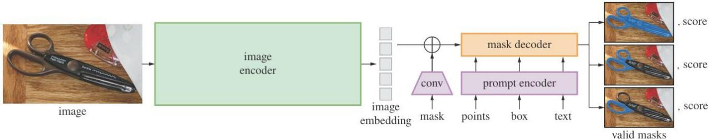  
图 2.6 SAM 分割网络架构图

然而，在语义分割领域持续发展的进程中，Kirillov等人[68]提出的 SAM 模型（SegmentAnything Model）带来了全新的思路与突破。如图2.6 所示，SAM 开创性地提出提示驱动的分割范式，其基于对多种提示信息的理解实现图像分割。SAM 在技术路线上精心设计了一套独特的架构，该架构主要由图像编码器、提示编码器和掩码解码器构成。其中，图像编码器采用经MAE 预训练的VisionTransformer，能够有效处理高分辨率图像，输出蕴含丰富信息的图像嵌入；提示编码器针对点、框、文本等不同形式的提示，采用相应的嵌入策略，将其转化为模型可识别的特征；掩码解码器借助Transformer 架构的优势，融合图像与提示嵌入，生成精准的分割掩码。此外，考虑到提示可能存在的歧义问题，SAM 具备预测多个掩码并通过置信度分数排序的能力。同时，为获取高质量、大规模的训练数据，Meta构建了含三个阶段的数据引擎，生成了庞大的SA-1B 数据集。基于此，SAM 经大规模数据预训练，习得强大的通用图像分割能力，实现了不依赖特定类别训练，依各类提示分割目标物体的卓越效果。这种创新的技术路线使得SAM 在零样本分割任务中表现出色，展现出强大的泛化能力。然而，SAM 仅适用于静态图像，处理复杂场景时分割效果欠佳，受图像编码器影响实时性难保证，在文本到掩码等任务上适应性也有限。

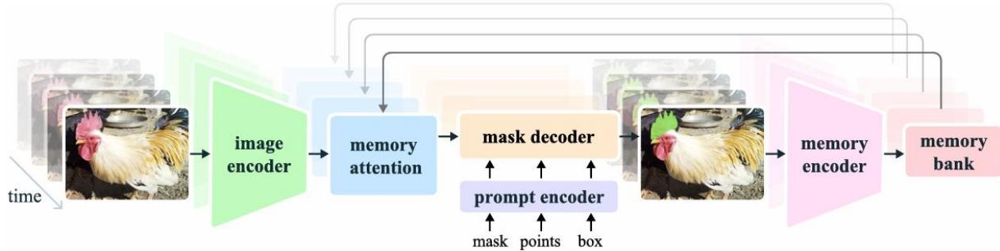  
图 2.7SAM2 分割网络架构图

鉴于 SAM 存在诸多局限，Ravi 等人[69]提出了 SAM2 模型。该模型聚焦于可提示视觉分割（Promptable Visual Segmentation，PVS）任务，把提示驱动的分割任务从图像领域拓展到视频领域，旨在实现对视频中目标物体的时空精准分割与跟踪。如图2.7 所示，SAM2在技术路线上构建了一套创新的架构体系，该体系涵盖图像编码器、记忆注意力模块、掩码解码器等多个关键部分。其中，图像编码器采用 MAE 预训练的Hiera 编码器，凭借其层次结构实现多尺度特征解码与视频的流式逐帧高效处理。在此基础上，SAM2 引入记忆注意力模块处理时序信息，通过堆叠Transformer 模块，融合当前与过去帧的特征、预测及新提示信息，增强模型对时间维度信息的利用效率，提升视频分割时处理物体运动变化的能力。SAM2 在掩码解码器基于SAM进一步创新，新增的掩码预测头用于判断目标物体的可见性，同时，通过将跳跃连接引入图像编码器，从而融入高分辨率嵌入信息。此外，记忆编码器通过卷积模块处理输出掩码并与图像编码器信息融合生成记忆信息，同时保存目标特征信息，供记忆注意力模块交叉计算。通过这一系列操作，SAM2 进一步提升了掩码预测的准确性，从而更好地应对复杂场景下的分割任务。通过上述多方面的改进，SAM2 在维持高分割精度的同时，推理速度大幅提升，显著拓展了实际应用潜力。

## 2.3视觉语言模型技术

视觉语言模型作为实现语言与视觉信息融合的核心技术，近年来取得了长足的发展。其核心在于构建一个统一的跨模态特征空间，使得语言和视觉信息能够在该空间中进行有效的交互和对齐，从而实现对复杂任务的理解和执行。

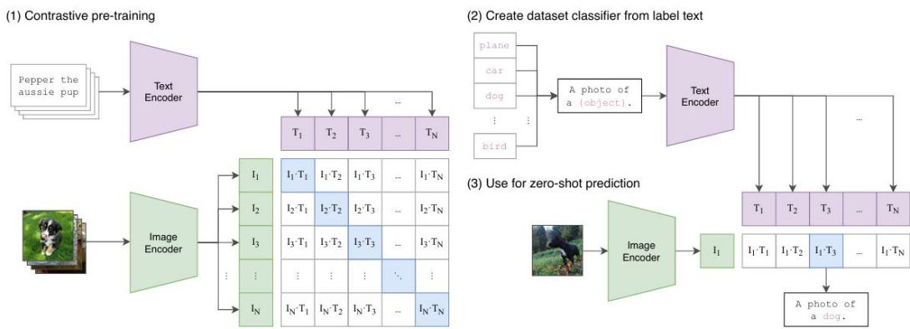  
图 2.8 CLIP 网络架构图

在视觉语言模型算法中，CLIP（Contrastive Language-Image Pretraining）模型[70]开创性地运用对比学习方法，在大规模图像-文本对上进行预训练。通过这种方式，图像和文本在联合嵌入空间获得相似表示，使得模型能够从自然语言监督中学习可迁移视觉模型，并具备在多任务中进行零样本转移的能力。如图2.8展示了CLIP 模型借助自然语言监督学习可迁移视觉模型的核心流程。首先，CLIP 运用对比学习策略联合训练图像和文本编码器。在此过程中，通过优化对称交叉熵损失，模型最大化真实配对的图像与文本嵌入余弦相似度，最小化错误配对的相似度，从而学习到两者的关联，为后续任务奠定基础。接着，利用预训练好的文本编码器，依据目标数据集类别信息生成文本嵌入，构建零样本线性分类器，将自然语言形式的类别信息转化为模型可处理的特征表示。最后，待分类图像经图像编码器得到特征表示，与零样本线性分类器中的文本嵌入计算余弦相似度，再经Softmax 函数[71]转化为概率分布，进而预测出图像的类别。

在此基础上，GLIP 模型[72]将对象检测和短语接地统一为预训练任务，把对象检测看作无上下文的短语接地，通过重新制定任务、引入语言感知深度融合模块以及利用大规模数据预训练，提升了对稀有类别和新任务的检测能力，但GLIP 在复杂场景、模糊提示下性能差，且无法聚焦特定区域。针对 GLIP 无法聚焦特定区域的问题，Alpha-CLIP 模型[73]引入额外alpha 通道指定关注区域，经数百万RGBA 区域-文本对微调后，能实现精确区域聚焦。但该模型存在结构和训练局限，聚焦多对象与建模能力不足。

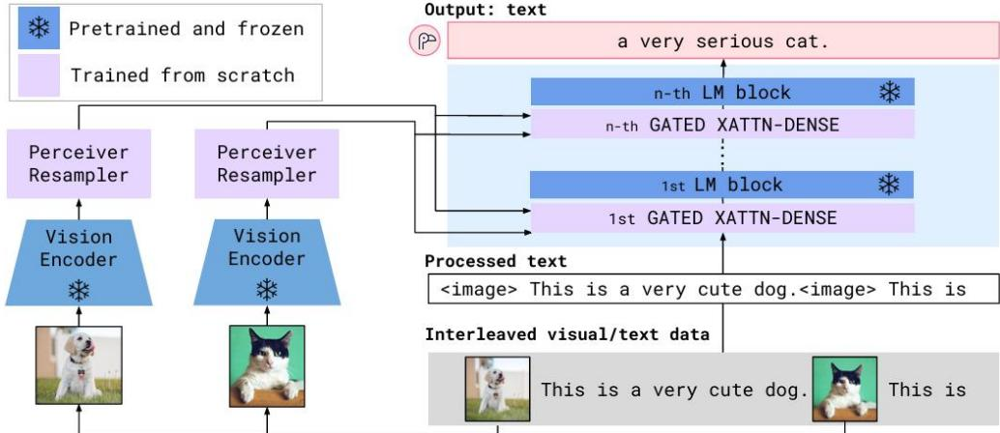  
图 2.9 Flamingo 算法框架图

为此，Flamingo 模型[74]创新性地融合预训练视觉和语言模型，展现出强大的少样本学习能力。如图2.9 所示，Flamingo 的技术路线有着独特的设计思路，其输入为文本与图像交错的数据。视觉编码器将图像编码为视觉特征，感知重采样器[75]通过学习固定数量的潜在输入查询与视觉特征交叉注意力计算，输出固定数量的视觉令牌。这些令牌作为语言模型的输入条件，Flamingo 在预训练且冻结的语言模型层间插入 GATED XATTN-DENSE 层，该层从视觉令牌获取键和值、从语言输入获取查询，使语言模型结合视觉信息预测文本。最终，语言模型基于处理后的信息，以束搜索或对数似然评分的方式输出自由形式文本。整个架构协同工作，支持Flamingo 在少样本学习任务中，通过上下文示例进行任务适应。

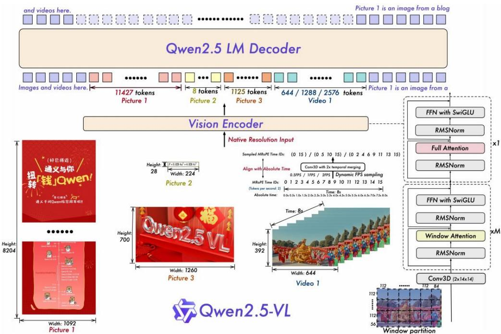  
图 2.10 Qwen2.5-VL 模型框架图

近年来，Qwen 系列[76-78]视觉语言模型在跨模态理解与任务执行领域潜力巨大。Qwen2.5-VL 通过大规模预训练和高效的架构设计，实现了对视觉与语言信息的深度融合。

具体而言，Qwen2.5-VL 的视觉编码器基于窗口注意力机制，并结合 2D、3D旋转位置嵌入编码[79]（Rotary Position Embedding，RoPE）提升模型性能。同时，在空间上用图像实际尺寸表示特征，时间上采用动态帧率与绝对时间编码增强多模态处理能力。此外，对多模态旋转位置嵌入进行改进，实现其与绝对时间的精准对齐。最后，借助数据过滤和拒绝采样的协同作用，进一步提升数据质量，强化模型性能。如图2.10所示，Qwen2.5-VL 整体模型架构由大语言模型、视觉编码器和视觉语言融合模块构成。大语言模型依托Qwen2.5 LLM的预训练权重，对位置嵌入进行改进；视觉编码器运用重新设计的ViT[80]架构，融入2D-RoPE和窗口注意力机制，按特定规则处理图像以生成特征；视觉语言融合模块先对图像特征进行分组，随后借助多层感知机对分组后的特征加以压缩，有效提升了计算效率。

## 2.4模仿学习算法

模仿学习可让机械臂学习到有效的行为策略，它通过学习人类示范数据，助机械臂快速掌握复杂任务技能，规避强化学习的大量试错。传统行为克隆（Behavioral Cloning，BC）是模仿学习的主要方式。它接收含示范者状态与行动的训练数据，借分类器或回归器学习复制专家策略。但BC 方法依赖示范者动作序列，可现实中人类模仿常只能见动作效果，难获内部控制信号，限制了应用范围。同时，易受“协变量转移”影响，机械臂实际遇的状态分布或与示范数据不同，致性能降低。此外，通常BC 只能学单一行为策略，难适应复杂多变环境与多样任务，降低了机械臂执行任务的灵活性与成功率。

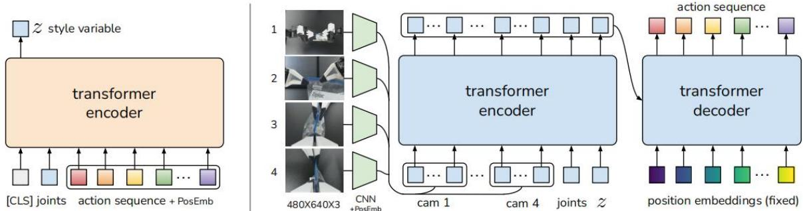  
图 2.11 基于 Transformer 的 ACT 模仿学习框架

为了解决 BC 方法的局限性，基于Transformer 的模仿学习方法逐渐兴起，ACT（ActionChunking withTransformers）就是其中一种用于解决精细操作任务模仿学习问题的算法。如图 2.11 所示，ACT 在实现上基于 Transformer 架构构建 CVAE[81]编码器和解码器建模示教数据。具体而言，ACT 编码器对输入数据进行处理，高效提取输入信息的关键特征。解码器则先借助 ResNet 网络对图像编码，随后通过 Transformer 编码器将多模态特征深度融合。最后，由Transformer 解码器生成连贯、流畅的动作序列。

在模仿学习中，存在“误差累积”和非平稳人类演示的问题，基于此，ACT 采用动作分块策略将连续的动作序列分割为多个相对独立的动作组块，有效减少误差在动作执行过程中的传递与积累。如图2.12所示，在面对高精度控制和闭环反馈的精细操作任务时，ACT策略预测未来k个时间步的动作，使得任务的有效视野降低k倍，以此缓解误差累积的问题。

此外，为提升策略的平滑性，ACT 引入时间集成机制。在每个时间步推理动作序列，生成不同时刻的动作组块，按时序排列使不同动作组块相互重叠，在任一时间步生成多个预测动作，然后采用指数加权平均 $\boldsymbol { w } _ { i } = \exp \left( - m ^ { * } i \right)$ 组合这些预测，其中 $w _ { 0 }$ 是初始动作的权重，m为权重系数。

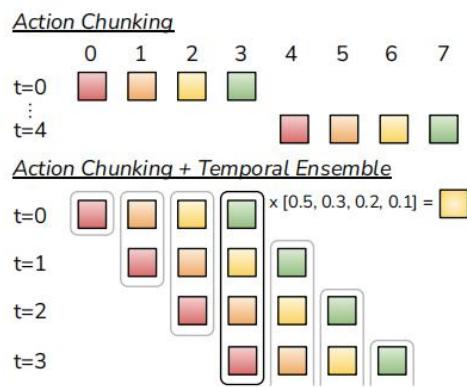  
图 2.12 动作分块与时间集成机制

在机械臂策略学习领域，ACT 算法运用动作组块、时间集成机制和Transformer 架构，在精细操作任务中成效显著。但它难以执行复杂手部动作，在复杂任务中表现不佳。这源于ACT 算法在处理复杂动作分布和高维动作空间能力上的不足。然而，Diffusion Policy 算法能在处理复杂动作分布时精准生成合适策略，高效探索高维动作空间并寻得最优解，且训练稳定性出色，保障算法在各类场景可靠运行。Diffusion Policy 基于去噪扩散概率模型（DDPMs），以随机朗之万动力学为理论基础，把动作序列生成视为去噪过程。DDPMs为 Diffusion Policy 搭建了核心原理框架，在此之上，Diffusion Policy 做出系列针对性改进，以契合机械臂任务的复杂要求，实现高效的机械臂策略学习。

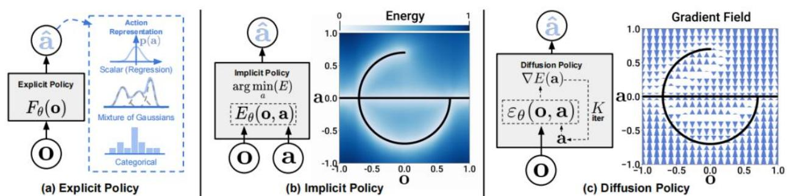

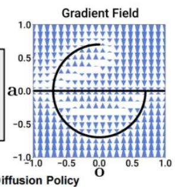  
图 2.13 不同策略表示方法对比：显示策略、隐式策略和扩散策略

如图2.13所示，（a）中的显式策略将世界状态或观察直接映射到动作，这种简单方式在处理多模态行为和高精度任务时存在明显局限。（b）中的隐式策略通过能量函数定义动作分布，虽能自然表示多模态分布，但训练时需负采样估计归一化常数，导致过程不稳定。与之不同，（c）中的DiffusionPolicy 不直接输出动作，而是基于视觉观察推断动作分数梯度，并通过随机朗之万动力学步骤迭代优化动作。从随机噪声动作开始逐步去噪，最终生成符合要求的动作。这使得 Diffusion Policy 具备独特优势：能自然精确表达多模态动作分布，在机械臂操作中可灵活应对多种动作选择；适应高维动作空间，能联合推断未来动作序列，避免短视规划；训练稳定，直接学习能量函数梯度，避免了传统负采样带来的不稳定问题。

在具体原理方面，DiffusionPolicy 基于DDPMs 进行设计，其输出生成过程被建模为去噪过程，具体公式如下：

$$
x ^ {k - 1} = \alpha \left(x ^ {k} - \gamma \varepsilon_ {\theta} \left(x ^ {k}, k\right) + N \left(0, \sigma^ {2} I\right)\right)\tag{2.7}
$$

在这个公式中， $\varepsilon _ { \theta } \left( x ^ { k } , k \right)$ 是噪声预测网络，通过学习不断优化以准确预测噪声； $\alpha$ 、 $\gamma$ 和 $\sigma$ 是与迭代步骤k相关的参数，共同构成噪声调度，决定了每次迭代中噪声的变化方式；$\mathrm { N } \big ( 0 , \sigma ^ { 2 } I \big )$ 是每次迭代添加的高斯噪声，为迭代引入随机性，避免模型陷入局部最优。训练时，从数据集中随机抽取样本 $x ^ { 0 }$ ，随机选择一个去噪迭代步骤k，并采样一个具有适当方差的随机噪声 $\varepsilon ^ { k }$ ，通过最小化均方误差损失函数 $L = M S E { \left( \varepsilon ^ { k } , \varepsilon _ { \theta } \left( x ^ { 0 } + \varepsilon ^ { k } , k \right) \right) }$ 来训练噪声预测网络。为适应机械臂任务，Diffusion Policy对DDPMs 进行了关键调整。在闭环动作序列预测上，将动作序列预测能力与滚动时域控制相结合，在时间步t，以最近 $T _ { o }$ 步的观察数据 $O _ { t }$ 为输入，预测 $T _ { p }$ 步的动作 $A _ { t }$ ，其中， $T _ { a }$ 步的动作会被直接执行在机械臂上，而无需重新规划。这样的设计通过平衡长期规划与实时响应，实现了动作的稳健执行。

为了更好地适配机械臂任务，DiffusionPolicy 进行了多方面的关键改进。在闭环动作序列方面，DiffusionPolicy 巧妙地结合了动作序列预测能力与滚动时域控制。在视觉观察条件设定方面，使用DDPM 近似条件分布，避免推断未来状态的计算成本，加快扩散过程并提高动作生成准确性，具体公式为：

$$
A _ {t} ^ {k - 1} = \alpha \left(A _ {t} ^ {k} - \gamma \varepsilon_ {\theta} \left(O _ {t}, A _ {t} ^ {k}, k\right) + N \left(0, \sigma^ {2} I\right)\right)\tag{2.8}
$$

训练损失公式为：

$$
L = M S E \left(\varepsilon^ {k}, \varepsilon_ {\theta} \left(O _ {t}, A _ {t} ^ {0} + \varepsilon^ {k}, k\right)\right)\tag{2.9}
$$

在这个过程中，网络不断调整自身的参数，学习如何从带噪数据中提取原始数据的特征，从而为后续准确的动作生成奠定坚实的基础。通过大量的样本训练，噪声预测网络逐渐掌握数据的内在规律，能够根据不同的带噪样本预测出合适的噪声，进而实现去噪的目的。在推理时，Diffusion Policy 从高斯噪声中采样初始动作 $x ^ { K }$ ，这个初始噪声动作是整个推理过程的起点。随后，依据上述公式进行K次去噪迭代。在每一次迭代中，模型根据当前的噪声动作 $x ^ { k }$ 、噪声预测网络的输出 $\mathinner { \varepsilon _ { \theta } \mathopen { \left( x ^ { k } , k \right) } }$ 以及添加的高斯噪声 $\mathrm { N } { \left( 0 , \sigma ^ { 2 } I \right) }$ 来更新动作。通过多次迭代优化，动作序列逐渐从随机噪声状态向真实的动作分布靠近，最终生成符合机械臂实际操作需求的动作序列。

如图 2.14 所示，Diffusion Policy 在网络架构设计上采用 CNN 和 Transformer 架构进行构建。基于 CNN 的 Diffusion Policy 使用修改后的 1D 时间卷积网络，借助 FiLM[82]预测动作轨迹。而基于Transformer的时间序列扩散Diffusion Policy凭借独特的输入与注意力机制，在高复杂度任务和高动作变化率场景中表现卓越。这两种架构为 Diffusion Policy 应对不同任务需求提供了有力支持。

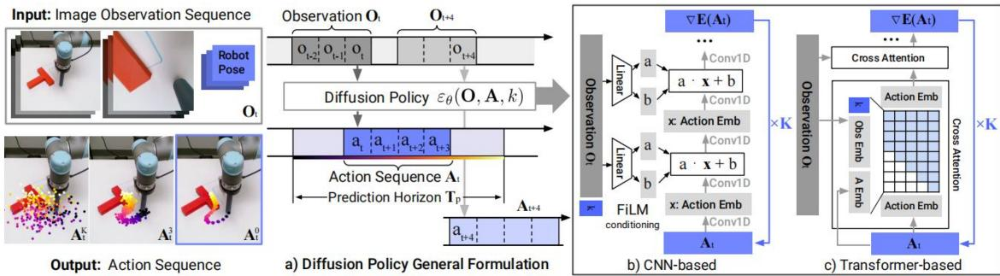  
图 2.14 Diffusion Policy 算法框架图

具体而言，采用 ResNet18 作为视觉编码器。以空间 Softmax 池化替换全局平均池化，更好地保留图像空间信息，提升目标定位与特征识别的精准度；用 GroupNorm 替代BatchNorm，并与DDPMs 常用的指数移动平均相结合，有效保障了训练的稳定性，进而提升模型整体性能。最后，通过噪声调度合理调控扩散过程中的噪声变化，助力模型有效捕捉动作信号的高频和低频特征，优化动作生成的准确性与稳定性，使得 Diffusion Policy 在机器人动作生成方面表现更为出色，提升模型性能。

## 2.5本章小结

第二章深入阐述了本文算法相关理论基础与关键技术，为后续研究基于视觉语言模型与模仿学习的机械臂自主操作算法奠定基础。首先介绍了深度学习中的经典特征提取网络，包括ResNet 残差网络和 Transformer 模型。接着阐述了语义分割技术，为机械臂精准识别、定位目标物体提供关键支持。随后探讨了视觉语言模型技术，从 CLIP 的核心原理过度到Qwen2.5-VL 强大的跨模态理解和高效推理能力。最后深入剖析了模仿学习算法，针对传统行为克隆方法的缺陷，讲述了ACT 变分自编码器模仿学习算法原理与 Diffusion Policy 在多模态动作分布生成方面的优势。通过集成这些技术，全方位覆盖从信息感知到决策执行的关键流程，为解决复杂场景下机械臂自主操作任务，构建起坚实且完备的理论与技术支撑体系，也为后续算法的创新设计、系统的高效搭建以及实验的顺利开展夯实了基础。

## 3 基于视觉语言模型与模仿学习的机械臂自主操作算法

## 3.1系统总体架构设计

在机械臂桌面操作任务方面，机械臂面临着极为复杂艰巨的挑战。实际场景中，机械臂需实时处理涵盖不同角度和光照条件下目标物体图像的视觉信息，以及自然语言形式任务描述的语言指令等来源广泛、格式多样且内容繁杂的多模态数据，并快速准确提取关键信息。同时，要在充满不确定性的复杂环境里，凭借强大的环境感知能力迅速精准决策，规划出合理高效的动作与最优路径，避开障碍物以准确抓取目标物体。此外，由于物体意外移动、环境光线突然变化等外界干扰因素众多，机械臂还需具备高度的抗干扰能力和精确的动作控制能力，来确保动作执行的稳定性和准确性。

为应对复杂环境下的多种挑战，本文提出了一种基于视觉语言模型与模仿学习的机械臂自主操作算法。该算法基于部分可观察的马尔可夫决策过程[83]（Partially ObservableMarkov Decision Processes，POMDPs）构建了一个稳健的框架。本文将机械臂自主操作过程概念化为一个部分可观测的马尔可夫决策过程，由一个四元组定义 $\langle S , A , T , O \rangle$ 。其中S是状态空间，代表机械臂感知状态的集合。具体而言，定义 $s _ { t }$ 为机器人感知状态，包括系统各个相机的RGB 图像信息、机械臂的各关节姿态、夹爪的开合度等所有环境的相关信息；$\overline { { S } } _ { t }$ 为机器人关节状态与夹爪状态的集合。 A是动作空间，代表机械臂可能执行的动作$a _ { t } = \left\{ \theta _ { 1 } , \theta _ { 2 } , \theta _ { 3 } , \theta _ { 4 } , \theta _ { 5 } , \theta _ { 6 } , g \right\}$ 的集合，其中 $\theta _ { i }$ 代表第i轴的轴角弧度， $g$ 是夹爪开闭度；T是状态转换函数，它描述了在特定状态和动作下，环境中各状态之间转换的概率； $O$ 是观察空间，代表环境系统中传感器数据的集合，在本文配置中特指 Intel Realsense D435 相机拍摄的场景的RGB 图像。

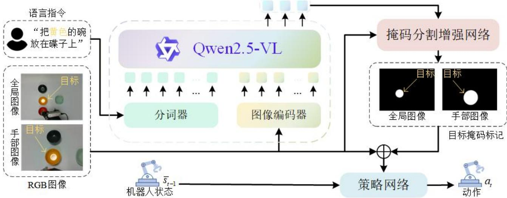  
图 3.1 基于视觉语言模型与模仿学习的机械臂自主操作算法框架图

图3.1展示了基于视觉语言与模仿学习的机械臂自主操作算法框架图，呈现了机械臂在机械臂自主操作任务中，从接收语言指令和视觉观测图像，到生成动作的完整流程。这一框架主要包含数据输入、任务目标特征提取、目标掩码分割、动作策略生成等关键环节，各部分紧密协作，共同实现机械臂自主操作任务。具体而言，本系统输入数据包括语言指令、RGB 视觉观测图像以及机械臂自身状态数据。其中，语言指令明确了任务目标，RGB图像提供了环境视觉信息，机械臂自身状态数据（如机械臂各关节的角度、夹爪的开合状态等）则反映了机械臂当前的工作状态。

在本系统的运行流程中，首先处理任务语言指令和视觉图像观测。语言指令由分词器拆解编码为离散特征向量，RGB 图像经图像编码器提取视觉特征，转化为特征丰富的向量，为后续任务筑牢语义根基。接着，将处理后的语言向量与视觉特征输入Qwen2.5-VL 视觉语言大模型，借助跨模态注意力机制深度融合二者，精准聚焦目标信息，输出任务目标特征信息。随后，基于任务目标特征信息与原始图像，利用掩码分割增强网络分割目标生成掩码信息，依次进行标注、融合、几何特征提取和后处理等操作，强化语义与空间信息，再将目标掩码信息与原始RGB 图像叠加，生成掩码嵌入图像特征。最后，策略网络依据掩码嵌入特征与机械臂实时状态信息，推理得出最优动作，输出 6-DoF 的轴角弧度和夹爪开闭度。通过ROS 将指令发送至机械臂执行，在执行过程中，机械臂借助传感器反馈动态优化轨迹，形成闭环控制，确保任务高效完成。

## 3.2基于 VLM的任务目标特征提取框架

在本系统中，多模态信息的预处理与任务目标特征提取是实现机械臂自主操作的首要环节。语言指令与 RGB 图像作为关键的输入信息，需经过一系列处理转化为可供后续模块使用的特征向量，再经Qwen2.5-VL 视觉语言大模型处理，获取目标特征信息。

具体而言，对于自然语言指令，系统运用分词器进行转化为语义向量。分词器基于内部预训练的语言规则和词汇表，对输入指令执行分词与编码操作，将其细致拆解为离散单元，并为每个单元赋予特定的向量表示。通过这一过程，能够精准捕捉指令中的关键信息，如物体类别、空间关系等目标属性。而在视觉特征提取方面，图像编码器采用了ResNet 骨干网络。该网络可将原始的 RGB 图像高效转化为蕴含丰富图像特征的向量。Qwen2.5-VL模型凭借其内部的跨模态注意力机制，对语言向量和视觉特征开展深度融合与剖析，并依据关联性动态分配权重，实现对目标相关信息的精准捕捉。经深度融合分析后，模型输出结构化的目标描述，其中详细包含目标位置坐标、边界框参数以及语义属性等关键特征信息，作为后续进行目标实例分割和动作策略生成的重要依据，助力系统精准定位并识别目标物体，为机械臂后续的操作提供坚实的信息基础。

Qwen2.5-VL 大模型具备强大的语义理解和跨模态处理能力，在视觉语言任务中优势显著，可为机械臂精准操作提供有力支撑。但该模型的部署与运行资源消耗巨大，若在实际机械臂运行时将其部署于本地，机械臂运行效率会大幅降低。由于机械臂硬件资源有限，除需处理自身运动控制、传感器数据采集等任务外，运行复杂大模型会加重其负担，进而引发响应迟缓、操作卡顿等问题，严重影响任务执行的效率与准确性。

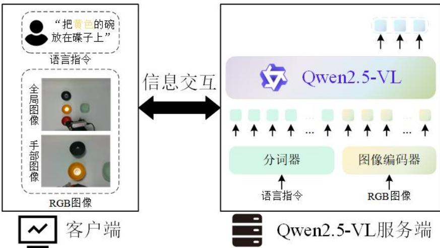  
图 3.2 Qwen2.5-VL 服务端与机械臂客户端示意图

为解决资源占用与系统响应问题，如图3.2所示，本系统针对Qwen2.5-VL 大模型采用客户端-服务端架构部署，机械臂为客户端，Qwen2.5-VL 大模型为服务端。机械臂基于ROS系统回调函数机制，实时获取视觉观测图像，并将视觉图像与语言指令封装打包，通过网络传输至Qwen2.5-VL 服务端。Qwen2.5-VL 服务端接收数据后，凭借其强大推理能力及内部先进算法和预训练知识，深度分析视觉语言图像与语言指令，推理生成任务目标特征信息。推理完成后，服务端将任务目标特征信息回传至机械臂客户端，为动作规划和任务执行提供支持。为保障系统可靠性与高效性，本架构融入多重优化策略。数据传输采用高效压缩和加密算法，减少传输量并提升安全性；服务端部署负载均衡和资源动态分配机制，确保高并发下模型稳定快速处理请求；客户端与服务端建立实时心跳检测和错误重传机制，保证数据传输完整稳定。

## 3.3基于 Transformer 的掩码分割增强网络

在本系统中，精准识别与定位目标物体是机械臂自主操作的核心环节。本系统利用掩码分割增强网络完成目标实例分割与掩码增强，为后续抓取操作提供关键信息支撑。具体而言，将 Qwen2.5-VL 输出的任务目标特征信息转化为任务目标在图像上的边界框和关键点，基于此信息结合原始图像经网络处理后生成掩码信息，再将目标掩码信息与原始RGB图像叠加，生成掩码嵌入图像特征作为下游策略网络推理动作的输入信息，基于Transformer的掩码增强分割网络如图3.3 所示。

本文掩码增强分割网络以RGB图像作为原始输入，图像先经编码器处理得到图像特征，同时结合 Qwen2.5-VL 输出的目标特征向量从图像获取的关键点和边界框信息进入提示编码器作为提示信息。目标提示为掩码分割增强网络提供了目标物体在图像中的大致位置，这有助于掩码分割增强网络快速定位目标并生成掩码。然后，进入掩码生成阶段，图像特征会经过基于 Transformer 架构的记忆注意力模块捕捉长距离依赖关系后，与提示编码器输出一同进入掩码解码器，掩码解码器凭借强大的特征提取能力和空间注意力机制在复杂背景中准确分割目标物体，生成二值掩码。具体而言，掩码解码器输入图像特征、输出令牌和提示令牌，借助注意力机制对两类输入信息进行融合，有侧重地关注关键部分，并通过多层叠加结构逐步处理变换信息，从基础特征到复杂语义和空间信息层层细化，不断加深对目标物体的理解与表示。此外，目标掩码降采样后，再与图像特征一起，通过多层感知机、卷积网络和 Transformer 等模块进行处理，最终输出掩码、目标语义、IoU 分数和遮挡分数，根据这些分数综合评判，输出明确划分目标物体位置和轮廓的二值目标掩码，为后续生成掩码嵌入图及下游策略网络推理等操作提供关键信息支撑。

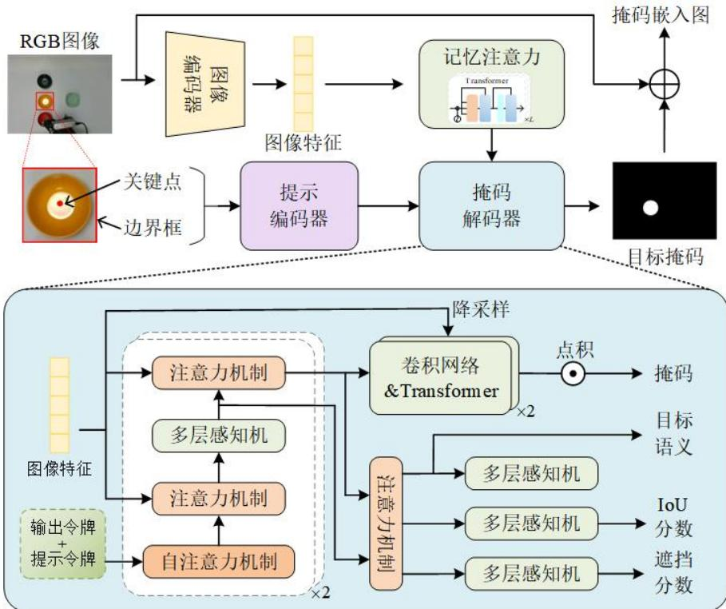  
图 3.3 掩码分割增强网络结构图

为了提高分割结果的质量，系统会对掩码分割增强网络生成的掩码进行后处理操作。采用去噪算法和边缘平滑技术消除掩码中的噪声和不完整区域，以此提升分割结果的鲁棒性。在复杂场景中，目标物体的尺度和形状差异较大，这对掩码分割增强网络提出了更高要求。为此，本系统采用多尺度分割策略，结合图像金字塔或多分辨率输入，确保不同尺度的目标都能被精确分割。对于较小的目标，使用高分辨率输入以提高分割精度，而对于较大的目标，则使用低分辨率输入来提高计算效率。同时，系统借助注意力机制，以动态的方式对分割模型的关注范围进行调节，从而使分割结果的精确程度与稳健性能得到进一步提升。对于分割不完整或错误的情况，系统会使用插值或区域生长等方法进行修复，如根据周围像素信息插值填充未正确分割的区域，使用区域生长算法扩展边界不清晰的分割区域。在完成上述一系列处理后，将优化后的目标掩码与原始RGB 图像进行叠加，通过调整掩码的透明度或颜色等参数，使目标物体在图像中以高亮标记的形式呈现，生成掩码嵌入图。这种图像既保留了原始RGB 图像的所有视觉信息，又突出了目标物体的位置和形状，为后续策略网络的决策提供了直观明确的视觉输入，大大提高了策略网络对目标物体的识别和处理能力。

## 3.4基于 Diffusion 的模仿学习策略网络

在我们所构建的系统中，策略网络发挥着至关重要的作用，其结构与工作机制直接关系到机械臂能否精准地完成自主操作任务。图3.4展示的策略网络是整个系统实现高效动作规划的核心组件，它以融合后的多模态信息为基础，借助先进的网络架构和算法，为机械臂输出精确的动作指令。

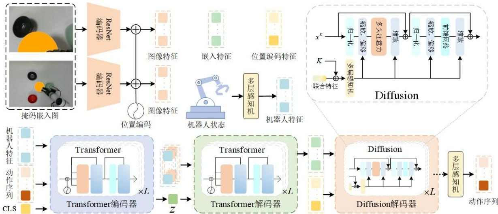  
图 3.4 策略网络结构示意图

如图3.4 所示，本文策略网络结构以条件变分自编码器（CVAE）为基础进行构建，由CVAE 编码器和 CVAE 解码器两大部分组成，以实现从观测数据到动作序列预测的功能。其中，CVAE 编码器由 Transformer 编码器组成，CVAE 解码器由 Transformer 解码器和Diffusion 解码器组成。在策略网络的训练阶段，CVAE 编码器的作用是将当前的机械臂状态信息和机械臂动作序列进行编码处理。具体而言，其输入包括当前的机械臂关节位置、夹爪状态以及目标动作序列，并且为了更好地与模型架构融合，会在输入前添加一个BERT中可学习的“CLS”标记。这些输入共同构成一个长度为k2的序列，经过 CVAE 编码器处理后，提取对应“CLS”标记的特征，用于预测风格变量的均值和方差，z被参数化为对角高斯分布。在策略网络的训练过程中，为加快模型训练的速度，本研究选择仅基于机械臂状态观测和动作序列预测多模态动作分布z，忽略图像观测信息。具体策略网络训练过程如表3.1 所示。

在策略网络的推理阶段，首先，当前时刻的输入数据主要包含2个带有掩码特征的RGB图像和机器人特征，这里机器人特征包括机械臂的 6 自由度关节位置信息以及夹爪开闭状态，这些数据反映了机械臂所处环境的视觉场景和自身状态。然后通过ResNet 骨干网络对RGB 图像进行特征提取与处理，在此过程中，每个 480×640×3 的 RGB 图像被转化为15×20×512 的特征图，随后沿空间维度展平，形成 300×512 的图像特征序列。考虑到空间信息对于图像理解的重要性，为了保留关键的空间信息，系统会给该特征序列添加2D余弦位置嵌入。对 2个图像都进行这样的操作后，会得到维度为 600×512 的综合图像特征序列，这一步整合了两个图像的视觉信息，不仅有效提取了图像中的关键特征，还通过合理的处理和嵌入操作，保留了重要的空间信息。

表 3.1策略网络训练过程

策略网络训练过程
输入: D ——数据集;  $\theta$  ——网络参数; k ——分块尺寸;  $\beta$  ——权重参数
1: 定义  $a_{t}$ ,  $s_{t}$  为时刻 t 的动作和观测状态,  $\overline{s}_{t}$  刻表示不包含图像的观测状态
2: 初始化 CVAE 编码器  $q_{\varphi}(z|a_{t:t+k},\overline{s}_{t})$  和 CVAE 解码器  $\pi_{\theta}(\hat{a}_{t:t+k}|s_{t},z)$ 
3: for  $n=1,2,\ldots$  do
4: 从 D 中采样  $s_{t}$ ,  $a_{t:t+k}$ 
5: 从  $q_{\varphi}(z|a_{t:t+k},\overline{s}_{t})$  采样 z
6: 从  $\pi_{\theta}(\hat{a}_{t:t+k}|s_{t},z)$  预测  $\hat{a}_{t:t+k}$ 
7: 计算  $L_{reconst}=MSE(\hat{a}_{t:t+k},a_{t:t+k})$  损失,  $L_{reconst}$  为重构损失
8: 计算  $L_{reg}=D_{KL}(q_{\varphi}(z|a_{t:t+k},\overline{s}_{t})\parallel N(0,I))$  损失,  $L_{reg}$  为 KL 正则化损失
9: 使用 ADAM 优化器，根据损失函数  $L=L_{reconst}+\beta L_{reg}$  更新网络参数  $\theta$  以及  $\varphi$ ,
10: end for

之后，系统对不同来源的信息进行整合与处理，以形成更全面的特征表示。具体而言，将当前时刻机器人特征和风格变量z分别通过线性层映射到512维，其中，z设置为零向量，使得其服从训练时的先验分布。然后与图像特征序列进行拼接形成维度为 602×512 的输入向量，这个输入向量包含了机械臂视觉感知信息（来自图像特征序列）和机械臂本体感受信息（来自机器人特征），通过Transformer 编码器进行编码。Transformer 编码器能够有效捕捉输入向量中的长距离依赖关系，对不同模态的信息进行融合与转换，从而生成当前时刻的嵌入特征。

表 3.2 策略网络推理过程

策略网络推理过程
输入:  $\pi_{\theta}$  ——策略网络；m ——权重参数；T ——最大轨迹长度；k ——历史数据长度
1: 初始化先进先出 FIFO 缓存区 B[0:T]，其中 B[t] 为 t 时刻的所有预测动作的集合
2: for  $n=1,2,\ldots$  do
3: 从  $\pi_{\theta}\left(\hat{a}_{t:t+k}\mid s_{t},z\right)$  预测  $\hat{a}_{t:t+k}$  的，这里 z=0
4: 将预测动作  $\hat{a}_{t:t+k}$  添加到缓存区 B[t:t+k]
5: 获取当前时刻所有动作  $A_{t}=B[t]$ ， $A_{t}[i]$  表示时刻在时刻 i 生成的 t 时刻的动作  $a_{t}$ 
6: 计算最终动作  $a_{t}=\sum_{i=0}^{K}w_{i}\cdot A_{t}[i]$ ，其中  $w_{i}=\exp\left(\alpha\cdot\cos\left(A_{t}[t],A_{t}[i]\right)\right)$ ，这里 K=2, $\alpha=0.2$ 
7: end for

最后，将嵌入特征与位置编码拼接起来以组成联合特征，通过 Diffusion 解码器生成当前时刻的动作轨迹序列，具体而言，Diffusion 解码器采用多层Transformer 模块堆叠结构，每个Transformer 模块依次对输入特征进行归一化、缩放与偏移操作，借助多头注意力机制捕捉丰富语义和依赖关系，在本文网络设计中，多头注意力机制位置编码作为注意力机制中的查询，以嵌入特征作为注意力机制中的键和值进行交叉注意力计算，再经前馈网络进行非线性变换以学习高级特征表示。通过多层模块的迭代处理，不断细化转换输入特征。在完成一系列处理流程后，Diffusion 编码器所产生的输出会进入多层感知机进行进一步计算，最终输出一个 $k \times 7$ 的张量，该向量代表未来k个时间步机械臂的绝对关节位置以及夹爪状态，即规划的动作序列。接下来使用动态轨迹集成策略处理多个时间步的动作轨迹序列，生成t时刻的动作 $a _ { { _ t } }$ 。具体策略网络推理过程如表3.2所示。

在模仿学习应用于需要高精度和视觉反馈的精细操作任务场景时，模仿学习算法面临着诸多挑战。一方面，模仿学习算法面临“累计误差”难题。这是因为机械臂操作误差容忍度低，预测动作的微小偏差会引发状态显著变化，致使误差随时间不断累积，最终让机械臂行为偏离训练分布。另一方面，机械臂的轨迹规划长度对于任务执行效果起着至关重要的作用。若对未来动作规划的时间跨度太长，当执行环境发生变化时，机械臂可能无法及时响应和调整，而规划时间跨度太短，又难以让机械臂在规划运动轨迹时达到理想的完美程度。并且，机械臂动作具有多模态分布特性，完成同一任务存在多种可行动作模式，这进一步加剧了动作规划和执行的复杂性。

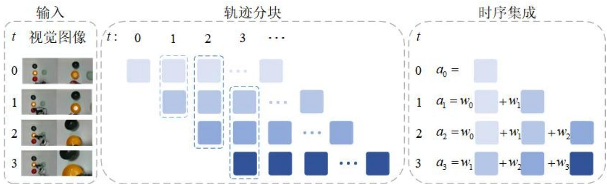  
图 3.5 动态轨迹集成策略

为解决这一问题，本文设计了动态轨迹集成策略，与传统的平滑处理不同，这种方法是对同一时间步的预测动作进行动态集成，避免了传统平滑处理中因聚合相邻时间步动作而引入的偏差。如图3.5所示，通过将连续的动作序列分割为多个相对独立的动作组块。每次预测未来k个时间步的目标关节位置。通过这种方式，任务的有效视野降低了k倍，从机械臂单步决策扩展为多步规划，可以有效缓解了复合误差问题。在实际执行过程中，系统会按照每隔k步的时间间隔来推理未来k步的动作序列。这种动作分块方式虽然简洁，但存在明显弊端。由于机械臂在执行任务时，对动作的连贯性和流畅性要求较高，而每隔k步才进行一次动作推理，使得机械臂在执行动作时，难以根据实时的环境变化和任务需求进行及时调整。在不同的动作分块之间，机械臂可能无法平滑过渡，从而导致运动出现不连贯、生硬的情况，影响任务执行的精度和效率。

针对这一问题，本文动态轨迹集成策略在每个时间步都根据机械臂观测推理未来k步的动作序列，使得不同的动作块相互重叠，在同一时间步会产生多个预测动作。然后，采用余弦动态加权的方式对这些预测动作进行组合做轨迹平滑处理。具体公式如下：

$$
a _ {t} = \sum_ {i = 0} ^ {K} w _ {i} \bullet A _ {t} [ i ]\tag{3.1}
$$

其中，K表示本文动态轨迹策略滑动窗口的大小，设置 $K = 2$ 表示在任一时刻t所考虑的动作数量， $w _ { i }$ 是每个动作的动态权重，具体公式如下：

$$
w _ {i} = \exp \left(\alpha \cdot \cos \left(A _ {t} [ t ], A _ {t} [ i ]\right)\right)\tag{3.2}
$$

其中， $\cos { \left( \mathcal { A } _ { t } \left[ t \right] , \mathcal { A } _ { t } \left[ i \right] \right) }$ 表示在时刻t两个动作之间的余弦相似度， $\alpha$ 是一个超参数。

## 3.5本章小结

第三章详细阐述了基于视觉语言模型与模仿学习的机械臂自主操作算法，涵盖任务目标特征提取模块、掩码分割增强网络和模仿学习策略网络。首先，详细介绍了本章算法设计框架，明确各环节如何协同运作。然后介绍了基于 VLM 的任务目标特征提取框架，根据视觉观测图像和自然语言指令输出任务目标特征。接着，深入探讨基于Transformer 的掩码分割增强网络，结合任务目标特征进行掩码分割增强，用以生成联合嵌入特征。最后，设计了基于Diffusion 的模仿学习策略网络，引入动作分块和时序集成策略，提出动态轨迹集成策略，提高机械臂在复杂任务和动态环境中的适应性和决策能力。通过上述各个模块协同运作，为机械臂在桌面平台操作任务中的应用提供了清晰的思路和坚实的理论依据。

## 4 机械臂操作平台搭建与多模态数据集构建

为验证本文提出的基于视觉语言模型与模仿学习的机械臂自主操作算法，本文搭建了一个完整的机械臂操作平台，包括仿真环境的创建、硬件设备的选择与集成、实验环境的搭建以及基于 ROS（机械臂操作系统）的机械臂控制系统。此外，还通过精心设计采集流程，融合多传感器数据并经严格处理，构建了多模态数据集，为算法研究提供支撑。本章详细介绍平台搭建过程的各个环节及其实现方法。

## 4.1机械臂硬件系统搭建

## 4.1.1 机械臂仿真环境选择

针对本研究需通过语言指令驱动机械臂完成特定任务的特殊需求，筛选能够真实映射物理环境特性并精确模拟交互动态的仿真环境具有重要意义。经技术评估，MuJoCo、PyBullet、IsaacSim 和 Gazebo 等主流平台在动力学建模方面各具优势，如图 4.1 所示：

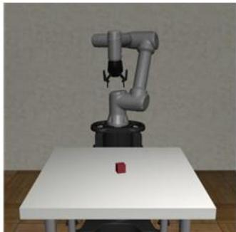  
MuJoCo

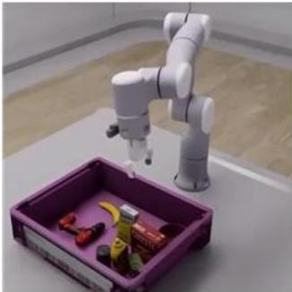  
IsaacSim

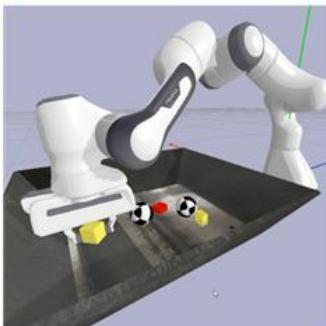  
PyBullet

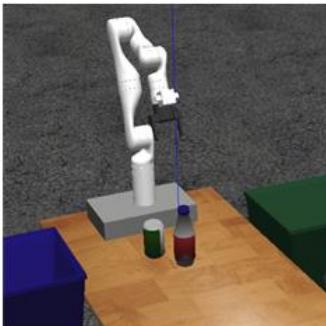  
Gazebo  
图 4.1 常见的四种机械臂物理仿真平台

在机械臂研究领域，不同的仿真环境各有其独特的优势与局限。MuJoCo因其在复杂动力学建模与精准物理模拟中的高效表现，广泛应用于学术与工业领域。其高效计算能力可精准复现多体系统交互行为及物理属性，提供高保真仿真环境。然而，其商业授权的高额成本限制了它在更广泛范围内的应用。NVIDIA IsaacSim 是一款基于 NVIDIA Omniverse 平台的机械臂仿真环境。它具有高度的可扩展性，开发人员能够构建基于通用场景描述（OpenUSD）的自定义模拟器，也可将 IsaacSim 的核心技术集成到现有的测试和验证流程中。IsaacSim 为基于人工智能的机械臂和自主机器提供了强大的物理仿真环境，支持丰富的传感器和执行器模型，能够逼真地模拟各种复杂场景。其先进的渲染技术和精确的物理模拟，使得它在机械臂感知、运动规划和控制算法的研究与开发中具有重要作用。但它也存在一定的局限性，例如对硬件性能要求较高，这在一定程度上增加了使用门槛。PyBullet 是基于Bullet 物理引擎开发的 Python 开源工具包，凭借其高效的运算性能和高精度的碰撞检测功能，已成为复杂关节系统动力学建模及控制策略验证的重要平台，在机械臂操作模拟与物理环境构建领域得到广泛应用，但在应用层面仍面临仿真与现实场景在控制精度鲁棒性和环境复杂度适配性方面的转换鸿沟，需通过参数优化和算法改进来提升系统的迁移应用能力。而Gazebo 作为机器人操作系统生态的标准仿真环境，具备显著的技术优势。该平台支持多样化物理引擎接口，还集成标准化模型资源库与多平台兼容特性。依托与ROS的深度集成框架，构建了仿真环境与真实环境之间的迁移通道。其在物理属性建模保真度与系统扩展性方面的突出表现，使之成为机械臂系统研发全周期的优选平台，极大地促进了机械臂技术从理论研究到实际应用的转化。

综合考量建模真实度、系统通用性及物理特性模拟精度等关键指标，本研究决定采用Gazebo 作为机械臂桌面操作任务的仿真平台。该平台凭借与ROS 的深度集成架构，结合其强大的仿真引擎与丰富的模型库资源，成为复杂交互场景与多样化环境模拟的理想选择，能够有效满足本研究对物理属性精确建模的技术需求。

## 4.1.2 机械臂硬件平台集成

本文在搭建该环境时，所选用的主要硬件包含机械臂、夹爪、RGB 相机等，在仿真环境里借助相应模拟包开展仿真实验。首先选择中国睿尔曼智能公司研发的RM65-B机械臂，如图4.2所示。RM65-B 机械臂是一款六轴协作型机械臂，支持多模态交互控制，其机身重量为 7.2kg，却拥有出色的负载能力，额定负载 5kg，全臂展时峰值负载可达 9kg，负载自重比表现优异。重复定位精度达到±0.05mm，能在各种任务中精准操作，确保了操作的准确性和稳定性。610mm 的工作半径结合灵活的关节设计，提供了 360 度的关节运动自由度（J1-J6关节分别有不同的运动范围，如J1、J4 为±178°，J2 为±130°等），使其能够灵活地到达工作区域的各个位置，轻松应对复杂的操作任务。在本实验场景下，机械臂需要实现对物体的精准操作。工作空间规划为80mm×100mm的二维区域，选用RM65-B协作机械臂作为执行机构，其末端的最大工作半径能够完全覆盖该区域，确保操作过程的空间可达性。

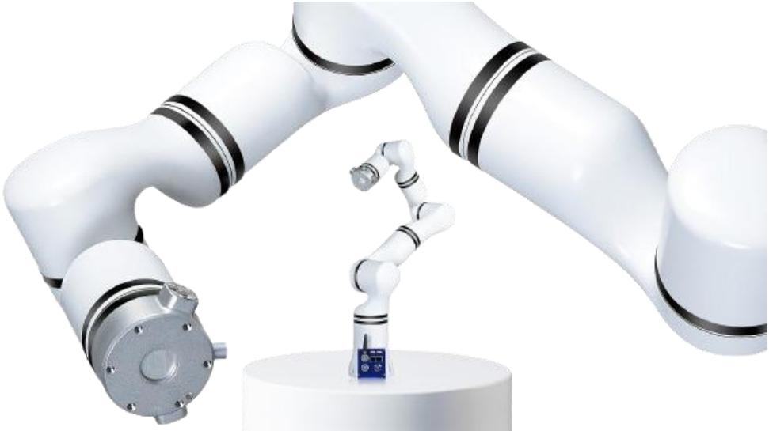  
图 4.2 RM65-B 机械臂

RM65-B 机械臂具备诸多突出特性。它采用一体化、模块化设计，将控制器集成于机械臂本体，这种设计使得其结构极为紧凑，不仅减少了空间占用，还提升了整体稳定性，方便快速部署。在编程方面，除了便捷的拖拽编程方式，还为开发者提供了开放的 API 函数库，支持 C/C++/C#/Python 等多种编程语言，同时兼容 Windows/Linux/ROS 等常见操作系统，为不同需求的用户提供了多样化的编程选择，无论是基础用户还是高级开发者都能轻松上手，实现对机械臂的精确控制。具体机械臂参数可见表4.1。

表 4.1 RM65-B 机械臂相关参数

<table><tr><td colspan="4">产品相关参数</td></tr><tr><td>自由度</td><td>100W(Max200W)</td><td>电源电压</td><td>DC24v</td></tr><tr><td>额定负载</td><td>5kg</td><td>重复定位精度</td><td>±0.05mm</td></tr><tr><td>工作半径</td><td>610mm</td><td>控制方式</td><td>拖拽/示教器/API/JSON</td></tr><tr><td>本体重量</td><td>7.2kg</td><td>空间占用</td><td>∅190mm</td></tr><tr><td>通讯方式</td><td>WIFI/网口/蓝牙/USB/RS485</td><td>关节运动范围</td><td>J1±178°、J2±130°、J3±135°、J4±178°、J5±128°、J6±360°</td></tr></table>

RM65-B 机械臂末端的接口具备良好的通用性，支持多种工业传感器和执行器，可根据不同的任务需求快速更换工具，通过ROS 进行编程，可成功实现运动控制，大大提升了机械臂的应用灵活性和适应性，展现出强大的应用潜力。

其次，本文实验所使用的夹爪在不同环境下有所不同。在仿真环境中，使用Robotiq-85夹爪模拟包，其由加拿大公司 Robotiq研发；而在真实环境实验中，则选用大寰机械臂公司的DH-95夹爪。这两款夹爪型号中的数字对应着其最大夹取宽度，Robotiq-85 能达到85mm，DH-95 为95mm。实验选用的物体均是家庭和零售场景里的常见物品，它们的尺寸都小于夹爪的最大夹取宽度，符合桌面操作任务要求。在执行任务时，会把夹爪装配到 RM65-B 机械臂的末端。在仿真环境当中，能够直接借助 ROS通信机制对夹爪开展编程操控；而在实际的真实环境里，夹爪网络通信与系统建立连接，之后再通过编程来实施控制，进而达成本文算法所要求的各种交互动作。

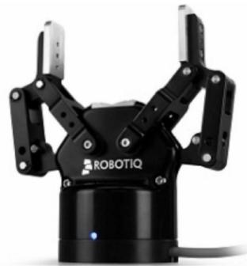  
Robotiq-85

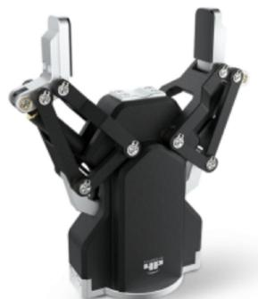  
DH-95  
图 4.3 本文使用夹爪示意图

最后，本文选用 Intel RealSense D435 作为机械臂视觉感知设备，仿真环境采用官方模拟包，真实环境部署实体相机。该RGB 相机分辨率达 $1 9 2 0 \times 1 0 8 0$ ，立体视觉方案配备87广角镜头，场景覆盖范围 $1 . 2 \mathrm { m } \times 0 . 8 \mathrm { m }$ ，以30fps 频率输出图像，可实时采集数据。其重140g的轻量化设计便于集成至机械臂末端，且支持Intel OpenVINO工具链，能与ROS系统无缝对接。

系统配置双相机：其一置于工作空间上方 1 米处，提供全局视野；其二安装于机械臂末端，捕捉近距离物体细节。二者视角互补，使机械臂兼具环境整体认知与目标精细操作能力，显著提升操作准确性与可靠性。

## 4.1.3 机械臂操作环境搭建

本系统基于高刚度轻量化的设计理念搭建本文机械臂仿真操作平台，在Gazebo 仿真环境中，机械臂系统主体为一个睿尔曼 RM65-B 六轴协作机械臂，将 Robotiq-85 夹爪作为交互设备固定在机械臂末端，同时，两个 Realsense D435 相机分别搭载于机械臂末端夹爪及工作空间正上方 1 米处。顶部相机构建全局视角，可实时获取工作区域内物体的空间分布信息，末端相机获取局部信息，精度捕捉目标表面纹理特征。两台设备通过ROS同步触发机制，协同完成机械臂系统的场景感知。整个机械臂系统稳固安装在水平实验台上开展机械臂桌面操作任务实验。环境中本文的工作空间为一个桌面平台，实验物体被放置在桌面平台中心区域，如图4.5(a)所示。

在真实环境中，实验环境的设置与仿真环境基本相似。针对平面工作空间的尺寸，本文对机械臂的初始抓取姿态进行了优化调整，使其更契合实际操作需求，具体如图 4.5(b)所示。在真实环境下，各硬件设备按照实际设计进行安装和连接，确保机械臂、夹爪和相机之间的协同工作，满足精密装配场景下亚毫米级的动态协调需求，以此来验证相关算法和策略在实际应用中的可行性和有效性。

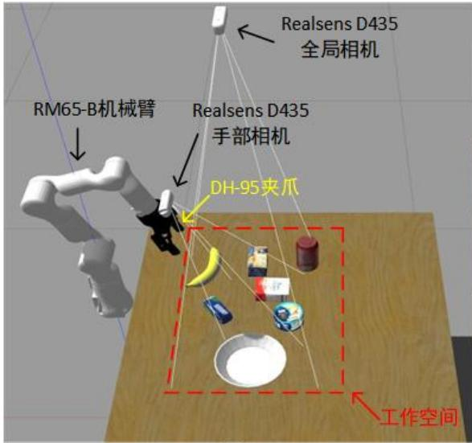  
(a)

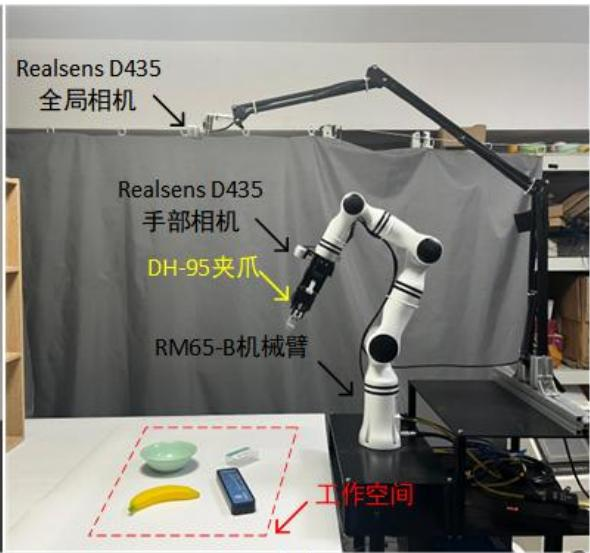  
(b)  
图 4.5 仿真和真实实验环境的机械臂实验平台：(a)仿真环境实验平台；(b)真实环境实验平台

## 4.1.4 ROS 机械臂控制方案

本研究采用机器人操作系统（ROS）构建机械臂实验的软件架构，结合MoveIt!运动规划框架实现机械臂的路径规划与运动控制。作为专为多关节机械臂开发的智能控制解决方案，MoveIt!集成了 OMPL 运动规划库与 Chomp 轨迹优化算法，支持实时碰撞检测（离散化步长2mm）、运动学逆解（基于URDF 的DH 参数解析器）及三维环境建模等核心功能，能够无缝兼容 RM65-B 机械臂及 Realsense D435 传感器。

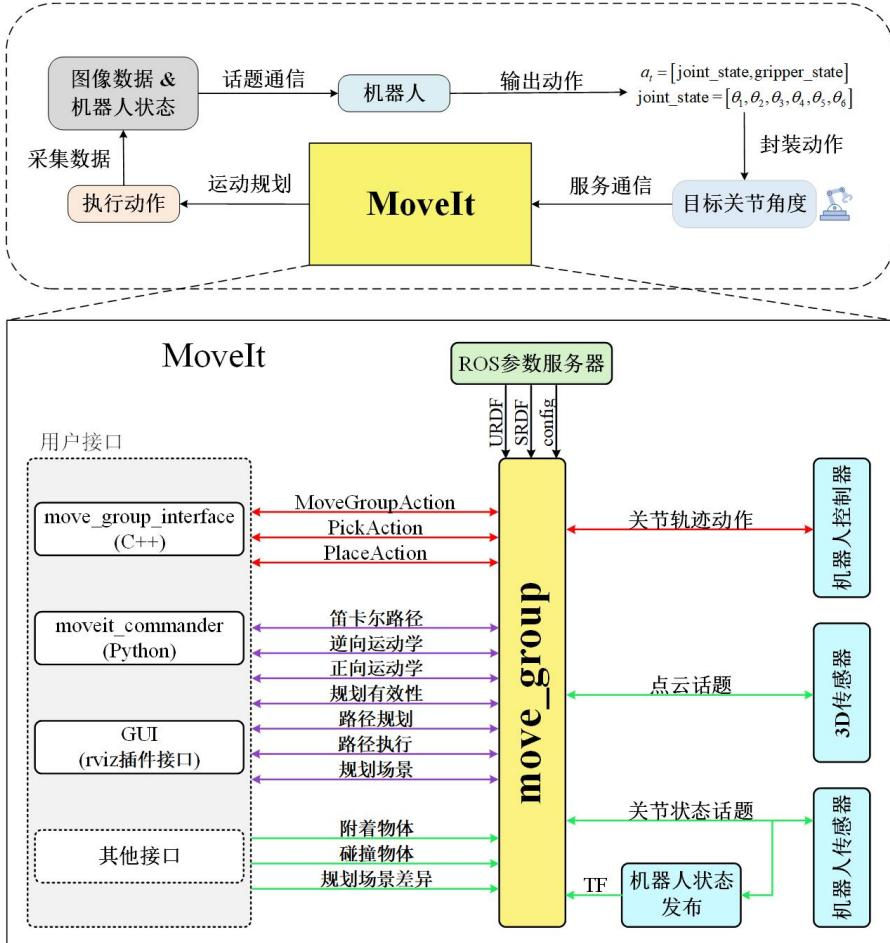  
图 4.6 MoveIt！运动控制库的核心节点 move\_group

如图 4.6所示，在系统架构层面，move\_group 节点作为控制中枢，通过 Action 通讯协议与用户交互层、参数服务器及硬件驱动层进行数据交互。该节点提供多语言 API 接口（C++/Python）及 Rviz可视化工具，支持运动规划请求的动态生成与执行状态监控。通过与机械臂控制器的硬实时连接，move\_group 可实现轨迹点的微秒级发送（平均规划延迟<80ms），并通过joint\_states 话题实时获取关节角度反馈（更新频率 1kHz，精度±0.01°）。

此外，move\_group 节点内置的碰撞检测引擎采用Octomap 环境建模技术，结合双目视觉系统的点云数据（更新频率15Hz），可构建精度达毫米级的三维场景模型。该架构支持力控模式下的柔顺操作（接触力控制精度±0.5N），通过集成 Gazebo 物理引擎实现虚实环境的同步仿真验证。本研究主要采用 Python 接口开发控制逻辑，通过消息协议实现算法与硬件的实时通讯，确保控制指令的可靠传输与执行状态的闭环反馈。

在机械臂控制领域，为实现高效且精准的操作任务，本文采用轴角控制方式，机械臂的运动规划与执行均以此为基础。在实际运行过程中，机械臂依靠先进的传感器实时获取环境与自身状态的观测数据。基于这些数据，结合机械臂自身当前的状态信息，通过复杂的算法进行深度推理，以确定最优的动作轨迹。值得注意的是，该轨迹以轴角形式呈现，为后续的控制操作提供了重要的基础数据。轴角形式的动作轨迹生成后，通过 ROS（机械臂操作系统）的话题机制，被精确地发布至move\_group 节点。作为运动规划与控制的核心组件move\_group 节点在接收到轴角动作信息后，迅速启动高性能的轨迹规划算法。该算法在运行过程中，全面且深入地考虑了机械臂的运动学约束条件，包括但不限于关节的活动范围限制、最大速度与加速度的约束等。同时，对环境中的障碍物分布情况进行细致分析，涵盖障碍物的形状、精确位置以及动态变化等因素。通过综合考量这些因素，move\_group节点生成了一条既安全又高效的运动轨迹，确保机械臂在复杂环境中能够安全、稳定地运行。最后，move\_group 节点将规划好的轨迹转换为具体的控制命令，这些命令能够被机械臂的驱动系统准确识别。随后，控制命令被精确无误地发送至机械臂的驱动系统，使得机械臂能够按照轴角控制方式精确地执行运动指令，顺利完成预期的操作任务。通过上述轴角控制方式的应用，实现了在复杂环境下对机械臂运动的精准控制满足了各种实际应用场景的需求。

## 4.2多模态数据集构建

多模态数据集的构建对提升智能系统性能与泛化能力意义重大。其融合多源数据，为模型提供丰富全面信息，以适应复杂多变的现实场景。本研究中，多模态数据集构建包含数据采集、标注等关键环节，共同构建高质量数据集，为后续模型训练与应用筑牢根基。接下来将详细阐述各部分内容。

## 4.2.1 数据采集流程设计

在机械臂模仿学习领域，传统同步阻塞式存储策略用于数据采集时存在弊端。以ALOHA 为例，它在采集数据时，要等机械臂完成整个任务轨迹，才存储单个任务周期内的视觉图像、关节状态、夹爪开合度等轨迹数据。任务复杂度低时，该方式还能满足基本需求，但当任务单个任务轨迹步数超 500 步，数据存储所需的时间会显著增加。这是因为单个任务的数据集由多个成功完成该任务的示教数据构成，每个示教数据涵盖机械臂完整执行任务过程中的视觉观测、关节状态、轨迹动作等全部信息。随着任务步数增多，数据量急剧增加，文件体积随之迅速膨胀，进而在数据存储过程中产生明显延迟。这不仅使得数据采集效率随着任务复杂度的提升呈指数级下降，更由于存储机制的限制，系统在数据存储期间不得不暂停数据采集工作。这一情况直接导致有效数据吞吐量进一步降低，严重阻碍了大规模、复杂任务的数据采集进程。

为解决上述问题，本研究基于ROS的多线程异步回调机制采集数据，将数据采集与存储过程解耦，通过回调驱动和队列缓冲实现并行化处理。如图4.7所示，系统在轨迹执行线程中通过ROS 的话题订阅机制实时捕获传感器数据。每当接收到新的关节状态或图像消息时，立即将当前步的数据（包括时间戳、RGB 图像、六轴角度及夹爪状态）封装为字典结构，并推送至共享内存队列。与此同时，一个独立的数据采集线程持续监听队列内容，将接收到的数据按时间戳顺序存储。为规避内存溢出风险，队列容量被设置为1000步，当队列满载时自动触发数据丢弃策略，优先保留最新数据。此外，采用动态扩展技术，避免了传统方案中预分配内存的开销，使得系统能够支持长达数小时连续任务的数据采集。

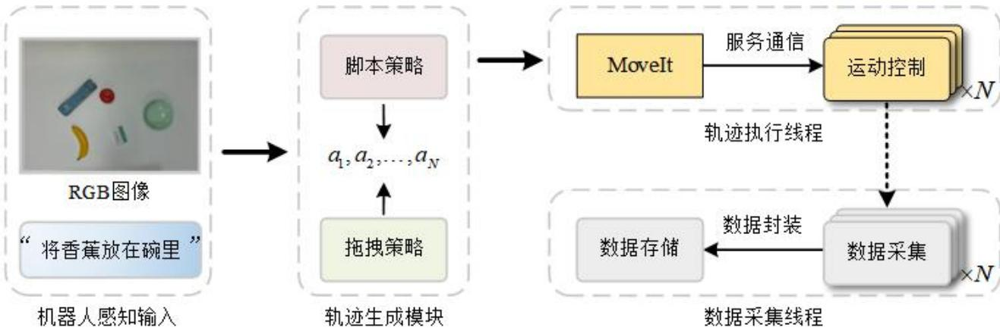  
图 4.7 数据采集框架图

在数据采集阶段，本文基于两种策略生成示教数据轨迹以驱动机械臂运动，同时，使用多线程技术动态采集数据，通过以下两种方式进行数据记录：

1、基于脚本策略的数据采集过程：在该数据采集进程中，初始阶段，依据任务指令和机械臂视觉图像，人工进行任务目标的确定。以“将香蕉放入盘子中”为例，在初始状态下，由于机械臂全局视野中香蕉和盘子均可见，操作人员通过人工点击图像的方式，精准获取香蕉和盘子的位置。借助这些位置信息，进一步获得香蕉上方和盘子上方的空间坐标，基于这两个关键坐标点生成一条完成任务的基础轨迹。完成轨迹规划后，操作人员利用基于深度学习的机械臂抓取算法生成任务轨迹驱动机械臂运动以完成任务，同时系统在机械臂运动过程中记录数据并存储，实现示教数据采集。

2、基于拖拽模式的数据采集过程：此过程分为两个阶段，首先，操作人员开启机械臂的拖拽模式，根据任务需求手动移动机械臂。系统依照预设的任务操作流程及其独特特点，记录物体的起始抓取点、最终放置点等关键点位的机械臂 6 轴轴角和夹爪状态。然后，系统控制机械臂依照预设点位运动以完成任务，同时系统在机械臂运动过程中记录数据并存储，实现示教数据采集。

值得注意的是，为模拟人类在真实世界的多模态动作分布，系统会在采集过程中对轨迹中加入适量噪声扰动，让任务轨迹具备一定的多模态动作分布。如此一来，得到的轨迹更贴近人类真实的操作情况。

## 4.2.2 掩码分割语义标注

在构建智能机械臂操作模型的进程中，对任务目标物体进行精准的语义分割标注是极为关键的环节。当通过多模态数据采集手段，如基于脚本策略和拖拽模式等方式完成数据收集后，为了让后续的模型训练能够精准学习到任务目标物体的特征，进而提升模型在实际场景中的操作能力，我们亟需为其提供高质量、精准且丰富的标注数据。为此，我们将对采集所得的数据集开展全面、细致的语义标注与增强处理工作，其中核心便是利用掩码分割增强网络对任务目标物体进行语义分割标注。

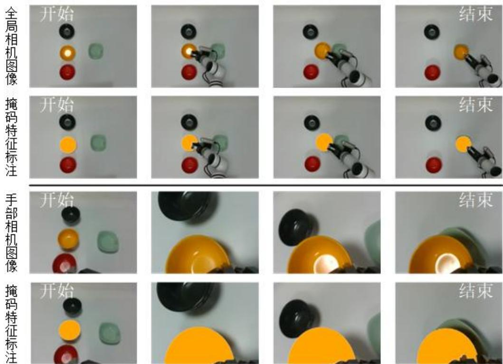  
图 4.8 数据集掩码分割标注结果图

如图4.8 为掩码特征标注结果图，具体而言，针对每个数据集，标注操作流程如下：首先读取数据，针对机械臂执行任务过程中的完整图像序列，利用Qwen2.5-VL 视觉语言大模型，结合任务语言指令明确任务目标，输出任务目标位置和边界框等关键信息。然后，使用掩码分割增强网络处理图像序列分割目标并生成掩码特征。再用该掩码特征标注任务目标，生成带有掩码标注的图像，为模型训练提供目标特征的直观信息。经此处理为模型训练提供精确语义标注的数据，有助于提高模型对任务的理解和执行能力。这种标注方式结合了Qwen2.5-VL 大模型的语义理解能力和掩码分割增强网络的语义分割能力，实现了高效准确的语义标注，为模型训练奠定了数据基础。

值得注意的是，在数据标注与机械臂实际执行任务时，存在关键差异：训练数据集中的图像因基于完整数据集标注，拥有历史信息辅助分割目标。例如机械臂任务图像序列中，即便某时刻目标被遮挡，掩码分割增强网络也能借之前未遮挡图像的历史信息（初始状态全局相机可观测全局信息）进行分割。但实际机械臂执行时，系统不存储历史信息，致使掩码分割增强网络无法依上下文语义分割图像。鉴于机械臂运动中目标被遮挡难以避免，系统制定了处理策略。经多次遮挡测试，当目标被遮挡比例超76.8%，掩码分割增强网络无法稳定分割目标，此时不对目标做掩码标记，能更好模拟目标不可观测情况，推动机械臂依据历史状态推理后续动作序列。

## 4.3本章小结

第四章详细介绍了本文机械臂操作系统的设计与实现，并且全面阐述了模仿学习多模态数据集构建流程。首先，我们对比多种机器人物理仿真平台，基于实验需求选定Gazebo作为仿真平台。然后基于硬件配置，确定了适配实验目标的机械臂、末端夹爪及RGB相机。接着深入探讨了基于机器人操作系统（ROS）控制机械臂的策略，着重介绍MoveIt!框架及其核心节点move\_group 的功能与细节。最后详细阐述了机械臂在桌面操作任务中的控制流程，并展示了控制逻辑实现及相关操作示意图。此外，本章节还细致解释了模仿学习多模态数据集的构建流程。通过这些准备工作，为后续算法整体性能实验与分析提供了可靠的实验环境和丰富的数据资源，是验证算法有效性和实用性的重要保障。

## 5 算法整体性能实验与分析

本文针对结合视觉语言的桌面平台机械臂操作任务展开研究，深入研究了桌面平台环境中机械臂理解语言指令并执行操作任务的挑战，发现该任务主要是难以根据语言指令精确识别任务目标，同时在模仿学习规划路径中存在累积误差的影响，导致机械臂在桌面操作任务中性能下降。为此，本文提出一种基于视觉语言模型与模仿学习的机械臂自主操作算法。该算法构建了创新的级联推理架构，深度融合视觉与语言信息，实现对多目标场景的精准感知与语义理解，能够准确捕捉各目标物体的特征及相互关系。同时，运用掩码分割增强技术，对目标物体精准分割，有效应对复杂背景和目标遮挡等挑战，显著提升机械臂在复杂场景下的任务执行能力，使其能够更加高效、准确地完成机械臂自主操作任务。

为验证本文所提方法的有效性，同时对三级级联架构及其各个组成模块的合理性展开评估，本研究分别在Gazebo 仿真平台与真实物理环境中开展对比实验与消融分析，验证算法在不同场景下的有效性。在实验过程中，从多个关键维度对算法性能进行了细致的定量分析，涵盖了任务成功率、抓取成功率、放置成功率等指标。通过这些实验，全面评估了本文所提出方法在各类桌面操作任务中的综合性能表现，并验证了各个模块在提升整体操作能力方面的作用与贡献。

## 5.1实验设计

## 5.1.1 实验平台与环境

在探究机械臂自主操作系统性能的过程中，为确保研究的全面性和科学性，本研究于第四章对常见的机械臂物理仿真平台从多个维度展开了细致的对比分析。综合考量本研究独特的实验需求，最终确定选用Gazebo 作为本次仿真实验的平台。随后，本文对实验环境所采用的硬件设备选型情况进行了介绍，具体的设备信息可查阅表5.1。在机械臂桌面操作任务中，真实场景采用实体硬件设备，仿真环境则采用对应的仿真模型。基于模块化集成方案，本研究分别在Gazebo 平台及真实环境搭建机械臂桌面操作系统。以仿真系统为例，构建的六自由度机械臂系统包含 RM65-B 机械臂，其末端搭载 Robotiq-85 夹爪，并集成双Realsense D435 相机视觉传感器。其中一台相机安装于夹爪上，另一台相机则被安置在距离工作平面正上方 1 米的高度位置，用于对工作平面进行俯视观测。机械臂的底座牢固地安装在水平工作台上，能够为各种不同类型的实验操作提供坚实且稳定的支撑基础。

在本研究的环境设定中，工作空间为一个桌面平台，实验物体整齐地分布在桌面平台的中心区域，具体的摆放布局可参照图 4.5(a)。真实环境的搭建参考了仿真环境的架构，两者在整体上保持较高的相似度。真实环境中所配备的机械臂系统，其规格与仿真环境中的完全一致，并且同样设置了一个桌面平台。为契合实际的实验需求，在真实环境下选用了大寰DH-95 夹爪来进行各项操作。另外，鉴于真实环境中工作平台的实际高度情况，对机械臂的初始姿态做了适当调整，以确保机械臂能在真实场景下顺利开展实验，调整后的机械臂姿态在图 4.5(b)中有清晰呈现。

表 5.1 实验环境硬件设备选型

<table><tr><td>硬件设备</td><td>型号或参数</td></tr><tr><td>机械臂</td><td>Realman RM 65-B</td></tr><tr><td>RGB相机</td><td>Intel Realsense D435 ×2</td></tr><tr><td>机械夹爪</td><td>Robotiq-85/大寰 DH-95</td></tr></table>

本研究提出的算法框架采用深度神经网络进行训练，实现从高维环境状态到机械臂控制指令的间接映射。该映射过程涉及多模态数据融合与时空特征提取，不仅需要处理每秒百帧级的视觉数据流，还需同步完成力控策略优化。鉴于此类任务的计算密集型特征，本文采用基于CUDA 架构的GPU加速方案，通过并行化处理提升模型训练与推理效率。关于具体的硬件计算平台设备详情，详见表5.2。

表 5.2 实验硬件计算平台选择

<table><tr><td>硬件设备</td><td>型号或参数</td></tr><tr><td>处理器(CPU)</td><td>Intel Core i7-6800k 3.40GHz</td></tr><tr><td>显卡(GPU)</td><td>NVIDIA GTX 1080Ti×2</td></tr><tr><td>处理器内存</td><td>64GB</td></tr><tr><td>显卡内存</td><td>12GB×2</td></tr></table>

本研究的开发测试环境构建于 Ubuntu 18.04 LTS 平台，该系统基于 Linux 内核 4.15 长期支持版本。在机器人操作系统选型中，经过多版本稳定性测试，最终采用 ROS Melodic发行版。该版本具有完善的硬件驱动支持和成熟的中间件生态，能够与实验所需的第三方库及硬件模拟包实现无缝兼容。在选择编程语言时，鉴于 Python 语言动态类型特性和丰富科学计算库，我们将其定为主要开发语言，此决策考虑了与 MoveIt!框架、OpenCV 视觉库及Gazebo 仿真引擎的集成需求，以优化开发效率与系统兼容性。

表 5.3 实验软件平台选择

<table><tr><td>软件名称</td><td>版本或参数</td></tr><tr><td>Linux</td><td>Ubuntu 18.04 LTS</td></tr><tr><td>ROS</td><td>Melodic</td></tr><tr><td>Python</td><td>3.10</td></tr><tr><td>Pytorch</td><td>2.3.1</td></tr><tr><td>CUDA</td><td>12.1</td></tr><tr><td>Cudnn</td><td>8.9.7</td></tr></table>

在搭建并训练深度学习模型的过程中，本研究采用了PyTorch 框架。PyTorch 凭借其独特的动态计算图优势，搭配简洁且易于掌握的 API 接口，成为众多科研工作者和开发者的首选。为大幅提升模型训练与推理的效率，本研究引入了CUDA和Cudnn 这两个面向深度学习的高性能加速库。在适配的GPU硬件环境下，这些加速库可高效完成深度神经网络里的各类计算任务，涵盖卷积、池化、归一化、激活等基础层操作，实现计算资源的最优利用。详细的软件平台版本及参数信息，可查阅表5.3。

## 5.1.2 实验设置与评价指标

为全面评估本文所提出的算法在桌面操作任务中的性能表现，本文设计了 6 个机械臂桌面操作任务。这些任务不仅涵盖物体抓取、放置与转移，还涉及物体操作和环境交互等多方面技能，综合考量了物体特性、环境因素以及机械臂的感知、规划和执行能力，旨在全面检验单机械臂在复杂场景下的操作性能。为了显著提升实验分析的精细程度，同时实现对故障的精准定位，本次实验巧妙地运用了ROS框架的服务通信机制。使得算法推理过程与机械臂动作控制流程之间形成了一种紧密协作的关系。这样的设计，不仅能够准确找出性能瓶颈所在之处，还能清晰地对比算法预测误差和硬件执行误差，从而为系统性能的潜在优化方向提供坚实可靠的参考依据。具体任务如图5.1所示：

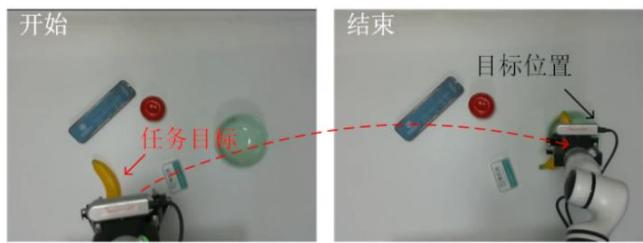

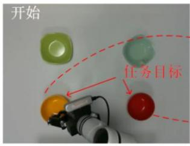

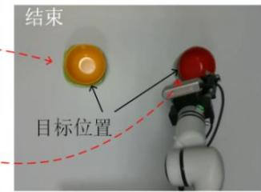

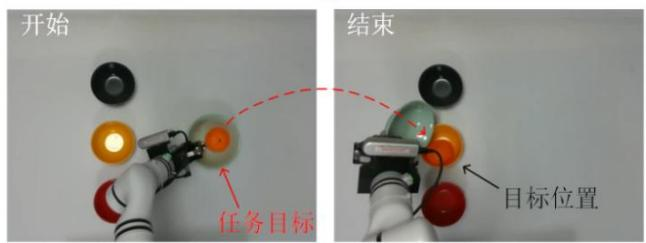

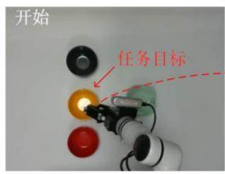

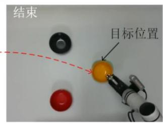

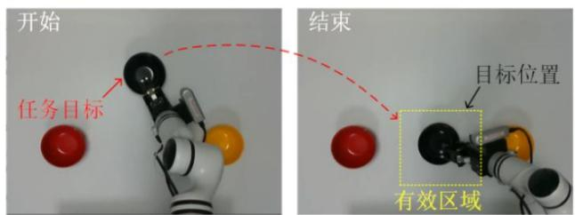

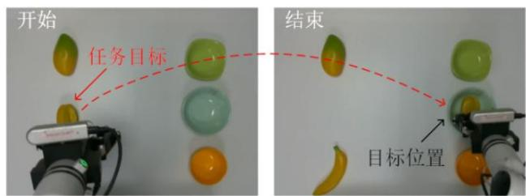  
图 5.1 本文设计的机械臂桌面操作任务示意图

（a）将香蕉放入盘子中：在这项任务中，桌面上放置包括香蕉在内的若干物体，同时还有一个盘子。机械臂需要抓取香蕉，并将香蕉成功放入盘子中，否则任务失败。

（b）将桌子上的碗放在前方的盘子中：在这项任务中，桌面有两个碗和两个盘子，机械臂需要先抓取左边的碗，然后将其放入左边的盘子中，然后再针对右边的碗执行相同的操作，最终成功把两个碗都放入盘子中，否则任务失败。

（c）将盘子中的橘子倒入黄色碗中：在这项任务中，桌面上有三个颜色不同的碗和一个装有橘子的盘子，机械臂需要抓起放有橘子的盘子，然后移动到黄色的碗上方合适位置，最后将橘子成功倒入碗中，否则任务失败。

（d）将黄色的碗放在盘子上：在这项任务中，桌面上有三个颜色不同的碗和一个盘子，机械臂需要抓起黄色的碗，并将其成功放在盘子上，否则任务失败。

（e）将桌子上的碗摆放整齐：在这项任务中，桌面上有三个碗，机械臂需要抓起中间突出的碗，并将其成功放置在其余两个碗的中间有效区域内，否则任务失败。

（f）将杨桃放入最大的碗中：在这项任务中，桌面上有三个种类不同的水果和三个大小不同的碗，机械臂需要抓取杨桃，将其成功放入最大的碗中，否则任务失败。

本文主要基于以下指标评估算法策略的有效性：(1)任务成功率，定义为在N个随机设置的测试回合中，任务成功执行的回合数与总回合数的比值；(2)抓取成功率，定义为在N个随机设置的测试回合中，任务成功执行过程中成功抓取目标物体的回合数与总回合数的比值；(3)放置成功率，定义为在N个随机设置的测试回合中，任务成功执行过程中成功放置目标物体到指定位置的回合数与总回合数的比值；需要注意的是，本实验所设定的桌面操作任务，涵盖机械臂的抓取与放置这两个关键操作环节。对于每个任务，在仿真环境下一个成功率数据进行100次回合测试，在真实环境则下进行20次回合测试。

## 5.2仿真环境实验结果分析

为全面且系统地评估本文所提出算法在理解自然语言指令以及执行桌面操作任务方面的综合性能，本文以家庭和零售场景中常见的各类物品为基础精心设计了 6 个机械臂操作任务，这些任务的语言指令涵盖了颜色、尺寸、空间位置等多个维度的语义信息，以评估算法在面对不同表述方式和语义细节时的语义理解能力。此外，为了深入考察算法在处理不同复杂程度任务时的性能表现，在任务设计过程中，采用了逐步递增干扰物品数量，并不断提升语言指令复杂程度的方式。从简单场景下的明确指令，到复杂场景中包含更多干扰因素和语义细节的指令，全方位检验算法在不同难度层次下的适应性和执行能力。

为避免真实场景中光照变化、传感器噪声以及环境动态干扰等因素对实验结果的影响，本文首先在Gazebo 仿真环境内展开实验。如图 5.2为任务“将香蕉放入盘子中”和“将桌子上的碗放在前方的盘子中”在Gazebo 仿真环境下的可视化效果。仿真中，机械臂从初始位出发，精准定位任务目标，调整姿态抓取后，沿合理路径移动，将其精准放入盘中，动作流畅，有效验证了本文算法的机械臂自主操作性能。实验数据结果如表5.4和表5.5所示，从表中数据可知，本文算法在各项任务中均展现出了优异性能，平均任务成功率为89.5%，这一结果有力地证明了该算法具备一定的自然语言理解能力和任务执行能力。尽管在面对复杂指令和操作场景时，算法性能会出现一定程度的下降，但在每个任务的成功率均超过80%。这充分体现了本文算法在机械臂桌面操作任务中具有较高的可靠性，能够在多数情况下稳定地完成相应任务。

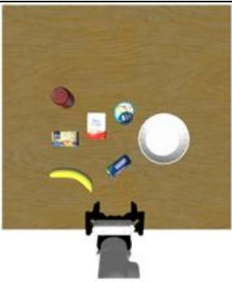

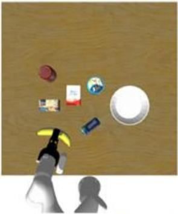

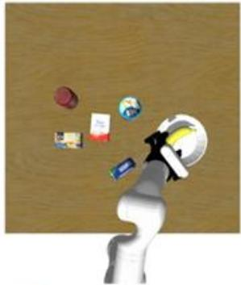

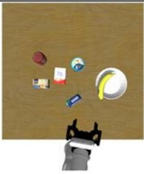

将香蕉放入盘子中  

  
将桌子上的碗放在前方的盘子中

  
图 5.2 仿真环境中任务可视化示意图

在“将杨桃放入最大的碗中”任务中，该任务涉及到对物体尺寸的判断以及精准放置操作。本文算法在此任务上的任务成功率为 91%。其中，抓取成功率为 96%，该数据表明本文算法能较好地识别杨桃并控制机械臂完成自主抓取动作，对任务目标物体的视觉识别和初步操作能力较强。放置成功率为 91%，相比于抓取成功率略有下降，这反映出算法在处理包含尺寸信息的复杂指令以及在有干扰的环境中执行精准放置操作时，其能力仍存在一定的提升空间。

表 5.4 实验测试结果

<table><tr><td>任务</td><td>抓取成功次数</td><td>放置成功次数</td><td>任务成功次数</td></tr><tr><td>将香蕉放入盘子中</td><td>98%</td><td>96%</td><td>96%</td></tr><tr><td>将盘子中的橘子倒入碗中</td><td>91%</td><td>88%</td><td>88%</td></tr><tr><td>将黄色的碗放在盘子上</td><td>95%</td><td>94%</td><td>94%</td></tr><tr><td>将桌子上的碗摆放整齐</td><td>91%</td><td>85%</td><td>85%</td></tr><tr><td>将杨桃放入最大的碗中</td><td>96%</td><td>91%</td><td>91%</td></tr></table>

针对于“将桌子上的碗放在前方的盘子中”任务，由于该任务需要机械臂执行两次抓取操作，所以本文分别记录两次操作过程的抓取成功率和放置成功率。如表5.5所示，其第一次抓取成功率为 92%，放置成功率为 88%，这表明机械臂在初次面对任务时，凭借视觉感知系统对碗和盘子的识别与定位非常准确，规划的抓取路径和抓取姿态合理有效，能够稳定地抓取碗并成功放置到盘子中，体现出该方法在初始操作时的高效性和准确性。这表明本文算法在任务开始阶段具备可靠的稳定性和准确性，能够有效驱动机械臂完成复杂操作。

然而，第二次抓取成功率为 90%，第二次放置成功率为 83%，相较于第一次有所下降，这可能是由于在完成第一次操作后，桌面环境发生了细微变化，导致第二次操作的难度增加，但本文算法依然可以实现较高的抓取成功率，这表明本文算法在识别任务目标方面具有显著性能。实验数据显示，在两次操作中，放置成功率均低于抓取成功率。这是因为抓取完成后，机械臂运动时夹爪状态不稳定，放置目标时机不当，导致碗掉落、放置位姿不准，最终致使放置操作失败。最终整体任务成功率仍达到 83%，说明本文方法在应对一定程度的环境变化和操作累积误差时，依然能够保持一定的稳定性，进一步体现了本文方法在复杂桌面操作任务中的有效性和适应性。

表 5.5 实验测试结果

<table><tr><td rowspan="2">任务</td><td colspan="2">第一次操作</td><td colspan="2">第二次操作</td><td rowspan="2">任务成功率</td></tr><tr><td>抓取成功率</td><td>放置成功率</td><td>抓取成功率</td><td>放置成功率</td></tr><tr><td>将桌子上的碗放在前方的盘子中</td><td>92%</td><td>88%</td><td>90%</td><td>83%</td><td>83%</td></tr></table>

为了全面评估本文算法在机械臂桌面操作任务中的性能优势与不足，本文算法与Otco[49]和 openVLA[50]两种方法进行对比。OpenVLA 是一款前沿的视觉语言动作（VLA）模型，具备 70 亿参数，它在 Open X-Embodiment（OXE）数据集上完成预训练。而 Octo 则是一个参数相对精简，仅有9300万的模型，该模型运用基于扩散的策略来实现动作生成。本研究采用这两个模型的开源预训练权重，将其作为基线模型。为保证实验公平可靠，所有基线模型均在与本文相同的数据集上微调，且微调参数与本文模型一致，确保各模型在同一标准下对比，使实验结果能更准确反映不同模型的性能差异。实验结果如表 5.6 和表5.7所示，可以看出本文方法在6个桌面操作任务上均展现出优于Octo和OpenVLA的性能。例如，在“将香蕉放入盘子中”任务中，本文方法的任务成功率达到96%，而Octo和OpenVLA仅为 72%和 79%。

表 5.6 对比测试结果

<table><tr><td>任务</td><td>Otco[49]</td><td>OpenVLA[50]</td><td>本文方法</td></tr><tr><td>评价指标</td><td colspan="3">抓取成功率/放置成功率/任务成功率</td></tr><tr><td>将香蕉放入盘子中</td><td>82%/72%/72%</td><td>87%/79%79%</td><td>98%/96%/96%</td></tr><tr><td>将盘子中的橘子倒入碗中</td><td>74%/58%/58%</td><td>72%/61%/61%</td><td>91%/88%/88%</td></tr><tr><td>将黄色的碗放在盘子上</td><td>90%/71%/71%</td><td>91%/82%/82%</td><td>95%/94%/94%</td></tr><tr><td>将桌子上的碗摆放整齐</td><td>87%/61%61%</td><td>82%/38%/38%</td><td>91%/85%/85%</td></tr><tr><td>将杨桃放入最大的碗中</td><td>72%/61%/61%</td><td>77%/65%/65%</td><td>96%/91%/91%</td></tr></table>

然而，随着任务复杂度的增加，本文方法的性能略有下降。在“将桌子上的碗摆放整齐”这一任务中，该任务并没有明确指定碗的放置位置，需要系统依据语言指令推理出桌面上合适的放置点，再进行物体放置操作。这种对环境理解和空间推理的高要求，增加了任务的难度，导致本文方法的任务成功率为 85%，相较于简单任务有所降低。尽管如此，在所

失败案例2

失败案例1

有对比任务中，本文方法仍保持领先优势。反观 Octo 和 OpenVLA，它们在面对复杂任务时，性能波动更为明显。例如OpenVLA 在“将桌子上的碗摆放整齐”任务中，其抓取成功率为82%，但任务成功率仅为38%。这一对比充分说明，OpenVLA 方法无法实现对语义信息以及空间环境的推理能力，而本文方法在复杂任务处理上，相较于对比方法具有更好的稳定性和适应性。即便在需要复杂推理的任务情境下，本文方法依然能够凭借自身的架构和训练策略，尽可能准确地理解任务并执行操作，展现出了一定的鲁棒性，而其他模型则更容易受到任务复杂度提升的影响。

表 5.7 实验测试结果

<table><tr><td rowspan="2">任务</td><td rowspan="2">方法</td><td colspan="2">第一次操作</td><td colspan="2">第二次操作</td><td rowspan="2">任务成功率</td></tr><tr><td>抓取成功率</td><td>放置成功率</td><td>抓取成功率</td><td>放置成功率</td></tr><tr><td rowspan="3">将桌子上的碗放在前方的盘子中</td><td> $OpenVLA^{[50]}$ </td><td>90%</td><td>71%</td><td>66%</td><td>47%</td><td>47%</td></tr><tr><td> $Otco^{[49]}$ </td><td>90%</td><td>75%</td><td>58%</td><td>39%</td><td>39%</td></tr><tr><td>本文方法</td><td>92%</td><td>88%</td><td>90%</td><td>83%</td><td>83%</td></tr></table>

如表5.7 实验结果所示，在“将桌子上的碗放在前方的盘子中”这一任务中，本文方法在两次操作过程中的表现全面优于 Otco 和 OpenVLA。从数据对比来看，第一次操作时，三种方法的抓取成功率超 90%，这表明三种方法在首次抓取目标物体时，基本都能准确识别并抓取；但在执行放置操作时，本文方法以 88%的成功率明显优于其余两种方法。在第二次操作过程中，本文方法的抓取成功率（90%）和放置成功率（83%）均高于 Otco（抓取58%、放置39%）和OpenVLA（抓取66%、放置47%）。实验结果表明，本文方法凭借更稳定的抓取策略、精准的视觉定位与动作协同能力，在多次操作的复杂任务场景下优势显著。这表明本文方法在识别、抓取和放置等多环节配合上更加协调高效，能够更好地适应复杂任务的需求。而 Otco 和OpenVLA 在处理该任务时，各环节均暴露出不同程度的问题，尤其是Otco 在放置环节的不佳表现，表明该方法针对语言指令的精确理解存在缺陷，极大地限制了其任务成功率的提升。

  
图 5.3 任务失败案例示意图

SAM

在“将香蕉放入盘子中”任务中，本文对该任务中两次放置失败的案例进行分析，失败案例的可视化如图5.3所示。其中，失败案例1的致因在于，在放置香蕉时的机械臂位姿偏向碗的右侧，使得香蕉在放置过程中无法完全落入碗内，导致任务失败。而失败案例 2则是由于机械臂在运行进程中过早地执行了放置指令，夹爪提前执行放置操作，最终致使任务未能成功完成。这表明，本文算法在任务的放置操作阶段对于机械臂末端的精确位置控制以及放置指令的合理触发还存在一定的优化空间。

## 5.3消融实验结果分析

为精准评估本文关键模块结构在机械臂自主操作任务中的作用，本文围绕基于视觉语言模型与模仿学习的机械臂自主操作算法，开展了三项重要的消融实验，分别针对掩码分割增强网络的有效性、动态轨迹集成策略不同权重计算方法以及不同滑动窗口大小进行研究，具体分析如下：

## 5.3.1 掩码分割增强网络对机械臂操作任务性能的提升

在基于视觉语言模型与模仿学习的机械臂自主操作算法中，掩码分割增强网络作为本文设计的关键模块之一，其性能的优劣对整个系统在机械臂自主操作任务中的表现起着至关重要的作用。为了充分验证该模块的有效性，深入探究其相较于其他常见分割网络的优势，本文在“将黄色的碗放在盘子上”任务上，将本文所设计的掩码分割增强网络与SAM[68]、U-net[65]、Mask R-CNN[67]、FCN[64]这几种常见的分割网络进行了任务执行成功率的对比。

  
图 5.4 不同分割网络的分割效果图

为探究本文掩码分割增强网络对模型性能的影响，本文在机械臂执行过程中记录任意两个时刻的全局相机掩码分割效果，如图5.4所示，在“将黄色的碗放在盘子上”任务中，本文设计的掩码分割增强网络在两个时刻的分割结果与示教数据高度接近，对目标物体的分割精准。而U-Net 和FCN 出现明显误分割与掩码溢出问题，对目标物体的界定不够准确。尽管 SAM 和 Mask R-CNN 的整体表现优于 U-Net 和 FCN，但在细节上，与掩码分割增强网络的分割结果仍存在偏差。对比结果证实，掩码分割增强网络在目标分割精准度上优势明显，能助力机械臂在复杂桌面任务中准确抓取目标，提升任务成功率，体现其作为关键模块的有效性与价值。

对比实验结果如表5.8所示，从中可以看出，本文方法的任务执行成功率达94%，显著高于其他分割网络。其余四种分割网络中，两种成功率相对较高但仍低于本文方法，另外两种成功率更低，均未超过80%。这一数据对比有力地证明了本文基于Transformer 的掩码分割增强网络在复杂桌面任务场景下的卓越性能。相比之下，其他几种分割网络在处理复杂桌面任务时，由于在目标分割的精准度上存在一定的局限性，导致任务执行成功率相对较低。这进一步凸显了本文所设计的掩码分割增强网络的优势和有效性，验证了其在机械臂自主操作算法中作为关键模块的重要价值。

表 5.8 针对于掩码分割增强网络能力的消融实验数据表

<table><tr><td>分割网络</td><td>SAM[68]</td><td>U-net[65]</td><td>Mask R-CNN[67]</td><td>FCN[64]</td><td>本文方法</td></tr><tr><td>任务执行成功率(%)</td><td>80%</td><td>55%</td><td>70%</td><td>55%</td><td>94%</td></tr></table>

## 5.3.2 动态集成策略对机械臂操作任务性能的提升

为了深入探究本文所提出的动态轨迹集成策略在机械臂操作任务中的影响，本文在“将香蕉放入碗中”任务中，对比了两种不同的权重计算方法，分别为ACT 提出的指数加权公式以及本文设计的余弦动态加权公式，同时设置了不使用策略的情况。

  
图 5.5 不同权重计算方法下机械臂轨迹图

为直观清晰地展现不同权重计算公式对机械臂轨迹的影响，我们对三种情况下机械臂执行“将香蕉放入碗中”任务过程中生成的轨迹数据进行了详细统计，并据此精心绘制出对应的轨迹曲线。如图5.5曲线所示，在任务执行初期，基于指数加权公式、不采用策略以及运用余弦动态加权公式这三种情形下，机械臂的性能表现都较为出色。然而，当机械臂执行步数超过 180步后，差异开始显现。具体到机械臂的4轴、5轴和6 轴轨迹曲线，区别尤为明显：采用指数加权公式时，其轨迹与示教数据间产生了明显偏离，导致在动作聚合过程中容易出现不合理的情况；不使用策略时，轨迹呈现出较大幅度偏差，而余弦动态加权公式生成的轨迹曲线能够紧密贴合示教数据。这表明动态余弦加权能依据动作预测相似性，高效规划动作，提升执行效率与精准度。

  
图 5.6 不同权重计算方法下夹爪轨迹图

在此基础上，本文对末端夹爪在不同权重计算方法下的轨迹也进行了分析，如图5.6所示，不同权重计算方法下末端夹爪轨迹差异明显。指数加权曲线波动频繁，与示教数据偏差较大，稳定性不足；余弦动态加权曲线在多数阶段与示教数据贴合紧密，仅在少数过渡阶段存在细微差异，相比之下，能更好地匹配示教数据，体现出余弦动态加权在指导夹爪动作上同样具有优势。

针对不同权重计算公式的对比实验结果如表5.6 中所示，当采用余弦动态加权公式时，任务执行成功率达到 96%，显著优于采用指数动态加权的 80%。这表明本文设计的权重计算方式通过考量不同时间步动作预测的相似性动态分配权重，更好的优化动作规划，从而显著提升任务执行成功率。而指数动态加权由于在权重分配的合理性上存在不足，导致机械臂在动作聚合时可能出现不合理的情况，进而影响了任务执行的成功率。当不使用动态轨迹集成策略时，该任务的执行成功率仅为 65%，与使用本文公式的情况相比大幅下降。这一数据进一步证明了本文动态轨迹集成策略对于机械臂自主操作任务的重要性。

表 5.9 针对于动态轨迹集成策略不同权重计算方法的消融实验数据表

<table><tr><td>权重计算公式</td><td>余弦动态加权</td><td>指数加权</td><td>不使用策略</td></tr><tr><td>任务执行成功率(%)</td><td>96%</td><td>80%</td><td>65%</td></tr></table>

为了进一步探究本文动态策轨迹集成策略中不同滑动窗口大小对模型性能的影响，本文在“将香蕉放入碗中”任务上分别设置滑动窗口大小为1、3、5、7 进行对比试验。实验结果如表5.10所示。其中，n=3 时任务执行成功率最高，达到了96%，高于n=1 时的 85%以及 n=5 和 7时的 80%。这表明滑动窗口大小的不同选择对模型在该任务中的表现有着显著的影响，适中的滑动窗口大小（n=3）能使模型更好地平衡对机械臂动作的规划，在有效利用环境信息的同时，避免因窗口过大或过小而带来的不利影响，进而实现更高的任务执行成功率。

表 5.10 针对于时间集成策略不同滑动窗口大小的消融实验数据表

<table><tr><td>滑动窗口大小(n)</td><td>1</td><td>3</td><td>5</td><td>7</td></tr><tr><td>任务执行成功率(%)</td><td>85%</td><td>96%</td><td>80%</td><td>80%</td></tr></table>

## 5.4真实环境实验结果分析

本文在仿真环境下已成功验证了算法的基本原理，并且证实本文算法可靠的自主操作性能。为进一步探究该算法在真实环境中的实际表现，本文围绕 6 个桌面任务展开了真实环境实验，如图5.7所示为三个任务在真实环境下的可视化示意。在此基础上，为实现对算法性能更为精准且全面的评估，我们对实验数据进行整理，其详细结果如表5.11和5.12所示。实验结果显示，在充斥着光照变化、传感器噪声以及环境动态干扰等复杂不可控因素的真实环境下，本文算法的平均任务成功率约为78.3%，表明本文算法不仅适用于理想的仿真环境，在充满挑战的现实场景中，也具备一定自主操作能力，能够在一定程度上有效应对真实环境所带来的挑战。

  
将杨桃放入最大的碗中  
图 5.7 真实环境中任务可视化示意图

在“将香蕉放入盘子中”任务上，本文算法表现出色，抓取成功率、放置成功率和任务成功率均达到 90%。这一成绩表明，算法在真实环境中对香蕉和碗的视觉识别精准度高，能够有效控制机械臂完成抓取和放置动作。然而，从仿真到真实环境，该任务的成功率仍有一定程度的下降（仿真环境中抓取成功率 98%、放置成功率 96%、任务成功率 96%），这也侧面反映出真实环境中存在的干扰因素对算法性能产生了影响，即便算法能够稳定完成任务，但在精准度上与仿真环境相比仍有提升空间。

表 5.11 实验测试结果

<table><tr><td>任务</td><td>抓取成功次数</td><td>放置成功次数</td><td>任务成功次数</td></tr><tr><td>将香蕉放入盘子中</td><td>90%</td><td>90%</td><td>90%</td></tr><tr><td>将盘子中的橘子倒入碗中</td><td>85%</td><td>75%</td><td>75%</td></tr><tr><td>将黄色的碗放在盘子上</td><td>90%</td><td>85%</td><td>85%</td></tr><tr><td>将桌子上的碗摆放整齐</td><td>80%</td><td>70%</td><td>70%</td></tr><tr><td>将杨桃放入最大的碗中</td><td>85%</td><td>80%</td><td>80%</td></tr></table>

在“将盘子中的橘子倒入碗中”的真实环境任务里，抓取成功率达 85%，显示算法能精准定位盘子并稳定操控机械臂抓取，视觉识别与初始操作稳定性强。但放置成功率、任务成功率为 75%，较仿真环境下降明显。这是因为该任务需机械臂平稳抓碟并移至合适位置倒橘子，对放置精准度和时机要求极高。在真实环境中，盘子中橘子的分布以及盘子的初始位置都存在不确定性，同时机械臂在运动时还会受到外界振动、气流等诸多因素的干扰，导致机械臂在移动和倾倒过程中的稳定性降低，进而使放置环节容易出现失误。这表明算法在处理此类精准放置且易受干扰的复杂操作时，精准度和抗干扰能力仍有提升空间。不过，在真实环境中 75%的任务成功率证明其面对复杂任务有一定有效性和适应性，能在挑战环境中尝试完成任务。

表 5.12 实验测试结果

<table><tr><td rowspan="2">任务</td><td colspan="2">第一次操作</td><td colspan="2">第二次操作</td><td rowspan="2">任务成功率</td></tr><tr><td>抓取成功率</td><td>放置成功率</td><td>抓取成功率</td><td>放置成功率</td></tr><tr><td>将桌子上的碗放在前方的盘子中</td><td>95%</td><td>90%</td><td>75%</td><td>70%</td><td>70%</td></tr></table>

在真实环境下执行“将桌子上的碗放在前方的盘子中”任务时，第二次操作成功率下降明显，累积误差是重要影响因素。每次操作中，机械臂的位置偏差会改变桌面物品位置，随着操作次数增加，累积偏差使视觉识别系统对碗和盘子的定位精度下降，规划的抓取路径与姿态出现偏差。同时，机械臂运动控制中的角度误差也不断累积，影响夹爪抓取和放置动作的准确性。此外，真实环境中的光照变化会干扰视觉传感器对目标的识别，传感器噪声会干扰运动控制信号，进一步加剧操作难度。这些因素相互交织，导致机械臂在执行长轨迹任务时性能会有所下降。为解决真实环境下长轨迹任务因累积误差导致的操作成功率下降问题，后续会构建环境感知预测模型，提前应对环境变化；同时改进动态轨迹集成策略，加强多模态信息融合，提升环境感知与操作性能。

综上所述，本文算法在从仿真环境泛化到真实环境的过程中，虽然受到真实环境复杂因素的影响，性能有所下降，但在不同任务中仍展现出了一定的优势和适应性。在相对简单的“将香蕉放入盘子中”任务上，算法能保持较高的成功率，具备良好的稳定性和准确性；而在“将盘子中的橘子倒入碗中”这类复杂放置任务中，虽然面临挑战，但也表现出了一定的应对能力。后续研究可针对算法在真实环境中面临的问题进行优化，进一步提升其在复杂场景下的性能表现。

## 5.5本章小节

本章主要通过一系列全面且深入的实验，对基于视觉语言模型与模仿学习的机械臂自主操作算法进行了全方位的验证和剖析。首先，在第一小节介绍了本章的实验设计，包括实验平台的搭建，实验环境的介绍，同时介绍了实验任务设置和实验评价指标。然后，第二小节在仿真环境中展开对比实验，将本文算法与其他方法进行比较，验证了本文算法在机械臂操作任务上都明显优于其他方法。接着，在第三小节针对算法的关键组件和策略进行消融实验，分别证明了本文提出的掩码分割增强网络、动态轨迹集成策略在机械臂操作任务中性能的提升，证明了上述算法结构及功能模块设计的合理性。最后，在真实环境中进行实验，验证了本文算法从仿真环境到真实环境的泛化能力，同时验证了本文方法在真实环境中的实际性能。

## 6 总结与展望

## 6.1本课题研究内容总结

随着智能制造与智能控制等自动化应用的快速发展，机械臂自主操作技术的研究对提升其在复杂环境下的性能意义重大。根据自然语言指令驱动机械臂执行自主操作任务，不仅能增强人机协作的适应性，还能推动机器人向高效、智能的交互模式演变。以自然语言指令来驱使机械臂完成自主操作任务，可以大幅增进人机协作的契合度，强力助推机器人朝着高效化、智能化的交互模式迭代升级。针对于简单的桌面操作任务，基于VLM、VLA的机械臂自主操作算法已可达成较高的任务成功率。但在处理复杂桌面平台的自主操作任务时，现有的方法难以实现任务目标与视觉感知、机械臂状态的精准匹配，且因输出笛卡尔空间动作，易致使轨迹逆解存在不确定性，进而降低了任务成功率。因此，如何依据语言指令和机器人感知状态设计算法来增强机械臂自主操作能力，仍是亟待解决的问题。

为此，本文提出了一种基于视觉语言模型与模仿学习的机械臂自主操作算法，首先借助视觉语言模型融合自然语言指令与视觉感知图像，精准识别任务目标；再利用掩码分割增强网络分割任务目标的掩码信息，提取语义和几何特征；最后通过模仿学习策略网络，结合任务目标特征与机械臂状态生成任务动作序列，实现机械臂自主操作。该方法能实现基于自然语言指令驱动机械臂在复杂桌面平台任务中实现自主操作。本文主要贡献如下：

1.本文提出了一种基于视觉语言模型与模仿学习的机械臂自主操作算法，依托视觉语言大模型，对任务的语言指令与视觉观测图像进行深度整合，从而精准地提炼出任务目标特征。在此基础上，借助掩码分割增强网络，依据任务目标特征生成详尽的任务目标掩码信息。最后，通过策略网络对动作轨迹进行精确预判，以高效的方式驱动机械臂完成相应任务，显著提升了机械臂在桌面任务中的执行成功率。

2.本文提出了一种基于Transformer 的掩码分割增强网络，借助视觉语言模型生成的任务目标特征，利用掩码分割增强网络的优势，精确地生成任务目标的掩码特征。这一方法有效提高了系统在复杂桌面任务环境中对目标的识别精度，同时提升了定位的准确性，使系统在面对不同桌面任务场景时，环境适应能力得到了显著增强。

3.本文提出了一种基于 Diffusion 的模仿学习策略网络，依据变分自编码器的架构，对专家的演示数据进行细致建模。通过 Transformer，将机械臂的状态特征与经过掩码增强处理的图像特征进行联合编码，进而生成联合嵌入特征。随后，利用 Diffusion 技术对所生成的联合嵌入特征进行解码操作，以此生成机械臂的动作序列，成功实现多模态轨迹的生成。这一过程确保了在多样化的复杂桌面任务场景中，机械臂运动轨迹生成的高度精确性。

4.本文提出了一种动态轨迹集成策略，深度关联任务的实时推进情况、环境的动态演变以及机械臂自身的状态信息，基于历史动作预测与当前动作预测之间的相似性，对轨迹规划进行灵活调校。通过这种方式，不仅能够保障机械臂更为流畅、高效地完成任务，有效规避碰撞风险，还能显著提高任务执行的成功率与稳定性，充分彰显出其卓越的环境适应能力与强大的任务执行效能。

5.本文分别于 Gazebo 仿真环境与现实场景中搭建了桌面机械臂自主操作平台，并开展了一系列实验。通过对仿真及真实复杂桌面平台环境下的实验结果进行分析，系统验证了所提方法的有效性、泛化性以及设计的合理性。实验数据显示，基于视觉语言模型与模仿学习的机械臂自主操作算法，在6种桌面平台机械臂操作任务中，实现了89.5%的目标级抓取成功率。这充分证明了该方法在桌面平台环境下具备良好的机械臂自主操作能力，同时也凸显了其在实际应用中的潜在价值。

## 6.2 展望

当下，具身智能领域发展势头迅猛，相关研究日益增多。众多研究重点关注如何赋予机器人感知、推理、决策以及行动的能力，使其能够在复杂多变的动态环境中，独立自主地执行并完成各项任务。尽管本文针对桌面平台场景，创新性地构建了机械臂自主操作的算法框架，且该框架在预设的桌面任务中实现了机械臂的自主操作。然而，受限于时间与资源等因素，仍存在改进空间，未来研究包括：

1. 端到端视觉语言-动作推理架构：本文算法对任务目标特征的提取和分割效果直接影响了下游策略网络推理动作的性能，未来可以探索如何更高效地将视觉信息和语言指令转化为精准的动作指令。提升机械臂在复杂场景下对任务目标的理解和执行能力，实现从感知到决策再到动作执行的流畅衔接，提高机械臂自主操作的智能水平。

2. 多模态示教数据采集方案：进一步优化数据采集方案，采用虚拟眼镜进行遥操作控制机械臂、主从机械臂协同控制等方案进行多模态示教数据收集，构建更加完整流畅且具有多模态分布的高质量示教数据。

3. 多模态信息深度融合：深入研究多模态信息的融合方式，除视觉和语言信息外，融入声音、触觉、力觉等信息，使机械臂能更全面地感知环境，获取更丰富的信息，做出更精准、智能的决策，拓展机械臂的应用范围和功能。

4. 拓展更复杂多样的桌面平台操作任务：进一步丰富任务的多样性和复杂性，涵盖从基础的精细操作到需要多步骤协同以及对环境高度适应的复杂任务类型。同时，引入更多元化的干扰因素和动态变化条件，模拟更加真实且复杂的现实环境。进一步提升机械臂在复杂桌面环境中的自主操作水平，推动具身智能在实际应用中的发展。

## 参考文献

[1] Hamet P, Tremblay J. Artificial intelligence in medicine[J]. metabolism, 2017, 69: S36-S40.

[2] Billard A, Kragic D. Trends and challenges in robot manipulation[J]. Science, 2019, 364(6446): eaat8414.

[3] Arents J, Greitans M. Smart industrial robot control trends, challenges and opportunities within manufacturing[J]. Applied Sciences, 2022, 12(2): 937.

[4] International Federation of Robotics. World Robotics 2024. [PDF], September 2024, https://ifr.org/img/worldrobotics/Press\_Conference\_2024.pdf.

[5] Tian H, Song K, Li S, et al. Data-driven robotic visual grasping detection for unknown objects: A problem-oriented review[J]. Expert Systems with Applications, 2023, 211: 118624.

[6] Mac T T, Copot C, Tran D T, et al. Heuristic approaches in robot path planning: A survey[J]. Robotics and Autonomous Systems, 2016, 86: 13-28.

[7] Spong M W, Hutchinson S, Vidyasagar M. Robot modeling and control[J]. John Wiley &amp, 2020.

[8] Nasir J, Islam F, Ayaz Y. Adaptive rapidly-exploring-random-tree-star (RRT\*)-smart: algorithm characteristics and behavior analysis in complex environments[J]. 2013.

[9] Sheikhrezaei S, Yeh H G, Kwon S S C. Piecewise Rapidly-Exploring Random Tree Star[C]//2023 IEEE International Systems Conference (SysCon). IEEE, 2023: 1-7.

[10] Wu D, Wei L, Wang G, et al. APF-IRRT\*: An improved informed rapidly-exploring random trees-star algorithm by introducing artificial potential field method for mobile robot path planning[J]. Applied Sciences, 2022, 12(21): 10905.

[11] Xu K, Yu H, Lai Q, et al. Efficient learning of goal-oriented push-grasping synergy in clutter[J]. IEEE Robotics and Automation Letters, 2021, 6(4): 6337-6344.

[12] Sundermeyer M, Mousavian A, Triebel R, et al. Contact-graspnet: Efficient 6-dof grasp generation in cluttered scenes[C]//2021 IEEE International Conference on Robotics and Automation (ICRA). IEEE, 2021: 13438-13444.

[13] McCulloch W S, Pitts W. A logical calculus of the ideas immanent in nervous activity[J]. The bulletin of mathematical biophysics, 1943, 5: 115-133.

[14] Eppner C, Mousavian A, Fox D. Acronym: A large-scale grasp dataset based on simulation[C]//2021 IEEE International Conference on Robotics and Automation (ICRA). IEEE, 2021: 6222-6227.

[15] Correll N, Bekris K E, Berenson D, et al. Analysis and observations from the first amazon picking challenge[J]. IEEE Transactions on Automation Science and Engineering, 2016, 15(1): 172-188.

[16] LeCun Y, Bengio Y, Hinton G. Deep learning[J]. nature, 2015, 521(7553): 436-444.

[17] Li Y. Deep reinforcement learning: An overview[J]. arXiv preprint arXiv:1701.07274, 2017.

[18] Lillicrap T P, Hunt J J, Pritzel A, et al. Continuous control with deep reinforcement learning[J]. arXiv preprint arXiv:1509.02971, 2015.

[19] Yu T, Quillen D, He Z, et al. Meta-world: A benchmark and evaluation for multi-task and meta reinforcement learning[C]//Conference on robot learning. PMLR, 2020: 1094-1100.

[20] Tschannen M, Gritsenko A, Wang X, et al. SigLIP 2: Multilingual Vision-Language Encoders with Improved Semantic Understanding, Localization, and Dense Features[J]. arXiv preprint arXiv:2502.14786, 2025.

[21] Wang W, Lv Q, Yu W, et al. Cogvlm: Visual expert for pretrained language models[J]. Advances in Neural Information Processing Systems, 2025, 37: 121475-121499.

[22] Li J, Li D, Savarese S, et al. Blip-2: Bootstrapping language-image pre-training with frozen image encoders and large language models[C]//International conference on machine learning. PMLR, 2023: 19730-19742.

[23] Vemprala S, Bonatti R, Bucker A, et al. Chatgpt for robotics: Design principles and model abilities. 2023[J]. Published by Microsoft, 2023.

[24] Pan M, Zhang J, Wu T, et al. OmniManip: Towards General Robotic Manipulation via Object-Centric Interaction Primitives as Spatial Constraints[J]. arXiv preprint arXiv:2501.03841, 2025.

[25] 兰沣卜, 赵文博, 朱凯, 等. 基于具身智能的移动操作机器人系统发展研究[J]. 中国工程科学, 2024, 26(1): 139-148.

[26] Torabi F, Warnell G, Stone P. Behavioral cloning from observation[J]. arXiv preprint arXiv:1805.01954, 2018.

[27] Jang E, Irpan A, Khansari M, et al. Bc-z: Zero-shot task generalization with robotic imitation learning[C]//Conference on Robot Learning. PMLR, 2022: 991-1002.

[28] Lin F, Hu Y, Sheng P, et al. Data scaling laws in imitation learning for robotic manipulation[J]. arXiv preprint arXiv:2410.18647, 2024.

[29] Ho J, Ermon S. Generative adversarial imitation learning[J]. Advances in neural information processing systems, 2016, 29.

[30] Merel J, Tassa Y, TB D, et al. Learning human behaviors from motion capture by adversarial imitation[J]. arXiv preprint arXiv:1707.02201, 2017.

[31] Wang Z, Merel J S, Reed S E, et al. Robust imitation of diverse behaviors[J]. Advances in Neural Information Processing Systems, 2017, 30.

[32] Duan Y, Andrychowicz M, Stadie B, et al. One-shot imitation learning[J]. Advances in neural information processing systems, 2017, 30.

[33] Ho J, Gupta J, Ermon S. Model-free imitation learning with policy optimization[C]//International conference on machine learning. PMLR, 2016: 2760-2769.

[34] Sermanet P, Xu K, Levine S. Unsupervised perceptual rewards for imitation learning[J]. arXiv preprint arXiv:1612.06699, 2016.

[35] Zhao T Z, Kumar V, Levine S, et al. Learning fine-grained bimanual manipulation with low-cost hardware[J]. arXiv preprint arXiv:2304.13705, 2023.

[36] Chi C, Xu Z, Feng S, et al. Diffusion policy: Visuomotor policy learning via action diffusion[J]. The International Journal of Robotics Research, 2023: 02783649241273668.

[37] Ho J, Jain A, Abbeel P. Denoising diffusion probabilistic models[J]. Advances in neural information processing systems, 2020, 33: 6840-6851.

[38] Fu Z, Zhao T Z, Finn C. Mobile aloha: Learning bimanual mobile manipulation with low-cost whole-body teleoperation[J]. arXiv preprint arXiv:2401.02117, 2024.

[39] Zhao T Z, Tompson J, Driess D, et al. Aloha unleashed: A simple recipe for robot dexterity[J]. arXiv preprint arXiv:2410.13126, 2024.

[40] Chuang I, Lee A, Gao D, et al. Active vision might be all you need: Exploring active vision in bimanual robotic manipulation[J]. arXiv preprint arXiv:2409.17435, 2024.

[41] Dasari S, Mees O, Zhao S, et al. The ingredients for robotic diffusion transformers[J]. arXiv preprint arXiv:2410.10088, 2024.

[42] Huang W, Wang C, Zhang R, et al. Voxposer: Composable 3d value maps for robotic manipulation with language models[J]. arXiv preprint arXiv:2307.05973, 2023.

[43] Xu K, Zhao S, Zhou Z, et al. A joint modeling of vision-language-action for target-oriented grasping in clutter[C]//2023 IEEE International Conference on Robotics and Automation (ICRA). IEEE, 2023: 11597-11604.

[44] Li M, Zhao Q, Lyu S, et al. OVGNet: A Unified Visual-Linguistic Framework for Open-Vocabulary Robotic Grasping[C]//2024 IEEE/RSJ International Conference on Intelligent Robots and Systems (IROS). IEEE, 2024: 7507-7513.

[45] Kapelyukh I, Vosylius V, Johns E. Dall-e-bot: Introducing web-scale diffusion models to robotics[J]. IEEE Robotics and Automation Letters, 2023, 8(7): 3956-3963.

[46] Chen P, Wu Z, Sun J, et al. AlignBot: Aligning VLM-powered Customized Task Planning with User Reminders Through Fine-Tuning for Household Robots[J]. arXiv preprint arXiv:2409.11905, 2024.

[47] Brohan A, Brown N, Carbajal J, et al. Rt-1: Robotics transformer for real-world control at scale[J]. arXiv preprint arXiv:2212.06817, 2022.

[48] Brohan A, Brown N, Carbajal J, et al. Rt-2: Vision-language-action models transfer web knowledge to robotic control[J]. arXiv preprint arXiv:2307.15818, 2023.

[49] Team O M, Ghosh D, Walke H, et al. Octo: An open-source generalist robot policy[J]. arXiv preprint arXiv:2405.12213, 2024.

[50] Kim M J, Pertsch K, Karamcheti S, et al. Openvla: An open-source vision-language-action model[J]. arXiv preprint arXiv:2406.09246, 2024.

[51] Touvron H, Martin L, Stone K, et al. Llama 2: Open foundation and fine-tuned chat models[J]. arXiv preprint arXiv:2307.09288, 2023.

[52] Oquab M, Darcet T, Moutakanni T, et al. Dinov2: Learning robust visual features without supervision[J]. arXiv preprint arXiv:2304.07193, 2023.

[53] Zhai X, Mustafa B, Kolesnikov A, et al. Sigmoid loss for language image pre-training[C]//Proceedings of the IEEE/CVF international conference on computer vision. 2023: 11975-11986.

[54] Li Q, Liang Y, Wang Z, et al. Cogact: A foundational vision-language-action model for synergizing cognition and action in robotic manipulation[J]. arXiv preprint arXiv:2411.19650, 2024.

[55] Wen J, Zhu Y, Li J, et al. DexVLA: Vision-Language Model with Plug-In Diffusion Expert for General Robot Control[J]. arXiv preprint arXiv:2502.05855, 2025.

[56] Li S, Wang J, Dai R, et al. RoboNurse-VLA: Robotic Scrub Nurse System based on Vision-Language-Action Model[J]. arXiv preprint arXiv:2409.19590, 2024.

[57] He K, Zhang X, Ren S, et al. Deep residual learning for image recognition[C]//Proceedings of the IEEE conference on computer vision and pattern recognition. 2016: 770-778.

[58] Simonyan K, Zisserman A. Very deep convolutional networks for large-scale image recognition[J]. arXiv preprint arXiv:1409.1556, 2014.

[59] Chen Y. Convolutional neural network for sentence classification[D]. University of Waterloo, 2015.

[60] Vaswani A, Shazeer N, Parmar N, et al. Attention is all you need[J]. Advances in neural information processing systems, 2017, 30.

[61] Xu Y, Ghamisi P. Consistency-regularized region-growing network for semantic segmentation of urban scenes with point-level annotations[J]. IEEE Transactions on Image Processing, 2022, 31: 5038-5051.

[62] Dourado A, De Campos T E, Kim H, et al. Edgenet: Semantic scene completion from a single rgb-d image[C]//2020 25th international conference on pattern recognition (ICPR). IEEE, 2021: 503-510.

[63] Han T, Gao J, Yuan Y, et al. Unsupervised semantic aggregation and deformable template matching for semi-supervised learning[J]. Advances in Neural Information Processing Systems, 2020, 33: 9972-9982.

[64] Long J, Shelhamer E, Darrell T. Fully convolutional networks for semantic segmentation[C]//Proceedings of the IEEE conference on computer vision and pattern recognition. 2015: 3431-3440.

[65] Ronneberger O, Fischer P, Brox T. U-net: Convolutional networks for biomedical image segmentation[C]//Medical image computing and computer-assisted intervention–MICCAI 2015: 18th international conference, Munich, Germany, October 5-9, 2015, proceedings, part III 18. Springer international publishing, 2015: 234-241.

[66] Yu F, Koltun V. Multi-scale context aggregation by dilated convolutions[J]. arXiv preprint arXiv:1511.07122, 2015.

[67] He K, Gkioxari G, Dollár P, et al. Mask r-cnn[C]//Proceedings of the IEEE international conference on computer vision. 2017: 2961-2969.

[68] Kirillov A, Mintun E, Ravi N, et al. Segment anything[C]//Proceedings of the IEEE/CVF international conference on computer vision. 2023: 4015-4026.

[69] Ravi N, Gabeur V, Hu Y T, et al. Sam 2: Segment anything in images and videos[J]. arXiv preprint arXiv:2408.00714, 2024.

[70] Radford A, Kim J W, Hallacy C, et al. Learning transferable visual models from natural language supervision[C]//International conference on machine learning. PmLR, 2021: 8748-8763.

[71] Liu W, Wen Y, Yu Z, et al. Large-margin softmax loss for convolutional neural networks[J]. arXiv preprint arXiv:1612.02295, 2016.

[72] Li L H, Zhang P, Zhang H, et al. Grounded language-image pre-training[C]//Proceedings of the IEEE/CVF conference on computer vision and pattern recognition. 2022: 10965-10975.

[73] Sun Z, Fang Y, Wu T, et al. Alpha-clip: A clip model focusing on wherever you want[C]//Proceedings of the IEEE/CVF conference on computer vision and pattern recognition. 2024: 13019-13029.

[74] Alayrac J B, Donahue J, Luc P, et al. Flamingo: a visual language model for few-shot learning[J]. Advances in neural information processing systems, 2022, 35: 23716-23736.

[75] Jaegle A, Gimeno F, Brock A, et al. Perceiver: General perception with iterative attention[C]//International conference on machine learning. PMLR, 2021: 4651-4664.

[76] Bai J, Bai S, Chu Y, et al. Qwen technical report[J]. arXiv preprint arXiv:2309.16609, 2023.

[77] Bai J, Bai S, Yang S, et al. Qwen-VL: A Versatile Vision-Language Model for Understanding, Localization[J]. Text Reading, and Beyond, 2023, 2.

[78] Bai S, Chen K, Liu X, et al. Qwen2. 5-VL Technical Report[J]. arXiv preprint arXiv:2502.13923, 2025.

[79] Su J, Ahmed M, Lu Y, et al. Roformer: Enhanced transformer with rotary position embedding[J]. Neurocomputing, 2024, 568: 127063.

[80] Dosovitskiy A, Beyer L, Kolesnikov A, et al. An image is worth 16x16 words: Transformers for image recognition at scale[J]. arXiv preprint arXiv:2010.11929, 2020.

[81] Ramchandran S, Tikhonov G, Lönnroth O, et al. Learning conditional variational autoencoders with missing covariates[J]. Pattern Recognition, 2024, 147: 110113.

[82] Perez E, Strub F, De Vries H, et al. Film: Visual reasoning with a general conditioning layer[C]//Proceedings of the AAAI conference on artificial intelligence. 2018, 32(1).

[83] Kurniawati H. Partially observable markov decision processes (pomdps) and robotics[J]. arXiv preprint arXiv:2107.07599, 2021.