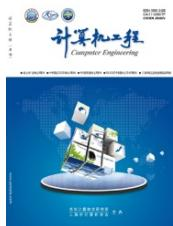
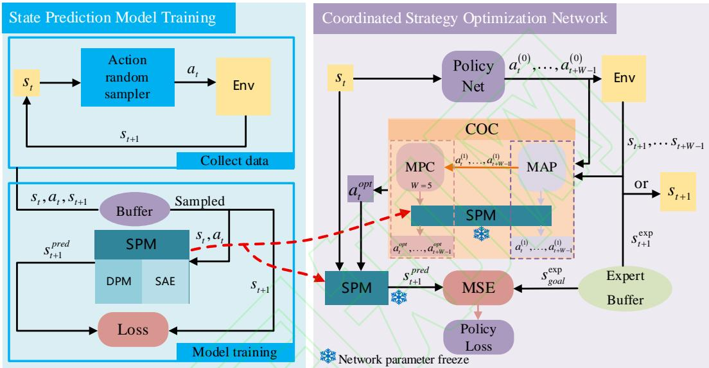
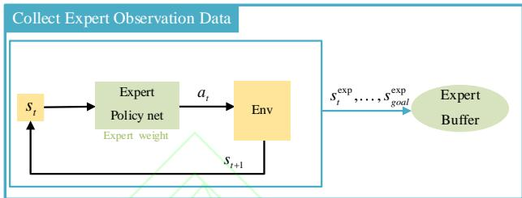
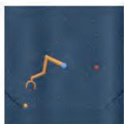
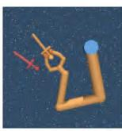
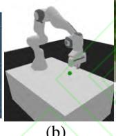
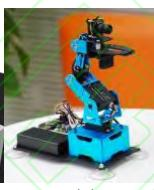
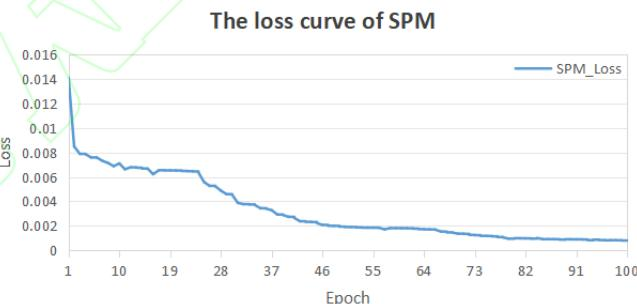
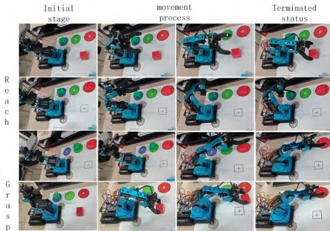
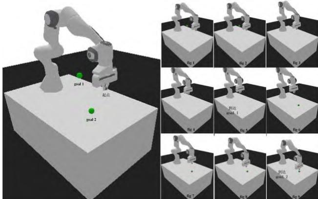

  
计算机工程 Computer Engineering ISSN 1000-3428,CN 31-1289/TP

# 《计算机工程》网络首发论文

题目： 基于预测-协同优化的机械臂零动作模仿学习

作者： 闫平，杨杰龙，黄道缘，钟石峰

DOI： 10.19678/j.issn.1000-3428.0252432

网络首发日期： 2025-09-23

引用格式： 闫平，杨杰龙，黄道缘，钟石峰．基于预测-协同优化的机械臂零动作模仿学 习[J/OL]．计算机工程. https://doi.org/10.19678/j.issn.1000-3428.0252432

网络首发：在编辑部工作流程中，稿件从录用到出版要经历录用定稿、排版定稿、整期汇编定稿等阶段。录用定稿指内容已经确定，且通过同行评议、主编终审同意刊用的稿件。排版定稿指录用定稿按照期刊特定版式（包括网络呈现版式）排版后的稿件，可暂不确定出版年、卷、期和页码。整期汇编定稿指出版年、卷、期、页码均已确定的印刷或数字出版的整期汇编稿件。录用定稿网络首发稿件内容必须符合《出版管理条例》和《期刊出版管理规定》的有关规定；学术研究成果具有创新性、科学性和先进性，符合编辑部对刊文的录用要求，不存在学术不端行为及其他侵权行为；稿件内容应基本符合国家有关书刊编辑、出版的技术标准，正确使用和统一规范语言文字、符号、数字、外文字母、法定计量单位及地图标注等。为确保录用定稿网络首发的严肃性，录用定稿一经发布，不得修改论文题目、作者、机构名称和学术内容，只可基于编辑规范进行少量文字的修改。

出版确认：纸质期刊编辑部通过与《中国学术期刊（光盘版）》电子杂志社有限公司签约，在《中国学术期刊（网络版）》出版传播平台上创办与纸质期刊内容一致的网络版，以单篇或整期出版形式，在印刷出版之前刊发论文的录用定稿、排版定稿、整期汇编定稿。因为《中国学术期刊（网络版）》是国家新闻出版广电总局批准的网络连续型出版物（ISSN 2096-4188，CN 11-6037/Z），所以签约期刊的网络版上网络首发论文视为正式出版。

# 基于预测-协同优化的机械臂零动作模仿学习

闫平 1，杨杰龙1\*，黄道缘 1，钟石峰1

(1.江南大学，物联网工程学院，江苏 无锡 214122)

摘 要：强化学习在机器人控制中面临奖励函数设计困难的挑战，而模仿学习虽规避了奖励工程的难题，却需依赖高成本的专家动作数据。为此，研究提出一种基于预测 协同优化的机械臂零动作模仿学习框架。该方法融合模型预测控制（ ）与最大后验概率（MAP）的贝叶斯修正，通过多步动作序列优化实现机械臂精准操控，同时消除对专家动作数据和人工奖励设计的依赖。框架的核心是利用 MPC 的滚动优化机制，以最小化多步状态误差为目标，动态调整动作序列，增强对噪声和预测不确定性的鲁棒性。在此过程中，MAP 方法被引入到单步优化，通过先验分布与似然性修正每个动作，提升动作优化的局部合理性与效率。与传统方法不同，该框架仅依赖专家状态而非专家动作，通过预测模型生成目标状态，避免了专家动作数据收集的困难，同时克服了预测误差累积的问题。实验结果表明，该方法在多种机械臂仿真任务中均优于现有基线方法，其中平均回报提升约 45.8%，预测误差降低约 50.7%，展现了更高的动作执行精度和对复杂环境的适应能力，并在真实机械臂平台上实现了稳定的控制，验证了跨平台工程化潜力。

关键词：模仿学习；模型预测控制；最大后验概率；机器人控制；状态预测

DOI:10.19678/j.issn.1000-3428.0252432

# Zero-Action Imitation Learning for Robotic Arm via Predictive-Collaborative Optimization

YAN Ping1, YANG Jielong1\*, HUANG Daoyuan1, ZHONG Shifeng1

(1. School of Internet of Things Engineering, Jiangnan University, Wuxi, Jiangsu 214122, China)

【Abstract】 Reinforcement learning faces the challenge of difficulty in designing reward functions in robot control, while imitation learning, although it avoids the problem of reward engineering, relies on high-cost expert motion data. To this end, the research proposes a zero-motion imitation learning framework for robotic arms based on Predictive-Collaborative Optimization. This method integrates model predictive control (MPC) with Bayesian correction of the maximum a posteriori (MAP), achieving precise control o the robotic arm through multi-step action sequence optimization. while eliminating the reliance on expert action data and manua reward design. The core of the framework is to utilize the rolling optimization mechanism of MPC, aiming to minimize multi-step state errors, dynamically adjust the action sequence, and enhance robustness against noise and prediction uncertainties. During this process, the MAP method is introduced into single-step optimization, where each action is corrected through prior distribution and likelihood, thereby enhancing the local rationality and efficiency of action optimization. Unlike traditional methods, this framework relies only on expert states rather than expert actions. It generates the target state through a prediction model. avoiding the difficulty of collecting expert action data and simultaneously overcoming the problem of accumulated prediction errors. The experimental results show that this method outperforms the existing baseline methods in various robotic arm simulation tasks, with an average return increase of approximately 45 8% and a prediction error reduction of approximately 50 7% It demonstrates higher action executior accuracy and adaptability to complex environments, and has achieved stable control on a real robotic arm platform, verifying the potential for cross-platform engineering.

【Key words】imitation learning; Model predictive control (MPC); Maximum a posteriori (MAP); robotic control; state prediction

## 0 引言

尽管深度强化学习在复杂决策任务中展现出强大潜力[1-2]，但其对人工设计奖励函数的严重依赖导致策略训练面临显著瓶颈——不同任务需要定制不同的奖励机制，动态环境中易出现奖励稀疏与错配问题[3-4]。随着机器人学习与控制技术的快速发展[5-7]，模仿学习通过效仿专家行为显著降低了复杂任务中的试错成本，成为机器人策略学习的关键范式[8-9]。传统方法依赖于专家提供的状态-动作对优化策略，在机械臂操控[10-11]、多任务学习[12]等领域取得了广泛应用。现有研究面临的核心问题集中体现在两大关键挑战：首先，专家动作数据的获取存在根本性限制，在动态或不可预测环境中，依赖人工演示的传统方法不仅面临高昂的采集成本，更因专家样本覆盖范围受限而导致策略泛化能力不足[13-15]；其次，现有基于预测模型的模仿学习方法虽能部分替代专家动作[16-18]，却难以解决多步任务中的误差累积问题，这主要源于预测模型在未覆盖序列中的泛化性能急剧下降，以及控制框架对模型输出的微小误差具有高度敏感性，导致动作偏差在时序传播过程中被持续放大。这些困境共同指向模仿学习领域亟待突破的核心问题，即如何在完全脱离专家动作数据的约束下，构建能够抑制预测

为了应对上述挑战，我们提出了一种结合模型预测控制(MPC)和最大后验概率(MAP)的新型模仿学习方法，该方法无需依赖专家动作数据即可完成多步动作序列的学习优化。具体来说，通过 MPC的滚动优化机制，在多步任务中动态调整动作序列，以最小化预测误差对任务执行的影响。同时，结合 MAP 在单步优化中的先验修正功能，减少了动作突变引发的局部预测误差，进一步提升了策略的鲁棒性和泛化能力。这种设计不仅有效克服了传统方法中的误差累积问题，还避免了对专家动作数据的依赖，为复杂动态环境中的模仿学习任务提供了更优的解决方案。本文的主要贡献包括：

1）专家动作零依赖：仅需专家状态序列，无 需专家动作引导，避免动作标注成本；

2）多尺度误差控制：结合 MPC 的全局滚动优化（抑制多步误差累积）与MAP 的局部先验修正（通过贝叶斯推断约束动作突变）多尺度控制预测误差；

3）方法的有效性：在多种不同机械臂任务环境中，所提出的方法显著优于现有基线方法，展现了更高的时间效率与操作精度。

4）实物平台的验证：在 4自由度ArmPi-min轻量级机械臂上成功实现 Reach（定点到达）与Grasp（目标抓取）任务的实时部署，验证了方法在资源受限硬件平台上的有效性和实用性。

## 1 相关研究

，模仿学习在机械臂控制领域取得了显开始探索如何通过专家示范来导机器人学习特定任务[19-20]。这些方法通过模仿为[21]，展示了在复杂任务中学习人类策略的巨大潜力。然而，这些方法的一个主要限制是依赖于高质量的专家动作数据，这在实际应用中可能非常具有挑战性。典型研究如 Chang 等人[22]提出了一种通过离线数据缓解变量偏移的方法，该方法通过重新加权专家演示来优化学习过程，但仍然依赖于专家动作数据作为输入。类似地，Hoque等人[23]提出了一种通过生成干预性数据来提高机器人模仿学习效率的方法，尽管这种方法在数据效率上有所提升，但依然需要专家动作数据作为基础。此外，Spencer等人[24]提出了一种在线学习框架，通过人类专家的显式和隐式反馈来优化机器人行为，然而这种方法仍然依赖于专家的动作数据来指导学习过程。此外，Reichlin 等人[25]提出了一种通过不确定性估计来触发人类演示数据注入的方法，尽管该方法在减少样本复杂性方面表现出优势，但仍未完全摆脱对专家动作数据的依赖。以上的这些方法均需高质量的专家动作标注，然而在实际任务中，专家动作的采集面临多重挑战：机械臂的高维连续动作空间导致动作标注误差累积；此外，在危险环境中，专家难以实时提供动作示范。尽管逆强化学习[26-27]可通过状态数据反推奖励函数以规避动作标注需求，但其对完全可观测性的强依赖在机械臂的部分可观测场景中会导致策略失稳。

为减少对专家动作的依赖，近年来研究者尝试在模仿学习中通过预测模型生成目标状态。例如，Wang等人[28]通过预测模型生成未来姿态，并利用模仿学习优化模型参数，以提高预测精度。等人[29]提出的加速模仿学习的方法，型来加速策略学习的收敛速度。 [30]提了基于模仿学习的 MPC方法，通过在线优化提高控制策略的鲁棒性。然而，这类方法面临两大挑战：其一，单步预测误差在多步任务中的指数级放大。以机械臂抓取任务为例， 若单步位置预测误差为2cm，经过5步操作后累计误差将超出典型夹持器容错阈值；其二，动作突变引发的力矩冲击可能会使预先训练的预测模型进入未探索状态空间，引发预测模型失效。现有方法（如[30]的在线模型预测控制）虽能通过滚动优化缓解全局误差，却缺乏对单步动作的局部约束，难以平衡探索与稳定性。

## 2 算法设计

本节提出了一种基于状态预测与协同优化的机械臂模仿学习框架，其核心架构如图 1所示。该框架由两个核心模块构成：状态预测模型（SPM）与协同策略优化网络（CSONet）。各模块通过层级化协作机制，实现仅依赖专家观测状态数据的策略学习与动作优化。第一个部分是 SPM状态预测模型，它接收当前状态 $s _ { t }$ 和给定动作 $a _ { t }$ 作为输入，输出预测的下一状态 $s _ { t + 1 } ^ { \mathrm { p r e d } }$ ，通过监督学习处理机械臂状态转移的动态特性，为后续策略优化提供环境动CSONet 协同策略优化网络，它包含 ：策略网络（PNet），它基于当前 $s _ { t }$ $s _ { g \mathrm { o a l } } ^ { \mathrm { e x p } }$ 生成初始动作$\left\{ a _ { t } ^ { ( 0 ) } , . . . , a _ { t + W - 1 } ^ { ( 0 ) } \right\}$ 供任务导向的初步策略；（COC）以当前状态 $s _ { t }$ 及 PNet策略网络提供的动作序列作为输入，通过 MAP 单步贝叶斯修正对动作进行局部可行性优化，再基于MPC 模型预测控制在滚动窗口内迭代调整多步动作 序 列 ， 最 终 输 出 即 时 优 化 动 作 序 列$\left\{ a _ { t } ^ { \mathrm { o p t } } , . . . , a _ { t + W - 1 } ^ { \mathrm { o p t } } \right\}$ 及下一状态预测序列。最后，通过计算优化后的预测状态 $s _ { t + 1 } ^ { \mathrm { p r e d } }$ 与专家目标状态 $s _ { g \mathrm { o a l } } ^ { \mathrm { e x p } }$ 的误差，反向传播更新PNet参数，驱动初始策略向专家目标对齐。

## 2.1 状态预测模型（SPM）

如图 1左侧图所示，图中展示了 SPM的整个训练过程。具体来说，在每个时间步骤 ，智能体根据环境观察值 $s _ { t }$ 随机采样动作 $a _ { t }$ ，并观测到新的环境状态 $s _ { t + 1 }$ 。随后我们将状态 $s _ { t }$ 、动作 $a _ { t }$ 和新状态 $s _ { t + 1 }$ 添加到经验回放缓冲区（Buffer）中。每回合数据收集完成后，我们对收集到的数据进行采样，并用这些数据训练 SPM 网络。SPM 网络将$\left( s _ { t } , a _ { t } \right)$ 状态动作对作为输入，输出预测的预期状态$s _ { t + 1 } ^ { \mathrm { p r e d } }$ ，然后我们计算预测状态与实际状态 $s _ { t + 1 }$ 之间的损失来优化网络。SPM 通过建模机械臂动作与状态间的动态关系，为策略优化提供环境动态的先验知识。如图 1 所示，SPM 由状态动作编码器（SAE）与动态预测模块（DPM）组成。

  
图 1 总体架构图  
Fig.1 Overall architecture diagram

压缩，去除冗余信息：

SAE 状态动作编码器负责提取状态与动作的联合特征表示。如果输入状态是图像，我们使用若干卷积神经网络和实例归一化层进行处理。我们从前面得到的缓冲区 Buffer 中采样一 批训练数据，将这批训练数据的状态 $s _ { t }$ 首先输入到一个二维卷积层的状态嵌入器中，将原始状态数据转换为低维度的表示：

$$
h _ {1} = \text { LayerNorm } (\text { ReLU } (\text { Conv2D } (s _ {t}, W _ {c}) + b _ {c}))\tag{1}
$$

其中， $W _ { c }$ 和 $b _ { c }$ 分别是嵌入器卷积层的权重和偏置，Conv2D 表示二维卷积操作，ReLU 是修正线性单元激活函数。然后将嵌入后的输出 $h _ { 1 }$ 送入到一个卷积层和实例归一化层构成的下采样层中，将特征维度

$$
h _ {2} = \text { LayerNorm } (\text { ReLU } (\text { Conv2D } (h _ {1}, W _ {c 1}) + b _ {c 1}))\tag{2}
$$

其中， $W _ { c 1 }$ 和 $b _ { c 1 }$ 分别是下采样卷积层的权重和偏置。通过这种压缩，我们可以减少维度并提取关键特征，从而减少数据的复杂性，使其更适合在模型中处理。然后，压缩后的输出 $h _ { 2 }$ 输入到一个卷积层和实例归一化层构成的上采样层中：

$$
h _ {3} = h _ {2} + \text { LayerNorm } (\text { ReLU } (\text { Conv2D } (h _ {2}, W _ {c 2}) + b _ {c 2}))\tag{3}
$$

其中， $W _ { c 2 }$ 和 $b _ { c 2 }$ 分别是上采样层卷积层的权重和偏置。将状态表示恢复到原始维度。然后，我们对动作进行注入，其目的是将动作信息融入到模型的状态表示，这将允许模型根据不同的动作调整其预测或决策。缓冲区 Buffer 中采样的动作 $a _ { t }$ 输入动作嵌入器中，将原始动作数据转换为低维度的表示 $h _ { a }$ ：

$$
h _ {a} = \operatorname{Embed} (a _ {t})\tag{4}
$$

接下来，我们将动作嵌入与解压缩后的状态表示相结合，这里我们使用逐元素乘法将动作嵌入与处理后的状态相乘，这允许模型根据不同的动作调整状态表示，随后我们将原始动作嵌入的 $h _ { a }$ 直接添加到状态表示中，这样，模型可以考虑动作对状态的直接影响：

$$
h _ {f u s e} = h _ {3} \odot s i g m o i d (h _ {a}) + h _ {a}\tag{5}
$$

这里， 表示逐元素乘法。而针对数值类型的状态，我们则采用全连接层处理。

最后，为了使模型能够捕捉状态之间的时间关联性并适应机械臂的动态行为，我们引入了双向长短期记忆网络（LSTM）来处理因环境变化引起的时间序列问题：

$$
h _ {\mathrm{LSTM}} = \mathrm{BiLSTM} (h _ {f u s e})\tag{6}
$$

这一步骤整合了状态序列的过去和未来的信息，为模型预测提供了更丰富的状态表示。

动态预测模块 DPM 是将之前处理得到的隐藏状态（通常是一个高维向量）转化为我们最终需要的预测目标：

$$
s _ {t + 1} ^ {\mathrm{pred}} = \mathrm{Conv2D} (h _ {\mathrm{LSTM}})\tag{7}
$$

最后，如图 1 所示，我们使用缓冲区 Buffer 中采样数据，计算预测状态和真实状态之间的均方误差（MSE）作为损失函数：

$$
\mathcal {L} _ {\mathrm{SPM}} = \frac {1}{T} \sum_ {t = 0} ^ {T - 1} | | s _ {t + 1} ^ {p r e d} - s _ {t + 1} | | ^ {2}\tag{8}
$$

其中，T 表示一回合时间序列的总长度，即样本中状态的数量， $s _ { t + 1 } ^ { \mathrm { p r e d } }$ 为预测的新状态， $s _ { t + 1 }$ 是真实的新状态。并通过最小化损失来优化 SPM。

## 2.2 协同策略优化网络（CSONet）

针对传统模仿学习依赖专家动作数据且难以抑制多步误差累积的瓶颈，本小节提出了 CSONet 协同策略优化网络框架，通过协同优化机制实现专家动作零依赖与长程误差控制。如图 1 右侧图所示，CSONet 由 PNet 策略网络与 COC 协同优化控制器构成。

## 2.2.1 策略网络

策略网络 PNet 作为动作生成的策略网络，其目标是在无专家动作标注的条件下，基于当前状态 $s _ { t }$ 与目标状态 $s _ { g \mathrm { o a l } } ^ { \mathrm { e x p } }$ ，生成物理可行的初始动作序列$\left\{ a _ { t } ^ { ( 0 ) } , . . . , a _ { t + W - 1 } ^ { ( 0 ) } \right\}$ 。因此，在缺乏专家动作标注的情况下，如何生成与目标状态对齐的动作序列是策略优化的关键。传统方法通常基于逆动力学模型从状态序列反推动作，但其依赖于精确的动力学建模且对噪声敏感。为此，PNet 通过端到端学习直接建立状态-目标-动作的映射关系，为后续优化提供物理可行的粗粒度策略。

在这之前，我们需要提前收集好专家状态序列。如图 2 所示，我们通过加载专家模型权重与环境交互收集状态数据，并将收集好的专家观测的状态数据存储到专家 Buffer 中。

  
图 2 专家状态数据收集过程  
Fig.2 The process of collecting expert status data

如图 1 右侧 CSONet 所示，首先，CSONet 将初始状态 $s _ { t }$ 作为输入，并通过 PNet 输出预测动作序列$\left\{ a _ { t } ^ { ( 0 ) } , \ldots , a _ { t + W - 1 } ^ { ( 0 ) } \right\}$ ，过程如下：

$$
a _ {t + k} ^ {(0)} = \mu_ {\theta} (s _ {t}, k) + \epsilon_ {k}, \epsilon_ {k} \sim \mathcal {N} (0, \sigma^ {2})\tag{9}
$$

其中， $k = 0 , . . . , W - 1$ ， 代表策略网络的参数，$\mu _ { \theta } ( s _ { t } , k )$ 代表第 次策略网络输出的动作， $\epsilon _ { k }$ 代表高斯噪声，在缺乏专家动作监督时，通过叠加可控噪声生成多样化初始动作， 表示预测窗口长度。次后生成输出预测动作序列。

## 2.2.2 协同优化控制器

协同优化控制器 COC 以 PNet 输出的动作为输入，通过滚动优化-单步修正-误差反传的三步闭环流程实现动作精细化调整，抑制长程误差累积。在此过程中，我们将 2.2.1 中 SPM 状态预测模型的参数冻结，从而提供稳定的状态预测，具体流程如下：

## 1) 单步贝叶斯修正

如图 1 所示，先对 PNet 生成的初始动作序列$\left\{ a _ { t } ^ { ( 0 ) } , \ldots , a _ { t + W - 1 } ^ { ( 0 ) } \right\}$ 进行局部修正，在保证动作连续性的前提下最小化单步预测误差。首先，窗口内部索引$k = 0$ 时，对先验均值进行初始化：

$$
\mu_ {\mathrm{prior}} ^ {(k)} = \left\{ \begin{array}{c} {{a _ {t} ^ {(0)}, k = 0 \text {且} t > 0}} \\ {{a _ {t + k - 1} ^ {(1)}, k > 0}} \end{array} \right.\tag{10}
$$

先验均值 $\mu _ { \mathrm { p r i o r } } ^ { ( k ) }$ 的设计体现了动作连续性约束，当$k = 0$ 时，使用 PNet 生成的初始动作 $a _ { t } ^ { ( 0 ) }$ 作为基准，保持与策略网络的一致性；当 $k > 0$ 时，使用前一步优化后的动作 $a _ { t + k - 1 } ^ { ( 1 ) }$ ，确保窗口内动作的时序连续。然后并构建以历史优化动作为均值的高斯先验：

$$
p (a _ {t + k} ^ {(0)}) \propto \exp \left(- \frac {1}{2 \sigma_ {p} ^ {2}} | | a _ {t + k} ^ {(0)} - \mu_ {\text {prior}} ^ {(k)} | | ^ {2}\right)\tag{11}
$$

其中， $\sigma _ { p } = 0 . 0 1$ ，用来控制动作变化幅度的超参数，防止关节速度突变。然后通过状态预测模型计算动作的似然概率：

$$
p (s _ {t + k} \mid a _ {t + k} ^ {(0)}) \propto \exp \left(- \frac {1}{2 \sigma_ {o} ^ {2}} | | f _ {\mathrm{SPM}} (s _ {t + k - 1}, a _ {t + k} ^ {(0)}) - s _ {t + k} | | ^ {2}\right)\tag{12}
$$

其中， $f _ { \mathrm { S P M } }$ 为冻结参数的预训练的状态预测模型，$\sigma _ { o }$ 为观测噪声标准差。式中 $s _ { t + k }$ 指代当前优化步骤选定的目标状态，并作为 MAP 优化的参考基准。其具体取值由状态切换机制动态决定：在训练早期（SPM 预测精度不足时）采用专家状态 $s _ { t + k } ^ { \mathrm { e x p } }$ 作为下一时刻输入，避免初始策略因预测误差陷入无效状态空间。随着训练进行，我们按线性衰减概率混合专家状态与真实环境状态，最终过渡至完全使用真实状态。这类似于 DAgger 的专家干预思想，但仅在状态层面操作，既规避了动作标注需求，又保证了策略最终适应真实动力学特性。在求解最大后验概率之前，我们对第 个动作维度，以当前动作估计值 $a _ { t + k } ^ { ( 0 ) }$ 为中心，施加扰动 $\delta \in \left. - 0 . 0 1 , 0 , 0 . 0 1 \right.$ ，进行局部小范围网格搜索，生成该维度的候$A _ { d }$

$$
A _ {d} = \left\{a _ {t + k} ^ {(0)} + \delta \cdot e _ {d} \mid \delta \in \{- 0. 1, 0, 0. 1 \} \right\} \subset \mathbb {R} ^ {m}\tag{13}
$$

其中， $\boldsymbol { e } _ { d } \in \mathbb { R } ^ { m }$ 是 维动作空间中的第 $d$ 个标准基向量。每个候选动作仅在第 维发生偏移，其余维度保持不变。通过分维度独立扰动，避免高维动作空间的组合爆炸，显著降低计算复杂度。然后，综合先验与似然项，求解最大后验估计：

$$
a _ {t + k} ^ {(1)} = \arg \min _ {a \in \mathcal {A} _ {t}} [ | | a - \mu_ {\text { prior }} ^ {(k)} | | ^ {2} + | | f _ {\mathrm{SPM}} (s _ {t + k}, a) - s _ {t + k + 1} | | ^ {2} ]\tag{14}
$$

并更新此时的状态预测：

$$
s _ {t + k + 1} ^ {\mathrm{pred}} = f _ {\mathrm{SPM}} (s _ {t + k}, a _ {t + k} ^ {(1)})\tag{15}
$$

然后，窗口内部索引 $k + 1$ ，同样执行公式（10）到（15），直到 $k = W - 1$ 为止，从而得到修正后动作$\left\{ a _ { t } ^ { ( 1 ) } , . . . , a _ { t + W - 1 } ^ { ( 1 ) } \right\}$ 以及状态预测序列 $\left\{ s _ { t + 1 } ^ { \mathrm { p r e d } } , . . . , s _ { t + W } ^ { \mathrm { p r e d } } \right\}$ 。

## 2) 全局滚动优化

在预测窗口 $W = 5$ 内，通过最小化多步累积误差对动作序列进行全局优化，抑制单步误差的时序传播。以修正后动作序列 $\left\{ a _ { t } ^ { ( 1 ) } , . . . , a _ { t + W - 1 } ^ { ( 1 ) } \right\}$ 为初始解，通过模型预测控制（MPC）最小化跟踪误差：

$$
\mathcal {J} (\boldsymbol {a}) = \sum_ {k = 0} ^ {W - 1} \left(\| s _ {t + k} ^ {\text {pred}} - s _ {t + k} \| ^ {2} + \lambda \| a _ {t + k} ^ {(1)} \| ^ {2}\right)\tag{16}
$$

其中， $\lambda$ 为动作幅值正则化系数，抑制关节力矩饱和。从而得到全局最优动作序列：

$$
\boldsymbol {a} ^ {\text { opt }} = \underset {\boldsymbol {a} \in \{a _ {t} ^ {(1)},..., a _ {t + W - 1} ^ {(1)} \}} {\arg \min} \mathcal {J} (\boldsymbol {a}) = [ a _ {t} ^ {\text { opt }},..., a _ {t + W - 1} ^ {\text { opt }} ]\tag{17}
$$

取优化序列的首步动作 $a _ { t } ^ { \mathrm { { o p t } } }$ 作为 PNet 的动作，并更新此时的状态预测：

$$
s _ {t + 1} ^ {\mathrm{pred}} = f _ {\mathrm{SPM}} (s _ {t}, a _ {t} ^ {o p t})\tag{18}
$$

经过一个周期的循环运算，我们计算预测的新状态$s _ { t + 1 } ^ { \mathrm { p r e d } }$ 与专家目标状态 $s _ { g \mathrm { o a l } } ^ { \mathrm { e x p } }$ 的均方误差（MSE）作为损失函数：

$$
\mathcal {L} _ {P N e t} = \frac {1}{N} \sum_ {i = 1} ^ {N} \Bigl (s _ {t + i} ^ {p r e d} - s _ {g o a l} ^ {\exp} \Bigr) ^ {2}\tag{19}
$$

$s _ { g \mathrm { o a l } } ^ { \mathrm { e x p } }$ 为专家提供的目标状态， N为一个周期的步数。通过梯度下降优化策略网络参数：

$$
\theta \leftarrow \theta - \alpha \nabla_ {\theta} \mathcal {L} _ {P N e t}\tag{20}
$$

其中， $\alpha$ 为学习率。从而迫使 PNet 生成的初始动作在优化后产生的状态更接近专家目标。我们在 3.5节我们通过多维度经验验证和稳定性机制设计来确保协同机制的实际可靠性。

## 3 实验结果与分析

本节构建了从虚拟仿真到实体硬件的多层次验证体系，通过不同仿真任务的测试、多基线对比实验以及物理部署验证三个维度，系统评估方法的泛化性能与有效性。

## 3.1 实验配置

为了验证我们方法在不同环境中的适用性，我们在三类异构平台进行实验：1）基于标准测试集的DM Control 仿真环境[31]；2）Panda 机械臂仿真环境[32]；3）ArmPi-mini 轻量化实体机械臂系统。这种配置有效验证方法在不同自由度、传感模态和执行精度下的迁移能力。

## 3.1.1 实验环境设置

## 1）DM Control 多模态仿真环境

Control Suite 是一组具有标准化结构的固定任务集。本研究选取其 Manipulator 模块中的物体操控任务建立验证场景。这是一个包含 6 个自由度的机械臂、球体、以及目标点位的机械臂操作环境。观测空间是 64x64x3 视觉通道以及状态向量（涵盖机械臂运动学参数、目标物位姿）；动作空间是 5 维连续控制量（笛卡尔空间位姿增量）；任务指标是 Bringball（球体转移）和 Bring peg（木钉装配）。

## 2）Panda 机械臂仿真环境

Franka Emika Panda Robot 基于 MuJoCo[33]物理引擎构建的 7 自由度机械臂仿真环境，采用 OpenAIGym[34]标准接口。在 Reach 任务中，状态空间包含关节角度/速度及目标坐标，动作空间为 3 维抓手位移指令。当末端执行器与目标间距小于等于 0.05m时视为成功完成任务。为提升训练效率，引入目标重标记技术（HER）[32]，通过动态调整经验回放中的目标参数增强策略学习能力，从而加速训练过程。

## 3）ArmPi-mini 实体平台

ArmPi-mini 四 自 由 度 机 械 臂 ， 配 备LDX-218/LFD-01 系列高精度舵机与 480P 视觉模组，金属架构尺寸 208×134×308mm（长×宽×高），总质量 700g。状态空间定义为末端坐标与目标物空间坐标，动作空间映射为 4 维舵机脉宽调节量。实验重点验证 Reach（定点到达）和 Grasp（目标抓取）两类基础操作能力。图 3 为三种环境及实物的相机视图和外观。

  
(a)  
DM Control 任务图

(b)  
  
Panda 任务图 实体平台图

  
(c)  
图 3. 三种实验环境与实物平台外观  
Fig.3 Three experimental environments and the appearance of the physical platform

在双仿真环境（DMC 和 Panda）中执行三组对照实验（Bring ball, Bring peg, Panda Reach），每基线方法进行 5 轮独立训练，每轮采集 10 万步交互数据。每回合结束后，我们评估模型的表现。

## 3.1.2 对比算法

为了评估我们提出的无动作模仿学习框架，我们选择了几种算法方法进行比较：

随机探索策略（Random）：这是一种基本的探索策略，不依赖于专家数据，但效率较低。

Plan2Explore（P2E）[35]：一种基于世界模型的自监督探索方法，通过优化预期信息增益训练单一策略，无需依赖专家动作数据。

Population Plan2Explore（PP2E）[31]：一种基于群体（population）的 P2E 版本，这些智能体独立地最大化预期信息增益，无需依赖专家动作数据。

CASCADE[31]：一种自监督方法，通过训练多样化的探索策略收集数据，无需专家动作数据，旨在最大化模型的信息增益。

IPL[36]：一种从专家演示中学习奖励函数的模仿学习方法，它通过观察专家的行为来推断其潜在的偏好或奖励函数。

## 3.2 结果分析

## 3.2.1 SPM 预训练分析

## 1)训练配置与成本

数据收集：100 回合随机探索，每回合收集 2000步，共 20 万个 $\left( s _ { t } , a _ { t } , s _ { t + 1 } \right)$ 三元组。

训练设置：批大小 1500，学习率 1e-3（Adam优化器），在 RTX 3090 GPU 上训练。

收敛标准：验证集误差连续 10 个回合不下降。

## 2)训练效率分析

SPM 预训练总耗时约 2.9 小时，其中数据收集约 1 小时，模型训练约 1.9 小时。图 4 展示了训练损失曲线，可以看到模型在约第 82 回合后基本收敛，最终损失稳定在 0.00085±0.00003。

  
图 4. SPM 损失曲线图  
Fig.4 The loss curve graph of SPM

## 3)对整体框架效率的影响分析

SPM 预训练为一次性离线过程（耗时约 2.9 小时），训练完成的模型可持续部署于目标机械臂平台。一旦 SPM 训练完成，它能够支持该任务在不同初始条件、不同目标位置下的所有变体，无需重新训练。例如，Panda Reach 任务的 SPM 可处理工作空间内任意点到点的运动规划。这一设计将核心计算开销前置，使得在线运行时仅需低延迟推理。因此，SPM 预训练不仅不会降低系统效率，反而通过模型复用显著提升了长期部署的工程适用性。

## 3.2.2 任务执行效能分析

我们从策略收益、数据效率及跨任务稳定性三个维度进行系统验证，实验覆盖 DM Control Suite标准测试任务（Bring ball、Bring peg）及 Franka

Emika Panda 机械臂 Panda Reach 任务。

表 1 平均回报表现  
Table 1 Average Return Performance

<table><tr><td>Average score</td><td>Bring ball</td><td>Bring peg</td><td>Panda Reach</td></tr><tr><td>Random</td><td>0.789±0.19</td><td>1.152±0.27</td><td>-46.71±0.22</td></tr><tr><td>P2E</td><td>0.839±0.16</td><td>1.204±0.31</td><td>-47.04±0.33</td></tr><tr><td>PP2E</td><td>0.903±0.14</td><td>1.501±0.48</td><td>-46.59±0.49</td></tr><tr><td>CASCADE</td><td>1.151±0.22</td><td>2.065±0.59</td><td>-44.35±0.40</td></tr><tr><td>IPL</td><td>1.494±0.16</td><td>1.936±0.64</td><td>-20.97±8.16</td></tr><tr><td>Ours</td><td>2.178±0.17</td><td>3.651±0.90</td><td>-8.240±5.50</td></tr></table>

## 1) 策略收益优势

表 1 展示了各方法在三种任务中的平均回报表现，在 Panda Reach 任务中取得-8.240±5.50，较最优基线 IPL 提升 60.7%；Bring ball 任务达 2.178±0.17，显著优于所有基线。Random 基线因缺乏目标导向机制，导致其无法有效学习策略。P2E 和 PP2E基线基于自监督环境建模的方法，因其模型误差在长 时 域 任 务 中 持 续 累 积 导 致 最 终 效 果 不 佳。CASCADE 基线在两个任务（Bring ball 和 Bring peg）中表现良好，但在 Reach 任务中的表现不佳，是因为他的分层架构难以适应机械臂任务的动态复杂性，策略泛化能力有限。IPL 基线在这三个任务上表现都很不错，这得益于其依赖反馈的隐式奖励机制，但在 Panda Reach 任务中波动较大，反映偏好数据的噪声敏感性。相比之下，在无需专家动作监督的条件下，我们的方法因 COC 模块避免了自监督学习中的目标偏移问题，同时也证明了我们的状态

表 2 数据效率表现  
Table 2 Data Efficiency Performance

<table><tr><td>Algorithm</td><td>Ours</td><td>IPL</td><td>CAS</td><td>Ours</td><td>IPL</td></tr><tr><td>Data size</td><td>100k</td><td>200k</td><td>200k</td><td>300k</td><td>500k</td></tr><tr><td>Bring ball</td><td>1.950</td><td>1.647</td><td>0.894</td><td>2.203</td><td>1.913</td></tr><tr><td>Bring peg</td><td>1.488</td><td>1.620</td><td>1.724</td><td>2.972</td><td>1.937</td></tr><tr><td>Panda</td><td>-23.99</td><td>-28.56</td><td>-46.90</td><td>-2.190</td><td>-7.210</td></tr></table>

## 2) 数据效率突破

如表 2 所示（CASCADE 由 CAS 表示），我们针对不同任务和数据量展开系统分析，揭示我们的方法（Ours）在数据效率上的显著优势及内在机制。我们的方法在 Bring ball 任务中的 100k 步时（1.950）已超越 IPL-200k（1.647）和 CASCADE-200k（0.894），数据效率提升 2 倍以上。在 Bring peg 任务的 300k步时（2.972）较 IPL-500k（1.937）提升 53.5%。在Reach 任务中 300k 步时（-2.19）达到 IPL-500k（-7.21）的 3.3 倍性能，且在 100k 步时（-23.99）已显著优于 CASCADE-200k（-46.90）。这是因为通过滚动时域窗口重用历史动作序列，使 100k 数据的有效利用率相当于基线 200k-300k 水平。另外，基于贝叶斯修正的单步动作优化，也减少了大量的无效探索。

## 3.2.3 鲁棒性验证：IQM 指标分析

为评估方法在跨任务场景下的稳定性与抗干扰能力，我们采用归一化分数的四分位数间平均值（IQM[37]）作为核心指标。IQM通过计算25%至 75%分位数区间数据的均值，有效消除极端异常值影响，提供对策略性能中心趋势的鲁棒性度量。表 3 汇总了各基线在 DM Control Suite 任务（Bring ball、Bringpeg）中的 IQM 表现。

表 3 IQM 值表现  
Table 3 Performance of IQM Values

<table><tr><td>Baseline</td><td>IQM 值</td><td colspan="2">范围</td></tr><tr><td>Random</td><td>0.0516</td><td>1.00E-21</td><td>0.5323</td></tr><tr><td>P2E</td><td>0.0490</td><td>1.66E-22</td><td>0.4992</td></tr><tr><td>PP2E</td><td>0.0354</td><td>6.12E-20</td><td>0.4285</td></tr><tr><td>CASCADE</td><td>0.0622</td><td>5.04E-16</td><td>0.6317</td></tr><tr><td>IPL</td><td>0.0014</td><td>3.18E-100</td><td>0.0334</td></tr><tr><td>Ours</td><td>0.2326</td><td>4.53E-20</td><td>0.9156</td></tr></table>

Random/P2E/PP2E 的 IQM 值均低于 0.052，范围跨度大，表明其策略在任务间表现极不稳定，性能波动剧烈。CASCADE 的 IQM 值 0.0622 虽略高于随机方法，但范围上限与下限差异达较大，反映分层架构对任务目标的适应性不足。IPL 的 IQM 值最低（0.0014），范围压缩至近零区间（最大值 0.0334），证明依赖反馈的隐式奖励机制易受噪声干扰。而我们方法的 IQM 值（0.2326）显著优于其他基线，证明其策略性能中心趋势更强，MPC 抑制长期误差，MAP 约束瞬时动作，二者联合作用在消除极端异常值影响的同时，实现了跨任务的稳定，验证了多尺度优化框架的协同增益效应。

## 3.2.4 消融实验：协同必要性验证

为系统性验证所提出协同优化框架（COC,MPC+MAP）中各组分的必要性及其协同增益效应，本 小 节 在 仿 真 环 境 Panda Reach 与 实 体 平 台ArmPi-mini 上开展了详尽的消融实验。实验旨在对比分析以下四种策略的性能差异：1) 原始状态预测模型（Original）：即未经任何优化的基础 SPM 预测；2) 最大后验概率修正（MAP-only）：仅应用单步贝叶斯修正 MAP 模块；3) 模型预测控制 优化（MPC-only）：仅应用多步滚动优化 MPC 模块；4)完整协同优化框架（COC）：融合 MPC 与 MAP 的协同优化机制。实验结果如表 4 所示。

表 4 协同必要性消融实验  
Table 4 An ablation experiment on the necessity of collaboration

<table><tr><td>Error</td><td>Panda Reach</td><td>ArmPi-mini</td></tr><tr><td>Original</td><td>0.0296±0.014</td><td>0.0972±0.003</td></tr><tr><td>MAP-only</td><td>0.0295±0.013</td><td>0.0782±0.002</td></tr><tr><td>MPC-only</td><td>0.0272±0.013</td><td>0.0969±0.002</td></tr><tr><td>COC</td><td>0.0270±0.012</td><td>0.0519±0.002</td></tr></table>

具体分析如下：

## 1）原始模型局限性

原始 SPM 模型在 Panda Reach 任务中的预测误差高达 0.0296±0.014，在 ArmPi-mini 平台更是达到 $0 . 0 9 7 2 \pm 0 . 0 0 3$ 。这凸显了基础预测模型在复杂动态环境及存在传感器噪声的真实场景下性能受限，亟需优化机制介入。

## 2）MAP 单步修正的有效性

MAP 模块在仿真环境（0.0295±0.013）和实体平台 $( 0 . 0 7 8 2 \pm 0 . 0 0 2 )$ 均显著优于原始误差，尤其在含有传感器噪声的实体平台 ArmPi-mini 上误差降低 19.5%。这证明了 MAP 模块通过贝叶斯先验约束和似然函数进行的局部修正，能有效抑制动作突变和单步预测偏差，对提升动作的局部合理性与稳定性至关重要。尽管 MAP 在单步优化上表现出色，但其缺乏对多步误差累积的全局抑制机制（在PandaReach 任务中误差仍达 0.0295），限制了其在长程任务中的性能上限。

## 3）MPC 滚动优化的贡献

MPC 模块在 Panda Reach 任务（0.0272±0.013）较原始误差（0.0296±0.014）降低约 8.82%。这表明 MPC 通过滚动时域窗口动态调整多步动作序列，能够有效的平滑轨迹、抑制单步误差在时序上的传播放大。然而，在存在传感器噪声的 ArmPi-mini 平台上，MPC 模块产生的误差（0.0969±0.002）相比原始误差 $( 0 . 0 9 7 2 \pm 0 . 0 0 3 )$ 改善甚微。这揭示了由传感器瞬时噪声或突发扰动引起的局部动作偏差（可能导致瞬间较大状态误差）缺乏快速、精准的在线修正能力。

## 4）协同优化框架 COC 的优越性与必要性

COC 框架在 Panda Reach 任务（0.0270±0.012）和 ArmPi-mini 平台 $( 0 . 0 5 1 9 \pm 0 . 0 0 2 )$ 均表现出最低预测误差。COC 框架的优势源于 MPC 与 MAP 的深度协同，即 MPC 提供了多步前瞻的全局视野，动态优化动作序列以最小化累计状态误差；而 MAP 则在每一步优化中嵌入局部先验约束和基于观测的似然修正，确保每一步动作的物理可行性和预测准确性。这种协同有效克服了 MAP 模块的长程误差累积问题和 MPC 模块对局部模型误差的敏感性，实现了预测精度在仿真与实体平台上的全面提升。

## 3.2.5 消融实验：参数敏感性分析

## 1）动作平滑强度参数 $\sigma _ { p }$ 的影响

在 Panda Reach 任务中，我们系统测试了四类策略 $\sigma _ { p } \in \left\{ 0 . 0 1 , 0 . 1 , 0 . 5 \right\}$ 的预测误差，实验结果如表5 所示。

表 5 不同动作平滑约束的误差对比  
Table 5 Error comparison of smoothing constraints for different actions

<table><tr><td>Error (10-2)</td><td>0.01</td><td>0.1</td><td>0.5</td></tr><tr><td colspan="4">平滑约束</td></tr><tr><td>Original</td><td>2.11±1.3</td><td>3.14±1.3</td><td>4.54±1.4</td></tr><tr><td>MAP-only</td><td>2.10±1.2</td><td>3.14±1.2</td><td>4.53±1.3</td></tr><tr><td>MPC-only</td><td>1.97±1.1</td><td>2.95±1.1</td><td>4.17±1.2</td></tr><tr><td>COC</td><td>1.96±1.1</td><td>2.94±1.1</td><td>4.16±1.2</td></tr></table>

实验数据清晰揭示：随着 $\sigma _ { p }$ 从 0.01 增至 0.5，所有方法的预测误差呈单调上升趋势。以协同优化框架 COC 为例，其误差从最优值 $1 . 9 6 { \pm } 1 . 1 { \times } 1 0 ^ { - 2 }$ $( \sigma _ { p } = 0 . 0 1 )$ ）逐步攀升至 $4 . 1 6 { \pm } 1 . 2 { \times } 1 0 ^ { - 2 } \ : ( \ : \sigma _ { p } = 0 . 5 \ : )$ 增幅达 112%。这种变化规律源于约束强度的动态平衡机制，当 $\sigma _ { p } = 0 . 0 1$ 时，适度的平滑约束既能有效抑制关节速度突变，又为轨迹跟踪保留了必要的动作调整自由度；而 $\sigma _ { p } \geq 0 . 1$ 的强约束则显著削弱了系统响应动态目标的能力，导致末端执行器发生位置滞后。值得注意的是，尽管如此，与其他方案相比，COC 框架在所有 $\sigma _ { p }$ 取值下均保持性能优势，验证了其参数鲁棒性。

## 2）MAP 搜索半径与步长的影响

如表 6 所示的系统测试数据，搜索半径 0.1 与搜索步长 0.001 的参数组合展现出显著的精度-效率平衡特性：该配置平均窗口时间仅需 2.801 秒，较同半径下步长 0.0001 配置（26.855 秒）计算效率提升 9.6 倍，同时比步长 0.01 配置（0.416 秒）提供更充分的搜索分辨率。这种平衡源于精细分辨率与实时性需求的优化匹配，即当步长≤0.0001 时，高分辨率带来 26 秒级计算开销，难以满足工业实时控制的需求；而步长≥0.01 虽提升响应速度，却导致末端定位误差增加。另外，对于需要更精密的场景，可采用搜索半径 0.01 与步长 0.0001 的组合（耗时2.808 秒），在可接受的时间成本内实现最高精度。

## 表 6 MAP 不同搜索半径与步长的执行耗时（单位：秒）

Table 6 Execution time consumption of MAP with different search radii and step sizes (unit: seconds)

<table><tr><td>半径\步长</td><td>0.01</td><td>0.001</td><td>0.0001</td></tr><tr><td>0.01</td><td>0.175</td><td>0.483</td><td>2.808</td></tr><tr><td>0.05</td><td>0.331</td><td>1.520</td><td>13.735</td></tr><tr><td>0.1</td><td>0.416</td><td>2.801</td><td>26.855</td></tr><tr><td>0.2</td><td>0.691</td><td>5.444</td><td>53.383</td></tr></table>

## 3.2.6 传感器噪声的鲁棒性分析

实验模拟了工业场景中常见的执行器误差、传动 延 迟 等 问 题。 在 模 拟 工 业 场 景 执 行 器 误 差$a _ { e x e } = a _ { t } + \epsilon , \epsilon \sim \mathcal { N } ( 0 , \sigma ^ { 2 } )$ （其中， 为智能体提供的理论动作， $a _ { e x e }$ 为受噪声干扰后实际执行的动作）的严苛条件（扰动强度 $\sigma \in \left\{ 0 . 0 1 , 0 . 1 , 0 . 2 , 0 . 4 \right\}$ ），我们在 Panda Reach 仿真平台和 ArmPi-mini 实体平台分别验证了方法的抗干扰能力，如表 7 所示。

表 7 扰动下的执行器误差对比  
Table 7 Comparison of actuator errors under disturbance

<table><tr><td>Error( $10^{-2}$ )</td><td></td><td colspan="3">Panda Reach</td></tr><tr><td>扰动 $\sigma$ </td><td>0.01</td><td>0.1</td><td>0.2</td><td>0.4</td></tr><tr><td>Original</td><td>2.09</td><td>4.45</td><td>9.96</td><td>15.24</td></tr><tr><td>MAP-only</td><td>2.09</td><td>4.44</td><td>9.95</td><td>15.23</td></tr><tr><td>MPC-only</td><td>1.89</td><td>4.19</td><td>9.47</td><td>14.39</td></tr><tr><td>COC</td><td>1.88</td><td>4.18</td><td>9.45</td><td>14.37</td></tr><tr><td>误差( $10^{-2}$ )</td><td></td><td colspan="3">ArmPi-mini</td></tr><tr><td>扰动 $\sigma$ </td><td>0.01</td><td>0.1</td><td>0.2</td><td>0.4</td></tr><tr><td>Original</td><td>9.88</td><td>8.30</td><td>10.81</td><td>11.11</td></tr><tr><td>MAP-only</td><td>7.82</td><td>6.15</td><td>8.27</td><td>7.62</td></tr><tr><td>MPC-only</td><td>9.41</td><td>7.81</td><td>10.32</td><td>10.60</td></tr><tr><td>COC</td><td>5.80</td><td>4.14</td><td>6.25</td><td>5.59</td></tr></table>

所有方法在 时误差显著增长（如 PandaReach 平台 COC 从 $1 . 8 8 \times 1 0 ^ { - 2 }  1 4 . 3 7 \times 1 0 ^ { - 2 } )$ ），证明强扰动会破坏动作序列的物理可行性。在存在扰动（ ）的严苛条件下，COC 框架在 ArmPi-mini平台仍保持 $5 . 5 9 \times 1 0 ^ { - 2 }$ 的误差控制，较单独 MPC 方法误差降低 47.3%。这种强抗扰能力源于双重防护机制：一方面，MPC 的滚动优化窗口通过规划未来5 步动作序列，有效吸收传动延迟引发的时序错位；另一方面，MAP 的单步贝叶斯修正实时补偿瞬时执行偏差，避免误差向后续状态传递。结果表明，COC框架在各种干扰下都保持稳定性能。这种鲁棒性使得我们的方法可以有效的部署到实际场景中，无需针对特定环境进行大量调参。

## 3.3 实物平台验证

为验证方法在真实物理环境中的适用性，我们在 ArmPi-mini 四自由度机械臂平台（图 3c）上进行了 Reach（定点到达）与 Grasp（目标抓取）两类基础任务的实物测试，其效果图如图 5 所示。

  
图 5 ArmPi-mini 机械臂实验效果图  
Fig.5 Experimental renderings of the ArmPi-mini robotic arm

## 3.3.1 实验配置

实验系统由以下组件构成：

1 ） 机 械 本 体 ： 四 自 由 度 机 械 臂 ， 采 用LDX-218/LFD-01 系列数字舵机驱动，其关节参数满足：脉宽调控范围 ，对应转角范围 ；

2）感知系统：工作台中央配置红（R）、绿（G）、蓝（B）三色标准立方体（边长 3cm），配合目标点位的抓取地图，提供醒目的视觉目标点位；

3）初始条件：设置四组不同高度的机械臂末端初 始 位 姿 ， 其 关 节 脉 宽 组 合 分 别 为[662μs,2484μs,722μs,1500μs]（对应末端坐标(0cm,6cm,16cm)）、 （对应 末 端 坐 标 (0cm,6cm,18cm) ） 、[551μs,2490μs,749μs,1500μs]（对应末端坐标(0cm,6cm,14cm) ）、（对应末端坐标(0cm,6cm,20cm)）。

## 3.3.2 任务执行效果

如图 5 所示，两类任务均呈现三阶段特征：

1）初始阶段：机械臂末端随机初始化于工作空间坐标点(0cm,6cm,zcm)垂悬位置，夹持器保持张开状态；

2）运动阶段：机械臂沿平滑轨迹接近目标。

3）终止状态：

Reach 任务：末端准确定位至目标坐标点正上方，与立方体中心对齐，Reach 任务完成；

Grasp 任务：末端夹持器闭合将物体夹至指定

  
图 6. Panda 机械臂目标动态切换能力验证图  
Fig.6 The target dynamic switching capability verification diagram of the Panda robotic arm

位置，Grasp 任务完成。

## 3.4 目标动态切换能力验证

为验证 COC 框架处理动态场景的能力，我们在Panda 机械臂平台设计了目标动态切换能力验证。该任务要求机械臂从初始位置运动至第一目标点（goal 1），当末端执行器与目标距离小于设定阈值（0.05m）时，系统立即将目标切换至第二目标点（goal 2），模拟实际工业场景中任务优先级动态调整的决策需求。实验结果如图 6 所示。

实验结果验证了 COC 框架处理目标动态切换的有效性。当目标从 goal 1 切换到 goal 2 时，系统能够及时响应并完成任务。这表明 MPC 的滚动优化机制能够适应目标变化，而 MAP 的局部约束保证了动作的合理性。实验展示了框架具备处理目标变化场景的基本能力。该实验虽为动态场景的初步验证，但揭示了 COC 框架处理目标变化的核心机制适应性，即通过在线重规划与动作约束的协同，为后续复杂动态任务的研究奠定了技术基础。

## 3.5 协同机制效果验证分析

本节独立验证 COC 框架的经验性能，基于Agarwal 等人[37]提出的统计可靠性评估框架，我们通过多维度实验数据评估协同机制的稳定性。具体验证如下：

首先，在 3.2.3 节表 3 中报告的 IQM（四分位数间平均值）指标充分说明了算法的鲁棒性，即我们的方法达到 0.2326，显著高于所有基线方法（IPL仅为 0.0014，CASCADE 为 0.0622），这表明 COC在剔除极端值影响后仍保持优异的中心性能。其次，3.2.2节中表 1中各任务的性能标准差展现了良好的稳定性，如 Bring ball 任务中我们方法的标准差（±0.17）明显低于 CASCADE（±0.22）和其他基线，证明算法在多次独立运行中能稳定到相近的性能水平。此外，我们补充的训练损失曲线（图 4）显示，在 100 次独立运行中，实验在 80 步左右收敛到稳定值，且未出现方法中提到的性能崩溃或振荡现象。结合 3.2.2 节中表 2 的数据效率分析，可以看到性能随样本数单调递增（100k 步时达 1.950，300k 步时达 2.203），进一步证实了优化过程的稳定性。这些多角度证据（包括 IQM、标准差、损失曲线）共同表明，COC 框架在实践中展现了优异的稳定性。

## 4 结束语

本文提出了一种基于状态预测与多步协同优化的机械臂模仿学习框架，通过融合 MPC 的全局滚动优化和 MAP 的局部贝叶斯修正，在无需专家动作数据条件下实现了高精度轨迹跟踪与误差累积抑制，同时避免了强化学习中奖励函数设计的难题。实验表明，该方法在仿真任务中的表现显著优于传统基线方法，且通过 ArmPi-mini 实物平台部署进一步展现了其在工业场景适应性。

当前方法在动态目标快速形变场景下的鲁棒性仍需提升，这主要受限于状态预测模型对非结构化交互的建模能力。未来工作将结合图像-状态向量融合感知优化动态目标跟踪能力，并通过增量式在线学习机制增强复杂场景适应性。

## 参考文献

[1] Shehawy H, Pareyson D, Caruso V, et al. Flattening and folding towels with a single-arm robot based on reinforcement learning[J]. Robotics and Autonomous Systems, 2023, 169: 104506.

[2] 闫皎洁, 张锲石, 胡希平. 基于强化学习的路径规划技术综述[J]. 计算机工程, 2021, 47(10): 16-25.YAN Jiaojie, ZHANG Qieshi, HU Xiping. Review of PathPlanning Techniques Based on Reinforcement Learning[J].Computer Engineering, 2021, 47(10): 16-25.（in Chinese）

[3] Jang I, Noh S, Kim S, et al. An Analysis of the Impact of Dataset Characteristics on Data-Driven Reinforcement Learning for a Robotic Long-Horizon Task[C]//2023 14th International Conference on Information and Communication Technology Convergence (ICTC). Piscataway, NJ, USA: IEEE, 2023: 1681-1683.

[4] Cui Y, Xu Z, Zhong L, et al. A task-adaptive deep reinforcement learning framework for dual-arm robot manipulation[J]. IEEE Transactions on Automation

Science and Engineering, 2024, 22: 466-479.

[5] 赵寅甫, 冯正勇. 基于深度强化学习的机械臂控制快速训练方法[J]. 计算机工程, 2022, 48(8): 113-120.ZHAO Yinfu, FENG Zhengyong. Fast Training Methodfor Manipulator Control Based on Deep ReinforcementLearning[J]. Computer Engineering, 2022, 48(8): 113-120.（in Chinese）

[6] Hu J, Stone P, Martín-Martín R. Causal policy gradient for whole-body mobile manipulation [EB/OL]. [2023-09-28]. https://arxiv.org/abs/2305.04866

[7] Zhang H, Liang H, Cong L, et al. Reinforcement learning based pushing and grasping objects from ungraspable poses[C]//2023 IEEE International Conference on Robotics and Automation (ICRA). Piscataway, NJ, USA: IEEE, 2023: 3860-3866.

[8] Skrynnik A, Staroverov A, Aitygulov E, et al. Forgetful experience replay in hierarchical reinforcement learning from expert demonstrations[J]. Knowledge-Based Systems, 2021, 218: 106844.

[9] Ramirez J, Yu W. Redundant robot control with learning from expert demonstrations[C]//2022 IEEE Symposium Series on Computational Intelligence (SSCI). Piscataway, NJ, USA: IEEE, 2022: 715-720.

[10] Yu Z, Feng Y, Liu L. Reward-free reinforcement learning algorithm using prediction network[M]. Amsterdam, Netherlands: IOS Press, 2020: 663-670..

[11] Florence P, Manuelli L, Tedrake R. Self-supervised correspondence in visuomotor policy learning[J]. IEEE Robotics and Automation Letters, 2019, 5(2): 492-499.

[12] Siegel N Y, Springenberg J T, Berkenkamp F, et al. Keep doing what worked: Behavioral modelling priors for offline reinforcement learning[EB/OL]. [2020-06-17]. https://arxiv.org/abs/2002.08396.

[13] Lu G, Yu T, Deng H, et al. Anybimanual: Transferring unimanual policy for general bimanual manipulation [EB/OL]. [2024-12-09]. https://arxiv.org/abs/2412.06779.

[14] 张超,白文松,杜歆,等. 模仿学习综述: 传统与新进展[J]. 中国图象图形学报, 2023, 28(6): 1585-1607. Zhang Chao, Bai Wensong, Du Xin, et al. Survey of imitation learning: tradition and new advances [J]. Journal of Image and Graphics, 2023, 28(6): 1585-1607.（in Chinese）

[15] Ramirez J, Yu W. Reinforcement learning from expert demonstrations with application to redundant robot control[J]. Engineering Applications of Artificial Intelligence, 2023, 119: 105753.

[16] Gómez P I, Gajardo M E L, Mijatovic N, et al. Enhanced Imitation Learning of Model Predictive Control Through Importance Weighting[J]. IEEE Transactions on Industria Electronics, 2024, 72(4): 4073-4083.

[17] Lambert N O. Synergy of Prediction and Control in Model-based Reinforcement Learning[D]. Berkeley: University of California, 2022.

[18] Duan A, Batzianoulis I, Camoriano R, et al. A structured prediction approach for robot imitation learning[J]. The International Journal of Robotics Research, 2024, 43(2): 113-133.

[19] Krishnan K G. Using deep reinforcement learning for robot arm control[J]. Journal of Artificial Intelligence and Capsule Networks, 2022, 4(3): 160-166.

[20] Franceschetti A, Tosello E, Castaman N, et al. Robotic arm control and task training through deep reinforcement learning[C]//International Conference on Intelligent Autonomous Systems. Cham: Springer International Publishing, 2021: 532-550.

[21] Lin Q, Ling Q. Robust Reward-Free Actor–Critic for Cooperative Multiagent Reinforcement Learning[J]. IEEE Transactions on Neural Networks and Learning Systems, 2023, 35(12): 17318–17329.

[22] Chang J, Uehara M, Sreenivas D, et al. Mitigating covariate shift in imitation learning via offline data with partial coverage[J]. Advances in Neural Information Processing Systems, 2021, 34: 965-979.

[23] Hoque R, Mandlekar A, Garrett C, et al. Intervengen: Interventional data generation for robust and data-efficient robot imitation learning[C]//2024 IEEE/RSJ International Conference on Intelligent Robots and Systems (IROS). Piscataway, NJ, USA: IEEE, 2024: 2840-2846.

[24] Spencer J, Choudhury S, Barnes M, et al. Expert intervention learning: An online framework for robot learning from explicit and implicit human feedback[J]. Autonomous Robots, 2022, 46(1): 99-113.

[25] Reichlin A, Marchetti G L, Yin H, et al. Back to the manifold: Recovering from out-of-distribution

states[C]//2022 IEEE/RSJ International Conference on Intelligent Robots and Systems (IROS). Piscataway, NJ, USA: IEEE, 2022: 8660-8666.

[26] Hassan M S, Sanaullah S M. Robotic Arm Manipulation with Inverse Reinforcement Learning & TD-MPC [EB/OL]. [2024-08-07]. https://arxiv.org/abs/2407.12941.

[27] 宋莉, 李大字, 徐昕. 逆强化学习算法, 理论与应用研究综述[J]. 自动化学报, 2024, 50(9): 1704-1723.Song Li, Li Dazi, Xu Xin. A Survey of InverseReinforcement Learning Algorithms, Theory andApplications [J]. Acta Automatica Sinica, 2024, 50(9):1704-1723. （in Chinese）

[28] Wang B, Adeli E, Chiu H, et al. Imitation learning for human pose prediction[C]//Proceedings of the IEEE/CVF International Conference on Computer Vision. Washington D. C., USA: IEEE Press, 2019: 7124-7133.

[29] Cheng C A, Yan X, Theodorou E, et al. Accelerating imitation learning with predictive models[C]//The 22nd International Conference on Artificial Intelligence and Statistics. Cambridge, MA: PMLR, 2019: 3187-3196.

[30] Ahn K, Mhammedi Z, Mania H, et al. Model predictive control via on-policy imitation learning[C]//Learning for Dynamics and Control Conference. Cambridge, MA: PMLR, 2023: 1493-1505.

[31] Tunyasuvunakool S, Muldal A, Doron Y, et al. dm\_control: Software and tasks for continuous control[J]. Software Impacts, 2020, 6: 100022.

[32] Vecchietti L F, Seo M, Har D. Sampling rate decay in hindsight experience replay for robot control[J]. IEEE Transactions on Cybernetics, 2020, 52(3): 1515-1526.

[33] Zakka K, Tabanpour B, Liao Q, et al. Mujoco playground [EB/OL]. [2025-02-12]. https://arxiv.org/abs/2502.08844.

[34] Setiaji B, Pujastuti E, Filza M F, et al. Implementation of reinforcement learning in 2d based games using open AI gym[C]//2022 International Conference on Informatics, Multimedia, Cyber and Information System (ICIMCIS). Piscataway, NJ, USA: IEEE, 2022: 293-297.

[35] Sekar R, Rybkin O, Daniilidis K, et al. Planning to explore via self-supervised world models[C]//International conference on machine learning. Cambridge, MA: PMLR, 2020: 8583-8592

[36] Hejna J, Sadigh D. Inverse preference learning:

Preference-based rl without a reward function[J]. Advances in Neural Information Processing Systems, 2023, 36: 18806-18827.

[37] Agarwal R, Schwarzer M, Castro P S, et al. Deep reinforcement learning at the edge of the statistical precipice[J]. Advances in neural information processing systems, 2021, 34: 29304-29320.