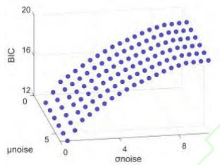
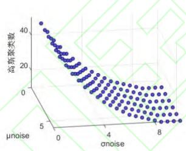
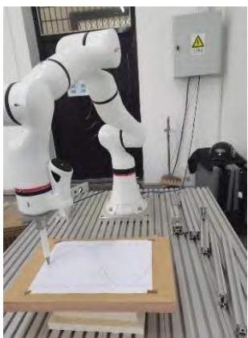
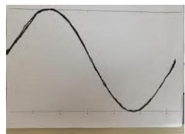
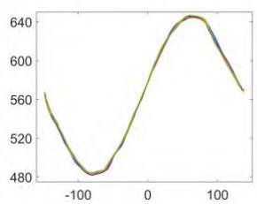
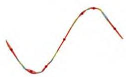
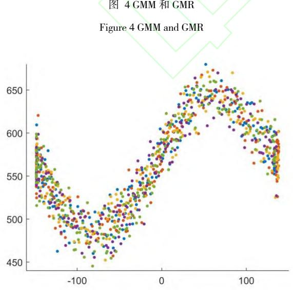
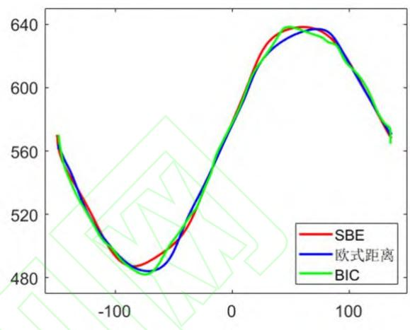

# 《机械设计与制造》网络首发论文

题目： 机器人模仿学习优化方法研究

作者： 李孟阳，武兵，李利娜，刘畅

DOI： 10.19356/j.cnki.1001-3997.20250808.007

网络首发日期： 2025-08-11

引用格式： 李孟阳，武兵，李利娜，刘畅．机器人模仿学习优化方法研究[J/OL]．机械设计与制造. https://doi.org/10.19356/j.cnki.1001-3997.20250808.007

网络首发：在编辑部工作流程中，稿件从录用到出版要经历录用定稿、排版定稿、整期汇编定稿等阶段。录用定稿指内容已经确定，且通过同行评议、主编终审同意刊用的稿件。排版定稿指录用定稿按照期刊特定版式（包括网络呈现版式）排版后的稿件，可暂不确定出版年、卷、期和页码。整期汇编定稿指出版年、卷、期、页码均已确定的印刷或数字出版的整期汇编稿件。录用定稿网络首发稿件内容必须符合《出版管理条例》和《期刊出版管理规定》的有关规定；学术研究成果具有创新性、科学性和先进性，符合编辑部对刊文的录用要求，不存在学术不端行为及其他侵权行为；稿件内容应基本符合国家有关书刊编辑、出版的技术标准，正确使用和统一规范语言文字、符号、数字、外文字母、法定计量单位及地图标注等。为确保录用定稿网络首发的严肃性，录用定稿一经发布，不得修改论文题目、作者、机构名称和学术内容，只可基于编辑规范进行少量文字的修改。

出版确认：纸质期刊编辑部通过与《中国学术期刊（光盘版）》电子杂志社有限公司签约，在《中国学术期刊（网络版）》出版传播平台上创办与纸质期刊内容一致的网络版，以单篇或整期出版形式，在印刷出版之前刊发论文的录用定稿、排版定稿、整期汇编定稿。因为《中国学术期刊（网络版）》是国家新闻出版广电总局批准的网络连续型出版物（ISSN2096-4188 CN.11-6037/7） 所以签约期刊的网络版上网络首发论文视为正式出版。

# 机器人模仿学习优化方法研究

李孟阳 1,武兵 1,2,李利娜 1,2,刘畅 1

（1.太原理工大学 机械与运载工程学院, 山西 太原 030024;2.太原理工大学 新型传感器与智能控制教育部重点实验室,山西 太原 030024）

作为机器人学的研究方向之一,机器人模仿学习在机器人研究中占比愈渐增加。模仿学习是指从示教者提供的范例即演示数据中进行学习。然而,在演示过程中,存在一些无法避免的抖动等不光滑特征。为了解决这个问题,提高模仿学习效果,本文提出了一种基于 GMM/GMR的机器人模仿学习优化方法。该方法首先设计了基于高斯噪声的优化策略,用来分散演示数据,消除示教轨迹中的不平滑特征;其次,提出了一种新的评价准则,用来平衡模型中欠拟合/过拟合问题。最后通过实验验证,该方法在计算效率,评估模型的效果方面具有显著优势。

关键词:模仿学习:高斯混合模型（GMM）:高斯混合回归（GMR）:贝叶斯准则（BIC）:欧式距离:高斯噪声中图分类号: TP181;TP242.2;TP391.9 文献标识码:A

# Optimized Learning from Demonstrations for Robots

LI Meng-yang1, WU Bing1,2, LI Li-na1,2, LIU Chang1

（1.School of Mechanical and Transportation Engineering, Taiyuan University of Technology, Taiyuan, 030024; 2.Key Laboratory of New Sensors and Intelligent Control of Ministry of Education, Taiyuan University of Technology, Taiyuan 030024）

Abstract: As an important research direction of robotics, learning from demonstrations （LFD） has gradually been widely used in robot systems. LFD refers to learning from few demonstrations provided by the teacher that is demonstration data. However, during the demonstrations, there are some unsmooth features such as jitter which are unavoidable. In order to solve this problem and improve the imitation learning effect, an imitation learning optimization method for robots based on GMM/GMR is proposed in this paper. Firstly, an optimization strategy based on Gaussian noise is designed to disperse the demo data and eliminate the unsmooth features in the teach-in trajectory. Secondly, a new evaluation criterion is proposed to balance the underfitting/overfitting problem in the model. Finally, significant advantages in computational efficiency and evaluation of model effect are showed from experimental results

Keywords: Learning from Demonstration; GMM; GMR; BIC; Euclidean Distance; Gaussian Noise

## 1 引 言

随着机器人技术的发展,人们期待机器人拥有更高级的技能,能满足处理复杂任务,又灵活性能的要求[1]。作为机器人的一种,工业机器人广泛应用于工业生产领域,能够执行预先编程的大规模生产任务但在执行任务时缺乏多功能性以及适应动态制造环境变化的能力3，相比之下协作机器人具有更加安全轻便,智能化的优势,在与人类近距离共同工作时,可以轻松完成各类场景中的复杂工作任务 [1.4]。作为机器人学的重要研究方向,模仿学习（Learning From Demonstration, LFD）逐渐在机器人系统中得到了广泛的应用。机器人通过模仿学习获得相应运动技能,从而避免建立较为复杂的机器人运动模型。有利于提升机器人智能水平[5]。机器人技能的模仿学习,又称为示教学习或示教编程,是一类机器人首先对示教数据进行学习从而得到运动技能的算法[6]。具有运动特征提取,泛化相关特征这两个阶段的学习过程。从而使机器人具有更好的自适应性。当前国内外学者已经提出多种机器人示教轨迹的模仿学习方法,主要包括高斯混合模型（Gaussian Mixture Model, GMM）和高斯混合回归（Gaussian Mixture Regression, GMR）[7],隐马尔可夫模型（HiddenMarkov Model, HMM）和隐式半马尔可夫模型（Hidden Semi-Markov Model, HSMM）[8],高斯过程（Gaussian Process, GP）[9],动态运动基元（Dynamical Movement Primitives, DMP）[10],动态系统稳定估计（Stable Estimator of Dynamical Systems, SEDS）[11],基于高斯分布的概率运动基元（Probabilistic Movement Primitives,ProMP）[12]和核化运动基元（Kernelized Movement Primitives, KMP）[13]等。

其中,GMM/GMR 作为模仿学习的主要方法之一,近年来得到了广泛应用。GMM/GMR可以使示教轨迹序列化,从而简化学习过程。在提取示教轨迹后,先基于 GMM进行编码学习,再基于GMM 编码学习模型,建立 GMR生成回归轨迹。Duque 等人开发了基于 GMM/GMR 的模仿学习来学习装配任务[14]。GMM/GMR可以用于对多个人类示教轨迹进行编码,并通过回归获得广义的运动轨迹。然而,此研究中得到的回归路径有多个冗余转弯,不能平滑地驱动机器人。Kyrarini 等人开发了用于模仿学习和回归的 GMM/GMR,并通过视觉方法动态识别对象[15]。然而,回归路径的平滑性没有得到有效解决。 $\mathrm { O g e n y i }$ 等人将观察学习和动态教学结合起来[16]。首先,机器人通过“观察”操作员手臂的运动来学习,再通过动态教学对获取的数据集进行补充,以便进一步移动。其中采用GMM/GMR对机器人关节角度数据进行处理,得到回归路径。Najafi 等人针对脑瘫儿童提出了一种执行二维位置跟随任务的机器人按需辅助框架[17]。此研究中,GMM/GMR被用于在脑瘫儿童和治疗师之间构建桥梁。考虑到视觉示教的鲁棒性,本文采用人类专家示教（即动态教学）的方式获取数据。但是,如果任务的起点或终点发生了显著的变化,则由GMM/GMR生成的回归路径将不适用于新的任务。Ti等人开发了一种结合 DMP和 GMM/GMR的方法,使回归路径平滑并泛化到新目标[18]。其中,GMM/GMR用于从多个示教路径中学习,DMP用于对新环境的路径进行泛化。但与 GMM/GMR 或 DMP 相比,GMM/GMR与DMP结合引入了更多的参数,增加了整个模型的不确定性和复杂性。

综上所述,基于 GMM/GMR 的模仿学习方法仍存在以下问题:1.对于示教轨迹,在进行演示教学时,存在一些不可避免的人为抖动误差[19];2.在基于 GMM/GMR 建模时,存在一些欠拟合/过拟合的问题。因此需要设计有效的优化算法来改进 GMM/GMR,提高模型质量。

针对上述问题,本文首先设计了基于高斯噪声的优化策略,用来分散演示数据,消除示教轨迹中的不平滑特征;其次提出了一种新的评价准则,用来平衡模型中欠拟合/过拟合问题。

## 2 基于GMM/GMR的示教轨迹建模

高斯混合模型（GMM）是一种针对连续数据进行密度估计的有效方法。在选择合适的参数之后,它可以平衡模型的复杂程度和训练的数据量。因此,GMM/GMR作为一种有效的模仿学习方法,可以用于机器人的运动轨迹建模。GMM 服从多元高斯分布,可以将数据集转换为一系列随机变量序列。在大多数情况下,时间被视为索引变量。GMR 通过估算每个高斯子模型的参数,回归出一个新的连续平缓的轨迹。

## 2.1 高斯混合模型（GMM）

给定 M 条示教轨迹 $\left\{ \left\{ S _ { n , m } , \xi _ { n , m } \right\} _ { n = 1 } ^ { N _ { m } } \right\} _ { m = 1 } ^ { M }$ ,其中 $N _ { { _ m } }$ 为第 m 条轨迹的长度, $s \in \mathbb { R } ^ { 1 }$ 表示 I维输入信息（如位置,时间或其他等外部状态）, $\xi \in \mathbb { R } ^ { 0 }$ 表示 O维输出信息,即轨迹变量,如机器人的末端位置,加速度和速度,关节位置,加速度和速度,以及力矩和力等。

用 GMM 可以对样本中输入和输出变量的联合概率密度分布 $P ( s , \xi )$ 进行建模,即

$$
\mathcal {P} (s, \xi) \sim \sum_ {k = 1} ^ {K} \pi_ {K} \mathcal {N} (\mu_ {k}, \Sigma_ {k})\tag{1}
$$

式中,K-GMM 中高斯子模型的数量, -第 k 个高斯子模 $\pi _ { k }$ 型的先验概率, $\mu _ { k }$ —第 k 个高斯子模型的均值, $\boldsymbol { \mu } _ { k } = \left[ \frac { \boldsymbol { \mu } _ { s , k } } { \boldsymbol { \mu } _ { \xi , k } } \right] , \boldsymbol { \Sigma } _ { k }$ -第 k 个高斯子模型的协方差， $\begin{array} { r l } { \sum _ { k } = \left[ \begin{array} { l l } { \sum _ { s s , k } } & { \sum _ { s \xi , k } } \\ { \sum _ { \xi s , k } } & { \sum _ { \xi \xi , k } } \end{array} \right] } \end{array}$ 。GMM 中高斯子模型中的参数可以运用期望最大化（ExpectationMaximization ,EM）算法进行迭代优化求解。

## 2.2高斯混合回归（GMR）

在得到 GMM参数后,对于任意新的输入 $s ^ { * }$ ,可以通过 GMR预测其对应轨迹 $\xi ^ { * }$ 的条件概率分布,即[20.21.22]:

$$
\mathcal {P} \left(\boldsymbol {\xi} ^ {*} | s ^ {*}\right) = \sum_ {k = 1} ^ {K} h _ {k} \left(s ^ {*}\right) \mathcal {N} \left(\bar {\mu} _ {k} \left(s ^ {*}\right), \bar {\Sigma} _ {k}\right)\tag{2}
$$

式中,

$$
h _ {k} \left(s ^ {*}\right) = \frac {\pi_ {k} \mathcal {N} \left(s ^ {*} \mid \mu_ {s , k} , \Sigma_ {s s , k}\right)}{\sum_ {i = 1} ^ {K} \pi_ {i} \mathcal {N} \left(s ^ {*} \mid \mu_ {s , i} , \Sigma_ {s s , i}\right)}\tag{3}
$$

$$
\bar {\Sigma} _ {k} = \Sigma_ {\xi \xi , k} - \Sigma_ {\xi s, k} \Sigma_ {s s, k} ^ {- 1} \Sigma_ {s \xi , k}\tag{4}
$$

进一步,可以将 $\mathcal { P } \big ( \xi ^ { * } | ~ s ^ { * } \big )$ 近似为:

$$
\mathcal {P} \left(\xi^ {*} | s ^ {*}\right) \approx \mathcal {N} (\hat {\mu}, \hat {\Sigma})\tag{5}
$$

式中,

$$
\hat {\mu} = \sum_ {k = 1} ^ {K} h _ {k} (s ^ {*}) \overline {{\mu}} _ {k} (s ^ {*})\tag{6}
$$

$$
\hat {\Sigma} = \sum_ {k = 1} ^ {K} h _ {k} (s ^ {*}) (\overline {{\mu}} _ {k} (s ^ {*}) \overline {{\mu}} _ {k} ^ {T} (s ^ {*}) + \overline {{\Sigma}} k - \hat {\mu} \hat {\mu} ^ {T}\tag{7}
$$

即,通过计算 $\left\{ \hat { \mu } , \hat { \Sigma } \right\}$ ,即可泛化成一条连续的轨迹。

## 3 对 GMM/GMR 的优化改进

## 3.1 基于高斯噪声的优化措施

在演示过程中会不可避免地出现人为抖动从而使得示教轨迹出现不光滑的特征。高斯噪声有服从高斯分布的瞬时值,以及均匀分布的功率谱密度。为了更好支持基于 GMM/GMR对示教轨迹的编码学习,引入高斯噪声用来丰富和分散演示数据,减弱演示过程中出现的不可避免地误差,使高斯聚类的过程更加准确,减少学习轨迹和回归轨迹的不光滑特征。

高斯公式如下[19]:

$$
x ^ {\prime} = x + r\tag{8}
$$

$$
y ^ {\prime} = y + r\tag{9}
$$

$$
z ^ {\prime} = z + r\tag{10}
$$

$$
r \sim N \big (\mu_ {n o i s e}, \sigma_ {n o i s e} \big)\tag{11}
$$

$$
N \left(\boldsymbol {\mu} _ {\text {noise}}, \sigma_ {\text {noise}}\right) = \frac {1}{\sqrt {2 \pi} \sigma_ {\text {noise}}} e ^ {- \frac {\left(r - \mu_ {\text {noise}}\right) ^ {2}}{2 \sigma_ {\text {noise}}}}\tag{12}
$$

式中, $\mathbf { x } \prime , \mathbf { y } \prime , \mathbf { z } \prime$ -演示轨迹中用高斯噪声增强过的数据点;x,y,z-演示轨迹中原始的数据点。 $r \sim N \big ( \mu _ { n o i s e } , \sigma _ { n o i s e } \big )$ 表示被定义为高斯高斯噪声的随机变量 r,服从高斯分布,其概率密布函数为 $N \left( \mu _ { n o i s e } , \sigma _ { n o i s e } \right) ; \mu _ { n o i s e }$ 和 $\sigma _ { n o i s e }$ 分别是高斯噪声的均值和方差。

## 3.2 基于 BIC 的优化措施

贝叶斯信息准则（Bayesian Information Criterion,BIC）是一种对有限数据集建模效果评估的有效准则[23]。BIC 标准可以成从以下两个方面评估模型的质量:1.模型的拟合程度;2.模型的复杂程度。BIC的定义如下:

$$
B I C = - 2 \ln L (\hat {\theta} / B) + p \cdot \ln (m)\tag{13}
$$

其中, $L ( \cdot )$ 表示似然函数; $L ( \hat { \theta } / B )$ 表示高斯聚类中各点的对数似然函数 $_ { ; p }$ 表示高斯聚类中参数的数量;m 表示演示轨迹中有效数据点的数量。

在 BIC 准则中,BIC 的值越小,模型的拟合程度越好,GMM/GMR 的模型效果越好。然而,根据 BIC 准则可知,演示数据中几何图形的不平滑特征,如由于人为操控引起的颤抖和突变,仍会保留在建立的 GMM/GMR 中,其相应的回归路径会因为出现过拟合的现象而变得不那么光滑。因此,在对示教轨迹进行编码学习,进行高斯聚类和建立 GMM/GMR 前引入高斯噪声,从而分散演示数据,减轻上述不平滑的特征。

图 1 $\mu _ { n o i s e }$ 和 $\sigma _ { n o i s e }$ 对 BIC和 K的影响  
  
Figure 1 Impact of $\mu _ { n o i s e }$ and $\sigma _ { n o i s e }$ on BIC and K

如图1所示,随着 $\sigma _ { n o i s e }$ 数值增大,BIC的值增大,这会引起过拟合现象。同时,随着 $\sigma _ { n o i s e }$ 数值增大,高斯子模型的数目（K）减小,这又引起欠拟合现象。基于上述现象可知,BIC 准则在评价模型效果,优化 GMM/GMR 时不是一个理想的设计。考虑基于以下方面引进新的评价准则:

1.通过调整对示教轨迹进行编码学习时,高斯聚类中高斯 子模型的数量,使模型能够在欠拟合和过拟合之间取得平衡。

2.通过对示教轨迹以及回归轨迹之间进行相似性评估,使模型能够在欠拟合和过拟合之间取得平衡。

因此,在调整对示教轨迹进行编码学习时高斯聚类中高斯子模型的个数时,考虑对高斯子模型的个数 K取对数（即 lnK）,对K取对数不会改变其对模型的影响将其作为衡量模型质量的一个重要参考。同时,通过引入 lnK‧BIC,将 K与 BIC结合可以排除与低 BIC 值对应的高斯子模型数,从而缓解建模时因过拟合现象出现的轨迹不平滑现象。

## 3.3基于欧式距离的优化措施

在评估演示轨迹与回归轨迹之间的相似性时,回归轨迹并非越平滑越好。在引入 lnKBIC后,回归轨迹可能受其影响而过度平滑,从而造成演示轨迹特征丢失,与演示轨迹产生很大偏差,出现欠拟合的现象。

因此,引入欧氏距离（Euclidean Distance, ）进行相似性评估。欧式距离的定义如下:

$$
\left\| \text { Eudis } \right\| = \sum_ {i = 1} ^ {n} \sum_ {j = 1} ^ {m} \left(\sqrt {\left(x _ {j} ^ {\prime} - x _ {i j}\right) ^ {2} + \left(y _ {j} ^ {\prime} - y _ {i j}\right) ^ {2}}\right)\tag{14}
$$

其中: $E u d i s$ 表示回归轨迹和演示轨迹之间的距离;m表示演示轨迹中取样点的数目;n 表示演示轨迹的总数; $\left( x _ { j } ^ { ' } , x _ { i j } \right)$ 和$\left( { y } _ { j } ^ { \prime } , { y } _ { i j } \right)$ 是回归轨迹和第 i次演示轨迹中对应的取样点。

## 3.4 基于 SBE准则的优化措施

由于 BIC 具有高的方差而 $\| E u d i s \|$ 有低的方差,当高斯白噪声的散射水平增加时,BIC 的值将发生急剧变化,而 $\| E u d i s \|$ 的变化程度较低。因此在建立新的准则时考虑将上述两个元素结合并引入标准差,避免出现过度偏倚的结果。因此,提出的新评价准则（综合贝叶斯信息准则BIC和欧式距离 $\left\| E u d i s \right\|$ ,简称为 SBE准则）如下:

$$
S B E = \ln k \cdot s t d (B I C) + s t d (\| E u d i s \|)\tag{15}
$$

其中,std表示标准偏差。

## 4 实验与仿真分析

为了验证本文提出的方法,搭建实验台如图 2所示。该实验台主要包括 xMate3 柔性协作机器人和对应的计算机系统。xMate3 柔性协作机器人是一种高精度的 7自由度机械臂。该机械使用 ROKAE Control Interface （RCI）进行编程,是一种基于Linux系统的控制接口,使用 C++语言编写。

  
图 2实验台  
Figure 2 Lab Bench

在机械臂末端夹持记号笔（如图2所示）在一张纸上多次叠加绘制图案,并将绘制图案的路径记录下来。选取正弦曲线作为模板图案。在演示时,提前将模板图案打印在 A4纸上,一名操作员通过控制机械臂末端记号笔牵引机械臂沿着正弦线的图案运行五次（如图 3（a）所示）,并把运行中的路径记录下来,生成的五条演示路径（如下图 3（b）所示）。

  
图 3 示教轨迹

  
Figure 3 Taught Trajectorie

根据生成的演示数据,建立 GMM,并基于 GMM 中的参数生成 GMR,得到新的回归路径（如图 4所示）。图中红色的部分代表对示教轨迹建立的 GMM（如图 4（a）所示）,绿色的轨迹代表基于 GMR所得到的回归路径（如图 4（b）所示）。如图 4所示，在基于示教轨迹建立 GMM/GMR 得到新的回归路径时,人类演示过程中造成的抖动,急转弯等不平滑特征都会保留,而这些不平滑特征会影响机械臂运行时速度和位姿的突变,造成机械臂运行失误。因此在示教轨迹中引入高斯噪声（如图 5所示）,分散演示数据从而减轻演示数据中的不平滑特征,使回归路径光滑,有利于机械臂运行。

  
a对示教轨迹建立的 GMM

b 对示教轨迹建立的 GMR  
a GMM Built on Taught Trajectory b GMR Built on Taught Trajectory 图 4 GMM 和 GMR  
  
图5 对示教轨迹引入高斯噪声  
Figure 5 Introduction of Gaussian Noise to the Taught Trajectory

在引入高斯噪声后,分别基于 SBE 准则,欧式距离准则以及BIC准则对示教轨迹建立GMM/GMR并得到回归轨迹如图6所示。基于不同准则建模时所对应最优模型中高斯子模型的个数K 如表 1所示。在评价模型时,要求高斯聚类中高斯子模型的个数K少,这样既能平衡高斯聚类中欠拟合/过拟合的现象,又能因聚类次数少而提高运算速度[19]。

  
图 6基于 SBE,欧式距离,BIC准则的回归轨迹  
Figure 6 Regression Trajectories Based on SBE, Euclidean Distance, and BIC Criteria

表1 不同准则对应高斯子模型的个数（K）  
Table 1 Number of K Corresponding to Different Criteria

<table><tr><td>准则</td><td>K</td></tr><tr><td>SBE 准则</td><td>7</td></tr><tr><td>欧式距离准则</td><td>14</td></tr><tr><td>BIC 准则</td><td>41</td></tr></table>

实验结果表明,在基于三种准则进行编码学习后,均可获得正弦曲线状的回归轨迹（如图 6 所示）,然而基于 SBE 准则得到的回归轨迹在保留演示轨迹特征的同时,轨迹的不平滑特征较少,编码学习时对应 GMM 中高斯子模型的个数最少,可以平衡欠拟合/过拟合现象且计算速度最快;基于欧式距离准则和BIC准则得到的回归路径虽可以使回归轨迹保持演示轨迹的特征,但是对应最优模型时高斯子模型个数较多,易出现过拟合现象而造成对应回归轨迹存在尖角,急转弯等不平滑特征。因此,基于 SBE准则建立 GMM/GMR得到回归路径的效果是最优的。

## 5 结 论

基于 GMM/GMR 的模仿学习方法是当前机器人学的重要研究方向,在实际应用中,对人类操作机器人有很好的帮助。然而,模仿学习方法的有效性可能会受到一些因素的影响,这些因素都会影响最终形成回归路径的效果。

为了解决模仿学习中演示数据的获取过程中出现的不平滑以及在对示教轨迹进行编码学习过程中的欠拟合/过拟合问题,本文提出了一种基于 GMM/GMR 的协作机器人模仿学习优化方法,使得机械臂更好地执行模仿学习任务。文中在获得示教轨迹的数据后,首先引入高斯白噪声分散演示数据;然后提出了一种基于 GMM/GMR 的优化准则,即 SBE 准则。该准则通过调整高斯聚类中高斯子模型的个数 K,有效地平衡 GMM/GMR 中欠拟合/过拟合的现象,并提高了计算速度。最后,通过对协作机械臂进行拖动示教,实验结果验证了该方法在计算效率,评价模型效果方面的有效性。

## 参考文献:

[1]. 解迎刚,兰江雨.协作机器人及其运动规划方法研究综述[J].计算机工程与应用,2021,57（13）:18-33.（Xie Ying-gang, Lan Jiang-yu. Review of collaborative robots and theirmotion planning methods[J]. Computer Engineering and Applications,2021,57（13）:18-33.））

[2]. Robla-Gómez S, Becerra V M, Llata J R, et al. Working together: A review on safe human-robot collaboration in industrial environments[J]. IEEE Access, 2017, 5: 26754-26773.

[3]. Pedersen M R, Nalpantidis L, Andersen R S, et al. Robot skills for manufacturing: From concept to industrial deployment[J]. Robotics and Computer-Integrated Manufacturing, 2016, 37: 282-291.

[4]. Kanazawa A, Kinugawa J, Kosuge K. Adaptive motion planning for a collaborative robot based on prediction uncertainty to enhance human safety and work efficiency[J]. IEEE Transactions on Robotics, 2019, 35(4): 817- 832.

[5]. 王鹏,朱建新,朱振新,罗南安.机器人视觉示教学习方法研究[J].机械设计与制造,2019,No.345（11）:242-245.（Wang Peng, Zhu Jian-xin, Zhu Zhen-xin, Luo Nan-an. Research onrobot vision teaching learning method[J]. Mechanical Design andManufacturing, 2019, No.345（11）:242-245.））

[6]. 黄艳龙,徐德,谭民.机器人运动轨迹的模仿学习综述[J].自动化学报,2022,48（02）:315-334.（Huang Yan-long, Xu De, Tan Min. Review of imitation learning of robotmotion trajectory[J]. Acta Automatica Sinica,2022,48（02）:315-334.））

[7]. Tsarouchi P, Makris S, Chryssolouris G. Human–robot interaction review and challenges on task planning and programming[J]. International Journal of Computer Integrated Manufacturing, 2016, 29(8): 916-931.

[8]. Rabiner L R. A tutorial on hidden Markov models and selected applications in speech recognition[J]. Proceedings of the IEEE, 1989, 77(2): 257-286.

[9]. Rasmussen C E, Williams C K I. Gaussian processes for machine learning[M]. Cambridge, MA: MIT press, 2006.

[10]. Ijspeert A J, Nakanishi J, Hoffmann H, et al. Dynamical movement primitives: learning attractor models for motor behaviors[J]. Neural Computation, 2013, 25(2): 328-373.

[11]. Khansari-Zadeh S M, Billard A. Learning stable nonlinear dynamical systems with gaussian mixture models[J]. IEEE Transactions on Robotics, 2011, 27(5): 943-957.

[12]. Paraschos A, Daniel C, Peters J R, et al. Probabilistic movement primitives[J]. Advances in Neural Information Processing Systems, 2013, 26.

[13]. Huang Y, Rozo L, Silvério J, et al. Kernelized movement primitives[J]. The International Journal of Robotics Research, 2019, 38(7): 833-852

[14]. Duque D A, Prieto F A, Hoyos J G. Trajectory generation for robotic assembly operations using learning by demonstration[J]. Robotics and Computer-Integrated Manufacturing, 2019, 57: 292-302.

[15]. Kyrarini M, Haseeb M A, Ristić-Durrant D, et al. Robot learning of industrial assembly task via human demonstrations[J]. Autonomous Robots, 2019, 43: 239-257.

[16]. Ogenyi U E, Zhang G, Yang C, et al. An intuitive robot learning from human demonstration[C]//Intelligent Robotics and Applications: 11th International Conference, ICIRA 2018, Newcastle, NSW, Australia, August 9–11, 2018,

[17]. Najafi M, Sharifi M, Adams K, et al. Robotic assistance for children with cerebral palsy based on learning from tele-cooperative demonstration[J]. International Journal of Intelligent Robotics and Applications, 2017, 1: 43- 54.

[18]. Ti B, Gao Y, Li Q, et al. Dynamic movement primitives for movement generation using GMM-GMR analytical method[C]//2019 IEEE 2nd International Conference on Information and Computer Technologies (ICICT). IEEE, 2019: 250-254.

[19]. Li W D. Reinforcement Learning-based Learning from Demonstrations for Collaborative Robots[C]//2021 IEEE 17th International Conference on Automation Science and Engineering （CASE）. IEEE, 2021: 1642-1647.

[20]. Huang Y, Abu-Dakka F J, Silvério J, et al. Toward orientation learning and adaptation in cartesian space[J]. IEEE Transactions on Robotics, 2020, 37(1): 82-98.

[21]. Cohn D A, Ghahramani Z, Jordan M I. Active learning with statistical models[J]. Journal of Artificial Intelligence Research, 1996, 4: 129-145.

[22]. Calinon S. A tutorial on task-parameterized movement learning and retrieval[J]. Intelligent Service Robotics, 2016, 9: 1-29.

[23]. 叶子涵. 基于视觉和动态运动基元的机器人抓取轨迹规划研究[D].广 东工业大学,2020. （YE Zihan. Research on robot grasping trajectory planning based on visual and dynamic motion primitives [D].Guangdong University of Technology,2020.）