# 硕士学位论文

# 机繼运动轨迹雛学习及实验

作者姓名 M生

指导教师姓名 、 职称 李团结 教授

申请学位类别 工学硕士

学校代码 10701

分 类 号 TP242

学 号 21041211813

密 级 公开

# 西安电子科技大学

# 硕士学位论文

# 机械臂运动轨迹模仿学习及实验

作者姓名：黄勇华

一级学科：机械工程

二级学科（研究方向）：机器人技术

学位类别：工学硕士

指导教师姓名、职称：李团结 教授

学 院：机电工程学院

提交日期：2024年5 月

# Motion Trajectory Imitation Learning Method and Experiments for Manipulator

A thesis submitted to

XIDIAN UNIVERSITY

in partial fulfillment of the requirements

for the degree of Master

in Mechanical Engineering

By Huang Yonghua

Supervisor: Li Tuanjie Title: Professor

May 2024

## 摘要

机器人广泛应用于生物医疗、太空探索、仓储物流等领域。其中，运动轨迹生成作为机器人技术领域的基础性关键问题，是机器人实现移动、操作的技术前提。然而，基于人工编程、遥操作或拖动示教等的传统运动轨迹生成方法存在轨迹泛化性能弱、自主程度低、环境适应能力差等突出问题，无法胜任非结构化环境或多任务的工作场景。因此，本文从轨迹样本处理、运动轨迹表征与学习等方面，系统性的研究机械臂运动轨迹模仿学习方法，具体内容如下：

（1）针对现有运动轨迹模仿学习方法轨迹泛化性能弱的问题，通过集成动态时间规整、高斯混合模型（Gaussian Mixture Model，GMM）和高斯混合回归(GaussianMixture Regression，GMR）等数据处理技术与先进运动轨迹模仿学习算法动态运动基元（Dynamic Movement Primitives，DMP），开发了一种具备运动轨迹表征和学习能力的模仿学习框架，提高了运动轨迹模仿学习方法的泛化性能。针对DMP 算法应用于运动轨迹模仿学习时自主程度低的问题，研究了DMP 的原理，在此基础上将贝叶斯优化技术引入至DMP，提出了一种参数自主选择算法，并对位移参数处于数量级10下的运动轨迹进行了数值验证。结果表明，与使用专家参数相比，采用通过参数自主算法得到的参数，运动轨迹的学习误差和终止状态下的跟踪误差均得到改善。

（2）针对当前运动轨迹模仿学习方法存在约束环境下泛化失效的问题，将人工势场法引入 DMP 中进行轨迹调制，扩展了现有的 DMP 数学模型，并在此基础上提出了一种考虑环境约束的运动轨迹模仿学习算法。为了验证上述算法的有效性，进行了数值验证和样机验证，实验结果表明 EC-DMP 算法能够通过耦合的控制信号调制DMP 的运动轨迹在线生成过程，有效解决约束环境下泛化失效的问题。

（3）为验证上述方法的实用性和鲁棒性，开展了典型场景验证实验。首先，基于机器人操作系统搭建了实验平台，实现了软硬件系统之间的高效通信。其次，针对直接获得的演示数据中存在大量无关特征信息造成轨迹学习效果不佳的问题，基于机械臂在任务执行阶段和停止阶段所表现出的速度上的差异，提出了一种无关特征去除策略。最后，设计了多个包含多组演示的运动轨迹模仿学习实验，结果表明，本文研究的方法在自主性和学习效果方面相较现有方法均得到提升，对于推动运动轨迹模仿学习的工程应用具有重要意义。

关 键 词：机械臂， 模仿学习， 动态运动基元， 运动轨迹， 贝叶斯优化

## ABSTRACT

Robots are now widely used in biomedicine, space exploration, warehousing and logistics, and other fields. Among them, motion trajectory generation, as a fundamental key issue in the field of robotics, is a technical prerequisite for robots to realize movement and operation. However, the traditional motion trajectory generation methods based on manual programming, teleoperation or drag-and-drop demonstration have outstanding problems such as weak trajectory generalization performance and poor environment adaptation ability, which are unable to cope with unstructured environments or multi-tasking work scenarios. Therefore, this paper systematically researches the manipulator motion trajectory imitation learning method from the aspects of trajectory sample processing, motion trajectory characterization and learning as follows.

(1) Aiming at the weak trajectory generalisation performance of existing motion trajectory imitation learning methods, a framework with the ability to characterise and learn motion trajectories is developed by integrating data processing techniques such as dynamic time regularisation, Gaussian Mixture Model (GMM) and Gaussian Mixture Regression (GMR) with an advanced motion trajectory imitation learning algorithm, Dynamic Movement Primitives (DMP), to improve the generalisation of motion trajectories. Primitives (DMP), an imitation learning framework with the ability to characterise and learn motion trajectories is developed, which improves the generalisation of the motion trajectory imitation learning method. Aiming at the problem of low degree of autonomy when the DMP algorithm is applied to the imitation learning of motion trajectories, the principle of DMP is investigated, based on which the Bayesian optimization technique is introduced to DMP, a parameter autonomy selection algorithm is proposed, and a numerical validation is carried out for the motion trajectories with the displacement parameter at the order of magnitude $1 0 ^ { 1 } .$ , and the results show that compared with the use of the expert parameter, the learning error of the motion trajectories can be improved by using the parameter autonomy algorithm. The results show that compared with using expert parameters, the learning error of the motion trajectory and the tracking error in the terminated state is improved.

(2) Aiming at the problem of generalization failure under constrained environment in the current motion trajectory imitation learning method, the Artificial Potential Field method is introduced into the DMP for trajectory modulation, the existing DMP mathematical model is extended, and based on this, a motion trajectory imitation learning algorithm considering environmental constraints is proposed. In order to verify the effectiveness of the above algorithm, numerical validation and prototype validation are carried out, and the experimental results show that the EC-DMP algorithm is able to modulate the online generation process of motion trajectory of the DMP through the coupled control signals, and effectively solves the problem of generalization failure under the constrained environment.

(3) To validate the practicality and robustness of the above method, typical scenario validation experiments are conducted. Firstly, an experimental platform is built based on the Robot Operating System (ROS) to realize efficient communication between hardware and software systems. Secondly, irrelevant feature information in the raw demonstration data is removed for the difference in speed exhibited by the manipulator during the task execution phase and the stopping phase. Finally, a motion trajectory imitation learning experiment containing multiple sets of demonstrations is designed, and the results show that the method studied in this paper is improved in terms of autonomy and learning effect compared with the existing methods, which is of great significance for promoting the engineering application of motion trajectory imitation learning.

Keywords: Manipulator, Imitation learning, Dynamic movement primitives, Motion trajectory, Bayesian optimization

## 插图索引

图1.1 新一代机械臂的应用场景....1  
图1.2 自主运动轨迹模仿学习框架....6  
图1.3 研究内容与关系....7  
图2.1 规整路径的获取原理....10  
图2.2 DTW时间对齐轨迹....11  
图2.3 GMR得到的广义轨迹....14  
图2.4 非线性目标强迫项获取过程....17  
图2.5 目标权重系数的获取过程....18  
图2.6 基于DMP的运动轨迹学习与泛化流程....20  
图2.7 不同元参数配置下的DMP学习效果....21  
图2.8 TPE优化的一般思想....23  
图2.9 基于TPE的DMP参数选择流程....25  
图2.10 TPE配置和专家配置下的参数的相似性指标结果....27  
图2.11 仅考虑相似度指标的轨迹学习结果....28  
图2.12 相同权重系数下两种指标的轨迹学习结果....28  
图2.13 不同权重系数下两种指标的轨迹学习结果....29  
图2.14 $\alpha_{y}$ 相同时不同数目基函数的轨迹学习效果....30  
图3.1 基于DMP的运动轨迹泛化失效情形....31  
图3.2 人工潜在势场法的基本原理....32  
图3.3 工作空间的定义....34  
图3.4 基于EC-DMP运动轨迹泛化流程....35  
图3.5 参考技能的参数化轨迹....36  
图3.6 DMP与EC-DMP在情形1-a的泛化结果....37  
图3.7 DMP与EC-DMP在情形1-b的泛化结果....38  
图3.8 DMP与EC-DMP在情形2-a的泛化结果....39  
图3.9 DMP与EC-DMP在情形2-b的泛化结果....39  
图3.10 DMP与EC-DMP在情形3-a的泛化结果....40  
图3.11 DMP与EC-DMP在情形3-b的泛化结果....40  
图3.12 不同值大小增益的EC-DMP泛化结果1....41  
图3.13 不同值大小增益的EC-DMP泛化结果2....41  
图3.14 机械臂系统架构....42

图3.15 七自由度机械臂....43  
图3.16 约束环境下的样机泛化结果....44  
图3.17 机械臂样机执行情形1泛化轨迹过程....44  
图3.18 机械臂样机执行情形2泛化轨迹过程....44  
图3.19 机械臂样机执行情形3泛化轨迹过程....44  
图4.1 模仿学习实验平台示意图....47  
图4.2 无关状态去除后的演示轨迹....49  
图4.3 七自由度机械臂构型图....50  
图4.4 绘制字母”R”的演示轨迹....52  
图4.5 绘制字母”R”的DTW轨迹....53  
图4.6 绘制字母”R”的GMR轨迹....53  
图4.7 绘制字母”R”的演示轨迹与表征轨迹....53  
图4.8 绘制字母“o”的演示轨迹与表征轨迹....53  
图4.9 绘制字母“b”的演示轨迹与表征轨迹....54  
图4.10 绘制字母“t”的演示轨迹与表征轨迹....54  
图4.11 绘制字母“s”的演示轨迹与表征轨迹....54  
图4.12 任务轨迹学习结果....55  
图4.13 七自由度机械臂执行学习轨迹的过程....56  
图4.14 无约束环境运动轨迹泛化结果....56  
图4.15 七自由度机械臂执行泛化轨迹的过程....57  
图4.16 约束环境机械臂运动轨迹泛化结果....58

## 表格索引

表 2.1 目标函数中各符号含义 ..... 24
表 2.2 基于 TPE 的 DMP 参数自主选择实验预置参数..... 26
表 3.1 任务参数..... 37
表 3.2 Fanka Panda 的性能参数表..... 43
表 4.1 Panda D-H 参数表..... 50

符号对照表

<table><tr><td>符号</td><td>符号名称</td></tr><tr><td>C</td><td>最大期望算法的迭代停止阈值</td></tr><tr><td> $C_y$ </td><td>基于人工潜在势场设计的DMP耦合项</td></tr><tr><td> $c_i$ </td><td>DMP基函数的中心</td></tr><tr><td>D(q)</td><td>APF的受控点与障碍物的最小距离</td></tr><tr><td>d</td><td>欧氏距离</td></tr><tr><td> $\underline{d}_0$ 、 $\overline{d}_0$ </td><td>约束环境的下边界和上边界的安全裕度</td></tr><tr><td>g</td><td>DMP学习轨迹的终止点</td></tr><tr><td> $g_{new}$ </td><td>DMP泛化轨迹的终止点</td></tr><tr><td> $h_i$ </td><td>DMP的基函数的宽度</td></tr><tr><td> $J_{obj}$ </td><td>用于TPE优化的目标函数</td></tr><tr><td> $k_p$ </td><td>收敛性指标在目标函数的权重</td></tr><tr><td> $k_r$ </td><td>反映斥力强度的常数</td></tr><tr><td> $k_s$ </td><td>相似性指标在目标函数的权重</td></tr><tr><td> $k_a$ </td><td>反映吸引力强度的常数</td></tr><tr><td>M</td><td>组成高斯混合模型的高斯分布数目</td></tr><tr><td> $N_{bfs}$ </td><td>DMP基函数的数目</td></tr><tr><td>p(i,j)</td><td>DTW的最小成本路径</td></tr><tr><td> $Q^*$ </td><td>APF的斥力势场有效范围阈值</td></tr><tr><td>q</td><td>APF的受控点</td></tr><tr><td> $q_{goal}$ </td><td>APF的目标点</td></tr><tr><td>s(k)</td><td>DTW的动态时间规整函数</td></tr><tr><td>s</td><td>DMP正则系统的相位变量</td></tr><tr><td>T</td><td>DTW轨迹时间步长</td></tr><tr><td> $U_{att}$ </td><td>APF的引力势场函数</td></tr><tr><td> $U_{rep}$ </td><td>APF的斥力势场函数</td></tr><tr><td> $V_c$ </td><td>DMP的人工势场函数</td></tr><tr><td> $\underline{V}_c(y)$ 、 $\overline{V}_c(y)$ </td><td>DMP的人工势场子函数</td></tr><tr><td> $w_i$ </td><td>DMP基函数的权重</td></tr><tr><td> $x_{new}(t_1)$ </td><td>DMP泛化轨迹的起始点</td></tr><tr><td>y、 $\overline{y}$ </td><td>DMP工作环境的上下界</td></tr><tr><td> $\alpha_s$ </td><td>DMP的正则系统的增益</td></tr><tr><td> $\alpha_y$ </td><td>DMP的特性参数1</td></tr><tr><td> $\beta_y$ </td><td>DMP的特性参数2</td></tr><tr><td> $\Gamma_{traj}$ </td><td>DTW的轨迹序列</td></tr><tr><td> $\gamma_m$ </td><td>高斯混合模型的后验概率</td></tr><tr><td> $\eta$ </td><td>DMP的人工势场函数增益</td></tr><tr><td> $\theta_{GMM}$ </td><td>高斯混合模型的特性参数</td></tr><tr><td> $\mu$ </td><td>高斯分布的均值</td></tr><tr><td> $\hat{\mu}_m$ </td><td>高斯混合的均值</td></tr><tr><td> $\pi_m$ </td><td>高斯分布相对高斯混合模型的权重</td></tr><tr><td> $\hat{\pi}_m$ </td><td>高斯混合的权重</td></tr><tr><td> $\sigma_s$ </td><td>目标函数的相似性的指标</td></tr><tr><td> $\sigma_p$ </td><td>目标函数的收敛性指标</td></tr><tr><td> $\tau$ </td><td>DMP的时间缩放系数</td></tr><tr><td> $\psi_i$ </td><td>DMP的基函数</td></tr><tr><td> $\mathcal{N}$ </td><td>高斯分布</td></tr><tr><td> $\Sigma$ </td><td>高斯分布的协方差</td></tr><tr><td> $\hat{\Sigma}_m$ </td><td>高斯混合的协方差</td></tr></table>

缩略语对照表

<table><tr><td>APF</td><td>Artificial Potential Field</td><td>人工潜在势场</td></tr><tr><td>BIC</td><td>Bayesian Information Criterion</td><td>贝叶斯信息准则</td></tr><tr><td>BO</td><td>Bayesian Optimization</td><td>贝叶斯优化</td></tr><tr><td>DFE</td><td>Dynamic Feature Extract</td><td>动态特征提取</td></tr><tr><td>DMP</td><td>Dynamic Movement Primitives</td><td>动态运动基元</td></tr><tr><td>DTW</td><td>Dynamic Time Warping</td><td>动态时间规整</td></tr><tr><td>EI</td><td>Expected Improvement</td><td>期望改进</td></tr><tr><td>EM</td><td>Expectation Maximization</td><td>最大期望算法</td></tr><tr><td>FCI</td><td>Franka Control Interface</td><td>Franka 控制接口</td></tr><tr><td>GD</td><td>Gaussian Distribution</td><td>高斯分布</td></tr><tr><td>GMM</td><td>Gaussian Mixture Model</td><td>高斯混合模型</td></tr><tr><td>GMR</td><td>Gaussian Mixture Regression</td><td>高斯混合回归</td></tr><tr><td>HMM</td><td>Hidden Markov Model</td><td>隐马尔可夫模型</td></tr><tr><td>LWR</td><td>Local Weight Regression</td><td>局部加权回归</td></tr><tr><td>PDF</td><td>Probability Density Function</td><td>概率密度函数</td></tr><tr><td>ROS</td><td>Robot Operating System</td><td>机器人操作系统</td></tr><tr><td>RL</td><td>Reinforcement Learning</td><td>强化学习</td></tr><tr><td>SEDS</td><td>Stable Estimator of Dynamical Systems</td><td>动态系统的稳定估计器</td></tr><tr><td>TP-GMM</td><td>Task parameterized GMM</td><td>任务参数化高斯混合模型</td></tr><tr><td>TPE</td><td>Tree-structured Parzen Estimator</td><td>树结构 Parzen 估计器</td></tr></table>

## 目 录

第一章 绪论....1
1.1 研究背景及意义....1
1.2 运动轨迹模仿学习研究现状....2
1.3 存在的问题与解决方案....5
1.4 论文的主要研究工作与章节安排....6
第二章 机械臂运动轨迹表征与学习....9
2.1 引言....9
2.2 运动轨迹预处理....9
2.3 运动轨迹表征....11
2.3.1 基于 GMM 的轨迹特征提取....11
2.3.2 基于 GMR 的轨迹泛化输出....13
2.4 运动轨迹学习....14
2.4.1 DMP....14
2.4.2 基于 DMP 的运动轨迹学习与泛化....16
2.5 学习参数自主选择算法....20
2.5.1 TPE 原理分析....22
2.5.2 参数选择算法....23
2.6 数值验证....26
2.7 本章小结....30
第三章 考虑环境因素的机械臂运动轨迹模仿学习....31
3.1 引言....31
3.2 EC-DMP 算法....31
3.2.1 问题分析....31
3.2.2 APF 原理分析....32
3.2.3 考虑环境约束的 DMP 模型....33
3.2.4 基于 EC-DMP 的运动轨迹泛化....35
3.3 数值验证....36
3.4 样机验证....42
3.5 本章小结....45
第四章 机械臂运动轨迹模仿学习实验....47
4.1 引言....47
4.2 实验环境....47
4.3 实验数据预处理....49
4.4 实验验证与分析....52

4.4.1 轨迹预处理....52
4.4.2 运动轨迹学习....54
4.4.3 运动轨迹泛化....56
4.5 本章小结....58
第五章 总结与展望....59
5.1 总结....59
5.2 展望....59
附录 A 本文自主构建数据集....61
附录 B 基于 TPE 配置的 DMP 学习结果....65
附录 C 参数自主选择算法数值验证结果（情形 1）....69
附录 D 参数自主选择算法数值验证结果（情形 2）....70
附录 E 参数自主选择算法数值验证结果（情形 3）....71
附录 F 非均匀权重下的数值验证结果（情形 3）....72
参考文献....73

## 第一章 绪论

## 1.1 研究背景及意义

机器人被誉为“制造业皇冠顶端的明珠”，其研发、制造、应用是衡量一个国家科技创新和高端制造业水平的重要标志。近年来，全球机器人产业迅速发展，2019年全球机器人市场规模超过200亿美元[1]，使得机器人技术备受世界关注，我国也在加速布局人工智能与先进机器人技术前沿领域。国务院印发的《中国制造2025》明确提出“以加快新一代信息技术与制造业深度融合为主线，以推进智能制造为主攻方向”。国家发改委等提出的《机器人产业发展规划（2021-2026）》、《新一代人工智能发展规划》等政策都为机器人的发展和应用保驾护航。

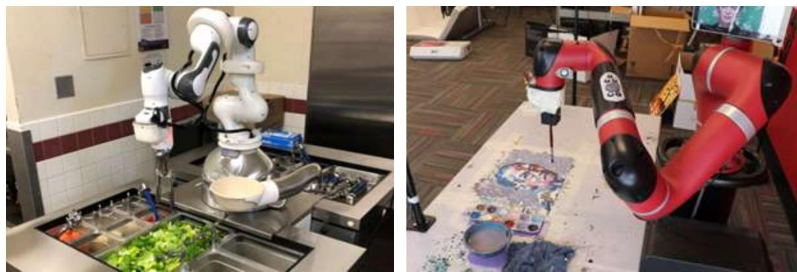  
图1.1 新一代机械臂的应用场景[2, 3]

近年来，机械臂及其关键技术得到了极大的发展和应用，其定位精度、运动灵巧性、安全性等方面均得到了很大程度上的提升，正逐渐应用于家居、实验室、工站等环境[4]，并已具备房屋清洁、零部件装配、物料搬运等操作技能。目前，机器人实现自主作业的基本途径可以概括为：在人工分析机器人操作行为和作业要求的基础上，采用基于人工编程、遥操作或拖动示教等的传统运动轨迹生成方法使得机器人具备一定的操作技能[5]。该类方法能够较好地胜任于结构化环境和单一固定任务的作业场景，能够准确的完成重复性高的操作任务。然而，随着机器人应用领域的不断扩大，实际作业场景往往面临动态、难以预测的复杂状况，导致传统的运动轨迹生成方法无法适应该类非结构化作业环境，无法满足研发周期长、工况复杂多变、多样化定制等作业需求[6]。目前，机器人模仿学习作为机器人研究领域的前沿和热点，可为运动轨迹生成提供全新途径[7-9]。因此，本文从轨迹样本处理、运动轨迹表征与学习等方面，系统性的研究机械臂运动轨迹模仿学习方法，旨在提高机械臂在非结构化环境中的作业效率和作业精度。

## 1.2 运动轨迹模仿学习研究现状

运动轨迹生成作为机器人技术领域的基础性关键问题，是机器人实现移动、操作的技术前提。目前，运动轨迹生成方法大体可以分为三类：基于规划的方法、基于强化学习的方法和基于模仿学习的方法。其中，基于规划的方法是一种通过对机器人的运动进行规划和优化，生成适合特定任务的运动轨迹的方法。例如：Jerk函数[10]、B样条曲线[11]、非均匀 B 样条[12]以及 S 曲线[13]等。基于强化学习的方法是通过反复试错的方式学习得到最佳行为的运动轨迹[14]。具体来说，强化学习主要是通过与环境的互动来完成学习过程，通过奖惩值来判断这个动作的好坏，它可以自行做出决定并对环境采取行动，根据环境反馈的奖励值来改善自己的行为，从而达到最佳决策的目的[15-19]。然而，上述两种方法面临的一个共性问题是运动轨迹泛化能力弱。因此，模仿学习已成为运动轨迹生成的主流方法[9]。目前，模仿学习可以分为以下三类：

## （1）基于概率模型的方法

概率方法在运动编码方面表现良好，可以提取多个轨迹的固有变化性，因此可以保留更多示教样本的特征。该类方法的主要思想是给定某一任务的多次演示信息，借助概率模型对以上信息进行建模分析。其中，GMM/GMR 是实现运动轨迹模仿学习的主要方法之一，其主要优势在于能够高效简洁的序列化学习机器人行为，并对任务中的内部相关性和约束进行建模。GMM 最早由 Calinon 和 Billard[20]提出，是 GMM在机器人模仿学习领域初次应用，因具有对噪声数据敏感度低，计算成本低等优势被广泛关注。Li[21]提出了一种基于RL 的改进GMM方法，通过引入高斯噪声策略来增强演示数据，改善了基于GMM的方法的技能学习效果，并且该方法在真实工业场景下进行了验证，结果表明使用该方法的协作机器人能够以稳健和自适应的方式执行各种复杂的制造任务。类似地，Wang等人[22]同样使用了高斯噪声策略对初始数据进行处理，此外开发了一种基于模拟退火强化学习优化算法来避免GMM出现过拟合的问题，并且针对 GMR 环节引入 B 样条插值算法来优化最终的表征轨迹。Ye 等人[23]提出了一种Bagging-GMM/GMR，通过将单个原始演示数据划分成多个子演示数据，从而构建多个 GMM/GMR，并通过加权平均得到最终的目标技能轨迹。此外，部分学者从提高泛化性角度出发展开研究，Calinon 等人[24, 25]提出了任务参数化的高斯混合模型（Task parameterized GMM, TP-GMM），将坐标系的原点和旋转变换矩阵作为模型中的任务参数，从而允许在不同的参考坐标系下观察和复现运动轨迹。由于 TPGMM需要定义若干参考坐标系，而并没有对各参考系坐标系对于相关技能的重要性进行区分，Huang 等人[26]设计了基于置信度权重的框架，允许用户将技能与各参考坐标系相关性的先验置信度知识用于TP-GMM的示教学习。Arduengo 等人[27]基于TP-GMM 实现了对位移信息和姿态信息的同时编码，并基于特征正交旋转群（SO3）实现姿态运动的复现。Silvério 等人[28]针对 GMM 无法编码演示数据未包含的行为，提出了一种自适应编码策略方法，通过该方法可以有效地使原始策略适应新的要求，并根据任务变化调节机器人行为。

尽管基于 GMM 的运动轨迹学习方法可以从多个示范中学习时提供额外的运动信息，然而，该类方法的泛化性能受到了特征向量长度固定的限制，使得此类方法不适合轨迹的空间和时间缩放。

## （2）基于动态系统的方法

基于动态系统的方法是依托动态系统的具体模型来实现的，目前最具代表性的有动态系统稳定估计器（Stable Estimator of Dynamical Systems，SEDS）[29]和 DMP。SEDS 是 GMM/GMR 的拓展，区别在于 SEDS 学习了系统状态和运动的联合分布。然而，SEDS 仅适合学习位移和速度之间的映射关系，而不适用于学习输入为时间的轨迹或输入输出对应不同类型轨迹的情形，造成其应用面较为狭窄。因此相较于SEDS，目前DMP 更受研究者关注。DMP 最早由Schaal[30]提出，其贡献在于统一了动态系统和最优控制方法。在过去几年，使用 DMP 进行运动轨迹学习已成为最流行的方法，该方法省略了收集学习样本的阶段，相较依赖机器学习算法的方法学习速度更快，并且具有显式的数学模型，使得其可解释较强。然而，该方法的自身属性也为其造成了一定的局限性[31]，因此近年来不少研究者围绕其存在的局限性开展了大量改进工作，旨在丰富基于 DMP 的运动轨迹学习方法的应用场景。针对原始的 DMP 适应空间单一的问题，Pastor 等人[32]综合考虑 DMP 的工作原理和流形空间的计算法则，提出了一种面向机器人姿态的 DMP 变体，其中姿态分别被表示成四元数和 SO3 的形式。Abu-Dakka 等[33]和 Ude[34]等对上述工作进行了改进，前者重新考虑了 SO3 的几何形状，后者通过加入目标切换机制提高了学习方法的实时性。以上工作奠定了基于DMP的运动轨迹学习方法被用于考虑姿态的任务的基础。针对DMP 无法被用于通过点任务的问题，其中通过点任务可以被定义为状态空间中轨迹必须经过的点的任务，未能通过一个通过点可能会导致机器人的任务执行失败。Ning 等人[35, 36]提出了一种重构演示轨迹的方法，该方法分为两步，首先通过组合连接途经点的局部线性轨迹来创建一个示例轨迹。然后，将这个示例轨迹视为演示轨迹通过DMP 进行学习，以此得到一个受限于经过途经点的技能。Weitschat 等[37]则提供了一种新的思路，分别将每个通过点视为技能的终点，从而整个技能划分为多个子技能，利用DMP 分别学习每一个子技能，并将各子技能背后的轨迹序列进行拼接来得到满足任务的最终轨迹序列。然而上述两种方法只能用于对于精度要求无明确要求以及存在较少通过点的任务，具体来说，上述方法无法应用在对精度具有明确要求以及通过点较多的曲面任务，对此，Han 等[38]通过重构 DMP 的数学模型，提出了一种面向曲面任务的 DMP 变体，具体做法是基于阻抗原理为DMP 添加了额外的加速度耦合项，该方法的有效性在物理样机上得到了验证。Xue 等[39]对该方法进一步应用，将DMP 变体纳入了一个自主化程度更高的模仿学习框架来提高学习的效率。针对DMP 在面向特征分布不均匀的运动轨迹具有学习效果差的问题，Wang 等人[40]和 Wu 等人[41]对 DMP 数学模型的非线性项进行改进，提出使用截断形式的基函数替代标准基函数，提升了DMP 学习满足此类特性的轨迹的效果。针对机器人在实施经多个DMP 习得技能所构成的任务时，在相邻技能切换点速度不连续的问题，Kulvcius等人[42, 43]通过对DMP的正则系统进行改进，提出了一种 DMP 变体，该变体弥补了 DMP 无法用于提出了一种多技能序贯连接的基于的技能学习方法，极大改善了相邻技能在连接点的速度跳变现象。此外，伴随深度学习技术的发展，将 DMP 与深度学习技术结合在近年来受到了一定关注。Chen 等人[44]提出了 AEDMP 框架，该框架使用深度自动编码器来找到潜在空间中表示的动作。在这个空间中，DMP 可以最佳地泛化到新的任务，而且这种架构允许DMP作为一个单元进行训练。Gams 等人[45]提出了一种用于感知—行动耦合的深度学习方法，展示了基于视觉的图像和相关运动轨迹之间的耦合。在后续的研究中，Ridge等人[46]继续扩展了该方法以纳入卷积神经网络，并给出该方法的区别性质的表述，该表述利用损失函数来衡量运动轨迹之间的物理距离，而不是测量DMP参数之间的距离，从而提高了算法的性能。Pervez等[47]提出了一种将DMP 与卷积神经网络结合的技能学习方法：D-DMP，其中卷积神经网络负责从环境图像中学习任务特定的特征，具体来说是任务的起止点信息，进而DMP 利用以上信息进行轨迹的泛化，通过这种方法消除了人工提取任务参数的需要，一定程度上还原了类人的感知-动作循环。

以上工作极大推动了基于DMP 的运动轨迹学习方法的发展，使得其成为当下最主流的机器人运动轨迹学习方法之一。然而，仍然存在一个问题影响此类方法的应用，该问题无法通过改进 DMP 来解决。具体来说，由于 DMP 的学习方式是为每个运动轨迹生成一个标准化的径向基函数混合模型。通过这种方式，每个演示轨迹均被使用一次，可能无法捕捉轨迹中特征的属性。换句话说，基于DMP 的运动轨迹学习方法每次学习仅针对单个对象，这要求提供的演示轨迹必须足够具有准确或具有代表性。在很多情况下，具备这种性质的轨迹往往很难得到。该问题限制了其在某些任务下的应用。

## （3）基于动态系统和概率模型的方法

根据上述分析，基于概率模型的运动轨迹学习方法优势在于可以从多个演示轨迹中学习时提供额外的运动信息，劣势在于无法对轨迹空间和时间的调制。基于 DMP的运动轨迹学习方法的优势在于拥有强大的轨迹调制能力，劣势在于只能针对单个运动轨迹进行学习，此时无法判断运动轨迹是否包含技能的所有特征信息。针对上述情形，为了充分利用 GMM/GMR 和 DMP 的性能，研究人员开展了初步研究，最典型的方法是将 GMM/GMR 作为生成模型为 DMP 提供最优的技能表征信息。Paxton[48]和 Ali 等人[49]开发了一种结合 DMP 和 GMM/GMR 的方法，允许演示轨迹在新的时间和空间进行泛化。在该方法中，首先对人类演示的运动轨迹采用动态时间规整进行了预处理，其次使用GMM建模预处理后的轨迹，然后使用GMR检索该轨迹对应的时间序列下的位移的估计值，最后将检索得到的位移序列视为目标运动轨迹通过DMP 进行学习；不同于上述对人类演示的运动轨迹采用GMM建模的方式，Yin 等人[50]考虑了演示运动轨迹在 DMP 表示的物理含义，提出了一种对 DMP 的强迫项进行建模的方法，该方法首先通过DMP 为不同的演示轨迹计算所对应的非线性项，其次使用GMM来建模非线性项，并通过GMR检索时间序列下的非线性项估计值。在上述工作的基础上，Yang 等人[51]和张文安等人[52]进一步考虑了机器人在执行运动轨迹期间的跟踪精度，从而设计了基于神经网络的控制器，具备环境自适应性。相较于上述理论研究，融合了 GMM/GMR 和 DMP 的运动轨迹学习方法在应用层面同样备受关注。Li 等人[53]将构成汉字的多个笔画所表示的轨迹视为不同的技能，通过对人类执行上述笔画时的轨迹使用该方法，成功使机器人学会了由上述笔画构成的汉字的书写。赵曼[54]通过分析旋拧装配任务的特性，成功利用该方法使机器人掌握了旋拧技能背后的运动轨迹特性。Ding 等人[55]通过分析插销插孔任务的特性，成功使机器人学会了插销穿孔技能背后的运动轨迹特性。Bai 等人[56]通过分析阀门转动任务的特性，成功使机器人掌握了自动阀门转动技能背后的运动轨迹特性。在这类方法中，GMM被用于从多个示教样本中表征和学习轨迹，而DMP 则用于泛化新轨迹到新环境。然而，GMM/GMR与DMP 结合起来增加了整个模型的不确定性和复杂性，并引入了更多的参数。

## 1.3 存在的问题与解决方案

结合上文研究方案，在机械臂运动轨迹模仿学习方面还存在以下问题：

（1）基于概率模型的运动轨迹学习方法优势在于可以从多个演示轨迹中学习时提供额外的运动信息，劣势在于无法对轨迹空间和时间的调制。基于DMP 的运动轨迹学习方法的优势在于拥有强大的轨迹调制能力，劣势在于只能针对单个运动轨迹进行学习。以上两种方法泛化性能较差。基于动态系统和概率模型的方法虽然一定程度上提升了泛化性能，但由于存在大量的自主参数，自主程度得到了损失。

（2）基于 DMP 的运动轨迹学习算法凭借学习速度快和可解释性强的优势已成为最流行的运动轨迹模仿学习算法之一，然而该算法由于DMP 模型自身的限制，即缺乏考虑环境信息，无法被应用于受限环境中。

为此，针对上述不足，本文对机械臂运动轨迹模仿学习进行了系统地探究，并提出相应的解决方案：

（1）针对机械臂运动轨迹模仿学习方法存在泛化性能弱与自主程度低等问题，通过集成动态时间规整、GMM 和 GMR 等数据处理技术与先进运动轨迹模仿学习算法DMP，开发了一种具备运动轨迹表征和学习能力的模仿学习框架；针对DMP 算法应用于运动轨迹模仿学习时自主程度低的问题，将贝叶斯优化技术引入 DMP，提出了一种DMP 参数选择算法。

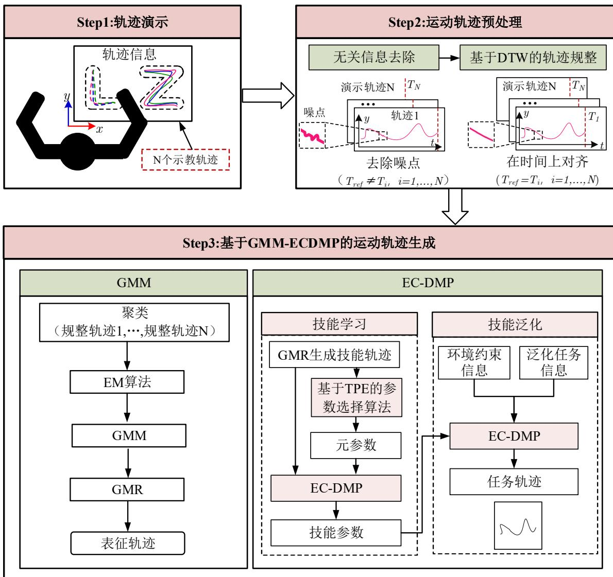  
图1.2 自主运动轨迹模仿学习框架

（2）针对基于DMP的运动轨迹模仿学习算法存在受限环境下泛化失效的问题，将人工势场法引入 DMP 中进行轨迹调制，扩展了现有的 DMP 数学模型，并在此基础上提出了一种考虑环境约束的运动轨迹模仿学习算法。

## 1.4 论文的主要研究工作与章节安排

根据前文的研究背景及现状，本文对现有运动轨迹学习方法中存在的学习效果差、

自主性差和泛化性差的问题进行了深入研究，本文的主要研究内容和创新点为：

第一章介绍了本文的研究背景与意义，归纳总结了目前国内外在机械臂运动轨迹生成领域的研究现状，分析了机械臂运动轨迹模仿学习中存在的问题。论述了本文的主要研究内容，并给出了组织结构和各章节的主要内容。

第二章研究了运动轨迹表征与学习，提出了一种DMP 参数选择算法提高运动轨迹模仿学习的鲁棒性与自主性。

第三章研究了考虑环境因素的运动轨迹模仿学习，设计了一种考虑环境约束的DMP 运动轨迹模仿学习算法，提高了机械臂运动轨迹模仿学习的环境适应能力。

第四章搭建了机械臂运动轨迹模仿学习实验平台，开展了理论章节所提算法和方法的验证实验，并分析了实验结果。

第五章总结了研究过程，阐述取得的工作成果，分析研究过程中存在的问题，并给出下一步需要着重改进和完善的思路。

本文各章节之间的关系如图1.3所示：

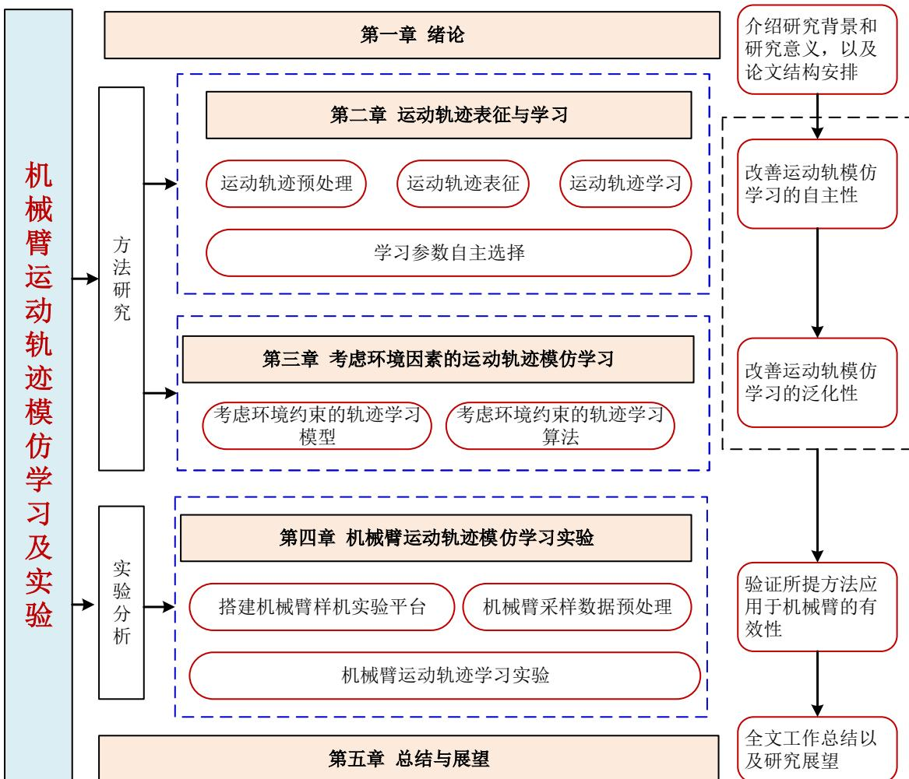  
图1.3 研究内容与关系

## 第二章 机械臂运动轨迹表征与学习

## 2.1 引言

众所周知，良好的学习对象和有效的学习方法是保证学习性能的前提。在本文研究的面向运动轨迹的模仿学习中，学习对象是人类为完成任务而产生行为背后的运动轨迹，即所谓的示教轨迹。通常情况下，仅通过单次演示任务获得的示教轨迹往往不能准确地概括完成任务所需行为的特性，因此需要通过对多个演示轨迹进行表征，得到一条用于学习的最优示教轨迹。随后，采用模仿学习算法完成最优示教轨迹的学习。本章围绕这两个问题开展了研究，重点对现有学习方法存在的自主性差的问题进行了改进。

## 2.2 运动轨迹预处理

在应用基于 GMM/GMR 的运动轨迹表征任务中，运动轨迹通常以动觉演示的方式获取，并需要进行多次示教以用于GMM的建模。在这种情况下，由于人类难以确保每次示教在时间和空间上的一致性，因此得到的多个运动轨迹可能会存在时间上的失真和不一致性。然而，GMM具有与时间无关的特性。因此，对于包含明确时间状态的运动轨迹数据，必须进行时间上的对齐。为此，本文选择采用动态时间规整DTW[58]来完成。

DTW 的基本思想在于将两个长度不一的时间信号通过通过非线性对齐拉伸到相同长度，且拉伸后使得两条轨迹之间的距离最短。具体方法如下：给定时间步长分别为T1和T2的两条轨迹序列 $\Gamma _ { t r a j 1 } = \{ \Gamma _ { t r a j 1 , i } \} _ { i = T 1 }$ 和 $\Gamma _ { t r a j 2 } = \{ \Gamma _ { t r a j 2 , j } \} _ { j = T 2 }$ 。其中 $\Gamma _ { t r a j 1 , i }$ 和 $\Gamma _ { t r a j 2 , j }$ 分是轨迹 $\Gamma _ { t r a j 1 }$ 和轨迹 $\Gamma _ { t r a j 2 }$ 中的坐标点。首先，定义一个时间规整函数 $s ( k )$ ，它将轨迹$\Gamma _ { t r a j 1 , i }$ 的时间索引映射到轨迹 $\Gamma _ { t r a j 2 , j }$ 的时间索引，如下所示：

$$
s (k) = (i (k), j (k))\tag{2-1}
$$

其中， $i ( k )$ $j ( k )$ 分别表示规整后轨迹 $\Gamma _ { t r a j 1 }$ 和轨迹 $\Gamma _ { t r a j 2 }$ 的对应时间点。

然后，定义距离函数 $d ( s )$ ，作为衡量两个向量之间距离的一种度量，可以表示为欧式距离，如下所示：

$$
d (s) = d (i, j) = \left\| \Gamma_ {t r a j 1, i} - \Gamma_ {t r a j 2, j} \right\|\tag{2-2}
$$

最后，定义规整函数s上距离的总和，如下所示：

$$
E (s) = \sum_ {k = 1} ^ {K} d (s (k))\tag{2-3}
$$

其中，K是对齐路径的长度。这个总和量化了轨迹 $\Gamma _ { t r a j 1 }$ 和轨迹 $\Gamma _ { t r a j 2 }$ 之间的整体差异，通过最小化这个总和，可以找到最佳的轨迹对齐路径。

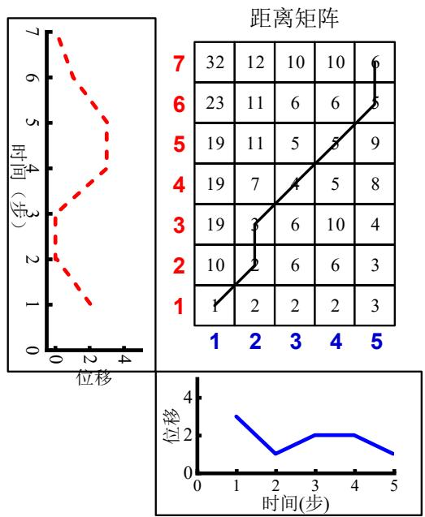  
（a）轨迹距离矩阵

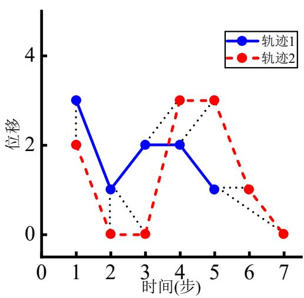  
（b）轨迹规整结果  
图2.1 规整路径的获取原理

图2.1将DTW方法的一般过程进行了可视化，考虑两条时间步长分为5（蓝色）和7（红色）的轨迹，将它们视为长度为5和7的两个向量，由此可以得到一个距离矩阵 $D _ { 5 \times 7 }$ ,其任意元素 $D ( i , j ) = \left\| \Gamma _ { t r a j 1 , i } - \Gamma _ { t r a j 2 , j } \right\|$ 。现在，问题涉及到从D(1,1)到D(5,7)找到最小成本路径，最小成本路径通过动态规划算法得到：

$$
p (i, j) = D (i, j) + \min \left\{p (i - 1), j, p (i, j - 1) + p (i - 1, j - 1) \right\}\tag{2-4}
$$

其中， $p ( i , j )$ 是点D i j( , )从原点D(1,1)出发找到的最小成本路径。

此外，当需要对齐的轨迹需要大于3个时，必须选定一个模板轨迹。剩余轨迹都将被配准到该模板轨迹上。为了选择模板，本文通过分别计算各个轨迹与其它轨迹之间的规整距离，将同其它规整轨迹都具有最小规整距离的轨迹作为模板轨迹。

图 2.2 展示了使用 DTW 针对同一动作获取的 6 条演示轨迹处理前后的效果。左图表示通过动觉演示直接获得的轨迹，可以发现演示轨迹的起止点相近，演变趋势一致，体现了演示操作的重复性。同时可以观察到演示轨迹在时间长度上存在差异，体现了演示操作存在随机性。右图表示DTW处理后的轨迹，所有轨迹都经过非线性变

形，以共享相同的时间。

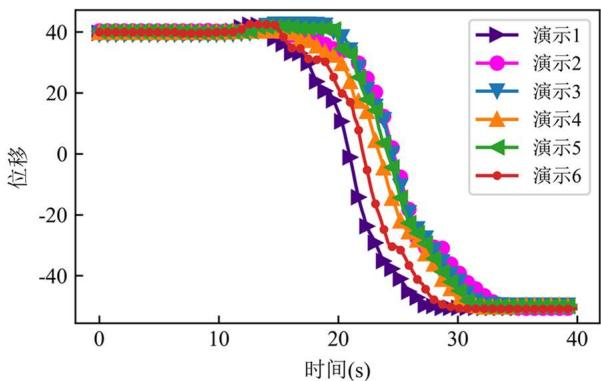  
（a）原始轨迹

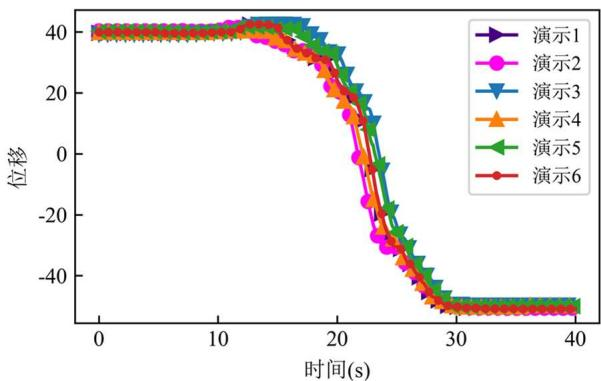  
图2.2 DTW时间对齐轨迹  
（b）DTW处理轨迹

## 2.3 运动轨迹表征

## 2.3.1 基于GMM的轨迹特征提取

GMM是一种由有限个的高斯分布以线性方式组成的概率模型，其假设所有数据点都是从有限个的高斯混合分布中生成。GMM已经被证明从多个数据集中找出趋势方面表现出色，在机器学习领域被广泛应用。因此，通过使用GMM对经DTW规整后的演示轨迹进行建模，将执行同一任务得到的每条演示轨迹视为一个数据集，则可以实现通过少量的演示数据模拟广义的运动趋势。

基于上述思想，假设经由DTW规整后的多条示教轨迹构成的数据集 $\xi$ 有N个轨迹点，每个轨迹点具有D个特征，即 $\boldsymbol { \xi } : \{ \xi _ { 1 } , . . . , \xi _ { n } , . . . , \xi _ { N } | \xi _ { n } \in \mathbb { R } ^ { D } \}$ ，则包含所有轨迹点的 $\xi$ 为一个 $N \times D$ 矩阵，在本文的研究中 $D = 2$ 。这里将 $\xi$ 的输入和输出特征的维度分布定义为 $\xi ^ { I }$ 和 $\xi ^ { o }$ ，以方便后文 GMR 的推导。如果每个轨迹点可以通过一个高斯分布 $\mathcal { N }$ 来表示，那么矩阵 $\xi$ 的概率密度函数为：

$$
p (\xi \mid \mu , \Sigma) = p (\xi^ {\mathcal {I}}, \xi^ {\mathcal {O}} \mid \mu , \Sigma) = \prod_ {n = 1} ^ {N} \mathcal {N} (\xi_ {n} \mid \mu , \Sigma)\tag{2-5}
$$

$$
\mathcal {N} \left(\xi_ {n} \mid \mu , \Sigma\right) = \frac {1}{(2 \pi) ^ {\frac {D}{2}} \sqrt {| \Sigma |}} \exp \left(- \frac {1}{2} \left(\xi_ {n} - \mu\right) ^ {T} \Sigma_ {m} ^ {- 1} \left(\xi_ {n} - \mu\right)\right)\tag{2-6}
$$

其中， 和 $\mu$ $\Sigma$ 分别表示高斯分布 $\mathcal { N }$ 的均值和协方差。如果 $\xi$ 来自多个高斯分布，正如GMM的假设，则概率密度函数为：

$$
p (\xi \mid \mu , \Sigma) = \prod_ {n = 1} ^ {N} \sum_ {m = 1} ^ {M} \pi_ {m} \mathcal {N} \left(\xi_ {n} \mid \mu_ {m}, \Sigma_ {m}\right)\tag{2-7}
$$

其中，M表示组成高斯分布的数量， $\pi _ { m } = [ 0 , 1 ]$ 是第m个高斯分布的概率权重，且满足$\sum { \overset { M } { \mathop { m } } } = 1 \pi _ { m } = 1$ 。因此，GMM可以通过一组特征参数来描述：

$$
\theta_ {G M M} = \left\{\left\{\pi_ {1}, \mu_ {1}, \Sigma_ {1} \right\}, \left\{\pi_ {2}, \mu_ {2}, \Sigma_ {2} \right\}, \dots , \left\{\pi_ {M}, \mu_ {M}, \Sigma_ {M} \right\} \right\}\tag{2-8}
$$

为获取这组参数，需要使用最大期望（Expectation Maximization，EM）算法。EM算法是对均值、协方差和高斯分布个数的最大似然估计。正如算法的名称所示，EM算法在两个步骤上进行迭代：E 步和 M 步，也被称为期望步和最大化步。在每次迭代中，E步负责通过当前参数 $\theta _ { G M M }$ 评估模型的后验概率 $\gamma _ { m } ( \xi )$ 。M 步负责最大化数据和隐藏变量的联合分布重新估计参数。在此过程中，需要引入一个潜在变量z，如下所示：

$$
z _ {n m} = \left\{ \begin{array}{l l} 1, & \text { if } \xi_ {n} \in \text { compent } m \\ 0, & \text { other } \end{array} \right.\tag{2-9}
$$

其中， $z _ { n m }$ 用于表示样本 $\xi _ { n }$ 是否属于第m个高斯分布。基于该变量，E 步能够计算出样本 $\xi _ { n }$ 属于第m个高斯分布的后验概率 $\gamma _ { n m }$ ，如下所示：

$$
\gamma_ {n m} = p \left(z _ {n m} = 1 \mid \xi_ {n}\right) = \frac {p \left(\xi_ {n} \mid z _ {n m} = 1\right) p \left(z _ {n m} = 1\right)}{\sum_ {j = 1} ^ {M} p \left(\xi_ {n} \mid z _ {n j} = 1\right) p \left(z _ {n j} = 1\right)}\tag{2-10}
$$

然后，M 步使用后验概率 $\gamma _ { n m }$ 计算参数 ${ \boldsymbol { \theta } } _ { G M M } ^ { * }$ ，以最大公式(2-7)的似然函数。简单而言，通过为对数似然的每个参数分别微分，并设置结果为0，便可以求解出各个参数，M 步的方程如下所示：

$$
\pi_ {m} ^ {n e w} = \frac {\sum_ {n = 1} ^ {N} \gamma_ {n m}}{N}\tag{2-11}
$$

$$
\mu_ {m} ^ {\text { new }} = \frac {\sum_ {n = 1} ^ {N} \gamma_ {n m} \xi_ {n}}{\sum_ {n = 1} ^ {N} \gamma_ {n m}}\tag{2-12}
$$

$$
\Sigma_ {m} ^ {\text { new }} = \frac {\sum_ {n = 1} ^ {N} \gamma_ {n m} \left(\xi_ {n} - \mu_ {m} ^ {\text { new }}\right) \left(\xi_ {n} - \mu_ {m} ^ {\text { new }}\right) ^ {T}}{\sum_ {n = 1} ^ {N} \gamma_ {n m}}\tag{2-13}
$$

通过在式(2-10)表示的 E步和式(2-11)至式(2-13)表示的M 步之间迭代，直到参数收敛。判断收敛的方法为：计算相邻两次的对数似然值的变化率，若小于预设阈值，则表示收敛。

## 2.3.2 基于 GMR 的轨迹泛化输出

由上一小节可知，当GMM用于由多条演示轨迹构成的数据集的建模时，旨在通过少量的演示数据模拟轨迹的广义运动趋势，完成参数学习的GMM便满足了上述要求。而基于 GMM/GMR 的运动轨迹表征的目标是基于演示运动轨迹来得到一条广义运动轨迹。在此背景下，GMR 提供了一种从符合高斯分布的的数据中概括演示轨迹的方法。GMR的原理如下

GMR 利用数据的联合概率分布 $p ( \xi ^ { \mathcal { Z } } , \xi ^ { \mathcal { O } } | \Theta _ { G M M } )$ 进行建模，从而在给定输入数据$\xi ^ { I }$ 的情况下，估计输出数据 $\xi ^ { \mathcal { O } }$ 的条件概率分布 $p ( \xi ^ { \mathcal { O } } | \xi ^ { \mathcal { I } } , \theta _ { G M M } )$ 。在 GMM 的每个高斯分布中，回归值被视为给定输入的输出条件分布的后验均值的线性组合。这样，可以利用拟合的GMM来预测缺失的输出特征。具体的数学推导如下：

首先，根据概率论中的乘积规则，在输入 $\boldsymbol { \xi } _ { t } ^ { \ : \perp }$ 和高斯分布特性参数 $\theta _ { G M M }$ 给定的条件下，输出 $\xi _ { t } ^ { \mathcal { O } }$ 的条件概率分布 $p ( \xi _ { t } ^ { \mathcal { O } } | \xi _ { t } ^ { \mathcal { I } } , \Theta _ { G M M } )$ 与联合概率分布 $p ( \xi _ { t } ^ { \tau } , \xi _ { t } ^ { \mathcal { O } } \mid \boldsymbol { \theta } _ { G M M } )$ 和边缘分布 $p ( \xi _ { t } ^ { \tau } | \theta _ { G M M } )$ 存在以下关系：

$$
p \left(\xi_ {t} ^ {\mathcal {O}} \mid \xi_ {t} ^ {\mathcal {I}}, \theta_ {G M M}\right) = \frac {p \left(\xi_ {t} ^ {\mathcal {I}} , \xi_ {t} ^ {\mathcal {O}} \mid \theta_ {G M M}\right)}{p \left(\xi_ {t} ^ {\mathcal {I}} \mid \theta_ {G M M}\right)} = \sum_ {m = 1} ^ {M} \hat {\pi} _ {m} \mathcal {N} \left(\hat {\mu} _ {m}, \hat {\Sigma} _ {m}\right)\tag{2-14}
$$

可以发现，输出 $\xi ^ { \mathcal { O } }$ 的条件概率分布同样是一个具有M个高斯分布的高斯混合模型，特性参数为权重 $\hat { \pi } _ { m }$ 、均值 $\hat { \mu } _ { m }$ 和协方差 ${ \hat { \Sigma } } _ { m }$ 。条件概率分布的参数$\hat { \boldsymbol { \theta } } _ { G M M } = \{ \hat { \pi } _ { m } , \hat { \mu } _ { m } , \hat { \Sigma } _ { m } \}$ 与GMM的参数 $\mathsf { \Pi } \theta _ { G M M } = \{ \pi _ { m } , \mu _ { m } , \Sigma _ { m } \}$ 之间通过下式相关联：

$$
\hat {\pi} _ {m} = \frac {p (m) p (\xi_ {t} ^ {\mathcal {I}} \mid m)}{\sum_ {m = 1} ^ {M} p (m) p (\xi_ {t} ^ {\mathcal {I}} \mid m)} = \frac {\pi_ {m} \mathcal {N} (\xi_ {t} ^ {\mathcal {I}} \mid \mu_ {m} ^ {\mathcal {I}} , \Sigma_ {m} ^ {\mathcal {I}})}{\sum_ {m = 1} ^ {M} \pi_ {m} \mathcal {N} (\xi_ {t} ^ {\mathcal {I}} \mid \mu_ {m} ^ {\mathcal {I}} , \Sigma_ {m} ^ {\mathcal {I}})}\tag{2-15}
$$

$$
\hat {\mu} _ {m} = \mu_ {m} ^ {\mathcal {O}} + \Sigma_ {m} ^ {\mathcal {O I}} (\Sigma_ {m} ^ {\mathcal {I}}) ^ {- 1} (\xi_ {t} ^ {\mathcal {I}} - \mu_ {m} ^ {\mathcal {I}})\tag{2-16}
$$

$$
\hat {\Sigma} _ {m} = \Sigma_ {m} ^ {\mathcal {O}} - \Sigma_ {m} ^ {\mathcal {O I}} \left(\Sigma_ {m} ^ {\mathcal {I}}\right) ^ {- 1} \Sigma_ {m} ^ {\mathcal {I O}}\tag{2-17}
$$

这里，第 m 个高斯分布的均值 $\mu _ { { } _ { m } }$ 和协方差 $\Sigma _ { m }$ 被分解为对应于输入和输出特征部分，如下所示：

$$
\boldsymbol {\mu} _ {m} = \left[ \begin{array}{c} \boldsymbol {\mu} _ {m} ^ {\mathcal {I}} \\ \boldsymbol {\mu} _ {m} ^ {\mathcal {O}} \end{array} \right], \boldsymbol {\Sigma} _ {m} = \left[ \begin{array}{c c} \boldsymbol {\Sigma} _ {m} ^ {\mathcal {I}} & \boldsymbol {\Sigma} _ {m} ^ {\mathcal {I O}} \\ \boldsymbol {\Sigma} _ {m} ^ {\mathcal {O I}} & \boldsymbol {\Sigma} _ {m} ^ {\mathcal {O}} \end{array} \right]\tag{2-18}
$$

从而最终的预测输出值 $\hat { \xi } _ { t } ^ { \mathcal { O } }$ 由下式给出：

$$
\hat {\xi} _ {t} ^ {\mathcal {O}} = \mathbb {E} (\xi_ {t} ^ {\mathcal {O}} \mid \xi_ {t} ^ {\mathcal {I}}) = \sum_ {m = 1} ^ {M} \hat {\pi} _ {m} \hat {\mu} _ {m}
$$

(2-19)

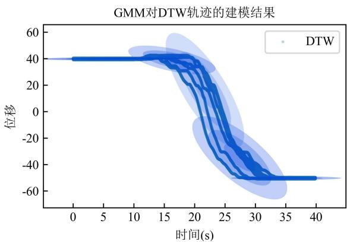  
（a）GMM建模结果

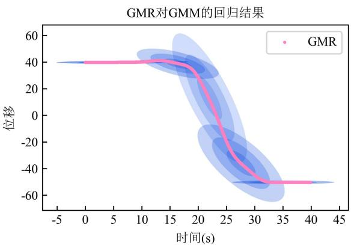  
（b）GMR回归结果  
图2.3 GMR得到的广义轨迹

考虑到本文的情景，GMM 的建模对象为经由 DTW 处理的演示轨迹构成的数据集 $\{ ( t _ { i } , y _ { i } ) | i = 1 , \cdots , N \}$ ，其包含时间索引 $t _ { i }$ 和空间索引 $y _ { i }$ 。在回归过程中， $t _ { i }$ 被视为已知特征，代指式(2-19)中的 $\boldsymbol { \xi } _ { t } ^ { \ : \tau }$ 。因此，依次将所有 $t _ { i }$ 带入式(2-19)计算，从而得到重构的目标轨迹。图 2.3 展示了利用 GMR 对完成学习的 GMM 进行回归计算的结果。其中左图表示 GMM 对演示数据集的建模结果（每一个浅蓝色椭圆表示一个高斯分布）。右图展示了利用GMR将时间索引作为输入对同一GMM进行回归计算的结果，这里以粉色线段表示。对比左图经由 DTW 处理的演示轨迹，可以直观地发现 GMR得到的轨迹在保留演示特征的前提下更为平滑。粉色轨迹也被称为表征轨迹，是基于GMM/GMR对演示轨迹的最终建模结果。该轨迹将被用于后面DMP 的学习。

## 2.4 运动轨迹学习

## 2.4.1 DMP

DMP 是一种将运动基元的思想与动态系统相结合的方法，基于这种方法学习运动轨迹，能够得到期望形状的运动轨迹且保证收敛。具体而言，DMP 的核心思想是将运动轨迹通过二阶弹簧阻尼系统和由基元构成的激励来编码。选择二阶弹簧阻尼系统的原因是，非受迫的质量弹簧阻尼系统无论其开始的位置在何处，均能收敛到其平衡位置。然而，仅通过调整二阶弹簧阻尼系统只能在初始条件和目标之间产生非受迫临界阻尼质量-弹簧-阻尼器系统响应，换句话说，它们只形成得单一形状的运动轨迹，难以满足复杂形状轨迹的需求。为此，通过为弹簧阻尼系统在特定时间施加不同大小的激励便可以得到丰富的运动轨迹。

基于上述考虑，DMP 包含二阶弹簧阻尼系统和激励，由此 DMP 被实例化为式(2-20)的形式[31]：

$$
\tau \ddot {y} = \alpha_ {y} (\beta_ {y} (g - y) - \tau \dot {y}) + f (t)\tag{2-20}
$$

其中， $f ( t )$ 项对应激励，剩余项对应二阶动态系统。可以观察到，当 $f ( t )$ 等于 0 时，剩余项表示了一个平衡位置为 $g$ 的典型二阶弹簧阻尼系统， 、 $\alpha _ { y }$ 和 $\beta _ { y }$ 为弹簧阻尼系统的特性参数。激励 $f ( t )$ 在 DMP 中被称为强迫项，其被设计为简单基函数的归一化线性组合和一个额外的乘数：

$$
f (t) = \frac {\sum_ {i = 1} ^ {N _ {b f s}} \psi_ {i} (t) w _ {i}}{\sum_ {i = 1} ^ {N _ {b f s}} \psi_ {i} (t)} (g - y _ {0})\tag{2-21}
$$

$$
\psi_ {i} (t) = \exp (- h _ {i} (t - c _ {i}) ^ {2})\tag{2-22}
$$

其中， $\psi _ { i } ( t )$ 表示第i个基函数在时刻t的值， $h _ { \scriptscriptstyle i }$ 和 $c _ { i }$ 分别表示第i个基函数的宽度和中心， $N _ { b f s }$ 表示选用基函数的个数， $w _ { i }$ 表示第i个基函数的权重; $\left( g - y _ { 0 } \right)$ 用于缩放不同目标 $g$ 和初始条件 $y _ { 0 }$ 的轨迹，它提供了几何不变性；然而，当 $f$ 是关于时间t的函数时会造成一个问题：强迫项并不会在临近运动轨迹的终止点时消失；而理想中的强制项$f ( t )$ 作应当随着轨迹向目标移动而接近零的函数。

对此，引入了一个指数衰减函数：

$$
s (t) = \exp (- \frac {\alpha_ {s} t}{\tau})\tag{2-23}
$$

其中， $\alpha _ { s }$ 表示衰减函数的增益，衰减函数通过提供新的相位变量s 来避免显式的时间依赖，替换后的强迫项和基函数被表示成：

$$
f (s) = \frac {\sum_ {i = 1} ^ {N} \psi_ {i} (s) w _ {i}}{\sum_ {i = 1} ^ {N} \psi_ {i} (s)} s \left(g - y _ {0}\right)\tag{2-24}
$$

$$
\psi_ {i} (s) = \exp (- h _ {i} (s - c _ {i}) ^ {2})\tag{2-25}
$$

其中，对比式(2-21)，可以观察到除了所有的变量t被替换，式(2-24)新增加了项s，可以将其看作一个“门控项”。由于 $s ( t )$ 在运动结束时值接近0，进而临近运动结束时激励对点吸引子系统的影响几乎消失，以此保证了弹簧阻尼系统的收敛。在本文中，为了在基函数数量相同的情况下获得较低的均方误差，式(2-22)中第i个基函数的中心 $c _ { i }$ 基于下式选择[31]：

$$
c _ {i} = \exp (- \alpha_ {s} T _ {i})\tag{2-26}
$$

$$
T _ {i} = \frac {i}{N _ {b f s}} T\tag{2-27}
$$

第i个基函数的宽度 $h _ { i }$ 基于下式选择[31]：

$$
h _ {i} = \frac {N _ {n f s} ^ {\frac {3}{2}}}{\alpha_ {s} \cdot c _ {i}}\tag{2-28}
$$

最终，DMP 的数学表达式如下所示：

$$
\tau \ddot {y} = \alpha_ {y} (\beta_ {y} (g - y) - \tau \dot {y}) + f (s)\tag{2-29}
$$

$$
\tau \dot {s} = - \alpha_ {s} s\tag{2-30}
$$

其中，式(2-29)和(2-30)在DMP 中分别被称为转换系统和正则系统。

## 2.4.2 基于DMP 的运动轨迹学习与泛化

## （1）轨迹学习

根据上述推导的转换系统和正则系统，已经清晰了DMP 的建模思路。接下来将介绍如何通过 DMP 实现运动轨迹的学习。通过 DMP 对运动轨迹进行学习本质上是建立运动轨迹序列 $\{ t _ { i } , \mathbf { y } ( t _ { i } ) \in \mathbb { R } ^ { 3 } | i = 1 , 2 , . . . , N _ { p t s } \}$ 与DMP数学表达式的联系，具体而言，就是得到一组通过基函数叠加求和来逼近目标非线性强迫项的权重系数。因此，基于DMP 的运动轨迹学习过程可分为两个阶段：获取非线性目标强迫项和获取最优权重系数。

另外，根据前文的介绍，容易得知两点：1）在笛卡尔空间下，轨迹位移信息是三维的，即 $\mathbf { y } = [ x , y , z ] ^ { T }$ ；2）DMP 是针对单维轨迹进行学习的。

综合考虑以上两点，通过将y视作三个独立的一维轨迹在时间上的耦合。因此，分别使用DMP 对每一维轨迹进行学习，它们共享相同的正则系统。接下来，将以一维轨迹x为例，推导具体的学习过程。为便于区分，将用于学习的运动轨迹表示为 $x _ { d e m o }$ 并详细说明获取非线性目标强迫项和最优权重系数的过程。

## 1）获取非线性目标强迫项

众所周知，学习的第一步是设立学习目标。对于 DMP 来说，其学习目标就是非线性强迫项。将演示轨迹对应的非线性强迫项称为目标强迫项 $f _ { t a r g e t }$ ，其与演示轨迹$x _ { d e m o }$ 的联系通过式(2-29)建立，具体如下所示：

$$
f _ {\text { target }} = \tau \ddot {x} _ {\text { demo }} - \alpha_ {y} \left(\beta_ {y} (g - x _ {\text { demo }}) - \dot {x} _ {\text { demo }}\right)\tag{2-31}
$$

其中， $g$ 表示演示轨迹的终点，即 $g = x _ { d e m o } ( t _ { N p t s } )$ ， 表示时间缩放系数。在 DMP 的学习阶段 $\tau = 1$ ， 和 $\alpha _ { y }$ $\beta _ { y }$ 是超参数，需要预先设置。后续章节会进一步研究有关超参数的设置方法。将关于时间的运动轨迹序列 $\{ t _ { i } , \boldsymbol { x } _ { d e m o } ( t _ { i } ) , \dot { \boldsymbol { x } } _ { d e m o } ( t _ { i } ) , \ddot { \boldsymbol { x } } _ { d e m o } ( t _ { i } ) | i = 1 , 2 , . . . , N _ { p t s } \}$ 下的各个点逐个带入上式，可以得到其对应的强迫项序列 $\{ t _ { i } , f _ { t a r g e t } ( t _ { i } ) | i = 1 , 2 , . . . , N _ { p t s } \}$ 其中速度 $\dot { x } _ { d e m o } ( t _ { i } )$ 和加速度 $\ddot { x } _ { d e m o } ( t _ { i } )$ 分别通过对位移 $x _ { d e m o } ( t _ { i } )$ 求取关于时间的一阶导和二阶导来获得。在该过程中假设时间步长一致，即任意两个连续的轨迹点间隔时间相同。例如，一条持续时间为1秒，状态点个数为 $N _ { p t s }$ 的演示轨迹，其时间步长为 $1 / N _ { p t s }$ 秒。图2.4展示了一个具有 $N _ { p t s }$ 个轨迹点的单维轨迹获得目标强迫项的过程。

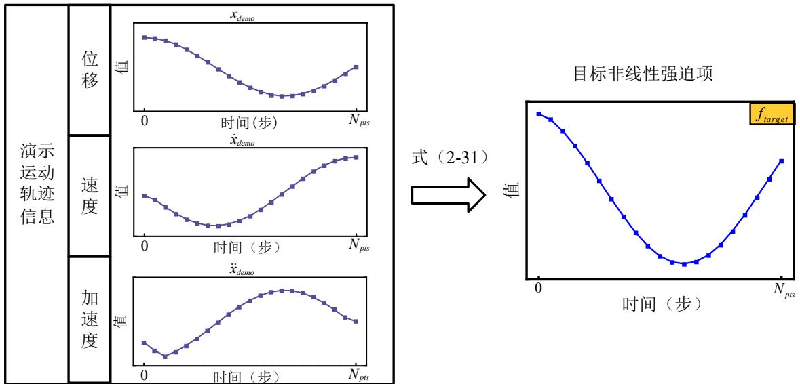  
图2.4 非线性目标强迫项获取过程

## 2）获取目标权重系数

目标权重系数 $w _ { t } = [ w _ { 1 } , w _ { 2 } , . . . , w _ { N _ { b f s } } ]$ 指的是能够通过式(2-24)最优地表示整个运动状态下目标强迫项 $f _ { t a r g e t }$ 的基函数的一组系数。其中， $N _ { b f s }$ 表示所使用的基函数个数，需要预先指定。获取这组系数的过程需要借助优化算法。考虑到强迫项被设计成随时间激活的基函数的加权求和的形式，因此选择局部加权回归（Local Weight Regression,LWR）来获取基函数的权重。LWR 具有非常快速的一次学习过程，并且各个核的学习是相互独立的。通过对每个基函数的局部权重进行调整，使得损失函数最小化，即对应于目标强迫项的逼近。需要最小化的损失函数表示为：

$$
J (w _ {k}) = \sum_ {i = 1} ^ {N _ {p t s}} \psi_ {k} s (t _ {i}) \Big (f _ {t a r g e t} (t _ {i}) - w _ {k} s (t _ {i}) (g - x _ {d e m o} (t _ {0})) \Big)\tag{2-32}
$$

其中， $s ( t _ { i } )$ 表示时刻 $t _ { i }$ 由正则系统表示的相位变量。

为方便描述，下面将式(2-32)转换成矩阵形式。首先，将第k 个基函数在不同时刻的值带入对角矩阵：

$$
\Psi_ {k} = \left( \begin{array}{c c c c} \psi_ {k} (t _ {1}) & & & 0 \\ & \psi_ {k} (t _ {2}) & & \\ & & \ddots & \\ 0 & & & \psi_ {k} (t _ {N _ {p t s}}) \end{array} \right)\tag{2-33}
$$

然后，令 $\zeta ( t _ { i } ) = w _ { k } s ( t _ { i } ) ( g - x _ { d e m o } ( t _ { 0 } ) )$ ，为 $\xi ( t _ { i } )$ 和 $f _ { t a r g e t } ( t _ { i } )$ 设置列向量 $\upsilon$ 和 $f _ { t }$ ：

$$
\upsilon = \left( \begin{array}{c} \xi (t _ {1}) \\ \xi (t _ {2}) \\ \vdots \\ \xi (t _ {N _ {p t s}}) \end{array} \right) \quad f _ {t} = \left( \begin{array}{c} f _ {\text { target }} (t _ {1}) \\ f _ {\text { target }} (t _ {2}) \\ \vdots \\ f _ {\text { target }} (t _ {N _ {p t s}}) \end{array} \right)\tag{2-34}
$$

因此，式(2-32)可以表示成：

$$
J (w _ {k}) = \left(f _ {t} - v ^ {T} w _ {k}\right) ^ {T} \Psi_ {k} \left(f _ {t} - v ^ {T} w _ {k}\right)\tag{2-35}
$$

最终，使用最小二乘法解得：

$$
w _ {k} = \left(\upsilon^ {T} \Psi_ {k} \upsilon\right) ^ {- 1} \upsilon^ {T} \Psi_ {k} f _ {\mathrm{t}} = \frac {\upsilon^ {T} \Psi_ {k} f _ {\mathrm{t}}}{\upsilon^ {T} \Psi_ {k} \upsilon}\tag{2-36}
$$

上述介绍了单个基函数对应的权重参数计算的方法。通过对每个基函数执行该过程，即可完成目标权重系数 $w _ { t }$ 的获取。图2.5展示了目标权重系数的获取过程的一般思想。

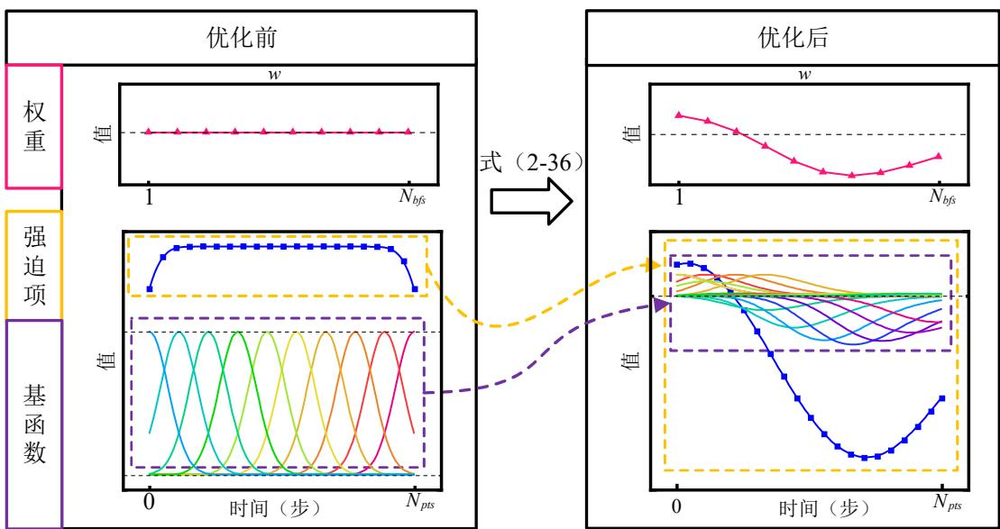  
图2.5 目标权重系数的获取过程

## （2）轨迹泛化

通过上一小节对演示轨迹的学习，建立了笛卡尔空间下的演示轨迹与DMP 参数空间的映射关系。具体来说，即获得了DMP 非线性项的权重参数。利用这些权重参数再现笛卡尔空间下的运动轨迹的过程被称为运动轨迹泛化。与学习阶段类似，泛化过程也是分维度进行的。因此，下面将继续以x维为例，推导基于 DMP 的运动轨迹泛化流程。

根据前述内容，为了实现运动轨迹的泛化，需要建立笛卡尔空间与DMP 参数空间的联系。具体方法是将习得的最优权重系数 $w _ { t }$ 带入与式(2-31)相同的非线性强迫项中，并使用与式(2-31)相同的正则系统来计算第i个时间步的输出系统的非线性强迫项$f _ { g e n } ( t _ { i } )$ ，如下所示：

$$
f _ {g e n} (s \left(t _ {i}\right)) = \frac {\sum_ {k = 1} ^ {N _ {b f s}} \psi_ {k} \left(t _ {i}\right) w _ {t} s \left(t _ {i}\right)}{\sum_ {k = 1} ^ {N _ {b f s}} \psi_ {k} \left(t _ {i}\right)} \left(g _ {\text { new }} - x _ {\text { new }} \left(t _ {1}\right)\right)\tag{2-37}
$$

$$
\psi_ {k} (t _ {i}) = \exp (- h _ {k} (s (t _ {i}) - c _ {k}) ^ {2})\tag{2-38}
$$

其中， $g _ { n e w }$ 和 $x _ { n e w } ( t _ { 1 } )$ 分别表示新指定的泛化起点和终点。然后，利用式(2-39)，计算第i个时间步泛化轨迹的加速度，即动态系统的二阶导数：

$$
\ddot {x} _ {\text { gen }} (t _ {i}) = \left(\alpha_ {y} \left(\beta_ {y} \left(g - x _ {\text { gen }} (t _ {i})\right) - \dot {x} _ {\text { gen }} (t _ {i}) + f _ {\text { gen }} (t _ {i})\right) / \tau \right.\tag{2-39}
$$

其中， $\tau$ 是时间缩放系数，其计算方法为：

$$
\tau = T _ {n e w} / T\tag{2-40}
$$

其中，T表示演示轨迹的运动时间， $T _ { n e w }$ 表示面向新任务期望得到的泛化轨迹的运动时间。为了保证泛化轨迹与演示轨迹的演变特性一致，当 $\tau > 1$ 时，泛化轨迹的加速度相较于演示轨迹的加速度会发生等比例缩小；而当 $\tau < 1$ 时，泛化轨迹的加速度相较于演示轨迹的加速度会发生等比例增大。

最后，通过对加速度 $\ddot { x } _ { g e n } ( t _ { i } )$ 进行积分，得到第i个时间步泛化轨迹的速度 $\dot { x } _ { g e n } ( t _ { i } )$ 和位移 $x _ { g e n } ( t _ { i } )$

$$
\dot {x} _ {g e n} (t _ {i}) = \dot {x} _ {g e n} (t _ {i - 1}) + \ddot {x} _ {g e n} (t _ {i}) \cdot d t\tag{2-41}
$$

$$
x _ {g e n} (t _ {i}) = x _ {g e n} (t _ {i - 1}) + \dot {x} _ {g e n} (t _ {i}) \cdot d t\tag{2-42}
$$

与学习过程相似，上述公式中假设泛化生成的轨迹点在时间上均匀分布，即dt为定值，其大小取决于新任务的持续时间 $T _ { n e w }$ 。此外，在轨迹泛化的过程中，泛化轨迹在起始点处的速度和加速度均为0，即 $\dot { x } _ { g e n } ( t _ { 0 } ) = 0 , \ddot { x } _ { g e n } ( t _ { 0 } ) = 0$ 。综上，基于给定的参数和假设条件，泛化轨迹将以第一个时间步 $( t _ { 1 } )$ 为初始点开始泛化。通过以先前时间步的输出作为当前时间步的输入，系统将逐步迭代直至第 $N _ { p t s }$ 个时间步 $( t _ { N p t s } )$ 结束。

综上，本文提出的基于DMP 的运动轨迹学习与泛化流程如图2.6所示。

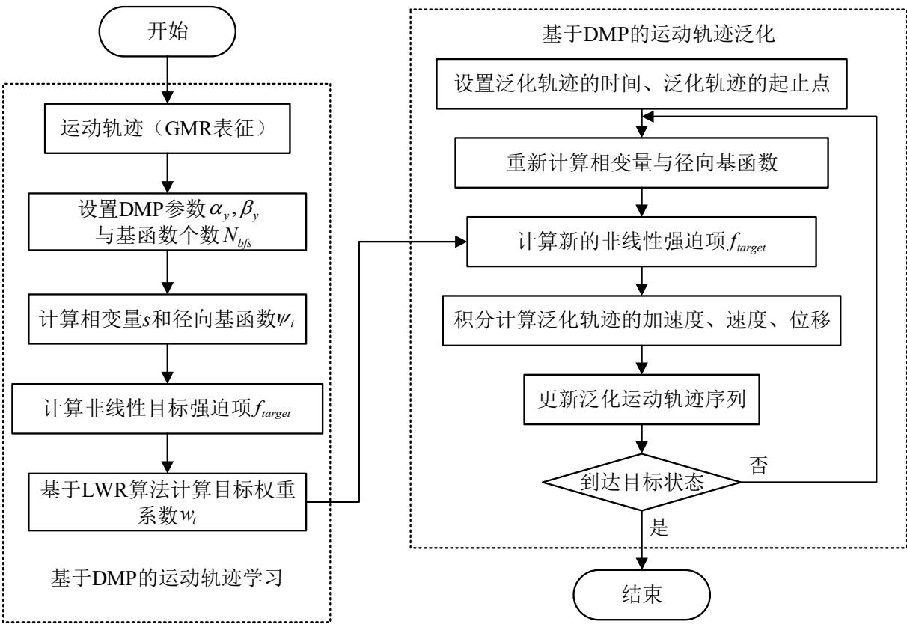  
图2.6 基于DMP 的运动轨迹学习与泛化流程

## 2.5 学习参数自主选择算法

根据第2.4.2章节可知，为了实现DMP 对轨迹的学习，必须预先指定DMP 的超参数（ $. \alpha _ { y } \setminus \beta _ { y }$ 和 $N _ { b f s } \ )$ ），这些参数被称为DMP 的元参数。对于同一学习轨迹，不同元参数配置下的学习效果存在差异，具体表现在演示轨迹与学习轨迹的相似程度以及运动结束时轨迹的收敛程度。图2.7展示了针对同一演示轨迹在不同元参数配置下的学习效果。图（a）展示了各轨迹在时间下的位移，其中“demon”表示演示轨迹，“DMP1”和“DMP2”分别为两种配置下的学习轨迹；图（b）展示了两种配置下的学习轨迹与演示轨迹关于时间的位移误差。配合左右图观看，可以发现在两个参数配置下，DMP1与“demon”更相似，表现为两者的位移误差更小；并且在运动结束时，DMP1 更接近“demon”的终点，由此体现了其收敛性。

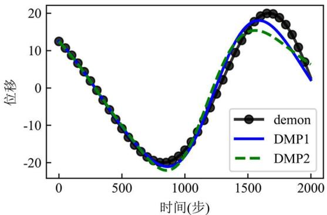  
（a）轨迹实时位移

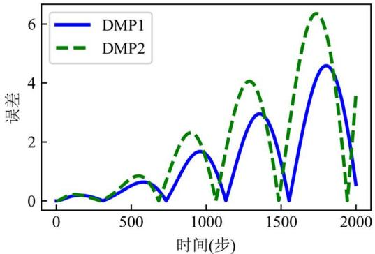  
（b）轨迹实时误差  
图2.7 不同元参数配置下的DMP 学习效果

由上述分析可知，合理的元参数配置对于DMP的学习效果至关重要。换句话说，为了让DMP 获得良好的学习效果，特别是对于强调运动轨迹精度的任务，元参数的选择应该被特别关注。已有研究分析了各个元参数对DMP 系统的影响。现有研究表明， $\alpha _ { y }$ 和 $\beta _ { y }$ 同时影响系统的收敛性和相似性。为了确保运动轨迹y单调地趋近于目标 $g$ ，已经证明有效的取值规则是 $\alpha _ { y } = 4 \beta _ { y }$ [31],在本文的研究中同样遵循该规则；此外， $N _ { b f s }$ 的取值影响着轨迹的拟合程度，且 $N _ { b f s }$ 与轨迹的拟合程度具有正相关关系。然而，这种关系是建立在一个局部范围内的，该范围取决于轨迹的复杂性。目前尚未有明确的关系来量化这两者之间的关系。

因此，为了充分发挥DMP 的优势，实现最佳的学习效果，需要针对不同的演示轨迹制定元参数。目前，参数制定仍然需要依赖人类用户完成，这导致了以下问题：

（1）对于具备相关专业知识的专家来说，即使能够为不同任务确定最佳参数，但仅仅遵循现有结论和经验，该过程仍然需要耗费大量时间。

（2）对于尚未具备相关背景知识的普通用户来说，仅凭借上述研究结论来调整参数以适应不同任务是困难的。因为在基函数个数相同的情况下，不同大小的 $\alpha _ { y }$ 和$\beta _ { y }$ 值会导致不同的结果。

（3）从另一个角度考虑，现有研究表明基函数的数量越多，学习轨迹与演示轨迹的拟合程度就越高。在不考虑过拟合的情况下，人们通常倾向于选择更多的基函数。然而，在某些情况下，这可能会导致计算资源的浪费，削弱了DMP 作为高效学习方法的优势。

综上所述，人工调整 DMP 元参数的方法难以充分发挥 DMP 在运动轨迹学习中的优势，从而阻碍了基于DMP 的运动轨迹模仿学习方法的推广应用。为了解决这一问题，本文通过采用优化思想来处理参数选择问题，利用优化算法替代人工调参，使人们从繁琐的参数调整中解脱出来，最大限度地发挥DMP 在技能学习中的优势。

根据上述的分析，DMP 参数的选择难点在于无法构建显式的自变量和目标函数之间的关系。目标函数作为一个黑箱，仅能实现输入一组自变量x 和来得到对应目标函数值 $f ( x )$ ，但始终无法明确目标函数的真实分布。对于这种情形， $\mathrm { B O } ^ { [ 5 9 ] }$ 提供了一种理想的解决方案。首先，BO 的思想是期望通过已有的近似值来估算真实最优值，通过不断的迭代找到目标函数与优化参数之间隐式的映射关系；其次，BO 以明确的策略在定义域范围内采样收益最高的点，保证了优化的效率。在应用过程中，上述策略被实例化为概率代理模型和采集函数。概率代理模型是黑箱函数的评价量测。采集函数的功能在于对黑箱函数进行评估的标准，决定下一步在哪里，以便获得黑箱函数的真正全局最优所在的最大信息量。关于概率代理模型和采集函数的类型并不唯一，考虑本文优化参数的特性，选择使用 $\mathrm { T P E } ^ { [ 6 0 ] }$ 作为 BO 的概率代理模型，选择 $\mathrm { E I } ^ { [ 6 1 ] }$ 作为获取函数。下面将进一步分析TPE 的原理及流程。

## 2.5.1 TPE 原理分析

TPE 的第一阶段：首先随机采样n 个的样本 $\{ ( \boldsymbol { \xi } _ { i } ^ { x } , \boldsymbol { \xi } _ { i } ^ { y } ) | i = 1 , \ldots , n \}$ ，其次基于分位数 来确定阈值 $\gamma$ $\xi ^ { y * }$ ，确定规则为 $p ( \xi ^ { y } < \xi ^ { y ^ { * } } ) = \gamma$ ，最后将观测样本划分为最佳观测群$\{ ( \boldsymbol { \xi } _ { i } ^ { x } , \boldsymbol { \xi } _ { i } ^ { y } ) | \boldsymbol { \xi } _ { i } ^ { y } < \boldsymbol { \xi } ^ { y ^ { * } } \}$ 和其它观测群 $\{ ( \boldsymbol { \xi } _ { i } ^ { x } , \boldsymbol { \xi } _ { i } ^ { y } ) | \boldsymbol { \xi } _ { i } ^ { y } > \boldsymbol { \xi } ^ { y ^ { * } } \}$ ，其中以 $\boldsymbol { \xi } _ { i } ^ { \flat }$ 表示优化参数， $\boldsymbol { \xi } _ { i } ^ { y }$ 表示以 $\boldsymbol { \xi } _ { i } ^ { x }$ 为自变量对应目标函数 $J _ { o b j }$ 的值，两者的关系可以表示为： $\boldsymbol { \xi } _ { i } ^ { y } = \boldsymbol { J } _ { o b j } ( \boldsymbol { \xi } _ { i } ^ { x } )$ ；

TPE 的第二阶段：为最佳观测群和其它观测群建模后验概率 $l ( \xi ^ { x } )$ $g ( \xi ^ { x } )$ ，该过程通过使用Parzen 窗密度估计来完成：

$$
p (\xi^ {x} \mid \xi^ {y}) = \left\{ \begin{array}{l l} l (\xi^ {x}), & \xi^ {y} <   \xi^ {y ^ {*}} \\ g (\xi^ {x}), & \xi^ {y} > \xi^ {y ^ {*}} \end{array} \right.\tag{2-43}
$$

其中， $l ( \xi ^ { x } )$ 是通过使用来自最佳观测群形成的概率密度函数， $g ( \xi ^ { x } )$ 是通过使用其它观测群形成的概率密度函数。

Parzen 窗的概率密度估计公式如下：

$$
\hat {f} \left(\xi^ {x}\right) = \frac {1}{n h ^ {2}} \sum_ {i = 1} ^ {n} K \left(\frac {\xi^ {x} - \xi_ {i} ^ {x}}{h}\right)\tag{2-44}
$$

式(2-44)的主要思想是，为了逼近未知函数 $\hat { \boldsymbol f }$ ，为每个观测样本定义一个具有独特均值 $\xi ^ { x }$ 和标准差h 的标准高斯分布K，然后所有的这些分布被叠加求和，并进行归一化来得到概率密度函数。其中 $l ( \xi ^ { x } )$ 和 $g ( \xi ^ { x } )$ 被视为不同的 $\hat { \boldsymbol f }$ 。

$$
K = \frac {1}{\sqrt {2 \pi} \sigma} \exp (- \frac {\left(\xi_ {i} ^ {x} - \xi^ {x}\right) ^ {2}}{2 \sigma^ {2}})\tag{2-45}
$$

TPE 的第三阶段：利用最佳观测群的似然比，从抽样的候选样本中，试图找到更有可能属于最佳观测群，而属于其它观测群可能性较小的候选样本，该过程通过获取函数EI来完成，EI表示的物理意义是期望改进率，具体如下所示：

$$
E I _ {\xi^ {y ^ {*}}} \left(\xi^ {x}\right) = \int_ {- \infty} ^ {+ \infty} \max \left(\xi^ {y ^ {*}} - \xi^ {y}, 0\right) p \left(\xi^ {y} \mid \xi^ {x}\right) d \xi^ {y}\tag{2-46}
$$

将式(2-43)中的 $p ( \xi ^ { x } \mid \xi ^ { y } )$ 进行变换后带入上式，得到候选样本 $\xi ^ { x }$ 的预期改进率：

$$
E I _ {\xi^ {y ^ {*}}} \left(\xi^ {x}\right) = \frac {f _ {- \infty} ^ {\xi^ {y ^ {*}}} \left(\xi^ {y ^ {*}} - \xi^ {y}\right) p \left(\xi^ {y}\right) d \xi^ {y}}{\gamma + (1 - \gamma) \frac {g \left(\xi^ {x}\right)}{l \left(\xi^ {x}\right)}}\tag{2-47}
$$

观察上式能够发现，当 $\gamma$ 确定之后， $E I _ { _ { \xi ^ { y ^ { * } } } } ( \xi ^ { x } )$ 的值仅取决于 $l ( \xi ^ { x } ) / g ( \xi ^ { x } )$ 的比值，而比值最大对应的 $\xi ^ { x }$ 便是下一步的采样样本。

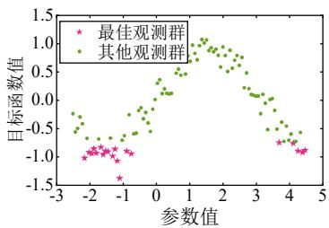  
（a）生成观测样本

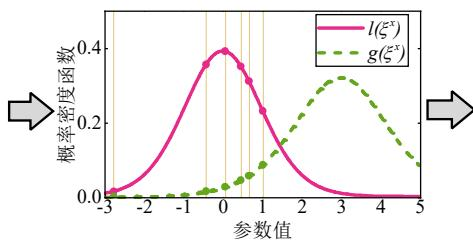  
（b）构建概率密度函数

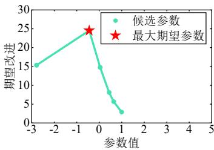  
（c）计算期望改进  
图2.8 TPE 优化的一般思想

为了可视化 TPE 优化时的一般思想，图 2.8 展示了一个集成了 TPE 各个阶段的例子。其中，图2.8（a）表示经过初始采样得到的观测样本，根据分位数被划分为最佳观测群（粉色）和其他观测群（绿色）；图2.8（b）表示了基于观测样本通过Parzen窗构建的两个概率密度函数，其中粉色表示最佳观测群的概率密度函数 $l ( \xi ^ { x } )$ ，绿色表示其他观测群的概率密度函数 $g ( \xi ^ { x } )$ ；图2.8（c）表示了基于构建的概率密度函数计算候选样本EI的结果，其中最大EI对应的参数将用于下一次迭代。具体来说，五角星标记对应的横坐标表示着下一次迭代中将被选取的参数值。

## 2.5.2 参数选择算法

由上一节可知，基于 TPE 进行参数优化的前提是制定目标函数，而目标函数决定最终的 DMP 参数，进而影响轨迹的学习效果。考虑到 DMP 的基本原理，本文将运动轨迹的学习效果分别考虑为与演示轨迹的整体相似性和终止点收敛性。因此，分别设计了相似性指标和收敛性指标：

## （1）相似性指标

根据DMP 的基本假设，从权重参数空间映射的具有相同强迫项的轨迹在任务空间中被认为是相似的。因此，在基于DMP 的运动轨迹学习中，如果学习轨迹与重新生成的轨迹之间的距离最小，可以推断出其他具有不同目标位置和时间持续的重新生成的轨迹也会与原始示范相似。任务空间中的距离可以通过测量演示轨迹与重新生成轨迹的累积欧氏距离的平均误差来计算，因此相似度指标被设计为下式：

$$
\sigma_ {p} \left(\alpha_ {y}, N _ {b f s}\right) = \sqrt {\frac {\sum_ {t = 1} ^ {T} \left(y _ {g e n} \left(\alpha_ {y} , N _ {b f s} , t\right) - y _ {G M R} (t)\right) ^ {2}}{T}}\tag{2-48}
$$

## （2）收敛性指标

根据DMP 的基本假设，当变换系统的阻尼比为1时，可以确保重新生成的轨迹能够始终收敛到预设的目标点。然而，这种收敛过程是以特定的运动形式进行的，系统无法按照期望的运动轨迹进行收敛。具体来说，在实际应用中轨迹具有有限时长，这表明正则系统无法完全收敛至 $0 ^ { [ 6 2 ] }$ 。进而导致了不同元参数下的收敛结果也会有所不同。因此，单一轨迹下的收敛度指标被设计为以下形式：

$$
\sigma_ {p} (\alpha_ {y}, N _ {b f s}) = \left\| y _ {g e n} (\alpha_ {y}, N _ {b f s}, T) - y _ {G M R} (T) \right\|\tag{2-49}
$$

综上，用于DMP 参数优化的TPE 目标函数构建为下式：

$$
J _ {o b j} (\alpha_ {y}, N _ {b f s}) = k _ {s} \sigma_ {s} + k _ {p} \sigma_ {p}\tag{2-50}
$$

其中， $\sigma _ { s }$ 用于检验 DMP 轨迹的相似性， $\sigma _ { \textit { p } }$ 用于检验 DMP 轨迹的收敛性， $k _ { s }$ 和 $k _ { p }$ 是目标函数的调整增益，用于平衡每个项的影响。上式中出现的各符号表示的含义如表2.1所示。

表2.1 目标函数中各符号含义

<table><tr><td>名称</td><td>含义</td></tr><tr><td> $y_{GMR}(t)$ </td><td>通过 GMR 得到的学习轨迹的时间位移序列</td></tr><tr><td> $y_{gen}(\alpha_y, N_{bfs}, t)$ </td><td>通过 DMP 参数  $\alpha_y$ 、 $N_{bfs}$  得到的泛化轨迹的时间位移序列</td></tr><tr><td> $\ddot{y}_{GMR}(t)$ </td><td>通过 GMR 得到的学习的轨迹的时间加速度序列</td></tr><tr><td> $\ddot{y}_{gen}(\alpha_y, N_{bfs}, t)$ </td><td>通过 DMP 参数  $\alpha_y$ 、 $N_{bfs}$  得到的泛化轨迹的时间加速度序列</td></tr><tr><td> $y_{GMR}(T)$ </td><td>通过 GMR 得到的学习轨迹的终止点</td></tr><tr><td> $y_{gen}(\alpha_y, N_{bfs}, T)$ </td><td>通过 DMP 参数  $\alpha_y$ 、 $N_{bfs}$  得到的泛化轨迹的终止点</td></tr></table>

基于上述构造的用于评价 DMP 学习效果的目标函数和 TPE 算法的实施步骤，

进而可得到如图2.9所示的DMP 元参数自主选择过程：

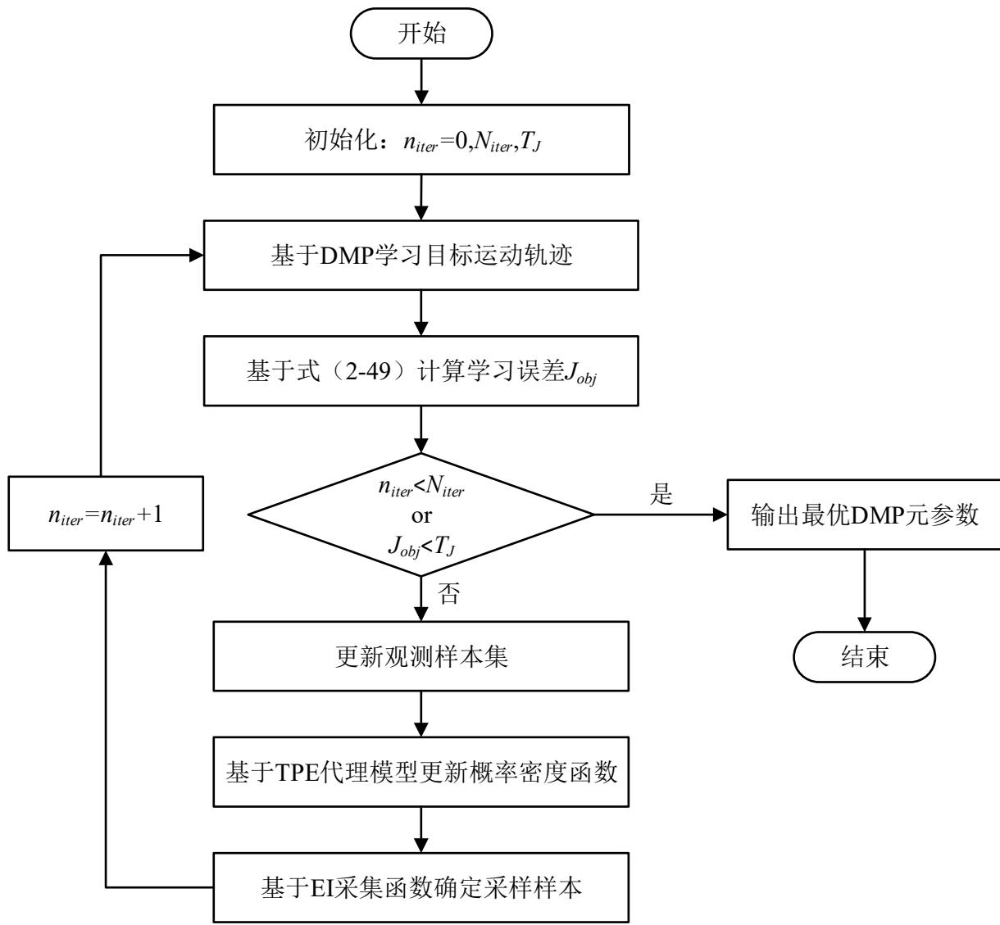  
图2.9 基于TPE 的DMP 参数选择流程

（1）设置最大迭代次数 $N _ { i t e r }$ 和目标误差 $T _ { J }$ ，设定公式(2-50)中 $k _ { s }$ 以及 $k _ { p }$ 的值，实例化目标函数。确定DMP 元参数 和 $\alpha _ { y }$ $N _ { b f s }$ 的定义域，在该定义域内随机采样几组样本 $\{ \alpha _ { _ y } , N _ { b f s } , J _ { o b j } ( \alpha _ { _ y } , N _ { b f s } ) \}$ ，构建TPE 优化算法的初始样本空间。

（2）基于上述步骤构建的样本空间，指定分位数 $\gamma$ 进一步构建TPE观测样本集。通过公式(2-44)为观测样本集建立TPE 概率代理模型，并通过采集函数进行新的参数采样。

（3）将GMR轨迹序列与新的参数共同带入DMP 模型进行权重参数的学习。完成学习后，将得到的轨迹序列与GMR轨迹序列进行对比，即根据步骤1确定的目标函数计算 TPE 目标函数值。完成计算后，将新参数与目标函数的结果视为新的 TPE观测样本，添加至TPE 观测样本集。

（4）判断目标函数值是否收敛以及是否到达最大迭代步数，若均不满足，则基于添加的样本重新构建观测样本集，并基于该观测样本集更新 TPE 概率代理模型，即更新 $l ( \xi ^ { x } )$ 和 $g ( \xi ^ { x } )$ ，根据新的TPE 概率代理模型使用式(2-47)表示的采集函数继获得待优化参数样本，重复执行过程（3），从而形成了以DMP 模型为对象，以TPE 优化为载体的内部循环，直至达到最大迭代步数，此时输出面向给定GMR轨迹在当前策略下具有最佳学习效果的局部DMP 最优元参数。

上述过程实现了TPE 优化与DMP 模型的有机融合，通过交替迭代的循环解决了DMP 的参数选择问题。这使得机械臂具备了对未知轨迹进行参数自主配置的能力，从而提升了纳入DMP 的运动轨迹学习方法的自主性。因此，这个方法满足了不具备相关背景知识的人类用户能够使机械臂通过DMP模型进行高质量运动轨迹学习的要求。

## 2.6 数值验证

根据本文的假设，参数自主选择策略的有效性在于其能够提供比基准配置更好的学习结果，否则就失去了自主选择的意义。因此，有必要设定一个基准配置。本文选择文献[31]提供的参数配置作为专家配置的基准，参数的具体配置原因是该配置已经在多种任务下被证明能够满足目标要求[63-67]。为了验证优化算法的有效性，考虑所构造的目标函数，在三种情形下进行了数值验证：

情形1：仅考虑相似度指标；

情形2：仅考虑收敛度指标；

情形3：同时考虑相似度指标和收敛度指标。

表2.2 基于TPE的DMP 参数自主选择实验预置参数

<table><tr><td>参数项</td><td>值</td></tr><tr><td> $\alpha_y$ </td><td>搜索区间[1,50]</td></tr><tr><td> $N_{bfs}$ </td><td>搜索区间[1,200]</td></tr><tr><td> $\alpha_s$ </td><td>0.1</td></tr><tr><td> $τ$ </td><td>1</td></tr><tr><td> $k_s$ </td><td>1</td></tr><tr><td> $k_p$ </td><td>1</td></tr></table>

在每种情形下，对之前构造的 30 个数据集进行了测试，更多有关数据集的信息见附录A。每次实验中，使用专家配置对每个数据集进行学习后，将得到的相似度指标误差和收敛度指标误差视为基准误差。然后，将本文提出的基于 TPE 算法得到的配置参数用于学习后，将两项指标误差与基准误差进行对比。如果它们小于基准误差，则证明通过 TPE 算法进行参数选择是有效的。实验中预设参数的取值如表 2.2 所示。如果不遵守上述参数设置，将在文中进行说明。更多实验细节和结果将在下文给出。

## （1）情形 1

对于仅考虑相似度指标的情形，目标函数被实例化为 $J _ { o b j } ( \alpha _ { y } , N _ { b f s } ) = \sigma _ { s }$ ，执行如图 2.9 所示的过程。在实验中，获得了 30 个数据集下采用 TPE 算法得到的参数配置以及该参数配置下的相似性指标。图 2.10 展示了每个数据集采用 TPE 配置和专家配置下的元参数进行学习后的相似性指标结果。其中，纵坐标左轴表示两种参数配置下学习轨迹与参考轨迹的相似度指标误差，纵坐标右轴表示 TPE 配置相对于专家配置的相似度指标改善率，其计算方法为：TPE 配置的相似度指标误差减少量/专家配置的相似度指标误差。具体的实验结果如附录C 所示。

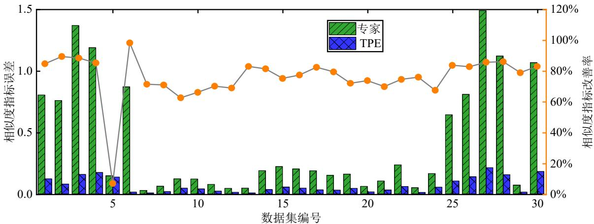  
图2.10 TPE 配置和专家配置下的参数的相似性指标结果

观察图 2.10，绿色柱代表专家配置误差，蓝色柱代表 TPE 配置误差。可以直观地看出，对于任何数据集，TPE 都具有更小的误差。同时，由附录C 可知，相较于专家配置参数，采用通过参数自主算法得到的参数，运动轨迹的平均学习误差由 0.419减小至 0.069。除了数据集 5 外，TPE 提供的参数相对于专家参数能够使 DMP 在相似度指标提升60%，这表明在仅考虑相似度指标的情况下，TPE 算法获得的参数能够有效满足任务的需求。

## （2）情形2

对于仅考虑相似度指标的情形，目标函数被实例化为 $J _ { _ { o b j } } ( \alpha _ { \nu } , N _ { b f s } ) = \sigma _ { { } _ { p } }$ ，类似地，对该目标函数执行图 2.9 所示过程。分别对比了 30 个数据集下采用 TPE 算法得到的元参数配置以及该参数配置下的收敛性指标误差。完整的实验结果数据见附录D，图2.11 展示了每一数据集采用 TPE 配置和专家配置下的元参数的进行学习后的相似性指标结果，纵坐标表示两种参数配置下的学习轨迹与参考轨迹的收敛度指标误差。

观察图 2.11，其中绿色点线表示专家配置下的学习误差，蓝色点线表示 TPE 算法配置下的学习误差。可以直观地看出，对于任一数据集，TPE 配置下的学习轨迹拥有更小的收敛度误差，且在多个数据集下误差接近0。同时，由附录D可知，相较于专家配置参数，采用通过参数自主算法得到的参数，终止状态下的运动轨迹平均跟踪误差由 0.004 减小至 0.001，这表明仅考虑收敛度指标情况下 TPE 算法获得的参数是有效的。

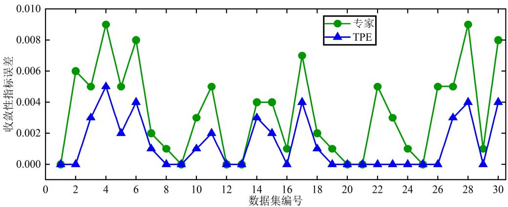  
图2.11 仅考虑相似度指标的轨迹学习结果

## （3）情形3

对于同时考虑相似度指标和收敛度指标的情形，目标函数被实例化为：$J _ { \it o b i } ( \alpha _ { \nu } , N _ { \it b f s } ) = \sigma _ { \it s } + \sigma _ { \it p }$ 。类似地，对该目标函数执行图 2.9 所示过程，分别对比了 30个数据集下采用 TPE 算法得到的元参数配置以及该参数配置下的收敛性指标。完整的实验结果数据见附录 B 和附录 E。图 2.12 展示了每一个数据集采用 TPE 配置和专家配置下的元参数进行学习后的相似性指标和收敛性指标结果。纵坐标左轴表示两种参数配置下的学习轨迹与参考轨迹的相似度指标误差，纵坐标右轴表示两种参数配置下的学习轨迹与参考轨迹的收敛度指标误差。

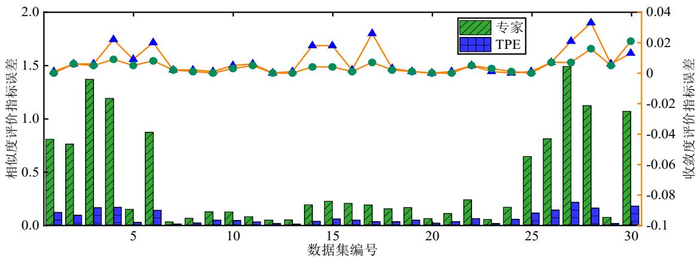  
图2.12 相同权重系数下两种指标的轨迹学习结果

观察图2.12，其中绿色柱和蓝色柱分别表示专家配置和TPE 配置在相似度上的学习误差，绿色点线和蓝色点线表示专家配置和 TPE 配置在收敛性上的学习误差。可以看出，在相似度上，TPE配置相比专家配置有显著的提升，而在收敛性上表现一般，特别是在某些数据集（4, 6, 14, 15, 17, 28, 30）中，收敛度误差大于专家配置。配合附录E对此现象进行分析，发现相较于相似性指标误差，收敛性指标误差所体现的误差相对较小。为了解决这种情况，一种有效的方法是给收敛性指标 $\sigma _ { p }$ 赋予更大的权重。根据本文的研究，一种有效的权重取值规则是：

$$
k _ {p} = \frac {\sigma_ {s}}{\sigma_ {p}} k _ {s}\tag{2-51}
$$

根据以上的取值规则，确保了在 TPE 优化中两种指标误差更加均衡。基于这一取值规则，实例化了新的目标函数，并重新进行了实验，针对图 3.22 中经 TPE 配置学习后收敛度指标误差大于专家配置误差的数据集（4, 6, 14, 15, 17, 27, 28）。实验结果见附录 $\mathrm { ~ F ~ } _ { \circ }$ 。图 2.13 展示了上述数据集采用 TPE 配置和专家配置下的元参数进行学习后的相似性指标和收敛性指标结果。图中纵坐标左轴表示两种参数配置下的学习轨迹与参考轨迹的相似度指标误差，纵坐标右轴表示两种参数配置下的学习轨迹与参考轨迹的收敛度指标误差。其中，TPE1 表示使用赋予相同权重的目标函数，TPE2 表示使用基于式（2-51）获得权重的目标函数。

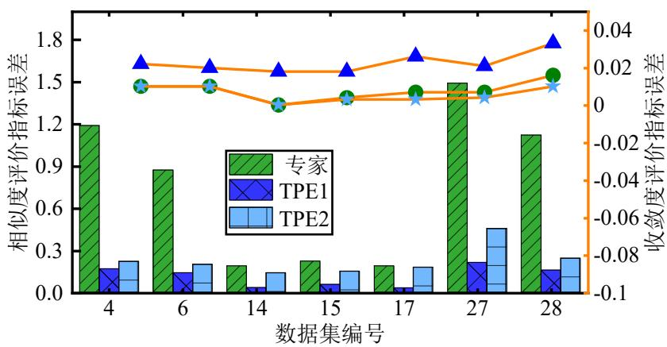  
图2.13 不同权重系数下两种指标的轨迹学习结果

观察图 2.13，可以看到绿色柱、深蓝色柱和浅蓝色柱分别代表专家配置、TPE1配置和TPE2 配置在相似度上的学习误差；而绿色点线、蓝色点线和浅蓝色点线则分别表示专家配置、TPE1 配置和 TPE2 配置在收敛度上的学习误差。可以直观看出，TPE2 配置在这些数据集下的学习效果在相似度和收敛度上均优于专家配置，这表明基于TPE 的DMP 参数自主选择策略在多种任务中能够取得更好的效果。因此，可以得出结论，基于TPE 的DMP 参数选择策略能够完全替代专家配置。

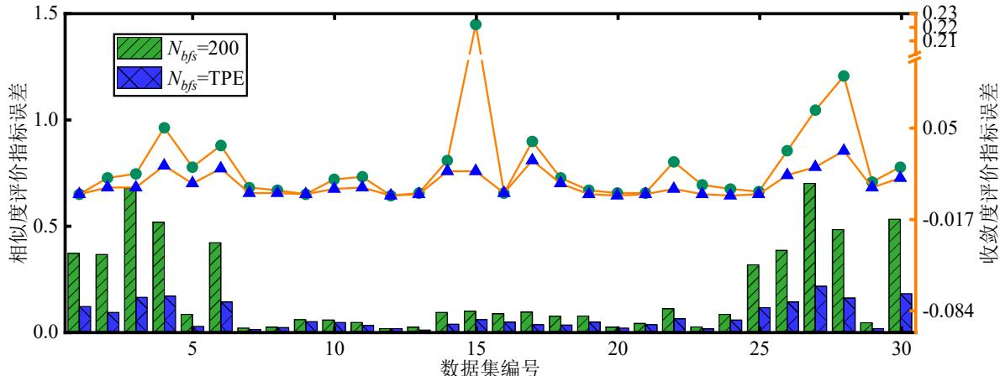  
图2.14 $\alpha _ { _ y }$ 相同时不同数目基函数的轨迹学习效果

为了验证在其他参数相同的情况下，更多的基函数并不一定能带来更好的学习效果，并验证 TPE 所得的各项参数均是最优配置，我们进行了如下实验。在上述实验基础上，我们对比了在 $\alpha _ { y }$ 相同的前提下，不同数量的基函数针对同一轨迹的学习效果，并以提出的相似性指标和收敛性指标来量化学习效果。这里将两种配置表示为：1） $\alpha _ { y }$ 和 $N _ { b f s }$ 都采用 TPE 算法得到；2）采用上述 $\alpha _ { y }$ ，但基函数的数量为 200。其中$\forall \mathrm { T P E } ( N _ { b f s } ) < 2 0 0$ ，完整的实验结果数据见附录 E，两种配置对各数据集的学习效果如图2.14所示。观察图2.14，其中绿色柱和蓝色柱分别表示配置1）和配置2）在相似度指标下的误差；绿色点线和蓝色点线分别表示配置 1）和配置 2）在收敛度指标下的误差。可以明显看出，完全遵循 TPE 参数配置的学习轨迹在相似度和收敛度上表现更好。这进一步证实了以下两点：1）在其他条件相同时，增加基函数数量无法提升效果；2）利用 TPE 优化算法得到的各项配置参数是针对同一轨迹的最优组合。这些结果间接凸显了本文研究的重要性。

## 2.7 本章小结

本章对运动轨迹的表征与学习进行了研究。为了确保轨迹表征和学习的效果，首先利用DTW对多个运动轨迹进行了时间上的对齐。其次，采用GMM对对经由DTW处理后的多个运动轨迹进行表征，表征完成GMM特性参数的确定后，利用GMR泛化生成一条最优示教轨迹，其表征了多个运动轨迹的运动趋势与共同轨迹特征；最后用DMP 对最优示教轨迹进行学习，生成对应的轨迹表征参数。此外，本章针对DMP的参数选择进行了深入研究，提出了一种参数自主选择算法来提高DMP 用于轨迹学习的自主性，通过设置数值仿真验证其有效性以及讨论了相关特性。

## 第三章 考虑环境因素的机械臂运动轨迹模仿学习

## 3.1 引言

遵循上一章节研究的运动轨迹表征与学习方法，允许人类以简单高效的方式将期望特性的运动轨迹赋予机械臂。然而，当机械臂将习得运动轨迹在泛化后用于现实世界的执行时，必须要考虑外界环境的影响。而现有的方法由于缺乏考虑环境信息，无法保证泛化生成的轨迹满足环境的约束，因此容易造成轨迹的执行失败。为此，本章在前一章的基础上，将环境信息纳入运动轨迹的泛化过程以及机械臂执行泛化轨迹的过程，提出了一种考虑环境因素的运动轨迹学习算法。

## 3.2 EC-DMP 算法

## 3.2.1 问题分析

考虑图3.1所示的情形，左图表示了一个存在边界约束的环境以及两条运动轨迹，右图表示两条轨迹的位移随时间变化情况。其中，将红色轨迹视为用于DMP 学习的轨迹，将蓝色轨迹视为采用给定新的起止点使用DMP 得到的泛化轨迹。三角形与五角星标记分别代表学习轨迹与泛化轨迹的起始点和终止点。可以观察到，蓝色轨迹在Y方向上超出了边界，这表明DMP 在此类环境下存在失效行为。

针对上述问题，本章改进了 DMP，以拓展其在运动轨迹学习中的应用范围。一种常见的改善DMP 适应性的方式是向其基础形态添加额外的控制信号，以重新塑造不符合环境约束的运动轨迹。受到这种方法的启发，本章基于 $\mathsf { A P F } ^ { [ 6 8 ] }$ 提出了一种新的耦合环境控制信号。该信号允许对通过DMP 获得的泛化轨迹进行调整。

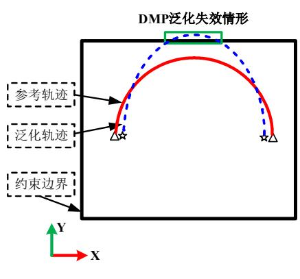

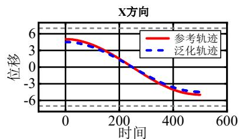

（a）工作空间轨迹  
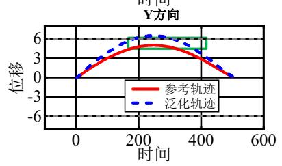  
（b）时间位移轨迹  
图3.1 基于DMP 的运动轨迹泛化失效情形

## 3.2.2 APF 原理分析

APF 是一种基于虚拟力场的方法，该方法的基本原理可以想象为一个带有正电荷的受控点 $q$ 在带电场中移动，如图 3.2 所示。其中，障碍物具有与受控点相同的电荷，提供一个斥力来将其推开。目标 ${ { q } _ { g o a l } }$ 具有负电荷，提供一个引力来吸引受控点。这些效应构成的合力负责将 $q$ 吸引向 ${ { q } _ { g o a l } }$ ，同时使其避开障碍物。

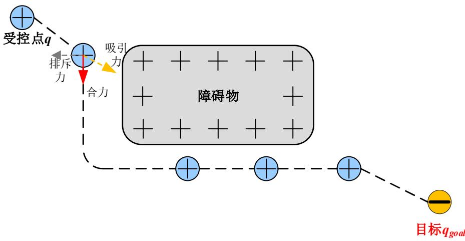  
图3.2 人工潜在势场法的基本原理

基于上述原理，分别通过两类势函数来生成人工势场。具体来说，目标 ${ { q } _ { g o a l } }$ 对受控点的作用效果和障碍物对受控点的作用效果被实例化为引力势场函数和斥力势场函数。

## （1）引力势场函数

引力势场函数 $U _ { a t t }$ 旨在将受控点从实时位置 $q$ 驱动到目标位置 ${ { q } _ { g o a l } }$ 。其值大小满足受控点随着距离 ${ { q } _ { g o a l } }$ 的增加而单调增加。目前最常用的引力势场函数为式(3-1)表示的抛物形状的势场函数：

$$
U _ {a t t} (q) = \frac {1}{2} k _ {a} (q - q _ {\text { goal }}) ^ {2}\tag{3-1}
$$

其中， $k _ { a }$ 是反映吸引力强度的常数。

类比于物理中的势能，受控点所受的引力可以定义为引力势场的负梯度：

$$
F _ {a t t} (q) = - \nabla U _ {a t t} (q) = k _ {a} (q _ {g o a l} - q)\tag{3-2}
$$

## （2）斥力势场函数

斥力势场函数 $U _ { r e p }$ 旨在将受控点从障碍物中排斥出去。其大小取决于受控点与障碍物之间的距离，且满足机器人与障碍物的距离越近，排斥力越强。目前惯用的斥力场函数为FIRAS 函数[69]，如下所示：

$$
U _ {r e p} = \left\{ \begin{array}{l l} \frac {k _ {r}}{2} (\frac {1}{D (q)} - \frac {1}{Q ^ {*}}), & D (q) \leq Q ^ {*} \\ 0, \quad \text { other } \end{array} \right.\tag{3-3}
$$

其中， $k _ { r }$ 是反映斥力强度的常数， $D ( q )$ 表示受控点与障碍物的最小距离， $\boldsymbol { Q } ^ { * }$ 为斥力势场有效范围的阈值。

类似地，受控点所受的斥力可以用斥力势场的梯度来表示：

$$
F _ {r e p} (q) = - \nabla U _ {r e p} (q) = \left\{ \begin{array}{l l} \frac {k _ {r}}{D (q) ^ {2}} \left(\frac {1}{D (q)} - \frac {1}{Q ^ {*}}\right), & D (q) \leq Q ^ {*} \\ 0, \quad \text { other } \end{array} \right.\tag{3-4}
$$

综上，受控点在人工势场中运动所受到的合力 $F ( q )$ 可表示为：

$$
F (q) = F _ {r e p} (q) + F _ {a t t} (q)\tag{3-5}
$$

通过 $F ( q )$ 控制受控点的状态来实现目标导向和避障。

## 3.2.3 考虑环境约束的DMP模型

综合考虑DMP 和APF的原理，本文研究发现：通过融合APF 和DMP，可以在保留 DMP 强泛化优点的基础上，同时弥补图 3.1 所示泛化情形失败的不足。具体来说，通过为 DMP 生成运动轨迹的空间添加人工势场。将 DMP 在线泛化生成的轨迹点考虑为人工势场下的受控点，将约束环境的边界被视为人工势场下的障碍物，将DMP 泛化轨迹的目标点视为人工势场下的目标。

具体的融合方法如下，区别与 APF 用于传统路径规划上的避障设计不同，DMP在力场上的选取具有特殊性。仅通过为DMP 引入排斥势场，就可以实现期望的运动轨迹，因为DMP 具有明确定义的点吸引子属性，无论在何处受到扰动均能够保证轨迹向目标点的稳定收敛。将改进后的DMP 称为EC-DMP。单维EC-DMP 的变换系统如下所示：

$$
\tau \ddot {y} = \alpha_ {y} (\beta_ {y} (g - y) - \tau \dot {y}) + f + C _ {y} (y)\tag{3-6}
$$

其中， $C _ { y } ( y )$ 表示基于APF 设计的控制信号，如下所示：

$$
C _ {y} (y) = - \frac {\partial V _ {c} (y)}{\partial y}\tag{3-7}
$$

其中， $V _ { c } ( y )$ 表示势场函数，如下所示：

$$
V _ {c} (y) = \frac {\eta}{2} \left(\underline {{V}} _ {c} (y) + \bar {V} _ {c} (y)\right)\tag{3-8}
$$

其中， $\underline { { { V } } } _ { c } ( y )$ 和 $\boldsymbol { \bar { V } } _ { c } ( \boldsymbol { y } )$ 分别表示下界势场函数和上界势场函数，如下所示：

$$
\underline {{{V}}} _ {c} (y) = \left\{ \begin{array}{l l} \left(\frac {1}{y - \underline {{{y}}}} - \frac {1}{\underline {{{d}}} _ {0}}\right) ^ {2}, & y - \underline {{{y}}} <   \underline {{{d}}} _ {0} \\ 0, \quad \text { other } \end{array} \right.\tag{3-9}
$$

$$
\overline {{V}} _ {c} (y) = \left\{ \begin{array}{l l} \left(\frac {1}{\bar {y} - y} - \frac {1}{\bar {d} _ {0}}\right) ^ {2}, & \bar {y} - y <   \bar {d} _ {0} \\ 0, \quad \text { other } \end{array} \right.\tag{3-10}
$$

将式(3-9)和(3-10)带入(3-8)可得到控制信号 $C _ { y } \left( y \right)$ ，如下所示：

$$
C _ {y} (y) = \left\{ \begin{array}{l l} \eta \left(\frac {1}{y - \underline {{{y}}}} - \frac {1}{\underline {{{d}}} _ {0}}\right) \cdot \frac {1}{(y - \underline {{{y}}}) ^ {2}}, & y - \underline {{{y}}} <   \underline {{{d}}} _ {0} \\ \eta \left(\frac {1}{\bar {y} - y} - \frac {1}{\bar {d} _ {0}}\right) \cdot \frac {1}{(\bar {y} - y) ^ {2}}, & \bar {y} - y <   \bar {d} _ {0} \\ 0, & \text { other } \end{array} \right.\tag{3-11}
$$

其中， $\eta$ 表 $\overline { { \overline { { \mathbf { \Omega } } } } }$ 可调增益，且 的取值必须大于 0； $\underline { { \boldsymbol { y } } }$ 和 $\overline { { y } }$ 分别表示约束环境的下边界和上边界； $\overline { { d } } _ { 0 }$ 和 $\underline { { d } } _ { 0 }$ 分别表示单个自由度的上界安全裕度和下界安全裕度，它们的关系如图3.3所示，图中符号的下标表示维度信息。

利用约束边界和安全裕度，运动轨迹的任务空间被考虑成安全区域和约束区域。根据式(3-9)和(3-10)，仅当轨迹点处于约束区域时，控制信号被激活，并且遵循以下规律：当 $y - y$ 和 ${ \overline { { y } } } - y$ 的值越小，即运动轨迹点与约束边界越接近，其对应的势场函数 $\underline { { V } } _ { c } ( y )$ $\overline { { V } } _ { c } ( y )$ 的值越大，同时 $\partial V _ { c } ( y ) / \partial y$ 也越大；而当轨迹点处于安全区域时，$\underline { { \boldsymbol { V } } } _ { c } \left( \boldsymbol { y } \right)$ 和 $\boldsymbol { \bar { V } } _ { c } ( y )$ 的值为 0，EC-DMP 退化为 DMP。

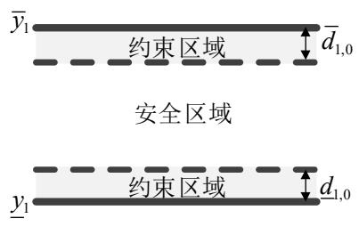  
（a）一维工作空间

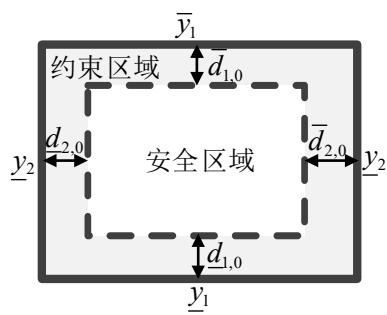  
（b）二维工作空间  
图3.3 工作空间的定义

至此，完成了EC-DMP 的设计。需要说明的是，除了引入新的控制信号项 $C _ { y } ( y )$ EC-DMP 的其他部分与DMP 保持一致，具体包括正则系统和非线性强迫项的形式以及设计规则。

## 3.2.4 基于 EC-DMP 的运动轨迹泛化

由上一小节可知，EC-DMP 的转换系统相较DMP 发生了变化，根据EC-DMP 的假设，此变化将影响运动轨迹的泛化过程。具体来说，相较于DMP的泛化过程，以x维为例，EC-DMP 的区别在于：

（1）需要预先设定环境的约束信息，具体是约束边界 $d _ { 0 } = [ \underline { { x } } , \overline { { x } } ]$ 和安全裕度$d _ { 0 , x } = [ \underline { { d } } _ { 0 , x } , \overline { { d } } _ { 0 , x } ]$ 0

（2）式(2-38)被替换为以下形式：

$$
\ddot {x} _ {\text {gen}} (t _ {i}) = \left(\alpha_ {y} \left(\beta_ {y} (g - x _ {\text {gen}} (t _ {i})) - \dot {x} _ {\text {gen}} (t _ {i})\right) + f _ {\text {gen}} (t _ {i}) + C _ {y} \left(x _ {\text {gen}} (t _ {i})\right)\right) / \tau\tag{3-12}
$$

其中， $C _ { y } \left( y _ { g e n } ( t _ { i } ) \right)$ 由式(3-7)计算得到，除此均与DMP 保持一致。

因此，基于EC-DMP 的运动轨迹泛化流程如图3.4所示。

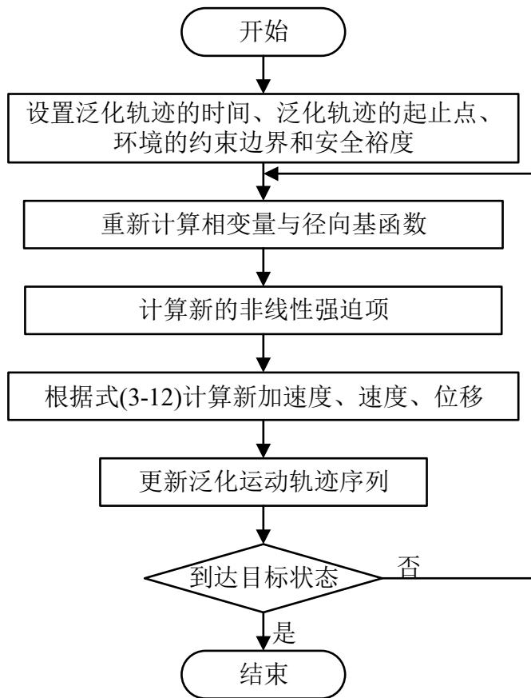  
图3.4 基于EC-DMP运动轨迹泛化流程

## 3.3 数值验证

为了验证 EC-DMP 的有效性和探究其泛化特性，本小节将设置多个案例从不同角度讨论EC-DMP 在面向不同轨迹下的泛化结果，重点是对比其在DMP 和EC-DMP在约束环境下的表现。基于上述考虑，将分别验证其有效性，并分析增益项对泛化性能的影响。

在下述的案例中，选择使用绘制字母“R”的轨迹作为参考轨迹，其通过以下分段函数得到。

$$
x _ {d e m o} = \left\{ \begin{array}{l l} 0, & 0 \leq t <   1 \\ \sin (t \pi), & 1 \leq t <   2 \\ 1. 2 5 (t - 2), & 2 \leq t \leq 3 \end{array} \quad y _ {d e m o} = \left\{ \begin{array}{l l} 5 t, & 0 \leq t <   1 \\ 4 + \cos ((t - 1) \pi), & 1 \leq t <   2 \\ 3 - 2. 9 (t - 2), & 2 \leq t \leq 3 \end{array} \right. \right.\tag{3-23}
$$

其中，t表示时间，单位为秒，采样频率在每个时间段固定，均为1kHz（与现实环境下的硬件设备采样率一致）。因此，整个轨迹在每一维均具有3000个轨迹点。在不破坏轨迹形状的前提下，下述案例分别对该轨迹进行了相应的平移和旋转变换作为各自的演示轨迹。

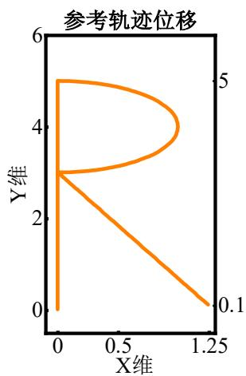  
（a）二维参考轨迹

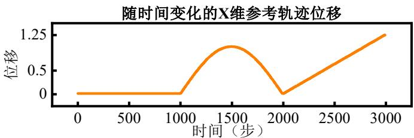

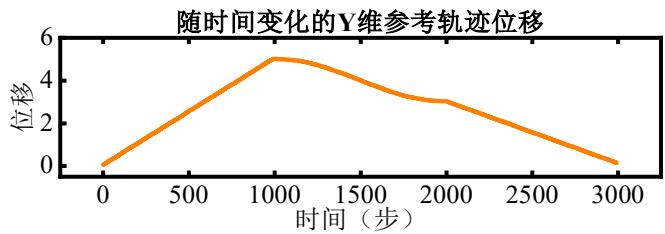  
（b）一维参考轨迹  
图3.5 参考技能的参数化轨迹

由于 EC-DMP 的额外控制信号在处理上下边界时采用了不同的等式，因此在验证提出方法的有效性时考虑了原始泛化轨迹不满足环境边界约束的三种情形，分别是：

情形1：单自由度条件下泛化轨迹超出环境上边界；

情形2：单自由度条件下泛化轨迹超出环境下边界；

情形3：多自由度条件下泛化轨迹同时超出环境上下边界。

为了避免随机性，每种情形均设置了两个任务，标记为任务a和任务 b，分别利

用DMP和EC-DMP进行泛化。其中各个任务的起始点和终止点的设定如表3.1所示：

表3.1 任务参数

<table><tr><td colspan="2">情形</td><td>起始点</td><td>终止点</td></tr><tr><td rowspan="2">1</td><td>a</td><td>[9,15.5,3]</td><td>[10.25,15.6,3]</td></tr><tr><td>b</td><td>[16,16.5,3]</td><td>[17.5,16.6,3]</td></tr><tr><td rowspan="2">2</td><td>a</td><td>[10,4.5,3]</td><td>[8.75,4.4,3]</td></tr><tr><td>b</td><td>[16,3.5,3]</td><td>[14.75,3.7,3]</td></tr><tr><td rowspan="2">3</td><td>a</td><td>[16,17,3]</td><td>[17.7,16,3]</td></tr><tr><td>b</td><td>[17,3,3]</td><td>[16.2,2.5,3]</td></tr></table>

## （1）有效性验证

## 1）情形 1

为了直观地展示仿真结果，采用了图3.6(a)所示的工作空间，其中灰色平面表示任务区域，黑色实线表示约束边界，黑色虚线表示安全裕度。工作空间中所使用的演示轨迹是基于图3.5中的轨迹，在X方向平移9个单位长度和Y方向平移7.5个单位长度得到的。

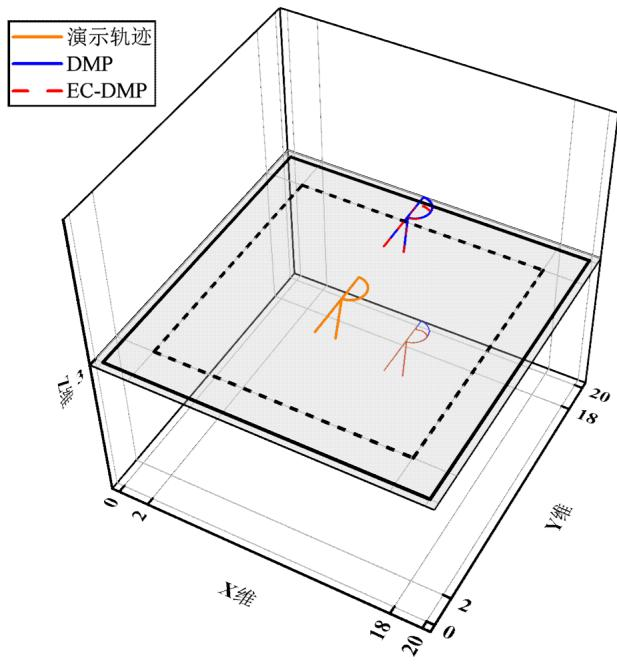  
（a）工作空间轨迹

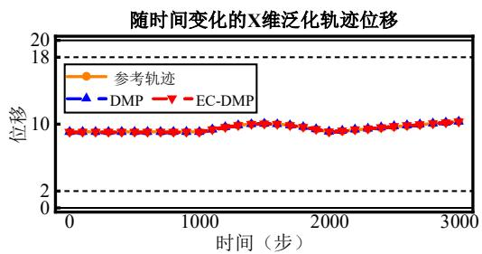

随时间变化的Y维泛化轨迹位移  
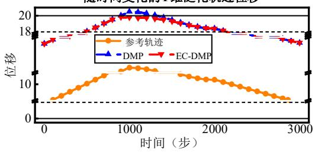  
（b）时间位移轨迹  
图3.6 DMP 与 EC-DMP 在情形 1-a 的泛化结果

图 3.6 和图 3.7 展示了情形 1 两个不同任务下两种 DMP 的泛化结果。可以观察到，DMP 的泛化结果用蓝色线段表示，在Y方向上跨越了表示上约束边界的黑色实线段，而EC-DMP 的泛化结果用红色线段表示，则完全位于Y方向的上约束边界内。此外，可以发现当轨迹位于由两条虚线构成的区域内时，蓝色线段与红色线段完全重合，这表明 EC-DMP 中的额外控制信号此时并未发挥作用。而当轨迹位于由黑色实线与虚线构成的区域时，控制信号被激活，对不满足约束的轨迹进行了重塑。综上所述，这与 EC-DMP 的设计思路相吻合，证明了所提出的 EC-DMP 在重塑不满足环境约束的轨迹点的有效性。

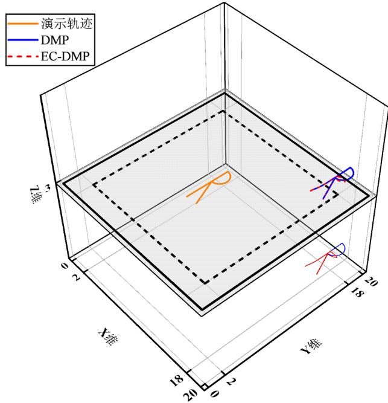  
（a）工作空间轨迹

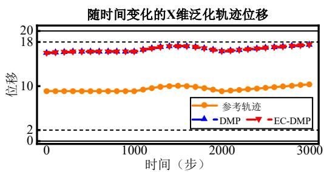

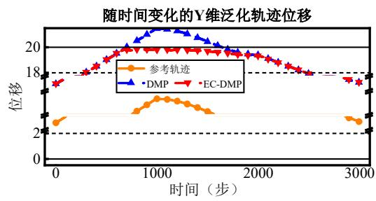  
（b）时间位移轨迹  
图3.7 DMP 与 EC-DMP 在情形 1-b 的泛化结果

## 2）情形2

在此情形中，所采用的演示轨迹是由图 3.5 所示轨迹经过沿 X 方向反转后平移10个单位长度和沿Y方向反转后平移12个单位长度得到的。类似地，为了验证所提EC-DMP 能够通过耦合项对不满足环境约束的轨迹序列进行调制，从而获得满足环境约束的泛化轨迹，首先采用DMP 算法完成对上述演示轨迹的学习，其中算法使用的预设参数为章节 2 列出的专家参数；其次将表 3.1 所示的任务参数作为图 3.4 所示的EC-DMP 的运动轨迹泛化流程的输入，由此可得任务参数a和任务参数b下运动轨迹泛化结果图3.8和3.9。观察图3.8和3.9能够发现，当泛化得到的轨迹序列全部满足预设环境约束时，DMP 和EC-DMP 得到为轨迹序列几乎保持一致；而当泛化得到的轨迹序列存在部分不满足环境环境约束时，此时由于额外耦合项的作用，EC-DMP 能够对不满足环境约束的轨迹序列进行重塑，且重塑后的轨迹序列位于环境边界内部，由此表明所提EC-DMP 在调制泛化轨迹序列不满环境下边界的条件下是有效的。

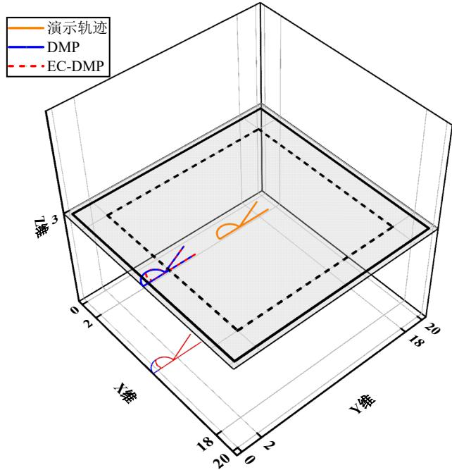  
（a）工作空间轨迹

随时间变化的X维泛化轨迹位移  
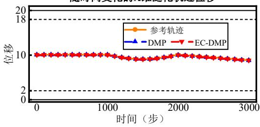

随时间变化的Y维泛化轨迹位移  
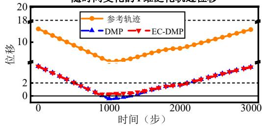  
（b）时间位移轨迹

图3.8 DMP 与 EC-DMP 在情形 2-a 的泛化结果  
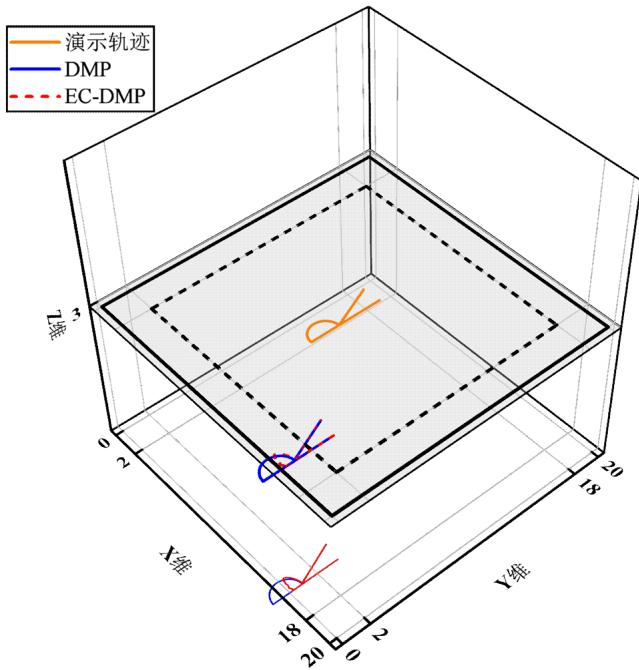  
（a）工作空间轨迹

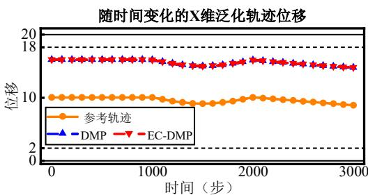

随时间变化的Y维泛化轨迹位移  
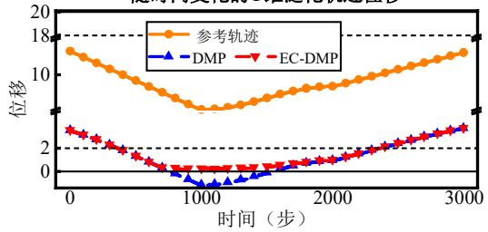  
（b）时间位移轨迹  
图3.9 DMP 与 EC-DMP 在情形 2-b 的泛化结果

## 3）情形3

在这种情形下，采用了两个不同的演示轨迹，它们分别通过绕Z轴旋转情形1所使用的演示轨迹获得，旋转角度分别为/4和3 /4 。由图 3.10 可知，经 DMP 泛化得到的轨迹同时跨越了 X 方向的上边界和 Y 方向的上边界，图 3.11 展示了经 DMP泛化得到的轨迹同时跨越了X方向的上边界和Y方向的下边界，而经EC-DMP 泛化得到的轨迹则由于耦合项的的作用在每一维度被重塑至边界内部。

随时间变化的X维泛化轨迹位移  
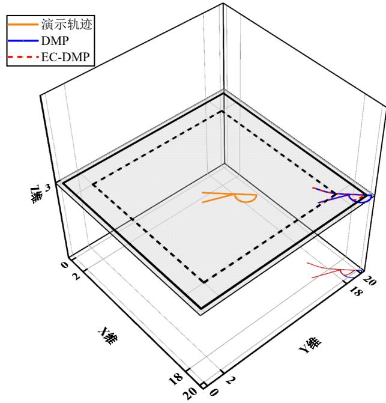  
（a）工作空间轨迹

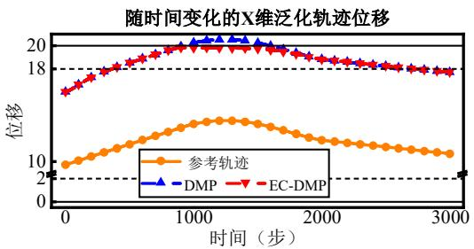

随时间变化的Y维泛化轨迹位移  
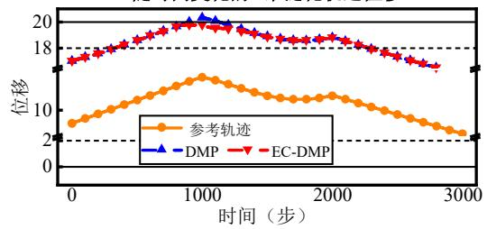  
（b）时间位移轨迹

图3.10 DMP 与 EC-DMP 在情形 3-a 的泛化结果  
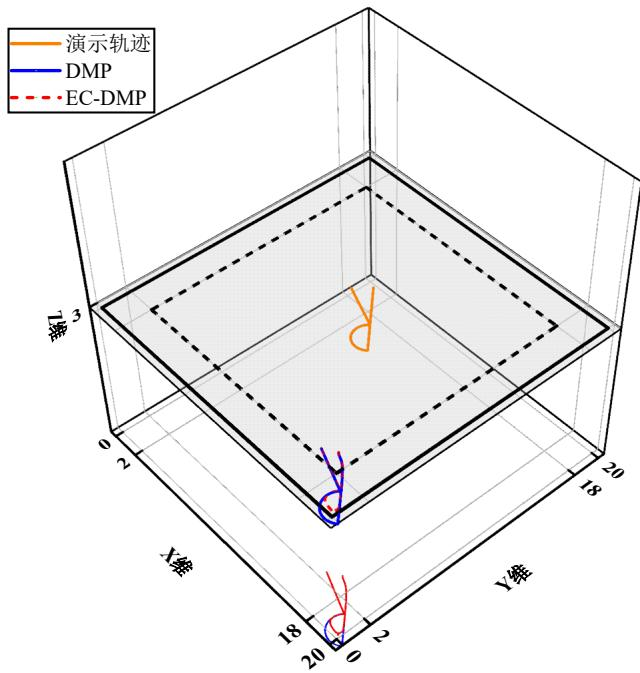  
（a）工作空间轨迹

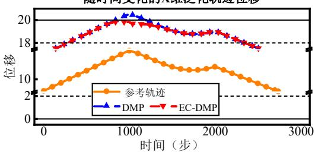

随时间变化的Y维泛化轨迹位移  
  
（b）时间位移轨迹  
图3.11 DMP 与 EC-DMP 在情形 3-b 的泛化结果

## （2）增益项的效果分析

为了研究增益参数对泛化结果的影响，选择了情形 1-a 任务和情形 2-a 任务在 Y方向上的泛化作为研究对象，并分析了它们在不同增益参数下的泛化结果。在实验中，共选取了6个增益参数，它们的值分别是0.002、0.2、2、20、200、2000。

  
图3.12 不同值大小增益的EC-DMP泛化结果1

观察图 3.12 和图 3.13 可见，在一定范围内，增益值的大小与泛化轨迹与边界的距离呈正比关系。然而，过小或过大的增益值都可能导致不符合预期的轨迹结果。当增益值过小时，例如 $\eta \ : = \ : 0 . 0 0 2$ 时，泛化生成的轨迹会完全失去之前轨迹的特性，这与 EC-DMP 的初衷相违背，即在保证安全的前提下尽可能还原演示轨迹的特性。此外，能够发现轨迹会出现反弹效应，这是因为轨迹是由DMP 动态生成的，且耦合项的值大小取决于运动轨迹与边界的距离，当两者的距离小于一定值的时候，耦合项会迫使通过式(3-12)得到的加速度发生巨大变换。且耦合项提供加速度的符号与速度的符号相反，从而迫使轨迹速度的方向发生反转。

  
图3.13 不同值大小增益的EC-DMP泛化结果2

需要说明的是，在面对新任务时，采用与本实验相同的增益参数并不能保证取得相同的效果。

## 3.4 样机验证

为了进一步验证算法在真实环境下部署的可行性，基于上述数值仿真结果，设计了在真实环境下的样机实验。在样机实验中，通过让机械臂在存在边界约束的环境执行绘制字母“R”的任务，比较EC-DMP 与原始DMP 在实际应用的表现。

  
图3.14 机械臂系统架构

为了实现机械臂的控制，使用了图 3.14 所示机械臂的硬件和软件系统架构，包括带有力反馈夹持器的机械臂，DMP 和 EC-DMP 算法，7 自由度冗余机械臂的仿真模型，MoveIt 的系统框架和 3D 可视化仿真平台，MoveIt 与 ROS 中的 Rviz 结合起来。更多有关机械臂的信息如下：本文实验采所采用的是一款典型的七自由度协作机械臂 Franka-Panda[71]，如图 3.15 所示。该机械臂的设计初衷是探索如何利用柔顺性来提供更安全的人机交互和更快的学习能力。因此，其被设计成类似于人类手臂的结构，拥有7个旋转自由度，并且每个关节都支持力和扭矩传感。Panda所使用的末端执行器是一个结构简单的双指夹具，同样支持力传感，因此可以根据需要固定力来抓取物体，并在完成任务之前保持稳定。Panda所具备的特性使其成为开发本文实验任务的理想选择。更多有关Panda的性能参数表3.2。

  
图3.15 七自由度机械臂

表3.2 Franka Panda 的性能参数表

<table><tr><td>参数</td><td>参数内容</td></tr><tr><td>质量</td><td>17.8kg</td></tr><tr><td>自由度</td><td>7</td></tr><tr><td>负载</td><td>3kg</td></tr><tr><td>工作半径</td><td>855mm</td></tr><tr><td>重复位姿精度</td><td>+/-0.1mm(ISO 9283)</td></tr><tr><td>作用力分辨率</td><td>小于0.05N</td></tr><tr><td>相对作用力精度</td><td>0.8N</td></tr><tr><td>作用力重复精度</td><td>0.15N</td></tr></table>

实验的具体流程如下，首先，根据表3.1设定的环境相关参数在白色画板绘制了一个存在边界约束的工作空间；其次，建立机械臂基坐标系与工作空间参考坐标系的变换矩阵，计算机械臂末端执行器在基坐标系下的轨迹位移序列；最后，基于图3.14的机械臂系统架构实现控制械臂执行目标运动轨迹。

遵循以上实验流程，分别令机械臂执行DMP 算法和EC-DMP 算法生成的运动轨迹序列，执行完成后的最终结果如图3.15所示，图中S1、S2、S3、S4、S5 和S6 分别对应数值验证的三种情形下1-a、1-b、2-a、2-b、3-a和3-b，其中蓝色字母“R”由机械臂执行 DMP 算法生成的轨迹得到，红色字母“R”由 DMP 执行 EC-DMP 算法生成的轨迹得到。能够发现，蓝色字母的部分位于约束边界外，而红色字母的全部均保留在约束边界内，由此证明了EC-DMP 算法在样机部署的可行性。

  
图3.16 约束环境下的样机泛化结果

  
图3.17 机械臂样机执行情形 1泛化轨迹过程

  
图3.18 机械臂样机执行情形 2泛化轨迹过程

  
图3.19 机械臂样机执行情形 3泛化轨迹过程

## 3.5 本章小结

本章针对现有DMP 算法未考虑环境信息导致无法应用于受限环境的不足，通过将人工势场法与 DMP 算法结合，提出了一种面向存在边界约束环境的 EC-DMP 算法。首先，分析了人工势场法的基本原理；其次，推导了纳入人工势场的DMP 数学模型，在此基础上给出了 EC-DMP 的算法流程；最后，分别设计了数值仿真和样机实验，数值仿真实验结果表明，改进后的 EC-DMP 能够生成符合环境约束的运动轨迹，样机实验则确保了机械臂能够在目标环境下对泛化轨迹的有效执行。

## 第四章 机械臂运动轨迹模仿学习实验

## 4.1 引言

本章通过搭建物理样机实验平台，对前文提出的算法开展有效性验证。首先，针对实验环境进行简要介绍，并给出样机实验数据预处理过程。其次，面向DMP 自主参数选择策略有效性设计了一个字母轨迹学习实验。最后，基于实验平台开展了样机实验。以控制机械臂执行现实场景下的具体任务为目标，分别对比了原始框架及经过本文改进之后框架在同一任务中的表现，进一步支撑本文所提方法的有效性以及证明研究的重要性。

## 4.2 实验环境

为了实现算法的部署应用，本文搭建了图4.1所示的机械臂运动轨迹模仿学习实验平台。实验平台软件环境基于 Ubuntu 18.04系统搭建，为了实现对图 4.1 中 Panda机械臂的控制，使用ROS[72]作为基础架构，采用Moviet[73]作为实现机械臂路径规划、碰撞检测和轨迹执行等功能的组件，选择 Rviz 作为实时显示机械臂状态、运动轨迹和环境信息的可视化工具。同时，为了进行算法的验证和评估，基于 Gazebo[74]搭建了高保真环境。实验平台整合了上述工具和框架，不仅简化了实验流程，还提高了算法在部署应用中的工作效率。

  
图4.1 模仿学习实验平台示意图

针对上述工具和框架，简要介绍如下：

（1）ROS 是一个旨在简化机器人构建应用程序过程的框架。其主要优势之一是架构中软件与硬件组件之间的通信。它包括了一大套库和工具，涵盖了机器人几何、仿真和规划等多个领域。

目前，ROS 存在多个版本的软件包集。在本文的实验中，使用了ROS Melodic版本，该版本面向 Ubuntu 18.04 操作系统。此外，Panda 机器人官方提供了 franka\_ros功能包，该功能包支持使用Python或C++代码进行接口命令的操作。

（2）MoveIt 是一个在 ROS 之上运行的运动规划库。它提供了 MoveIt 接口，用于规划和执行机器人的轨迹。规划包括指定关节位置、速度和加速度的路径点。用户可以选择在关节空间或笛卡尔空间规划关节配置。在笛卡尔空间中，可以规划线性移动，规划器在关节空间创建密集的路标点，以确保线性运动。MoveIt的主要目的是通过提供一个统一的API来简化机器人运动规划应用程序的开发。

在本文，使用了MoveIt官方提供的Python版本API来实现Panda机器人的运动规划。具体而言，通过将各实验计算得到的末端执行器的轨迹序列提供给 MoveIt，MoveIt 处理完成后将输出每个序列点的关节坐标，然后进一步提供给 Franka 控制接口。

（3）Franka 控制接口（FCI），为了实现对Franka的控制，FCI 提供机器人的低级控制，既适用于关节，也适用于末端夹爪。同时连接是双向的，因此既可以向机械臂提供命令，也可以读取机械臂的实施状态信息，最大传输频率为 1kHz。机器人并提供适当的执行信号可以通过两种方式实现同时，FCI 提供了良好的ROS 兼容。

在本文，分别通过FCI 获取Panda在执行演示任务时的状态和下发Panda执行目标任务对应的关节状态。

（4）Rviz 是ROS 生态的一部分，作为一个3D可视化工具，Rviz 提供了一个图形用户界面，它允许用户在仿真环中可视化和与机器人模型、传感器数据以及其他对象进行交互，使用户能够显示和操作各种类型的数据，例如点云、激光扫描和机器人的3D模型。

在本文，Rviz 将用于可视化和调试使用ROS 构建的机器人应用程序，具体来说，通过与Panda的进行交互，以此提高实验的开发效率。

（5）Gazebo 同样是 ROS 生态的一部分，与 Rviz 类似提供了一个 3D 可视化图形界面。然而，其与Rviz 存在一些差异，显著的区别在于Gazebo 允许包含机器人的物理属性，这对于模拟现实世界的场景非常关键，一些研究甚至直接使用 Gazebo 替代真实机器人和环境。此外，Gazebo 仅具备根据预设的传感器信息模拟机器人的实时状态，不能类似Rviz 实现与机器人交互。

在本文，通过在 Gazebo 搭建目标任务环境，基于此环境测试目标代码，在确保不存在物理冲突后将其迁移至真实环境，通过此种方式有效避免了物理样机的损耗，节约了时间，极大地提高了开发效率。

## 4.3 实验数据预处理

通过上文可知，本文基于动觉示教的方式，并通过FCI 获取Panda的运动轨迹信息。然而，在实验中发现直接获得的示教轨迹无法真实地反应人类示教轨迹。首先，由于硬件与软件之间存在通信延迟，为了避免演示信息的丢失，状态记录时间应大于Panda的正式运动时间。具体来说，需要在拖动Panda执行演示前一段时间开始记录，并在Panda完成运动后的一段时间停止记录。这导致采集的数据中存在大量与技能无关的数据，因此需要将上述数据从原始采集数据中去除。其次，通过 FCI 直接获取的Panda参数化信息是面向关节空间的，而本文研究的运动轨迹学习方法是面向笛卡尔空间的。因此，需要建立 Panda 的正运动学模型，实现两个参考空间下的坐标变换。

## （1）无关状态的演示信息去除

为了获得Panda在未执行任务状态下的演示数据，实际上是要确定Panda 在该状态下演示数据呈现的某种规律。为此，本文利用了Panda的关节在各个时刻的速度来确定该状态。具体地说，通过多次实验发现，当 Panda 的 7 个关节均未发生移动时，存在两个值得关注的情况。首先，各个关节的速度不为 $0 _ { \circ }$ 。其次，各个关节的速度维持在一个稳定的区间。因此，可以设定一个阈值 $q _ { \nu } ^ { T H }$ ，通过式(4-1)计算所有关节的绝对速度之和与 $q _ { \phantom { i } _ { \nu } } ^ { T H }$ 进行比较，从而判断Panda是否处于执行任务状态：

$$
q _ {t, v} = \sum_ {i = 1} ^ {7} \left| \dot {q} _ {t, i} \right|\tag{4-1}
$$

其中，若时刻t各关节速度的 $\dot { q } _ { t , \nu } \leq q _ { \nu } ^ { T H }$ ，则此时被判断 Panda 处于未执行任务状态，从而在获取的原始数据中去除时刻 t对应的数据。经过多次测试，将 Panda 的 $q _ { \nu } ^ { T H }$ 确定为 0.02rad/s2。

  
（a）原始轨迹

  
（b）处理轨迹  
图4.2 无关状态去除后的演示轨迹

图4.2展示了一组经过无关状态去除处理前后的轨迹。其中左图表示原始示教轨迹，能够观察到4条示教轨迹在临近运动结束时的一段时间下位移不再变化，此段时间下的轨迹点即为无关状态信息点；右图表示经过上述方法处理后得到的轨迹，由于去除了无关状态信息，能够发现运动轨迹在时间轴上的长度均变短。

## （2）正运动学建模

正运动学建模是确定机械臂末端执行器位姿的过程，目前分为数值法和解析法两类，解析法因其精确性高和适应性广泛等特点得到了广泛使用。目前常用的解析法分为标准 D-H 法和改进 D-H 法两类，与标准 D-H 法相比，改进 D-H 法在解决奇异性问题和建模精度等方面具有较大的优势[75]。因此，为实现关节空间下的坐标向笛卡尔空间下坐标的变换，选择改进D-H法建立Panda的正运动学模型。表4.1提供了基于改进D-H法确定的Panda相关建模参数。

  
图4.3 七自由度机械臂构型图

表4.1 Panda D-H 参数表

<table><tr><td>连杆i</td><td>连杆长度ai</td><td>连杆扭转角αi</td><td>连杆偏移di</td><td>关节角度θi</td></tr><tr><td>1</td><td>0</td><td>0</td><td>d1</td><td>q1</td></tr><tr><td>2</td><td>0</td><td>-π/2</td><td>0</td><td>q2</td></tr><tr><td>3</td><td>0</td><td>π/2</td><td>d3</td><td>q3</td></tr><tr><td>4</td><td>a4</td><td>π/2</td><td>0</td><td>q4</td></tr><tr><td>5</td><td>a5</td><td>-π/2</td><td>d5</td><td>q5</td></tr><tr><td>6</td><td>0</td><td>π/2</td><td>0</td><td>q6</td></tr><tr><td>7</td><td>a7</td><td>π/2</td><td>0</td><td>q7</td></tr><tr><td>8</td><td>0</td><td>0</td><td>d7</td><td>0</td></tr></table>

利用图中 D-H 坐标系与机械臂结构的几何参数，可得相邻杆件之间的位姿变换矩阵 $^ { i - 1 } { \cal T }$ 为：

$$
{ } _ { i } ^ { i - 1 } T = \left[ \begin{array} { c c c c } \cos ( \theta _ { i } ) & - \sin ( \theta _ { i } ) & 0 & a _ { i - 1 } \\ \sin ( \theta _ { i } ) \cos ( \alpha _ { i - 1 } ) & \cos ( \theta _ { i } ) \cos ( \alpha _ { i - 1 } ) & - \sin ( \alpha _ { i - 1 } ) & - \sin ( \alpha _ { i - 1 } ) d _ { i } \\ \sin ( \theta _ { i } ) \sin ( \alpha _ { i - 1 } ) & \cos ( \theta _ { i } ) \sin ( \alpha _ { i - 1 } ) & \cos ( \alpha _ { i - 1 } ) & \cos ( \alpha _ { i - 1 } ) d _ { i } \\ 0 & 0 & 0 & 1 \end{array} \right]\tag{4-2}
$$

其中，连杆长度 $a _ { i - 1 }$ 、连杆扭转角 $\alpha _ { i - 1 }$ 与连杆偏移量 $d _ { i }$ 为已知量，均由机械臂的自身结构确定。

根据图4.4中机械臂的D-H坐标系和已知参数的几何参数信息，对式(4-2)进行矩阵连乘运算，可得到机械臂末端执行器的末端位姿矩阵和各关节转动角度之间的表达式(4-3)，即七自由度机械臂的正向运动学方程：

$$
{ } _ { 7 } ^ { 0 } T = { } _ { 1 } ^ { 0 } T { } _ { 2 } ^ { 1 } T { } _ { 3 } ^ { 2 } T { } _ { 4 } ^ { 3 } T { } _ { 5 } ^ { 4 } T { } _ { 6 } ^ { 5 } T { } _ { 7 } ^ { 6 } T = \left[ \begin{array} { c c c c } n _ { x } & o _ { x } & a _ { x } & p _ { x } \\ n _ { y } & o _ { y } & a _ { y } & p _ { y } \\ n _ { z } & o _ { z } & a _ { z } & p _ { z } \\ 0 & 0 & 0 & 1 \end{array} \right] = \left[ \begin{array} { c c } { } _ { 7 } ^ { 0 } R & { } _ { 7 } ^ { 0 } P \\ 0 & 1 \end{array} \right]\tag{4-3}
$$

其中，矩阵的前3行前3列构成的子矩阵 ${ } _ { 7 } ^ { 0 } R$ 表示末端执行器的姿态信息， $[ p _ { x } , p _ { y } , p _ { z } ]$ 表示末端执行器的位移信息，即本文方法所需要的信息。上述参数详细表达如下：

$$
\begin{array}{l} p _ {x} = a _ {6} \left[ s _ {6} \left(s _ {4} \left(s _ {1} s _ {3} - c _ {1} c _ {2} c _ {3}\right) + c _ {1} c _ {4} s _ {2}\right) - c _ {6} \left(c _ {5} \left(c _ {4} \left(s _ {1} s _ {3} - c _ {1} c _ {2} c _ {3}\right) - c _ {1} c _ {2} s _ {4}\right)\right) \right] - a _ {3} \left(s _ {1} s _ {3} - c _ {1} c _ {2} c _ {3}\right) \\ \quad - c _ {1} c _ {2} c _ {3}) - c _ {1} s _ {2} s _ {4}) + s _ {5} \left(c _ {3} s _ {1} + c _ {1} c _ {2} s _ {3})\right) ] - d _ {3} \left(s _ {1} s _ {3} - c _ {1} c _ {2} c _ {3}\right) \\ \quad d _ {5} \left[ s _ {4} \left(s _ {1} s _ {3} - c _ {1} c _ {2} c _ {3}\right) + c _ {1} c _ {4} s _ {2} \right] + d _ {3} c _ {1} s _ {2} \\ p _ {y} = a _ {4} \left[ c _ {4} \left(c _ {1} s _ {3} + c _ {2} c _ {3} s _ {1}\right) + s _ {1} s _ {2} s _ {4} \right] - d _ {5} \left[ s _ {4} \left(c _ {1} s _ {3} + c _ {2} c _ {3} s _ {1}\right) - c _ {4} s _ {1} s _ {2} \right] + a _ {3} \left(c _ {1} s _ {3} + c _ {2} c _ {3} s _ {1}\right) + a _ {3} \left(c _ {1} s _ {3} + c _ {2} c _ {3} s _ {1}\right) - a _ {6} \left[ s _ {6} \left(s _ {4} \left(c _ {1} s _ {3} + c _ {2} c _ {3} s _ {1}\right) - c _ {4} s _ {1} s _ {2}\right) - c _ {6} \left(c _ {5} \left(c _ {4} \left(c _ {1} s _ {3} + c _ {2} c _ {3} s _ {1}\right) + s _ {1} s _ {2} s _ {4}\right) + s _ {5} \left(c _ {1} c _ {3} - c _ {2} c _ {1} s _ {3}\right)\right) \right] + d _ {3} s _ {1} s _ {2} \\ p _ {z} = d _ {1} + a _ {4} \left(c _ {2} s _ {4} - c _ {3} c _ {4} s _ {2}\right) + d _ {5} \left(c _ {2} c _ {4} + c _ {3} s _ {2} s _ {4}\right) + \\ \quad a _ {6} \left[ c _ {6} \left(c _ {5} \left(c _ {2} s _ {4} - c _ {3} c _ {4} s _ {2}\right) + s _ {2} s _ {3} s _ {5}\right) + s _ {6} \left(c _ {2} c _ {4} + c _ {3} s _ {2} s _ {4}\right) \right] + d _ {3} c _ {2} - a _ {3} c _ {3} s _ {2}. \end{array}
$$

(4-4)

其中，为了方便表示，sin $\theta _ { 1 }$ 简写为 $S _ { 1 }$ ，cos $\theta _ { 1 }$ 简写为 $c _ { 1 }$ ，以此类推。

## 4.4 实验验证与分析

为了验证第二章节所提基于 GMM/GMR 的示教轨迹表征方法的适用性，以及基于TPE 的DMP 参数自主选择算法的有效性，本文设计了一个字母轨迹学习实验，目的在于让Panda学习如何绘制Robots 轨迹。在这个实验中，将Robots 中的各个字母视为单个演示轨迹，并采用本文提出的运动轨迹学习方法对演示轨迹进行表征和学习。重点是比较使用本文方法和传统方法对同一对象建模和学习的效果，以此评估本文研究的工程应用价值。

具体而言：首先，对组成 Robots 的 5 个字母示教轨迹采用第二章节所研究的运动轨迹表征分别回归，进而得到各字母轨迹所对应的最优示教轨迹；其次，以相同的GMR轨迹作为DMP 的学习对象，比较了使用专家配置参数的轨迹学习效果；最后，为 TPE 参数配置下习得的各个字母轨迹分别指定不同于演示轨迹起止点的位置，分析其在新环境下的轨迹泛化结果。

## 4.4.1 轨迹预处理

在本实验中，以上述构造的数据集用作建模数据集。下面将以绘制字母“R”的运动轨迹为对象，逐步分析运动轨迹学习的过程。绘制字母“R”的经过无关状态信息去除和正运动学变换后的各字母对应的最终结果如图4.4所示，可以发现各轨迹随时间的变化趋势基本保持一致。

从这里开始，以下各步骤将遵循本文研究的运动轨迹学习方法。首先采用 DTW对图4.4所示轨迹进行时间上的对齐，对齐后的结果如图4.5所示。接下来采用GMM对图4.5所示轨迹进行建模，并根据建模结果得到了GMR轨迹。随后，对X维和Y维轨迹进行时间上的耦合。实验绘制字母“R”表征轨迹与演示轨迹如图 4.7 所示，本文开展了5个字母的轨迹绘制实验，每个字母都采取了与“R”类似的如图4.4 \~ 4.6过程，同理得到其余4个字母的表征轨迹与演示轨迹结果分别如图4.8 \~ 4.11所示。

  
（a）X方向

  
（b）Y方向  
图4.4 绘制字母”R”的演示轨迹

  
（a）X 方向

  
（b）Y方向

图4.5 绘制字母”R”的 DTW轨迹  
  
（a）X 方向

  
（b）Y方向

图4.6 绘制字母”R”的 GMR 轨迹  
  
（a）人类演示轨迹

  
（b）GMR表征轨迹

图4.7 绘制字母”R”的演示轨迹与表征轨迹  
  
（a）人类演示轨迹

  
（b）GMR表征轨迹  
图4.8 绘制字母”o”的演示轨迹与表征轨迹

  
（a）人类演示轨迹

  
（b）GMR表征轨迹

图4.9 绘制字母”b”的演示轨迹与表征轨迹  
  
（a）人类演示轨迹

  
（b）GMR表征轨迹

图4.10 绘制字母”t”的演示轨迹与表征轨迹  
  
（a）人类演示轨迹

  
（b）GMR表征轨迹  
图4.11 绘制字母”s”的演示轨迹与表征轨迹

## 4.4.2 运动轨迹学习

类似地，以图 4.7 所示的 GMR 表征轨迹作为任务轨迹，分别对 DMP 使用专家配置参数和 TPE 配置的参数进行学习。学习后的 Panda 执行效果如下，需要说明的是，由于未进行泛化，正常情况下Panda会以相同的起止点绘制图中字母。为了方便对比，这里对其中一者进行了平移，该平移是在学习完成后得到轨迹序列进行的，并

不对学习效果产生影响。

观察图 4.13 能够发现，两者在肉眼的观察下几乎无法察觉到差异。这是因为实验中轨迹的参数化量纲为米，且各技能具有较小的尺寸。在这种情况下，即使TPE 参数能够得到具有出更好学习效果的参数（以相似性指标和收敛性指标判定），实际上在以上运动轨迹的学习中，TPE 配置下的相似性指标和收敛性指标均优于专家配置参数，受限于Panda的定位精度，该优势无法直观体现。

  
图4.12 任务轨迹学习结果

尽管如此，实验中发现使用TPE配置参数的Panda在学习速度上具有绝对优势。Panda执行学习轨迹的过程如图4.14所示。

  
图4.13 七自由度机械臂执行学习轨迹的过程

## 4.4.3 运动轨迹泛化

根据图 2.1 所示的基于 DMP 的运动轨迹学习与泛化流程，上一小节已经表明，panda已经具备了习得字母轨迹在新位置下的泛化能力。本节将对习得的各个字母轨迹进行泛化。具体做法是重新为各字母制定新的起止点。为了更直观地展示，我们将泛化轨迹的起止点围绕在一条斜线附近。期望得到了一个倾斜分布的“Robots”轨迹。最终的泛化结果如图4.14所示。观察到，由于DMP 自身的缩放形状，当泛化轨迹的起止点欧式距离与演示轨迹的起止点欧式距离不一致时，轨迹会相应地发生缩放。例如，字母“b”和“s”表现得更为细长，而字母“t”则整体比例缩小，这是由于式(2-24)中的 $g - y _ { 0 }$ 项所引起的。Panda执行泛化轨迹过程如图4.15所示。

  
图4.14 无约束环境运动轨迹泛化结果

  
(a)

  
图4.15 七自由度机械臂执行泛化轨迹的过程

此外，为了验证第三章节提出的考虑环境因素的机械臂运动轨迹模仿学习的有效性，进一步为以上环境添加了一种模拟边界约束（图 4.16 黑色实线表示的四边形），对比分别纳入 DMP 和 EC-DMP 模型自主运动轨迹模仿框架的表现。在新的环境下，若遵循图4.15中所采用的轨迹，将会出现泛化轨迹不满足环境边界约束的情形。Panda在该环境下的执行使用两种算法生成运动轨迹的结果如图4.16所示，其中图4.16（a）为执行DMP 算法生成运动轨迹的结果，图中蓝色轨迹与图4.15中轨迹一致，能够发现表示字母“R”的轨迹跨越了所设定的虚拟环境边界；右图表示执行经EC-DMP 算法生成运动轨迹结果，可以观察到相较于DMP 算法，通过给定附加的环境信息，EC-DMP 算法生成的红色轨迹则完全位于由黑色实线包围的区域，由此表明EC-DMP 算法在面向存在边界约束的环境时能够生成有效的轨迹。

  
（a）DMP 泛化结果

  
（b）EC-DMP 泛化结果  
图4.16 约束环境机械臂运动轨迹泛化结果

综上可知，通过本文研究的机械臂运动轨迹学习方法，成功实现了机械臂对经由人类演示的示教轨迹的学习，且学习过程的自主程度和轨迹的泛化性能均得到了改善，对于尚不具备机械臂专业知识的群体以及机械臂被部署在存在边界约束的环境下的情形，可以使得类似的机械臂完成个性化运动轨迹模仿学习的任务。

## 4.5 本章小结

为了验证本文所提方法的可行性和有效性，本章搭建了机械臂运动轨迹模仿学习实验平台。首先，分别对硬件和软件环境进行了说明；其次，针对由样机直接获得的运动轨迹信息无法验证本文研究方法的有效性这一问题，给出实验数据预处理的相关方法。在此基础上，设计了由多运动轨迹组成的字母绘制实验，整个实验过程人类仅参与运动轨迹的示教过程。进而利用本文所提的运动轨迹表征与学习方法，为了判断机械臂能否习得演示轨迹，设计了运动轨迹再现和泛化两个子实验，结果表明机械臂在演示位置和泛化位置都能够生成新的运动轨迹，证明了本文研究方法具有良好的学习与泛化能力。

## 第五章 总结与展望

## 5.1 总结

本文以机械臂为研究对象，开展了运动轨迹的表征、考虑环境因素的运动轨迹学习的研究，并设计了轨迹模仿学习实验，具体总结如下：

第一部分研究了运动轨迹的表征与轨迹学习参数选择问题。首先，利用DTW对多个运动轨迹进行了时间上的对齐，采用 GMM 对多个运动轨迹进行表征，并利用GMR 泛化生成一条最优示教轨迹。该轨迹表征了多个运动轨迹的运动趋势与共同轨迹特征。其次，采用DMP 对最优示教轨迹进行学习，生成对应的轨迹表征参数。最后，研究 DMP 的参数选择，提出了一种可提高 DMP 轨迹学习的自主性的参数选择算法，通过仿真验证了有效性，并讨论了相关特性。

第二部分研究了考虑环境因素的运动轨迹学习问题。针对现有DMP技能学习方法在显式约束的环境下无法进行泛化的不足，提出了一项泛化性改进策略。基于人工潜在势场为 DMP 设计了新的耦合项，改进了 DMP 的泛化能力，将该类 DMP 称为EC-DMP。为了验证以上工作的有效性，进行了数值验证实验，并与当前方法进行对比。实验结果表明，改进后的基于DMP 的运动轨迹学习方法在泛化性和自主性方面均取得了显著提升。

第三部分搭建了机械臂运动轨迹模仿学习实验平台。首先，分别对硬件和软件环境进行了说明；其次，针对由样机直接获得的运动轨迹信息无法验证本文研究方法的有效性这一问题，给出实验数据预处理的相关方法。在此基础上，设计了由多运动轨迹组成的字母绘制实验，整个实验过程人类仅参与运动轨迹的示教过程。进而利用本文所提的运动轨迹表征与学习方法，为了判断机械臂能否习得演示轨迹，设计了运动轨迹再现和泛化两个子实验，结果表明机械臂在演示位置和泛化位置都能够生成新的运动轨迹，证明了本文研究方法具有良好的学习与泛化能力。

## 5.2 展望

本文对机器臂运动轨迹模仿学习进入了深入研究，并且取得了初步的成果，然而在本文的研究中也发现了部分值得进一步研究的问题，具体如下：

（1）本文重点研究了面向人类演示的运动轨迹的学习方法，对示教轨迹信息获取与处理并未进行详细研究，而示教轨迹信息的采集直接关系到最终的学习效果。因此，未来可以通过研究示教轨迹数据的增强来进一步提升本文所提方法的效果。

（2）在本文的研究中，通过为DMP 设计新的耦合项能够避免泛化轨迹出现不满足环境约束的情形，保证轨迹的合法性；然而，并没有考虑到不满足环境约束点的特征，在未来的研究中如何能够在规整的同时保留演示轨迹的特征信息将是值得被探究的。

（3）在本文的研究中，并未考虑机械臂的结构以及机械臂关节处所使用的电机的特性，在未来可通过将上述方面纳入运动轨迹模仿学习的过程，研究DMP 动态系统在速度加速度和力的优化方法，为机械臂力位混合，运动技能自组织，复杂技能操作以及轨迹规划任务提供新思路。

由于个人能力和精力有限，本文中仍存在较多问题和不足之处，恳请各位老师和读者批评指正。

## 附录A 本文自主构建数据集

为了保证本文所提参数选择算法的鲁棒性，基于Franka Panda机械臂样机和ROS操作平台，采用动觉示教的方式控制机械臂执行了30个随机动作，用于形成30个数据集，同时每个动作均被执行5次，在此基础上对使用GMR对每个动作下的5个运动轨迹（蓝色轨迹）进行表征，各随机运动轨迹的表征结果（粉色轨迹）被用于参数选择算法的数值仿真，具体表征结果如下所示。

  
数据集 1

  
数据集 2

  
数据集 3

  
数据集5

数据集 4  
  
数据集6

  
数据集 7

  
数据集 8

  
数据集 9

  
数据集 10

  
数据集11

  
数据集 12

  
数据集13

  
数据集14

  
数据集 15

  
数据集 16

  
数据集 17

  
数据集 18

  
数据集 19

  
数据集 20

  
数据集21

  
数据集 22

  
数据集 23

  
数据集 24

  
数据集 25

  
数据集 26

  
数据集 27

  
数据集 28

  
数据集 29

  
数据集 30

## 附录B 基于 TPE 配置的DMP 学习结果

为了验证本文所提参数选择方法的有效性，以附录 A 构建的表征轨迹为目标轨迹，分别采用 TPE 配置参数和专家参数对目标轨迹进行学习，两种参数下的学习结果如下所示。

  
数据集 1

  
数据集 2

  
数据集 3

  
数据集 4

  
数据集 5

  
数据集 6

  
数据集7

  
数据集8

  
数据集 9

  
数据集 10

  
数据集 11

  
数据集 12

  
数据集13

  
数据集 14

  
数据集15

  
数据集16

  
数据集17

  
数据集18

  
数据集 19

  
数据集 20

  
数据集 21

  
数据集22

  
数据集23

  
数据集24

  
数据集 25

  
数据集 26

  
数据集 27

  
数据集 28

  
数据集 29

  
数据集30

附录C 参数自主选择算法数值验证结果（情形 1）

<table><tr><td rowspan="2">数据集编号</td><td colspan="2">TPE 配置参数</td><td colspan="2">误差</td></tr><tr><td> $\alpha_y$ </td><td> $N_{fs}$ </td><td>TPE</td><td>专家</td></tr><tr><td>1</td><td>1.06</td><td>36</td><td>0.123</td><td>0.805</td></tr><tr><td>2</td><td>1.143</td><td>34</td><td>0.08</td><td>0.76</td></tr><tr><td>3</td><td>1.009</td><td>32</td><td>0.159</td><td>1.37</td></tr><tr><td>4</td><td>1.059</td><td>48</td><td>0.175</td><td>1.189</td></tr><tr><td>5</td><td>1.027</td><td>47</td><td>0.137</td><td>0.147</td></tr><tr><td>6</td><td>1.011</td><td>43</td><td>0.015</td><td>0.871</td></tr><tr><td>7</td><td>1.006</td><td>74</td><td>0.008</td><td>0.028</td></tr><tr><td>8</td><td>1.001</td><td>133</td><td>0.018</td><td>0.062</td></tr><tr><td>9</td><td>1.009</td><td>70</td><td>0.046</td><td>0.123</td></tr><tr><td>10</td><td>1.004</td><td>103</td><td>0.041</td><td>0.121</td></tr><tr><td>11</td><td>1.012</td><td>75</td><td>0.023</td><td>0.077</td></tr><tr><td>12</td><td>1.0</td><td>138</td><td>0.014</td><td>0.045</td></tr><tr><td>13</td><td>1.024</td><td>66</td><td>0.008</td><td>0.047</td></tr><tr><td>14</td><td>1.058</td><td>52</td><td>0.035</td><td>0.189</td></tr><tr><td>15</td><td>1.006</td><td>63</td><td>0.055</td><td>0.222</td></tr><tr><td>16</td><td>1.046</td><td>77</td><td>0.046</td><td>0.203</td></tr><tr><td>17</td><td>1.069</td><td>47</td><td>0.033</td><td>0.188</td></tr><tr><td>18</td><td>1.003</td><td>81</td><td>0.031</td><td>0.151</td></tr><tr><td>19</td><td>1.025</td><td>48</td><td>0.045</td><td>0.161</td></tr><tr><td>20</td><td>1.014</td><td>109</td><td>0.016</td><td>0.061</td></tr><tr><td>21</td><td>1.012</td><td>132</td><td>0.032</td><td>0.106</td></tr><tr><td>22</td><td>1.009</td><td>57</td><td>0.06</td><td>0.236</td></tr><tr><td>23</td><td>1.007</td><td>63</td><td>0.012</td><td>0.05</td></tr><tr><td>24</td><td>1.049</td><td>76</td><td>0.054</td><td>0.166</td></tr><tr><td>25</td><td>1.003</td><td>45</td><td>0.105</td><td>0.644</td></tr><tr><td>26</td><td>1.052</td><td>42</td><td>0.139</td><td>0.81</td></tr><tr><td>27</td><td>1.035</td><td>49</td><td>0.213</td><td>1.491</td></tr><tr><td>28</td><td>1.031</td><td>41</td><td>0.156</td><td>1.121</td></tr><tr><td>29</td><td>1.151</td><td>79</td><td>0.015</td><td>0.071</td></tr><tr><td>30</td><td>1.039</td><td>61</td><td>0.182</td><td>1.068</td></tr></table>

## 附录D 参数自主选择算法数值验证结果（情形 2）

<table><tr><td rowspan="2">数据集编号</td><td colspan="2">TPE 配置参数</td><td colspan="2">目标函数误差</td></tr><tr><td> $\alpha_y$ </td><td> $N_{fs}$ </td><td>TPE</td><td>专家</td></tr><tr><td>1</td><td>3.437</td><td>166</td><td>0</td><td>0</td></tr><tr><td>2</td><td>1.647</td><td>70</td><td>0</td><td>0.006</td></tr><tr><td>3</td><td>5.32</td><td>200</td><td>0.003</td><td>0.005</td></tr><tr><td>4</td><td>5.32</td><td>196</td><td>0.005</td><td>0.009</td></tr><tr><td>5</td><td>5.224</td><td>198</td><td>0.002</td><td>0.005</td></tr><tr><td>6</td><td>5.297</td><td>200</td><td>0.004</td><td>0.008</td></tr><tr><td>7</td><td>6.611</td><td>10</td><td>0.001</td><td>0.002</td></tr><tr><td>8</td><td>5.708</td><td>200</td><td>0</td><td>0.001</td></tr><tr><td>9</td><td>6.376</td><td>199</td><td>0</td><td>0</td></tr><tr><td>10</td><td>5.915</td><td>199</td><td>0.001</td><td>0.003</td></tr><tr><td>11</td><td>6.262</td><td>200</td><td>0.002</td><td>0.005</td></tr><tr><td>12</td><td>5.556</td><td>200</td><td>0</td><td>0</td></tr><tr><td>13</td><td>5.488</td><td>200</td><td>0</td><td>0</td></tr><tr><td>14</td><td>5.587</td><td>200</td><td>0.003</td><td>0.004</td></tr><tr><td>15</td><td>5.675</td><td>200</td><td>0.002</td><td>0.004</td></tr><tr><td>16</td><td>5.395</td><td>198</td><td>0</td><td>0.001</td></tr><tr><td>17</td><td>5.9</td><td>199</td><td>0.004</td><td>0.007</td></tr><tr><td>18</td><td>6.227</td><td>200</td><td>0.001</td><td>0.002</td></tr><tr><td>19</td><td>3.78</td><td>52</td><td>0</td><td>0.001</td></tr><tr><td>20</td><td>3.778</td><td>64</td><td>0</td><td>0</td></tr><tr><td>21</td><td>3.757</td><td>61</td><td>0</td><td>0</td></tr><tr><td>22</td><td>3.82</td><td>51</td><td>0</td><td>0.005</td></tr><tr><td>23</td><td>3.792</td><td>123</td><td>0</td><td>0.003</td></tr><tr><td>24</td><td>3.51</td><td>63</td><td>0</td><td>0.001</td></tr><tr><td>25</td><td>1.752</td><td>120</td><td>0</td><td>0</td></tr><tr><td>26</td><td>5.507</td><td>196</td><td>0</td><td>0.007</td></tr><tr><td>27</td><td>6.234</td><td>196</td><td>0.003</td><td>0.007</td></tr><tr><td>28</td><td>6.329</td><td>200</td><td>0.007</td><td>0.016</td></tr><tr><td>29</td><td>4.867</td><td>200</td><td>0.002</td><td>0.005</td></tr><tr><td>30</td><td>1.018</td><td>82</td><td>0</td><td>0.021</td></tr></table>

附录E 参数自主选择算法数值验证结果（情形 3）

<table><tr><td rowspan="3">数据集编号</td><td colspan="2">TPE给定参数</td><td colspan="6">目标函数误差</td></tr><tr><td rowspan="2"> $\alpha_y$ </td><td rowspan="2"> $N_{bfs}$ </td><td colspan="2">相似度</td><td colspan="2">收敛度</td><td colspan="2"> $N_{bfs}=200$ </td></tr><tr><td>专家</td><td>TPE</td><td>专家</td><td>TPE</td><td>相似度</td><td>收敛度</td></tr><tr><td>1</td><td>1.011</td><td>42</td><td>0.805</td><td>0.118</td><td>0</td><td>0.001</td><td>0.368</td><td>0.001</td></tr><tr><td>2</td><td>1.048</td><td>47</td><td>0.76</td><td>0.09</td><td>0.006</td><td>0.006</td><td>0.363</td><td>0.013</td></tr><tr><td>3</td><td>1.002</td><td>33</td><td>1.37</td><td>0.161</td><td>0.005</td><td>0.006</td><td>0.676</td><td>0.016</td></tr><tr><td>4</td><td>1.025</td><td>43</td><td>1.189</td><td>0.167</td><td>0.009</td><td>0.022</td><td>0.516</td><td>0.050</td></tr><tr><td>5</td><td>1.083</td><td>39</td><td>0.147</td><td>0.024</td><td>0.005</td><td>0.009</td><td>0.081</td><td>0.021</td></tr><tr><td>6</td><td>1.006</td><td>57</td><td>0.871</td><td>0.139</td><td>0.008</td><td>0.02</td><td>0.418</td><td>0.037</td></tr><tr><td>7</td><td>1.389</td><td>61</td><td>0.028</td><td>0.009</td><td>0.002</td><td>0.002</td><td>0.016</td><td>0.006</td></tr><tr><td>8</td><td>1.015</td><td>67</td><td>0.062</td><td>0.018</td><td>0.001</td><td>0.002</td><td>0.02</td><td>0.004</td></tr><tr><td>9</td><td>1.02</td><td>93</td><td>0.123</td><td>0.046</td><td>0</td><td>0.001</td><td>0.055</td><td>0.001</td></tr><tr><td>10</td><td>1.063</td><td>63</td><td>0.121</td><td>0.042</td><td>0.003</td><td>0.005</td><td>0.053</td><td>0.012</td></tr><tr><td>11</td><td>1.373</td><td>71</td><td>0.077</td><td>0.028</td><td>0.005</td><td>0.006</td><td>0.042</td><td>0.014</td></tr><tr><td>12</td><td>1.0</td><td>150</td><td>0.045</td><td>0.014</td><td>0</td><td>0</td><td>0.014</td><td>0</td></tr><tr><td>13</td><td>1.005</td><td>72</td><td>0.047</td><td>0.007</td><td>0</td><td>0.001</td><td>0.02</td><td>0.002</td></tr><tr><td>14</td><td>1.012</td><td>56</td><td>0.189</td><td>0.034</td><td>0.004</td><td>0.018</td><td>0.09</td><td>0.026</td></tr><tr><td>15</td><td>1.003</td><td>79</td><td>0.222</td><td>0.056</td><td>0.004</td><td>0.018</td><td>0.095</td><td>0.222</td></tr><tr><td>16</td><td>1.001</td><td>85</td><td>0.203</td><td>0.044</td><td>0.001</td><td>0.002</td><td>0.084</td><td>0.002</td></tr><tr><td>17</td><td>1.016</td><td>48</td><td>0.188</td><td>0.032</td><td>0.007</td><td>0.026</td><td>0.092</td><td>0.04</td></tr><tr><td>18</td><td>1.031</td><td>63</td><td>0.151</td><td>0.03</td><td>0.002</td><td>0.003</td><td>0.071</td><td>0.013</td></tr><tr><td>19</td><td>1.02</td><td>49</td><td>0.161</td><td>0.044</td><td>0.001</td><td>0.001</td><td>0.073</td><td>0.004</td></tr><tr><td>20</td><td>1.011</td><td>75</td><td>0.061</td><td>0.016</td><td>0</td><td>0</td><td>0.02</td><td>0.002</td></tr><tr><td>21</td><td>1.027</td><td>105</td><td>0.106</td><td>0.032</td><td>0</td><td>0.001</td><td>0.037</td><td>0.002</td></tr><tr><td>22</td><td>1.01</td><td>44</td><td>0.236</td><td>0.06</td><td>0.005</td><td>0.005</td><td>0.108</td><td>0.025</td></tr><tr><td>23</td><td>1.037</td><td>43</td><td>0.05</td><td>0.013</td><td>0.003</td><td>0.001</td><td>0.021</td><td>0.008</td></tr><tr><td>24</td><td>1.053</td><td>48</td><td>0.166</td><td>0.053</td><td>0.001</td><td>0</td><td>0.08</td><td>0.005</td></tr><tr><td>25</td><td>1.138</td><td>45</td><td>0.644</td><td>0.112</td><td>0</td><td>0.001</td><td>0.314</td><td>0.003</td></tr><tr><td>26</td><td>1.057</td><td>46</td><td>0.81</td><td>0.14</td><td>0.007</td><td>0.008</td><td>0.382</td><td>0.033</td></tr><tr><td>27</td><td>1.03</td><td>51</td><td>1.491</td><td>0.213</td><td>0.007</td><td>0.021</td><td>0.698</td><td>0.063</td></tr><tr><td>28</td><td>1.012</td><td>41</td><td>1.121</td><td>0.158</td><td>0.016</td><td>0.033</td><td>0.481</td><td>0.088</td></tr><tr><td>29</td><td>1.015</td><td>63</td><td>0.071</td><td>0.014</td><td>0.005</td><td>0.006</td><td>0.041</td><td>0.01</td></tr><tr><td>30</td><td>1.105</td><td>55</td><td>1.068</td><td>0.178</td><td>0.021</td><td>0.013</td><td>0.53</td><td>0.021</td></tr></table>

附录F 非均匀权重下的数值验证结果（情形3）

<table><tr><td rowspan="3">数据集编号</td><td colspan="6">目标函数误差</td></tr><tr><td colspan="3">相似度</td><td colspan="3">收敛度</td></tr><tr><td>专家</td><td>TPE1</td><td>TPE2</td><td>专家</td><td>TPE1</td><td>TPE2</td></tr><tr><td>4</td><td>1.189</td><td>0.167</td><td>0.22</td><td>0.009</td><td>0.022</td><td>0.01</td></tr><tr><td>6</td><td>0.871</td><td>0.139</td><td>0.2</td><td>0.01</td><td>0.02</td><td>0.01</td></tr><tr><td>14</td><td>0.189</td><td>0.034</td><td>0.139</td><td>0</td><td>0.018</td><td>0</td></tr><tr><td>15</td><td>0.222</td><td>0.056</td><td>0.151</td><td>0.004</td><td>0.018</td><td>0.003</td></tr><tr><td>17</td><td>0.188</td><td>0.032</td><td>0.178</td><td>0.007</td><td>0.026</td><td>0.003</td></tr><tr><td>27</td><td>1.491</td><td>0.213</td><td>0.455</td><td>0.007</td><td>0.021</td><td>0.004</td></tr><tr><td>28</td><td>1.121</td><td>0.158</td><td>0.243</td><td>0.016</td><td>0.033</td><td>0.01</td></tr></table>

## 参考文献

[1] 马良, 徐晓兰, 丁汉等. 2019 中国机器人产业发展报告[R]. 北京: 中国电子学会, 2019.

[2] Liu J, Chen Y, Dong Z, et al. Robot cooking with stir-fry: Bimanual non-prehensile manipulation of semi-fluid objects[J]. IEEE Robotics and Automation Letters, 2022, 7(2): 5159-5166.

[3] Schaldenbrand P, McCann J, Oh J. Frida: A collaborative robot painter with a differentiable, real2sim2real planning environment[C]. IEEE International Conference on Robotics and Automation, 2023: 11712-11718.

[4] 邵继升. 移动机械臂协同规划与振动抑制方法[D]. 西安: 西安电子科技大学,2022.

[5] 曾超, 杨辰光, 李强等. 人-机器人技能传递研究进展[J]. 自动化学报, 2019, 45(10): 1813-1828.

[6] 吴鸿敏, 徐智浩, 周雪峰. 人工智能开启机器人编程新模式: 机器人操作技能学习[J]. 广东科技, 2021, 30(5): 45-49

[7] 曲威名, 刘天林, 林惟凯等. 机器人学习方法综述[J]. 北京大学学报(自然科学版), 2023,59(6): 1069-1086.

[8] 秦方博, 徐德. 机器人操作技能模型综述[J]. 自动化学报, 2019, 45(8): 1401-1418.

[9] 黄艳龙, 徐德, 谭民. 机器人运动轨迹的模仿学习综述[J]. 自动化学报, 2022, 48(2): 315-334.

[10] Piazzi A, Visioli A. Global minimum-jerk trajectory planning of robot manipulators[J]. IEEE Transactions on Industrial Electronics, 2000, 47(1): 140-149.

[11] Ude A, Atkeson C G, Riley M. Planning of joint trajectories for humanoid robots using B-spline wavelets[C]. IEEE International Conference on Robotics and Automation. Symposia Proceedings, 2000, 3: 2223-2228.

[12] Li Z, Cao J. General P-splines for non-uniform B-splines[J]. arXiv preprint arXiv:2201.06808, 2022.

[13] Nguyen K D, Chen I M, Ng T C. Planning algorithms for s-curve trajectories[C]. IEEE/ASME International Conference on Advanced Intelligent Mechatronics, 2007: 1-6.

[14] 董豪, 杨静, 李少波等. 基于深度强化学习的机器人运动控制研究进展[J]. 控制与决策,2022, 37(2): 278-292.

[15] Naeem M, Rizvi S T H, Coronato A. A gentle introduction to reinforcement learning and its application in different fields[J]. IEEE Access, 2020, 8: 209320-209344.

[16] Mnih V, Kavukcuoglu K, Silver D, et al. Human-level control through deep reinforcement learning[J]. Nature, 2015, 518(7540): 529-533.

[17] Schulman J, Levine S, Abbeel P, et al. Trust region policy optimization[C]. International

Conference on Machine Learning, 2015: 1889-1897.

[18] Schulman J, Wolski F, Dhariwal P, et al. Proximal policy optimization algorithms[J]. arXiv preprint 2017: 1707.06347.

[19] Silver D, Lever G, Heess N, et al. Deterministic policy gradient algorithms[C]. International Conference on Machine Learning, 2014: 387-395.

[20] Calinon S, Guenter F, Billard A. On learning, representing, and generalizing a task in a humanoid robot[J]. IEEE Transactions on Systems, 2007, 37(2): 286-298.

[21] Li W D. Reinforcement learning-based learning from demonstrations for collaborative robots[C]. IEEE International Conference on Automation Science and Engineering, 2021: 1642-1647.

[22] Wang Y Q, Hu Y D, El Zaatari S, et al. Optimised learning from demonstrations for collaborative robots[J]. Robotics and Computer-Integrated Manufacturing, 2021, 71: 102169.

[23] Ye C, Yang J, Ding H. Bagging for Gaussian mixture regression in robot learning from demonstration[J]. Journal of Intelligent Manufacturing, 2022, 33(3): 867-879.

[24] Calinon S, Li Z, Alizadeh T, et al. Statistical dynamical systems for skills acquisition in humanoids[C]. IEEE-RAS International Conference on Humanoid Robots. IEEE, 2012: 323-329.

[25] Calinon S. Robot learning with task-parameterized generative models[M]. Robotics Research: Volume 2. Cham: Springer International Publishing, 2017: 111-126.

[26] Huang Y, Silvério J, Rozo L, et al. Generalized task-parameterized skill learning[C]. IEEE International Conference on Robotics and Automation, 2018: 5667-5474

[27] Arduengo M, Colomé A, Lobo-Prat J, et al. Gaussian-process-based robot learning from demonstration[J]. Journal of Ambient Intelligence and Humanized Computing, 2023: 1-14.

[28] Silvério J, Rozo L, Calinon S, et al. Learning bimanual end-effector poses from demonstrations using task-parameterized dynamical systems[C]. IEEE International Conference on Intelligent Robots and Systems, 2015: 464-470.

[29] Khansari-Zadeh S M, Billard A. Learning stable nonlinear dynamical systems with gaussian mixture models[J]. IEEE Transactions on Robotics, 2011, 27(5): 943-957.

[30] Schaal S. Dynamic movement primitives-a framework for motor control in humans and humanoid robotics[M]. Adaptive motion of animals and machines. Tokyo: Springer Tokyo, 2006: 261-280.

[31] Ijspeert A J, Nakanishi J, Hoffmann H, et al. Dynamical movement primitives: learning attractor models for motor behaviors[J]. Neural Computation, 2013, 25(2): 328-373.

[32] Pastor P, Righetti L, Kalakrishnan M, et al. Online movement adaptation based on previous sensor experiences[C]. IEEE International Conference on Intelligent Robots and Systems, 2011: 365-371.

[33] Abu-Dakka F J, Nemec B, Jørgensen J A, et al. Adaptation of manipulation skills in physical contact with the environment to reference force profiles[J]. Autonomous Robots, 2015, 39: 199-

217.

[34] Ude A, Nemec B, Petrić T, et al. Orientation in cartesian space dynamic movement primitives[C]. IEEE International Conference on Robotics and Automation, 2014: 2997-3004.

[35] Ning K J, Kulvicius T, Tamosiunaite M, et al. Accurate position and velocity control for trajectories based on dynamic movement primitives[C]. IEEE International Conference on Robotics and Automation, 2011: 5006-5011.

[36] Ning K J, Kulvicius T, Tamosiunaite M, et al. A novel trajectory generation method for robot control[J]. Journal of Intelligent & Robotic Systems, 2012, 68: 165-184.

[37] Weitschat R, Aschemann H. Safe and efficient human–robot collaboration part II: Optimal generalized human-in-the-loop real-time motion generation[J]. IEEE Robotics and Automation Letters, 2018, 3(4): 3781-3788.

[38] Han L, Yuan H, Xu W, et al. Modified dynamic movement primitives: robot trajectory planning and force control under curved surface constraints[J]. IEEE Transactions on Cybernetics, 2022, 53(7): 4245-4258.

[39] Xue X, Dong J, Lu Z, et al. A robotic learning and generalization framework for curved surface based on modified DMP[J]. Robotics and Autonomous Systems, 2023, 160: 104323.

[40] Wang R, Wu Y, Chan W L, et al. Dynamic movement primitives plus: For enhanced reproduction quality and efficient trajectory modification using truncated kernels and local biases[C]. IEEE International Conference on Intelligent Robots and Systems, 2016: 3765-3771.

[41] Wu Y, Wang R, D'Haro L F, et al. Multi-modal robot apprenticeship: Imitation learning using linearly decayed DMP+ in a human-robot dialogue system[C]. IEEE International Conference on Intelligent Robots and Systems, 2018: 1-7.

[42] Kulvicius T, Ning K J, Tamosiunaite M, et al. Modified dynamic movement primitives for joining movement sequences[C]. IEEE International Conference on Robotics and Automation, 2011: 2275-2280.

[43] Kulvicius T, Ning K J, Tamosiunaite M, et al. Joining movement sequences: Modified dynamic movement primitives for robotics applications exemplified on handwriting[J]. IEEE Transactions on Robotics, 2011, 28(1): 145-157.

[44] Chen N, Bayer J, Urban S, et al. Efficient movement representation by embedding dynamic movement primitives in deep autoencoders[C]. IEEE-RAS 15th International Conference on Humanoid Robots, 2015: 434-440.

[45] Gams A, Ude A, Morimoto J. Deep encoder-decoder networks for mapping raw images to dynamic movement primitives[C]. IEEE International Conference on Robotics and Automation., 2018: 5863-5868.

[46] Ridge B, Gams A, Morimoto J, et al. Training of deep neural networks for the generation of dynamic movement primitives[J]. Neural Networks, 2020, 127: 121-131.

[47] Pervez A, Mao Y, Lee D. Learning deep movement primitives using convolutional neural networks[C]. IEEE-RAS International Conference on Humanoid Robotics, 2017: 191-197.

[48] Paxton C, Hager G D, Bascetta L. An incremental approach to learning generalizable robot tasks from human demonstration[C]. IEEE International Conference on Robotics and Automation, 2015: 5616-5621.

[49] Pervez A, Ali A, Ryu J H, et al. Novel learning from demonstration approach for repetitive teleoperation tasks[C]. IEEE World Haptics Conference, 2017: 60-65.

[50] Yin X, Chen Q. Learning nonlinear dynamical system for movement primitives[C]. IEEE International Conference on Systems, Man, and Cybernetics, 2014: 3761-3766.

[51] Yang C, Chen C, He W, et al. Robot learning system based on adaptive neural control and dynamic movement primitives[J]. IEEE Transactions on Neural Networks and Learning Systems, 2018, 30(3): 777-787.

[52] 张文安, 高伟展, 刘安东. 基于动态运动原语和自适应控制的机器人技能学习[J]. 上海交通大学学报, 2023, 57(3): 354.

[53] Li C, Yang C, Giannetti C. Segmentation and generalisation for writing skills transfer from humans to robots[J]. Cognitive Computation and Systems, 2019, 1(1): 20-25.

[54] 赵曼. 基于示教学习的机器人旋拧技能方法研究[D]. 济南: 山东大学, 2022.

[55] Ding G, Liu Y, Zang X, et al. A task-learning strategy for robotic assembly tasks from human demonstrations[J]. Sensors, 2020, 20(19): 5505.

[56] Li F, Bai Y, Zhao M, et al. Research on Robot Screwing Skill Method Based on Demonstration Learning[J]. Sensors, 2023, 24(1): 21.

[57] Rozo L, Jiménez P, Torras C. A robot learning from demonstration framework to perform forcebased manipulation tasks[J]. Intelligent Service Robotics, 2013, 6(1): 33-51.

[58] Müller M. Dynamic time warping[J]. Information retrieval for music and motion, 2007: 69-84.

[59] Frazier P I. A tutorial on Bayesian optimization[J]. arXiv preprint arXiv: 1807.02811, 2018.

[60] Ozaki Y, Tanigaki Y, Watanabe S, et al. Multiobjective tree-structured parzen estimator for computationally expensive optimization problems[C]. Proceedings of the Genetic and Evolutionary Computation Conference, 2020: 533-541.

[61] Zhan D, Xing H. Expected improvement for expensive optimization: a review[J]. Journal of Global Optimization, 2020, 78(3): 507-544.

[62] 王德硕. 双机器人协同搬运轨迹规划及力/位置协调控制方法[D]. 西安: 长安大学, 2023.

[63] Kong L H, He W, Chen W S, et al. Dynamic movement primitives based robot skills learning[J].

Machine Intelligence Research, 2023, 20(3): 396-407.

[64] Chang C, Haninger K, Shi Y, et al. Impedance adaptation by reinforcement learning with contact dynamic movement primitives[C]. IEEE/ASME International Conference on Advanced Intelligent Mechatronics, 2022: 1185-1191.

[65] Gams A, Nemec B, Ijspeert A J, et al. Coupling movement primitives: Interaction with the environment and bimanual tasks[J]. IEEE Transactions on Robotics, 2014, 30(4): 816-830.

[66] 邹朝彬. 下肢康复外骨骼机器人步态建模与学习算法研究[D]. 成都: 电子科技大学, 2023.

[67] Joshi R P, Koganti N, Shibata T. Robotic cloth manipulation for clothing assistance task using dynamic movement primitives[C]. Proceedings of the International Conference on Advances in Robotics, 2017: 1-6.

[68] Bounini F, Gingras D, Pollart H, et al. Modified artificial potential field method for online path planning applications[C]. IEEE Intelligent Vehicles Symposium, 2017: 180-185.

[69] Liu X, Nefzger C M, Rossello F J, et al. Comprehensive characterization of distinct states of human naive pluripotency generated by reprogramming[J]. Nature methods, 2017, 14(11): 1055-1062.

[70] 王健发, 王耀南, 陈文锐等. 基于改进动态运动基元的 6D 轨迹规划[J]. 控制理论与应用,2022, 39(5): 809-818.

[71] Danielczuk M, Mousavian A, Eppner C, et al. Object rearrangement using learned implicit collision functions[C]. IEEE International Conference on Robotics and Automation, 2021: 6010- 6017.

[72] Macenski S, Foote T, Gerkey B, et al. Robot Operating System 2: Design, architecture, and uses in the wild[J]. Science Robotics, 2022, 7(66): 6074.

[73] Görner M, Haschke R, Ritter H, et al. Moveit! task constructor for task-level motion planning[C]. 2019 International Conference on Robotics and Automation, 2019: 190-196.

[74] Bingham B, Agüero C, McCarrin M, et al. Toward maritime robotic simulation in gazebo[C]. Proceedings of IEEE/MTS OCEANS Conference, 2019: 1-10.

[75] Lynch K M, Park F C. Modern robotics[M]. Cambridge: Cambridge University Press, 2017.

地址：西安市太白南路2号

邮编：710071

网址：www.xidian.edu.cn