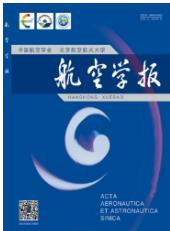  
航空学报Acta Aeronautica et Astronautica SinicaISSN 1000-6893,CN 11-1929/V

# 《航空学报》网络首发论文

题目： 模仿学习驱动的旋翼无人机鲁棒飞行控制方法

作者： 华和安，陈美林，张辉，钟杭，常浩，王耀南

收稿日期： 2026-04-20

网络首发日期： 2026-09-08

引用格式： 华和安，陈美林，张辉，钟杭，常浩，王耀南．模仿学习驱动的旋翼无人机 鲁棒飞行控制方法[J/OL]．航空学报. https://link.cnki.net/urlid/11.1929.v.20260907.1444.026

网络首发：在编辑部工作流程中，稿件从录用到出版要经历录用定稿、排版定稿、整期汇编定稿等阶段。录用定稿指内容已经确定，且通过同行评议、主编终审同意刊用的稿件。排版定稿指录用定稿按照期刊特定版式（包括网络呈现版式）排版后的稿件，可暂不确定出版年、卷、期和页码。整期汇编定稿指出版年、卷、期、页码均已确定的印刷或数字出版的整期汇编稿件。录用定稿网络首发稿件内容必须符合《出版管理条例》和《期刊出版管理规定》的有关规定；学术研究成果具有创新性、科学性和先进性，符合编辑部对刊文的录用要求，不存在学术不端行为及其他侵权行为；稿件内容应基本符合国家有关书刊编辑、出版的技术标准，正确使用和统一规范语言文字、符号、数字、外文字母、法定计量单位及地图标注等。为确保录用定稿网络首发的严肃性，录用定稿一经发布，不得修改论文题目、作者、机构名称和学术内容，只可基于编辑规范进行少量文字的修改。

出版确认：纸质期刊编辑部通过与《中国学术期刊（光盘版）》电子杂志社有限公司签约，在《中国学术期刊（网络版）》出版传播平台上创办与纸质期刊内容一致的网络版，以单篇或整期出版形式，在印刷出版之前刊发论文的录用定稿、排版定稿、整期汇编定稿。因为《中国学术期刊（网络版）》是国家新闻出版广电总局批准的网络连续型出版物（ISSN 2096-4188，CN 11-6037/Z），所以签约期刊的网络版上网络首发论文视为正式出版。

引用格式：华和安，陈美林，张辉，等.模仿学习驱动的旋翼无人机鲁棒飞行控制方法[J]. 航空学报，2027，48（3）：533752. HUAHACHEN M L, ZHANG H, et al. Imitation-Learning-Driven Robust Flight Control Method for Multirotors 2027 48 （3 ） ： 533752 （iChinese ） . doi: 10.7527/S1000-6893.2026. 33752

# 模仿学习驱动的旋翼无人机鲁棒飞行控制方法

华和安1,\*，陈美林1，张辉1，钟杭1，常浩1，王耀南1

1. 湖南大学 人工智能与机器人学院，长沙 410082

摘，要：针对旋翼无人机在复杂任务及扰动条件下飞行控制精度下降、鲁棒性不足的问题，提出一种模仿学习驱动的鲁棒飞行控制方法。该方法以模型驱动控制生成的高质量飞行数据为先验经验，结合深度确定性策略梯度（deep， ）网络构建学习控制策略，通过模仿学习与强化学习探索的协同训练，提高旋翼无人机对外部扰动和模型不确定性的补偿能力。首先，设计非线性干扰观测器对系统集总不确定性进行在线估计，并利用模型驱动控制过程采样飞行轨迹，构建具有模型先验信息的模仿学习经验池。随后，采用 网络学习集总不确定变量的补偿策略，并设计模仿经验与在线探索经验相结合的训练机制，通过优先经验回放和多步学习提高示范数据与交互数据的利用效率。通过上述模型经验与探索数据的协同利用，所提方法能够增强学习策略对外部扰动和模型不确定性的补偿能力，从而提升旋翼无人机在复杂飞行任务中的轨迹跟踪精度和鲁棒控制性能。仿真对比结果表明，所提方法在风力扰动螺旋轨迹、高速飞行和转弯飞行任务中的平均位置误差分别为 、 和 ，均小于自适应鲁棒反步滑模控制（adaptive robust backstepping sliding mode control，AR-BSMC）方法；与PX4位置控制器的补充对比进一步表明，所提方法在三组任务中均能够实现稳定轨迹跟踪，并在转弯飞行任务中将平均位置误差降低了73.6%。实物飞行实验进一步验证了所提方法在真实飞行平台上的有效性与可行性。

关键词：旋翼无人机；飞行控制；模仿学习；强化学习；鲁棒控制

中图分类号：V24；TP273

文献标识码：A

近年来，无人机广泛应用于农业、工业、公共安全、环境监测、军事国防、物流运输以及媒体娱乐等多个领域，展现了无人机的多功能性和高效性[1-3]。其中，旋翼无人机具备卓越的悬停能力和快速响应性能，且可灵活地调整负载，使其不仅可以在复杂环境中实现精确操作，而且能够满足多样化任务的特殊需求[4]。快稳准的控制是实现无人机各类功能的基础，也是旋翼无人机研究的核心问题。然而，旋翼无人机具有非线性、欠驱动性和强耦合性的特征，并且在执行任务时不可避免地会受到外部扰动，难以有效保障其控制系统的鲁棒性能[5]，这些特性为旋翼无人机控制器的设计带来了诸多挑战。因此，针对非理想因素的干扰，设计高效且智能的无人机控制算法文章编号：1000-6893(2025)XX-XXXXX-XX

以确保飞行鲁棒控制，具有重要的理论价值与实际意义。

为解决旋翼无人机的飞行鲁棒控制问题，研究人员提出了许多基于模型的控制策略[6-8]。这类方法通过建立准确的数学模型描述无人机的动力学与运动学特性，并在此基础上利用控制算法实时计算所需的控制指令，从而实现预期的运动性能。例如，文献[5]针对四旋翼无人机编队飞行的部分有界和状态相关扰动问题，通过使用自适应技术，提出虚拟位置控制策略来消除扰动的影响，使得四旋翼无人机能够有界地跟踪期望的位置轨迹。文献[9]提出了一种解决非线性参数化回归的参数估计问题的方案，将注意力限制在可以分解为两个函数的乘积的参数化上，并通过严格弱于激励持续性的激励假设来确保参数收敛，将其应用于自适应控制。文献 设计了一种级联控制器架构，综合了三步法和非线性积分滑模的优点，实现对具有未知扰动的四旋翼无人机的姿态控制。文献[11]提出了一种基于滤波器的控制方法，并在该滤波框架下设计了自适应控制器和基于扰动观测的控制器，实验结果表明该方法可应用于四旋翼无人机。文献 提出了一种非线性分层控制方案，将内环控制器与外环控制器的设计分离，实现了对四旋翼无人机较高精度的控制，并有效抑制了载荷摆动。文献 考虑了四旋翼无人机姿态跟踪时的外部干扰，提出了一种集成了函数自适应规则的反步控制方案，并在Hover系统中验证了控制器的有效性。文献[14]提出了一种基于反步的鲁棒自适应控制方法，解决了四旋翼无人机控制器设计中不确定参数、有界外部干扰和测量中的噪声问题。文献[15]根据滑模控制理论设计了鲁棒控制方案，能够抑制四旋翼无人机在姿态跟踪过程中，因外部干扰和时变质量引起的不稳定性。此外，国内学者也围绕旋翼无人机在不确定性、外部扰动和强耦合条件下的鲁棒控制问题开展了相关研究。文献 针对不确定强耦合下的四旋翼姿态控制问题，设计了多层逼近自适应神经网络动态面控制算法；文献针对倾转四旋翼无人机在复杂扰动下的姿态控制问题，提出了基于ADRC-RBF的参数自适应控制方法；文献 针对四旋翼无人机轨迹跟踪控制问题，提出了基于动态补偿器和扩张状态观测器的全驱抗干扰控制方法；文献[19]基于固定时间干扰观测器设计了空中机器人非奇异终端滑模控制方法；文献[20]针对四旋翼无人机编队系统中的模型不确定性、未知外部干扰和内部碰撞问题，提出了基于预设性能的安全控制方法。

尽管上述基于模型的旋翼无人机控制方法能够实现无人机的姿态控制，但在任务导向的实际应用中仍存在诸多亟待解决的问题。首先，旋翼无人机动力学系统本质上具有高度非线性特征，虽然滑模控制、自适应控制等方法能够在一定程度上缓解系统非线性带来的控制困难，但在抑制高频抖动和应对复杂扰动方面仍存在明显局限。其次，四旋翼无人机作为典型的多变量系统，具有显著的耦合特性，各旋翼之间的协同作用对系统稳定性和控制性能具有重要影响。然而，现有基于模型的控制方法在解耦设计方面仍存在不足，在复杂强耦合环境下容易因模型失配而导致控制性能下降。最后，模型驱动控制方法高度依赖精确的动力学模型，而在实际应用中，由于模型参数误差和外界环境不确定性的存在，往往难以建立高精度的旋翼无人机动力学模型。

随着人工智能与大模型的井喷式发展，基于学习的控制方法为旋翼无人机的控制提供了新的解决思路[21-23]，该方法通过从系统的历史数据或交互过程中学习系统动态特性和最佳控制策略，这类学习驱动的控制方法在应对复杂非线性系统、高维状态空间以及建模误差较大的系统时展现出显著优势，受到研究人员的广泛关注。其中文献[24]针对四旋翼无人机系统提出了一种基于学习的鲁棒跟踪控制方法，采用改进的权重更新规则，将神经网络用于基于学习的控制方案。文献[25]基于分层控制方案和强化学习理论，提出了一种鲁棒控制器，有效实现了对四旋翼无人机的无模型鲁棒编队控制。文献[26]提出了一种结合强化学习和自适应控制的控制框架，并通过数值验证展示了其在四旋翼无人机着陆任务中的有效性。文献 研究了从有限数量的专家演示中学习得到稳定控制器的问题，并实际验证了该控制器应用于四旋翼无人机的可行性。文献[28]基于神经网络学习组件，提出了对具有一般不确定性的非线性系统的鲁棒控制方案。文献 提出了一种基于事件触发模型的深度学习控制策略，来实现四旋翼无人机的实时轨迹跟踪控制。文献[30]提出了一种基于模糊逻辑系统的评估者 执行者架构的强化学习控制策略，该策略包含与角位置和速度相对应的跟踪误差项，能够平滑的操控四旋翼无人机的姿态角位置和速度状态。在学习控制方面，国内相关研究也将深度强化学习、actor-critic网络和抗扰控制思想引入飞行器控制任务。文 献 [31] 将 深 度 确 定 性 策 略 梯 度 （ deepdeterministic policy gradient，DDPG）算法用于无人飞行器控制；文献[32]面向直升机姿态控制中的强化学习奖励函数设计问题，基于actor-critic方法训练神经网络姿态控制器；文献 针对变体飞行器控制系统中安全性、抗扰性和最优性难以兼顾的问题，提出了基于强化学习的自适应抗

扰控制方法。

上述基于学习的控制方法能够较好的完成对旋翼无人机的控制，但仍然有一些关键性问题亟待解决。一方面，通过学习生成的控制策略鲁棒性较差，当面对复杂的动态环境或出现极端情况时，可能无法及时作出适应性调整，从而导致控制失效；另一方面，大部分的强化学习类算法没有充分利用旋翼无人机的先验动力学模型信息，只关注训练过程中对新状态的探索，这会导致学习到的控制策略没有安全保障，无法在实际中稳定应用。

针对上述问题，本文提出了模仿学习驱动的旋翼无人机鲁棒飞行控制方法。具体而言，通过分析旋翼无人机的动力学模型，采用姿态与位置分层的控制框架，并在此基础上提出分层控制架构下的鲁棒观测控制方法。该方法利用实时估计系统中的不确定性，并充分采样旋翼无人机的飞行数据，构建模仿学习经验池。然后，利用采样的经验池训练学习控制策略。该控制策略能够显著提升旋翼无人机的飞行控制精度，提升系统对不确定性的鲁棒性。本文的主要贡献如下：

设计了基于非线性干扰观测器的模型驱动示范数据生成方法。通过对旋翼无人机集总不确定变量进行在线估计，生成具有控制先验信息和稳定性基础的飞行示范数据，为后续模仿学习提供高质量经验来源。

提出了模型经验与在线探索相结合的模仿—探索学习机制。该机制先利用模型驱动示范数据对DDPG策略进行离线初始化，使策略在在线交互前具备一定的初始控制能力；随后结合在线交互数据继续优化策略，实现模型经验利用与强化学习探索的协同。

3) 构建了面向双经验池结构的训练策略。通过模仿学习经验池和强化学习经验池的混合采样，结合优先经验回放和多步学习机制，提高模型驱动示范数据和在线探索数据的利用效率，从而提升旋翼无人机在扰动和模型不确定条件下的控制精度与鲁棒性。

4) 通过仿真对比和实物飞行实验验证了所提方法的有效性。实验结果表明，所提方法能够在螺旋轨迹跟踪、高速飞行和转弯飞行等任务中实现稳定飞行与有效轨迹跟踪，相较于AR

BSMC方法具有更小的平均位置误差； PX4位置控制器对比结果进一步表明，所提方法在连续转弯任务中具有更好的位置误差抑制能力；实物实验进一步在真实飞行平台上验证了方法的可行性。

本文接下来的内容如下：在第1节中介绍旋翼无人机动力学模型与飞行控制框架；在第 节中介绍模仿学习驱动的鲁棒飞行控制方法，包括模仿学习策略设计和模仿数据收敛性分析；在第3节构建基于机器人操作系统（Robot OperatingSystem，ROS）和Gazebo的仿真环境的仿真环境，开展仿真对比验证；在第4节中进行实物实验验证；最后，在第5节中总结本文内容。

## 1 旋翼无人机动力学模型与飞行控制框架

## 1.1 旋翼无人机动力学模型

本节将介绍旋翼无人机的动力学模型。通过刚体建模，其动力学模型可用以下方程表示：

$$
\begin{array}{l} \dot {\boldsymbol {p}} = \boldsymbol {v}, \dot {\boldsymbol {v}} = \frac {1}{m} \left(f \boldsymbol {R e} _ {3} - m g \boldsymbol {e} _ {3}\right) \\ \dot {\boldsymbol {R}} = \boldsymbol {R} \hat {\omega}, \dot {\omega} = \mathbb {I} ^ {- 1} (\boldsymbol {\tau} - \boldsymbol {\omega} \times \mathbb {I} \boldsymbol {\omega}) \end{array}\tag{1}
$$

其中旋翼无人机的位置和速度分别由变量 $\pmb { p } \in \mathbb { R } ^ { 3 }$ 和 $\nu \in \mathbb { R } ^ { 3 }$ 表示。无人机的质量与旋转惯量矩阵由m∈R和Ⅱ∈R3×3表示。g∈R和 $\pmb { e } _ { 3 } = \left[ 0 0 1 \right] ^ { \mathrm { T } } \in \mathbb { R } ^ { 3 }$ 分别代表重力常数和竖直向上方向上的单位向量。无人机的输入由 和 $\tau \in \mathbb { R } ^ { 3 }$ 组成，分别表示推力输入和力矩输入； $\pmb { R } \in \mathrm { S O } ( 3 )$ 代表从物体固定系到惯性系的旋转矩阵， $\pmb { \omega } \in \mathbb { R } ^ { 3 }$ 表示物体固定坐标系中的四旋翼角速度。

## 1.2 飞行控制框架

旋翼无人机的鲁棒飞行控制目标是设计适当的输入策略 和 , 使得无人机能够沿给定的轨迹准确飞行。

为此，首先定义如下飞行控制误差变量，包括位置误差 $\boldsymbol { e } _ { p } \in \mathbb { R } ^ { 3 }$ 、速度误差 $\boldsymbol { e } _ { \nu } \in \mathbb { R } ^ { 3 }$ 、姿态误差 $\boldsymbol { e } _ { R } \in \mathbb { R } ^ { 3 }$ ，以及角速度误差 $\boldsymbol { e } _ { \omega } \in \mathbb { R } ^ { 3 }$ ，具体定义式如下：

$$
\begin{array}{l} \boldsymbol {e} _ {p} = \boldsymbol {p} - \boldsymbol {p} _ {d}, \boldsymbol {e} _ {v} = \dot {\boldsymbol {e}} _ {p} \\ \boldsymbol {e} _ {R} = \frac {1}{2} \left(\boldsymbol {R} _ {d} ^ {\mathrm{T}} \boldsymbol {R} - \boldsymbol {R} ^ {\mathrm{T}} \boldsymbol {R} _ {d}\right) ^ {\vee}, \boldsymbol {e} _ {\omega} = \boldsymbol {\omega} - \boldsymbol {R} ^ {\mathrm{T}} \boldsymbol {R} _ {d} \boldsymbol {\omega} _ {d} \end{array}\tag{2}
$$

其中， $\pmb { p } _ { \mathrm { { d } } } \in \mathbb { R } ^ { 3 }$ $\pmb { R } _ { \mathrm { d } } \in S O ( 3 )$ 和 ${ \pmb { \omega } } _ { \mathrm { d } } \in \mathbb { R } ^ { 3 }$ 分别表示期望位置、期望姿态旋转矩阵和期望角速度，下标 表示期望量； $( \cdot ) ^ { \vee }$ 表示将反对称矩阵映射为三维向量的vee映射。在此基础上，引入辅助变量$\xi , \chi \in \mathbb { R } ^ { 3 }$ 描述系统的开环动力学方程：

$$
\boldsymbol {\xi} = m \boldsymbol {e} _ {v} + \boldsymbol {K} _ {1} \boldsymbol {e} _ {p}, \boldsymbol {\chi} = \boldsymbol {e} _ {\omega} + k _ {\chi} \boldsymbol {e} _ {R}\tag{3}
$$

其中, $\pmb { K } _ { 1 } = \mathrm { d i a g } [ K _ { 1 x } , K _ { 1 y } , K _ { 1 z } ] \in \mathbb { R } ^ { 3 \times 3 }$ 为正定对角矩阵，下标�、�和�分别表示三个坐标轴方向；$k _ { \chi } \in$ 为与辅助变量 $\chi$ 对应的正控制参数。接下来，为了解决旋翼无人机控制中的欠驱动耦合问题，设计耦合变量 $\pmb { d } _ { o } \in \mathbb { R } ^ { 3 }$ 如下，其中下标o用于表示耦合项：

$$
\boldsymbol {d} _ {o} = \frac {1}{\boldsymbol {e} _ {3} ^ {\mathrm{T}} \boldsymbol {R} _ {d} ^ {\mathrm{T}} R \boldsymbol {e} _ {3}} \left[ f \left(\boldsymbol {e} _ {3} ^ {\mathrm{T}} \boldsymbol {R} _ {d} ^ {\mathrm{T}} \boldsymbol {R e} _ {3}\right) \boldsymbol {R e} _ {3} - f \boldsymbol {R} _ {d} \boldsymbol {e} _ {3} \right]\tag{4}
$$

与此同时，考虑到外界干扰与系统的建模误差等不确定因素，引入变量 $\pmb { d } _ { u } \in \mathbb { R } ^ { 3 }$ 表示系统中的不确定项，其中下标u表示不确定项。进而，综合考虑耦合变量和不确定项，设计线性相加的系统集总不确定变量 $\pmb { d } = \pmb { d } _ { o } + \pmb { d } _ { u } \in \mathbb { R } ^ { 3 }$ 。接下来，设计虚拟控制输入 $\mathbf { } f _ { d } = \frac { \mathcal { } \pmb { \mathcal { M } } _ { d } \pmb { e } _ { 3 } } { \pmb { e } _ { 3 } ^ { \mathrm { T } } \pmb { R } _ { d } ^ { \mathrm { T } } \pmb { R } \pmb { e } _ { 3 } } \in \mathbb { R } ^ { 3 }$ ，其中下标d表示期望量，进而可以将系统的控制输入展开为$f R e _ { 3 } = f _ { d } + d$ ，通过设计虚拟控制合适的输入$\pmb { f } _ { d }$ ，应对集总不确定变量 的影响，完成飞行控制任务。在此基础上，将旋翼无人机的开环动力学系统表示如下：

$$
\begin{array}{r l} & {\dot {\boldsymbol {\xi}} = \boldsymbol {f} _ {d} + \boldsymbol {d} - m g \boldsymbol {e} _ {3} - m \ddot {\boldsymbol {p}} _ {d} + \boldsymbol {K} _ {1} \boldsymbol {e} _ {v},} \\ & {\mathbb {I} \dot {\boldsymbol {\chi}} = \boldsymbol {\tau} - \boldsymbol {\omega} \times \mathbb {I} \boldsymbol {\omega} + \mathbb {I} \left(\hat {\boldsymbol {\omega}} \boldsymbol {R} ^ {\mathrm{T}} \boldsymbol {R} _ {d} \boldsymbol {\omega} _ {d} - \boldsymbol {R} ^ {\mathrm{T}} \boldsymbol {R} _ {d} \dot {\boldsymbol {\omega}} _ {d}\right)} \\ & {\quad + k _ {\chi} \mathbb {I} \left(\operatorname{tr} \left[ \boldsymbol {R} ^ {\mathrm{T}} \boldsymbol {R} _ {d} \right] \boldsymbol {I} - \boldsymbol {R} ^ {\mathrm{T}} \boldsymbol {R} _ {d}\right) \boldsymbol {e} _ {\omega} / 2} \end{array}\tag{5}
$$

式中， 为三阶单位矩阵。基于开环动力学系统式(5)，设计模型驱动的飞行控制算法如下：

$$
\begin{array}{l} \boldsymbol {\tau} = - k _ {w} \boldsymbol {\chi} - k _ {R} \boldsymbol {e} _ {R} - \boldsymbol {\tau} _ {M}, \\ \boldsymbol {f} _ {d} = m g \boldsymbol {e} _ {3} + m \ddot {\boldsymbol {p}} _ {d} - \boldsymbol {K} _ {1} \boldsymbol {e} _ {v} - \boldsymbol {K} _ {\xi} \boldsymbol {\xi} - \boldsymbol {K} _ {p} \boldsymbol {e} _ {p} - \overline {{\boldsymbol {d}}} \end{array}\tag{6}
$$

式中 $k _ { w } \in$ 和 $k _ { R }$ ∈R分别为角速度误差和姿态误差对应的正控制参数；姿态控制的前馈项 定 $\tau _ { M }$ 义为：

$$
\begin{array}{l} \boldsymbol {\tau} _ {M} = - \boldsymbol {\omega} \times \mathbb {I} \boldsymbol {\omega} + \mathbb {I} \Big (\hat {\boldsymbol {\omega}} \boldsymbol {R} ^ {\mathrm{T}} \boldsymbol {R} _ {d} \boldsymbol {\omega} _ {d} - \boldsymbol {R} ^ {\mathrm{T}} \boldsymbol {R} _ {d} \dot {\boldsymbol {\omega}} _ {d} \Big) \\ \quad + k _ {\chi} \mathbb {I} \Big (\operatorname{tr} \Big [ \boldsymbol {R} ^ {\mathrm{T}} \boldsymbol {R} _ {d} \Big ] \boldsymbol {I} - \boldsymbol {R} ^ {\mathrm{T}} \boldsymbol {R} _ {d} \Big) \boldsymbol {e} _ {\omega} / 2 \end{array}
$$

$\boldsymbol { K } _ { \xi } , \boldsymbol { K } _ { p } \in \mathbb { R } ^ { 3 \times 3 }$ 分别为辅助变量 和位置误差 $e _ { p }$ 对应的正定对角增益矩阵； $\bar { \pmb { d } }$ 为集总不确定变量 $\pmb { d }$ 的在线估计值。设计估计策略如下。首先，设计辅助变量 $\zeta \in \mathbb { R } ^ { 3 }$ 表示系统辅助变量 $\xi$ 与不确定项$\pmb { d }$

$$
\boldsymbol {\zeta} = \boldsymbol {d} - \boldsymbol {K} _ {\zeta} \boldsymbol {\xi} \Rightarrow \boldsymbol {d} = \boldsymbol {\zeta} + \boldsymbol {K} _ {\zeta} \boldsymbol {\xi}\tag{7}
$$

其中 $\ b { K _ { \zeta } } \in \mathbb { R } ^ { 3 }$ 为正定对角矩阵。然后，对上左式求导并且带入式(5)，可得：

$$
\dot {\boldsymbol {\zeta}} = \dot {\boldsymbol {d}} - \boldsymbol {K} _ {\zeta} \left(\boldsymbol {f} _ {d} + \boldsymbol {d} - m g \boldsymbol {e} _ {3} - m \ddot {\boldsymbol {p}} _ {d} + \boldsymbol {K} _ {1} \boldsymbol {e} _ {v}\right)\tag{8}
$$

定义 $\zeta$ 的实时估计值为 $\bar { \zeta } \in \mathbb { R } ^ { 3 }$ , 设计其更新策略如下：

$$
\dot {\overline {{\boldsymbol {\zeta}}}} = - \boldsymbol {K} _ {\zeta} (\boldsymbol {f} _ {d} + \overline {{\boldsymbol {d}}} - m g \boldsymbol {e} _ {3} - m \ddot {\boldsymbol {p}} _ {d} + \boldsymbol {K} _ {1} \boldsymbol {e} _ {v})\tag{9}
$$

根据式(7)右式，可得集总不确定变量 的在线估计表示如下：

$$
\begin{array}{l} \overline {{\boldsymbol {d}}} = \overline {{\boldsymbol {\zeta}}} + \boldsymbol {K} _ {\zeta} \boldsymbol {\xi} \\ = - \boldsymbol {K} _ {\zeta} \int (\boldsymbol {f} _ {d} + \overline {{\boldsymbol {d}}} - m g \boldsymbol {e} _ {3} - m \ddot {\boldsymbol {p}} _ {d} + \boldsymbol {K} _ {1} \boldsymbol {e} _ {v}) \mathrm{d} t + \boldsymbol {K} _ {\zeta} \boldsymbol {\xi} \end{array}\tag{10}
$$

进而，定义 、 的估计误差 $\pmb { d } \in \mathbb { R } ^ { 3 }$ 和 $\zeta \in \mathbb { R } ^ { 3 }$ 分别如下

$$
\boldsymbol {d} = \overline {{\boldsymbol {d}}} - \boldsymbol {d}, \zeta = \overline {{\zeta}} - \zeta\tag{11}
$$

带入式(7)和式(10)，可得 $\pmb { d } = \pmb { \zeta }$ 可见，只要能准确估计辅助变量ζ ，保证估计误差 $\zeta$ 收敛，即可实现对变量 的准确估计。利用该性质，对估计误差d求导：

$$
\dot {\tilde {d}} = \dot {\tilde {\zeta}} = \dot {\bar {\zeta}} - \dot {\zeta} = - \dot {d} - K _ {\zeta} (\bar {d} - d) = - \dot {d} - K _ {\zeta} d\tag{12}
$$

至此，利用式(9)所示的更新策略，能够准确地观测变量 的值。

## 2 模仿学习驱动的鲁棒飞行控制方法

本节提出模仿学习驱动的旋翼无人机鲁棒飞行控制方法，如图 所示。该方法主要包括模型驱动采样、离线模仿学习和在线强化探索三个过程。首先，基于旋翼无人机动力学模型和非线性干扰观测器估计系统集总不确定性，并利用模型驱动控制律采样飞行轨迹，构建具有模型先验信息的模仿学习经验池；其次，采用 网络构建学习控制策略，并利用模型驱动示范数据对actor网络和critic网络进行离线预训练，使策略在在线交互前具备一定的不确定性补偿能力；最后，在在线飞行过程中采集强化学习探索数据，并通过模仿学习经验池与强化学习经验池的混合采样、优先经验回放和多步学习机制更新网络参数，从而实现模型驱动经验与在线探索数据的协同利用。通过上述设计，本文所提方法将非线性干扰观测器、模型驱动控制律和 学习策略统一到同一闭环飞行控制框架中，提高旋翼无人机在外界扰动和模型不确定条件下的轨迹跟踪精度与鲁棒性。

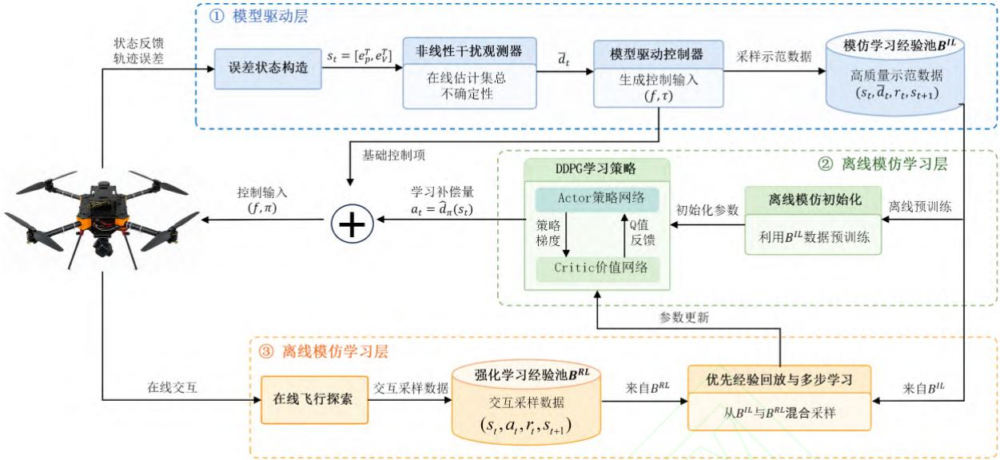  
图1 模仿学习驱动的鲁棒飞行控制方法总体框图  
Fig. 1 Overall framework of the imitation-learning-driven robust flight control method

## 2.1 模仿学习策略设计

尽管模型驱动的更新策略式(10)能够估计不确定性 的值，进而完成旋翼无人机的跟踪控制，但是仍然存在如下关键问题亟待解决。首先，由于不确定变量 的影响，在控制策略 的作用下，只能保证系统状态最终一致有界，无法完收敛到平衡点。其次，不确定性 的更新完全由模型驱动(9)，实际应用效果严重依赖准确的飞行控制系统建模。但是，现实中往往难以准确建立旋翼无人机系统的精确模型，亟需解决上述控制设计的鲁棒性不足、飞行精度差以及不确定变量估计不准等严重问题。为此，通过将旋翼无人机的飞行控制建模为决策问题，利用强化学习的交互式学习，有望实现旋翼无人机的高性能飞行控制。基于此，在上述飞行控制框架的基础上，提出模仿学习驱动旋翼无人机飞行控制方法，通过设计模仿学习与强化学习的复合策略，完成精准飞行控制。具体而言，首先设计 网络框架，然后利用控制策略 采样系统的控制轨迹，以强化学习的经验池数据格式( , , ', )r 构造模仿学习的数据库，进而设计兼顾监督学习与强化学习的学习策略训练DDPG网络。进一步使用控制策略(6)采样系统的经验，引导强化学习的交互探索，在模仿的基础上探索更好的控制策略，形成高性能的鲁棒飞行控制方法。

模仿学习的训练如算法1所示，其中， $n _ { 1 }$ 为模型驱动飞行轨迹的采样次数， $k _ { 2 }$ 为离线学习训练的迭代次数，i 和j 为循环索引。首先，将旋翼无人机的飞行控制问题建模为决策问题，采用 DDPG 中的 actor-critic 深度网络框架，其输入输出分别为 $\pmb { S } _ { t } = [ \pmb { e } _ { p } ^ { \mathrm { T } } , \pmb { e } _ { \nu } ^ { \mathrm { T } } ] ^ { \mathrm { T } } \in \mathbb { R } ^ { 6 }$ 和 $\pmb { a } _ { t } = \pmb { d } \in \mathbb { R } ^ { 3 }$ 。其中，下标t 表示当前交互时刻；状态 $s _ { t }$ 由位置误差和速度误差构成，用于描述当前轨迹跟踪偏差；动作 $\mathbf { } _ { \pmb { a } _ { t } }$ 表示学习策略输出的集总不确定变量补偿量，而不是直接输出旋翼无人机的推力 和力矩τ 。在实际控制过程中，学习策略输出的补偿量与模型驱动控制律相结合，共同作用于飞行控制闭环。actor 网络以6维状态 $s _ { t }$ 为输入，包含两层全连接隐藏层，每层包含 512个神经元，隐藏层激活函数为 ；输出层维度为 ，对应集总不确定变量补偿量 $\pmb { d }$ 在三个方向上的分量，并采用 tanh 激活函数生成归一化连续动作。critic 网络以状态—动作拼接向量 $[ \pmb { s } _ { t } ^ { \mathrm { T } } , \pmb { a } _ { t } ^ { \mathrm { T } } ] ^ { \mathrm { T } } \in \mathbb { R } ^ { 9 }$ 为输入，同样包含两层 个神经元的全连接隐藏层，隐藏层激活函数为 ReLU，输出层为1维动作价值函数 $Q ( s _ { t } , \pmb { a } _ { t } )$ 。此外，本文设置与 网络和critic 网络结构相同的目标网络，用于提高 DDPG 训练过程的稳定性。针对旋翼无人机高性能鲁棒飞行控制任务，设计控制策略的奖励函数为 $r _ { t } = - | | \mathbf { \Delta } e _ { p } | | ^ { 2 }$ ，即通过最小化飞行误差实现高 精 度 飞 行 ， 进 而 折 扣 累 计 奖 励 表 示 为$R _ { t } = \sum _ { t ^ { \prime } = t } ^ { T } \gamma ^ { t ^ { \prime } - t } r _ { t ^ { \prime } }$ ，其中T表示时间步数， $\gamma \in ( 0 , 1 )$ 为折扣因子。接下来，由 $\pmb { \theta } _ { 1 }$ 参数化 actor 网络 $\pi$ ，由 $\pmb { \theta } _ { 2 }$ 参数化 网络 $\boldsymbol { \mathcal { Q } }$ 。

算法 1 采样与训练策略

1: 初始化DDPG网络参数  $\theta$  和  $\theta'$ 

2: 初始化经验池  $B^{IL}$ 、 $B^{RL}$ 

3: /* 模型驱动的控制轨迹采样 */

4: for  $i=1,\cdots,n_{1}$  do

5: 加载规划的期望飞行轨迹  $p_{d}$ 

6: 计算式(9)所示的模型驱动策略估计变量 d 值

7: 使用式(6)所示的控制策略采样系统轨迹

8: 保存飞行数据  $(s,a^{\mathrm{IL}},r,s')$  到经验池  $B^{IL}$ 

9: end for

10: /* 离线学习训练 */

11: for  $j=1,\cdots,k_{2}$  do

12: 从  $B^{IL}$  中采样数据

13: 计算损失函数  $L(\theta_{1})$  与  $L(\theta_{2})$ 

14: 使用梯度下降更新策略参数  $\theta_{1}$  与  $\theta_{2}$ 

15: end for

16: /* 在线强化-模仿学习 */

17: 规划期望飞行轨迹  $p_{d}$ 

18: 使用策略  $\pi$  生成补偿动作  $a_{t}$，并结合模型驱动控制律驱动无人机飞行

19: 保存飞行数据到经验池  $B^{RL}$ 

20: 使用优先经验回放技术从  $B^{IL}$  和  $B^{RL}$  中采样训练数据

21: 计算损失函数，使用多步学习策略更新参数  $\theta_{1}$  与  $\theta_{2}$ 

在此基础上，应用模型驱动控制律和非线性干扰观测器采样系统飞行轨迹数据，构造模仿学习经验数据  $(s_{t},a_{t}^{\mathrm{IL}},r_{t},s_{t+1})$，其中  $a_{t}^{IL}=d_{t}$  表示由非线性干扰观测器生成的集总不确定变量估计值。将采样的数据以上述格式保存到模仿学习经验池  $B^{IL}$，其中上标IL表示模仿学习。进一步，设计模仿学习策略，利用  $B^{IL}$  中的数据训练  $\pi$  和 Q。

具体而言，为了有效地防止训练中的过拟合，在 actor 和 critic 的损失函数设计中都引入  $L_{2}$  正则化项 $^{[34]}$，即设计 critic 网络 Q 损失函数为：

$L(\theta_{2})=L_{1}(\theta_{2})+L_{n}(\theta_{2})+L_{2}(\theta_{2})$ (13)

其中， $L _ { 1 } ( \pmb { \theta } _ { 2 } )$ 和 $L _ { n } ( \pmb { \theta } _ { 2 } )$ 分别表示单步和多步损失函数， $L _ { 2 } ( \pmb { \theta } _ { 2 } )$ 为 $L _ { 2 }$ 正则化损失函数；通过引入单步和多步损失函数更新 网络，能够将之前的状态纳入学习过程中，更加精准地估计 值。其中，单步损失主要用于提高 critic 网络对当前状态转移的动作价值估计精度，多步损失用于引入连续飞行轨迹中的累计奖励信息，使网络能够利用更长时间尺度上的轨迹演化特征； $L _ { 2 }$ 正则化项用于降低网络训练过程中的过拟合风险，提高训练稳定性。设计 网络的损失函数为：$L ( \pmb \theta _ { 1 } ) = - J ( \pmb \theta _ { 1 } ) + L _ { 2 } ( \pmb \theta _ { 1 } )$ (14)其中， $J ( \pmb \theta _ { 1 } ) = \mathbb { E } _ { s _ { t } \sim \mathcal { B } } \big [ Q \big ( s _ { t } , \pi ( s _ { t } \mid \pmb \theta _ { 1 } ) \mid \pmb \theta _ { 2 } \big ) \big ]$ 表示由critic 网络评价的策略目标函数， 表示训练时采样的经验数据集合， $L _ { 2 } ( \pmb { \theta } _ { 1 } )$ 表示 $L _ { 2 }$ 正则化损失函数。由于 actor 网络的优化目标是提高 critic网络对当前策略动作的评价值，因此将 $- J ( \pmb \theta _ { 1 } )$ 写入损失函数，使最小化 $L ( \pmb \theta _ { 1 } )$ 等价于最大化$Q ( \pmb { s } _ { t } , \pi ( \pmb { s } _ { t } \mid \pmb { \theta } _ { 1 } ) )$ 。该目标项用于引导 网络输出更有利于减小轨迹跟踪误差的不确定性补偿量，从而使损失函数设计与旋翼无人机鲁棒轨迹跟踪任务相对应。基于上述损失函数，从 $\boldsymbol { B } ^ { \mathrm { I L } }$ 中采样数据更新网络参数 $\pmb { \theta } _ { 1 }$ 和 $\pmb { \theta } _ { 2 }$ ，采样时采用优先经验回放技术更新策略。在此基础上，设计在线的强化—模仿学习算法，进一步训练策略 $\pi$ ，通过策略的试错交互训练提高飞行控制的鲁棒性。具体而言，在每个交互时刻，actor 网络根据当前状态 $\pmb { s } _ { t - }$ 输出补偿动作 $\mathbf { } _ { \mathbf { } _ { t } }$ ，并与模型驱动控制律共同生成飞行控制输入，驱动无人机沿规划轨迹飞行；随后观测下一状态 并计算奖励 ，将在线交互数据保存至强 $\mathbf { } s _ { t }$ $r _ { t }$ 化学习经验池 ${ \mathfrak { B } } ^ { \mathrm { R L } }$ ，其中上标RL表示强化学习。飞行过程中首先获得一步转换数据 $( s _ { t - 1 } , \pmb { a } _ { t } , r _ { t } , s _ { t } )$ 为利用连续多个交互时刻的奖励信息，进一步由连续 $n$ 个一步转换数据构造 步转换数据$( s _ { t - n } , \pmb { a } _ { t - n + 1 } , \sum _ { i = 0 } ^ { n - 1 } r _ { t - n + 1 + i } \gamma ^ { i } , \gamma ^ { n } , s _ { t } )$ ，其中，�表示累计奖励所跨越的连续交互步数， $\gamma ^ { n }$ 表示经过 步状态转移后的累计折扣因子。在此基础上，采样${ \mathfrak { B } } ^ { \mathrm { R L } }$ 中的数据更新策略 $\pi$ ；与此同时，根据优先经验回放技术，混合采样 $\mathcal { B } ^ { \mathrm { I L } }$ 中的数据参与在线训练。样本优先级由 critic 网络的时序差分误差、actor 评价项和最小优先级常数共同确定；对于模仿学习样本，额外增加示范样本优先级权重，以保证模型驱动示范经验在在线训练阶段仍具有较高采样机会。该混合采样方式既能够利用在线交互数据修正当前策略，又能够保留模型驱动示范数据对策略更新的引导作用。此外，引入目标网络技术，构造与 actor-critic 相同结构的目标网络，分别由 $\boldsymbol { \theta } _ { 1 } ^ { \prime }$ 和 $\boldsymbol { \theta } _ { 2 } ^ { ' }$ 参数化，每 次交互更新一次目标网络，其中 表示目标网络更新间隔，即 $\pmb { \theta } _ { 1 } ^ { ' }  \pmb { \theta } _ { 1 } ~ , ~ \pmb { \theta } _ { 2 } ^ { ' }  \pmb { \theta } _ { 2 }$ 。进一步，为了充分利用历史数据，设计多步学习策略更新，即每个交互步长都多次更新，以提高数据使用率，取得学习效率和实时采样之间的动态平衡。进而，旋翼无人机的学习过程可以描述为：在每次交互时间步，观测到系统状态 $\pmb { S } _ { t - 1 }$ ，actor 网络根据当前状态生成补偿动作 $\mathbf { } _ { \pmb { a } _ { t } }$ ，并与模型驱动控制律共同生成控制输入施加于系统，进而观测到下一个状态 $s _ { t }$ 并计算此时的奖励函数 $r _ { t }$ ，将一步与多步交互信息保存到经验池，同时淘汰末尾的一组数据；在缓冲区采样数据完成多次更新。接下来给出飞行控制策略的更新公式如下：

$$
\boldsymbol {\theta} _ {2} (t) = \boldsymbol {\theta} _ {2} (t - 1) - \lambda_ {2} \nabla_ {\theta_ {2}} L (\boldsymbol {\theta} _ {2})
$$

$$
\boldsymbol {\theta} _ {1} (t) = \boldsymbol {\theta} _ {1} (t - 1) - \lambda_ {1} \nabla_ {\theta_ {1}} L (\boldsymbol {\theta} _ {1})\tag{15}
$$

其中 $\lambda _ { 1 }$ 和 $\lambda _ { 2 }$ 分别表示 actor 网络和 critic 网络的学习率参数。

## 2.2 模仿数据收敛性分析

通过设计非线性干扰观测器采样飞行数据，提出探索与演示数据结合的模仿-强化学习机制，充分利用模型驱动数据和学习探索数据，有效提高了旋翼无人机的飞行控制精度与鲁棒性。模仿学习的数据，即非线性干扰观测器采样飞行数据质量至关重要，能够很大程度上决定学习策略的性能。为此，本节将分析非线性干扰观测器策略的收敛性，旨在从模型驱动的角度说明采样策略的有效性，进而保证设计的学习策略能充分发挥模型驱动和探索数据驱动的优势，实现智能的鲁棒飞行控制。

定理 当参数选择满足条件 $\lambda _ { \xi } > \frac { 1 } { 2 }$ 和$\lambda _ { \zeta } > 1$ 时，若集总不确定变量变化率有界，即存在常数 $\Delta _ { d } > 0$ 使得 $\dot { \pmb { d } } \parallel \le \Delta _ { d }$ ，所提的模型驱动控制方法(6)能够保证旋翼无人机的控制误差最终一致有界，其中 $\lambda _ { \xi }$ 和 $\lambda _ { \zeta }$ 为对称正定矩阵 $K _ { \xi } , K _ { \zeta }$ 的最小特征值。

证明 提出Lyapunov候选函数 如下：

$V = \frac 1 2 \| \boldsymbol { \xi } \| ^ { 2 } + \frac { m } 2 e _ { p } ^ { \mathrm { { T } } } \pmb { K } _ { p } \pmb { e } _ { p } + \frac 1 2 \| \pmb { d } \| ^ { 2 } + \frac 1 2 \pmb { \chi } ^ { \mathrm { { T } } } \mathbb { I } \pmb { \chi } + k _ { R } \Psi$ (16)其中 $\Psi = \frac 1 2 \operatorname { t r } \left[ I - R _ { d } ^ { \mathrm { T } } R \right]$ 表示定义在SO(3)流形上的误差函数，其上下界可由误差变量 $\pmb { e } _ { R } |$ 表示：‖ $e _ { R }$ 2‖ $/ 2 \leq \Psi \leq k _ { \Psi } \Vert e _ { R } \Vert ^ { 2 }$ $k _ { \Psi }$ ∈R为正的参数，其导数计算如下 $\dot { \Psi } = e _ { R } ^ { \mathrm { T } } e _ { \omega }$ , 然后, 将式(6)带入式(5),可得旋翼无人机飞行控制闭环系统方程如下：

$$
\dot {\boldsymbol {\xi}} = - \boldsymbol {K} _ {\xi} \boldsymbol {\xi} - \boldsymbol {K} _ {p} \boldsymbol {e} _ {p} - \boldsymbol {d},
$$

$$
\mathbb {I} \dot {\boldsymbol {\chi}} = - k _ {w} \boldsymbol {\chi} - k _ {R} \boldsymbol {e} _ {R}\tag{17}
$$

在此基础上，对式(16)求导。由 $\pmb { \xi } = m \pmb { e } _ { \nu } + \pmb { K } _ { 1 } \pmb { e } _ { p }$ 可得 $\dot { \pmb { e } } _ { p } = \pmb { e } _ { \nu } = ( \xi - K _ { 1 } \pmb { e } _ { p } ) / m$ ；由式(12)可得观测误差动态 $\dot { \tilde { d } } = - \dot { d } - K _ { \zeta } d$ $K _ { p }$ 的对称性以及${ \pmb { \chi } } = { \pmb { e } } _ { \omega } + k _ { \chi } { \pmb { e } } _ { R }$ ，将式(12)和(17)带入可得：

$$
\begin{array}{l} \dot {V} = - \boldsymbol {\xi} ^ {\mathrm{T}} \boldsymbol {K} _ {\xi} \boldsymbol {\xi} - \boldsymbol {e} _ {p} ^ {\mathrm{T}} \boldsymbol {K} _ {p} \boldsymbol {K} _ {1} \boldsymbol {e} _ {p} - \boldsymbol {\xi} ^ {\mathrm{T}} \boldsymbol {d} - \boldsymbol {d} ^ {\mathrm{T}} \dot {\boldsymbol {d}} - \boldsymbol {d} ^ {\mathrm{T}} \boldsymbol {K} _ {\zeta} \boldsymbol {d} \\ - k _ {w} \boldsymbol {\chi} ^ {\mathrm{T}} \boldsymbol {\chi} - k _ {R} k _ {\chi} \boldsymbol {e} _ {R} ^ {\mathrm{T}} \boldsymbol {e} _ {R} \end{array} \tag {18}
$$

进而，根据Young不等式 $\dot { \pmb { d } } \rVert ^ { 2 } + | | \pmb { d } | | ^ { 2 } \ge 2 \pmb { d } ^ { \top } \dot { \pmb { d } }$ 和11 $\xi | | ^ { 2 } + | | \pmb { d } | | ^ { 2 } \geq 2 \xi ^ { \top } \pmb { d }$ ，将式(18)缩放如下：

$$
\dot {V} \leq - (\lambda_ {\xi} - \frac {1}{2}) \| \boldsymbol {\xi} \| ^ {2} - \lambda_ {p} \lambda_ {K _ {1}} \| \boldsymbol {e} _ {p} \| ^ {2} - (\lambda_ {\zeta} - 1) \| \boldsymbol {d} \| ^ {2}
$$

$$
+ \frac {1}{2} \| \dot {\boldsymbol {d}} \| ^ {2} - k _ {w} \| \boldsymbol {\chi} \| ^ {2} - k _ {R} k _ {\chi} \| \boldsymbol {e} _ {R} \| ^ {2}\tag{19}
$$

其中 $\lambda _ { \xi } , \lambda _ { p } , \lambda _ { K _ { 1 } } , \lambda _ { \zeta }$ 分别表示对称正定矩阵 $K _ { \xi } , K _ { p }$ $\pmb { K } _ { 1 } , \pmb { K } _ { \zeta }$ 的最小特征值。接下来, 定义辅助变量$e _ { s }$ [=‖ξ‖ ‖ $e _ { p }$  d‖‖‖‖ $\chi |$ ‖‖ $\pmb { e } _ { R } | \| ^ { \mathrm { T } } \in \mathbb { R } ^ { 5 }$ ， 将 Lyapunov 候选 函 数 (16) 缩 放 如 下 $V \leq k _ { \operatorname* { m a x } } e _ { s } ^ { \mathrm { T } } e _ { s }$ ， 其 中$k _ { \mathrm { m a x } } = \mathrm { m a x } \left\{ \frac { 1 } { 2 } , \frac { m \lambda _ { \mathrm { p m a x } } } { 2 } , \frac { \lambda _ { \mathrm { f m a x } } } { 2 } , k _ { R } k _ { \mathrm { \Psi } } \right\}$ 表示正的参数，$\lambda _ { p \mathrm { m a x } }$ 和 $\lambda _ { \operatorname* { m a x } }$ 为正定矩阵 $K _ { p }$ 和 的最大特征值。此时，式(19)缩放如下：

$$
\dot {V} \leq - k _ {\min} \boldsymbol {e} _ {s} ^ {\mathrm{T}} \boldsymbol {e} _ {s} + \frac {1}{2} \| \dot {\boldsymbol {d}} \| ^ {2} \leq - \kappa V + \frac {1}{2} \| \dot {\boldsymbol {d}} \| ^ {2}\tag{20}
$$

其 中 $k _ { \mathrm { m i n } } = \operatorname* { m i n } \left\{ \lambda _ { \xi } - 1 / 2 , \lambda _ { p } \lambda _ { 1 } , \lambda _ { \zeta } - 1 , k _ { w } , k _ { R } k _ { \chi } \right\}$ $\kappa = k _ { \operatorname* { m i n } } / k _ { \operatorname* { m a x } }$ 表示正的参数。由于 $\dot { \pmb { d } } \| \le \Delta _ { d }$ ，可$\dot { V } \le - \kappa V + \Delta _ { d } ^ { 2 } / 2$ 。根据比较引理[35]可知， 最终有界，因此 、 $e _ { p } \setminus \textit { \textbf { d } , \textit { \textbf { X } } }$ 和 最终一致有界。 $e _ { R }$ 至此，可得旋翼无人机状态将收敛到一个紧凑集合，能够保证旋翼无人机的控制误差最终一致有界，定理1得证。

需要指出的是，定理 主要用于说明模型驱动控制器和非线性干扰观测器生成的飞行数据具有最终一致有界性，从而为模仿学习经验池提供具有稳定性基础的示范数据。本文所提学习策略包含模型驱动采样、离线预训练和在线交互训练三个阶段。在离线预训练阶段， 网络主要利用上述模型驱动示范数据进行训练，因此示范数据的有界性和稳定性能够提高策略的初始训练质量；在在线交互训练阶段，策略性能还受到网络结构、学习率、损失函数、奖励函数、探索噪声以及经验池采样比例等因素影响，模型驱动示范数据通过混合采样继续参与策略更新，对训练过程起到引导作用。由于DDPG交互训练过程包含在线探索、经验回放、目标网络更新和神经网络参数迭代，学习策略并不是固定解析形式的控制律，因此本文不对整个交互训练过程作过度的全局稳定性声明，而是从模型驱动示范数据质量和训练机制角度说明所提方法对学习控制性能的提升作用。

## 3 仿真验证

为了验证所提模仿学习算法的有效性，本文构造基于 ROS/Gazebo 的仿真训练环境，采用无人机仿真库中的 模型部署飞行控制算法。利用式 所示的模型驱动飞行控制方法采样系统控制轨迹，构造并保存模仿学习数据库，并通过算法1训练深度网络；随后，结合在线交互数据和模型驱动采样数据，利用优先经验回放策略完成鲁棒飞行控制策略训练。本文采用自 适 应 鲁 棒 反 步 滑 模 控 制 （ adaptive robustbackstepping sliding mode control，AR-BSMC）作为 对 比 算 法 [36] 。 对 比 实 验 采 用 相 同 的ROS/Gazebo仿真环境、RotorS Pelican 旋翼无人机模型、期望轨迹、初始状态及扰动设置，仅替换控制算法部分。 控制器参数依据其原始文献设置。具体参数如表1所示。

此外，本文增加PX4位置控制器作为对比基线。 位置控制器仅采用其内置位置控制功能跟踪相同的期望轨迹，未引入本文设计的非线性干扰观测器、学习补偿策略或额外鲁棒控制器。

本节设置 组飞行对比实验。测试 为螺旋轨迹跟踪任务，并引入外部风力干扰，用于验证三种方法在曲线轨迹和扰动环境下的轨迹跟踪精度与鲁棒性；测试2为高速飞行任务，通过提高规划飞行速度上界，验证三种方法在高速飞行条件下的控制性能和泛化能力；测试3为转弯飞行任务，用于验证三种方法在转弯机动过程中的轨迹跟踪能力和速度响应性能。

表1 旋翼无人机控制系统参数  
Table 1 Control parameters of the multirotor UAV system

<table><tr><td>参数</td><td>值</td></tr><tr><td>无人机质量m</td><td>2.2kg</td></tr><tr><td>无人机转动惯量II</td><td>diag[0.01 0.01 0.01]kg·m</td></tr><tr><td>重力加速度</td><td>9.8m/s2</td></tr><tr><td>学习率λα1,2,3</td><td>1,2,2×10-4</td></tr><tr><td>训练回合数Mmax</td><td>100</td></tr><tr><td>训练步数Nmax</td><td>500</td></tr><tr><td>经验池大小BIL,BRL</td><td>10000</td></tr><tr><td>采样数据量Nm</td><td>128</td></tr><tr><td>训练折扣因子γ</td><td>0.95</td></tr><tr><td>探索与平滑系数σ1,2</td><td>0.1,0.05</td></tr><tr><td>控制策略交互频率</td><td>100Hz</td></tr><tr><td>引导策略参数kφij,βij</td><td>0.2,0.3</td></tr><tr><td>位置辅助增益矩阵Kpi</td><td>diag[4 4 4]</td></tr><tr><td>姿态辅助增益矩阵KRi</td><td>diag[1.5 1.5 1.5]</td></tr><tr><td>外环控制参数Kζi</td><td>diag[2 2 2]</td></tr><tr><td>内环控制参数kηi</td><td>diag[1.5 1.5 1.5]</td></tr><tr><td>内环控制参数ki</td><td>diag[2 2 2]</td></tr><tr><td>AR-BSMC滑模面参数ci</td><td>diag[0.704 0.70 0.60]</td></tr><tr><td>AR-BSMC到达律增益ksi</td><td>diag[2.29 2.29 3.75]</td></tr><tr><td>AR-BSMC鲁棒项系数ηi</td><td>diag[0.8 0.8 1.0]</td></tr><tr><td>AR-BSMC自适应律增益γi</td><td>diag[0.2 0.2 0.2]</td></tr></table>

## 3.1 测试 1

为了验证所提方法的有效性，采用 旋翼无人机，设计飞行路径为 $x = 3 \sin ( 2 s ) \mathrm { m }$ ,$y = 3 \cos ( 2 s ) \mathrm { m } , z = 0 . 8 s + 2 \mathrm { m }$ ，其中 $s \in ( 0 , 2 \pi )$ 表示路径坐标。 在此基础上，引入风力干扰测试所提算法的鲁棒性，具体而言设置风力沿 $x , y$ 方向，大小分别为- $- 0 . 7 \mathrm { m } { \cdot } \mathrm { s } ^ { - 1 }$ 和 $\lvert 0 . 5 \mathrm { m } \bullet \mathrm { s } ^ { - 1 }$ 。实验中，时间最优二阶锥规划（second-order cone programming，）规划飞行轨迹[37]，并将得到的期望轨迹

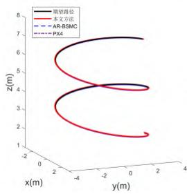

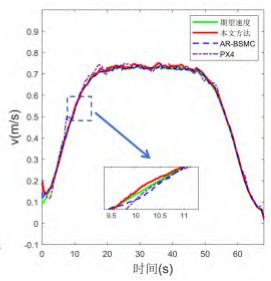  
图2 测试 1：飞行轨迹与速度对比

Fig. 2 Test 1: comparison of flight trajectories and speed  
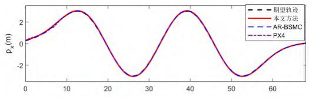

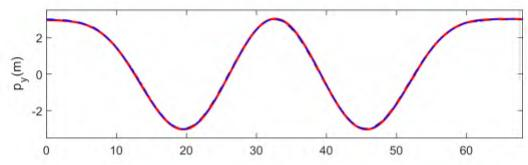

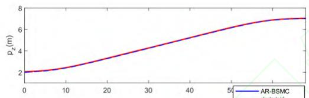

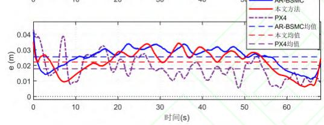  
图3 测试 1：x z 轴的飞行轨迹与飞行误差对比

Fig. 3 Test 1: comparison of trajectories and flight errors along the x, y and axes  
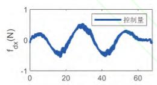

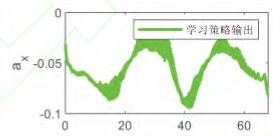

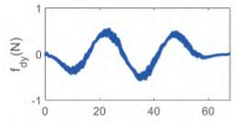

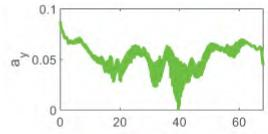

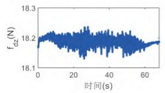

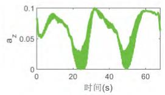  
图4 测试 1： $x , y , z$ 轴的控制量与学习策略输出  
Fig. 4 Test 1: control inputs and learning policy outputs along the x, y and axes

输入本文方法与AR-BSMC对比方法以及PX4位置控制器。实验结果如图2—图4所示。

从图 可以看出，在风力扰动条件下，三种方法均能够完成螺旋轨迹跟踪任务，但本文方法的实际轨迹与期望轨迹更加接近，而AR-BSMC方法在局部轨迹段存在可见偏差。 的实际轨迹与期望轨迹也基本一致，能够实现对螺旋轨迹的稳定跟踪。同时，本文方法的实际飞行速度与期望速度基本一致，稳态速度为 $0 . 7 \mathrm { m } { \cdot } \mathrm { s } ^ { - 1 }$ ，表明所提方法在风力扰动下仍能够实现高精度跟踪控制。PX4 的实际速度能够跟随期望速度变化，但局部区段存在小幅波动。在此基础上，进一步分析系统飞行误差，如图 3 所示。本文方法的综合位置误差整体小于 AR-BSMC 方法，其平均误差为 m而AR-BSMC方法的平均误差达到0.03m。PX4 的平均位置误差为 0.019m。综合轨迹、速度及误差响应可以看出，本文方法在外部风力扰动下仍能够保持稳定跟踪，其平均位置误差较 AR-BSMC 方法降低约 33.3%，且速度响应较为平稳，体现出较好的轨迹跟踪精度和抗风扰能力。图给出了本文方法的控制量曲线和学习策略输出。其中，学习策略输出表示 DDPG actor 网络在$x , y , z$ 方向上生成的集总不确定变量补偿量。由图可见，本文方法能够生成连续补偿量，并与模型驱动控制律共同作用，从而使无人机在风力扰动条件下保持较小的跟踪误差。

## 3.2 测试 2

在测试 的基础上，为了进一步验证所提飞行控制方法的泛化能力，设计飞行路径为：$x = 0 . 3 5 s - 0 . 5 \mathrm { m } , y = 0 . 5 s - \mathrm { l m } , z = 0 . 2 5 s + \mathrm { l m }$ ，其中$s \in ( 0 , 2 \pi )$ 表示路径坐标。通过提高规划的飞行速度上界，验证所提策略在高速飞行时的控制性能和泛化能力。需要说明的是，使用 方法规划的飞行轨迹满足系统动力学约束，包括最大加加速度、加速度、速度约束等。通过释放上述约束，测试2中SOCP规划策略的输出轨迹可能超出旋翼无人机的约束上限，不满足无人机的实际约束。尽管如此，应用所提控制方法，仍能够控制无人机完成飞行控制任务，结果如图5、图6所示。

图5记录了飞行速度曲线。由图5可见，测试中飞行速度在约 内快速增大，速度峰值超过 $2 \ m \bullet \mathrm { s } ^ { - 1 }$ ；本文方法的实际速度能够较好跟随

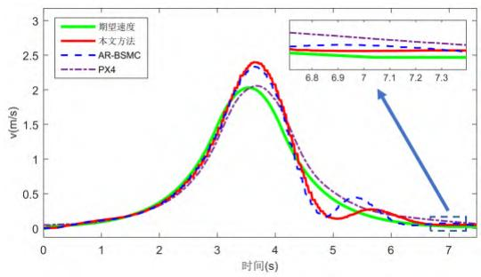  
图5 测试 2：飞行速度对比

Fig. 5 Test 2: comparison of flight speed  
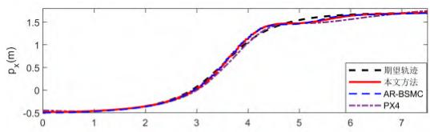

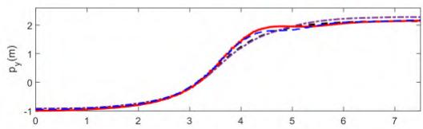

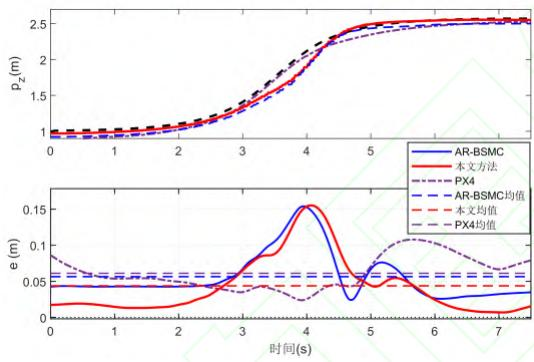  
图6 测试 2：飞行轨迹与误差对比  
Fig. 6 Test 2: comparison of flight trajectories and errors

期望速度变化，说明所提方法在高速飞行条件下仍具有较好的速度跟踪能力。PX4的实际速度也能够跟随期望速度的整体变化，但在减速阶段存在一定的响应滞后。此外，图6记录了本次测试的飞行轨迹和跟踪误差。由图 可见，三种方法均能够完成高速轨迹跟踪任务，其三轴位置响应总体能够跟随期望轨迹变化。需要指出的是，由于规划期望轨迹时释放了旋翼无人机的约束，测试 中期望轨迹可能并不满足系统的动力学约束，因此飞行误差较测试1有所增大。从误差曲线可以看出，在约 的高速变化区段，三种方法均出现一定跟踪误差，但本文方法的误差整体小于方法；从平均误差来看，本文方法的平均误差为 ， 方法的平均误差达到0.06m，PX4的平均位置误差为0.039m。上述结果说明，本文方法在高速飞行条件下能够保持较小的位置跟踪误差，且相较于AR-BSMC方法具有更高的轨迹跟踪精度；同时，相较于PX4位置控制器，本文方法在减速阶段具有更快的速度响应。

## 3.3 测试 3

为了测试所提方法在转弯机动任务中的泛化能力，进一步开展测试 。具体而言，测试 中采用转弯飞行轨迹测试所提控制方法的有效性。设置期望飞行路径为： ${ x = 0 . 1 s ^ { 2 } - 0 . 2 s + 0 . 5 \mathrm { m } , }$ $y = - 0 . 9 \cos ( s ) - 0 . 5 \mathrm { m } , z = 0 . 1 5 s + \mathrm { l m }$ ， 其 中$s \in ( 0 , 2 \pi )$ 表示路径坐标。

图7、图8记录了测试3的结果。从图7左图可以看出，三种方法均能够完成转弯飞行任务，但本文方法的实际轨迹与期望轨迹更加接近；BSMC方法在局部转弯区段存在一定偏差，PX4在转弯过程中的轨迹偏差相对更加明显。从图7右图可以看出，测试 中的实际速度与期望速度基本一致，说明所提方法在转弯机动过程中仍能够保持较好的速度跟踪效果。相比之下， 的速度响应在局部加减速区段存在一定滞后。

在此基础上，图8记录了飞行轨迹和误差。图8可以看出，本文方法的 $p _ { x }$ 、 $p _ { y }$ 和 曲线相 $p _ { z }$ 比于 方法有更好的控制精度，平均误差为0.023m，而AR-BSMC方法的平均误差达到。 的平均位置误差为 ，明显大于本文方法和 方法。相比于 ，本文方法的平均位置误差降低约73.6%。由此可见，本文方法能够有效减小转弯过程中的位置跟踪误差，并保持较好的三轴轨迹跟踪精度，在连续转弯任务中表现出更好的控制性能。

综上所述，三组仿真对比结果表明，本文方法在风力扰动、高速飞行和转弯机动任务中均能够实现稳定轨迹跟踪，并相较于AR-BSMC方法具有更高的轨迹跟踪精度和鲁棒性。PX4位置控制器能够完成三组轨迹跟踪任务，但在连续转弯过程中位置偏差明显增大；相比之下，本文方法在转弯飞行任务中表现出更高的轨迹跟踪精度。该结果说明，模型驱动示范经验与在线探索经验的协同训练能够有效提高学习策略对扰动、模型不确定性和轨迹变化的补偿能力。

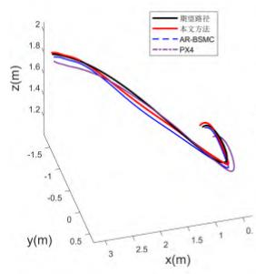

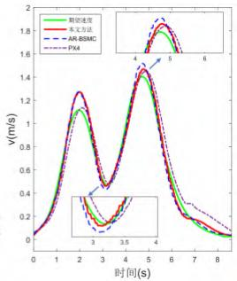  
图7 测试 3：飞行三维路径与飞行速度对比

Fig. 7 Test 3: comparison of 3D flight path and flight speed  
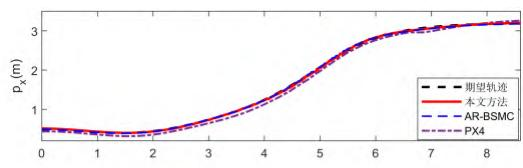

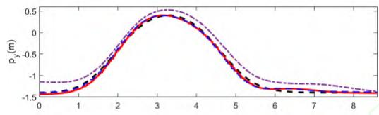

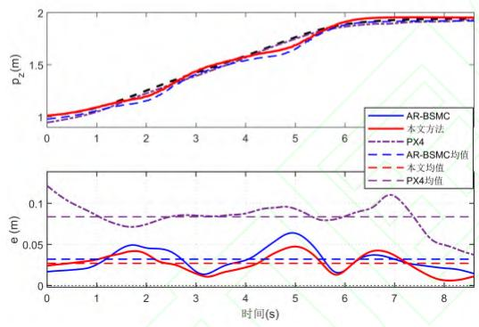  
图8 测试 3：飞行轨迹与飞行误差对比  
Fig. 8 Test 3: comparison of flight trajectories and flight errors

## 4 实验验证

为了进一步验证所提模仿学习驱动鲁棒飞行控制方法在真实飞行平台上的有效性，设计并开展了实物飞行实验。本节实物实验主要用于验证所提方法在真实旋翼无人机平台上的部署可行性和实际飞行效果，因此仅采用本文方法进行实物验证。为便于结果展示与分析，本节选取测试1对应的螺旋轨迹跟踪任务作为实物实验场景。具体而言，在真实平台上对测试1所设置的螺旋轨迹跟踪任务进行了实验验证，并采用与仿真一致的本文控制方法实现旋翼无人机的轨迹跟踪控制。实验过程中无人机的实际飞行状态如图9所示，

实验结果分别如图10和图11所示。

由图 和图 可知，在实物实验条件下，所提模仿学习驱动鲁棒飞行控制方法能够实现旋翼无人机对期望三维轨迹的稳定跟踪，验证了该方法在真实飞行平台上的有效性。具体而言，如图左图所示，实际飞行轨迹与期望轨迹总体一致，表明所提飞行控制方法能够有效支撑旋翼无人机完成给定空间轨迹飞行任务。需要指出的是，在轨迹过渡段及转向飞行区段，实际轨迹存在一定偏差。这主要是由于该区段飞行状态变化较为剧烈，位置与姿态通道间的耦合作用更为显著，同时外界扰动与模型不确定性对闭环跟踪性能的影响有所增强，从而导致该区段的轨迹跟踪误差增大。但从整体结果来看，系统未出现明显失稳或轨迹发散现象，表明所提方法在真实飞行条件下仍具有较好的轨迹跟踪性能与鲁棒控制能力。由图10右侧速度响应结果可以看出，实际飞行速度总体能够跟随期望速度变化。需要指出的是，实际速度曲线在约20\~40s区间存在一定波动，并出现局部偏差。这主要与实物实验中速度信息获取过程中的测量噪声、外部扰动作用下的瞬态响应波动以及模型失配条件下控制输入调节偏差有关。尽管如此，实际速度的整体演化趋势与期望速度基本一致，说明所提模仿学习与强化学习相结合的飞行控制策略在真实飞行条件下仍具有较好的速度跟踪性能。

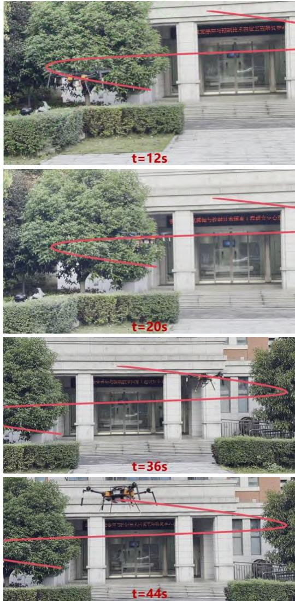  
图9 实物验证：不同时刻的飞行状态  
Fig. 9 Physical validation: flight states at different time instants

进一步地，如图11所示， 、 、 三个方向的位置响应总体与期望指令保持一致，表明所提模仿学习驱动鲁棒飞行控制方法能够实现旋翼无人机三维位置的稳定跟踪。从误差响应结果可以看出，三个方向的位置跟踪误差均保持有界，并始终在零附近波动，未出现持续累积或发散现象，说明系统整体闭环飞行控制过程保持稳定。需要指出的是， x 方向的位置跟踪误差 在约 $e _ { x }$ 区间的波动相对更为明显，表明前向通道在螺旋轨迹过渡阶段对外界扰动、模型失配及动态耦合效应更为敏感；相比之下， 方向的位置跟踪误差 $e _ { y }$ 整体较小，说明横向通道具有较好的轨迹跟踪精度； 方向的位置跟踪误差 在初始 $e _ { z }$ 阶段存在一定调节过程，随后逐步减小并稳定于零附近，这与旋翼无人机垂向通道需要完成重力补偿及高度调节有关。综合上述结果可知，尽管实物实验条件下系统响应相较仿真存在更明显的波动，所提模仿学习与强化学习相结合的飞行控制策略仍能够有效完成预定三维飞行任务，从而验证了该方法在真实飞行平台上的有效性与鲁棒性。

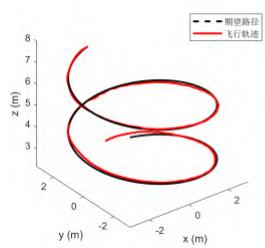

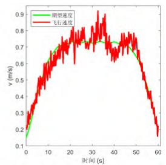  
图10 实物验证：飞行三维路径与飞行速度  
Fig. 10 Physical validation: 3D flight path and flight speed

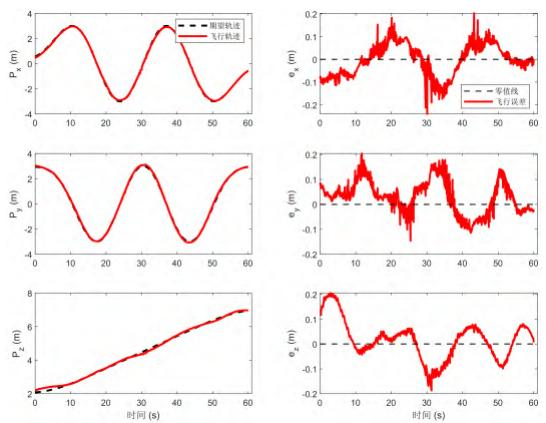  
图11 实物验证：飞行轨迹与跟踪误差  
Fig. 11 Physical validation: flight trajectories and tracking errors

## 5 结 论

本文针对旋翼无人机在复杂飞行任务和扰动条件下轨迹跟踪精度下降、鲁棒性不足的问题，提出了一种模仿学习驱动的鲁棒飞行控制方法。该方法基于旋翼无人机动力学模型和姿态--位置分层控制框架，设计非线性干扰观测器估计系统集总不确定性，并利用模型驱动控制过程生成飞行示范数据。在此基础上，构建 学习控制策略，通过模仿学习经验池和强化学习经验池的混合训练，实现模型驱动经验与在线探索数据的协同利用，从而提高学习策略对外部扰动和模型不确定性的补偿能力。

仿真对比和实物飞行结果表明，所提方法能够在螺旋轨迹跟踪、高速飞行和转弯飞行等任务中保持较好的轨迹跟踪性能。相较于AR-BSMC方法，本文方法在三组仿真任务中均具有更小的平均位置误差； PX4对比结果进一步表明，所提方法在三组飞行任务中均能够保持稳定轨迹跟踪，并在连续转弯任务中表现出更好的位置误差抑制能力。实物实验也验证了所提方法在真实飞行平台上的可行性。后续研究将重点面向真实复杂扰动环境，开展模仿—探索学习策略的迁移应用研究，以提升所提方法在不同旋翼无人机平台和复杂飞行任务中的适应能力。

## 参 考 文 献

[1] ERSKINE J, BRIOT S, FANTONI I, et al. Singularity analysis of rigid directed bearing graphs for quadrotor formations[J]. IEEE Transactions on Robotics, 2024, 40: 139-157.

[2] CHUNG S J, PARANJAPE A A, DAMES P, et al. A survey on aerial swarm robotics[J]. IEEE Transactions on Robotics, 2018, 34(4): 837-855.

[3] WANG J, YUAN X, ZHU B. Geometric control for trajectory-tracking of a quadrotor UAV with suspended load[J]. IET Control Theory & Applications, 2022, 16(12): 1271-1281.

[4] EVERAERTS J. The use of unmanned aerial vehicles (UAVs) for remote sensing and mapping[J]. The International Archives of the Photogrammetry, Remote Sensing and Spatial Information Sciences, 2008, 37: 1187-1192.

[5] JIN X Z, CHE W W, WU Z G, et al. Robust adaptive general formation control of a class of networked quadrotor aircraft[J]. IEEE Transactions on Systems, Man, and Cybernetics: Systems, 2022, 52(12): 7714- 7726.

[6] LIU H, TIAN Y, LEWIS F L, et al. Robust formation tracking control for multiple quadrotors under aggressive maneuvers[J]. Automatica, 2019, 105: 179- 185.

[7] MU C, SUN C, XU W. Fast sliding mode control on airbreathing hypersonic vehicles with transient response analysis[J]. Proceedings of the Institution of Mechanical Engineers, Part I: Journal of Systems and Control Engineering, 2016, 230(1): 23-34.

[8] HAN Z, WANG W, HUANG J, et al. Distributed adaptive formation tracking control of mobile robots with event-triggered communication and denial-ofservice attacks[J]. IEEE Transactions on Industrial Electronics, 2023, 70(4): 4077-4087.

[9] ORTEGA R, GROMOV V, NUÑO E, et al. Parameter estimation of nonlinearly parameterized regressions without overparameterization: Application to adaptive control[J]. Automatica, 2021, 127: 109544.

[10] ZHU C, CHEN J, ZHANG H. Attitude control for quadrotors under unknown disturbances using triple-step

method and nonlinear integral sliding mode[J]. IEEE Transactions on Industrial Electronics, 2022, 70(5): 5004-5012.

[11] HAN Q, LIU Z, SU H, et al. Filter-based disturbance observer and adaptive control for Euler-Lagrange systems with application to a quadrotor UAV[J]. IEEE Transactions on Industrial Electronics, 2022, 70(8): 8437-8445.

[12] LIANG X. FANG Y, SUN N. et al. Nonlinear hierarchical control for unmanned quadrotor transportation systems[J]. IEEE Transactions on Industrial Electronics, 2017, 65(4): 3395-3405.

[13] LI Y, LI Z, YU X, et al. Attitude tracking control for quadrotors under unknown disturbances based on dual loop nonlinear command filters[J]. IEEE Transactions on Circuits and Systems II: Express Briefs, 2024, 71(5): 2769-2773.

[14] WANG J, ZHU B, ZHENG Z. Robust adaptive control Electronic Systems, 2023, 59(6): 8313-8326.

[15] W U X, XIAO B, QU Y. Modeling and sliding modebased attitude tracking control of a quadrotor UAV with time-varying mass[J]. ISA Transactions, 2022, 124: 436- 443.

[16] 刘晨阳, 吴大伟, 郭一泽, 等. 不确定强耦合下四旋翼姿态鲁棒自适应控制[J]. 航空学报, 2023, 44(S1):727645.LIU C Y, WU D W, GUO Y Z, et al. Robust adaptiveattitude control of quadrotor with uncertain strongcoupling[J]. Acta Aeronautica et Astronautica Sinica,2023, 44(S1): 727645. (in Chinese).

[17] 贺炅, 任斌武, 杜思亮, 等. 基于ADRC-RBF倾转四旋 翼 无 人 机 姿 态 自 适 应 控 制 [J]. 航 空 学 报 ,2025,46(S1): 732189.HE J, REN B W, DU S L, et al. Adaptive attitude controlfor tilt-quadrotor UAV based on ADRC-RBF[J]. ActaAeronautica et Astronautica Sinica, 2025, 46(S1):732189. (in Chinese).

王晓娟 田广泰 李彬 等 基于动态补偿器的四旋翼无人机全驱抗干扰控制[J]. 航空学报, 2026, 47(9):123.

WANG X J, TIAN G T, LI B, et al. Fully actuated anti disturbance control for quadrotor UAVs based on dynamic compensator[J]. Acta Aeronautica et Astronautica Sinica, 2026, 47(9): 123. (in Chinese).

[19] 赵静, 潘龙, 陆宁云, 等. 基于固定时间干扰观测器 的空中机器人非奇异终端滑模控制 航空学报 2026, 47(9): 532278. ZHAO J, PAN L, LU N Y, et al. A novel nonsingular terminal sliding mode control for aerial robot based on fixed-time disturbance observer[J]. Acta Aeronautica et Astronautica Sinica, 2026, 47(9): 532278 (in Chinese).

[20] 郭洪振, 陈谋. 基于预设性能的四旋翼无人机编队安 全控制[J]. 航空学报, 2021, 42(8): 525789-525789. GUO H Z, CHEN M. Safety formation control of quadrotor UAVs based on prescribed performance[J]. Acta Aeronautica et Astronautica Sinica, 2021, 42(8): 525789-525789. (in Chinese).

[21] WEN G, CHEN C L P, GE S S. Simplified optimized backstepping control for a class of nonlinear strictfeedback systems with unknown dynamic functions[J]. IEEE Transactions on Cybernetics, 2020, 51(9): 4567- 4580.

[22] MU C, WANG D, HE H. Novel iterative neural dynamic programming for data-based approximate optimal control design[J]. Automatica, 2017, 81: 240-252.

[23] DORFLER F, COULSON J, MARKOVSKY I. Bridging direct and indirect data-driven control formulations via regularizations and relaxations[J]. IEEE Transactions on Automatic Control, 2023, 68(2): 883-897.

[24] MU C, ZHANG Y. Learning-based robust tracking control of quadrotor with time-varying and coupling uncertainties[J]. IEEE Transactions on Neural Networks and Learning Systems, 2019, 31(1): 259-273.

[25] ZHAO W, LIU H, LEWIS F L. Robust formation control for cooperative underactuated quadrotors via reinforcement learning[J]. IEEE Transactions on Neural Networks and Learning Systems, 2020, 32(10): 4577- 4587.

[26] ANNASWAMY A M, GUHA A, CUI Y, et al. Integration of adaptive control and reinforcement learning for real-time control and learning[J]. IEEE Transactions on Automatic Control, 2023, 68(12): 7740-

7755.

[27] SULTANGAZIN A, PANNOCCHI L, FRAILE L, et al. Learning to control known feedback linearizable systems from demonstrations[J]. IEEE Transactions on Automatic Control, 2023, 69(1): 189-201.

[28] WANG D, LIU D, MU C, et al. Neural network learning and robust stabilization of nonlinear systems with dynamic uncertainties[J]. IEEE Transactions on Neural Networks and Learning Systems, 2018, 29(4): 1342- 1351.

[29] ZHU C, CHEN J, IWASAKI M, et al. Event-triggered deep learning control of quadrotors for trajectory tracking[J]. IEEE Transactions on Industrial Electronics, 2023, 71(3): 2726-2736.

[30] WEN G, YU D, ZHAO Y, et al. Optimized fuzzy attitude control of quadrotor unmanned aerial vehicle using adaptive reinforcement learning strategy[J]. IEEE Transactions on Aerospace and Electronic Systems, 2024, 60(5): 6075-6083.

[31] 黄旭, 柳嘉润, 贾晨辉, 等. 深度确定性策略梯度算法用于无人飞行器控制[J]. 航空学报, 2021, 42(11):524688-524688.HUANG X, LIU J R, JIA C H, et al. Deep deterministicpolicy gradient algorithm for UAV control[J]. ActaAeronautica et Astronautica Sinica, 2021, 42(11):524688-524688. (in Chinese).

章涛 李攀 王梓旭 等 面向直升机姿态控制的强化学习奖励函数设计[J]. 航空学报, 2025, 46(S1):732184.ZHANG T, LI P, WANG Z X, et al. Design of rewardfunctions for helicopter attitude control in reinforcementlearning[J]. Acta Aeronautica et Astronautica Sinica,2025, 46(S1): 732184. (in Chinese).

[33] 程昊宇, 张笑妍, 刘昕, 等. 变体飞行器强化学习自 适应抗扰动控制方法[J]. 宇航学报, 2025, 46(05): 977-990. CHENG H Y, ZHANG X Y, LIU X, et al. Reinforcement learning-based adaptive anti-disturbance control method for morphing flight vehicles [J]. Journal of Astronautics, 2025, 46(05): 977-990. (in Chinese).

[34] VECERIK M, HESTER T, SCHOLZ J, et al. Leveraging demonstrations for deep reinforcement learning on

robotics problems with sparse rewards[DB/OL]. arXiv:1707.08817, 2017.

[35] KHALIL H K. Nonlinear Systems[M]. 3rd ed. Upper Saddle River, NJ: Prentice Hall, 2002.

[36] HOU Y H, CHEN D K, YANG S M. Adaptive robust trajectory tracking controller for a quadrotor UAV with uncertain environment parameters based on backstepping sliding mode method[J]. IEEE Transactions on Automation Science and Engineering, 2025, 22: 4446-4456.

[37] HUA H, FANG Y, ZHANG X, et al. A time-optimal trajectory planning strategy for an aircraft with a suspended payload via optimization and learning approaches[J]. IEEE Transactions on Control Systems Technology, 2022, 30(6): 2333-2343.

# Imitation-Learning-Driven Robust Flight Control Method for Multirotors

HUA Hean1,\*, CHEN Meilin 1, ZHANG Hui1, ZHONG Hang1, CHANG Hao1, WANG Yaonan1

1. School of Artificial Intelligence and Robotics, Hunan University, Changsha 410082, China

Abstract: An imitation-learning-driven robust flight control method is proposed for rotary-wing unmanned aerial vehicles (UAVs under complex missions and disturbance conditions, where flight control accuracy may degrade and robustness may become insufficient. In this method, high-quality flight data generated by a model-driven controller are used as prior experience, and a learning-based control policy is constructed using the deep deterministic policy gradient (DDPG) network. Through the collaborative training of imitation learning and reinforcement learning exploration, the compensation capability of multirotors against external disturbances and model uncertainties is improved. First, a nonlinear disturbance observer is designed to estimate the lumped system uncertainty online. Meanwhile, flight trajectories are sampled during the model-driven control process to construct an imitation learning experience buffer with model prior information. Subsequently, the DDPG network is employed to learn the compensation policy for the lumped uncertainty variable, and a training mechanism combining imitation experience with online exploration experience is developed. Prioritized experience replay and multi-step learning are further introduced to improve the utilization efficiency of both demonstration data and interaction data. Through the collaborative use of model-based experience and exploration data, the proposed method enhances the ability of the learning policy to compensate for external disturbances and model uncertainties, thereby improving the trajectory tracking accuracy and robust control performance of multirotors in complex flight missions. Simulation comparison results show that the proposed method achieves mean position errors of 0.02 m, 0.04 m, and 0.023 m in the wind-disturbed helical trajectory tracking, high-speed flight, and turning flight tasks, respectively, all of which are lower than those of the AR-BSMC method. Additional comparisons with the PX4 controller further show that the proposed method achieves stable trajectory tracking in all three tasks and reduces the mean position error by 73.6% in the turning flight task. Real world flight experiments further verify the effectiveness and feasibility of the proposed method on a practical flight platform.

Keywords: Multirotors; flight control; imitation learning; reinforcement learning; robust control