http: //hkxb. buaa. edu. cn hkxb@buaa. edu. cn

引用格式：张智星，钟杭，张彩霞，等.空中操作机器人运动规划技术研究进展与展望[J]. 航空学报，2026，47(9)：533402ZHANG Z X, ZHONG H, ZHANG C X, et al. Research progress and prospect of motion planning technologyfor aerial manipulators[J]. Acta Aeronautica et Astronautica Sinica, 2026, 47(9): 533402 (in Chinese). doi:10.7527/S1000-6893.2026.33402

先进飞行器安全控制技术专刊

# 空中操作机器人运动规划技术研究进展与展望

张智星1，钟杭1，2，3，张彩霞4，梁嘉诚1，刘兰兰5，王耀南1，\*

1．湖南大学 人工智能与机器人学院，长沙 410082

2．湖南大学 粤港澳大湾区创新研究院， 广州 511340

3．江西省通讯终端产业技术研究院有限公司，吉安 343000

4．湖南大学 电气与信息工程学院，长沙 410082

5．国网湖南省电力有限公司 超高压输电公司，长沙 410004

摘 要：空中操作机器人通过与环境建立持续或瞬态的物理接触，从传统的信息获取平台拓展为具备主动作业能力的复杂交互系统，从“被动感知”向“主动作业”演进，在桥梁、电网、油气管道等大型能源交通基础设施的复杂交互场景中具有广阔应用前景。与非接触式飞行作业相比，接触式作业包含显著的动力学耦合、接触力限制及多模态运动切换，引入的高维非线性约束限制了运动规划的可行解空间，制约了系统的自主性与稳定性。针对上述挑战，系统综述了空中操作机器人运动规划领域的研究进展。首先，从系统架构出发，分析各类飞行平台构型以及作业机构对可规划空间与作业能力的影响；其次，总结了面向运动规划的系统建模方法，接触动力学建模与各类任务规划约束；在此基础上，围绕接触式作业任务的规划需求，分别介绍了基于采样、基于优化及基于学习的 类主流运动规划算法，分析其发展趋势，并比较其在高维状态搜索、动力学约束处理及实时重规划等方面的适用性与局限性。最后，总结了空中操作机器人面临的挑战并对未来发展趋势进行了展望。

关键词：空中操作机器人；旋翼飞行机器人；运动规划；接触式作业；系统建模

中图分类号：V279. 2；V249. 1

文献标识码：A

传统的空中机器人主要为信息观测式空中机器人，依靠高分辨率摄像头、激光雷达等传感设备，实现对环境的感知识别［1-2］，导航探索［3-4］等观测作业任务。然而，随着电力巡检、设备维护等复杂场景应用需求的深化，单纯的非接触式观测已难以满足安装、检测、维修等涉及物理交互的作业要求，促文章编号：1000-6893（2026）09-533402-21

使空中机器人技术从“被动感知”向具备主动作业能力的方向演进［5］，如图1所示。

空中操作机器人正是在这一背景下产生的一种新型复合机器人构型，其本质是在传统信息观测型机器人平台上增设机械臂、专用作业工具等主动作业机构［6］，融合飞行运动平台的大范围机动能力与作业机构的高灵巧操作特性。在高空、高危环境下的作业任务中，空中操作机器人可降低工作人员的操作风险，提升作业的精确性、质量与效率，在电力设施巡检［7］、桥梁检测［8］及高层建筑清洁［9］等领域展现出广阔的应用前景与发展潜力［10］。

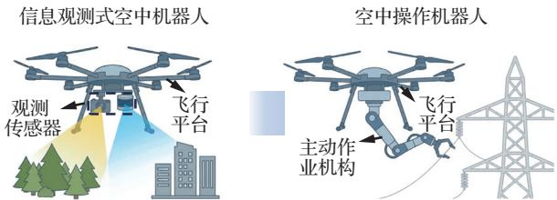  
图 1 空中机器人演进：“被动感知”到“主动作业”  
Fig. 1 Evolution of aerial robots： From passiveperception to active manipulation

然而，与传统工业机械臂基于固定基座的作业模式不同，空中操作机器人作为一个典型的浮动基座系统，其运动规划面临着严峻挑战。首先，飞行平台与机械臂之间存在强烈的动力学耦合效应，末端执行器的接触反力会直接干扰平台的飞行稳定性［11］；其次，操作任务通常要求满足维持接触力，躲避障碍等任务约束，以及执行器饱和，关节限位等系统约束［12］。因此，在多重物理约束下，生成兼具动力学可行性与作业高效性的运动轨迹，已成为实现空中机器人自主交互操作的关键核心技术。

对于空中操作机器人运动规划方法的系统总结与归纳将有助于其技术发展与应用拓展。目前，Ollero等［6］回顾了近十年的三代技术演进及感知、规划与控制技术。Mohiuddin等［13］全面梳理了单/多无人机平台及交互控制策略。Zhong等［5］聚焦物理交互，深度解析了构型、建模与主动控制关键技术。宋光明等［14］进一步依据末端执行器与作业对象的交互特性，将接触模式划分为定点、滑动及干预3类，并系统评述了接触作业型飞行机械臂在机构设计与控制策略方面的研究现状。Zhou等［15］则综述了具备变形与仿生特征的新型空中操作机器人，剖析了其材料与驱动等前沿挑战。

然而，上述关于空中操作机器人的综述文献多侧重于系统构型与交互控制方法，对其运动规划算法的分析尚不够深入，且缺乏对主流规划算法的横向对比。因此，本文对空中操作机器人运动规划技术的最新研究进展进行了全面综述。文章结构安排如下：第1节首先梳理机械系统架构，分析不同飞行平台构型与作业机构对运动规划可行性的影响；第 2节探讨面向规划的系统建模技术，阐述多体动力学耦合、接触力模型与约束模型的数学描述，确立规划算法的理论基础；第3节从基于优化、基于采样及基于学习3个维度，深入分析主流运动规划算法的原理、优劣势及其在空中操作场景中的应用；最后，总结当前技术面临的关键挑战，并对未来的发展趋势进行展望。

## 1 系统架构设计

空中操作机器人的机械设计与系统架构直接决定了其可达构型空间、可施加交互力的方向与幅值范围，以及飞行平台与作业机构之间的动力学耦合特性，是运动规划问题形式与复杂度的重要影响因素。因此，需要从系统层面系统梳理不同机械构型的结构特征，为后续分析运动规划方法奠定基础。

## 1. 1 飞行平台

空中操作机器人的飞行平台作为整个系统的移动基座，其结构设计决定系统可施加交互力的方向、幅值范围以及位姿耦合等特性，是运动规划算法设计的物理前提。目前，空中操作机器人飞行平台以多旋翼构型为主。

## 1. 1. 1 平行轴多旋翼式

平行轴多旋翼空中操作机器人的飞行平台由主体框架和多个沿垂直方向排列的旋翼组成。该类平台涵盖了从传统的单旋翼直升机［16］、双旋翼［17］、三旋翼［18］，到应用广泛的四旋翼［19］、六旋翼［20］和八旋翼［21］等多种构型。其中，单旋翼直升机通过周期变距机构控制位姿，适用于重型空中操作任务［22］；双旋翼在提升载重比的同时结构更为紧凑；三旋翼则常通过尾舵倾转实现偏航控制，兼顾了机械简单性与机动性。四轴飞行器由于其机械结构简单、低成本和控制方案相对成熟等优点而得到广泛使用。然而，平行轴多旋翼飞行平台固有的欠驱动特性是其执行接触式作业时的核心瓶颈［23］。由于位置与姿态存在强耦合效应，平台在不产生位移的前提下无法独立调整姿态。该类平台主要应用任务场景包括物体抓取［24］、空中装配［25］以及吊运运输［26］等，如图 2［19，25］所示。对于平行轴多旋翼式飞行平台，规划算法需在受限的欠驱动流形中解算满足推力矢量方向与作业力方向一致的轨迹序列。

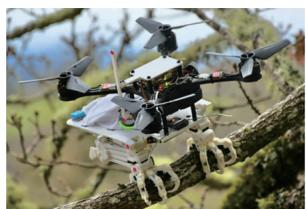  
(a) 抓取栖息[19]

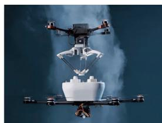  
图 2 平行轴多旋翼式空中操作机器人  
(b)空中装配[25]  
Fig. 2 Parallel-axis multirotor aerial manipulators

## 1. 1. 2 固定倾角多旋翼式

针对平行轴多旋翼系统存在的位姿强耦合局限，固定倾角多旋翼式空中操作机器人通过预设旋翼的安装倾角，使其能够在机体坐标系下产生侧向推力分量。这种构型打破了推力矢量仅能沿机体主轴分布的限制，通过在多个维度提供独立的控制力矩，实现了位置与姿态运动的物理解耦。该类平台具备至少 6个独立的控制输入，能够直接对应并控制空间的 6个自由度，从而构成了典型的全驱动系统。相较于欠驱动的平行轴构型，固定倾角多旋翼机器人展现出更显著的机动性与灵活性，能够支持作业机构在保持特定接触力的同时独立调节平台姿态。这使其能够胜任更为复杂的空中交互任务，例如高精度的孔对接任务［27］、需要持续力控的连续接触作业［28］以［29-30］ ［27，30所示。在运动规划层面，由于位姿解耦特性的引入，规划算法无需再依赖复杂的映射来处理欠驱动流形的束缚，而是可以直接在完整的六自由度任务空间内进行轨迹解算。然而，自由度的增加也带来了规划维度的提升，使得算法需要在更高维度的空间搜索。

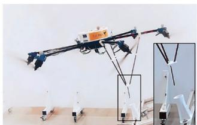  
(a)孔对接作业[27]

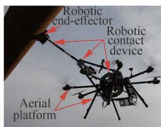  
(b) 滑动检测作业[30]  
图 3 固定倾角多旋翼式空中操作机器人  
Fig. 3 Fixed-tilt multirotor aerial manipulators

## 1. 1. 3 可变倾角多旋翼式

固定倾角构型的推力输出边界受限于物理安装角，在执行大负载或动态操作时，特定方向的电机易达到作动器饱和阈值。可变倾角多旋翼通过引入舵机等机构主动调节旋翼指向，实现了推力矢量的全向动态配置。可变倾角多旋翼构型，不仅能根据任务需求实时优化推力分配以提升能效，且能在维持机身姿态恒定的前提下，大幅扩展末端执行器的力矩输出范围及有效作业空间，实现大倾转姿态接触［18］和大负载推拉操作［31-32］等任务，如图4［18，32］所示。然而，机构冗余也显著增加了系统复杂度并降低了系统可靠性。冗余自由度协同优化以及倾转过程中的强非线性耦合，使得实时生成动力学可行轨迹的计算开销增加。

针对上述不同形式的作业机构多旋翼平台，表 1［18，24-32］总结了其在规划方面的优缺点与适用任务。

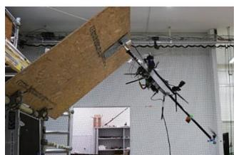  
(a)大倾转姿态接触[18]

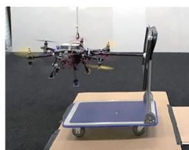  
(b)大负载推动作业[32]  
图4 可变倾角多旋翼式空中操作机器人  
Fig. 4 Variable-tilt multirotor aerial manipulators

表1 不同旋翼式飞行平台对比  
Table 1 Comparison of various multirotor platforms

<table><tr><td>平台类型</td><td>优势</td><td>不足</td><td>适用任务</td></tr><tr><td>平行轴多旋翼式</td><td>结构简单,悬停效率高,控制方案成熟</td><td>欠驱动特性导致力/位耦合,交互方向受限</td><td>物体抓取[24]、空中装配[25]、吊运运输[26]</td></tr><tr><td>固定倾角多旋翼式</td><td>可实现位置/姿态独立控制,接触稳定性强</td><td>能量效率较低</td><td>孔对接[27]、表面接触[28-30]</td></tr><tr><td>可变倾角多旋翼式</td><td>构型灵活度极高,兼顾推力矢量与能量效率</td><td>机械与控制系统复杂,维护成本高</td><td>大姿态倾转接触[18]、重载推拉[31-32]</td></tr></table>

## 1. 1. 4 其他飞行平台

除常见的多旋翼构型外，空中操作机器人的飞行平台还包括扑翼无人机、固定翼无人机等特种构型，如图5［33-34］所示。与旋翼类平台相比，扑翼无人机在模拟生物飞行方面具有独特优势，长距离巡航时能效更高，但其载荷能力与推力输出相对较弱，因此目前多用于小目标采样或高隐蔽性巡检等轻量化任务［33］。固定翼无人机具备飞行速度快、续航时间长的显著优点，但在执行接触作业时，通常需要在接触前完成复杂的模式转换或俯冲动作［34-35］，难以实现定点高精度的物理交互，故其在定点接触作业中的应用受到较大限制。

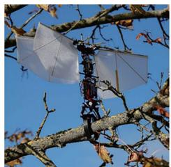  
(a) 扑翼抓取作业[33]

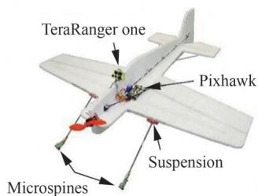  
(b) 固定翼栖息作业[34]  
图 5 扑翼空中机器人与固定翼空中机器人  
Fig. 5 Flapping-wing and fixed-wing aerial robots

## 1. 2 作业机构

空中操作机器人的作业机构是执行物理交互任务的直接载体，不同形式的作业机构将改变系统的动力学特性与约束形式，从而对运动规划算法的选择与设计提出不同要求。

## 1. 2. 1 绳系机构

绳系机构通过绳缆连接飞行平台与作业对象，如图6［36-37］所示，具有成本低、部署方便、工具负载小等显著优势。然而，由于绳缆缺少可控的主动自由度，且无法提供持续稳定的推力，其本质上是一个典型的欠驱动系统［38］。在进行运动规划时，必须将细绳摆动规律纳入动力学约束，通过增加摆动抑制约束来生成平滑轨迹［36-37］。该类机构主要应用于吊运运输等任务场景，规划目标通常侧重于载荷的定位精度与摆动能量的最小化。

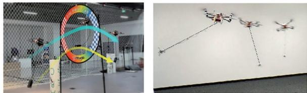  
图 6 绳系作业机构［36-37］  
Fig. 6 Tethered operation mechanisms［36-37］

## 1. 2. 2 刚性固连机构

刚性固连作业机构通常直接固结于飞行平台上，作为飞行平台本体的刚性延伸，如图7［39-40］所示。此类机构无额外的主动自由度，但具有较高的机构刚度，能够直接传递飞行平台的推力矢量。在进行任务规划时，需将作业机构与飞行平台视为统一的整体构型，通过调节飞行平台的位姿来满足末端工具的作业需求［39-41］。

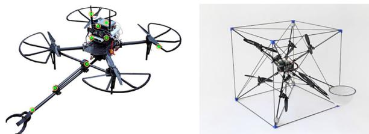  
图 7 刚性固连机构［39-40］  
Fig. 7 Rigidly fixed mechanisms［39-40］

## 1. 2. 3 串联机械臂

串联机械臂由多个转动或移动关节串接构成，如图8［42-43］所示，具有较大的构型空间与工作范围，能够为飞行平台提供额外的作业自由度，实现对末端执行器的全位姿控制［42-43］。然而，机械臂运动会导致系统重心实时偏移，产生动力学耦合［24，44］。因此，运动规划需采用系统全身规划框架。

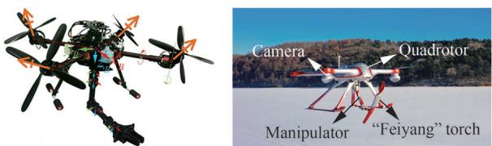  
图 8 串联机械臂［42-43］  
Fig. 8 Serial manipulators［42-43］

## 1. 2. 4 并联机械臂

并联机械臂通过多个闭环支路共同驱动末端执行器，如图 9［45-46］所示，相较于串联机构，其通常具有更高的机构刚度和更高的作业精度。但在运动规划层面，并联机构的工作空间相对受限，且存在相对复杂的正逆运动学映射，为系统状态空间规划带来约束。

针 对 上 述 不 同 作 业 机 构 ，表 2［25-28，31-33，47-48］从质量成本、作业精度及运动规划复杂度等维度进行了综合对比，并列举不同作业机构适用的任务。

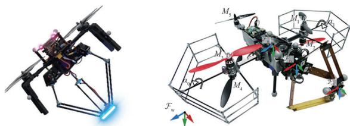  
图 9 并联机械臂［45-46］  
Fig. 9 Parallel manipulators［45-46］

表2 不同作业机构对比  
Table 2 Comparison of various operation mechanisms

<table><tr><td>平台类型</td><td>优势</td><td>不足</td><td>适用任务</td></tr><tr><td>绳系机构</td><td>质量轻,成本低,便于部署</td><td>无法输出持续推力</td><td>吊运运输[26]</td></tr><tr><td>刚性机构</td><td>刚度大,成本低</td><td>纯刚性接触,容易发生冲击振动</td><td>孔对接[27],表面接触[28,31-32]</td></tr><tr><td>串联机械臂</td><td>可控自由度高,作业空间大</td><td>刚度较低,重心偏移显著</td><td>栖息[33],物体抓取放置[47]</td></tr><tr><td>并联机械臂</td><td>可控自由度高,精度高,刚度较大</td><td>作业空间较小,运动解算较复杂</td><td>空中装配[25],推拉物体[48]</td></tr></table>

## 1. 2. 5 其他作业机构

除了传统作业机构，多机协同变形机构通过特殊机构链接多个空中机器人单元，如图10（a）［49］与图 $1 0 ( \mathrm { b } )$ ）［50］所示，突破单机载荷瓶颈并提升任务冗余，实现更灵巧的运动作业和特殊操作，此外，可变形作业机器人可通过自身形态调整可实现精细的物体交互，例如模仿人手的柔性抓取，见图10（c）［51］。但该类空中操作机器人面临高维构型空间及强动力学耦合导致的解空间稀疏挑战。而连续体柔性机构则效仿生物灵活构型，如图 10（d）［52］所示，利用非刚性结构的物理柔顺性补偿接触冲击，其规划核心在于突破刚体建模，融合大变形力学与高维几何约束进行一体化建模。

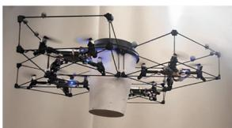  
(a)协同变形作业机构[49]

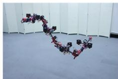  
(b)组合变形作业机构[50]

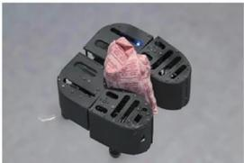  
(c) 仿人手操作变形机构[51

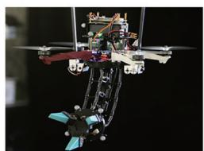  
(d)连续体柔性作业机构[52]  
图 10 其他作业机构  
Fig. 10 Other manipulator mechanisms

## 2 系统建模

空中操作机器人由飞行平台与作业机构深度耦合而成。与固定基座机械臂不同，该类系统属于典型的浮动基座系统。为了实现高精度的运动规划，必须建立能够准确描述系统运动学特性、动力学耦合效应以及末端交互受力特性的数学模型。系统模型的建立通常可分为2个子系统的组合建模或完整系统的整体建模。

## 2. 1 系统运动学建模

运动学模型定义了机器人自身构型与其末端或作业点在空间中的位姿映射关系。以较为常见的装备二关节串联机械臂的平行轴四旋翼空中操作机器人为例，其坐标系定义如图11所示。

建立运动学模型之前，首先需要定义多体系统的坐标系及其转换关系。通常定义惯性坐标系 $\mathcal { F } _ { \mathrm { w } }$ 以描述机器人的绝对位置；机体坐标系 $\mathcal { F } _ { \mathrm { B } }$ 固连于飞行平台中心以描述其姿态；作业机构坐标系 $\mathcal { F } _ { i }$ 以及末端执行器坐标系 $\mathcal { F } _ { \mathrm { E } }$ 则用于描述操作工具相对基座的位姿。将机器人视为由飞行平台与操作臂构成的运动链，采用广义坐标描述构型：

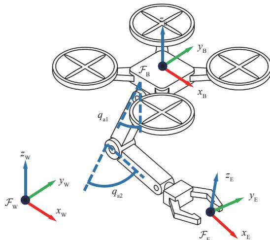  
图 11 空中操作机器人坐标系定义  
Fig. 11 Definitions of coordinate systems for aerial manipulators

$$
\boldsymbol {q} = \left[ \begin{array}{c} \boldsymbol {q} _ {p} ^ {\mathrm{T}}, \boldsymbol {q} _ {a} ^ {\mathrm{T}} \end{array} \right] ^ {\mathrm{T}} \in \mathbb {R} ^ {6 + n}\tag{1}
$$

式中： $\mathbf { \Phi } : \pmb q _ { \beta } = [ \pmb { p } ^ { \mathrm { scriptscriptstyle T } } , \pmb { \phi } ^ { \mathrm { \scriptscriptstyle T } } ] ^ { \mathrm { \scriptscriptstyle T } } \in \mathbb { R } ^ { 6 }$ 表示飞行平台在惯性坐标系 $\mathcal { F } _ { \mathrm { w } }$ 下的位置 $\pmb { p } \in \mathbb { R } ^ { 3 }$ 和姿态 $\pmb { \phi } \in \mathbb { R } ^ { 3 } ; \pmb { q } _ { i }$ 为作业臂关节角度。正运动学描述了从平台状态（位置与姿态）及关节构型空间到末端执行器任务空间的映射，表示为

$$
\boldsymbol {x} _ {\mathrm{e}} = f (\boldsymbol {q}) = \left[ \begin{array}{c} \boldsymbol {p} _ {\mathrm{e}} (\boldsymbol {q}) \\ \boldsymbol {\Phi} _ {\mathrm{e}} (\boldsymbol {q}) \end{array} \right]\tag{2}
$$

式中 $: x _ { \mathrm { { e } } } \in$ R6 表示末端执行器的位置和姿态。末端执行器的速度关系通过雅可比矩阵建立为

$$
\dot {\boldsymbol {x}} _ {\mathrm{e}} = \boldsymbol {J} (\boldsymbol {q}) \dot {\boldsymbol {q}}\tag{3}
$$

式中：雅可比矩阵 $\pmb { J } ( \pmb q ) = [ \pmb { J } _ { \mathrm { p } } ( \pmb q ) , \pmb { J } _ { \mathrm { a } } ( \pmb q ) ] \in \mathbb { R } ^ { 6 \times ( 6 + n ) }$ 可分解为飞行平台和作业臂2个部分。

## 2. 2 系统动力学建模

系统动力学建模是空中操作机器人实现安全、精准运动规划的理论核心与物理边界。空中操作机器人作为一个由飞行平台与多自由度作业机构构成的典型浮动基座系统，其运动学与动力学行为表现出显著的强耦合，高度非线性以及复杂的欠驱动特性。为了支撑后续运动规划算法的解算，建模过程不仅需要准确描述机器人本体在三维空间中的位姿演化与动力学约束，更需在执行接触交互任务时，显式表征末端执行器与作业环境之间的物理交互特征。这种“机体-环境”的耦合建模，是确保规划轨迹在物理层面具有可行性、鲁棒性与作业精度的前提。

## 2. 2. 1 机器人动力学建模

空中操作机器人动力学建模方法主要包括递归牛顿-欧拉方法和欧拉-拉格朗日能量法。前者是使用递归的方法推导机器人动力学模型，充分考虑了飞行平台和作业臂之间的动态耦合效应；后者基于能量守恒推导，将整个复合机器人系统视为一个耦合系统。

1）递归牛顿-欧拉方法建模：将飞行平台和作业臂视为 2个子系统分别进行控制，并将 2个子系统之间的耦合效应作为各自的扰动项。利用递归牛顿-欧拉方法，建立惯性坐标系 $\mathcal { F } _ { \mathrm { w } }$ 下的飞行平台动力学为［27］

$$
\left[ \begin{array}{c} m \ddot {\boldsymbol {p}} \\ \boldsymbol {J} _ {\mathrm{b}} \dot {\boldsymbol {\omega}} _ {\mathrm{b}} \end{array} \right] = \left[ \begin{array}{c} \boldsymbol {F} _ {\mathrm{c}} \\ \boldsymbol {\tau} _ {\mathrm{c}} \end{array} \right] - \left[ \begin{array}{c} m g \boldsymbol {e} _ {3} \\ [ \boldsymbol {\omega} _ {\mathrm{b}} ] _ {\times} \boldsymbol {J} _ {\mathrm{b}} \boldsymbol {\omega} _ {\mathrm{b}} \end{array} \right] + \left[ \begin{array}{c} \boldsymbol {F} _ {\mathrm{d}} \\ \boldsymbol {\tau} _ {\mathrm{d}} \end{array} \right]\tag{4}
$$

式中： $; m \in$ R 和 $\pmb { J } _ { \mathrm { b } } \in \mathbb { R } ^ { 3 \times 3 }$ 分别为系统总质量及其惯性矩阵； $g$ 为重力加速度系数 $\mathbf { ; } e _ { 3 } { = } [ 0 , 0 , 1 ] ^ { \mathrm { { r } } }$ ；$\pmb { \omega } _ { \mathrm { b } } \in \mathbb { R } ^ { 3 }$ 为飞行平台在机体坐标系 $\mathcal { F } _ { \mathrm { B } }$ 下的角速度； $\mathsf { ; } \left[ \cdot \mathsf { \right] _ { \times } }$ 表示矩阵叉乘运算； $\boldsymbol { F } _ { \mathrm { c } } , \boldsymbol { \tau } _ { \mathrm { c } } \in \mathbb { R } ^ { 3 }$ 分别为飞行平台的输入力和力矩； $F _ { \mathrm { d } } , \tau _ { \mathrm { d } } \in \mathbb { R } ^ { 3 }$ 分别为总扰动力和力矩，包括内部飞行平台和作业臂间的耦合效应和外部扰动。

2）欧拉-拉格朗日能量法：将飞行平台和操作臂视为一个独立的实体，并基于系统的全动力学进行控制。欧拉-拉格朗日方程可以表示为

$$
\left\{ \begin{array}{l} \frac {\mathrm{d}}{\mathrm{d} t} \cdot \left(\frac {\partial \mathcal {L}}{\partial \dot {\boldsymbol {q}}}\right) - \frac {\partial \mathcal {L}}{\partial \boldsymbol {q}} = \boldsymbol {W} _ {\mathrm{c}} + \boldsymbol {W} _ {\mathrm{d}} \\ \mathcal {L} = \mathcal {K} - \mathcal {U} \end{array} \right.\tag{5}
$$

式中：L 为系统动能 K 和势能 U的拉格朗日量；$\pmb { W } _ { \mathrm { c } } \in \mathbb { R } ^ { 6 + n }$ 为广义输入， $W _ { \mathrm { d } } \in \mathbb { R } ^ { 6 + n }$ 为外部扰动项。通过推导［53］，空中操作机器人系统的总动力学模型可建立为

$$
\boldsymbol {M} (\boldsymbol {q}) \ddot {\boldsymbol {q}} + \boldsymbol {C} (\boldsymbol {q}, \dot {\boldsymbol {q}}) \dot {\boldsymbol {q}} + \boldsymbol {G} (\boldsymbol {q}) = \boldsymbol {W} _ {\mathrm{c}} + \boldsymbol {W} _ {\mathrm{d}}\tag{6}
$$

式中： ${ \pmb M } ( { \pmb q } ) { \in } \mathbb { R } ^ { ( 6 + n ) \times ( 6 + n ) } , { \pmb C } ( { \pmb q } , { \pmb { \dot { q } } } ) { \in } \mathbb { R } ^ { ( 6 + n ) \times ( 6 + n ) } ,$ 和$\pmb { G } ( \pmb { q } ) \in \mathbb { R } ^ { 6 + n }$ 分别为惯性项、科氏项和重力项。

## 2. 3 任务约束建模

在接触式空中操作任务中，机器人需要在复杂环境中完成稳定的交互操作，必须同时考虑环境安全、交互稳定性以及系统物理极限等多种约束。因此，需要对各类约束进行建模。根据约束来源，可将任务约束主要分为环境避障约束、交互作业约束以及系统物理约束等。

## 2. 3. 1 环境避障约束

环境避障要求机器人本体及其作业机构在运动过程中与障碍物保持安全距离。数学上通常表示为不等式约束［54］：

$$
g _ {\text { obs }} (\boldsymbol {q}) = \operatorname{dist} (\mathcal {R} (\boldsymbol {q}), \mathcal {O}) - d _ {\min} \geqslant 0\tag{7}
$$

式中： $\mathcal { R } ( \pmb q )$ 表示机器人在构型 $\pmb q$ 下所占据的空间区域；dist(⋅)表示两几何体之间的最小距离函数 O表示环境中障碍物集合； $d _ { \mathrm { m i n } }$ 为预设安全裕量；式（8）所示约束通常通过碰撞检测或距离函数在运动规划算法中进行处理。

## 2. 3. 2 交互作业约束

在接触式作业任务中，要求末端始终处于作业表面流形上，通常表示为等式约束［55］：

$$
h _ {\text { ext }} (\boldsymbol {q}) = S (\boldsymbol {p} _ {\mathrm{e}}) = \mathbf {0}\tag{8}
$$

式中 $: { \pmb p } _ { \mathrm { ~ e ~ } }$ 为末端执行器位置；S(⋅)为作业表面的隐式表达方程。

此外，为保证接触稳定性，末端施加的交互力$\pmb { F }$ 需维持在期望范围内且不发生突变和抖动［12］。

$$
\left\{ \begin{array}{l} \boldsymbol {F} _ {\min} \leqslant \boldsymbol {F} \leqslant \boldsymbol {F} _ {\max} \\ \dot {\boldsymbol {F}} _ {\min} \leqslant \delta \boldsymbol {F} \leqslant \dot {\boldsymbol {F}} _ {\max} \end{array} \right.\tag{9}
$$

式中：F和δF分别表述接触力和接触力变化率。

## 2. 3. 3 系统约束

系统约束定义了机器人硬件的物理极限，是确保规划轨迹动态可行的基础。常见的系统约束包括关节角限位、速度极限以及旋翼推力饱和等。

1）关节角度限制为

${ \pmb q } _ { \mathrm { m i n } }$ ≤ q ≤ ${ \pmb q } _ { \mathrm { m a x } }$

（10）

2）关节速度限制为

$\dot { \pmb q } _ { \mathrm { m i n } }$ ≤ q̇ ≤ $\dot { \pmb q } _ { 1 }$

（11）

3）执行器推力饱和约束为

$$
\mathbf {0} \leqslant f _ {i} \leqslant f _ {\max} \quad i = 1, 2, \dots , N\tag{12}
$$

式中 $\mathbf { \cdot } \pmb { f } _ { i }$ 为第i个旋翼的推力；N为旋翼数量。

## 3 运动规划

在实现从被动感知向主动物理交互演进的过程中，运动规划作为系统执行层的核心，承担着将高层作业任务转化为底层可行运动轨迹的关键职能。不同于传统的观测型空中机器人，空中操作机器人不仅需要在复杂三维空间中实现精确的导航与避障，还必须在物理交互过程中对末端执行器的接触力进行精细调节。因此，接触式空中操作运动规划系统在高度非线性的状态空间内求解的同时，还需要满足动力学约束、环境避障约束、任务几何约束（如末端轨迹、接触法向）等复杂非线性约束。因此，如何在多重约束下生成兼具可行性与高效性的运动轨迹，已成为实现空中操作机器人自主、安全作业的核心挑战之一。目前，主流的运动规划方法主要包括：基于优化的运动规划方法、基于采样的运动规划方法以及基于学习的运动规划方法。规划算法要求兼顾飞行平台的稳定性与作业机构的灵活性，在确保系统构型不超出物理极限的前提下，实现对接触任务的精确映射与动态自适应。近年国内外空中操作机器人运动规划技术的主要研究如表 3［7，12，36，45，54-71］所示。

## 3. 1 问题定义

为了实现空中操作无人机在复杂环境下的自主作业，需要建立对运动规划求解问题的完整数学描述。将系统在时间区间t∈[0，T ]内的运动轨迹定义为四元组 ${ \pmb \zeta } = ( { \pmb q } , { \dot { \pmb q } } , { \ddot { \pmb q } } , t )$ ，其中 T为轨迹的持续时间。基于上述定义，空中操作无人机的受限运动规划问题可表述为如式（13）所示最优化形式［72］：$\mathrm { m i n } _ { \zeta } ~ J ( \zeta )$

$$
\text { s.   t. } \left\{ \begin{array}{l l} h _ {i} (\boldsymbol {\zeta} (t), t) = 0 & \forall t, \forall i \in \{1, 2, \dots , N _ {h} \} \\ k _ {j} (\boldsymbol {\zeta} (t), t) \leqslant 0 & \forall t, \forall j \in \{1, 2, \dots , N _ {k} \} \end{array} \right.\tag{13}
$$

式中： $N _ { h }$ 和 $N _ { k }$ 分别表示系统等式约束 $h _ { i }$ 与不等式约束 $k _ { j }$ 的数量； $J ( \zeta )$ 为表征作业任务性能的成本函数。在空中接触式作业场景中，等式约束通常涵盖系统动力学方程或特定的作业几何约束，不等式约束则用于描述物理限制，如避障要求、关节限位、执行器饱和以及关节力矩限制。

表3 空中操作机器人运动规划技术研究汇总  
Table 3 Summary of motion planning research for aerial manipulators

<table><tr><td>规划方法</td><td>研究单位</td><td>系统机构</td><td>实现任务</td></tr><tr><td rowspan="7">基于采样</td><td>西班牙塞维利亚大学[56]</td><td>平行轴四旋翼平台+六关节串联机械臂</td><td>物体抓取</td></tr><tr><td>加拿大西蒙·弗雷泽大学[57]</td><td>平行轴四旋翼平台+二关节串联机械臂</td><td>物体抓取</td></tr><tr><td>西班牙塞维利亚大学[58]</td><td>平行轴四旋翼平台+三关节串联机械臂(双臂)</td><td>物体抓取运输</td></tr><tr><td>韩国首尔国立大学[54]</td><td>平行轴四旋翼平台(双机)+二关节串联机械臂</td><td>物体抓取运输</td></tr><tr><td>美国内华达大学[59]</td><td>平行轴四旋翼平台+刚性固连机构</td><td>曲面滑动接触</td></tr><tr><td>法国国家科学研究中心[55]</td><td>固定倾角多旋翼式平台+二关节串联机械臂</td><td>滑动接触检测</td></tr><tr><td>湖南大学[60]</td><td>固定倾角多旋翼式平台+单自由度机械臂</td><td>曲面滑动接触检测</td></tr><tr><td rowspan="7">基于优化</td><td>美国宾夕法尼亚大学[61]</td><td>平行轴四旋翼平台+多类串联机械臂</td><td>物体抓取+表面书写</td></tr><tr><td>南开大学[62]</td><td>平行轴六旋翼平台+二关节串联机械臂</td><td>物体抓取</td></tr><tr><td>北京通用人工智能研究院[63]</td><td>复合可变倾角平台+三关节串联机械臂</td><td>开启柜门、抽屉</td></tr><tr><td>中国科学院大学[7]</td><td>平行轴四旋翼平台+刚性固连机构</td><td>线缆着陆检测</td></tr><tr><td>德国斯图加特大学[64]</td><td>平行轴四旋翼平台+单自由度串联机械臂</td><td>动态物体交接</td></tr><tr><td>中山大学[36]</td><td>平行轴四旋翼平台+绳系机构</td><td>物体吊运</td></tr><tr><td>美国卡内基梅隆大学[12]</td><td>固定倾角六旋翼平台+刚性固连机构</td><td>表面书写</td></tr><tr><td rowspan="8">基于学习</td><td>瑞士苏黎世联邦理工学院[65]</td><td>可变倾角六旋翼平台+刚性固连机构</td><td>开启柜门</td></tr><tr><td>荷兰代尔夫特理工大学[66]</td><td>平行轴四旋翼平台+二关节机械臂</td><td>推动物体</td></tr><tr><td>北京航空航天大学[67]</td><td>平行轴六旋翼平台+二关节机械臂</td><td>目标抓取</td></tr><tr><td>北京航空航天大学[68]</td><td>平行轴四旋翼平台+刚性固连机构/绳系机构</td><td>目标抓取、绳系牵引</td></tr><tr><td>上海交通大学[69]</td><td>平行轴四旋翼平台+刚性固连机构</td><td>目标抓取</td></tr><tr><td>美国约翰斯·霍普金斯大学[70]</td><td>平行轴四旋翼平台+刚性固连机构</td><td>推动物体</td></tr><tr><td>美国卡内基梅隆大学[71]</td><td>固定倾角六旋翼平台+四关节串联机械臂</td><td>表面书写+物体抓取放置</td></tr><tr><td>中山大学[45]</td><td>平行轴四旋翼平台+并联机械臂</td><td>表面书写+物体抓取</td></tr></table>

## 3. 2 基于采样运动规划方法

采样运动规划算法将空中操作机器人的运动规划问题转化为高维度状态空间质点运动轨迹搜索问题［73］。通过采样、局部连接等流程、在状态空间中构建搜索树或者图以获取状态空间连通性，搜寻满足操作任务的运动轨迹［74］。主 要 算 法 包 括 RRT（Rapidly-exploring RandomTrees）［75］ 、PRM （Probabilistic Roadmaps）［76］两大类算法，基于采样的运动规划算法的主要流程如图12所示。

空中操作机器人通常由飞行基座与多自由度作业机构深度耦合而成，系统维度高，而采样类算法无需在构型空间中对障碍物进行显式建模，而是通过高效的碰撞检测算子进行隐式验证，从而显著提升了在高维非线性空间中的搜索效率。此外，由于基于采样的运动规划算法具有概率完备性以及渐进最优性等关键性质［73］，算法在复杂环境下的规划结果提供了可靠的收敛性保证，确保了求解过程的稳健性。因此，基于采样的运动规划算法被广泛运用于空中操作机器人的运动规划。随着空中操作机器系统结构和作业任务向精细化、复杂化演进，应用于空中操作机器人的采样规划技术经历了从解耦规划到协同规划，再向约束流形规划的发展过程，如图13所示。

考虑空中操作机器人浮动基座+作业机构的组合结构，部分早期研究通过过程解耦的方法进行运动规划。Ragel等［56］将飞行作业机器人的运动过程分为飞行平台导航阶段与机械臂操作阶段。在飞行平台导航阶段将机械臂视为固定

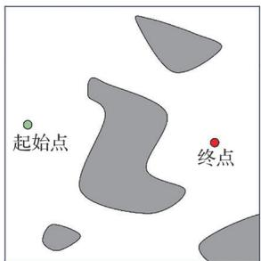  
(a) 规划问题初始化

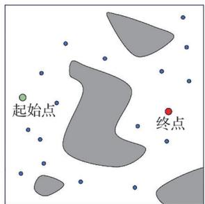  
(b)规划空间随机采样

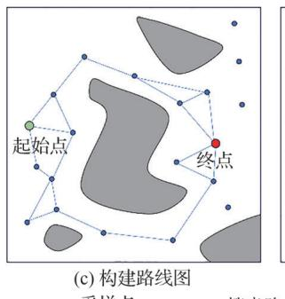

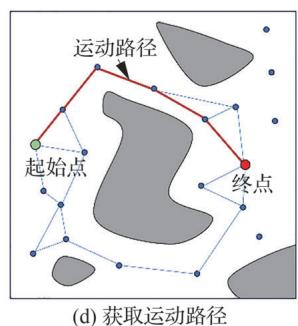  
图12 基于采样的运动规划方法主要过程

Fig. 12 Main process of sampling-based motion planning methods  
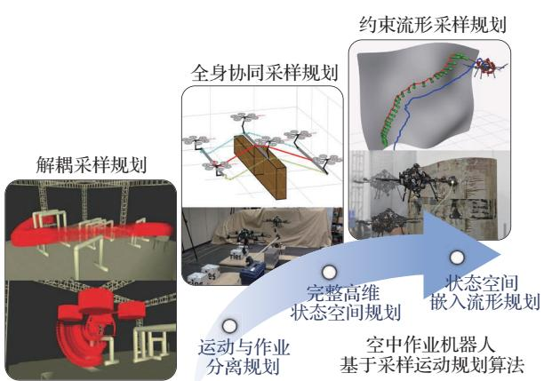  
图13 空中操作机器人基于采样运动规划方法演进  
Fig. 13 Evolutionary progression of sampling-based motion planning strategies for aerial manipulators

不动，单独对飞行平台进行规划，而在机械臂操作阶段仅考虑机械臂的运动规划，将飞行平台视为静止。Yavari 等［57］采用了类似的策略，利用Lazy-Steering-RRT\*实现了面向未知环境的快速在线重规划，使无人机能够在保持机械臂折叠状态下穿越狭窄空间并抵达预抓取位置，再在后续作业阶段主要考虑末端执行器规划完成伸展与抓取。基于解耦的采样运动方法本质上仍属于以到达预抓取位置为目标的空间过渡规划。通过解耦进行规划可以直接分别应用飞行平台与作业机构运动规划算法，将整体状态空间维度进行拆分，大幅降低计算复杂度。但由于飞行过程与作业过程分离。在需要同时进行运动和操作的任务中，将显著降低空中操作机器人的作业效率，限制系统冗余自由度的充分利用。随着作业需求的精细化，规划方法正逐步向全身一体化的协同规划演进。

为更充分地发挥空中操作机器人的性能，实现更为复杂的作业任务。Caballero等［58］通过一体化地考虑无人机与机械臂的运动，重新构建RRT\*算法的空间尺度，实现了双臂空中操作机器人在复杂环境下的抓取运输作业任务与避障任务。在此基础上，考虑到长臂机构与飞行平台之间存在的强动力学耦合效应，Caballero等［77］对框架进行了进一步扩展，提出了具有“动力学感知”能力的规划策略，生成的轨迹不仅在几何上避开了障碍物，还能有效抵御机械臂运动对平台稳定性产生的干扰。Lee等［54］基于 RRT\*框架，并利用 DMP（Dynamic Movement Primitives）方法实现实时避障与重规划，基于主从的架构实现了多机器人协作搬运任务与避障任务。

然而上述问题主要考虑抵达抓取任务以及抓取运输任务，主要任务约束为避障约束，可以通过碰撞检测与拒绝采样规避碰撞。然而当面对持续交互作业时等，此时运动规划问题变为约束运动规划，规划可行空间变为状态空间中的零测度流形，降低了随机采样获取可行解的概率。Tognon等［55］为解决空中机械臂在执行任务约束提出了一种整合控制器的规划方法。该方法直接在约束任务空间中进行规划，并且利用一个由二阶逆运动学算法和轨迹跟踪控制器作为局部规划器，从而在满足滑动接触作业的同时自然地考虑了闭环系统的动力学特性。该团队进一步将该规划方法运用于圆柱形金属管道连续滑动无损检测作业中［29］。针对复杂的非结构曲面，Khedekar 等［59］提出了一种基于 RRT\*算法的接触式导航规划器。该方法直接在环境网格表面进行随机采样，并采用了“虚拟穿透”的方法扩展搜索树。通过将目标点设定在物体表面内部一定深度，利用底层控制器的位置跟踪误差产生维持稳定接触所需的法向力，从而确保了机器人与表面间的物理约束。Zhang等［60］提出了一种集成参数与位形空间信息规划 PCS-FMT\*（Param‐eter Configuration Space Fast Marching Tree），该方法利用非均匀有理 B样条曲面重建技术将高维约束压缩至低维参数空间，并设计了一种重参数化映射策略，有效解决了由于表面剧烈曲率变化导致的参数空间与物理配置空间度量不一致的问题。通过引入状态空间启发式函数引导采样搜索，该算法在大曲率及复杂场景下实现了高效的路径生成与轨迹优化。

综上所述，基于采样的运动规划算法通过将空中操作机器人的运动规划问题转化为高维状态空间中的随机搜索与路径优化问题。依靠状态空间采样特性以及渐进最优性等固有优势，可在非线性构型空间中快速获取连通性，实现满足任务约束的同时快速收敛至全局最优路径。适用于空中操作无人机空中抓取、运输以及曲面滑动检测等任务的运动规划。但由于规划轨迹通过随机搜索实现，对动力学约束的直接处理相对复杂。

## 3. 3 基于优化运动规划方法

基于优化的运动规划方法将空中操作机器人的运动轨迹生成问题转化为多约束条件下的受限非线性规划问题。其核心逻辑是通过构建包含任务时效、能量损耗或控制平顺性等指标的目标函数，并显式引入系统非线性动力学、作动器物理极限、环境避障边界以及作业过程中的交互力约束，利用数值优化算法迭代求解满足所有约束的最优状态序列。该类方法早期在空中操作机器人上的运用主要聚焦于保障运动轨迹连续光滑。随后，为适应持续交互场景，框架逐渐考虑各类针对特定任务几何约束的优化与拓展。面对复杂多变的接触状态，基于优化方法进一步转向更深层次的物理交互优化，如图14所示。

针对空中操作机器人强耦合、欠驱动的特性，如何在高维状态空间中保证轨迹的动态可行性是优化规划的难题之一。Seo等［47］基于序列二次规划（SQP），将无人机六自由度位姿与机械臂关节角进行统一建模，并在平坦输出空间内利用多项式参数化生成轨迹，确保了机器人在满足避障硬约束的前提下，能于开口箱体等狭窄空间内完成局部最优的作业规划。Welde等［61］证明了由四旋翼基座与多关节臂构成的复合系统具有微分平坦性，并提出了一种在任务空间内确保末端轨迹动态可行的规划方法，实现了运动学与动力学约束的同步解算。Zhang等［62］则进一步提出了一种面向末端执行器的耦合规划方法，利用平坦输出及其高阶导数构建多项式轨迹，不仅显著降低了避障包络的保守性，还通过耦合优化实现了基座姿态与机械臂运动的高度协调。

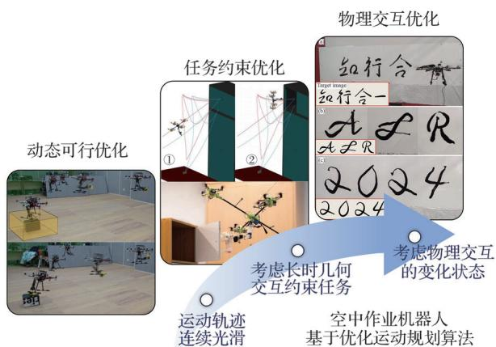  
图14 空中操作机器人基于优化运动规划方法演进  
Fig. 14 Evolutionary progression of optimization-based motion planning strategies for aerial manipulators

在执行复杂的长时序或特定领域任务时，研究者倾向于通过构建专有的运动动力学模型来增强优化框架的描述能力。Su等［63］针对过驱动空中机械臂的顺序作业任务，引入了虚拟运动链框架将基座、作业臂及受控对象统一建模，通过层次化控制与优化实现了多阶段任务的协同。在电力巡检领域，Li等［7］针对空中操作机器人的导线着陆与检测任务，通过构建几何约束模型并采用多点射击非线性规划算法，实现了在 50 ms内生成兼顾巡检视场角与避障安全性的实时轨迹。

随着作业任务向精细化和动态化演进，处理复杂动力学变化，成为优化方法的前沿探索方向。Luo等［64］结合离散变分拉格朗日力学与互补约束，解决了空中机械臂从移动平台抓取包裹时的时刻自动判定与时间最优轨迹优化问题。针对吊挂载荷系统中的绳索张紧切换难题，Wang等［36］提出了一种考虑系统冲击的规划框架，利用增广拉格朗日法高效处理非线性互补约束，确保了复杂机动下规划轨迹的动态可行性。在此基础上，Guo等［12］将该范式进一步拓展至动态接触作业场景，通过接触感知型规划器同时解算表面切向运动轨迹与法向随动压力，在保证物理约束的前提下成功实现了高精度的空中书法作业。

综上所述，基于优化的规划方法通过将轨迹生成建模为多约束非线性规划问题，实现了对复杂动力学与物理边界的显式处理。该方法利用微分平坦理论与互补约束框架，有效解决了强耦合系统在高维空间中的动态可行性与非光滑接触力调节难题。能高效生成高阶连续的最优平滑轨迹，但计算过程对初值较为敏感，且在处理高度非凸环境时存在陷入局部最优的风险。

## 3. 4 基于学习运动规划方法

近年来，随着机器学习尤其是强化学习与模仿学习技术的发展，研究者逐渐尝试将学习方法引入空中操作机器人的运动规划与控制问题中。不同于基于采样的运动规划方法侧重于位形空间的全局搜索，以及基于优化的方法高度依赖精确的解析模型与复杂的数值迭代过程，基于学习的方法展现出显著的数据驱动特征。该方法通过与环境进行大规模的交互反馈或利用专家示范数据，直接在高维状态—动作空间内建立非线性的端到端映射策略。从而在一定程度上规避了复杂动力学建模与约束显式表达的困难。该类方法还进一步扩展到元学习等研究方向，提升学习型规划方法在复杂环境和多任务场景中的适应能力。其在空中操作机器人上的应用发展如图15所示。

在基于强化学习的方法当中，按照是否显式利用系统动力学模型，可以将其大致分为无模型强化学习和有模型强化学习。无模型强化学习方法不依赖对系统动力学或环境模型的精确描述，而是通过试错机制直接优化策略或价值函数，适用于动力学复杂、接触特性难以精确建模的空中操作场景。例如，Cuniato等［65］基于近端策略优化算法［78］学习了空中机械臂开门等接触操作任务的规划控制策略，并将其推广到从未见过真实环境的关门任务上，具有良好的泛化性。然而，对于欠驱的空中飞行平台搭载多自由度机械臂的系统而言，其运动规划与控制问题需要在高维配置空间中同时满足飞行稳定性、机械臂操作可行性以及接触任务约束，平台欠驱特性与机构耦合效应显著，提高了规划问题的复杂度，对规划方法提出了更高要求。针对这一问题，Deshmukh等［66］利用近端策略优化算法训练了欠驱动空中机械臂末端姿态全局规划控制策略，在仿真环境中直接学习飞行平台与机械臂的联合控制命令，并通过底层控制器实现高精度跟踪。该策略不仅实现了厘米级的定位精度和度级的定向精度，在重载操作和推动任务中也具有良好的性能。类似地，Liu等［67］也提出了基于近端策略优化算法的智能规划方法，该方法能够实时对六旋翼无人机飞行平台与二关节机械臂位置姿态进行联合规划，既避免了动力学分析和建模的复杂性，又避免了二者独立规划对机器人本体产生的较大扰动。

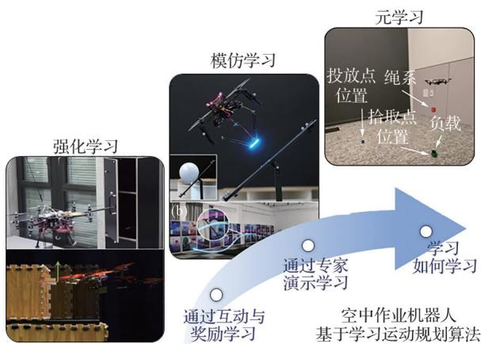  
图 15 空中操作机器人基于学习运动规划方法演进  
Fig. 15 Evolutionary progression of learning-based motion planning strategies for aerial manipulator

与无模型强化学习相比，有模型方法通过建立环境的预测模型，在模型中进行规划或模拟推演，从而显著提高数据利用效率，尤其适用于交互代价高昂或样本获取困难的任务。针对具有未知动力学特性的复杂环境，Dimmig 和 Kobi‐larov［70］采 用 基 于 模 型 的 深 度 强 化 学 习 方 法（Dreamer V3算法［79］）将规划、视觉感知和动态推理紧密结合，在无须依赖复杂的传感器或精确的摩擦模型的条件下，完成变摩擦系数的非抓取式空中操作任务的规划与验证，展示了模型驱动学习在复杂交互任务中的潜力。

强化学习虽然是直接优化任务目标，可以取得良好的效果，但训练时间成本高，奖励函数设计复杂。为了提高训练效率，学者们发展了对专家数据的模仿学习。模仿学习是通过利用人类操作员或高性能控制器提供的示范数据进行策略训练，在奖励函数难以设计或探索风险较高的空中操作任务中具有显著优势。He等［71］提出的统一空中操作框架，以末端执行器为中心的接口，可以将平台无关的高层级决策与任务无关的低级控制解耦。通过遥操作获取专家示范，并结合模仿学习实现自主控制，使系统能够完成书写、孔插入、抓取放置等多种复杂操作任务。Deng等［45］将模仿学习引入空中机械臂全身一体化运动规划框架中，利用灵活的航路点约束来实现多功能作业，采用模仿学习在考虑不同机器人配置、动态可行性和运动学可行性的同时，为空中操作机器人生成可靠的轨迹。

虽然强化学习和模仿学习在机器人控制中取得了显著进展，但这类方法通常需要大量训练数据，并且在环境或任务发生变化时往往需要重新训练策略。为提高机器人在新任务中的适应能力，研究者提出了元学习方法，用数据驱动的方式提高规划的适应性。元学习是通过在多任务或多环境条件下训练策略，使模型能够快速适应新的任务或未知环境。空中操作机器人在实际作业过程中往往需要面对不同的操作对象、接触条件以及外界扰动，传统强化学习策略通常针对单一任务进行训练，泛化能力有限。Belkhale等［80］提出了一种悬挂飞行的元强化学习方法，可以在连接后飞行数据的几秒钟内在线自适应“学习如何学习改变的动力学模型”，并在一系列具有挑战性的悬挂有效载荷运输任务上优于其他非自适应方法。

此外，由于大多数基于学习规划与控制算法需要在仿真环境中进行大规模训练，仿真到真实迁移成为空中机器人学习控制中的关键问题。仿真环境能够提供安全且低成本的数据采集方式，但由于真实系统与仿真模型之间在动力学参数、传感噪声以及空气动力学效应等方面存在差异，直接部署仿真训练得到的策略往往会导致性能下降。为解决这一问题，研究者提出了多种迁移策略，其中最具代表性的是域随机化方法。许多研究人员为了使学习到的策略行为具有鲁棒性，会在其方法中对影响任务成功的关键物理量进行随机化，例如，Cuniato等［65］在开门任务中，在训练中将门把手位置，和机器人末端钩子在手柄框架中的初始姿态和速度均进行域随机化处理。Deshmukh 等［66］也在文中指出需要与对末端执行器质量和关节摩擦进行域随机化，否则会出现策略输出震荡。对于空中操作机器人而言，通过在仿真训练阶段引入动力学参数扰动、风场干扰以及传感噪声等，可以有效缩小仿真与真实系统之间的差距，提高真实飞行平台的部署成功率。

总体而言，基于学习的运动规划方法通过数据驱动的方式，将空中操作机器人的规划问题转化为高维“状态-动作”空间中的策略学习与优化问题，能够在一定程度上规避精确动力学建模与复杂约束显式处理的难题，在接触作业、自适应控制及高耦合操作任务中表现出较强的灵活性与潜力。同时，元学习等新兴研究方向进一步拓展了学习型规划方法的应用范围。然而，基于学习的方法通常依赖大量训练数据，且存在“仿真-现实”迁移问题，策略可解释性与稳定性分析相对困难，复杂环境下的安全性待进一步研究。

## 3. 5 空中操作机器人运动规划方法总结

总的来说，尽管基于优化、采样和学习的运动规划方法为空中操作机器人的发展提供了多样化的解决思路，但在面对复杂环境下的实际作业任务时，现有方法仍具有各自的局限。采样方法的高维空间中搜索过程难以兼顾复杂动力学约束；优化方法对于初值敏感性，如优化过程设置不当易于陷入局部最优值；学习方法则对数据与训练环境有较高依赖，并且存在“仿真-现实”迁移问题，其可靠性仍有待提升。各运动规划算法间的性能对比如表 4［12，45，74，81-85］所示从运动规划的发展历程来看，随着空中作业机器人平台及其机构日趋复杂，系统可控自由度与耦合维度不断提升，作业任务的难度也随之攀升。任务形态已从早期的简单空间抵近、抓取与放置，逐步演变为非结构化环境下、伴随复杂状态切换的连续物理交互。与之相应，规划方法也在协同演进。其发展主要体现在2个方面：在系统状态处理上，从早期的解耦分离全面走向全身一体化的统一；在求解维度上，从满足几何避障的运动学层面逐步向处理特定任务约束与非线性变化的复杂动力学深化。

表4 空中操作机器人运动规划方法对比  
Table 4 Comparison of motion planning methods for aerial operation robots

<table><tr><td>规划方法</td><td>计算复杂度</td><td>实时性</td><td>鲁棒性</td><td>优势</td><td>不足</td></tr><tr><td>基于采样规划方法</td><td>较高</td><td>中等</td><td>强</td><td>无需显示表征不可行状态[74];具备完备理论证明,可全局收敛[81]</td><td>难以直接对动力学约束及接触力进行表征[82]</td></tr><tr><td>基于优化规划方法</td><td>中等</td><td>较高</td><td>中等</td><td>可显式处理动力学约束[12];可生成高阶连续的最优轨迹[45]</td><td>对初值敏感,易于陷入局部最优值[83]</td></tr><tr><td>基于学习规划方法</td><td>低(推理)高(训练)</td><td>高</td><td>较弱</td><td>适应能力和泛化能力强;可避免复杂的系统环境建模[84]</td><td>可解释性差,存在“仿真-现实”模型失配问题[85]</td></tr></table>

## 4 挑战与展望

## 4. 1 现存挑战

空中操作涉及从“自由飞行”到“受限交互”的模态演化。虽然底层控制器在抑制接触瞬间的冲击力方面已有深入研究，但在运动规划层面，现有范式往往将接触过程简化为准静态或预定义序列，忽略了动力学特性变化对轨迹全局稳定性的影响［86］。这种规划与控制在冲击表征上的脱节，使得机器人在面对高动态或长时序交互任务时，难以在规划阶段预判并规避由瞬态冲击引起的系统失稳风险。

随着作业机构自由度的增加以及多机协同任务的引入，系统的构型空间维度显著增长。在有限的机载算力与严格的实时性约束下，如何在保证高质量全局运动规划的同时，兼顾对局部动态环节的快速重规划，仍是当前存在的主要挑战。特别是在多机协同作业中，强耦合约束导致的可行解空间稀疏，现有的算法难以在计算效率与全局最优性之间取得理想平衡［87］。

接触式物理交互对环境参数具有极高的敏感度。在运动规划层面，这些参数直接定义了系统的约束空间边界与动力学平衡状态。然而，非结构化场景中的感知噪声常导致建模参数与实际物理属性存在显著偏差［71］。现有的规划范式多依赖精确的先验模型生成“标称轨迹”，一旦标称模型与实际环境发生失配，规划器生成的路径可能在物理层面变为“不可行解”，因此，如何构建具备参数鲁棒性的在线重规划框架，使规划层能够主动适应时变的物理干涉是目前的技术挑战。

## 4. 2 发展趋势

## 4. 2. 1 仿生空中操作机器人

仿生空中操作机器人通过借鉴自然界生物的结构与运动机理，赋予空中操作机器人更强的环境适应性、作业灵巧性以及能量利用效率。典型的仿生路径包括飞行平台对生物扑翼运动的效仿，以及作业机构对柔性连续体结构的借鉴。

扑翼式仿生空中操作机器人，通过模仿自然界飞行生物的扑动飞行模式如图 16［88-89］所示。相较于传统的旋翼式空中操作机器人，提升长距离巡航能效以及高隐蔽性作业方面展现出显著优势，主要应用于小目标采样与复杂环境下的栖息交互任务［88，90-91］。在运动规划层面，由于其在执行接触作业时涉及俯冲、减速及栖息等连续的非线性过程转换，因此要求规划器满足不同飞行状态下复杂约束，实现平稳的仿生运动轨迹生成。

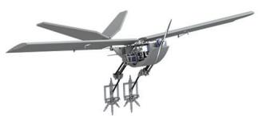  
(a) 抓握型扑翼机器人[88]

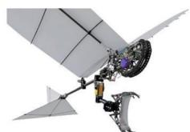  
(b)腿足式仿鸟机器人[89]  
图 16 扑翼空中操作机器人  
Fig. 16 Bio-inspired flapping-wing aerial manipulators

连续体柔性作业机构模仿象鼻、章鱼触手等生物的灵活构型，通过非刚性结构实现复杂空间内的灵巧操作，如图17［92-95］所示。具备连续体特征的仿生机械臂拥有理论上无限维的构型自由度，能够利用机构自身的物理柔顺性补偿接触瞬间产生的瞬态冲击，从而实现对非结构化、脆弱表面等复杂环境的自适应操作［92-95］。然而，连续体机构的大变形特性要求规划算法突破传统的刚体运动学建模假设，探索能够深度融合物理柔顺性、大变形力学与高维几何约束的新型运动规划框架［96］。未来的研究将致力于通过规划手段主动利用机构的物理特性来消解交互扰动，从而在极高自由度约束下实现比传统控制范式更具鲁棒性的柔顺物理交互。

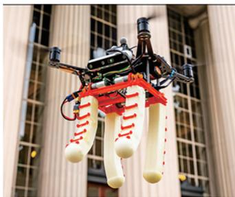  
(a)仿肌腱驱动作业机构[92]

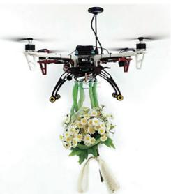  
(b)仿藤蔓卷须作业机构[93]

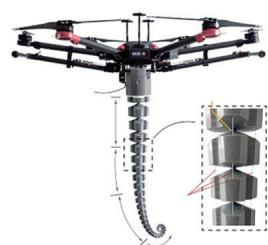  
(c) 仿章鱼触手作业机构[94

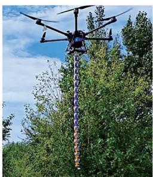  
(c) 仿虾外骨骼作业机构[95]  
图 17 连续体仿生作业臂空中操作机器人  
Fig. 17 Bio-inspired continuum aerial manipulators

## 4. 2. 2 多机协同作业

多机协同作业是突破单机载荷能力瓶颈、提升作业系统冗余度与任务灵活性的重要演进方向。通过多台空中机器人的集群协作，可以实现对大型、重型目标的运输，或在复杂空间内完成单机难以胜任的分布式交互任务，如图 18（a）［87］所示，异构无人机协同作业还能通过不同功能平台的优势互补，实现从工具补给到多阶段复杂任务的自主执行，如图18（b）［25］所示。然而，随着协作单元数量的增加，构型空间维度显著增长。在处理多机间的防碰撞约束与强动力学耦合时，系统的可行解空间将变得稀疏，对运动规划算法带来挑战。

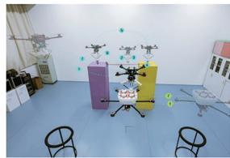  
(a)异构多机协作[87]

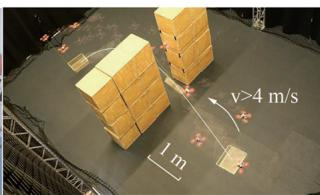  
(b)同构多机协作[25]  
图 18 多机协同作业  
Fig. 18 Multi-aerial manipulator collaboration

## 4. 2. 3 人机协同作业

人机协同作业是提升空中操作系统决策柔性任务灵活性的另一重要演进方向，如图19［97-100］所示，其核心挑战在于实现人类意图识别、高层任务决策与底层运动规划的深度融合。需要将人类操作员的物理意图转化为时变的优化目标或动态边界约束，使机器人具备预判人类动作逻辑并主动调节自身位姿与出力策略的能力。这种深层协同要求运动规划层不仅作为孤立的轨迹生成单元，而是与任务层逻辑决策建立整体闭环，通过力觉、视觉等多模态感知的反馈，在保障人机交互安全前提下，实现高效作业运动规划。

## 4. 2. 4 跨介质空中操作机器人

为进一步拓展空中操作机器人的作业领域，具备跨介质作业能力的新型机器人系统正逐渐成为研究热点。除了传统的空域任务外，这类系统通过改变驱动方式或调整机构构型，能够实现水面漂浮及水下航行等多模态作业，如图 20［101-102］所示。

跨介质作业的核心难点在于不同物理介质下的运动特性存在显著差异，尤其是在穿透水面等临界过程中，系统受到的流体阻力与浮力会发生剧烈波动。如何构建适应多物理场环境的通用运动规划框架，是实现系统自主跨介质作业的关键。上述挑战要求规划器必须能够解决不同介质模态剧烈切换时的轨迹动力学可行性解算问题，根据介质反馈调整轨迹参数，以确保跨越边界时的状态稳定和轨迹平滑。

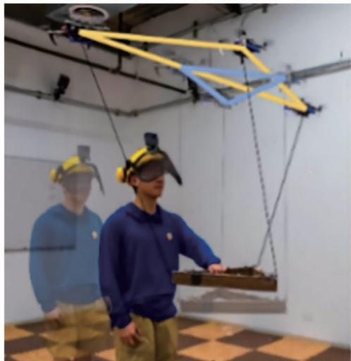

(a)基于意图感知的多无人机协同搬运[97]  
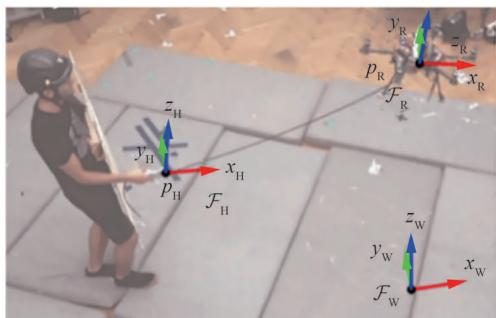  
(b)基于绳系力觉反馈的人机引导作业[98

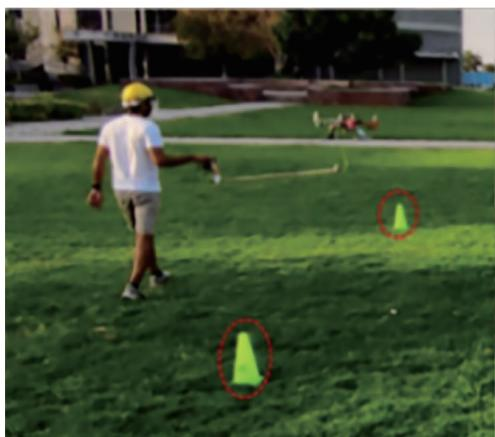

(c)面向载荷运输的物理人机协同[99]  
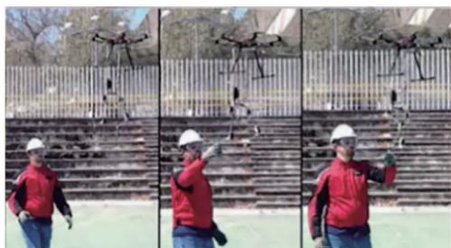  
(d)具备柔顺特性的双臂人机支互操作[100]  
图 19 人机协同作业  
Fig. 19 Human-aerial manipulator collaboration

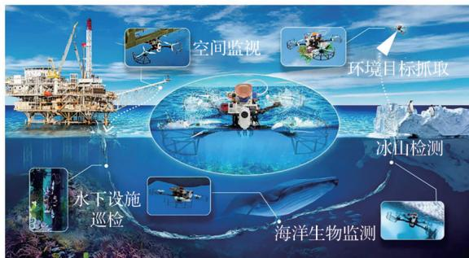  
(a)仿鲫鱼吸跨介质空中操作机器人[101]

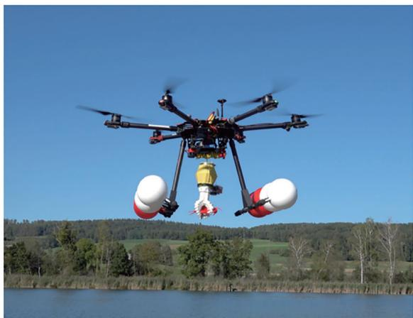  
(b)空投式抓取跨介质空中操作机器人[102  
图 20 跨介质空中操作机器人  
Fig. 20 Aerial-aquatic manipulators

## 5　结 论

空中操作机器人作为机器人技术由“被动感知”向“主动作业”演进的关键载体，在复杂环境交互任务中展现出巨大的应用潜力。其核心运动规划算法主要包括基于采样、优化及学习类规划算法，这些算法分别从高维构型空间的全局寻优、复杂非线性约束的精确解析以及未知环境下的策略泛化等维度，为空中操作任务的作业轨迹生成供了多样的理论支撑与实现途径。尽管当前研究在特定作业任务下已取得突破，但在机载算力受限下的实时重规划效率、物理交互瞬间的瞬态冲击抑制，以及非结构化场景中针对环境参数失配的鲁棒性等方面仍面临严峻挑战。展望未来，接触式空中操作将融合仿生机构，探索多机、人机协同作业范式，拓展空中操作机器人工作领域，实现更具泛用性与智能化的自主物理交互。

## 参 考 文 献

［1］ CAO M Q， NGUYEN T M， YUAN S H， et al. Coop‐erative aerial robot inspection challenge： A benchmarkfor heterogeneous multi-uncrewed-aerial-vehicle plan‐ning and lessons learned［J］. IEEE Robotics & Automa‐tion Magazine，2025（99）： 2-13.

［2］ LU X Y， ZHOU Y， MAI J Y， et al. Event-based visual-inertial state estimation for high-speed maneuvers［J］.IEEE Transactions on Robotics，2025，41：4439-4458.

［3］ ZHOU X， WEN X Y， WANG Z P， et al. Swarm of mi‐cro flying robots in the wild［J］. Science Robotics，2022，7（66）： eabm5954.

［4］ LU J J， ZHANG X W， SHEN H M， et al. You onlyplan once： A learning-based one-stage planner with guid‐ance learning［J］. IEEE Robotics and Automation Let‐ters，2024， 9（7）：6083-6090.

［5］ ZHONG H， LIANG J C， CHEN Y J， et al. Prototype，modeling， and control of aerial robots with physical inter‐action： A review［J］. IEEE Transactions on AutomationScience and Engineering，2025，22：3528-3542.

［6］ OLLERO A， TOGNON M， SUAREZ A， et al. Past，present， and future of aerial robotic manipulators［J］.IEEE Transactions on Robotics，2022，38（1）：626-645.

［7］ LI Z S， TIAN Y N， YANG G D， et al. Model-based tra‐jectory planning of a hybrid robot for powerline inspection［J］. IEEE Robotics and Automation Letters，2024， 9（4）：3443-3450.

［8］ PFÄNDLER P， BODIE K， CROTTA G， et al. Non-destructive corrosion inspection of reinforced concretestructures using an autonomous flying robot［J］. Automa‐tion in Construction，2024，158：105241.

［9］ SUN Y S， JING Z L， DONG P， et al. A switchable un‐manned aerial manipulator system for window-cleaningrobot installation［J］. IEEE Robotics and AutomationLetters，2021， 6（2）：3483-3490.

［10］ 杨斌，何玉庆，韩建达，等. 作业型飞行机器人研究现状与展望［J］. 机器人，2015，37（5）：628-640.YANG B， HE Y Q， HAN J D， et al. Survey on aerialmanipulator systems［J］. Robot，2015，37（5）：628-640（in Chinese）.

［11］ LIANG J C， CHEN Y J， WU Y N， et al. Active physi‐cal interaction control for aerial manipulator based on ex‐ternal wrench estimation［J］. IEEE/ASME Transactionson Mechatronics，2023，28（5）：2774-2785.

［12］ GUO X F， HE G Q， XU J H， et al. Flying calligrapher：Contact-aware motion and force planning and control foraerial manipulation［J］. IEEE Robotics and AutomationLetters，2024， 9（12）：11194-11201.

［13］ MOHIUDDIN A， TAREK T， ZWEIRI Y， et al. A sur‐vey of single and multi-UAV aerial manipulation［J］. Un‐manned Systems，2020， 8（2）：119-147.

［14］ 宋光明，郝爽，纪梓潮，等. 接触作业型飞行机械臂研究进展［J］. 机械工程学报，2025，61（3）：197-211.SONG G M， HAO S， JI Z C， et al. Research progressof aerial manipulators for contact-based operations［J］.Journal of Mechanical Engineering，2025，61（3）：197-211（in Chinese）.

［15］ ZHOU X D， ZHONG H， ZHANG H， et al. Current sta‐tus， challenges， and prospects for new types of aerial ro‐bots［J］. Engineering，2024，41：19-34.

［16］ POUNDS P E I， DOLLAR A. Hovering stability of heli‐copters with elastic constraints［C］∥ ASME 2010 Dy‐namic Systems and Control Conference， New York：ASME，2011：781-788.

［17］ JI S L， WANG Y X， HE X. Flipping an upright-inverted bimodal bicopter UAV： Attitude control and op‐timization［J］. IEEE/ASME Transactions on Mechatron‐ics，2025，30（6）：5063-5073.

［18］ WATSON R， KAMEL M， ZHANG D Y， et al. Drycoupled ultrasonic non-destructive evaluation using anover-actuated unmanned aerial vehicle［J］. IEEE Trans‐actions on Automation Science and Engineering，2022，19（4）：2874-2889.

［19］ RODERICK W R T， CUTKOSKY M R， LENTINKD. Bird-inspired dynamic grasping and perching in arbo‐real environments［J］. Science Robotics，2021， 6（61）：eabj7562.

［20］ SUAREZ A， HEREDIA G， OLLERO A. Design of ananthropomorphic， compliant， and lightweight dual armfor aerial manipulation ［J］. IEEE Access， 2018， 6：29173-29189.

［21］ POZDERAC T， VELAGIĆ J， OSMANKOVIĆ D. 3D mapping based on fusion of 2D laser and IMU data acquired by unmanned aerial vehicle［C］∥ 2019 6th International Conference on Control， Decision and Information Technologies （CoDIT）. 2019：1533-1538.

［22］ KIM M J， KONDAK K， OTT C. A stabilizing control‐ler for regulation of UAV with manipulator［J］. IEEE Ro‐botics and Automation Letters，2018， 3（3）：1719-1726.

［23］ MAHONY R， KUMAR V， CORKE P. MultirotorAerial vehicles： Modeling， estimation， and control ofquadrotor［J］. IEEE Robotics & Automation Magazine，2012，19（3）：20-32.

［24］ OHNISHI Y， TAKAKI T， AOYAMA T， et al. Development of a 4-joint 3-DOF robotic arm with antireaction force mechanism for a multicopter［C］∥ 2017 IEEE/RSJ International Conference on Intelligent Ro‐

bots and Systems （IROS）. Piscataway： IEEE Press，2017：985-991.

［25］ CAO H Z， SHEN J H， ZHANG Y， et al. Proximal co‐operative aerial manipulation with vertically stackeddrones［J］. Nature，2025，646（8085）：576-583.

［26］ LI H， ZHONG H， GAO J， et al. A nonlinear trajectorytracking control strategy for quadrotor with suspendedpayload based on force sensor［J］. IEEE Transactions onIntelligent Vehicles，2024， 9（1）：704-714.

［27］ RYLL M， MUSCIO G， PIERRI F， et al. 6D interactioncontrol with aerial robots： The flying end-effector para‐digm［J］. International Journal of Robotics Research，2019，38（9）：1045-1062.

［28］ NAVA G， SABLÉ Q， TOGNON M， et al. Direct forcefeedback control and online multi-task optimization foraerial manipulators［J］. IEEE Robotics and AutomationLetters，2020， 5（2）：331-338.

［29］ TOGNON M， CHÁVEZ H A T， GASPARIN E， et al.A truly-redundant aerial manipulator system with applica‐tion to push-and-slide inspection in industrial plants［J］.IEEE Robotics and Automation Letters，2019， 4（2）：1846-1851.

［30］ VIGURIA A， CABALLERO R， PETRUS Á， et al.Aerial robotic system for complete bridge inspections［C］∥ Advances in Road Infrastructure and Mobility.Cham： Springer，2022：171-186.

［31］ BRUNNER M， GIACOMINI L， SIEGWART R， et al.Energy tank-based policies for robust aerial physical inter‐action with moving objects［C］∥ 2022 International Con‐ference on Robotics and Automation （ICRA）. Piscat‐away： IEEE Press，2022：2054-2060.

［32］ BENZI F， BRUNNER M， TOGNON M， et al. Adap‐tive tank-based control for aerial physical interaction withuncertain dynamic environments using energy-task esti‐mation［J］. IEEE Robotics and Automation Letters，2022， 7（4）：9129-9136.

［33］ BROERS K C V， ARMANINI S F. Repeatable energy-efficient perching for flapping-wing robots using soft-grippers［J］. Bioinspiration & Biomimetics， 2025， 20（6）：066017.

[34] MEHANOVIC D BASS L COURTEAU T et al Atonomous thrust-assisted perching of a fixed-wing UAV on vertical surfaces［C］∥ Biomimetic and Biohybrid Systems. Cham： Springer，2017：302-314.

［35］ MAT A R， HOW L M， ARIFF O K， et al. Autonomous aerial hard docking of fixed and rotary wing UAVs： Task assessment and solution architecture［J］. Applied Mechanics and Materials，2014，629：176-181.

［36］ WANG H K， LI H J， ZHOU B Y， et al. Impact-aware

planning and control for aerial robots with suspended payloads［J］. IEEE Transactions on Robotics，2024，40： 2478-2497.

［37］ FOEHN P， FALANGA D， KUPPUSWAMY N， et al.Fast trajectory optimization for agile quadrotor maneu‐vers with a cable-suspended payload［C］∥ Robotics： Sci‐ence and Systems XIII. 2017.

［38］ LIANG X， YU H， ZHANG Z， et al. Unmanned aerialtransportation system with flexible connection betweenthe quadrotor and the payload： Modeling， controller de‐sign， and experimental validation［J］. IEEE Transactionson Industrial Electronics，2023，70（2）：1870-1882.

［39］ KUMAR A， BEHERA L. Thrust microstepping via ac‐celeration feedback in quadrotor control for aerial grasp‐ing of dynamic payload［J］. IEEE Robotics and Automa‐tion Letters，2024， 9（2）：1246-1253.

［40］ BRESCIANINI D， D’ANDREA R. Computationally ef‐ficient trajectory generation for fully actuated multirotorvehicles［J］. IEEE Transactions on Robotics，2018，34（3）：555-571.

［41］ 顾玥，宋光明，郝爽，等. 一种用于接触作业的全驱动旋翼飞行机械臂设计与实现［J］. 机器人，2023，45（5）：523-531，545.GU Y， SONG G M， HAO S， et al. Design and imple‐mentation of a fully actuated rotor aerial manipulator forcontact operations［J］. Robot，2023，45（5）：523-531，545（in Chinese）.

［42］ LI Z， YANG Y P， YU X H， et al. Fixed-time control of a novel thrust-vectoring aerial manipulator via high-order fully actuated system approach［J］. IEEE/ASME Transactions on Mechatronics，2025，30（2）：1084-1095.

［43］ ZHANG G Y， HE Y Q， YANG L Y， et al. An aerialmanipulator for robot-to-robot torch-relay task： Systemdesign and control scheme［J］. IEEE Robotics & Automa‐tion Magazine，2024，31（2）：54-65.

［44］ 王营华，宋光明，刘盛松，等. 一种视觉引导的作业型飞行机器人设计［J］. 机器人，2019，41（3）：353-361.WANG Y H， SONG G M， LIU S S， et al. Design of avision-guided aerial manipulator［J］. Robot， 2019， 41（3）：353-361（in Chinese）.

［45］ DENG W L， CHEN H M， YE B Y， et al. Whole-bodyintegrated motion planning for aerial manipulators［J］.IEEE Transactions on Robotics，2025，41：6661-6679.

［46］ CUNIATO E， GECKELER C， BRUNNER M， et al.Design and control of a micro overactuated aerial robotwith an origami delta manipulator［C］∥ 2023 IEEE International Conference on Robotics and Automation （ICRA）.Piscataway： IEEE Press，2023：5352-5358.

［47］ SEO H， KIM S， KIM H J. Locally optimal trajectory

planning for aerial manipulation in constrained environ‐ments［C］∥ 2017 IEEE/RSJ International Conference onIntelligent Robots and Systems （IROS）. Piscataway：IEEE Press，2017：1719-1724.

［48］ LIANG J， ZHONG H， WANG Y， et al. Adaptive forcetracking impedance control for aerial interaction in uncer‐tain contact environment using barrier function［J］. IEEETransactions on Automation Science and Engineering，2024，21（3）：4720-4731.

［49］ GABRICH B， SALDAÑA D， KUMAR V， et al. A fly‐ing gripper based on cuboid modular robots［C］∥ 2018IEEE International Conference on Robotics and Automa‐tion （ICRA）. Piscataway： IEEE Press， 2018： 7024-7030.

［50］ ZHAO M J， OKADA K， INABA M. Versatile articu‐lated aerial robot DRAGON： Aerial manipulation andgrasping by vectorable thrust control［J］. InternationalJournal of Robotics Research，2023，42（4-5）：214-248.

［51］ WU Y Z， YANG F， JIN R， et al. Hand-like autono‐mous flying robot for airborne grasping and interaction［J］. Nature Communications，2026，17：2200.

［52］ PENG R， WANG Z， LU P. AeCoM： An aerial con‐tinuum manipulator with IMU-based kinematic modelingand tendon-slacking prevention［J］. IEEE Transactionson Systems， Man， and Cybernetics： Systems，2023，53（8）：4740-4752.

［53］ ZHANG D Y， WATSON R， DOBIE G， et al. Autono‐mous ultrasonic inspection using unmanned aerial vehicle［C］∥ 2018 IEEE International Ultrasonics Symposium（IUS）. Piscataway： IEEE Press，2018： 1-4.

［54］ LEE H， KIM H， KIM H J. Planning and control forcollision-free cooperative aerial transportation［J］. IEEETransactions on Automation Science and Engineering，2018，15（1）：189-201.

［55］ TOGNON M， CATALDI E， CHAVEZ H A T， et al.Control-aware motion planning for task-constrainedaerial manipulation［J］. IEEE Robotics and AutomationLetters，2018， 3（3）：2478-2484.

［56］ RAGEL R， MAZA I， CABALLERO F， et al. Compari‐son of motion planning techniques for a multi-rotor UASequipped with a multi-joint manipulator arm［C］∥ 2015Workshop on Research， Education and Development ofUnmanned Aerial Systems （RED-UAS）. Piscataway：IEEE Press，2016：133-141.

［57］ YAVARI M， GUPTA K， MEHRANDEZH M. Inter‐leaved predictive control and planning for an unmannedaerial manipulator with on-the-fly rapid re-planning in un‐known environments［J］. IEEE Transactions on Automa‐tion Science and Engineering，2023，20（3）：1690-1705.

［58］ CABALLERO A， SUAREZ A， REAL F， et al. First experimental results on motion planning for transportation in aerial long-reach manipulators with two arms ［C］∥ 2018 IEEE/RSJ International Conference on Intelligent Robots and Systems （IROS）. Piscataway： IEEE Press，2019：8471-8477.

［59］ KHEDEKAR N， MASCARICH F， PAPACHRISTOSC， et al. Contact-based navigation path planning foraerial robots［C］∥ 2019 International Conference on Ro‐botics and Automation （ICRA）. Piscataway： IEEEPress，2019：4161-4167.

［60］ ZHANG Z X， ZHONG H， LIN C Q， et al. Parameter‐ized motion planning for aerial manipulators in contactwith unstructured surfaces［C］∥ 2025 IEEE/RSJ Interna‐tional Conference on Intelligent Robots and Systems（IROS）. Piscataway： IEEE Press，2025：5401-5406.

［61］ WELDE J， PAULOS J， KUMAR V. Dynamically fea‐sible task space planning for underactuated aerial manipu‐lators ［J］. IEEE Robotics and Automation Letters，2021， 6（2）：3232-3239.

［62］ ZHANG Z P， YU H， CHAI Y， et al. An end-effector-oriented coupled motion planning method for aerial ma‐nipulators in constrained environments［J］. IEEE/ASMETransactions on Mechatronics，2025，30（6）：6027-6037.

［63］ SU Y， LI J R， JIAO Z Y， et al. Sequential manipulationplanning for over-actuated unmanned aerial manipulators［C］∥ 2023 IEEE/RSJ International Conference on Intel‐ligent Robots and Systems （IROS）. Piscataway： IEEEPress，2023：6905-6911.

［64］ LUO W， CHEN J S， EBEL H， et al. Time-optimal han‐dover trajectory planning for aerial manipulators based ondiscrete mechanics and complementarity constraints［J］.IEEE Transactions on Robotics，2023，39（6）：4332-4349.

［65］ CUNIATO E， GELES I， ZHANG W X， et al. Learn‐ing to open doors with an aerial manipulator［C］∥ 2023IEEE/RSJ International Conference on Intelligent Ro‐bots and Systems （IROS）. Piscataway： IEEE Press，2023：6942-6948.

［66］ DESHMUKH S， ALONSO-MORA J， SUN S H.Global end-effector pose control of an underactuatedaerial manipulator via reinforcement learning［DB/OL］.arXiv preprint：2512.21085；2025.

［67］ LIU H Y， GUO P， JIN X Y， et al. An intelligent plan‐ning method for the multi-rotor manipulation robot withreinforcement learning［C］∥ 2022 IEEE InternationalConference on Mechatronics and Automation （ICMA）.Piscataway： IEEE Press，2022：1028-1033.

［68］ JIA J D， GUO K X， WANG Y Y， et al. FORESEER：

Recognize and utilize uncertainties by integrating databased learning and symbolic feedback［J］. The International Journal of Robotics Research，2025：02783649251364000.

［69］ HUANG Z K， NIU X Z， CHAI B W， et al. Swooper：Learning high-speed aerial grasping with a simple gripper［J］. IEEE Robotics and Automation Letters，2026，11（2）：2298-2305.

［70］ DIMMIG C A， KOBILAROV M. Non-prehensile aerialmanipulation using model-based deep reinforcementlearning［C］∥ 2024 IEEE 20th International Conferenceon Automation Science and Engineering （CASE）. Piscat‐away： IEEE Press，2024：2194-2200.

［71］ HE G Q， GUO X F， TANG L Y， et al. Flying hand： End-effector-centric framework for versatile aerial manipulation teleoperation and policy learning［C］∥ Robotics： Science and Systems XXI.

［72］ KICKI P， LIU P Z， TATEO D， et al. Fast kinodynamicplanning on the constraint manifold with deep neural net‐works［J］. IEEE Transactions on Robotics，2024，40：277-297.

［73］ KARAMAN S， FRAZZOLI E. Sampling-based algo‐rithms for optimal motion planning［J］. International Journal of Robotics Research，2011，30（7）：846-894.

［74］ ORTHEY A， CHAMZAS C， KAVRAKI L E.Sampling-based motion planning： A comparative review［J］. Annual Review of Control， Robotics， and Autono‐mous Systems，2024， 7：285-310.

［75］ LAVALLE S M， KUFFNER J J. Randomized kinody‐namic planning［C］∥ Proceedings 1999 IEEE Interna‐tional Conference on Robotics and Automation. Piscat‐away： IEEE Press，2002：473-479.

［76］ KAVRAKI L E， SVESTKA P， LATOMBE J C， et al.Probabilistic roadmaps for path planning in high-dimensional configuration spaces［J］. IEEE Transactionson Robotics and Automation，1996，12（4）：566-580.

［77］ CABALLERO A， BEJAR M， RODRIGUEZ-CASTAÑOA， et al. Motion planning with dynamics awareness forlong reach manipulation in aerial robotic systems withtwo arms［J］. International Journal of Advanced RoboticSystems，2018，15（3）：1729881418770525.

［78］ SCHULMAN J， WOLSKI F， DHARIWAL P， et al.Proximal policy optimization algorithms［DB/OL］. arXivpreprint：1707.06347；2017.

［79］ HAFNER D， PASUKONIS J， BA J， et al. Masteringdiverse control tasks through world models［J］. Nature，2025，640（8059）：647-653.

［80］ BELKHALE S， LI R， KAHN G， et al. Model-based meta-reinforcement learning for flight with suspended payloads［J］. IEEE Robotics and Automation Letters，

2021， 6（2）：1471-1478.

［81］ GAMMELL J D， STRUB M P. Asymptotically optimalsampling-based motion planning methods［J］. Annual Re‐view of Control， Robotics， and Autonomous Systems，2021， 4：295-318.

［82］ VERGINIS C K， DIMAROGONAS D V， KAVRAKIL E. KDF： Kinodynamic motion planning via geometricsampling-based algorithms and funnel control［J］. IEEETransactions on Robotics，2023，39（2）：978-997.

［83］ ZHAO Z G， CHENG S， DING Y， et al. A survey ofoptimization-based task and motion planning： From clas‐sical to learning approaches［J］. IEEE/ASME Transac‐tions on Mechatronics，2025，30（4）：2799-2825.

［84］ CARVALHO J， LE A T， KICKI P， et al. Motion plan‐ning diffusion： Learning and adapting robot motion plan‐ning with diffusion models［J］. IEEE Transactions on Ro‐botics，2025，41：4881-4901.

［85］ SALVATO E， FENU G， MEDVET E， et al. Crossingthe reality gap： A survey on sim-to-real transferability ofrobot controllers in reinforcement learning［J］. IEEE Ac‐cess，2021， 9：153171-153187.

［86］ LIU Z C， LU Z Y， AGHA-MOHAMMADI A A， et al.Contact-prioritized planning of impact-resilient aerial ro‐bots with an integrated compliant arm［J］. IEEE/ASMETransactions on Mechatronics，2023，28（4）：2064-2072.

［87］ SUN S H， WANG X R， SANALITRO D， et al. Agileand cooperative aerial manipulation of a cable-suspendedload［J］. Science Robotics，2025，10（107）： eadu8015.

［88］ ZUFFEREY R， TORMO-BARBERO J， FELIU-TALEGÓN D， et al. How ornithopters can perch autono‐mously on a branch［J］. Nature Communications，2022，13：7713.

［89］ SHIN W D， PHAN H V， DALEY M A， et al. Fastground-to-air transition with avian-inspired multifunc‐tional legs［J］. Nature，2024，636（8041）：86-91.

［90］ DURÁN R G， TAPIA R， NEKOO S R， et al.Flapping-wing flying robot with integrated dual-armscissors-type flora sampling system［C］∥ 2025 IEEE In‐ternational Conference on Robotics and Automation（ICRA）. Piscataway： IEEE Press，2025：7512-7518.

［91］ ASKARI M， BENCIOLINI M， PHAN H V， et al.Crash-perching on vertical poles with a hugging-wing ro‐bot［J］. Communications Engineering，2024， 3：98.

［92］ UBELLACKER S， RAY A， BERN J M， et al. High-speed aerial grasping using a soft drone with onboard per‐ception［J］. npj Robotics，2024， 2： 5.

［93］ GUO X Y， TANG W， QIN K C， et al. Powerful UAVmanipulation via bioinspired self-adaptive soft selfcontained gripper［J］. Science Advances，2024，10（19）：

eadn6642.

［94］ WANG Z C， FRERIS N M， WEI X. SpiRobs： Logarith‐mic spiral-shaped robots for versatile grasping acrossscales［J］. Device，2025， 3（4）：100646.

［95］ FU K J， WU X S， YU S Q， et al. Origami exoskeletonsfor enhanced soft robotic manipulation［J］. Science Ad‐vances，2025，11（31）： eadv6629.

［96］ PENG R， WANG Y， LU M H， et al. A dexterous andcompliant aerial continuum manipulator for cluttered andconstrained environments［J］. Nature Communications，2025，16：889.

［97］ LI G R， LIU X Y， LOIANNO G. Human-aware physi‐cal human-robot collaborative transportation and manipu‐lation with multiple aerial robots［J］. IEEE Transactionson Robotics，2025，41：762-781.

［98］ TOGNON M， ALAMI R， SICILIANO B. Physicalhuman-robot interaction with a tethered aerial vehicle：

Application to a force-based human guiding problem［J］.IEEE Transactions on Robotics，2021，37（3）：723-734.

［99］ PRAJAPATI P， VASHISTA V. Aerial physical humanrobot interaction for payload transportation［J］. IEEE Ro‐botics and Automation Letters，2023， 8（8）：4903-4910.

［100］SUAREZ A， REAL F， VEGA V M， et al. Compliantbimanual aerial manipulation： Standard and long reachconfigurations［J］. IEEE Access，2020， 8：88844-88865.

［101］LI L， WANG S Q， ZHANG Y Y， et al. Aerial-aquaticrobots capable of crossing the air-water boundary andhitchhiking on surfaces［J］. Science Robotics，2022， 7（66）： eabm6695.

［102］ROMANELLO L， AMIR D J， STENGEL H， et al.Gotta catch’em all， safely！ Aerial-deployed soft under‐water gripper［C］∥ 2024 IEEE 7th International Confer‐ence on Soft Robotics （RoboSoft）. Piscataway： IEEEPress，2024：615-622.

（责任编辑：宋金超）

# Research progress and prospect of motion planning technology for aerial manipulators

ZHANG Zhixing1， ZHONG Hang1，2，3， ZHANG Caixia4， LIANG Jiacheng1， LIU Lanlan5， WANG Yaonan1，\*

1. College of Artificial Intelligence and Robotics， Hunan University， Changsha 410082， China

2. Greater Bay Aera Institute for Innovation，Hunan University， Guangzhou 511340， China

3. Jiangxi Communication Terminal Industry Technology Research Institute Co. ， Ltd. Ji’an 343000， China

4. College of Electrical and Information Engineering， Hunan University， Changsha 410082， China

5. UHV Transmission Company， State Grid Hunan Electric Power Co. ， Ltd. Changsha 410004， China

Abstract：By establishing continuous or transient physical contact with the environment， aerial manipulators have expanded from traditional information acquisition platforms to complex interactive systems with active operation capabili ties， evolving from “passive sensing” to “active operation”. They have broad application prospects in complex interaction scenarios of large-scale energy and transportation infrastructure such as bridges， power grids， and oil and gas pipelines. Compared with non-contact flight operations， contact operations involve significant dynamic coupling， contact force constraints， and multi-modal motion switching. The introduced high-dimensional nonlinear constraints limit the feasible solution space of motion planning and restrict the autonomy and stability of the system . To address these challenges， this paper systematically reviews the research progress in the field of motion planning for aerial manipula ⁃ tors. Firstly， starting from the system architecture， this paper analyzes the influences of various flight platform configurations and operation mechanisms on the plannable space and operation capability. Secondly， it summarizes system modeling methods for motion planning， contact dynamics modeling， and various task planning constraints. On this basis， focusing on the planning requirements of contact operation tasks， three mainstream types of motion planning algorithms， namely sampling-based， optimization-based， and learning-based algorithms， are introduced respectively. Their development trends are analyzed， and their applicability and limitations in high-dimensional state search， dynamic constraint handling， and real-time replanning are compared. Finally， the challenges faced by aerial manipulators are summarized and future development trends are prospected.

Keywords：aerial manipulators；multirotor aerial robots；motion planning；contact operation；system modeling